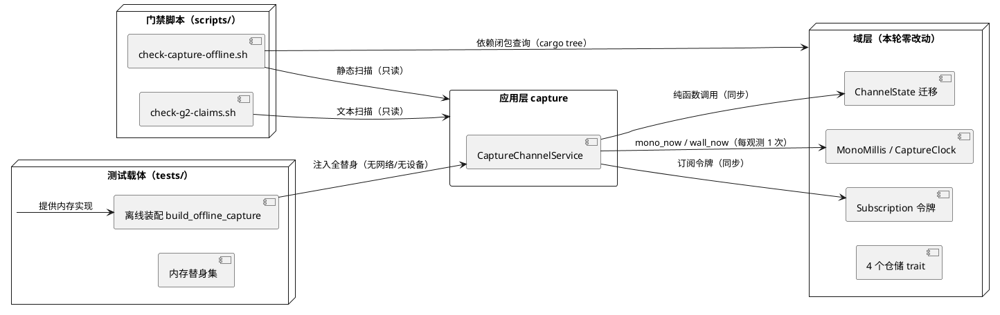
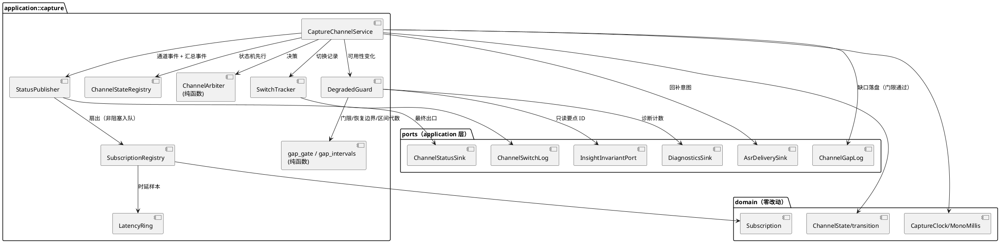
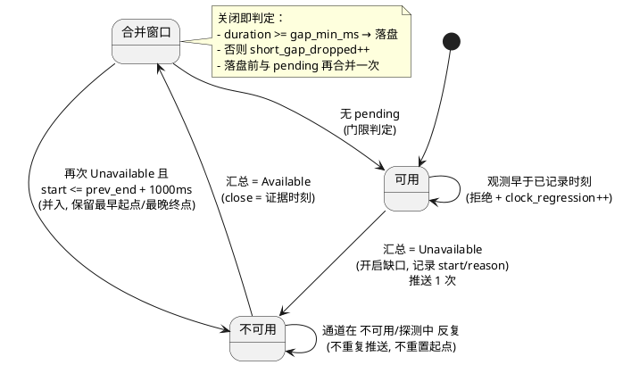
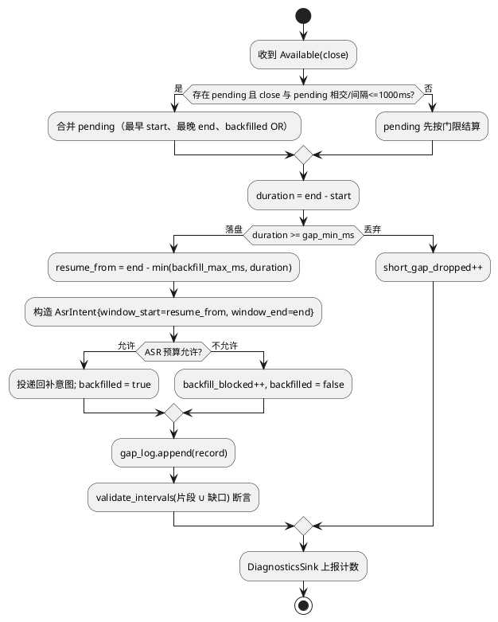
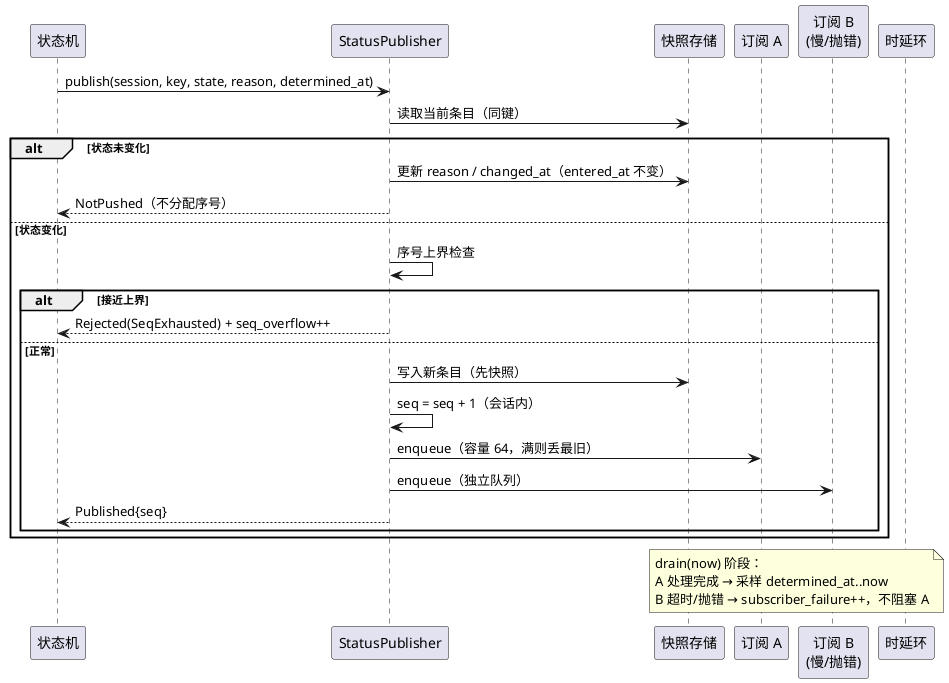
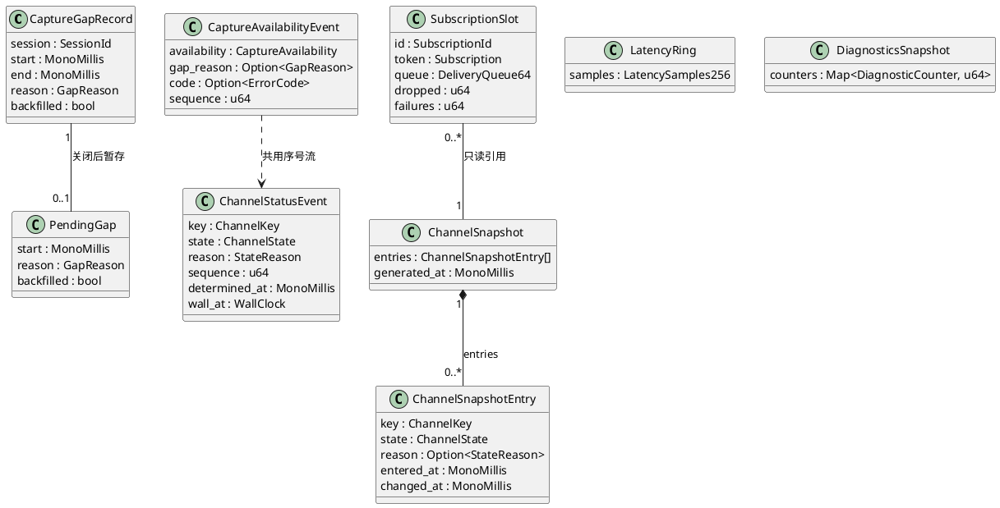
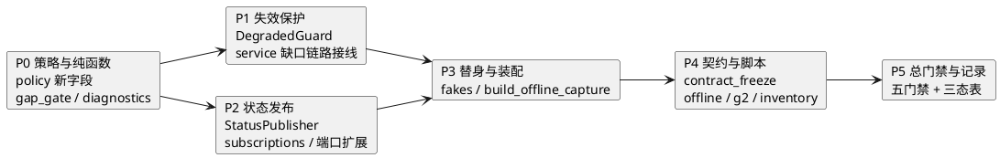

# 一、需求与存量功能关系分析

> 输入依据：`.codeartsdoer/specs/b2_offline_closure/spec.md`（第 8 章 AC-B2-OC-01~F06、第 9 章 X1~X10/D1~D5）、`docs/sdd/design.md`（2.1.3(2)、2.2.2 A、2.3.2、2.5.4）、`docs/sdd/tasks.md`（23.3/23.4/阶段 F）、`docs/progress/b2-status.md`。
> 代码事实基线（本轮校核）：workspace 实测 329 passed / 0 failed / 8 ignored；`capture` 相关 25 用例；隔离临时目录执行。
> 追溯原则：本设计只做"范围收敛 + 可判定化 + 增量装配"，不重定义既有 `AC-B2-23-*` 行为口径（spec 9.1）。

## 1.1 需求功能与存量功能对比

### 1.1.1 已实现功能

| 需求功能 | 存量功能 | 代码位置 | 匹配度 |
|---|---|---|---|
| 通道四状态与合法迁移（W-C/W-D 共用底座） | `ChannelKind` / `ChannelState` / `ChannelKey` / `legal_targets` / `transition` | `crates/domain/src/model/channel.rs:18,37,69,221,232` | 100% |
| 封闭原因码（状态 14 / 切换 9 / 缺口 2） | `StateReason::ALL` / `SwitchReason::ALL` / `GapReason` | `crates/domain/src/model/channel.rs:106,145,174` | 100% |
| 单调时刻类型（全部阈值判定载体） | `MonoMillis` | `crates/domain/src/vo/time.rs:69` | 100% |
| 可注入时钟端口（禁用系统时间） | `CaptureClock::mono_now/wall_now` | `crates/domain/src/port/capture_clock.rs:7` | 100% |
| 通道实例注册表与快照 | `ChannelStateRegistry::attach_session/observe/snapshot` | `crates/application/src/capture/channel_state.rs:89,124,168,201` | 75% |
| 仲裁决策表与 5s 回退 / 10s 切回 | `decide` / `subtitle_fallback_due` / `stable_switch_back_due` | `crates/application/src/capture/channel_arbiter.rs` | 100% |
| 切换记录（初选语义、写失败不回滚） | `SwitchTracker::on_decision` | `crates/application/src/capture/switch_log.rs:20` | 75% |
| 同毫秒切换合并（纯函数） | `merge_same_millisecond` | `crates/application/src/capture/switch_log.rs:84` | 50% |
| 缺口区间合并（纯函数、按会话、容差） | `merge_gaps` | `crates/application/src/capture/capture_gap.rs:11` | 75% |
| 缺口启停与回补投递 | `CaptureChannelService::handle_gap` | `crates/application/src/capture/service.rs:263` | 50% |
| 恢复账本（要点去重、缺口开始/结束） | `CaptureResumeLedger` | `crates/application/src/capture/capture_resume.rs:9,47,56` | 50% |
| ASR 回补预算与抖动抑制 | `AsrBudget::try_issue` / `JitterSuppressor` | `crates/application/src/capture/capture_budget.rs` | 100% |
| 服务门面（装配/观测/可用性/快照） | `attach_session` / `observe` / `availability` / `snapshot` | `crates/application/src/capture/service.rs:96,163,489,514` | 75% |
| 5s 无有效文本回退（无真实睡眠） | `advance_to` | `crates/application/src/capture/service.rs:387` | 75% |
| 通道状态单向发布 | `publish_status` + `ChannelStatusSink::publish` | `service.rs:233` / `capture_ports.rs:17` | 50% |
| 缺口语义 DTO（事件 6 字段 / 快照 5 字段 / 缺口 5 字段） | `ChannelStatusEvent` / `ChannelSnapshotEntry` / `CaptureGapRecord` | `crates/application/src/capture/types.rs:62,72,110` | 75% |
| 阈值配置与构造期校验 | `CapturePolicy` / `validate` | `crates/application/src/capture/types.rs:175,222` | 75% |
| 端口契约基线用例 | `mock_ports_satisfy_contracts` 等 4 例 | `crates/domain/tests/contracts.rs` | 50% |
| 采集测试基线（25 例） | 注册表/仲裁/服务/时钟/缺口/回补 | `crates/application/tests/capture_*.rs` | 100% |

### 1.1.2 需要扩展的功能

| 需求功能 | 存量功能 | 差异说明 | 扩展方向 |
|---|---|---|---|
| C01/C03 短缺口门限与"先合并后判门限" | `service.rs:322 store_gap` 无门限直接合并暂存，`flush_gaps` 无条件落盘 | 业务逻辑差异：现有 310ms 合并缺口即落盘；需求要求合并后 ≥1000ms 才落盘、否则仅计数 | 新增门限纯函数（`gap_gate`）+ 在 `DegradedGuard` 关闭链路中生效；`gap_min_ms` 从"配置未使用"转为生效 |
| C02 半开区间与时长容差 | `CaptureGapRecord` 已为 `[start,end)` 语义 | 边界条件差异：未断言 `end > start`，未定义 ±400ms 量化容差来源 | 新增区间合法性断言 + 容差口径文档化（观测粒度 100ms + 边界容差 400ms） |
| C04 恢复边界 `close - min(8000, duration)` | `service.rs:263 handle_gap` 直接以缺口起点作为回补窗口起点 | 输入输出差异：`AsrIntent.window_start` 现为 `start`，应为 `resume_from` | 新增 `resume_boundary` 纯函数，改写 `AsrIntent` 构造；`chunk_count` 按窗口长度重算 |
| C05/C06 会话与要点不变量 | 无对应实现；`CaptureResumeLedger` 只记录已交付要点 ID | 业务逻辑差异：无只读校验、无诊断计数、无"禁止写入/删除"的结构性约束 | 新增 `DegradedGuard` + 只读端口 `InsightInvariantPort`；依赖集白名单化（不含任何写仓储） |
| C07/C08 汇总可用性与告警去重 | `availability()` 每次查询即时计算，无事件、无去重 | 输出差异：无"汇总可用性事件"，无同缺口单次推送语义 | 新增 `CaptureAvailabilityEvent`，由 `StatusPublisher` 统一发号与去重；同缺口仅首次发 `Unavailable` |
| C09 区间代数断言 | 无 | 校验能力缺失 | 新增 `gap_intervals` 断言集（两两不交、与缺口仅 ≤400ms 边界接触） |
| D01~D04 去重 / 先快照后扇出 / 序号 / 溢出保护 | `service.rs:233 publish_status` 直接发事件，`status_seq: AtomicU64` 全局，快照读 `registry` | 业务逻辑与输出差异：无去重键、无独立快照源、序号跨会话共享、无上界保护 | 新增 `StatusPublisher`（快照源独立于 registry，序号域=会话）；`CaptureChannelService.snapshot()` 改读发布器快照 |
| D05/D06 订阅隔离与释放幂等 | 无订阅能力 | 能力缺失 | 新增 `SubscriptionRegistry` + 每订阅者 64 容量有界队列 + 显式 `drain`；复用域层 `Subscription` 令牌 |
| D07 时延 p99 与环形缓冲 | 无 | 能力缺失 | 新增 `LatencyRingBuffer`（≥256）+ `LatencyStats{p50,p99,max}` |
| D08 载荷白名单 7/6/4 | 事件 6 字段（`key` 复合）、快照 5 字段、无汇总事件 | 字段计数差异：`key` 需展开为 `platform+kind` 才等于 7；快照缺 1 项 | 保留既有字段名（不破坏调用点），新增字段白名单常量与静态断言；快照补足 6 项（沿用 `key` 展开计数） |
| E02 同毫秒切换最多 1 条 | `merge_same_millisecond` 纯函数未接入真实写入 | 集成差异 | `ChannelSwitchLog` 契约明确"同会话同毫秒幂等合并"，内存替身实现并由契约用例守护 |
| E10 契约冻结 | `contracts.rs` 4 例 | 覆盖差异：未断言变体数/取值数/`ALL` 长度 | 新增 `capture_contract_freeze`（应用层 6 条 + 基础设施层 1 条，合计 ≥7） |
| E11 用例名集合不减 | 无清单工具 | 能力缺失 | 变更前冻结 `--list` 清单，变更后做差集断言 |
| 既有 `capture_gap_merge` 两用例 | 允许 110ms 短缺口落盘、490ms 间隔不合并 | 与 D1/D4 口径冲突 | 保留用例名，收紧断言与夹具（详见 4.2.2 偏差 D6/D7） |

### 1.1.3 需要新增的功能或接口

**A. 失效保护（W-C，应用层 `capture/degraded_guard.rs`）**

| 功能点 | 输入 | 输出 | 核心逻辑 | 依赖 |
|---|---|---|---|---|
| 缺口开启 | 汇总不可用 + 证据时刻 + 缺口原因 | `Option<PendingGap>` | 首帧开启，后续帧不覆盖起点 | `CaptureClock` |
| 缺口关闭与合并 | 汇总可用 + 证据时刻 | `GapCloseOutcome` | 与已关闭未落盘缺口按 `gap_reopen_merge_ms` 合并（保留最早起点/最晚终点/`backfilled` 取或） | `merge_gaps` |
| 门限判定 | 合并后缺口 | `GateDecision::Persist / Drop` | `duration >= gap_min_ms` 落盘，否则 `short_gap_dropped += 1` | policy |
| 恢复边界 | 关闭时刻 + 起点 | `ResumeBoundary` | `resume_from = close - min(backfill_max_ms, duration)` | 纯函数 |
| 不变量校验 | 会话 + 时刻 | `InvariantOutcome` | 只读要点 ID 集合；失败则跳过并 `insight_check_skipped += 1`；任何情况不产生写/删/迁移 | `InsightInvariantPort` |
| 会话保留证明 | 会话 | 计数快照 | 守卫依赖集不含写仓储（结构性） + harness 哨兵仓储计数为 0（可观测） | diagnostics |

**B. 状态发布与订阅（W-D，应用层 `capture/status_publisher.rs` + `capture/subscriptions.rs`）**

| 功能点 | 输入 | 输出 | 核心逻辑 | 依赖 |
|---|---|---|---|---|
| 去重发布 | 通道事件（determined_at） | `PublishOutcome` | 键 `(session, key)` + 状态；同状态仅更新快照 `reason/changed_at` 并返回 `NotPushed` | 快照存储 |
| 汇总发布 | 可用性结论 + 缺口原因 | `PublishOutcome` | 同缺口 `Unavailable` 只发 1 次；恢复后 `Available` 发 1 次 | 去重账本 |
| 快照强一致 | — | `ChannelSnapshot` | 先写快照 → 再分配序号 → 再扇出 | 快照存储 |
| 序号 | — | `sequence: u64` | 会话内单流严格递增，通道与汇总共用；接近上界拒绝并入 `seq_overflow` | 序号表 |
| 订阅登记/释放 | 回调 + `Subscription` | `SubscriptionHandle` | 登记独立队列；`release` 幂等，移除队列 + 令牌失效 | 域层 `Subscription` |
| 扇出与 drain | 时刻 | 投递计数 | 非阻塞入队（64 容量，满丢最旧并计数）；`drain(now)` 逐订阅者处理，单订阅者失败/超时不阻塞他人 | 注入时钟 |
| 时延采样 | determined_at → 处理完成 | `LatencyStats` | 环形缓冲 ≥256；`p99 = sorted[ceil(0.99n)-1]` | 注入时钟 |

**C. 离线装配与门禁（W-E/W-F）**

| 功能点 | 形态 | 说明 |
|---|---|---|
| 能力替身集 | `tests/support/`（内存实现） | `MemoryGapLog`（append + 合并查询）、`MemorySwitchLog`（append + 同毫秒幂等）、`MemoryAsrDelivery`（三类计数）、`CountingAudit`、`CountingDiagnostics`、`MonotonicSystemClock`、`SentinelRepos`、`ConnectCounter` |
| 全替身装配函数 | `tests/support/mod.rs::build_offline_capture` | ≥4 个测试文件复用；函数体内不得出现系统时钟/网络/等待调用（脚本守护） |
| 离线门禁脚本 | `scripts/check-capture-offline.sh` | 依赖闭包 + 源码禁用调用 + 替身方法最小化 + 守卫依赖集 + 占位实现；支持 `--self-test` 植入自检 |
| 宣称扫描脚本 | `scripts/check-g2-claims.sh` | 进度记录/新增源码/说明文档/提交信息；排除 `.codeartsdoer/**` 与脚本自身；支持 `--self-test` |
| 用例名清单 | `scripts/test-name-inventory.sh` | `cargo test -- --list` 归一化，输出 `pkg::target::name` 升序清单 |
| 契约冻结用例 | `crates/application/tests/capture_contract_freeze.rs` + `crates/infrastructure/tests/capture_contract_freeze.rs` | 应用层 6 条（domain 契约）+ 基础设施层 1 条（`Metric::ALL`），合计 ≥7；跨包执行 |

## 1.2 存量功能详细分析

### 1.2.1 服务门面（`CaptureChannelService`）的接口契约

- **入参/出参**：`observe(&ChannelObservation) -> ObservationOutcome`（`Applied/NoOp/Rejected/Dropped`）；`attach_session(SessionContextView) -> Result<(), ChannelStateError>`；`detach_session(&SessionId)` 无返回值且不报错；`availability(&SessionId) -> CaptureAvailability`；`snapshot() -> ChannelSnapshot`。
- **副作用顺序**（现状）：`registry.observe` → 若 `Applied` 则 `publish_status` → 读 `contexts` → 读双通道状态 → `decide` → `SwitchTracker::on_decision`（写切换日志）→ `handle_gap`。**任何后续扩展必须保持"状态机先行、副作用随后"**，否则 D02 的"发布返回时快照已包含该状态"无法成立。
- **业务规则**：`observe` 对 `Rejected/Dropped` 立即返回，不触碰发布与缺口；`detach_session` 会强制关闭未结算缺口并 flush（现有语义，须保留，避免会话结束丢缺口）。
- **扩展点**：`with_ports` 已支持注入 `gap_log/status_sink/asr_sink` 三个端口，是本轮唯一需要在构造签名上扩展的位置（新增 `insight_reader`、`diagnostics`、`publisher` 装配参数，保留旧构造函数为默认实现组合）。
- **约束**：
  1. 全部可变状态由 `std::sync::Mutex` 保护，毒化时统一 `unwrap_or_else(|p| p.into_inner())` 恢复，**禁止新增 `unwrap()`**；
  2. 无 async runtime、无 tokio（`crates/application/Cargo.toml` 仅依赖 domain/serde/thiserror），订阅必须用"有界队列 + 显式 drain"而非线程/通道运行时；
  3. 锁获取顺序必须固定为 `registry → publisher.snapshot → publisher.seq → subscriptions → guard → diagnostics`，禁止反向嵌套（现状 `observe` 已在释放 registry 锁后再取 `trackers`，可沿用该风格）。

### 1.2.2 缺口链路（`handle_gap` / `store_gap` / `flush_gaps`）

- **现状契约**：缺口起点存于 `gap_start: HashMap<SessionId,(MonoMillis,GapReason)>`；关闭时构造 `CaptureGapRecord` 并交 `store_gap`；`store_gap` 与同会话"已关闭未落盘"记录按 `gap_tolerance_ms(400)` 合并；无法合并则先落盘旧记录、暂存新记录；`flush_gaps` 在会话解绑时落盘。
- **业务规则缺口**：
  1. 无最小时长门限（全部落盘）；
  2. 合并容差 400ms 与 AC-C08 的"恢复后 1000ms 内再次失效并入"不一致；
  3. 回补窗口起点取 `start`，与 AC-C04 的 `close - min(8000,duration)` 不符；
  4. 无 `backfilled` 之外的诊断计数（短缺口丢弃、时钟回退、回补受阻）。
- **约束**：`store_gap` 目前会在"无法合并"时**先落盘旧记录再暂存新记录**，这使门限判定被提前触发（旧记录已写出）。本轮必须把"合并 → 门限 → 落盘"三段收拢到同一决策点，避免部分落盘。

### 1.2.3 状态发布链路（`publish_status` / `status_seq` / `registry.snapshot`）

- **现状契约**：事件 `ChannelStatusEvent{key,state,reason,sequence,determined_at,wall_at}`；序号取 `AtomicU64::fetch_add(1)`，**全进程共享**；快照由 `registry.snapshot()` 生成，条目 `ChannelSnapshotEntry{key,state,reason,entered_at,changed_at}`（5 项，`key` 为复合）。
- **业务规则缺口**：
  1. 同键同状态重复上报会重复发事件（AC-D01 要求 1 次）；
  2. 序号不按会话隔离（AC-D03 要求"同一会话单流"）；
  3. 无上界保护（AC-D04）；
  4. 无订阅与扇出（AC-D05/D06）；
  5. 无时延采样（AC-D07）；
  6. 快照与事件字段数不足 7/6（AC-D08）。
- **约束**：`ChannelStatusSink::publish` 已被 `NoopStatusSink` 与既有测试实现，**签名不得变更**（`capture_ports.rs:17`）；本轮在发布器内部完成去重与快照，端口保持"最终出口"语义。

### 1.2.4 契约冻结与测试基线的既有约束

- 冻结项（spec 4.5）：`SourceHealth`(3)、`Platform`(3 值 + `ALL`)、`ChannelPreference`(4)、`Subscription`(4 方法)、四个仓储 trait（`SessionRepository`/`UtteranceRepository`/`InsightRepository`/`CardRepository`）、`ErrorCode::ALL`(12)、`Metric::ALL`(10)。上述类型分布在 `crates/domain`（仓储见 `port/repository.rs:10,21,37,55`；`Metric` 位于 `crates/infrastructure/src/metrics/mod.rs:21`）。
- **分层约束**：`scripts/check-layering.sh` 禁止 `application` 依赖 `infrastructure`/`platform-*`，因此 `Metric::ALL` 契约用例**不能**放在应用层测试中（见 4.3 偏差 D8）。
- 用例名不得减少（AC-E11）：改动前需冻结清单，`capture_gap_merge.rs` 的 `adjacent_gaps_merge_before_write` 与 `non_adjacent_gaps_remain_two_records` 必须保留原名。

# 二、增量设计方案

## 2.1 实现模型

### 2.1.1 上下文视图



| 交互方 | 协议 | 频率 | 本轮是否真实发生 |
|---|---|---|---|
| `CaptureChannelService` → 域层状态机/时钟 | 进程内同步函数调用 | 每观测 1 次（100~250ms 一次推进） | 是 |
| 测试装配 → 服务门面 | 进程内构造注入 | 每用例 1 次 | 是 |
| 门禁脚本 → 源码/依赖 | 文件系统 + `cargo tree` | 每轮 1 次 | 是 |
| 服务门面 → 字幕/音频源、网络、LLM | 不存在调用路径 | 0 | **否（结构性禁止）** |

### 2.1.2 服务/组件总体架构



**模块职责与文件落位**

| 模块 | 落位 | 职责 | 变更类型 |
|---|---|---|---|
| `DegradedGuard` | `crates/application/src/capture/degraded_guard.rs` | 缺口开启/合并/门限/恢复边界/不变量/告警去重 | 新增 |
| `StatusPublisher` | `crates/application/src/capture/status_publisher.rs` | 去重、先快照后扇出、会话序号、上界保护 | 新增 |
| `SubscriptionRegistry` | `crates/application/src/capture/subscriptions.rs` | 订阅登记、64 容量队列、drain、释放幂等 | 新增 |
| `gap_gate` | `crates/application/src/capture/capture_gap_gate.rs` | `persist_gate`、`resume_boundary`、`validate_intervals` | 新增 |
| `diagnostics` | `crates/application/src/capture/diagnostics.rs` | `DiagnosticsSnapshot`、`DiagnosticsSink`、`CountingDiagnostics` | 新增 |
| 端口扩展 | `crates/application/src/capture/capture_ports.rs` | `InsightInvariantPort`、`DiagnosticsSink` 落位 | 追加（不改既有签名） |
| DTO/策略 | `crates/application/src/capture/types.rs` | 汇总事件、发布结果、错误、时延统计、策略新字段 | 追加 |
| 门面接线 | `crates/application/src/capture/service.rs` | 装配 publisher/guard，重写缺口与发布链路 | 修改（保留既有公开方法签名） |
| 模块导出 | `crates/application/src/capture/mod.rs` | 新增导出 | 追加 |
| 切换契约 | `crates/application/src/capture/switch_log.rs` | 同毫秒幂等契约说明 | 追加注释（不改签名、不删用例） |
| 域层 | `crates/domain/**` | — | **零改动** |

> K2/D2 落地：状态端口与所有新增 trait 均留在 **application 层**（`capture_ports.rs`），不搬迁域层，既有调用点签名不变。若后续要求迁域层，需另立规格。

### 2.1.3 实现设计文档

#### （1）失效保护状态机（`DegradedGuard`）



**分支与触发条件**

| 分支 | 触发 | 处理策略 |
|---|---|---|
| 开启 | `Available → Unavailable` | 记录 `(start=evidence_at, reason)`；诊断 `gap_opened += 1`；汇总事件仅此一次 |
| 持续 | `Unavailable → Unavailable`（含原因变化） | 起点不变、原因保持首次、不重复推送（AC-C08/D10） |
| 关闭 | `Unavailable → Available` | `close = evidence_at`；与 pending 按 `gap_reopen_merge_ms(1000)` 合并；执行门限 |
| 重开 | 关闭后 `≤1000ms` 再次不可用 | 并入同一缺口，`backfilled` 取或，不新增告警 |
| 时钟回退 | `evidence_at < last_seen` | 拒绝观测、`clock_regression += 1`，不改变缺口与状态（AC 异常场景 4） |
| 不变量降级 | 要点只读失败 | 跳过校验、`insight_check_skipped += 1`、继续禁止写删（AC-C06） |

#### （2）缺口关闭决策流程（AC-C01/C02/C03/C04/C09）



**关键不变量（实现必须逐条成立）**

| 编号 | 不变量 | 判定方式 |
|---|---|---|
| I1 | 每条落盘缺口 `end > start` 且 `duration >= gap_min_ms` | 纯函数单测 + 门禁用例 |
| I2 | 同会话缺口两两不重叠，仅允许 `≤400ms` 边界接触 | `validate_intervals` + AC-C09 |
| I3 | 回补窗口 `[resume_from, close)`，`resume_from = close - min(8000, duration)` | AC-C04 |
| I4 | 更早区间（`[start, resume_from)`）不产生任何片段 | 片段集合代数断言 |
| I5 | 守卫依赖集不含写仓储（编译期结构约束） | 静态扫描 `degraded_guard.rs` |
| I6 | 同缺口汇总 `Unavailable` 推送恰 1 次 | AC-C08 |
| I7 | 失效期间要点 ID 集合与数量不变 | AC-C05 |

#### （3）状态发布时序（先快照后扇出，AC-D02）



**发布顺序硬约束**：`快照写入` 必须先于 `序号分配`，`序号分配` 必须先于 `入队`；`drain` 阶段**不得持有** `registry` 锁与 `publisher` 内部锁（先克隆订阅者句柄再逐个处理），以保证"回调内查询快照可见本次状态"且"慢订阅者不阻塞状态机"。

#### （4）离线时延测量（AC-D07）

- 定义：`sample = drain_completed_at - determined_at`，两者均来自注入时钟 `MonoMillis`，**禁止**任何真实时钟。
- 采样：环形缓冲容量 `status_latency_ring = 256`，保留最近 256 个样本；测试注入 200 次变更并按序推进时钟。
- 统计：`p99 = sorted[ceil(0.99*n)-1]`（n=200 → 下标 197），`max = sorted[n-1]`；判定 `p99 <= 5000 && max <= 5000`。
- 口径声明：该指标只证明**逻辑时延上限**，不代表真实 UI 线程时延（spec 4.1-1、R1），验收记录必须显式标注（AC-F05）。

## 2.2 接口设计

### 2.2.1 总体设计

| 分组 | 接口 | 位置 | 稳定性 | 说明 |
|---|---|---|---|---|
| 失效保护 | `DegradedGuard`（`new` / `on_availability` / `on_observation_time` / `pending` / `diagnostics`） | `capture/degraded_guard.rs` | 实验 | W-C 唯一入口 |
| 失效保护（纯函数） | `persist_gate` / `resume_boundary` / `validate_intervals` | `capture/capture_gap_gate.rs` | 稳定 | 无状态、可单测 |
| 状态发布 | `StatusPublisher`（`publish_channel` / `publish_availability` / `snapshot` / `snapshot_for` / `latency` / `detach`） | `capture/status_publisher.rs` | 实验 | W-D 唯一入口 |
| 订阅 | `StatusPublisher::subscribe` / `SubscriptionHandle::release` / `StatusPublisher::drain` | `capture/status_publisher.rs`、`capture/subscriptions.rs` | 实验 | 复用域层 `Subscription` |
| 端口（新增） | `InsightInvariantPort` / `DiagnosticsSink` | `capture/capture_ports.rs` | 实验 | 只读 + 计数 |
| 端口（既有） | `ChannelSwitchLog` / `ChannelGapLog` / `ChannelStatusSink` / `AsrDeliverySink` | `capture/capture_ports.rs` | **冻结（签名不变）** | 仅补契约文档 |
| 门面 | `CaptureChannelService::{new, with_ports, observe, availability, availability_event, snapshot, snapshot_for, drain_status, set_preference, advance_to, attach_session, detach_session}` | `capture/service.rs` | 稳定（既有 8 个方法签名不变） | 增量 4 个只读/推进方法 |
| 契约用例 | `capture_contract_freeze`（6 + 1 条） | `crates/{application,infrastructure}/tests/` | 稳定 | AC-E10 |

**接口变更策略**：`ChannelStatusSink::publish`、`ChannelGapLog::append`、`AsrDeliverySink::deliver/current_task`、`ChannelSwitchLog::append` 的签名一律不变（避免既有替身与调用点重写）；新增能力以**新 trait 或新方法**追加，不改既有返回类型。

### 2.2.2 接口清单

#### A. 失效保护（`DegradedGuard`）

```rust
pub struct DegradedGuard { /* 私有：open/pending/合并窗口/计数 */ }

pub enum GuardError {
    ClockUnavailable,
    ClockRegression { evidence: MonoMillis, last_seen: MonoMillis },
}

pub enum GapCloseOutcome {
    Persisted { record: CaptureGapRecord, intent: Option<AsrIntent> },
    DroppedShort { duration_ms: u64 },
    MergedIntoPending,
    NoOpenGap,
}

impl DegradedGuard {
    pub fn new(
        clock: Arc<dyn CaptureClock>,
        insight: Arc<dyn InsightInvariantPort>,
        diagnostics: Arc<dyn DiagnosticsSink>,
        policy: CapturePolicy,
    ) -> Self;

    /// 汇总可用性变化：开启 / 持续 / 关闭 / 重开 的唯一入口。
    pub fn on_availability(
        &mut self,
        session: &SessionId,
        availability: CaptureAvailability,
        evidence_at: MonoMillis,
    ) -> Result<GuardTransition, GuardError>;

    /// 观测时刻回退检测（在写入任何缺口前调用）。
    pub fn on_observation_time(
        &mut self,
        session: &SessionId,
        evidence_at: MonoMillis,
    ) -> Result<(), GuardError>;

    /// 缺口关闭后的待落盘记录（供装配层断言，不提供写入能力）。
    pub fn pending(&self, session: &SessionId) -> Option<CaptureGapRecord>;
}
```

- **业务说明**：承载 AC-C01~C09 全部业务规则；缺口"合并 → 门限 → 落盘"只在此类型内决策。
- **前置条件**：`evidence_at` 必须来自证据时刻（`ObservationPayload` 携带的观测时刻），**禁止**用 `mono_now()` 替代。
- **后置条件**：`Persisted` 时 `record.end > record.start` 且 `duration >= gap_min_ms`；`DroppedShort` 时 `short_gap_dropped` 恰好 +1 且不调用 `gap_log.append`。
- **异常映射**：`ClockRegression` 只计数不改变状态（不映射对外错误码）；`ClockUnavailable` 由调用方降级为 `ObservationOutcome::Dropped{SourceCancelled}`，不新增 `ErrorCode`。
- **状态迁移输出**：`GuardTransition::{Opened{first_push: true}, Sustained, Closed{outcome}, Reopened}`，`first_push` 直接决定汇总事件是否发送。
- **调用示例**：`let t = guard.on_availability(&session, availability, observation.at)?;`（装配层每次 `observe` 调用一次）。

#### B. 状态发布（`StatusPublisher`）

```rust
pub struct StatusPublisher { /* 私有：快照 / 会话序号 / 订阅 / 时延环 / 去重账本 */ }

pub enum PublishOutcome {
    Published { sequence: u64 },
    NotPushed { reason: NotPushedReason },
    Rejected { reason: PublishRejectReason },
}

pub enum NotPushedReason { SameState, NoSubscriberButSnapshotUpdated }

pub enum PublishRejectReason { SeqExhausted, SnapshotWriteFailed }

#[derive(Debug, Clone, Copy, PartialEq, Eq)]
pub struct LatencyStats {
    pub samples: usize,
    pub p50_ms: u64,
    pub p99_ms: u64,
    pub max_ms: u64,
}

impl StatusPublisher {
    pub fn new(clock: Arc<dyn CaptureClock>, sink: Arc<dyn ChannelStatusSink>, policy: CapturePolicy) -> Self;

    pub fn publish_channel(&self, event: ChannelStatusEvent, session: &SessionId) -> PublishOutcome;
    pub fn publish_availability(&self, event: CaptureAvailabilityEvent, session: &SessionId) -> PublishOutcome;

    pub fn snapshot(&self) -> ChannelSnapshot;
    pub fn snapshot_for(&self, session: &SessionId) -> ChannelSnapshot;

    pub fn subscribe(&self, handler: StatusHandler) -> SubscriptionHandle;
    pub fn drain(&self, now: MonoMillis) -> DrainReport;

    pub fn latency(&self) -> LatencyStats;
    pub fn detach(&self, session: &SessionId);
}

pub type StatusHandler = Box<dyn Fn(&CaptureStatusDelivery) -> bool + Send + Sync>;
```

- **业务说明**：AC-D01~D10 的唯一发布入口；通道事件与汇总事件共用同一会话序号流。
- **前置条件**：`event.determined_at` 与 `event.key` 由调用方给定；`session` 必须已 `attach`。
- **后置条件**：`Published` 返回时 `snapshot_for(session)` 必然包含本次状态且 `reason/changed_at` 一致（AC-D02）；`NotPushed{SameState}` 时序号不推进、订阅者不收到事件、快照 `reason` 已更新（AC-D01）；`Rejected{SeqExhausted}` 时快照不被覆盖、`seq_overflow` +1（AC-D04）。
- **异常映射**：发布失败不向上抛错（发布是"尽力而为"的通知），一律转内部计数；**不新增对外 `ErrorCode`**，"采集不可用"仍为 `E-AUDIO-002`（AC 4.3-4）。
- **释放语义**：`SubscriptionHandle::release(&self)` 幂等；释放后该 handler 回调次数恒为 0（AC-D06）。
- **调用示例**：`let h = publisher.subscribe(Box::new(|d| { let _ = &d.event; true })); h.release();`

#### C. 端口扩展（只读 + 计数）

```rust
pub enum InsightReadError { Unavailable, Corrupted }

/// 只读：仅允许读取要点 ID 集合；实现方不得在本 trait 内提供写/删方法。
pub trait InsightInvariantPort: Send + Sync {
    fn read_insight_ids(&self, session: &SessionId) -> Result<Vec<String>, InsightReadError>;
}

/// 诊断计数：只接收事件类别与增量，禁止携带文本/样本/凭据。
pub trait DiagnosticsSink: Send + Sync {
    fn bump(&self, counter: DiagnosticCounter, delta: u64);
    fn snapshot(&self) -> DiagnosticsSnapshot;
}

pub enum DiagnosticCounter {
    ShortGapDropped,
    GapOpened,
    GapPersisted,
    GapReopened,
    InsightCheckSkipped,
    ClockRegression,
    BackfillBlocked,
    AvailabilityPushed,
    StatusNotPushed,
    SubscriberFailure,
    QueueDropped,
    SeqOverflow,
    ObservationRejected,
}
```

- **前置/后置**：`read_insight_ids` 只读、无副作用；失败时守卫跳过校验（AC-C06）。`bump` 只接受封闭枚举（禁止字符串事件名），保证 D08 载荷白名单。
- **异常映射**：`InsightReadError` 不外抛；仅转为 `insight_check_skipped` 计数。
- **调用示例**：`diagnostics.bump(DiagnosticCounter::ShortGapDropped, 1);`

#### D. 门面增量方法（`CaptureChannelService`）

```rust
impl CaptureChannelService {
    pub fn with_offline_ports(
        clock: Arc<dyn CaptureClock>,
        switch_log: Arc<dyn ChannelSwitchLog>,
        gap_log: Arc<dyn ChannelGapLog>,
        status_sink: Arc<dyn ChannelStatusSink>,
        asr_sink: Arc<dyn AsrDeliverySink>,
        insight: Arc<dyn InsightInvariantPort>,
        diagnostics: Arc<dyn DiagnosticsSink>,
        policy: CapturePolicy,
    ) -> Self;

    pub fn availability_event(&self, session: &SessionId) -> CaptureAvailabilityEvent;
    pub fn snapshot_for(&self, session: &SessionId) -> ChannelSnapshot;
    pub fn drain_status(&self, now: MonoMillis) -> DrainReport;
    pub fn subscribe_status(&self, handler: StatusHandler) -> SubscriptionHandle;
}
```

- **兼容性**：`new` 与 `with_ports` 保留并转发到 `with_offline_ports`（使用 `Noop` 只读实现），既有 7 个 `capture_service` 用例与 2 个 `capture_gap_merge` 用例零改签名即可编译。
- **`observe` 顺序（契约）**：状态机 → 通道事件发布 → 仲裁/切换记录 → 汇总事件发布（同缺口去重）→ 守卫缺口判定 → 回补投递。任何新副作用只能追加在末位。
- **异常语义**：`observe` 仍只返回 `ObservationOutcome`，不新增 `Result`；内部端口失败只落计数（与现状一致）。
- **调用示例**：`service.observe(&ChannelObservation{ ..observation });`

#### E. 纯函数接口

```rust
pub enum GateDecision { Persist, DropShort }

pub fn persist_gate(start: MonoMillis, end: MonoMillis, gap_min_ms: u64) -> GateDecision;
pub fn resume_boundary(close: MonoMillis, start: MonoMillis, backfill_max_ms: u64) -> ResumeBoundary;
pub fn merge_for_persist(pending: Option<CaptureGapRecord>, incoming: CaptureGapRecord, reopen_merge_ms: u64) -> Option<CaptureGapRecord>;

/// 片段与缺口区间代数：两两不交；与缺口仅允许 <= boundary_contact_max_ms 的边界接触。
pub fn validate_intervals(
    gaps: &[CaptureGapRecord],
    segments: &[(MonoMillis, MonoMillis)],
    boundary_contact_max_ms: u64,
) -> Result<(), IntervalViolation>;

pub enum IntervalViolation { GapOverlap { left: usize, right: usize }, SegmentOverlap { left: usize, right: usize }, OverlapWithGap { segment: usize, gap: usize, overlap_ms: u64 } }
```

- **业务说明**：C03（先合并后判门限）、C04（恢复边界）、C09（区间代数）的可复用判定核心；全部为无状态纯函数，便于在 lib 单测与集测两层判定。
- **前置条件**：`start <= end`；`backfill_max_ms > 0`。
- **后置条件**：`resume_boundary` 保证 `resume >= start` 且 `close - resume <= backfill_max_ms`。

## 2.3 数据模型

### 2.3.1 设计目标

1. 领域对象与 `spec.md` 术语一致：**采集缺口**（半开区间）、**汇总可用性**、**状态事件**、**状态快照**。
2. 支持 300s 级失效的区间聚合与门限判定，不依赖存储；单会话内存占用 O(1)（pending ≤1 条 + 已关闭暂存 ≤1 条）。
3. 状态快照与事件保持"单版本"（禁止历史数组），符合 AC-D08/D10。
4. 与存量 DTO 兼容：`ChannelStatusEvent`/`ChannelSnapshotEntry`/`CaptureGapRecord` 字段不删不改名，只新增"汇总事件"与新统计类型。

### 2.3.2 模型实现



**字段白名单（AC-D08 静态断言口径）**

| 对象 | 允许字段（展开计数） | 数量 | 禁止字段 |
|---|---|---|---|
| `ChannelStatusEvent` | `key.platform`、`key.kind`、`state`、`reason`、`sequence`、`determined_at`、`wall_at` | 7 | `text`、`samples`、`speaker`、`participants`、`history`、`caption` |
| `ChannelSnapshotEntry` | `key.platform`、`key.kind`、`state`、`reason`、`entered_at`、`changed_at` | 6 | `sequence`、`history`、`entries[]`、`text` |
| `CaptureAvailabilityEvent` | `availability`、`gap_reason`、`code`、`sequence` | 4 | `text`、`samples`、`target`、`reason_text` |

> 说明：`key` 是既有复合字段（`ChannelKey{platform,kind}`），白名单按"展开后的叶子字段"计数；`ChannelSnapshotEntry` 保持 5 个 Rust 字段但语义为 6 个叶子字段。此口径需在契约用例中以 `ChannelKey::field_names()`（新增常量数组，域层**只读常量**，不改变类型签名）或测试侧静态表证明。

**对象生命周期与持久化策略**

| 对象 | 创建 | 销毁 | 持久化 |
|---|---|---|---|
| `PendingGap` | 汇总首次不可用 | 门限判定后（落盘或丢弃） | 不持久化 |
| `CaptureGapRecord` | 门限通过 | 会话解绑后由仓储保留 | `ChannelGapLog::append`（只追加） |
| `SubscriptionSlot` | `subscribe` | `release` / `detach` | 不持久化（进程内） |
| `LatencyRing` | 发布器构造 | 发布器析构 | 不持久化（仅统计） |
| `DiagnosticsSnapshot` | `snapshot()` 按需生成 | — | 不持久化；由验收记录引用 |

**`CapturePolicy` 增量字段（默认值与校验）**

| 字段 | 默认 | 校验 | 用途 |
|---|---|---|---|
| `gap_reopen_merge_ms` | 1000 | 1..=2000 | 缺口重开合并窗口（AC-C08/E03） |
| `status_queue_capacity` | 64 | 固定 64（越界拒绝构造） | 订阅队列容量（AC-D05） |
| `status_handler_timeout_ms` | 50 | 1..=500 | 单订阅者处理超时阈值（AC-D05 异常场景 1） |
| `status_latency_ring` | 256 | >=256 | 时延样本容量（AC-D07） |
| `seq_upper_bound_margin` | 4096 | >=1 | 序号上界保护余量（AC-D04） |
| `boundary_contact_max_ms` | 400 | 0..=1000 | 区间代数边界接触上限（AC-C09） |

> 既有字段 `gap_min_ms(1000)`、`gap_tolerance_ms(400)`、`backfill_max_ms(8000)` 语义不变：`gap_min_ms` 从"未使用"转为门限；`gap_tolerance_ms` 降级为纯函数 `merge_gaps` 的通用容差参数，缺口重开一律用 `gap_reopen_merge_ms`。
# 三、验证与测试方案

## 3.1 测试分层与判定原则

| 层级 | 载体 | 判定性质 | 是否可计入 AC |
|---|---|---|---|
| L1 纯函数单测 | `src/capture/*.rs` 内 `#[cfg(test)]` | 边界值、代数律 | 可计入（对应 C02/C03/C04/C09 的纯函数部分） |
| L2 集测（AC 判定入口） | `crates/application/tests/capture_*.rs` | 服务门面 + 全替身装配 | 可计入，**每条 AC 至少 1 条具名用例** |
| L3 契约冻结 | `crates/{application,infrastructure}/tests/capture_contract_freeze.rs` | 编译期 + 变体数断言 | 可计入 E10 |
| L4 静态扫描 | `scripts/check-capture-offline.sh`、`scripts/check-g2-claims.sh`、`scripts/test-name-inventory.sh` | 命中数/退出码 | 可计入 E08/E09/E11/E12/E13/F03/F04 |
| L5 文本审阅 | `docs/progress/b2-offline-closure.md` | 三态表 + 五要素 | 可计入 01~05/F05/F06 |

**统一约束**：全部 L1/L2 用例禁止 `thread::sleep`、`Instant::now`、`SystemTime::now`；时钟一律 `ManualClock`；判定只读 `MonoMillis`；同组用例连续 3 次结果一致（AC 8.6-4）。

## 3.2 AC → 测试映射

### 3.2.1 基线校核（W-00）

| AC | 层级 | 载体/命令 | 判定 |
|---|---|---|---|
| AC-B2-OC-01 | L5 | 验收记录"完成判定"列 | 每条完成项含用例名 + 门禁命令 + 退出码 |
| AC-B2-OC-02 | L5 | 验收记录"环境偏差" | 工具链绝对路径、隔离临时目录、等价性说明 |
| AC-B2-OC-03 | L5 | 验收记录"失败处置" | 失败用例名、根因分类、复现命令、处置 |
| AC-B2-OC-04 | L4 | `git diff --stat` | 既有 capture 实现仅追加/收紧，无整文件重写 |
| AC-B2-OC-05 | L2 | `cargo test --workspace` | 通过数与记录值一致，失败 0 |

### 3.2.2 阶段 C（W-C）

| AC | 层级 | 用例名（计划） | 判定方式 |
|---|---|---|---|
| C01 短缺口不落盘 | L2 | `short_gap_500ms_is_not_persisted` | 缺口记录 0、`short_gap_dropped == 1` |
| C02 半开区间与时长 | L2 | `long_gap_30s_persists_single_half_open_record` | 1 条、`end > start`、时长 ∈[29600,30400] |
| C03 先合并后判门限 | L1+L2 | `two_short_gaps_merge_then_persist` / `merged_short_gaps_pass_gate` | 600+400+600=1600ms → 1 条 |
| C04 恢复边界 | L1+L2 | `resume_from_is_close_minus_capped_duration` | `resume_from = close - 8000`；更早 22000ms 片段数 0 |
| C05 会话与要点不变量 | L2 | `gap_300s_keeps_session_and_insight_ids` | 哨兵仓储写/删/迁移调用 0；要点 ID 集合一致 |
| C06 校验失败不降级 | L2 | `insight_read_failure_skips_check_without_delete` | 删除/清空 0、`insight_check_skipped == 1` |
| C07 单通道恢复 ≤5000ms | L2 | `single_channel_recovery_within_5s` | `determined_at - evidence_at <= 5000`；缺口关闭 |
| C08 重复失效只告警 1 次 | L2 | `repeated_flapping_pushes_unavailable_once` | 汇总推送 1 次、缺口 1 条 |
| C09 区间代数 | L1+L2 | `intervals_do_not_overlap_and_touch_within_boundary` | 两两不交；与缺口接触 ≤400ms |

### 3.2.3 阶段 D（W-D）

| AC | 层级 | 用例名（计划） | 判定方式 |
|---|---|---|---|
| D01 去重与原因更新 | L2 | `same_state_ten_times_pushes_once_and_updates_reason` | 事件 1、快照 reason 已变 |
| D02 先快照后扇出 | L2 | `snapshot_visible_inside_subscriber_callback` | 回调内快照 state/reason 与事件一致 |
| D03 序号严格递增 | L2 | `hundred_changes_share_one_increasing_sequence` | 序号 100 个严格递增、快照条目 1 |
| D04 序号上界保护 | L2 | `seq_near_upper_bound_is_rejected` | `Rejected{SeqExhausted}`、`seq_overflow == 1`、快照未覆盖 |
| D05 慢/抛错隔离 | L2 | `slow_subscriber_does_not_block_others` / `handler_error_only_counts` | 其它订阅者事件完整、`subscriber_failure == 1` |
| D06 释放后 0 回调 | L2 | `released_subscriber_receives_zero_events` | 被释放 0、其余各 10 |
| D07 p99 与最大值 | L2 | `latency_p99_and_max_within_5s` | 200 样本、`p99 <= 5000`、`max <= 5000`、环容量 ≥256 |
| D08 载荷白名单 | L2+L4 | `payload_whitelist_field_counts` + 脚本 | 7/6/4 字段；文本/样本子串命中 0 |
| D09 无订阅者仍更新快照 | L2 | `no_subscriber_still_updates_snapshot` | 5 次后快照为最后状态 |
| D10 缺口内原因变化不重复推送 | L2 | `reason_changes_inside_gap_do_not_repush` | 推送 1、快照 1、`StatusNotPushed` 计数 5 |

### 3.2.4 阶段 E（W-E）

| AC | 层级 | 用例名/命令（计划） | 判定方式 |
|---|---|---|---|
| E01 替身方法最小化 | L4 | `check-capture-offline.sh --rule=fakes` | 无 `update/delete/remove/send<` 方法 |
| E02 切换日志只追加 | L2 | `switch_log_append_is_monotonic_and_same_ms_idempotent` | 长度 +1；无修改入口；同毫秒合并为 1 |
| E03 缺口日志合并 | L2 | `gap_log_query_merges_adjacent_within_1s` | 1 条、最早起点、最晚终点、升序不重叠 |
| E04 投递与审计计数 | L2 | `asr_delivery_counts_by_kind` / `audit_event_has_no_payload` | 三类计数一致；审计结构体无载荷字段 |
| E05 时钟单调 | L2 | `system_clock_fake_is_monotonic_non_decreasing` | 后者 ≥ 前者、不 panic |
| E06 离线装配可复用 | L4+L2 | `check-capture-offline.sh --rule=harness` | ≥4 个测试文件复用 `build_offline_capture`；无禁用调用 |
| E07 建连为零 | L2 | `offline_min_path_has_zero_connections` | `ConnectCounter == 0` 且路径用例通过 |
| E08 依赖闭包洁净 | L4 | `bash scripts/check-capture-offline.sh` | 命中 0、退出 0 |
| E09 源码禁用调用为零 | L4 | 同上 `--rule=source` | 命中 0 |
| E10 契约冻结 | L3 | `cargo test --workspace --test capture_contract_freeze` | ≥7 条通过，取值数与 4.5 一致 |
| E11 用例名集合不减 | L4 | `bash scripts/test-name-inventory.sh --diff` | 差集为空 |
| E12 G2 宣称扫描 | L4 | `bash scripts/check-g2-claims.sh`（含 `--self-test`） | 正常 0 命中退出 0；植入退出 1 |
| E13 替身零副作用 | L4+L2 | `check-capture-offline.sh --rule=fakes` | 网络/设备/凭据调用命中 0 |

### 3.2.5 阶段 F（W-F）

| AC | 层级 | 命令 | 判定 |
|---|---|---|---|
| F01 全量阈值 | L2 | `cargo test --workspace --no-fail-fast` | 失败 0、通过 ≥360 |
| F02 忽略用例显式 | L2 | 同上输出 | 8 个真实环境用例 ignored 且标注"未实测" |
| F03 静态五门禁 | L4 | fmt / clippy / layering / secrets / deny | 五项退出 0 |
| F04 占位实现为零 | L4 | `check-capture-offline.sh --rule=placeholders` | 命中 0 |
| F05 交付记录完整 | L5 | `docs/progress/b2-offline-closure.md` | 五要素齐备 |
| F06 不得虚报完成 | L5 | 审阅结论 | 存在未通过/未实测项时结论为"部分完成" |

## 3.3 测试总量分解（≥360）

| 组 | 文件 | 计划新增 | 最低新增 | 说明 |
|---|---|---|---|---|
| L1 缺口纯函数 | `capture_gap_gate.rs`（新增） | 14 | 8 | 门限边界 999/1000/1001、恢复边界 3 例、重开合并 4 例、区间代数 4 例 |
| L1 诊断/策略 | `diagnostics.rs`、`types.rs` | 4 | 2 | 计数累加、策略默认值与越界拒绝 |
| L1 发布/订阅内部 | `status_publisher.rs`、`subscriptions.rs` | 5 | 3 | 队列满丢最旧、释放幂等、序号上界 |
| L2 失效保护 | `capture_degraded_guard.rs`（新增） | 12 | 9 | C01~C09（C03/C04/C09 各拆 2 例） |
| L2 状态推送 | `capture_status_push.rs`（新增） | 13 | 10 | D01~D10（D05/D08 各拆 2 例） |
| L2 替身 | `capture_fakes.rs`（新增） | 7 | 5 | E01~E05 |
| L2 离线门禁 | `capture_offline_gate.rs`（新增） | 3 | 2 | E06/E07/E13 |
| L3 契约冻结 | `capture_contract_freeze.rs` × 2（新增） | 7 | 7 | domain 契约 6 + Metric 1 |
| L2 既有收紧 | `capture_gap_merge.rs`（修改） | 2（新增断言） | 0 | 保留 2 个原用例名 |
| **合计** | — | **67** | **46** | — |

**阈值核算**：基线 329 passed → 计划 396；即使只达成最低新增 46 亦达 375，满足 ≥360（AC-F01）。**弱用例不得计入**（spec R5）：每条新用例必须在用例名或注释中绑定 AC 编号，验收记录逐条列名。

## 3.4 门禁命令（Windows + git-bash，环境偏差登记用）

```bash
# 工具链绝对路径（规避 cargo shim 的 STATUS_DLL_NOT_FOUND）
TC_BIN="${RUSTUP_HOME:-$HOME/.rustup}/toolchains/<toolchain>/bin"
export TEMP="$PWD/.tmp/test-temp"; export TMP="$TEMP"; mkdir -p "$TEMP"

"$TC_BIN/cargo" fmt --all --check
"$TC_BIN/cargo" clippy --workspace --all-targets -- -D warnings
"$TC_BIN/cargo" test --workspace --no-fail-fast
bash scripts/check-layering.sh
bash scripts/scan-secrets.sh
"$TC_BIN/cargo" deny --offline check licenses bans sources advisories
bash scripts/check-capture-offline.sh
bash scripts/check-g2-claims.sh
bash scripts/test-name-inventory.sh --diff
```

**判定纪律**：脚本失败必须输出 `文件:行号`，禁止回显敏感内容（spec 4.4-2）；退出码语义统一为 `0=PASS / 1=命中违规 / 2=扫描面缺失`。

# 四、风险、偏差与实施顺序

## 4.1 风险登记

| 编号 | 风险 | 后果 | 应对（本设计内建） |
|---|---|---|---|
| R1 | 离线 p99 被误读为真实 UI 时延 | 宣称越界 | 接口命名 `LatencyStats` + 文档"逻辑上限"；F05 强制不宣称声明 |
| R2 | 门限收紧导致既有 2 用例失败 | 误判回归 | 保留用例名，夹具/断言收紧（D6/D7）；E11 守护 |
| R3 | 端口扩展触碰域层冻结 | 冻结面破坏 | 全部新增 trait 留 application 层（D2）；E10 守护 6 项契约 |
| R4 | 替身与真实实现行为漂移 | 离线通过、真实失效 | 替身只保留 append/merge/count/mono 语义；真实结论一律"未实测" |
| R5 | 为凑 360 写弱用例 | 门禁失真 | 每条用例绑定 AC 编号；F01 与 F05 双向校验 |
| R6 | 环境偏差被当成豁免 | 结论失真 | 01/02/03 三项记录强制路径+根因+重跑 |
| R7 | 与 B2.24 去重职责混淆 | 缺口与去重互相等待 | 只判区间性质，不判语义去重；B2.24 明确不做 |
| R8 | 订阅 drain 依赖调度方，用例漏推进 | 事件积压导致误判 | `drain_status(now)` 为显式 API，用例必须显式推进；`DrainReport` 暴露未处理数 |
| R9 | 锁顺序反转导致死锁 | 用例偶发挂起 | 2.1.2 固定锁序；drain 不持锁；用例 3 次重复执行 |
| R10 | `CapturePolicy` 新增字段破坏既有构造 | 编译失败 | 新字段全部带默认值，`Default` 保持既有取值 |

## 4.2 偏差清单

### 4.2.1 沿用 spec 登记（D1~D5）

| 编号 | 偏差 | 本设计落实 |
|---|---|---|
| D1 | 收紧短缺口落盘口径 | `gap_min_ms` 生效，C01 守护 |
| D2 | 状态端口留应用层并扩展 | `capture_ports.rs` 追加，域层零改动 |
| D3 | 失效保护可为独立模块或门面内聚 | **选择独立模块** `degraded_guard.rs`（判定入口独立，符合 X9 允许项） |
| D4 | 先合并后判门限 | `merge_for_persist` → `persist_gate` 固定顺序 |
| D5 | 门禁使用工具链绝对路径与隔离临时目录 | 3.4 命令模板 |

### 4.2.2 本设计新增偏差（需在验收记录同步）

| 编号 | 偏差 | 理由 | 是否改变对外行为 |
|---|---|---|---|
| D6 | 既有 `adjacent_gaps_merge_before_write` 改为注入 `gap_min_ms=400` 的显式策略，并新增"默认策略 1000 下 0 条"断言 | 保留原用例名与"合并先于落盘"语义，同时验证门限；若直接改夹具长度将改变用例意图 | 否（仅测试夹具） |
| D7 | 既有 `non_adjacent_gaps_remain_two_records` 的夹具间隔由 490ms 调整为 1090ms | 新口径下 <1000ms 间隔必须合并；调整夹具后用例名与"不合并"语义仍成立 | 否（仅测试夹具） |
| D8 | 契约冻结用例跨两包执行：`cargo test --workspace --test capture_contract_freeze` | `Metric::ALL` 位于 infrastructure，若放应用层测试将违反分层门禁 | 否（仅执行方式） |
| D9 | 状态事件保留 `key: ChannelKey` 复合字段，白名单按展开叶子字段计 7 项 | 不改既有 6 字段签名可避免重写既有替身与 7 个服务用例 | 否（字段语义等价） |
| D10 | 订阅投递采用"有界队列 + 显式 `drain_status(now)`"，不启后台线程 | 离线可判定 + 应用层无 async runtime；生产装配由 ui-bridge 侧调度 | 是（需调度方定期 drain，已在接口契约声明） |
| D11 | `CaptureAvailabilityEvent` 为新类型，`availability()` 旧方法保留 | 避免改写既有 `availability` 返回类型与 7 个服务用例 | 否（新增能力） |

## 4.3 实施顺序与依赖



| 阶段 | 交付物 | 依赖 | 完成判据 | 关联 AC |
|---|---|---|---|---|
| P0 | `types.rs` 策略字段、`capture_gap_gate.rs`、`diagnostics.rs` | 无 | L1 用例全绿；既有 329 不回退 | C02/C03/C04/C09 纯函数部分 |
| P1 | `degraded_guard.rs` + `service.rs` 缺口链路 | P0 | `capture_degraded_guard` 12 例通过 | C01~C09 |
| P2 | `status_publisher.rs` + `subscriptions.rs` + 端口扩展 | P0 | `capture_status_push` 13 例通过；既有服务 7 例不回退 | D01~D10 |
| P3 | `tests/support/` 替身与 `build_offline_capture` | P1,P2 | `capture_fakes`/`capture_offline_gate` 通过；≥4 文件复用 | E01~E07、E13 |
| P4 | `capture_contract_freeze` ×2、三个脚本、既有用例收紧 | P3 | 脚本退出 0；`--self-test` 退出 1；E11 差集为空 | E02/E03/E08~E12 |
| P5 | 五门禁执行 + `docs/progress/b2-offline-closure.md` | P4 | F01~F06 三态填齐，结论仅"完成/部分完成" | F01~F06、OC-01~05 |

**并行建议**：P1 与 P2 可并行（均只依赖 P0，且 `service.rs` 接线点互不重叠：P1 改缺口/回补分支，P2 改发布分支）；两者合并时必须按 2.1.2 的 `observe` 顺序做一次整体复核，避免锁序与副作用顺序冲突。

## 4.4 与既有 SDD 的追溯一致性

| 本设计章节 | `docs/sdd/design.md` | `docs/sdd/spec.md` | `docs/sdd/tasks.md` | 本规格 |
|---|---|---|---|---|
| 2.1.3(1) 失效保护 | 2.5.4-5、2.1.3(2) 注记 | 4.2-7 | 23.3 | C01~C09 |
| 2.1.3(3)(4) 发布与订阅 | 2.1.3(2)、2.2.2 A | 5.8.1-4/5、4.1-1 | 23.4 | D01~D10 |
| 2.2 接口 | 2.2.2 A | 4.5 | 12.1（端口位置偏差 D2） | E10 |
| 2.3 数据模型 | 2.3.2 | 6.1~6.4 | 23.3/23.4 | C02/C09、D08 |
| 3.4 门禁 | 2.4.1 | 4.4 | 阶段 F（阈值由 ≥320 收紧为 ≥360，D-X4） | F01~F04 |

**不修改声明**：本设计不改动 `docs/sdd/*.md`、`.codeartsdoer/specs/capture_channel_state/**` 与域层源码；所有偏差仅在本文件与后续验收记录登记。