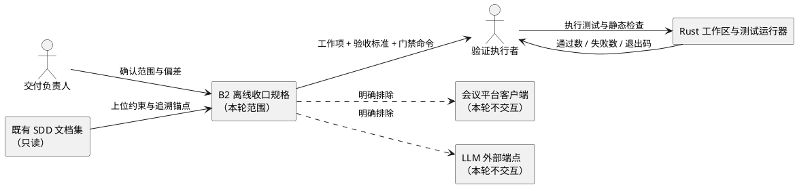
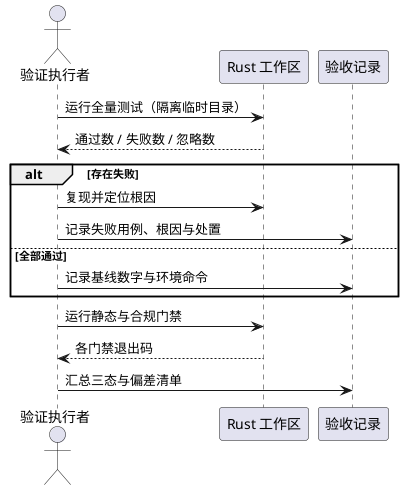
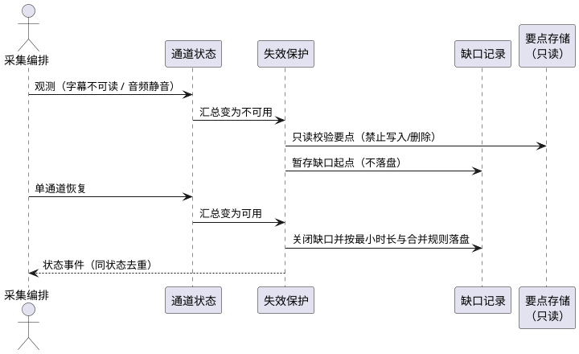
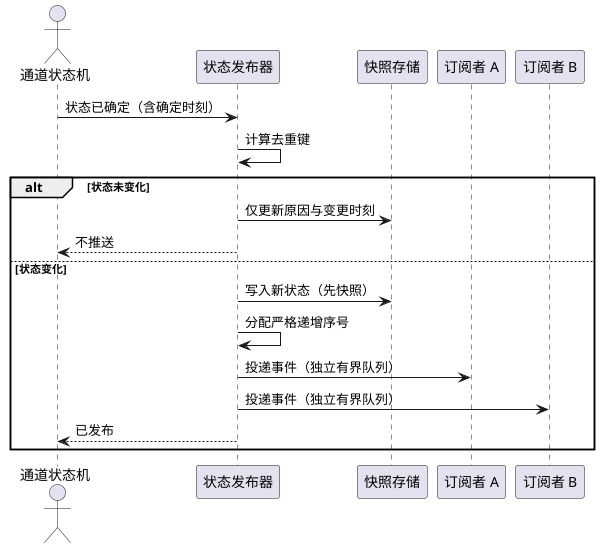
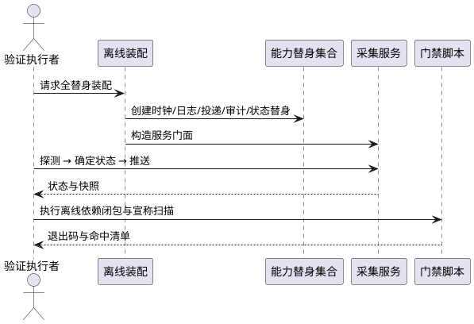
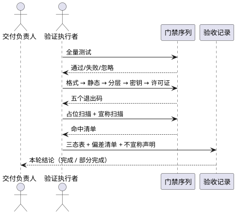

# **1. 组件定位**

## **1.1 核心职责**

本组件负责把 B2.23 剩余离线可判定能力收敛为可验证的验收集合，实现"不依赖真机与真实会议即可判定进度"。

## **1.2 核心输入**

1. 既有规格与设计：`docs/sdd/spec.md`（4.2、4.3、4.5、5.1.1、5.4.1、5.8.1）、`docs/sdd/design.md`（2.1.3、2.4、2.5.4、2.5.7）、`docs/sdd/tasks.md`（B2.23、B2.24、B3）。
2. 既有特性规格：`.codeartsdoer/specs/capture_channel_state/spec.md`（AC-B2-23-01~35）。
3. 进度记录：`docs/progress/b0-status.md`、`b1-status.md`、`b2-status.md`、`ci-readiness.md`。
4. 当前代码与测试事实：工作区源码、测试用例清单、全量测试运行结果。
5. 门禁命令的执行结果：格式、静态检查、分层、密钥、许可证、离线依赖闭包。

## **1.3 核心输出**

1. 本轮"可离线完成"工作项清单（编号、范围、可机器判定的验收标准、追溯关系）。
2. 进度基线与阻塞项分类（可离线完成 / 必须真机或外部依赖）。
3. 门禁执行约定：命令、环境隔离要求、通过阈值。
4. 三态标注规范：`已判定` / `未触发` / `未实测`，以及"不得宣称 G2 通过"的文字纪律。
5. 与既有 SDD 的冲突清单及处理方式。

## **1.4 职责边界**

本组件**不负责**以下事项：

1. 不实现任何真实音频捕获、字幕读取、OCR、平台探测（B2.15~B2.22）。
2. 不实现双通道去重合并与 `dualChannel` 标记（B2.24）。
3. 不实现会话六状态机、采集告知与同意（B2.26、B2.27）。
4. 不实现任何 UI 渲染、托盘、悬浮窗与通知（B5）。
5. 不实现 B3 理解层的归一化、摘要、要点、缺口识别。
6. 不执行任何真实端点采样、不产生任何真实会议数据、不联网、不打开音频设备。
7. 不交付 `design.md` 与 `tasks.md`（由后续阶段代理负责）。
8. 不得据本轮结果宣称三平台 30 分钟稳定、真实 5 秒回退、真实 UI 推送时延或真实去重已验证。

# **2. 领域术语**

**离线可判定**
: 指在断网、无真实平台进程、无音频设备、无 UI 的环境中，仅依赖注入替身与手动推进的单调时钟即可重复判定真假的验收性质。

**三态标注**
: 指每条验收标准必须落在 `已判定`、`未触发`、`未实测` 三种状态之一；`未实测` 必须附阻塞原因，禁止以模拟结果替代真实结论。

**能力替身**
: 指以内存实现替代真实基础设施的测试载体，只保留可观测的计数、追加、合并与查询语义，不访问网络、设备与磁盘。

**契约冻结**
: 指对本轮之前已被其它模块依赖的公开类型与方法集合施加"不减少、不改名、不改签名"的约束。

**采集缺口**
: 指同一会话内"无任何可用通道"的连续时间区间，采用半开区间表示，仅在满足最小时长后落盘。

**汇总可用性**
: 指对一 session 的字幕通道与音频通道状态做仲裁后得到的单一结论（可用-字幕 / 可用-音频 / 不可用）。

**单调时刻**
: 指仅由注入时钟产生、不受系统时间跳变影响的时间量；本轮所有阈值判定只允许使用单调时刻。

**抖动抑制**
: 指为避免短时间内反复切换通道而设置的窗口、次数与暂缓期组合限制。

**受控偏差**
: 指本轮实现与既有 `design.md`/`tasks.md` 的字面要求不一致，但已在本规格登记、且不改变对外行为的差异。

**G2 宣称禁令**
: 指任何本轮产出物（进度记录、源码注释、提交信息、报告）不得出现"三平台稳定运行已验证""真实 5 秒回退已实测""真实去重已验证"等结论性表述。

# **3. 角色与边界**

## **3.1 核心角色**

交付负责人：确认本轮范围、审阅验收标准、决定受控偏差是否接受。

验证执行者：按第 8 章命令执行判定并如实填写三态，不得以部分通过替代整体通过。

后续阶段代理：读取本规格产出 `design.md` 与 `tasks.md`，不得反向修改本规格的验收口径。

## **3.2 外部系统**

既有 SDD 文档集：提供上位约束与追溯锚点，本轮只读。

Rust 工作区与测试运行器：提供编译、测试、静态检查与依赖闭包查询能力。

持续集成流水线：承载三平台编译与合规检查；本轮不依赖其在线状态。

会议平台客户端：真实字幕与音频来源；本轮不与其交互。

LLM 外部端点：真实采样来源；本轮不发起请求。

## **3.3 交互上下文**

# **4. DFX 约束**

## **4.1 性能**

1. 状态变更从"确定时刻"到订阅者回调完成的时间差 p99 必须 ≤ 5000ms，采样量必须 ≥200 次；该指标只证明逻辑上限成立，不代表真实 UI 线程时延。
2. 通道推进的最小间隔必须为 100ms，允许配置 100~250ms，硬上限 500ms。
3. 缺口恢复回补窗口必须 ≤8000ms，且不得因回补阻塞状态机。

## **4.2 可靠性**

1. 全部离线用例禁止真实等待：不得出现 `thread::sleep`、`Instant::now`、`SystemTime::now` 用于阈值推进。
2. 同一组用例重复执行三次，结果必须完全一致（无顺序依赖、无共享可变全局状态）。
3. 任一用例失败不得被静默跳过；测试门禁必须使用"失败即整体失败"的退出码语义。
4. 本轮新增能力在断网环境下必须可完整装配并通过。

## **4.3 安全性**

1. 状态事件、快照、缺口记录、切换记录与验收记录只允许出现白名单字段，禁止承载字幕文本、音频样本、说话人、参会人与凭据。
2. 全部产物禁止出现端点、模型名、凭据任何可见片段（含前缀、遮蔽中段、末四位）与凭据编号。
3. 本轮不得新增任何对外网络调用、设备打开或凭据读取路径。
4. "采集不可用"必须复用既有错误码 `E-AUDIO-002`，禁止新增对外错误码。

## **4.4 可维护性**

1. 每个验收标准必须附一条可直接执行的判定命令或可静态比对的断言，禁止只写"人工确认"。
2. 门禁脚本失败时必须输出文件名与行号，不得回显敏感内容。
3. 本轮新增源码中 `todo!`、`unimplemented!`、`panic!` 的出现次数必须为 0。
4. 进度记录中的测试数字必须以本轮实测为准；既有记录中的过期数字必须在验收记录中标注"已过期"。

## **4.5 兼容性**

1. 下列既有契约不得减少变体、改名或改签名：`SourceHealth`（3 变体）、`Platform`（3 值）、`ChannelPreference`（4 值）、`Subscription`（构造/活性/释放/包装）、四个仓储接口、`ErrorCode::ALL`（12 项）、`Metric::ALL`（10 项）。
2. 既有测试用例名集合不得减少；允许仅收紧断言或新增断言，禁止删除用例。
3. 本轮不得修改 `docs/sdd/*.md` 与既有特性规格的判定口径。
4. 缺口落盘口径变更属于对外可观测行为变更，必须在本规格登记并同步到验收记录。

# **5. 核心能力**

## **5.1 基线与门禁口径校核（W-00）**

### **5.1.1 业务规则**

1. **进度事实以实测为准**：任务清单勾选状态不得作为完成依据；完成判定必须同时具备"代码存在 + 用例通过 + 门禁退出码 0"三项证据。
   a. 验收条件：When 某工作项被标记为完成，then 验收记录中必须同时给出对应用例名与门禁命令结果（AC-B2-OC-01）。
2. **环境偏差必须显式登记**：使用非默认工具链路径或隔离临时目录执行测试时，必须在验收记录中写明路径与原因。
   a. 验收条件：When 门禁执行使用工具链绝对路径或自定义临时目录，then 验收记录包含该路径、原因与等价性说明（AC-B2-OC-02）。
3. **失败用例不得归因于"环境"而未验证**：凡出现失败，必须先复现并区分"代码缺陷"与"环境限制"，再决定修复或登记偏差。
   a. 验收条件：When 全量测试出现失败用例，then 验收记录给出失败用例名、根因分类、复现命令与最终处置（AC-B2-OC-03）。
4. **禁止项**：禁止以"清单未勾选"为由重复实现已完成项，也禁止以"进度记录已写完成"为由跳过用例执行。
   a. 验收条件：When 既有实现已存在且用例通过，then 本轮只允许补充缺口判定，不得重写既有实现（AC-B2-OC-04）。

### **5.1.2 交互流程**

### **5.1.3 异常场景**

1. **工具链入口不可用**
   a. 触发条件：默认命令入口因动态库缺失等原因无法启动。
   b. 系统行为：改用工具链目录内的可执行文件，并在验收记录中登记路径与原因；不得据此判定"环境不支持测试"。
   c. 用户感知：验收记录出现"环境偏差：工具链入口"条目，门禁结论仍以实际运行结果为准。
2. **临时目录不可写**
   a. 触发条件：默认临时目录拒绝写入，导致依赖磁盘的用例失败。
   b. 系统行为：改用工作区内隔离目录并重跑；失败用例在隔离目录下重新判定。
   c. 用户感知：验收记录出现"环境偏差：临时目录隔离"条目及重跑结果。
3. **既有进度记录数字过期**
   a. 触发条件：进度记录中的用例数与实测不一致。
   b. 系统行为：以实测数字为准，并在验收记录中标注过期项。
   c. 用户感知：基线表同时出现"记录值"与"实测值"两列。

## **5.2 阶段 C：双通道失效保护（W-C）**

### **5.2.1 业务规则**

1. **缺口最小时长**：只有合并后时长 ≥1000ms 的缺口才允许落盘；不足 1000ms 的缺口禁止落盘，仅允许计数。
   a. 验收条件：When 一次失效持续 500ms 后恢复，then 缺口记录数为 0 且"短缺口丢弃"计数为 1（AC-B2-OC-C01）。
2. **缺口半开区间**：缺口必须表示为半开区间 `[start, end)`，且 `end > start`；同一会话内的缺口记录两两不得重叠。
   a. 验收条件：When 产生 30000ms 失效，then 记录恰 1 条、时长 ∈[29600, 30400]ms、且与其它记录无重叠（AC-B2-OC-C02）。
3. **缺口合并顺序**：必须先把同一会话内相邻或重叠的缺口按并集合并，再按合并后的时长执行最小落盘判定；合并时保留最早起点与最晚终点，"是否已回补"取逻辑或。
   a. 验收条件：When 两条 600ms 缺口间隔 400ms，then 合并为 1 条 1600ms 记录并落盘（AC-B2-OC-C03）。
4. **恢复边界**：恢复起点必须为 `close - min(8000ms, 缺口时长)`；缺口更早部分禁止回补，且该区间内禁止产生任何片段。
   a. 验收条件：When 缺口时长 30000ms 后恢复，then 只允许回补最后 8000ms，更早 22000ms 内片段数为 0（AC-B2-OC-C04）。
5. **会话与要点不变量**：失效期间会话必须保留，已产生要点必须不丢失、不被改写；禁止触发会话状态迁移、会话删除或要点清空。
   a. 验收条件：When 双通道失效持续 300s，then 会话迁移调用数 0、删除调用数 0、要点写入与摘要写入调用数 0，要点 ID 集合与数量与失效前完全相同（AC-B2-OC-C05）。
6. **要点校验失败不得降级为删除**：当要点读取失败而无法完成"不丢失"校验时，必须跳过校验、记录诊断计数，并继续禁止删除与清空。
   a. 验收条件：When 要点读取返回失败，then 不发出任何删除或清空指令，且诊断计数 +1（AC-B2-OC-C06）。
7. **单通道恢复**：任一通道恢复可用后，汇总可用性必须在 ≤5000ms 内转为"可用"，缺口必须关闭并按规则合并。
   a. 验收条件：When 音频通道由不可用转为可用且偏好为"字幕优先"，then 汇总 ≤5000ms 内变为"可用-音频"，缺口关闭（AC-B2-OC-C07）。
8. **重复失效不重复告警**：同一缺口内通道状态反复变化时，"采集不可用"只允许推送 1 次；恢复后 1000ms 内再次失效必须并入上一缺口且不重复推送。
   a. 验收条件：When 300s 内通道在不可用与探测中反复切换，then 汇总推送次数恰为 1（AC-B2-OC-C08）。
9. **禁止项**：禁止在失效期间把"回补"实现为对缺口全量重新转写，禁止以补录方式生成缺口范围内的片段。
   a. 验收条件：When 缺口关闭，then 回补请求窗口起点等于恢复起点，且区间代数断言（两两不交、与缺口仅允许 ≤400ms 边界接触）通过（AC-B2-OC-C09）。

### **5.2.2 交互流程**

### **5.2.3 异常场景**

1. **缺口不足最小时长**
   a. 触发条件：失效持续 500ms 后恢复。
   b. 系统行为：不落盘，累加"短缺口丢弃"计数，不推送重复告警。
   c. 用户感知：界面状态短暂变化后恢复，不产生缺口记录。
2. **要点读取失败**
   a. 触发条件：失效期间读取要点清单失败。
   b. 系统行为：跳过"不丢失"校验、记录诊断计数，继续禁止写入与删除。
   c. 用户感知：诊断面板出现"快照校验降级"，界面仍显示"采集不可用"。
3. **恢复后立即再次失效**
   a. 触发条件：恢复后 1000ms 内再次进入不可用。
   b. 系统行为：并入上一缺口，保留最早起点与最晚终点，不重复推送。
   c. 用户感知：缺口记录为 1 条，不产生两次告警。
4. **时钟回退**
   a. 触发条件：证据时刻早于当前已记录时刻。
   b. 系统行为：拒绝该观测并计数，不改变缺口与状态。
   c. 用户感知：无界面变化，诊断面板出现时钟回退计数。

## **5.3 阶段 D：状态推送、快照与订阅（W-D）**

### **5.3.1 业务规则**

1. **去重键**：状态推送必须以"通道标识 + 状态"为去重键，原因不参与去重；状态相同必须返回"不推送"，只更新快照中的原因与变更时刻。
   a. 验收条件：When 同一通道同一状态连续上报 10 次，then 推送次数恰为 1；原因由"仅 OCR"变为"版本不匹配"时事件数不变而快照原因已更新（AC-B2-OC-D01）。
2. **先快照后扇出**：必须先把新状态写入快照，再分配序号，再向订阅者扇出；发布返回时快照必须已包含该状态。
   a. 验收条件：When 在订阅回调内查询快照，then 可见本次状态且字段与事件一致（AC-B2-OC-D02）。
3. **序号唯一且严格递增**：同一会话必须只有一条状态流，序号严格递增；通道事件与汇总事件必须共用同一序列。
   a. 验收条件：When 同一通道变更 100 次，then 快照条目数恰为 1，序号严格递增且长度恰为 100（AC-B2-OC-D03）。
4. **序号溢出保护**：当序号接近上界时，必须拒绝发布并计数，禁止回绕。
   a. 验收条件：When 注入接近上界的序号，then 发布被拒绝、计数 +1、快照不被错误覆盖（AC-B2-OC-D04）。
5. **订阅隔离**：每个订阅者必须有独立的容量为 64 的有界队列；单个订阅者处理超时不得阻塞状态机与其它订阅者；回调抛错只允许计数并继续。
   a. 验收条件：When 一个订阅者处理超时并抛错，then 其它订阅者仍收到完整事件，失败计数 +1（AC-B2-OC-D05）。
6. **释放语义**：订阅释放必须幂等，释放后该订阅者回调次数必须为 0，且不影响其它订阅者。
   a. 验收条件：When 释放某订阅者后继续发布 10 次，then 该订阅者回调 0 次、其余订阅者各 10 次（AC-B2-OC-D06）。
7. **时延上限**：状态确定到回调完成的时间差 p99 与最大值都必须 ≤5000ms，样本以环形缓冲保留 ≥256 个。
   a. 验收条件：When 以可注入时钟模拟 200 次变更与订阅处理耗时，then p99 ≤5000ms 且 max ≤5000ms（AC-B2-OC-D07）。
8. **载荷白名单**：状态事件字段必须限定为 7 项，快照条目必须限定为 6 项，汇总可用性事件必须限定为 4 项；禁止出现历史数组与文本字段。
   a. 验收条件：When 对预置字幕文本与音频样本做字段与内容扫描，then 越界字段 0 个、命中 0 次（AC-B2-OC-D08）。
9. **无订阅者仍更新快照**：无订阅者时状态必须照常写入快照，后续订阅者可查询到完整当前状态。
   a. 验收条件：When 无订阅者时发布 5 次不同状态，then 快照条目状态为最后一次，后续订阅者查询结果一致（AC-B2-OC-D09）。
10. **禁止项**：禁止以"同一缺口内原因变化"为由重复推送；禁止在快照中保存历史序列或多版本状态。
    a. 验收条件：When 同一缺口内原因变化 5 次，then 推送次数仍为 1、快照条目仍为 1（AC-B2-OC-D10）。

### **5.3.2 交互流程**

### **5.3.3 异常场景**

1. **慢订阅者**
   a. 触发条件：某订阅者单次处理超过 50ms。
   b. 系统行为：事件留在其队列并立即返回，不阻塞状态机与其它订阅者。
   c. 用户感知：该订阅者后续收到积压事件，其它订阅者无感知。
2. **订阅者回调抛错**
   a. 触发条件：回调实现返回错误。
   b. 系统行为：失败计数 +1，继续投递给其它订阅者。
   c. 用户感知：诊断面板出现订阅失败计数。
3. **队列溢出**
   a. 触发条件：订阅者持续不消费，队列达到容量 64。
   b. 系统行为：丢弃最旧事件并计数，不阻塞发布方。
   c. 用户感知：该订阅者收到"丢弃计数"可观测值。
4. **无订阅者**
   a. 触发条件：发布时无任何订阅。
   b. 系统行为：照常更新快照与序号，不报错。
   c. 用户感知：后续订阅时能查询到当前状态。

## **5.4 阶段 E：替身装配、契约冻结与离线门禁（W-E）**

### **5.4.1 业务规则**

1. **替身能力最小化**：能力替身只允许提供追加、合并查询、计数与单调时钟能力，禁止提供更新、删除或万能泛型发送方法。
   a. 验收条件：When 扫描替身公开方法集合，then 不存在"更新/删除/通用发送"方法（AC-B2-OC-E01）。
2. **切换日志只追加**：切换日志必须只追加、不可修改，同一会话同一毫秒最多 1 条。
   a. 验收条件：When 追加 1 条后查询，then 长度 +1 且无修改入口；构造同毫秒重复记录被拒绝或合并（AC-B2-OC-E02）。
3. **缺口日志合并语义**：缺口日志必须按会话合并相邻或重叠区间，查询结果按起点升序且两两不重叠。
   a. 验收条件：When 写入两条间隔 <1000ms 的区间，then 查询结果为 1 条且保留最早起点与最晚终点（AC-B2-OC-E03）。
4. **投递与审计只计数**：转写投递与审计替身只允许累计计数，审计事件结构体禁止包含载荷字段。
   a. 验收条件：When 分别投递三类意图并记录审计，then 三类计数与实际投递次数一致（AC-B2-OC-E04）。
5. **系统时钟替身单调**：系统时钟实现必须保证单进程内单调不减，且委托既有墙钟实现，不 panic。
   a. 验收条件：When 连续两次读取单调时刻，then 后者 ≥ 前者（AC-B2-OC-E05）。
6. **离线装配可复用**：必须提供一套全替身装配函数，可被至少 4 个测试文件复用；函数内禁止出现系统时钟、网络与等待调用。
   a. 验收条件：When 4 个测试文件均通过该装配函数建立服务，then 全部用例通过且装配函数静态扫描无禁用调用（AC-B2-OC-E06）。
7. **网络建连为零**：离线装配下执行最小主路径，进程建连次数必须为 0。
   a. 验收条件：When 执行"装配→探测→可用"最小路径，then 建连计数为 0 且用例通过（AC-B2-OC-E07）。
8. **依赖闭包无网络与设备**：域层与应用层正常依赖中禁止出现网络、数据库、TLS、平台与 UI 相关依赖。
   a. 验收条件：When 查询依赖闭包，then 命中数为 0；命中时脚本打印命中行并退出 1（AC-B2-OC-E08）。
9. **源码禁用调用为零**：采集相关源码中禁止出现网络、设备等待与系统时间调用。
   a. 验收条件：When 扫描禁用调用，then 命中数为 0（AC-B2-OC-E09）。
10. **契约冻结**：第 4.5 条列出的既有契约必须保持变体数、取值数与签名不变，且必须有具名用例守护。
    a. 验收条件：When 执行契约冻结用例（≥7 条），then 全部通过且断言值与第 4.5 条一致（AC-B2-OC-E10）。
11. **测试基线不减少**：既有测试用例名集合不得减少；新增测试只允许追加文件或在既有文件内新增断言。
    a. 验收条件：When 对比变更前后的用例名清单，then 差集为空（AC-B2-OC-E11）。
12. **G2 宣称扫描**：必须提供扫描脚本覆盖进度记录、新增源码、提交信息与说明文档，并排除规格文档自身，避免自命中。
    a. 验收条件：When 执行扫描脚本，then 命中数为 0、退出码 0；人为植入禁用结论性表述时退出码 1（AC-B2-OC-E12）。
13. **禁止项**：禁止替身读取凭据、打开设备、访问网络；禁止以替身通过替代真实平台验证。
    a. 验收条件：When 扫描替身源码，then 网络、设备与凭据调用命中均为 0（AC-B2-OC-E13）。

### **5.4.2 交互流程**

### **5.4.3 异常场景**

1. **依赖闭包命中禁用库**
   a. 触发条件：新增依赖间接引入网络、数据库或平台库。
   b. 系统行为：脚本打印命中依赖与来源，退出 1；门禁整体失败。
   c. 用户感知：验收记录出现"依赖闭包"失败项与命中清单。
2. **源码出现禁用调用**
   a. 触发条件：采集源码引入等待或系统时间调用。
   b. 系统行为：脚本打印文件与行号，退出 1。
   c. 用户感知：验收记录出现"源码禁用调用"失败项。
3. **契约守护用例缺失**
   a. 触发条件：新增能力改动既有类型但未补守护用例。
   b. 系统行为：契约冻结用例数不足 7 时判定失败。
   c. 用户感知：验收记录出现"契约冻结用例数不足"。
4. **宣称文本命中**
   a. 触发条件：进度记录或提交信息出现结论性表述。
   b. 系统行为：扫描脚本退出 1，要求改写为三态表述。
   c. 用户感知：验收记录出现命中文件与行号。

## **5.5 阶段 F：总门禁与交付收口（W-F）**

### **5.5.1 业务规则**

1. **全量测试门禁**：全量测试必须失败数为 0，且通过数不得低于本轮阈值。
   a. 验收条件：When 执行全量测试，then 退出码 0、失败数 0、通过数 ≥360（AC-B2-OC-F01）。
2. **忽略用例必须显式**：真实环境用例必须以忽略方式存在，并在默认执行时显示为"未实测"而非失败。
   a. 验收条件：When 默认执行全量测试，then 真实环境用例被忽略且输出包含"未实测"标注（AC-B2-OC-F02）。
3. **静态门禁全零**：格式检查、静态检查（全部目标、警告即错误）、分层检查、密钥扫描、许可证与来源检查必须全部退出码 0。
   a. 验收条件：When 依次执行五类门禁，then 全部退出码 0（AC-B2-OC-F03）。
4. **占位实现为零**：本轮新增源码中 `todo!`、`unimplemented!`、`panic!` 必须为 0。
   a. 验收条件：When 扫描新增源码，then 命中数为 0（AC-B2-OC-F04）。
5. **交付记录完整**：验收记录必须包含基线数字、逐工作项三态、门禁结果、偏差清单与"不宣称 G2"声明。
   a. 验收条件：When 审阅验收记录，then 五项齐备，缺失任一项判"记录不完整"（AC-B2-OC-F05）。
6. **禁止项**：禁止在任一工作项未通过时宣称"本轮完成"；禁止用未实测项填充"已判定"。
   a. 验收条件：When 存在未通过与未实测项，then 验收结论必须逐项列出且整体结论为"部分完成"（AC-B2-OC-F06）。

### **5.5.2 交互流程**

### **5.5.3 异常场景**

1. **通过数低于阈值**
   a. 触发条件：全量测试通过数 <360。
   b. 系统行为：门禁失败，列出未达标工作项对应的缺失用例。
   c. 用户感知：验收记录结论为"部分完成"。
2. **静态检查告警**
   a. 触发条件：静态检查出现任一警告。
   b. 系统行为：门禁失败，不区分"可忽略"。
   c. 用户感知：验收记录出现告警清单。
3. **真实环境用例被误执行**
   a. 触发条件：默认执行路径包含真实端点或真实平台用例。
   b. 系统行为：判定门禁失败并关闭真实联调路径。
   c. 用户感知：验收记录出现"默认路径不得发起真实调用"。

# **6. 数据约束**

## **6.1 通道状态快照**

1. **平台**：必须为既有平台枚举值之一。
2. **通道类型**：必须为字幕或音频。
3. **状态**：必须为四状态之一。
4. **原因**：可以为空；非空时必须为封闭原因码之一，禁止自由文本。
5. **进入时刻**：单调时刻，不得早于会话绑定时刻。
6. **变更时刻**：单调时刻，不得早于进入时刻。

## **6.2 状态事件**

1. **平台**、**通道类型**、**状态**、**原因**：约束同 6.1。
2. **序号**：非负整数，同一会话严格递增，禁止回绕。
3. **确定时刻**：单调时刻，必须来自证据时刻而非读取时刻。
4. **墙钟时刻**：仅用于展示与审计，禁止参与阈值判定。

## **6.3 采集缺口记录**

1. **会话**：必须为非空会话标识，且与产生缺口的观测一致。
2. **起点**、**终点**：单调时刻，且终点必须严格大于起点。
3. **时长**：必须 ≥1000ms 才允许落盘。
4. **原因**：必须为封闭缺口原因码之一。
5. **是否回补**：布尔值，合并时取逻辑或。
6. **区间关系**：同一会话内任意两条记录不得重叠；允许 ≤400ms 的边界接触。

## **6.4 汇总可用性事件**

1. **可用性结论**：必须为"可用-字幕"、"可用-音频"或"不可用"之一。
2. **缺口原因**：仅在不可用时出现。
3. **错误码**：不可用时必须为既有 `E-AUDIO-002`。
4. **序号**：与通道事件共用同一递增序列。

## **6.5 本轮验收记录**

1. **工作项编号**：必须与本规格第 5 章编号一致。
2. **三态**：必须为"已判定"、"未触发"或"未实测"之一；"未实测"必须附阻塞原因。
3. **证据**：必须包含用例名或命令与退出码。
4. **环境偏差**：可选；出现时必须写明路径与原因。
5. **结论**：只能为"完成"或"部分完成"，禁止写"G2 通过"。

# **7. 范围与非范围**

## **7.1 本轮范围内（可离线完成并判定）**

1. 阶段 C：缺口最小时长、半开区间、合并顺序、恢复边界、会话与要点不变量、单通道恢复、重复告警抑制、区间代数断言。
2. 阶段 D：状态端口能力扩展、去重、先快照后扇出、序号、订阅隔离与释放、时延 p99、载荷白名单、无订阅者行为。
3. 阶段 E：能力替身与系统时钟、离线装配、建连为零、依赖闭包与源码禁用调用扫描、契约冻结、G2 宣称扫描。
4. 阶段 F：全量测试阈值、静态与合规门禁、占位扫描、交付记录与三态表。
5. 基线校核：进度事实复核、环境偏差登记、失败用例根因分类。
6. 既有测试口径修正：仅收紧断言、不删除用例名（见第 9 章 X2）。

## **7.2 本轮明确不做（附理由）**

1. **真实音频捕获（B2.15/16）**：需要 WASAPI/SCStream 真机与 30 分钟真实会议；本机无 macOS 设备，且不允许以合成音频替代验收。
2. **真实字幕读取与 OCR（B2.17~B2.21）**：需要三平台真实会议窗口、共享屏幕遮挡场景与 ≥100 张真实截图回归集；离线无法构造。
3. **平台探测与版本矩阵真实读取（B2.22）**：需要安装三平台客户端并读取文件版本资源；仅 Windows 单机且腾讯会议/飞书/Zoom 版本矩阵不完整，macOS 缺失。
4. **双通道去重合并（B2.24）**：属于独立能力（时钟对齐、三级等价判定、合并语料 ≥200 对），与本轮收口无依赖；需独立规格与设计。
5. **会话六状态机与告知同意（B2.26/27）**：独立能力，涉及 UI 与持久化，需独立规格。
6. **UI 推送与三形态展示（B5）**：本轮只证明逻辑时延上限，不代表真实 UI 线程时延。
7. **B3 理解层（28~33）**：依赖合并后的片段，且需独立设计与回放集。
8. **LLM 真实端点补充判定（AC-LLM-23/24/25）**：分别要求"实测期内出现 429""真实端点超时表现""真实端点 schema 违规对照"，均需真实端点与真实调用；离线 mock 结果不得替代，本轮统一保持"未实测"。
9. **LLM 基线报告（13.4 / AC-LLM-18）**：需真实端点与完整记录移交，归属 13.4，不在本特性内。
10. **门控离线回放（13.3）**：依赖 B4 五级门控实现尚未落地。
11. **ASR Rust 接入（12.1/12.3）**：本机缺 CMake/C++ 工具链，且模型许可需复核。
12. **macOS 编译与运行验证**：无 mac 设备；只能由 CI 承担，且当前网络无法推送触发。
13. **GitHub 推送与 CI 触发**：网络不可达且无凭据。

## **7.3 进度基线（实测事实）**

| 批次 | 项 | 状态 | 证据 |
|---|---|---|---|
| B0 | 五层工程基座、值对象、领域模型、端口、加密存储、审计链、脱敏日志、10 项度量 | 已完成（Windows） | `docs/progress/b0-status.md`；G0 整体未闭合（mac 未验证） |
| B0 | CI 三段流水线 | 已完成（未在线实跑） | `docs/progress/ci-readiness.md`；GitHub 不可达 |
| B1 | 12.2 稳定前缀策略 | 已完成 | 7 用例通过 |
| B1 | 13.1/13.2 LLM 网关与降级 | 已完成（mock + 真实采样） | 30 样本/任务，AC-LLM-20/21/22 达标 |
| B1 | AC-LLM-23/24/25 | 未实测 | 需真实端点；离线不可判定 |
| B1 | AC-LLM-18 / 13.4 | 未完成 | 归属 13.4 |
| B1 | WASAPI、三平台字幕、ASR/VAD | 阻塞 | 缺真机会议、模型许可、C++ 工具链 |
| B2 | B2.23 阶段 A/B（状态机、仲裁、切换记录、ASR 预算、服务门面） | 已完成 | `capture` 相关 25 用例通过；`docs/progress/b2-status.md` |
| B2 | B2.23 阶段 C | 部分完成 | 已有缺口合并纯函数与恢复台账；缺最小时长落盘、要点不变量校验、独立失效保护汇总 |
| B2 | B2.23 阶段 D | 未完成 | 状态端口只有单向发布；缺订阅、快照强一致、去重序号、p99 |
| B2 | B2.23 阶段 E | 未完成 | 缺能力替身、离线装配、依赖闭包与宣称扫描、契约冻结用例 |
| B2 | B2.23 阶段 F | 未完成 | 未形成本轮阈值与三态验收记录 |
| — | 全量测试基线 | 329 通过 / 0 失败 / 8 忽略 | 隔离临时目录下实测；未隔离目录时 1 条依赖磁盘的用例失败（环境限制） |
| — | 任务清单勾选 | 滞后 | 仅 12.2 勾选；以进度记录与实测为准 |

# **8. 可机器判定的验收标准**

> 编号纪律：本轮统一使用 `AC-B2-OC-*` 前缀；引用 LLM 特性时一律写全 `AC-LLM-*`，禁止简写为 `AC-xx`，避免与 `AC-B2-23-*` 混淆。
> 判定前提：默认执行环境为断网、无平台进程、无音频设备、无 UI；测试必须使用隔离临时目录。

## **8.1 基线校核（AC-B2-OC-01~05）**

| 编号 | 验收项 | 判定方法 | 通过条件 |
|---|---|---|---|
| AC-B2-OC-01 | 完成判定三证据 | 检查验收记录条目 | 每条完成项同时含用例名与门禁命令结果 |
| AC-B2-OC-02 | 环境偏差登记 | 检查验收记录 | 使用非默认入口或隔离目录时，路径与原因均被记录 |
| AC-B2-OC-03 | 失败根因分类 | 检查验收记录 | 失败项含用例名、根因分类、复现命令、处置 |
| AC-B2-OC-04 | 不重写既有实现 | `git diff --stat` | 既有 capture 实现文件无整体重写（仅允许追加/收紧） |
| AC-B2-OC-05 | 基线数字可复现 | `cargo test --workspace` | 通过数与记录值一致，失败 0 |

## **8.2 阶段 C（AC-B2-OC-C01~C09）**

| 编号 | 验收项 | 判定方法 | 通过条件 |
|---|---|---|---|
| AC-B2-OC-C01 | 短缺口不落盘 | `cargo test -p meeting-copilot-application --test capture_degraded_guard` | 500ms 失效 → 缺口记录 0 条、短缺口计数 1 |
| AC-B2-OC-C02 | 半开区间与时长 | 同上 | 30000ms 失效 → 1 条且时长 ∈[29600,30400]ms |
| AC-B2-OC-C03 | 先合并后判门限 | 同上 + 纯函数用例 | 600ms+600ms（间隔 400ms）→ 合并 1600ms → 落盘 1 条 |
| AC-B2-OC-C04 | 恢复边界 | 同上 | `resume_from = close - min(8000, duration)`；更早区间片段数 0 |
| AC-B2-OC-C05 | 会话与要点不变量 | 同上（仓储计数替身） | 300s 失效期间迁移/删除/要点写入/摘要写入调用数均为 0；要点 ID 集合不变 |
| AC-B2-OC-C06 | 校验失败不降级为删除 | 同上 | 要点读取失败 → 删除/清空调用 0，诊断计数 +1 |
| AC-B2-OC-C07 | 单通道恢复 ≤5000ms | 同上 | 恢复时刻与汇总变更时刻差 ≤5000ms，缺口关闭 |
| AC-B2-OC-C08 | 重复失效只告警 1 次 | 同上 | 300s 内反复切换 → 汇总推送 1 次 |
| AC-B2-OC-C09 | 区间代数 | 同上 | 片段两两不交；与缺口不重叠（仅允许 ≤400ms 边界接触） |

## **8.3 阶段 D（AC-B2-OC-D01~D10）**

| 编号 | 验收项 | 判定方法 | 通过条件 |
|---|---|---|---|
| AC-B2-OC-D01 | 去重与原因更新 | `cargo test -p meeting-copilot-application --test capture_status_push` | 同键同状态 10 次 → 1 次推送；原因变化不新增事件、快照已更新 |
| AC-B2-OC-D02 | 先快照后扇出 | 同上 | 回调内查询快照可见本次状态，字段一致 |
| AC-B2-OC-D03 | 序号严格递增 | 同上 | 100 次变更 → 序号递增且长度 100；快照条目 1 条 |
| AC-B2-OC-D04 | 序号溢出保护 | 同上 | 近上界时发布被拒绝、计数 +1、快照不被错误覆盖 |
| AC-B2-OC-D05 | 慢/抛错隔离 | 同上 | 其它订阅者事件完整；失败计数 +1；状态机不被阻塞 |
| AC-B2-OC-D06 | 释放后 0 回调 | 同上 | 被释放者 0 次，其余各 10 次 |
| AC-B2-OC-D07 | p99 与最大值 | 同上 | 200 样本 p99 ≤5000ms、max ≤5000ms；环形缓冲容量 ≥256 |
| AC-B2-OC-D08 | 载荷白名单 | 同上 + 静态字段比对 | 事件 7 字段、快照 6 字段、汇总 4 字段；文本/样本子串命中 0 |
| AC-B2-OC-D09 | 无订阅者仍更新快照 | 同上 | 5 次发布后快照为最后状态，后续订阅可查 |
| AC-B2-OC-D10 | 缺口内原因变化不重复推送 | 同上 | 原因变化 5 次 → 推送仍 1 次、快照 1 条 |

## **8.4 阶段 E（AC-B2-OC-E01~E13）**

| 编号 | 验收项 | 判定方法 | 通过条件 |
|---|---|---|---|
| AC-B2-OC-E01 | 替身方法最小化 | 静态方法集合比对 | 无更新/删除/通用发送方法 |
| AC-B2-OC-E02 | 切换日志只追加 | `--test capture_fakes` | 追加后长度 +1；无修改入口；同毫秒重复处理符合约定 |
| AC-B2-OC-E03 | 缺口日志合并 | 同上 | 间隔 <1000ms 两条 → 1 条，起点最早、终点最晚，升序不重叠 |
| AC-B2-OC-E04 | 投递与审计计数 | 同上 | 三类计数与实际投递一致；审计无载荷字段 |
| AC-B2-OC-E05 | 时钟单调 | 同上 | 连续读取后者 ≥ 前者；不 panic |
| AC-B2-OC-E06 | 离线装配可复用 | `--test capture_offline_gate` + 静态扫描 | 4 个测试文件复用；无系统时钟/网络/等待调用 |
| AC-B2-OC-E07 | 建连为零 | 同上 | 最小路径通过且建连计数 0 |
| AC-B2-OC-E08 | 依赖闭包洁净 | `bash scripts/check-capture-offline.sh` | 网络/数据库/TLS/平台/UI 依赖命中 0，退出码 0 |
| AC-B2-OC-E09 | 源码禁用调用为零 | 同上 | 网络/等待/系统时间命中 0 |
| AC-B2-OC-E10 | 契约冻结 | `--test capture_contract_freeze` | ≥7 条用例通过；变体数与第 4.5 条一致 |
| AC-B2-OC-E11 | 用例名集合不减 | 变更前后用例名清单对比 | 差集为空 |
| AC-B2-OC-E12 | G2 宣称扫描 | `bash scripts/check-g2-claims.sh` | 正常 0 命中退出 0；植入禁用表述退出 1 |
| AC-B2-OC-E13 | 替身零副作用 | 静态扫描 | 网络/设备/凭据调用命中 0 |

## **8.5 阶段 F（AC-B2-OC-F01~F06）**

| 编号 | 验收项 | 判定方法 | 通过条件 |
|---|---|---|---|
| AC-B2-OC-F01 | 全量测试阈值 | `cargo test --workspace --no-fail-fast` | 退出码 0；失败 0；通过数 ≥360 |
| AC-B2-OC-F02 | 忽略用例显式 | 同上输出 | 真实环境用例显示为忽略，输出含"未实测" |
| AC-B2-OC-F03 | 静态五门禁 | 格式、静态、分层、密钥、许可证 | 五项均退出码 0 |
| AC-B2-OC-F04 | 占位实现为零 | 新增源码扫描 | `todo!`/`unimplemented!`/`panic!` 命中 0 |
| AC-B2-OC-F05 | 交付记录完整 | 审阅记录 | 基线、三态、门禁、偏差、不宣称声明五項齐备 |
| AC-B2-OC-F06 | 不得虚报完成 | 审阅结论 | 存在未通过与未实测项时，结论为"部分完成"并逐项列出 |

## **8.6 判定环境约束（对全部 AC 生效）**

1. 全部用例必须在断网环境执行，进程建连次数必须为 0（真实联调用例除外且默认忽略）。
2. 全部用例必须使用隔离临时目录；未隔离导致的失败不得计入代码缺陷。
3. 全部阈值判定只允许使用单调时刻；墙钟只允许出现在展示字段。
4. 同一个 AC 重复执行三次，结果必须一致。

# **9. 与既有 SDD 的关系及冲突处理**

## **9.1 与既有规格的关系**

1. 本规格**不重复定义** `AC-B2-23-01~35` 的判定文本；阶段 C/D/E 的行为口径以 `.codeartsdoer/specs/capture_channel_state/spec.md` 为准，本规格只做"范围收敛 + 可判定化 + 补充收紧"。
2. 本规格新增的 `AC-B2-OC-*` 只覆盖三类内容：既有 AC 未给出的可执行判定方式、本轮识别的口径缺口（如缺口最小落盘、合并顺序）、以及门禁与记录要求。
3. 若本规格与既有 AC 冲突，以"更严格者"为准，并登记冲突编号。

## **9.2 冲突清单与处理方式**

| 编号 | 冲突点 | 既有口径 | 本轮口径 | 处理方式 |
|---|---|---|---|---|
| X1 | 阶段 C 完成度 | `b2-status.md` 记为"未完成" | 代码已有缺口合并纯函数、恢复台账、回补投递与 11 个相关用例，属"部分完成" | 以代码与实测为准；本轮只补缺口项，不重写既有实现（AC-B2-OC-04） |
| X2 | 短缺口落盘 | 既有 `capture_gap_merge` 用例允许 110~310ms 缺口落盘 | 只有合并后 ≥1000ms 才落盘 | 以 AC-B2-23-21 为准；保留用例名，只收紧断言并新增"落盘门限"断言；登记为受控偏差 D1 |
| X3 | 状态端口位置与方法名 | `tasks.md` 12.1 要求置于域层端口且提供 `upsert`/`list`/`subscribe`/`snapshot` | 现状端口在应用层，仅 `append`/`publish` | 本轮在应用层扩展端口能力（新增读取与订阅能力），不搬迁域层；登记为受控偏差 D2；理由：避免改动已冻结的域层契约与分层依赖 |
| X4 | 测试阈值 | `tasks.md` 阶段 F 与 16.3 要求 ≥320（基于 265 基线） | 当前实测 329，≥320 已无约束力 | 本轮收紧为 ≥360（329 + ≥31 新增）；不改写既有文档 |
| X5 | AC 编号重名 | LLM 规格与 B2.23 规格均使用 `AC-20~25` | 两套语义完全不同 | 本轮统一全前缀 `AC-B2-OC-*` / `AC-B2-23-*` / `AC-LLM-*`；禁止简写 |
| X6 | 既有测试零删改 | `tasks.md` G-5/16.2 要求既有测试零改动 | X2 需要收紧既有断言 | 允许"仅收紧/新增断言、不删除用例名"；用例名集合不减由 AC-B2-OC-E11 守护 |
| X7 | 工具链入口 | 进度记录以 `cargo` 直接调用 | 默认入口因动态库缺失不可用，需工具链绝对路径 | 门禁命令固定使用工具链目录内可执行文件，并在验收记录登记"环境偏差"；不改代码、不改 CI |
| X8 | 临时目录 | 默认系统临时目录 | 默认目录拒绝写入，导致 1 条依赖磁盘的用例失败 | 固定使用工作区内隔离目录；验收记录登记；该用例在隔离目录下必须通过 |
| X9 | 失效保护载体形态 | `tasks.md` 阶段 C 要求独立模块 `DegradedGuard` | 现状缺口逻辑内嵌于服务门面 | 本轮允许"独立模块或门面内聚"两种形态，但 AC 判定入口必须为独立测试文件；登记为受控偏差 D3 |
| X10 | 缺口合并判定顺序 | `tasks.md` 10.2 只定义"500ms 失效 → 0 条" | 未定义"多条短缺口合并后是否落盘" | 明确为"先合并、后判门限"（AC-B2-OC-C03）；登记为口径明确化 D4 |

## **9.3 受控偏差登记（本轮）**

| 编号 | 偏差 | 影响面 | 是否改变对外行为 |
|---|---|---|---|
| D1 | 收紧短缺口落盘口径 | 采集缺口记录数量 | 是（记录更少），已由 AC 明确 |
| D2 | 状态端口留在应用层并扩展 | 端口位置与 trait 方法集合 | 否（既有调用点不变） |
| D3 | 失效保护可为独立模块或门面内聚 | 代码组织 | 否 |
| D4 | 合并顺序明确为"先合并后判门限" | 缺口记录数量 | 是，已由 AC 明确 |
| D5 | 门禁使用工具链绝对路径与隔离临时目录 | 执行方式 | 否（仅环境） |

## **9.4 文档落位**

1. 本规格路径：`.codeartsdoer/specs/b2_offline_closure/spec.md`（本地 SDD 工作区，不入库）。
2. 后续阶段应产出 `.codeartsdoer/specs/b2_offline_closure/design.md` 与 `tasks.md`，并先读取本规格第 8、9 章。
3. 本轮不修改 `docs/sdd/spec.md`、`docs/sdd/design.md`、`docs/sdd/tasks.md` 与既有特性规格。

# **10. 风险与依赖**

| 编号 | 风险 | 后果 | 应对 |
|---|---|---|---|
| R1 | 离线 p99 只测逻辑时延 | 被误读为真实 UI 5s 达标 | 事件与记录强制标注"逻辑上限"；AC-B2-OC-F05 要求不宣称声明 |
| R2 | 缺口最小时长变更影响既有用例 | 既有用例失败被误判为回归 | 先按 X2 收紧断言；AC-B2-OC-E11 守护用例名不减 |
| R3 | 端口扩展与域层契约冻结冲突 | 触碰冻结面 | 按 X3 只扩展应用层；契约冻结用例覆盖 6 个既有契约 |
| R4 | 替身与真实实现行为漂移 | 离线通过但真实环境失效 | 替身只保留计数/追加/合并语义；真实环境结论一律标"未实测" |
| R5 | 测试数阈值抬升导致为凑数写弱用例 | 门禁失真 | 用例必须对应具名 AC；弱用例不得计入阈值 |
| R6 | 环境偏差被当成豁免 | 门禁结论失真 | AC-B2-OC-02/03 要求登记路径、根因与重跑结果 |
| R7 | 与 B2.24 去重职责混淆 | 缺口与去重互相等待 | 明确 B2.24 不在本轮；缺口只判"不重不漏"的区间性质，不判语义去重 |

依赖：B0 工程基座、B1 已完成的采集端口与时钟端口、既有 `capture_channel_state` 阶段 A/B 交付、当前 329 测试基线。

# **11. 追溯矩阵**

| 上位依据 | 本轮工作项 | 验收编号 |
|---|---|---|
| SPEC 4.2-7（字幕失效 5s 回退；双通道失效会话保留、要点不丢） | W-C | AC-B2-OC-C01~C09；AC-B2-23-18~23 |
| SPEC 4.2-2（要点 1s 内持久化） | W-C | AC-B2-OC-C05 |
| SPEC 5.8.1-4（通道状态可见、5s 内更新） | W-D | AC-B2-OC-D01~D10；AC-B2-23-24~30 |
| SPEC 5.8.1-5（字幕优先、音频兜底、不重复计入） | W-C、W-D | AC-B2-OC-C07、D02 |
| SPEC 4.1-1（状态更新时延） | W-D | AC-B2-OC-D07 |
| SPEC 4.3-1/2（载荷与日志白名单） | W-D、W-E、W-F | AC-B2-OC-D08、E12、F03 |
| SPEC 4.5（兼容性） | W-E | AC-B2-OC-E10、E11 |
| DESIGN 2.1.3(2)(3)(4) | W-C、W-D | AC-B2-OC-C01~C09、D01~D10 |
| DESIGN 2.5.4-5（双通道失效保护） | W-C | AC-B2-OC-C05、C07、C08 |
| `tasks.md` 23.3/23.4 | W-C、W-D | 同上 |
| `tasks.md` 阶段 F（门禁与计数） | W-F | AC-B2-OC-F01~F06 |
| `capture_channel_state` AC-B2-23-01~35 | 全部 | 引用，不重定义 |

# **12. 需确认项**

| 编号 | 待确认 | 默认执行口径（未确认时） | 影响 |
|---|---|---|---|
| K1 | 多条短缺口合并后达到 1000ms 是否落盘 | 落盘（先合并后判门限） | AC-B2-OC-C03 |
| K2 | 状态端口是否搬迁域层 | 不搬迁，应用层扩展 | X3 / D2 |
| K3 | 全量测试阈值 360 是否可接受 | 按 360 执行 | AC-B2-OC-F01 |
| K4 | 既有短缺口用例是否允许收紧断言 | 允许，仅收紧不删名 | X2 / X6 |
| K5 | 失效保护是否需要独立模块名 | 允许内聚，测试入口独立 | X9 / D3 |
| K6 | 环境偏差是否允许以工具链绝对路径执行 | 允许，必须登记 | X7 |
| K7 | 忽略用例是否必须保留 8 个真实环境用例 | 保留且默认忽略 | AC-B2-OC-F02 |