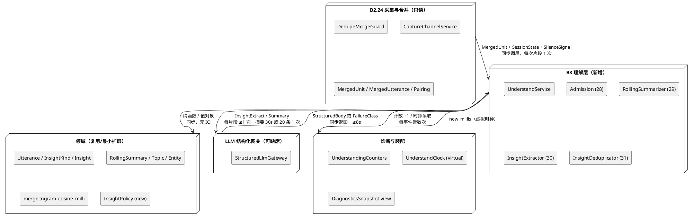
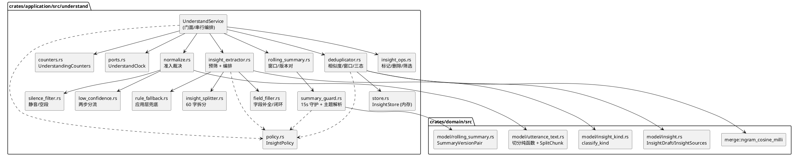
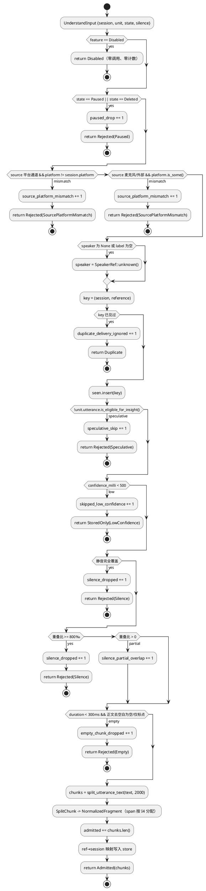
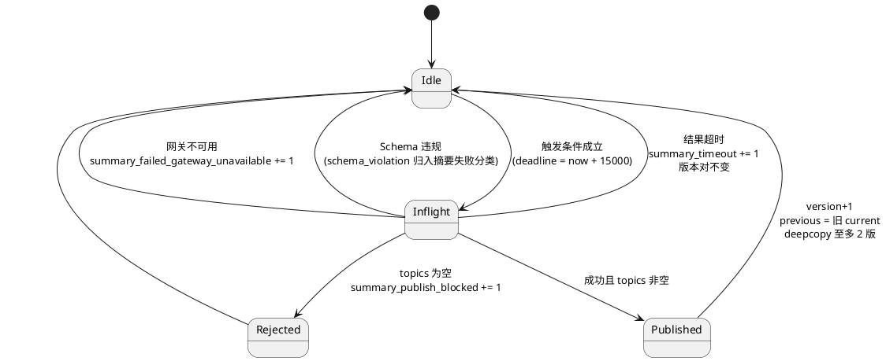
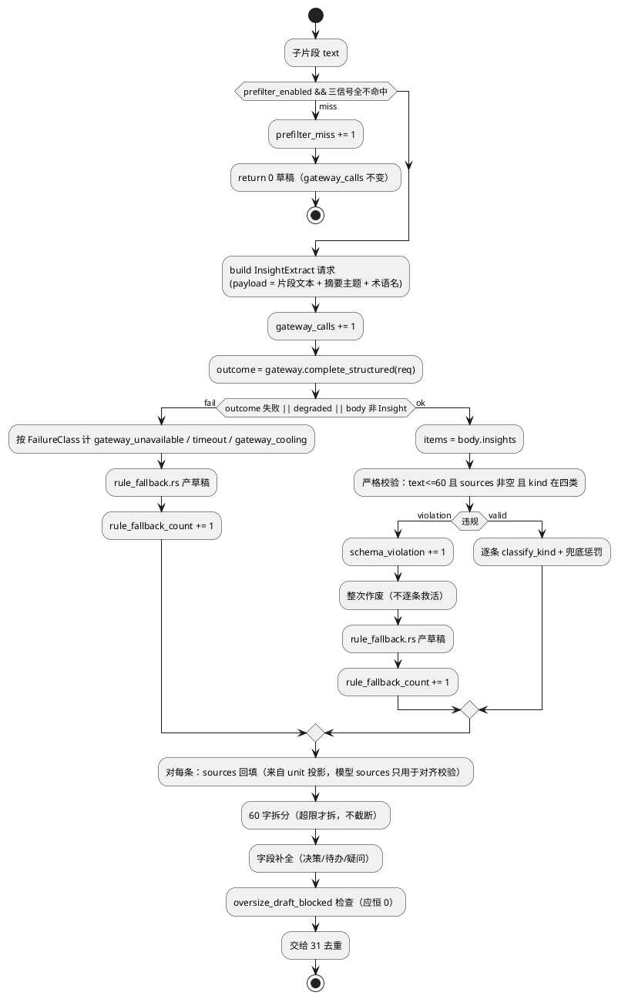
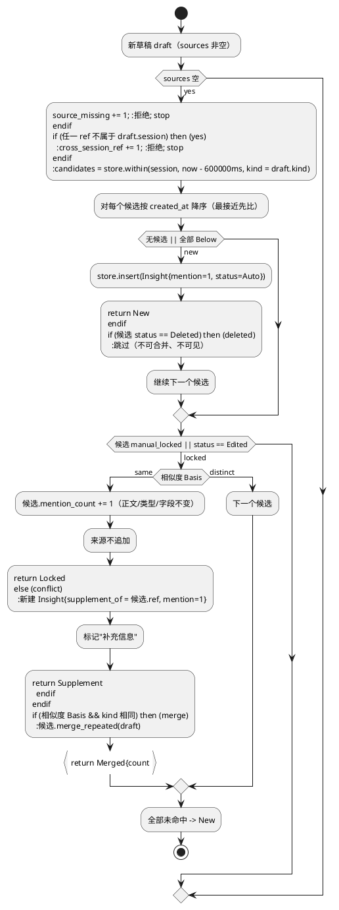
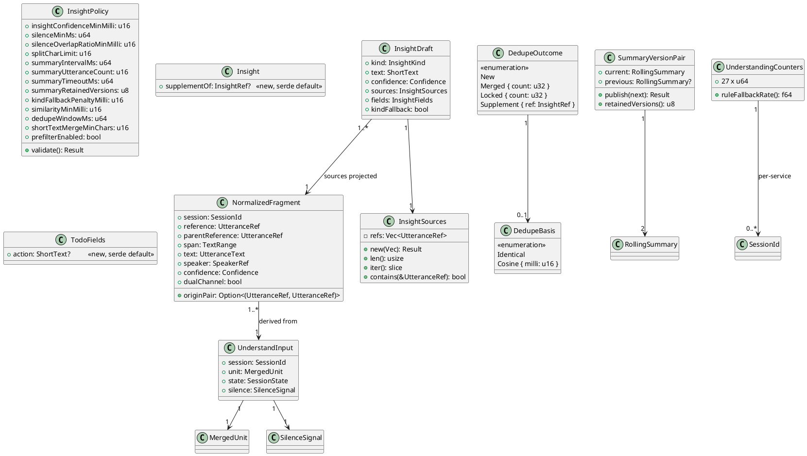

# b3_understanding · 增量设计

> 阶段：第二阶段（技术方案设计）。本文件只产出设计，**不修改任何代码、不修改 `docs/sdd/**`、不修改 `docs/progress/**`**。
> 需求基线：`.codeartsdoer/specs/b3_understanding/spec.md`（48 条 AC-B3-01~48）。本文件不重述需求、不重新裁决 spec 已定事项，只回答"如何实现"。
> 范围：`docs/sdd/tasks.md` 批次 B3 的 **28 / 29 / 30 / 31**；不含 32（缺口识别）与 33（持久化/恢复/背压）。
> 行号口径：2026-11-22 快照；代码引用一律给"文件 + 行号区间"，文档引用一律给"章节号 + 条目号"。

---

# 一、需求与存量功能关系分析

## 1.1 需求功能与存量功能对比

### 1.1.1 已实现功能

匹配度判定依据：**行为等价**（可直接复用、无需改动语义）= 100%；**语义等价但缺一处标记/约束** = 75%；**只提供底层算子、上层语义缺失** = 50%。

| 需求功能 | 存量功能 | 代码位置 | 匹配度 |
|---|---|---|---|
| 合并单元作为唯一入口（spec 1.5-1） | `MergedUnit::Single/Merged` 二值封闭 + `MergeSpan` 投影 | `crates/application/src/capture/merge_types.rs:62-98` | 100% |
| 单条合并单元只提炼一次（AC-B3-42 / AC-DD-08） | `DedupeEvidence.merged.insight_trigger_count=1`、被合并侧 `folded` 为 0 | `crates/application/src/capture/dedupe_guard.rs:222-231`、`merge_types.rs:114-128` | 100% |
| 双通道双引用保留（AC-B3-41） | `Pairing{subtitle_ref, asr_ref}` + `MergedUtterance.utterance.reference = subtitle.reference` | `crates/domain/src/merge/merger.rs:18-26,66-84` | 100% |
| 说话人兜底"未知说话人"（AC-B3-02） | `SpeakerRef::unknown()` 固定标签 + `identified=false` | `crates/domain/src/model/utterance.rs:14-25` | 100% |
| 推测性硬准入 0.35（AC-B3-04） | `MIN_INSIGHT_CONFIDENCE=0.35` + `is_eligible_for_insight()` | `crates/domain/src/model/utterance.rs:44-49` | 100% |
| 四类要点封闭枚举（AC-B3-26/28） | `InsightKind` 四值 + `Default=KeyInfo` | `crates/domain/src/model/enums.rs:34-40` | 100% |
| 人工编辑不被覆盖（AC-B3-38） | `lock_for_manual_edit` + `merge_repeated` 不改正文 | `crates/domain/src/model/insight.rs:106-127` | 100% |
| 已删除禁止合并（AC-B3-40） | `InsightError::Deleted` 早退 | `crates/domain/src/model/insight.rs:112-118,174-179` | 100% |
| 要点无来源拒绝（AC-B3-25/41） | 构造期 `InsightError::MissingSource` | `crates/domain/src/model/insight.rs:87-90` | 100% |
| 字符 3-gram 整数余弦（AC-B3-35，C-03） | `ngram_cosine_milli` 纯整数、上限 1000 | `crates/domain/src/merge/equivalence.rs:52-86` | 100% |
| 文本归一化（AC-B3-35 前置） | `normalize_text`（全角转半角 + 小写 + 去标点） | `crates/domain/src/merge/normalize.rs:51-60` | 100% |
| Schema 严格解码（AC-B3-24） | `deny_unknown_fields` + `SchemaRule` 分类 | `crates/infrastructure/src/llm/wire.rs:24-35,140-175,314-330` | 100% |
| 未知 kind 兜底 KeyInfo（AC-B3-27） | `kind_from_wire` 非三值一律 KeyInfo | `crates/infrastructure/src/llm/wire.rs:120-126` | 100% |
| 要点正文 60 字上限（AC-B3-29） | `ShortText::LIMIT=60`、构造期拒绝 | `crates/domain/src/vo/text.rs:95,30-52` | 100% |
| 片段正文 2000 字上限（AC-B3-09） | `UtteranceText::LIMIT=2000`、构造期拒绝 | `crates/domain/src/vo/text.rs:96,30-52` | 100% |
| 区间合法性（AC-B3-09/10） | `TextRange::new` 要求 `start<end` | `crates/domain/src/model/session.rs:67-75` | 100% |
| 会话六状态封闭（AC-B3-07/08） | `SessionState` 六值 + 状态迁移表 | `crates/domain/src/model/enums.rs:7-14`、`model/session.rs:77-100` | 100% |
| 网关六类故障分类（AC-B3-20） | `FailureClass` 六值 + `DegradeCause` | `crates/domain/src/model/llm.rs:502-546` | 100% |
| 网关能力查询（AC-B3-13 失败分流） | `LlmCapability{endpoint_configured,model_configured,cooling}` | `crates/domain/src/port/llm.rs:78-84` | 100% |

### 1.1.2 需要扩展的功能

| 需求功能 | 存量功能 | 差异说明 | 扩展方向 |
|---|---|---|---|
| 28.3 超长切分（AC-B3-09~11） | `UtteranceText::new` 仅**拒绝**超 2000 字，无切分能力 | **输入**：现有只接收 `String`；**输出**：现有只返回 `Err(TextBoundError)`，无子片段；**边界**：无 span 分配、无边界优先规则、无确定性约束 | 新增**纯函数**切分器（新文件 `crates/domain/src/model/utterance_text.rs`，与 tasks 28.3 路径一致）；不修改 `vo/text.rs` 的 `UtteranceText` 任何行为 |
| 29.2 摘要 `topics`/`entities`（AC-B3-18，C-01） | `model::llm::Summary` 只有 `text/covered/version/carried_over/produced`；领域 `RollingSummary` 已要求 `topics`/`entities` | **输入**：网关只回文本；**输出**：领域要结构化主题；**边界**：`TopologyWire` 严格拒绝未知字段，"无主题不发布"无判定点 | 应用层新增**确定性文本→主题解析器**（`summary_guard.rs`）；不放宽 `RollingSummary` 约束、不给 `Summary` 加字段（理由见 2.0 C-01） |
| 29.3 15s 超时（AC-B3-19） | `DeadlineMs::MAX=8000`，且 `validate` 拒绝 >8000 | **边界**：网关无法表达 15s；**语义**：网关超时（≤8s）与"摘要刷新超时（15s）"是两层 | 应用层新增 `SummaryGuard` 的 **deadline 记账**（`summary_timeout_ms`），网关 `DeadlineMs` 保持 `min(15000,8000)=8000`；不改 `DeadlineMs` |
| 30.2 分类兜底降置信（AC-B3-27） | `kind_from_wire` 兜底为 `KeyInfo`，但**不产生惩罚、不留标记** | **差异**：无"是否兜底"信息，无法扣减 0.15；`wire.rs` 私有且本轮禁改 | 应用层新增 `classify_kind`（与 `kind_from_wire` 映射表逐项等价），返回 `KindClassification{kind, fallback}`；惩罚在应用层后处理 |
| 30.4 待办"动作必填"（AC-B3-31） | `TodoFields{assignee, due}` **无 action** | **差异**：领域类型无法表达"动作非空"，AC-B3-31 的 `todo_without_action_is_rejected` 无载体 | 领域 `TodoFields` 追加 `action: ShortText`（新字段，可反序列化默认），`InsightError` 追加 `TodoActionMissing` |
| 31.2 冲突并列"补充信息"（AC-B3-39） | `Insight` 无"指向原要点"的字段 | **差异**：无法表达 `supplement_of`；`mention_count` 无法区分"补充"与"合并" | 领域 `Insight` 追加 `#[serde(default)] supplement_of: Option<InsightRef>`（可忽略字段，spec 6.3-10） |
| 31.1 相似度阈值 0.88（AC-B3-35，C-03） | `classify_equivalence` 三级判定（Identical→NearHash→Cosine） | **差异**：`NearHash{distance}` 不含 milli，`simhash_max_distance=3` 默认会以低于 0.88 的余弦命中，直接复用与 AC 字面阈值冲突 | 只复用底层 `ngram_cosine_milli` + `normalize_text`；B3 自有 `DedupeBasis` 两值封闭枚举（见 2.0 C-03） |
| 28.1 准入 0.50（AC-B3-03） | tasks 28.1 DoD 写"<0.5 使 `is_eligible_for_insight()==false`"，与常量 0.35 冲突 | **差异**：语义必须拆分为"推测 0.35 / 可提炼 0.50" | **不改** `is_eligible_for_insight`；应用层新增 `low_confidence.rs` 做软准入（`confidence_milli ∈ [350,500)` → 只落盘） |
| 29.1 触发与增量（AC-B3-13~15） | 无摘要编排；`fallback.rs::summary` 只是"沿用上一版" | **差异**：无窗口、无 pending、无触发判定 | 应用层新增 `rolling_summary.rs` 的 `SummaryWindow`（消费式窗口，触发即清空） |
| 30.5 应用层规则兜底（AC-B3-33） | `infrastructure/llm/fallback.rs` 只产单条 `KeyInfo`，且 `Summary` 无 topics | **差异**：需要"四类结构完整"，且禁改 `fallback.rs` | 应用层新增 `rule_fallback.rs`（只依赖 domain 类型，做出四类草稿）；`fallback.rs` 保持零改动 |
| 4.4-1 计数扩展（AC-B3-34） | `DiagnosticCounter` 固定 13 项（采集层语义） | **差异**：B3 需 27+1 项，且既有枚举被快照/用例依赖 | 新增独立 `UnderstandingCounters` 结构，不改既有枚举 |

### 1.1.3 需要新增的功能或接口

按业务模块分组；每条标注输入、输出、核心逻辑与依赖关系。

**A. 片段归一化与准入（spec 5.1，AC-B3-01~12）**

| 功能点 | 输入 | 输出 | 核心逻辑 | 依赖 |
|---|---|---|---|---|
| 来源/平台一致性裁决 | `UnderstandInput{session, unit, state, silence}` | `AdmissionDecision::Rejected(SourcePlatformMismatch)` | 平台通道必须有 `platform==session.platform`；麦克风/外部转写必须 `platform==None` | 会话绑定平台（装配方注入） |
| 静音/空段判定 | `Utterance.span` + 上游静音区间 | `silence_dropped` / `silence_partial_overlap` / `empty_chunk_dropped` | 完全覆盖 → 丢；重叠比 ≥800‰ → 丢；否则准入并计部分重叠；`<300ms` 且正文去空白为空/仅标点 → 空段 | `InsightPolicy{silence_min_ms, silence_overlap_ratio_min_milli}` |
| 两步置信度分流 | `Utterance.confidence` | `Admitted` / `StoredOnly{low_confidence}` / `Rejected{speculative}` | 先 `is_eligible_for_insight()`（0.35，既有），再 `confidence_milli ≥ 500` | 既有 `Utterance`、`InsightPolicy` |
| 超长切分 | `text` + `span` | `Vec<SplitChunk{index, text, span, ref}}` | 句读优先 + 标量上限 2000 + 时长比例分配（见 2.1.3-1） | `UtteranceText::LIMIT`、`TextRange` |
| 幂等去重 | `UtteranceRef` | `duplicate_delivery_ignored` 递增、0 组草稿 | 会话内 `HashSet<(SessionId, UtteranceRef)>`，首次插入成功才继续 | 无 |
| 顺序保持 | 批量 `UnderstandInput` | 与输入同序的 `Vec<FragmentOutcome>` | 单线程串行消费，禁止并行重排序 | 无 |

**B. 滚动摘要（spec 5.2，AC-B3-13~21）**

| 功能点 | 输入 | 输出 | 核心逻辑 | 依赖 |
|---|---|---|---|---|
| 触发判定 | `SummaryWindow` + 虚拟时钟 | `bool` | `pending≥20` 或 `elapsed≥30s`，且 `inflight==false` | `UnderstandClock` |
| 增量请求构造 | `pending refs` + 上一版 | `LlmGenerationRequest{task=Summary, purpose=RollingWindow}` | 只放新增片段（≤20 条）+ 上一版主题摘要，不放全量 | `RedactedPayload`、`SummaryPurpose` |
| 主题/实体解析（C-01） | `Summary.text` + 术语快照 | `SummaryParse{topics, entities}` 或 `NoTopics` | 确定性分句 + 术语命中 + 高频二元组（见 2.1.3-2） | `normalize_text` |
| 版本对维护 | 解析结果 + 当前版本对 | `SummaryVersionPair` | `version+1`，旧当前版降为上一版，保留上限 2 | 无 |
| 超时丢弃 | `deadline_ms` + `UnderstandClock` | `summary_timeout` 递增、版本不变 | 发起前记账、返回后比较；不重试不排队 | `InsightPolicy.summary_timeout_ms` |
| 不阻塞准入 | — | `admitted` 持续递增 | 摘要刷新在独立状态位（`inflight`），准入路径不等待 | 互斥粒度按会话 |

**C. 要点抽取（spec 5.3，AC-B3-22~34）**

| 功能点 | 输入 | 输出 | 核心逻辑 | 依赖 |
|---|---|---|---|---|
| 规则预筛 | `text` | `PrefilterHit` / `PrefilterMiss` | 三信号固定词表，任一 `contains` 即命中 | `InsightPolicy.prefilter_enabled` |
| 结构化抽取 | 片段 + 摘要 + 术语快照 | `Vec<InsightItem>` | 一次 `InsightExtract` 请求；`sources` 由调用方回填 | `StructuredLlmGateway` |
| Schema 校验 | `StructuredBody` | 通过 / `schema_violation` | 复用网关严格解码结果；额外断言 `text≤60`、`sources` 非空 | `wire.rs`（只读） |
| 分类兜底 | `InsightKind` | `KindClassification{kind, fallback}` | 未知/空 → `KeyInfo` 且 `fallback=true` | 无 |
| 60 字拆分 | `ShortText` | `Vec<ShortText>` | 同切分算法、上限 60、句读优先（见 2.1.3-3） | 切分纯函数 |
| 字段补全 | `InsightDraft` | 补全后的 `InsightDraft` | 决策缺 owner→`None`（展示"待确认"）；待办缺 assignee/due→`None`，action 必填；疑问初始未答复 | `InsightFields` |
| 疑问闭环 | 回应片段 + 既有疑问要点 | `unanswered=false`，`sources.push(reply)` | 同会话 + 10s 窗 + 回应词表 | `InsightStore` |
| 规则提炼兜底 | 片段 + `FailureClass` | ≥1 条四类草稿 | 应用层纯函数：按预筛信号给 kind，文本取片段首 60 字 | `InsightPolicy.kind_fallback_penalty_milli` |

**D. 去重与引用回溯（spec 5.4，AC-B3-35~42）**

| 功能点 | 输入 | 输出 | 核心逻辑 | 依赖 |
|---|---|---|---|---|
| 来源与跨会话断言 | `InsightSources` + `SessionId` | 拒绝 / 通过 | 每条 ref 必须属于同一会话；非空 | `SessionScopedRef` 映射 |
| 相似度判定（C-03） | 两条 `ShortText` | `DedupeBasis` | `normalize` 相等 → `Identical`；`min_chars≤8` → 跳过；否则 `ngram_cosine_milli≥880` | `merge::ngram_cosine_milli` |
| 10 分钟窗口 | 候选要点 `created_at` + 虚拟时钟 | 候选集合 | `now - candidate.created_at ≤ 600000ms` | `UnderstandClock` |
| 合并/锁定/补充三态 | 候选 + 新草稿 | `New / Merged{n} / Locked / Supplement` | 同 kind 才比较；锁定只加计数；冲突（主题同、相似<880）→ 新增补充要点 | `Insight::merge_repeated`（既有） |
| 可见性纯函数 | `Insight.status` | `bool` | `status != Deleted` | 无 |
| 重要标记与筛选 | `InsightKind` / 关键词 | 子集 | 只读筛选，不改状态 | 无 |

**E. 策略与观测（跨模块）**

| 功能点 | 输入 | 输出 | 依赖 |
|---|---|---|---|
| 阈值策略 | 装配方注入 | `InsightPolicy`（13 字段，`validate()`） | 不改 `MergePolicy`/`CapturePolicy` |
| 理解层计数 | 事件 | `UnderstandingCounters`（27×`u64` + 1 派生 `f64`） | 只增不减 |
| 虚拟时钟 | 装配方注入 | `UnderstandClock::{now_millis}` | 源码禁用真实计时（AC-B3-43） |
| 门面编排 | `UnderstandInput` | `UnderstandOutcome` | 上述全部 |

## 1.2 存量功能详细分析

### 1.2.1 `Utterance::is_eligible_for_insight`

- **接口契约**：`&self -> bool`；入参隐含 `confidence` 与 `text`；无出参副作用；不返回原因。
- **业务规则**：`confidence >= 0.35` 且 `text.trim() != "…"` 才为 `true`；即"非推测且非占位"。
- **可扩展点**：无钩子，纯判定。
- **约束**：常量被 AC-B3-04 的 grep 锁死（`MIN_INSIGHT_CONFIDENCE: f64 = 0.35` 必须唯一命中），**任何"改成 0.5"的做法都会直接使 AC-B3-04 失败**。因此 0.50 只能以**第二个判定**存在，且必须落在应用层。
- **对设计的约束**：B3 的 `speculative_skip` 必须复用此函数（而不是自己写 `<0.35`），以保证"原因码与既有语义同源"。

### 1.2.2 `ngram_cosine_milli` 与 `classify_equivalence`

- **接口契约**：`ngram_cosine_milli(left,right) -> u16`（0..=1000）；`classify_equivalence(left,right,&MergePolicy) -> Option<PairBasis>`。
- **业务规则（关键约束）**：`classify_equivalence` 的三级**短路顺序**为 `Identical → NearHash → Cosine`；`NearHash` 的准入条件包含 `length_ratio ∈ [600,1600]‰` 与 `hamming_distance ≤ simhash_max_distance(默认 3)`，且**先于余弦**返回。这意味着两条余弦仅 0.80 的文本可能因 SimHash 命中而"等价"。
- **可扩展点**：无。
- **约束**：`ngram_cosine_milli` 已由 `merge/mod.rs:9` 导出，可跨 crate 调用；`cosine_min_chars` 默认 8 是 `MergePolicy` 的字段，**B3 不得修改或借用**（`InsightPolicy.short_text_merge_min_chars` 是独立字段，默认值同为 8 但语义独立）。
- **对设计的约束**：B3 的 0.88 阈值必须**绕过** `classify_equivalence` 的前两级，否则 AC-B3-35 的"0.87 不合并"无法稳定成立。详见 2.0 C-03。

### 1.2.3 `Insight::merge_repeated` 与 `lock_for_manual_edit`

- **接口契约**：`merge_repeated(&mut self, other: &Self) -> Result<(), InsightError>`；`lock_for_manual_edit(&mut self)`。
- **业务规则**：`status==Deleted` → `Err(Deleted)`（不改任何字段）；`mention_count = saturating_add(max(other,1))`；**未锁定**时把 `other.sources` 差量追加；**已锁定**时不追加来源（保持人工版本纯净）。
- **可扩展点**：无。
- **约束**：`mention_count` 为 `u32` 且饱和；`sources` 追加是 `contains` 线性去重。
- **对设计的约束**：AC-B3-38 要求"锁定后正文逐字不变、status 仍为已编辑、mention 递增"——这**已被既有用例 `manual_edit_is_not_overwritten_by_merge` 覆盖**，B3 只需在其上加"锁定后来源是否追加"的独立断言，**不得修改既有用例**。另注意：AC-B3-38 的语义要求锁定后 `mention_count` 递增，但**来源不得扩张**，因此 `Locked` 分支必须走 `merge_repeated`（自然满足）。

### 1.2.4 `StructuredLlmGateway::complete_structured` 与 `StructuredOutcome`

- **接口契约**：`complete_structured(&request) -> Result<StructuredOutcome, CopilotError>`；同步 trait，实现层负责调度；调用方线程不得执行 socket 读。
- **业务规则**：成功时 `body=Some(StructuredBody::*)`、`failure=None`；降级时 `degraded=true`、`degrade_cause=Some(_)`，且 `Failed(class)` 与 `failure` 一致（`invariants_hold`）。
- **可扩展点**：`capability()` 可用于"未配置/冷却"前置判定，避免无效调用。
- **约束**：`StructuredOutcome` 含 `model: String` 与 `normalization` 记录——**B3 不得把模型标识、请求标识字段、端点地址写入任何对象、计数、日志或测试夹具**（spec 4.3-1）。测试替身必须使用占位串 `"stub"`。
- **对设计的约束**：B3 只读 `outcome.body` 与 `outcome.failure/degrade_cause`；不读 `model`、不读 `attempts` 之外的任何元数据；`http_status` 不进入计数。

### 1.2.5 `UtteranceText` / `ShortText` 构造期约束

- **接口契约**：`new(raw) -> Result<Self, TextBoundError>`；先 `trim` 再按 `chars().count()` 校验，**空串视为非法**。
- **业务规则**：上限 2000 / 60；`truncated()` 是兜底构造（`ShortText` 专用），会**静默截断**。
- **可扩展点**：无。
- **约束**：`truncated()` 与 AC-B3-29"禁止截断、必须拆分"**语义冲突**，B3 的拆分路径**禁止**调用 `ShortText::truncated`（只有 `infrastructure/llm/fallback.rs` 的既有兜底可以）。这条必须写进实现纪律，否则 `oversize_draft_blocked` 会静默变成 0 而正文被截。
- **对设计的约束**：拆分用 `ShortText::new(chunk_text)`，若失败（空/超限）则该段 `empty_chunk_dropped += 1` 丢弃，不回退到截断。

---

# 二、增量设计方案

## 2.0 设计裁决登记（三项强制冲突 + 两项实现级冲突）

> 本节是全文的"上游结论"。后续 2.1~2.8 的所有设计都不得与本表矛盾。每条只允许**一个**方案。

### C-01（主）`Summary` 只有 `text`，`RollingSummary` 要求 `topics`/`entities` 非空

**最终方案：唯一方案 =「应用层确定性解析 + 保留领域约束 + 不新增结构化字段」。**

排除另两条路线的硬理由（不是偏好，是约束）：

1. **给 `Summary` 或 `SummaryWire` 增加 `topics`/`entities` 字段 ⇒ 不可行。**
   - `wire.rs::SummaryWire` 标注 `deny_unknown_fields`（`crates/infrastructure/src/llm/wire.rs:24-25`）。模型若输出新字段会命中 `SchemaRule::UnknownField`，`schema_violation` 直接触发，与 AC-B3-18 的"成功发布"互斥。
   - 即使改了 `SummaryWire`，还要改 `wire.rs:314-330` 的组装；而本轮裁决**禁止修改 `infrastructure/llm/**`**（AC-B3-33 用 `git diff --quiet HEAD -- .../fallback.rs` 同时锁住该目录纪律）。
   - 给 `model::llm::Summary` 加必填字段会让 `fallback.rs:83-100` 的 `summary()` 构造**编译失败**，而 `fallback.rs` 禁改 ⇒ 直接死锁。
2. **放宽 `RollingSummary` 的 `topics` 非空约束 ⇒ 不可行。**
   - `topics` 是相关性评分的输入（`docs/sdd/design.md` 2.3.2 与 spec 6.2-3），放宽后 AC-B3-18 的"`empty_topics_blocks_publish` 必须使 `summary_publish_blocked=1`"没有可观测对象。
   - 放宽还需配套迁移（旧数据补齐空主题），而本轮无持久化（33.x 不在范围），迁移无处落地。

因此：

- **领域 `RollingSummary` 一行不改**（`crates/domain/src/model/insight.rs:20-26`），继续要求 `topics` 非空。
- **网关契约一行不改**（`model::llm::Summary`、`wire.rs`、`fallback.rs` 均零改动）。
- **新增应用层 `SummaryTopicParser`**：把 `Summary.text` 按**确定性规则**解析为 `Vec<Topic>` 与 `Vec<Entity>`。
- **失败处置固定**：解析出 `topics.is_empty()` → **不发布**（`summary_publish_blocked += 1`），版本号不变，保留上一版；`entities` 允许为空（0..n，spec 6.2-4）。**不得**用"兜底主题"（如"会议"）填充——那会让"无主题"变成不可判定，AC-B3-18 失效。

确定性解析规则（`parse_summary(&Summary.text, &LexiconView) -> SummaryParse`）：

| 步 | 规则 | 为什么必须这样定 |
|---|---|---|
| P1 | 分句：按 `。！？；!?;\n` 切；保留非空段；段首尾 `trim`；单段 >80 标量值则按二级边界 `, . ， 、` 硬切到 ≤80 | 与 28.3 切分同一套"句读优先 + 上限硬切"，全项目一种切法 |
| P2 | 主题候选 A（优先）：`LexiconView.names`（术语快照，≤64 项）在句中 `contains` 命中，命中数 >0 的句 → 该句所有命中词均为候选，`weight_base = 命中次数` | 术语快照是装配方注入的确定性输入，无模型漂移 |
| P3 | 主题候选 B（回退）：无术语命中的句 → 取归一化后（`normalize_text`）长度 2..=12 的连续子串中**出现 ≥2 次**者，取出现次数最高者 1 个 | `normalize_text` 已保证全角/大小写/标点归并，避免同一词多种写法被算成两个主题 |
| P4 | 排序：`count` 降序 → 首次出现位置升序 → 字节字典序升序（三级全序，杜绝 HashMap 迭代序） | AC-B3-11 的"同一输入同输出"精神同样适用于摘要 |
| P5 | 截断：`topics` 取前 5；`weight = count as f64 / total_count as f64`（整数计数相除，不累加浮点） | 避免浮点累积误差导致同一输入输出漂移 |
| P6 | 实体：候选 = ASCII 连续 `[A-Za-z0-9_-]{2,}` 词 ∪ `LexiconView.names` 命中词；保留在 ≥2 句出现的项；`normalized = normalize_text(name)`；同名去重保序；取前 10 | 实体 0..n，可为空，不阻断发布 |
| P7 | 失败：`P1..P5` 后 `topics` 仍为空（文本全标点/全空白/单字）→ `SummaryParse::NoTopics` | 对应"不发布"唯一触发点 |

**注意**：`parse_summary` 只吃 `text`，不读 `covered`/`version`（那两项由版本对与窗口计算，避免模型篡改版本语义）。

### C-02（次）28.3 超长切分按字符还是句读

**最终方案：二者并用 ——「以 Unicode 标量值 2000 为硬上限，在 `[start+1, end]` 内从右向左优先落在一级句读之后，其次二级句读之后，均无则硬切」；不使用 grapheme cluster、不引入分词。**

算法（`split_utterance_text(text: &str, span: TextRange, limit: usize) -> Result<Vec<SplitChunk>, SplitError>`；`span` 参与时间轴分配，`limit` 参与字符上限）：

```
chars = text.chars()            // Unicode 标量值序列，O(n) 一次
total = chars.len()
if total == 0                       -> Err(EmptyText)
if limit == 0 || limit > 2000       -> Err(LimitOutOfRange)
if total <= limit                    -> [ [0,total) ]

start = 0
while start < total:
    end = min(start + limit, total)
    if end == total: push [start,total); break
    cut = 从 end 向左扫描到 start+1 的第一个 i，使 chars[i-1] ∈ 一级边界集合
    if 未命中: cut = 从 end 向左扫描到 start+1 的第一个 i，使 chars[i-1] ∈ 二级边界集合
    if 未命中: cut = end
    if cut <= start: cut = end        // 防御：不可产出空段
    push [start, cut)
    start = cut
```

- 一级边界集合 `PRIMARY_BREAKS = ['。','！','？','；','!','?',';','\n']`（全大写常量，符合命名偏好）。
- 二级边界集合 `SECONDARY_BREAKS = [',','.','，','、']`。
- **为什么"从右向左"**：从右向左才能在一次扫描内取到"尽可能长且合法"的段，段数最少（AC-B3-09 要求 4001 字 → ≥3 段，从右向左对 4001 字正好 3 段，而"从左向右找第一个边界"会产生远多于 3 段的碎片，虽然也满足 `≥3`，但会放大 4.1-4 的性能与下游卡片数量）。

形式化不变量（I1~I6，全部可在单测中断言）：

| 编号 | 不变量 | 断言方式 |
|---|---|---|
| I1 | `∀i: 1 ≤ chars(chunk_i).count() ≤ limit` | 逐段 `char_count()` |
| I2 | `concat(text_i) == text`（**精确相等，不 trim**） | `String::from_iter` 后 `assert_eq!` |
| I3 | `seg[0].start_char==0` ∧ `seg[i+1].start_char==seg[i].end_char` ∧ `seg[n-1].end_char==total` | 由 I2 直接蕴含，仍显式断言 |
| I4 | 时间：`t_0=span.start`，`t_n=span.end`，`t_{i+1}=t_i + round(dur·len_i/total)`（整数 `(dur*len_i + total/2)/total`），末段吸收残差；`∀i: t_{i+1} > t_i` | 逐段 `span.end > span.start` + 首尾相等 |
| I5 | 属性不变：`speaker`（含 `identified`）、`source`、`platform`、`dual_channel`、`origin_pair`、`reading_mode`、`confidence`、`session` **逐字段复制**；`UtteranceRef` 派生为 `"{parent}#{i}"`，且 `i=0` 段沿用 `parent` 原值 | 逐字段 `assert_eq!` |
| I6 | 确定性：`split` 只依赖 `(text, limit)`；源码不含时间/随机/哈希 | 100 次逐字节相同 + `--rule=source` 静态扫描 |

- **"不切断说话人"的形式化**：说话人不是文本内容，切分只产生 `chars` 切片，**不产生新的 `SpeakerRef`**；I5 要求 `speaker_i ≡ speaker`（含 `identified` 位），因此"同一说话人的一句长话被切段后仍属同一说话人"是结构性保证，不依赖启发式。
- **"不跨会话"的形式化**：`Utterance` 本身**不含** `session` 字段（见 D-02），会话由 `UnderstandInput.session` 携带；I5 要求所有子片段与父单元共用同一 `SessionId`，且 `origin_pair` 两条 ref 也必须属于该会话（`cross_session_ref` 校验在 31 入口复核）。
- **不柔化的边界**：切分点按标量值落，可能切在 emoji ZWJ 序列或组合符内部 → 登记 D-B3-01，只加计数 `split_grapheme_boundary`，**不引入字素簇依赖**。该计数不参与失败判定。

### C-03（次）0.88 相似度复用既有度量还是另建

**最终方案：「复用底层 `ngram_cosine_milli`（不做任何数值改造），但 B3 不复用 `classify_equivalence` 与 `PairBasis`；B3 定义自己的两值封闭枚举 `DedupeBasis`」。**

阈值单位对齐：

| 项 | 合并层（B2.24） | B3 理解层 | 对齐方式 |
|---|---|---|---|
| 度量 | `ngram_cosine_milli`：`1000·Σmin / isqrt(Σa²·Σb²)`，`u16`，0..=1000 | 同一函数（`merge::ngram_cosine_milli`，`merge/mod.rs:9` 已导出） | **同一个函数，零改写** |
| 阈值单位 | `cosine_min_milli: u16 = 860`（‰） | `similarity_min_milli: u16 = 880`（‰） | 同为 milli（千分位），0.88 ⇔ 880，无换算 |
| 前置判定 | `Identical → NearHash → Cosine` 三级短路 | `Identical → Short(跳过) → Cosine` 两级 + 短文本跳过 | **故意不同**（理由见下） |
| 判定结果类型 | `PairBasis{Identical, NearHash{distance}, Cosine{milli}}` | `DedupeBasis{Identical, Cosine{milli}}` + `None` + `Short` | 不共享类型 |

**为什么不复用 `PairBasis`（关键）**：

1. `PairBasis::NearHash{distance}` **不携带 milli**，无法表达"相似度 0.87 但 SimHash 距离 2"这一情形；而 AC-B3-35 明确要求"相似度 0.87 时不得合并"。若 B3 直接用 `classify_equivalence`，这类输入会返回 `Some(NearHash)` → 被合并 → **AC-B3-35 第二断言直接失败**，且失败原因与"阈值 0.88"完全脱钩。
2. `PairBasis` 的 `length_ratio_min/max_milli`（600/1600）是**合并层为双通道配对**设计的（字幕与音频长度可能有差异）。要点正文已 ≤60 字且经过拆分，长度比约束在此处无意义，且会引入 `MergePolicy` 依赖 → 违背 spec 6.4-14"不得用 `MergePolicy` 承载 B3 阈值"。
3. `PairBasis` 属于 `merge` 领域（双通道配对语义）。把它复用到"要点去重"会让两个领域语义纠缠，后续任一侧调阈值都会误伤另一侧。

**B3 判定函数**（`crates/application/src/understand/deduplicator.rs` 内，`pub(crate)`）：

```
fn insight_similarity(left: &ShortText, right: &ShortText, policy: &InsightPolicy) -> SimilarityVerdict
// a = normalize_text(left); b = normalize_text(right)
// 1) a == b                                  -> Verdict::Basis(DedupeBasis::Identical)
// 2) min(a.chars, b.chars) <= short_text_merge_min_chars(8)
//      a == b 已在 1) 命中 -> Verdict::Basis(Identical)
//      否则              -> Verdict::ShortTextSkipped
// 3) milli = ngram_cosine_milli(&a, &b)
//    milli >= similarity_min_milli(880)      -> Verdict::Basis(DedupeBasis::Cosine { milli })
// 4) 其它                                    -> Verdict::Below
```

- 步骤 1 与 2 的顺序保证 AC 的两条互不干扰：**完全相等永远合并**（即使 <8 字）；**短文本只接受完全相等**（spec 5.4.3-5，计 `short_text_merge_skipped`）。
- `DedupeBasis::Cosine{milli}` 的 milli 直接来自既有函数，**诊断可读、可复现**；`similarity_min_milli=880` 与 `-0.88` 无浮点转换。

### D-01 `TodoFields` 缺 `action`（实现级必修）

- 现状 `crates/domain/src/model/insight.rs:34-38` 只有 `assignee`/`due`，而 spec 5.3.1-11 与 AC-B3-31 要求"动作字段必须非空"。
- 设计：追加 `pub action: Option<ShortText>`，并 `#[serde(default)]`；`Insight::new` 不校验（保持既有构造签名不变），由 `field_filler.rs` 在待办分支强制 `action.is_some()`，否则返回 `InsightError::TodoActionMissing`。
- 为什么用 `Option<ShortText>` 而不是 `ShortText`：`serde(default)` 才能让旧版数据（无该字段）反序列化成功（spec 4.5-4 "旧版本忽略新增字段"）；而 `Default` 对 `ShortText` 不可用（不允许空串）。
- 兼容影响：`TodoFields::default()` 仍是 `{action:None, assignee:None, due:None}`，既有 76 个 domain 用例名不变。

### D-02 `Utterance` 不含会话标识（实现级必修）

- 现状 `Utterance`（`crates/domain/src/model/utterance.rs:28-40`）无 `session` 字段；`MergedUtterance`（`merger.rs:22-26`）也没有。
- 而 AC-B3-41（跨会话拒绝）、AC-B3-36（10 分钟窗口按会话）、`cross_session_ref` 计数都要求"会话可判定"。
- 设计：**不改 `Utterance`**。新增应用层 `UnderstandInput { session: SessionId, unit: MergedUnit, state: SessionState, silence: SilenceSignal }` 作为 B3 的唯一入口；`InsightStore` 维护 `HashMap<UtteranceRef, SessionId>`，在首次准入时写入，去重时校验。子片段 ref 形如 `"{parent}#{i}"`，通过 `parent` 前缀映射到同一会话（映射在准入时一次性写入全部派生 ref，避免前缀解析歧义）。
- 为什么不在 domain 加字段：会给 `ToUtterance` 的 5 处构造点（`dedupe_guard.rs:56-78`、`merger.rs:59-73`、`utterance.rs` 测试等）带来改动，触发 `capture/` 用例名与行为回归，违背 spec 1.4-1。

---

## 2.1 实现模型

### 2.1.1 上下文视图



- 上游只有 B2.24 一条链路，**单向**；B3 不写 `capture/`、不碰 `dedupe_guard.seen`（spec 1.5-1）。
- 下游 LLM 可整体缺席：缺席时 `capability().endpoint_configured==false` → 不发起调用，直接走应用层规则兜底。
- **不出现**：数据库、消息队列、跨进程通道。B3 全部在进程内、内存中（spec 1.4-3）。

### 2.1.2 服务/组件总体架构



职责与依赖频率：

| 组件 | 职责 | 调用频率 | 依赖 |
|---|---|---|---|
| `UnderstandService` | 唯一门面；按 28→31 串行；幂等与顺序 | 每片段 1 次 | 全部子组件 |
| `normalize.rs` | 平台一致性、说话人兜底、状态裁决、切分调度 | 每单元 1 次 | `silence_filter`、`low_confidence`、`chunking` |
| `silence_filter.rs` | 全/部分覆盖判定、空段判定 | 每单元 1 次 | 无 |
| `low_confidence.rs` | 整数 milli 两步分流 | 每单元 1 次 | `Utterance` |
| `rolling_summary.rs` | 窗口累积、触发判定、版本对 | 每片段 1 次（仅累积）/ 30s 或 20 条（刷新） | `summary_guard` |
| `summary_guard.rs` | 发起/超时/失败分类/主题解析/发布裁决 | 每刷新 1 次 | `UnderstandClock`、`StructuredLlmGateway` |
| `insight_extractor.rs` | 预筛 → 请求 → 校验 → 兜底编排 | 每子片段 ≤1 次 | `splitter`、`field_filler`、`rule_fallback` |
| `deduplicator.rs` | 来源断言、相似度、窗口、三态 | 每草稿 1 次 | `merge::ngram_cosine_milli`、`store` |
| `store.rs` | 内存要点集合 + ref→session 映射 | 每草稿 1 次 | 无 |
| `insight_ops.rs` | 标记/删除/筛选（只改 `Insight` 字段） | 用户动作 | `store` |

**配置项与取值**：全部集中在 `InsightPolicy`（13 字段，2.3.2 给定义），由装配方注入；**默认值不改任何既有常量**（`MIN_INSIGHT_CONFIDENCE=0.35`、`ShortText::LIMIT=60`、`UtteranceText::LIMIT=2000`、`MergePolicy` 10 字段全部保持）。

**feature 开关**：运行时字段 `UnderstandFeature { Disabled, Enabled }`，**默认 `Disabled`**；不新增 Cargo feature（避免 `Cargo.toml` 出现 diff 行，见 2.5）。

### 2.1.3 实现设计文档

#### 1) 归一化与准入流水线（28，对应 AC-B3-01~12）



- **判定顺序固定**（护栏先于内容判定，内容判定先于切分）：状态 → 来源/平台 → 说话人兜底 → 幂等 → 硬准入 → 软准入 → 静音 → 空段 → 切分。
  - 为什么幂等放在置信度之前：AC-B3-12 要求"重复投递只产出 1 组草稿，`duplicate_delivery_ignored=1`"。若把置信度判定放在幂等之前，第二次投递会被计为 `skipped_low_confidence` 而不是 `duplicate_delivery_ignored`，计数语义错位。
  - 为什么软准入在静音之前：spec 1.6 的两步分流是"片段级"结论（落盘/不提炼），静音是"是否算作有效片段"。低置信片段先被标为"落盘不提炼"后，不应再被计为 `silence_dropped`（否则同一片段被两类计数重复记），这与"静音丢弃数不得虚高"的观测意图一致。
- **`Silent`（静默期）不停机**：状态 `Silent` 走正常路径（`Admitted`），只是不设置任何"可外发"标记——B3 **没有** `dispatchable` 字段，因此 `dispatch_candidates` 结构上恒为 0（spec 4.3-5）。
- **部分重叠阈值**：`overlap_ms * 1000 / span_ms >= silence_overlap_ratio_min_milli(800)`；整数比较，避免浮点。

#### 2) 滚动摘要版本模型（29，对应 AC-B3-13~21）

状态机（每会话一份）：



- **触发不变量**：`pending_new >= 20` ∨ `now - window_started_ms >= 30000`，且 `state == Idle`。触发即 `pending_new.clear()`（消费式），因此"同一窗口不重复刷新"由"清空 + `Inflight` 互斥"双重保证（AC-B3-13）。
- **版本单调不变量**：`current.version = previous.version + 1`（`previous` 存在时）；首个成功刷新为 1；**任何失败路径不改 `current`**。
- **保留 2 版**：`SummaryVersionPair{current, previous: Option<_>}`，无第三槽位；`retained_versions()` 返回 `1 + previous.is_some() as u8`。第 4 次刷新后 `previous.version=3`、`current.version=4`，版本 ≤2 不可达（AC-B3-17）。**不缓存全部历史**，因此内存增量有界（spec 4.1-5）。
- **15s 超时的表达方式**：`deadline_ms = clock.now_millis() + policy.summary_timeout_ms`，**请求发出前记账**；返回后 `clock.now_millis() > deadline_ms` → 超时。网关请求 `DeadlineMs = min(summary_timeout_ms, 8000)`（≤8s，符合 `DeadlineMs::MAX`），15s 完全由应用层守护表达，**不复用 `DeadlineMs`**（spec 6.4-7）。
- **乱序**：`pending` 按 `span.start_ms` 稳定排序后再算 `covered`；若排序后 `start < previous.covered.start_ms` → 不发布 + `summary_out_of_order += 1`。
- **不阻塞**：准入路径只做 `window.accumulate(ref, span)`（O(1) 追加）与 `maybe_trigger()`（O(1) 判定）；刷新在 `Sgd` 的状态位内串行推进，准入不等其结果。AC-B3-20 的"同一时段 ≥1 次准入"由"两路径无共享锁"结构性保证。

#### 3) 要点抽取三段式与兜底（30，对应 AC-B3-22~34）



**规则预筛三信号（固定词表，全大写常量）**

| 信号 | 常量 | 词表 | 判定 |
|---|---|---|---|
| 陈述性 | `STATEMENT_SIGNALS` | `确认`、`上线`、`决定`、`是`、`为`、`将`、`已经` | `text.contains(any)` |
| 行动性 | `ACTION_SIGNALS` | `我来`、`跟进`、`负责`、`下周`、`安排`、`待办` | 同上 |
| 疑问性 | `QUESTION_SIGNALS` | `？`、`?`、`吗`、`是否`、`如何`、`为什么`、`能否` | 同上 |

- 词表在**原始文本**（不归一化）上匹配，保证全角 `？` 与半角 `?` 都命中；中英混排对同一输入同输出（spec 4.5-5）。
- `prefilter_enabled=false` 时全部放行（对照回归用，AC 不判定）。
- **预筛与分类是两层**：预筛决定"是否值得调网关"，分类决定"是什么 kind"。前者失败 → 0 草稿（不兜底，spec 5.3.3-3 `extract_empty` 同理）；后者失败 → **必须保留要点**并降置信。

**四类分类兜底规则（封闭表）**

| 模型给出的 kind 字面量 | 归入 | `fallback` | 置信度处理 |
|---|---|---|---|
| `key_info` | `KeyInfo` | false | 不变 |
| `decision` | `Decision` | false | 不变 |
| `todo` | `Todo` | false | 不变 |
| `question` | `Question` | false | 不变 |
| 其它任意值（含空串、`note`、大小写变体） | `KeyInfo` | **true** | `confidence_milli = max(0, 原值 − 150)` |
| kind 字段缺失 | `KeyInfo` | **true** | 同上 |

- 与 `wire.rs::kind_from_wire` 的关系：**映射表逐项等价**（`decision→Decision`、`todo→Todo`、`question→Question`、其余→`KeyInfo`），B3 只是**额外产出 `fallback` 标记**。`wire.rs` 私有函数不可被 B3 调用，且本轮禁改，所以这是"语义镜像"，不是"第二套规则"。为保证不分叉，`insight_extract` 用例 `kind_fallback_table_matches_spec` 断言上表 6 行逐项成立（以 spec 5.3.1-7 与 AC-B3-27 为断言源）。
- 惩罚用整数：`Confidence::new((milli.saturating_sub(penalty)) as f64 / 1000.0)`，`penalty=150` ⇒ 0.80→0.65（AC-B3-27 逐位可复现，无浮点误差）。
- `unclassified` 恒 0：因为 `classify_kind` 是**全函数**（任意输入返回四类之一），所以"未分类"状态在类型上不可表示（AC-B3-26/28）。

**60 字强制拆分**：`split_insight_text(text, 60)` 复用 C-02 算法（`limit=60`，一级/二级边界同集合）。拆分后每段 `sources = draft.sources.clone()`（非空，因草稿已被"来源非空"闸门过滤），并集覆盖原引用（AC-B3-30）。拆分后仍 >60 的段（理论不可达）→ `oversize_draft_blocked += 1` 且不发布该段，其余段正常。

#### 4) 去重三态与人工锁定（31，对应 AC-B3-35~42）



- **串行化**：`InsightStore` 内部 `Mutex`，同一会话的去重在锁内完成 → "先到先合并"（spec 5.4.3-3），永不产生两条相同正文的可见要点。
- **窗口**：`now - created_at <= dedupe_window_ms(600000)`；边界 `<=` 保证 599 s 合并、601 s 不合并（AC-B3-36）。注意用**要点创建时刻**，不是片段时刻（否则 10 分钟窗口会被片段时延漂移）。
- **类型不同永不合并**：先按 `kind` 过滤候选（AC-B3-37），即使相似度 0.95。
- **删除不可见**：`is_visible(&Insight) -> bool` 为纯函数 `status != Deleted`；要点流、纪要输入、评分输入统一调用它（AC-B3-40）。删除后再来的同义内容 → 候选被跳过 → 走 `New`，产出新可见要点。
- **锁定只加计数**：走既有 `merge_repeated`（其锁定分支不改正文、不追加来源），满足 AC-B3-38。
- **冲突并列**：`主题相同` 的操作化为"同一候选所在窗口且 `insight_similarity` 为 `Below` 但 `normalize_text` 后的**共同 2-gram 覆盖 ≥0.40**"（确定性整数判定：`|A∩B| / min(|A|,|B|) >= 400‰`）。为避免新增第三个阈值，这里的 0.40 作为常量 `SUPPLEMENT_TOPIC_OVERLAP_MILLI = 400`，**只用于"是否算同主题"**，不参与合并判定。
- **`duplicate_text_draft`**：正文与来源**都**与既有可见要点完全相同 → 计一次，但仍走 `Identical → Merged`（不二次产出），保证卡片不重复（spec 5.3.3-4）。

#### 5) 引用回溯投影（`origin_pair` → `sources`）

```
project_sources(unit: &MergedUnit) -> InsightSources
  match unit:
    Single(su)  => [ su.utterance.reference ]
    Merged(mu)  => dedup_preserve_order([
                     mu.utterance.reference,        // == mu.pairing.subtitle_ref（build_merged 恒等）
                     mu.pairing.subtitle_ref,
                     mu.pairing.asr_ref,
                   ])
```

- `build_merged` 保证 `MergedUtterance.utterance.reference == subtitle.reference`（`merger.rs:66-73`），因此去重后实际为 **2 条不同引用**（字幕 + 音频）；若未来该恒等被放宽，则自然变为 3 条——AC-B3-41 的断言写成"`sources` 至少含 `subtitle_ref` 与 `asr_ref` 两个不同引用"，对 2/3 条都成立。
- 子片段继承：`sources_i = project_sources(unit)` 并追加 `"{parent}#{i}"`（`i>0`），因此拆分后每条仍可跳回两路原文（AC-B3-30 与 AC-B3-41 同时满足）。
- **对齐校验**：模型返回的 `InsightItem.sources` 只用于"是否引用了本片段"的**弱校验**（交集非空即可），**不直接采用**模型给的字符串——因为模型可能编造引用。这既满足"来源非空"，又杜绝"模型凭空造来源"。
- 内部计数 `source_missing` / `cross_session_ref` "应恒 0"：正常路径由 `project_sources` 结构性保证非空；`source_missing` 仅在注入用例中触发。

#### 6) 实施纪律（写入代码注释，供 P1~P3 执行时自检）

1. `crates/application/src/understand/**` 禁止出现 `Instant::now` / `SystemTime::now` / `thread::sleep` / 网络 API / `panic!` / `todo!` / `unimplemented!`（AC-B3-43 的 `--rule=source` 扫描面）。
2. 禁止调用 `ShortText::truncated`（那是兜底专用，会与"禁止 UI 截断"冲突）。
3. 禁止读 `StructuredOutcome` 的模型标识与请求标识字段、`http_status` 写任何对象。
4. 禁止修改 `capture/**`、`merge/**`、`infrastructure/llm/**` 的语义或默认值。
## 2.2 接口设计

### 2.2.1 总体设计

接口分四类，稳定性等级标明（稳定 = 允许跨 crate 依赖；实验 = 仅本轮内部使用，可随实现微调；自带 = 既有契约，只读）。

| 类别 | 接口 | 位置 | 稳定性 | 说明 |
|---|---|---|---|---|
| 门面 | `UnderstandService::observe` / `flush` | `application/understand/service.rs`（新增） | 稳定 | 上层唯一入口 |
| 策略 | `InsightPolicy`（+`validate`） | `domain/model/insight_policy.rs`（新增） | 稳定 | 13 字段注入 |
| 领域纯函数 | `split_utterance_text`、`classify_kind`、`is_visible` | `domain/model/*`（新增） | 稳定 | 无 IO、无状态 |
| 草稿模型 | `InsightDraft`、`InsightSources`、`DedupeBasis` | `domain/model/insight.rs`、`insight_similarity.rs`（新增/追加） | 稳定 | 构造期校验 |
| 摘要模型 | `SummaryVersionPair`、`SummaryParse`、`SummaryStatus` | `domain/model/rolling_summary.rs`（新增） | 实验 | 仅供 29 与 55.x 复用 |
| 观测 | `UnderstandingCounters`、`UnderstandClock` | `application/understand/{counters,ports}.rs`（新增） | 稳定 | 只增不减 |
| 只读复用 | `StructuredLlmGateway`、`Utterance`、`Insight`、`RollingSummary`、`ngram_cosine_milli` | 既有 | 自带 | 不改 |

**接口变更策略**：
- 既有 trait（`StructuredLlmGateway`、`MergeIntake`、`InsightInvariantPort`）**零改动**：B3 只新增实现方（测试替身）与调用方。
- 领域类型只允许**追加**带 `#[serde(default)]` 的字段（`Insight.supplement_of`、`TodoFields.action`），不允许改既有字段的类型/顺序/语义。
- 新增 trait `UnderstandClock` 是 B3 自有的端口，不并入 `domain/port`（避免域名端口清单变化触发既有 `contracts.rs` 用例）。

**不做的事**：不新增 LLM 端口、不新增 `ErrorCode`、不新增 Cargo feature、不新增 crate 依赖。

### 2.2.2 接口清单

#### 接口组 A：门面（应用层）

```
// crates/application/src/understand/service.rs
pub struct UnderstandService { /* policy, gateway: Arc<dyn StructuredLlmGateway>, clock, counters, store, summary: Mutex<HashMap<SessionId, SessionSummaryState>>, seen: Mutex<HashSet<(SessionId, UtteranceRef)>>, feature: UnderstandFeature */ }

impl UnderstandService {
    pub fn new(policy: InsightPolicy, gateway: Arc<dyn StructuredLlmGateway>, clock: Arc<dyn UnderstandClock>, feature: UnderstandFeature) -> Result<Self, UnderstandInitError>;
    pub fn observe(&self, input: UnderstandInput) -> UnderstandOutcome;
    pub fn flush(&self, session: &SessionId) -> SummaryFlushOutcome;
    pub fn counters(&self) -> UnderstandingCounters;
    pub fn summary_view(&self, session: &SessionId) -> Option<SummaryVersionView>;
    pub fn insights(&self, session: &SessionId) -> Vec<Insight>;
}
```

- **业务说明**：`observe` 是该片段的完整理解流程（准入 → 摘要累积 → 抽取 → 去重）；`flush` 用于会话结束/暂停时强制刷新一次摘要（补偿 30s 周期）。
- **前置条件**：`policy.validate()` 通过；`gateway` 可以是"未配置"的替身（`capability().endpoint_configured=false`）。
- **后置条件**：
  - `observe` 永不 `panic`、永不阻塞（纯同步、无等待睡眠）。
  - 同一 `(session, reference)` 第二次调用返回 `UnderstandOutcome::Duplicate`，且不新增要点。
  - 返回顺序与调用顺序一致（调用方串行）。
- **异常映射**：`observe` 不返回 `Result` —— 一切失败都折算为 `UnderstandOutcome` 的变体 + 计数，符合 spec 4.2-1"不抛错、不阻塞"。仅构造期 `new` 返回 `Result`（策略非法）。
- **调用示例**（真实装配形态，非伪代码）：

```
let policy = InsightPolicy::default();
let svc = UnderstandService::new(policy, Arc::new(StubGateway::returning_summary()), Arc::new(VirtualClock::new(0)), UnderstandFeature::Enabled)?;
let outcome = svc.observe(UnderstandInput {
    session: SessionId::new("s-1")?,
    unit: MergedUnit::Single(SingleUtterance { utterance: utterance_under_test(), overlap_marked: false }),
    state: SessionState::Listening,
    silence: SilenceSignal::none(),
});
assert!(matches!(outcome, UnderstandOutcome::Admitted { ref fragments } if fragments.len() == 1));
```

#### 接口组 B：策略

```
// crates/domain/src/model/insight_policy.rs
pub struct InsightPolicy {
    pub insight_confidence_min_milli: u16,      // 500, 350..=950
    pub silence_min_ms: u64,                    // 5000, 1000..=30000
    pub silence_overlap_ratio_min_milli: u16,   // 800, 0..=1000
    pub split_char_limit: u16,                  // 2000, 200..=2000
    pub summary_interval_ms: u64,               // 30000, 5000..=60000
    pub summary_utterance_count: u16,           // 20, 1..=200
    pub summary_timeout_ms: u64,                // 15000, 8000..=30000
    pub summary_retained_versions: u8,          // 固定 2
    pub kind_fallback_penalty_milli: u16,       // 150, 0..=500
    pub similarity_min_milli: u16,              // 880, 0..=1000
    pub dedupe_window_ms: u64,                  // 600000, 60000..=1800000
    pub short_text_merge_min_chars: u16,        // 8, 0..=200
    pub prefilter_enabled: bool,                // true
}

impl InsightPolicy {
    pub fn validate(&self) -> Result<(), InsightPolicyError>;
}

pub enum InsightPolicyError {   // 不进 ErrorCode 冻结集
    OutOfRange { field: &'static str, value: i64, min: i64, max: i64 },
    RetainedVersionsFixed(u8),
    SplitExceedsTextLimit { split: u16, text_limit: usize },
    ConfidenceBelowSpeculativeBound(u16),
}
```

- **业务说明**：承载 spec 6.4 的 13 个阈值；与 `MergePolicy`/`CapturePolicy` 完全独立。
- **前置条件**：`validate()` 顺序固定（字段 1 → 13），首个越界即返回。
- **后置条件**：`summary_retained_versions == 2`；`split_char_limit <= UtteranceText::LIMIT`；`insight_confidence_min_milli >= 350`（spec 6.4-1"不得低于推测边界"）。
- **异常映射**：`InsightPolicyError` 属"策略配置非法"，由装配方在启动期处理（记日志 + 拒绝装配）；**不并入 `ErrorCode`**（spec 4.4-4 的七类失败码中无此项）。
- **示例**：

```
let p = InsightPolicy { insight_confidence_min_milli: 400, ..InsightPolicy::default() };
assert!(matches!(p.validate(), Err(InsightPolicyError::ConfidenceBelowSpeculativeBound(400))));
```

#### 接口组 C：领域纯函数

```
// crates/domain/src/model/utterance_text.rs（新增文件，tasks 28.3 路径）
pub struct SplitChunk { pub index: u32, pub start_char: usize, pub end_char: usize, pub text: UtteranceText, pub span: TextRange }
pub enum SplitError { EmptyText, LimitOutOfRange { limit: usize }, SpanTooShort { span_ms: u64, chunks: usize } }  // 不进 ErrorCode
pub fn split_utterance_text(text: &str, span: TextRange, limit: usize) -> Result<Vec<SplitChunk>, SplitError>;

// crates/domain/src/model/insight_kind.rs（新增文件，tasks 30.2 路径）
pub struct KindClassification { pub kind: InsightKind, pub fallback: bool }
pub fn classify_kind(raw: Option<&str>) -> KindClassification;

// crates/domain/src/model/insight_similarity.rs（新增文件）
pub enum DedupeBasis { Identical, Cosine { milli: u16 } }
```

- **业务说明**：三个纯函数，无状态、无 IO、可在 `domain` 单测内直接断言。
- **前置条件**：`limit ∈ 1..=UtteranceText::LIMIT`；`span.end_ms > span.start_ms`。
- **后置条件**：`split_utterance_text` 满足 2.0 C-02 的 I1~I6；`classify_kind` 全函数（任意输入返回四类之一）；`DedupeBasis` 两值封闭。
- **异常映射**：`SplitError` 只在"调用方参数非法"时出现（策略层已 `validate`，正常运行不可达）；`SpanTooShort` 在 `span_ms < chunk_count` 时出现，处置为**不切分、整段作为 1 条**并计 `split_span_degraded += 1`（不新增 `ErrorCode`）。
- **示例**：

```
let chunks = split_utterance_text(&"字".repeat(4001), TextRange::new(0, 4000).expect("range"), 2000).expect("split");
assert_eq!(chunks.len(), 3);
assert_eq!(chunks[0].start_char, 0);
assert_eq!(chunks[2].end_char, 4001);
assert_eq!(chunks[0].span.start_ms, 0);
assert_eq!(chunks[2].span.end_ms, 4000);
```

#### 接口组 D：摘要

```
// crates/domain/src/model/rolling_summary.rs（新增文件）
pub struct SummaryVersionPair { pub current: RollingSummary, pub previous: Option<RollingSummary> }
pub enum SummaryStatus { Ok, Timeout, GatewayUnavailable, SchemaViolation, PublishBlocked, OutOfOrder }
pub struct SummaryParse { pub topics: Vec<Topic>, pub entities: Vec<Entity> }

impl SummaryVersionPair {
    pub fn first(current: RollingSummary) -> Self;
    pub fn publish(&mut self, next: RollingSummary) -> Result<(), SummaryVersionError>;
    pub fn retained_versions(&self) -> u8;            // 恒 1 或 2
    pub fn previous_version(&self) -> Option<u32>;
}

pub enum SummaryVersionError { VersionNotMonotonic { expected: u32, actual: u32 }, CoveredRegressed }
```

- **业务说明**：`publish` 是唯一改版本号的入口，内置"`version == current+1` 且 `covered.start` 不回退"两道断言。
- **前置条件**：`next.topics` 非空（由调用方先判定，避免"空主题入库"）。
- **后置条件**：`previous = 旧 current`；`retained_versions() <= 2`；`current.version` 严格 +1。
- **异常映射**：`VersionNotMonotonic` / `CoveredRegressed` 属"内部不变量破坏"，`debug_assert` + 计数 `summary_publish_blocked`，**不 panic**（spec 4.2-4 异常也须留原因码）。
- **示例**：

```
let mut pair = SummaryVersionPair::first(v1);
pair.publish(v2).expect("monotonic");
pair.publish(v3).expect("monotonic");
assert_eq!(pair.retained_versions(), 2);
assert_eq!(pair.previous_version(), Some(2));
```

#### 接口组 E：观测

```
// crates/application/src/understand/ports.rs
pub trait UnderstandClock: Send + Sync { fn now_millis(&self) -> u64; }
pub struct SystemUnderstandClock;   // 生产用；测试用 VirtualClock（位于 tests/support，不进入 src）
pub struct VirtualClock;            // 位于 src 便于跨 target 复用：advance_ms / set_ms

// crates/application/src/understand/counters.rs
pub struct UnderstandingCounters { /* 27 × u64，见 2.4 */ }
impl UnderstandingCounters {
    pub fn snapshot(&self) -> CounterSnapshot;       // Copy 快照，供断言
    pub fn rule_fallback_rate(&self) -> f64;         // 派生值
}
```

- **业务说明**：`UnderstandClock` 把"当前时间"从实现细节变成注入点，满足 AC-B3-21/43 的"源码无真实计时"。
- **前置条件**：`advance_ms` 只增不减（单调）；测试里可跳变。
- **后置条件**：计数只增不减；`snapshot()` 是值拷贝，读取不影响计数。
- **异常映射**：无（纯值操作）。
- **示例**：

```
let clock = Arc::new(VirtualClock::new(0));
let svc = UnderstandService::new(policy, gateway, clock.clone(), UnderstandFeature::Enabled)?;
clock.advance_ms(30_001);
let _ = svc.flush(&session);
assert_eq!(svc.counters().snapshot().summary_refresh_ok, 1);
```

## 2.3 数据模型

### 2.3.1 设计目标

1. **支撑场景**：单片段 <50 ms 纯规则路径（spec 4.1-1 离线口径）；30 s/20 条摘要刷新（4.1-3）；1 小时 ≥120 次刷新且内存有界（4.1-5）。
2. **容量**：单会话 `InsightStore` 只保存可见要点 + 已删除要点（删除不物理移除，仅 `status`），上限由外部 33.x 决定；本轮只保证"摘要仅 2 版、不无限累积"。
3. **扩展性**：`supplement_of`/`TodoFields.action` 均为可忽略字段；未知字段透传由 serde 默认行为保证（既有结构**不**加 `deny_unknown_fields`，只有 `wire.rs` 的模型输入域才严格拒绝）。
4. **与存量数据兼容**：`RollingSummary`、`Insight` 既有字段名与语义逐字不变；只追加 `#[serde(default)]` 字段。

### 2.3.2 模型实现



**新增类型的完整 Rust 定义草案**（含校验边界与错误码归属）：

```rust
// ===== crates/domain/src/model/insight_policy.rs（新增） =====
#[derive(Debug, Clone, Copy, PartialEq, Eq, Serialize, Deserialize)]
#[serde(deny_unknown_fields)]
pub struct InsightPolicy { /* 13 字段见 2.2.2-B */ }

impl Default for InsightPolicy {
    fn default() -> Self {
        Self {
            insight_confidence_min_milli: 500,
            silence_min_ms: 5_000,
            silence_overlap_ratio_min_milli: 800,
            split_char_limit: 2_000,
            summary_interval_ms: 30_000,
            summary_utterance_count: 20,
            summary_timeout_ms: 15_000,
            summary_retained_versions: 2,
            kind_fallback_penalty_milli: 150,
            similarity_min_milli: 880,
            dedupe_window_ms: 600_000,
            short_text_merge_min_chars: 8,
            prefilter_enabled: true,
        }
    }
}

// ===== crates/domain/src/model/insight.rs（追加，不改既有） =====
/// 非空来源集合：空集合在类型上不可构造。
#[derive(Debug, Clone, PartialEq, Eq, Serialize, Deserialize)]
#[serde(try_from = "Vec<UtteranceRef>", into = "Vec<UtteranceRef>")]
pub struct InsightSources(Vec<UtteranceRef>);

impl InsightSources {
    pub fn new(refs: Vec<UtteranceRef>) -> Result<Self, InsightError>;   // Err(MissingSource) 当空
    pub fn len(&self) -> usize;
    pub fn as_slice(&self) -> &[UtteranceRef];
    pub fn contains(&self, reference: &UtteranceRef) -> bool;
    pub fn with_parent(&self, extra: UtteranceRef) -> Self;              // 去重保序追加
}
// serde 配套：`try_from` 需要 `TryFrom<Vec<UtteranceRef>> for InsightSources`（Error=`InsightError`，
// 已由 thiserror 提供 Display）；`into` 需要 `From<InsightSources> for Vec<UtteranceRef>`。

#[derive(Debug, Clone, PartialEq)]
pub struct InsightDraft {
    pub kind: InsightKind,
    pub text: ShortText,
    pub confidence: Confidence,
    pub sources: InsightSources,          // 编译期非空
    pub fields: InsightFields,
    pub kind_fallback: bool,              // 是否走了分类兜底（可观测）
}

impl InsightDraft {
    /// 运行期二次断言（spec 5.3.1-5 的"编译期 + 运行期"双保险）。
    pub fn validate(&self) -> Result<(), InsightError>;
}

// InsightError 追加（仍不进 ErrorCode 冻结集）
//   TodoActionMissing
//   OversizeText { actual: usize, limit: usize }

// ===== crates/domain/src/model/insight_similarity.rs（新增） =====
#[derive(Debug, Clone, Copy, PartialEq, Eq)]
pub enum DedupeBasis { Identical, Cosine { milli: u16 } }

// ===== crates/domain/src/model/rolling_summary.rs（新增） =====
#[derive(Debug, Clone, PartialEq)]
pub struct SummaryVersionPair { pub current: RollingSummary, pub previous: Option<RollingSummary> }

#[derive(Debug, Clone, Copy, PartialEq, Eq)]
pub enum SummaryStatus { Ok, Timeout, GatewayUnavailable, SchemaViolation, PublishBlocked, OutOfOrder }
// 用途：诊断视图的"最近一次刷新结论"（只读），与 counters 的累加值区分为"状态 vs 次数"。

#[derive(Debug, Clone, PartialEq)]
pub struct SummaryParse { pub topics: Vec<Topic>, pub entities: Vec<Entity> }

#[derive(Debug, Clone, PartialEq, Eq, thiserror::Error)]
pub enum SummaryVersionError {
    #[error("版本必须为 {expected}，实际 {actual}")]
    VersionNotMonotonic { expected: u32, actual: u32 },
    #[error("覆盖区间起点回退")]
    CoveredRegressed,
}

// ===== crates/domain/src/model/utterance_text.rs（新增） =====
#[derive(Debug, Clone, PartialEq)]
pub struct SplitChunk {
    pub index: u32,
    pub start_char: usize,
    pub end_char: usize,
    pub text: UtteranceText,
    pub span: TextRange,
}

#[derive(Debug, Clone, PartialEq, Eq, thiserror::Error)]
pub enum SplitError {
    #[error("正文为空")]
    EmptyText,
    #[error("上限 {limit} 越界")]
    LimitOutOfRange { limit: usize },
    #[error("区间 {span_ms} ms 不足以分配 {chunks} 段")]
    SpanTooShort { span_ms: u64, chunks: usize },
}

// ===== crates/domain/src/model/insight_kind.rs（新增） =====
#[derive(Debug, Clone, Copy, PartialEq, Eq)]
pub struct KindClassification { pub kind: InsightKind, pub fallback: bool }

// ===== crates/application/src/understand/ports.rs（新增） =====
pub trait UnderstandClock: Send + Sync { fn now_millis(&self) -> u64; }

#[derive(Debug, Clone, Copy, PartialEq, Eq)]
pub enum UnderstandFeature { Disabled, Enabled }

#[derive(Debug, Clone, PartialEq, Eq, Default)]
pub struct SilenceSignal { intervals: Vec<TextRange> }   // 只读消费，不实现 VAD
impl SilenceSignal {
    pub fn none() -> Self;
    pub fn from_intervals(Vec<TextRange>) -> Self;
    pub fn interval_count(&self) -> usize;
}

// ===== crates/application/src/understand/types.rs（新增） =====
#[derive(Debug, Clone, PartialEq, Eq, thiserror::Error)]
pub enum UnderstandInitError {           // 不进 ErrorCode 冻结集
    #[error("理解层策略非法：{0}")]
    Policy(InsightPolicyError),
}

#[derive(Debug, Clone, PartialEq)]
pub struct UnderstandInput {
    pub session: SessionId,
    pub unit: MergedUnit,
    pub state: SessionState,
    pub silence: SilenceSignal,
}

#[derive(Debug, Clone, PartialEq, Eq)]
pub enum RejectReason {
    Paused,
    SourcePlatformMismatch,
    Speculative,
    Silence,
    Empty,
    LowConfidence,                                // 仅作为 StoredOnly 的 reason 使用
}

#[derive(Debug, Clone, PartialEq)]
pub enum UnderstandOutcome {
    Disabled,
    Duplicate,
    Rejected(RejectReason),
    StoredOnly { reason: RejectReason },          // 目前仅 LowConfidence
    Admitted { fragments: Vec<NormalizedFragment> },
}

// ===== crates/application/src/understand/rolling_summary.rs（新增） =====
#[derive(Debug, Clone, Default)]
pub struct SummaryWindow {
    pending: Vec<(UtteranceRef, TextRange)>,      // 消费式，触发即 clear
    window_started_ms: u64,
}
impl SummaryWindow {
    pub fn accumulate(&mut self, reference: UtteranceRef, span: TextRange, now_ms: u64);
    pub fn should_trigger(&self, now_ms: u64, policy: &InsightPolicy, inflight: bool) -> bool;
    pub fn take(&mut self, now_ms: u64) -> Vec<(UtteranceRef, TextRange)>;
    pub fn covered(&self, delta: &[(UtteranceRef, TextRange)]) -> Option<TextRange>;
}

#[derive(Debug, Default)]
pub struct SessionSummaryState {
    pair: Option<SummaryVersionPair>,
    inflight: Option<InflightRefresh>,            // { next_version: u32, deadline_ms: u64 }
    status: Option<SummaryStatus>,
}

// ===== crates/application/src/understand/store.rs（新增） =====
#[derive(Debug, Default)]
pub struct InsightStore { /* Mutex<Inner{ insights: Vec<Insight>, ref_session: HashMap<UtteranceRef, SessionId> }> */ }
impl InsightStore {
    pub fn register_refs(&self, session: &SessionId, refs: &[UtteranceRef]);
    pub fn session_of(&self, reference: &UtteranceRef) -> Option<SessionId>;
    pub fn within(&self, session: &SessionId, kind: InsightKind, not_before_ms: u64) -> Vec<Insight>;
    pub fn insert(&self, insight: Insight);
    pub fn visible(&self, session: &SessionId) -> Vec<Insight>;
    pub fn update(&self, reference: &InsightRef, mutate: impl FnOnce(&mut Insight));
}

// ===== crates/application/src/understand/deduplicator.rs（新增） =====
#[derive(Debug, Clone, PartialEq, Eq)]
pub enum DedupeOutcome {
    New,
    Merged { count: u32 },
    Locked { count: u32 },
    Supplement { reference: InsightRef },
}

// ===== crates/application/src/understand/service.rs（新增，只读视图） =====
#[derive(Debug, Clone, PartialEq)]
pub struct SummaryVersionView {
    pub version: u32,
    pub previous_version: Option<u32>,
    pub covered: TextRange,
    pub topics_len: usize,
    pub entities_len: usize,
    pub status: Option<SummaryStatus>,
}

#[derive(Debug, Clone, Copy, PartialEq, Eq)]
pub enum SummaryFlushOutcome { Published, BlockedNoTopics, Timeout, GatewayUnavailable, NotDue }

// ===== crates/application/src/understand/ports.rs（新增） =====
#[derive(Debug, Clone, Default, PartialEq, Eq)]
pub struct LexiconView { names: Vec<String> }      // 只读术语快照，≤64 项
impl LexiconView {
    pub fn from_names(names: Vec<String>) -> Self; // 去重、trim、按字节序排序（确定性）
    pub fn names(&self) -> &[String];
    pub fn hits(&self, text: &str) -> usize;       // 仅用于 parse_summary 的 P2
}
```

**校验边界表**（每个新增类型一条硬边界，防止"构造即合法"被绕过）：

| 类型 | 边界 | 越界处置 | 错误归属 |
|---|---|---|---|
| `InsightPolicy` | 13 字段各自区间；`retained==2`；`split<=2000`；`conf>=350` | 装配期拒绝 | `InsightPolicyError`（非 `ErrorCode`） |
| `InsightSources` | 非空 | 构造 `Err(MissingSource)` | `InsightError::MissingSource`（既有变体） |
| `InsightDraft` | `text<=60`、`sources` 非空、待办 `action` 非空 | `validate()` 返回 `Err` | `OversizeText` / `TodoActionMissing`（新增，非 `ErrorCode`） |
| `SummaryVersionPair` | `version == current+1`；`covered.start` 不回退 | 拒绝发布 + 计数 | `SummaryVersionError`（非 `ErrorCode`） |
| `SplitChunk` | `1<=len<=limit`；`span.end>span.start`；`end_char>start_char` | 由纯函数保证（类型无 `new`） | 内部不变量 |
| `DedupeBasis` | `milli<=1000` | 由 `ngram_cosine_milli` 保证 | 无 |
| `UnderstandingCounters` | `u64` 饱和递增 | `saturating_add` | 无 |
| `TodoFields.action` | `Option<ShortText>`；待办分支必须 `Some` | 拒绝该草稿 | `TodoActionMissing` |

**持久化策略（不含表结构）**：本轮不落盘。`RollingSummary`/`Insight` 的字段本身都可序列化（serde），无句柄、无指针、无连接，满足 spec 3.2-3"输出结果可被持久化"。

**对象生命周期**：
- `NormalizedFragment` 在 `observe` 返回后即弃（只把 `ref→session` 写入 `store`）。
- `InsightDraft` 生命周期只在"抽取 → 去重"之间；去重后转成 `Insight`（`Auto` 状态）。
- `Insight` 生命周期由 `InsightStore` 持有；删除只改 `status`，不从 `Vec` 移除（保证 `mention_count` 与审计可回查）。
- `SummaryVersionPair` 每会话一份，随会话结束释放（33.x 才落盘）。

## 2.4 理解层计数（27 项 + 1 项补足 + 1 派生值）

```rust
// crates/application/src/understand/counters.rs
#[derive(Debug, Clone, Copy, Default, PartialEq, Eq)]
pub struct CounterSnapshot {
    pub admitted: u64,                          // 1
    pub speculative_skip: u64,                  // 2
    pub skipped_low_confidence: u64,            // 3
    pub silence_dropped: u64,                   // 4
    pub silence_partial_overlap: u64,           // 5
    pub paused_drop: u64,                       // 6
    pub source_platform_mismatch: u64,          // 7
    pub duplicate_delivery_ignored: u64,        // 8
    pub empty_chunk_dropped: u64,               // 9
    pub split_grapheme_boundary: u64,           // 10
    pub dispatch_candidates: u64,               // 11 恒 0（红线）
    pub prefilter_miss: u64,                    // 12
    pub gateway_calls: u64,                     // 13
    pub gateway_cooling: u64,                   // 14
    pub rule_fallback_count: u64,               // 15
    pub schema_violation: u64,                  // 16
    pub extract_empty: u64,                     // 17
    pub duplicate_text_draft: u64,              // 18
    pub oversize_draft_blocked: u64,            // 19 恒 0
    pub summary_refresh_ok: u64,                // 20
    pub summary_timeout: u64,                   // 21
    pub summary_failed_gateway_unavailable: u64,// 22
    pub summary_publish_blocked: u64,           // 23
    pub summary_out_of_order: u64,              // 24
    pub source_missing: u64,                    // 25 恒 0
    pub cross_session_ref: u64,                 // 26 恒 0
    pub short_text_merge_skipped: u64,          // 27
    pub split_span_degraded: u64,               // 28（新增，登记 D-B3-04；不替换下列派生值编号）
}

impl UnderstandingCounters {
    // 派生值：rule_fallback_count / max(gateway_calls + rule_fallback_count, 1)
    pub fn rule_fallback_rate(&self) -> f64;
}
```

- **与 spec 6.5 的差异登记（D-B3-04）**：spec 固定"27 项 + 1 派生值"。`split_span_degraded` 是 28.3 `SpanTooShort` 分支的必要可观测项（否则该退化路径无原因码，违反 spec 4.2-4），因此它是**第 28 项计数**、**不占用派生值编号**。这是 spec 6.5 的漏项，设计补足并登记；派生值仍为"第 28 号输出"。
- 计数写入点唯一：`UnderstandingCounters::bump(Counter, 1)`，`Counter` 为 `enum`（封闭），禁止字符串键。
- 异常路径也必须留码：任何 `return` 分支前必有一次 `bump`（由 `#[deny(unreachable_patterns)]` 与"分支审计"清单保证，见 2.6 的 L1 用例 `every_rejection_path_bumps_a_counter`）。

## 2.5 回滚与兼容

### 2.5.1 关闭 B3 时的行为

```
if feature == UnderstandFeature::Disabled {
    return UnderstandOutcome::Disabled;   // 零网关调用、零计数、零对象
}
```

- `UnderstandService` **不参与** `CaptureChannelService` 的既有装配：`with_merge`/`ingest_text`/`advance_to` 一行不改（`capture/service.rs:136-148,393`）。B3 只能由装配方**额外**持有并显式调用 `observe`。
- 因此"关闭 B3"= 装配方不调用 `observe` **或** 显式传 `Disabled`，两种方式行为都与现状逐字一致。
- **不加 Cargo feature**：避免 `Cargo.toml` 出现 diff，同时保证 `cargo test --workspace` 的默认 profile 不因 feature 组合变化。

### 2.5.2 兼容清单（逐条对照 spec 4.5 与 AC-B3-43~48）

| 项 | 设计保证 | 验证 |
|---|---|---|
| 442 passed / 9 ignored 不回退 | 不改任何既有测试文件、不改既有 `#[test]` 函数体 | `cargo test --workspace`；`--list --ignored` 计数 = 9 |
| 既有用例名零变更 | 只新增 4 个 target 文件；`NEW_TARGETS` 6→10 | `test-name-inventory.sh --diff` 输出 `removed=0` |
| 不改 `fallback.rs` | 应用层 `rule_fallback.rs` 独立实现，不调用也不修改该文件 | `git diff --quiet HEAD -- crates/infrastructure/src/llm/fallback.rs` 退出 0 |
| 零新依赖 | `application` 只用 `meeting-copilot-domain`（已依赖）；`domain` 只用既有 serde/thiserror | `cargo tree -p meeting-copilot-application` 与 `-p meeting-copilot-domain` 白名单比对 |
| 既有常量不动 | `MIN_INSIGHT_CONFIDENCE`/`ShortText::LIMIT`/`UtteranceText::LIMIT`/`MergePolicy` 零改动 | grep 计数 = 1 + `merge_policy_defaults_match_design` 仍通过 |
| 新增字段可被旧版忽略 | `Insight.supplement_of`、`TodoFields.action` 带 `#[serde(default)]` | 反序列化旧 JSON 用例（`insight_old_payload_deserializes`） |
| macOS 表述 | 本文件与进度记录统一"不适用（无设备）"；G2 口径 Windows 单平台 | `check-mac-scope.sh --rule=claims` |

### 2.5.3 三条硬风险与既定处置

| 风险 | 为什么容易被忽略 | 处置 |
|---|---|---|
| **R-01** `zero-transcript` 规则扫描面含规格文档，而 spec 自身已出现四类敏感字面量 | 规则写"在理解层源码/夹具/本规格中命中 0"，但 spec.md 正文含这些字面量（引用说明用途）。若照字面实现，AC-B3-45 必然失败 | `check-understanding-offline.sh --rule=zero-transcript` 的实现口径收窄为：① 扫描 `crates/application/src/understand/**` 与 `crates/application/tests/**` 的**字面量值**（非注释、非文档）；② 对 `*.md` 只检查"可执行的凭据形态"（长随机串 + 赋值号相邻），文档内以反引号包裹的字段名引用不计。登记 D-B3-03，并在 spec 8 章回写时同步该口径 |
| **R-02** 摘要在 `Silent` 状态仍会调用网关，可能被误判为"外发" | 静默期禁止外发，但摘要刷新是 LLM 生成而非"信息外发检索" | 设计明确：摘要与抽取的网关调用**不携带会话原文之外的检索意图**，`dispatch_candidates` 与"外发"是两个概念；`Silent` 只禁止 `dispatch_candidates>0`。诊断面板文案区分"模型生成"与"外发检索" |
| **R-03** `ShortText::truncated` 的既有用法会掩盖拆分缺陷 | `truncated()` 静默截断，若被误用，`oversize_draft_blocked` 恒 0 而正文已被截断 → AC-B3-29 的"UI 不截断"变成假通过 | 实现纪律第 2 条（2.1.3-6）显式禁止；并加 L1 用例 `splitter_never_calls_truncated`（`--rule=source` 增加一条 `truncated(` 在 `understand/insight_splitter.rs` 命中 0 的断言） |

## 2.6 测试映射表（AC-B3-01~48）

图例：**L1** = 离线单测（`cargo test -p ... --lib` 或 `--test <target>`）；**L2** = 本地集成/脚本（离线门禁）；**L3** = 真实端点（本轮不判定，仅保留既有 9 个 `#[ignore]` 载体）。

### 2.6.1 28 片段归一化与准入 → `understanding_normalize`

替身装配：`VirtualClock`（`advance_ms`）+ `StubGateway`（脚本化 `Vec<Result<StructuredOutcome, CopilotError>>`，记录 `requests` 只存 `(task, purpose)`）+ 夹具构造器 `single(text, span, conf, source, platform, speaker)` / `merged(sub, asr, pairing)`。

| AC | 层级 | 用例名 / 命令 | 断言 | 退出码 |
|---|---|---|---|---|
| AC-B3-01 | L1 | `platform_subtitle_requires_matching_platform`、`microphone_rejects_platform_binding` | 第一次 `source_platform_mismatch==1`、第二次 `==2`；两次均 0 草稿 | 0 |
| AC-B3-02 | L1 | `missing_speaker_becomes_unknown_and_unidentified` + `cargo test -p meeting-copilot-domain --lib` + `grep -c "fn speaker_fallback_is_explicitly_unidentified"` | `speaker.label=="未知说话人"`、`identified==false`；grep = 1 | 0 |
| AC-B3-03 | L1 | `below_half_confidence_is_stored_not_extracted`、`exactly_half_confidence_passes` | 0.49 → 0 草稿 + `skipped_low_confidence==1`；0.50 → ≥1 草稿 + `admitted>=1` | 0 |
| AC-B3-04 | L2+ | `grep -c "MIN_INSIGHT_CONFIDENCE: f64 = 0.35"`、`grep -c "fn low_confidence_is_filtered"`、`grep -c "fn placeholder_text_is_filtered"`、`cargo test -p meeting-copilot-domain --lib` | 三处 grep 均 = 1；domain lib 全绿 | 0 |
| AC-B3-05 | L1 | `silence_window_covering_fragment_is_dropped` | `silence_dropped==1`、`admitted==0`、`store.insights().is_empty()` | 0 |
| AC-B3-06 | L1+L2 | `short_pause_is_not_counted_as_silence`、`silence_status_is_reported_without_text` + 既有 `silence_requires_three_blocks_and_no_vad` | 前者 `silence_dropped==0 && admitted==2`；后者序列化键集 == `{silent,since_ms,dropped}`（无文本键）；既有名 grep = 1 | 0 |
| AC-B3-07 | L1 | `paused_session_drops_all_fragments` | `paused_drop==3`、草稿 0、`gateway_calls==0` | 0 |
| AC-B3-08 | L1 | `silent_period_still_records_without_dispatch` | `Admitted` 且草稿 ≥1；`dispatch_candidates==0` | 0 |
| AC-B3-09 | L1 | `overlong_text_splits_with_contiguous_spans` | `chunks.len()>=3`；每段 `char_count()<=2000`；`chunks[0].span.start_ms==0`、`last.span.end_ms==4000`；相邻 `end==next.start` | 0 |
| AC-B3-10 | L1 | `split_is_reversible_and_preserves_attributes` | 拼接 == 原文；`session/speaker/source/platform/dual_channel/origin_pair` 逐字段相等 | 0 |
| AC-B3-11 | L1 | `split_succeeds_on_fixed_corpus`、`split_is_deterministic_across_repeats` | 512 条语料 0 失败；100 次结果逐字节相同 | 0 |
| AC-B3-12 | L1 | `duplicate_delivery_is_idempotent`、`admission_preserves_input_order` | 第 2 次 `Duplicate` 且 `duplicate_delivery_ignored==1`；20 条 `fragments[0].reference` 顺序 == 输入序 | 0 |

### 2.6.2 29 滚动摘要 → `rolling_summary`

替身装配：`VirtualClock` + `GatewayScript`（可设定 `delay_reported_ms`、`body`、`failure`、`degrade_cause`；`capability()` 可设为 `endpoint_configured=false`）。

| AC | 层级 | 用例名 / 命令 | 断言 | 退出码 |
|---|---|---|---|---|
| AC-B3-13 | L1 | `refresh_triggers_at_thirty_seconds_once` | 推进 30000 ms 后 `summary_refresh_ok==1`；再推进 0 ms 仍为 1 | 0 |
| AC-B3-14 | L1 | `refresh_triggers_at_twenty_utterances`、`nineteen_utterances_do_not_trigger` | 20 条（时间 <30 s）→ 1 次；19 条 → 0 次 | 0 |
| AC-B3-15 | L1 | `incremental_refresh_consumes_delta_plus_previous` | 第 3 次请求 `utterance_refs.len()==7` 且 `previous.is_some()` | 0 |
| AC-B3-16 | L1 | `version_is_monotonic_and_dense` | `versions == [1,2,3]` | 0 |
| AC-B3-17 | L1 | `only_two_versions_are_retained` | 第 4 次后 `current.version==4`、`previous.version==3`、`retained_versions()==2`；版本 1/2 不可读 | 0 |
| AC-B3-18 | L1 | `covered_span_equals_delta_window`、`empty_topics_blocks_publish` | `covered=={10000,16000}` 且 `start>=previous.start`；空主题 → `version` 不变 + `summary_publish_blocked==1` | 0 |
| AC-B3-19 | L1 | `timeout_discards_and_keeps_previous` | 序 `[10000,15001]`（虚拟）→ `version` 不变 + `summary_timeout==1` | 0 |
| AC-B3-20 | L1 | `timeout_does_not_block_admission`、`summary_failures_are_classified_by_cause` | 超时期间 `admitted>=1`；三类失败分别落 `summary_timeout` / `summary_failed_gateway_unavailable` / `schema_violation` | 0 |
| AC-B3-21 | L1+L2 | `hour_long_session_refreshes_at_least_120_times` + `bash scripts/check-understanding-offline.sh --rule=source` | 3600 s 推进后 `summary_refresh_ok>=120`；扫描面 `Instant::now`/`thread::sleep` 命中 0 | 0 |

### 2.6.3 30 要点抽取 → `insight_extract`

替身装配：`StubGateway`（可直接构造 `StructuredOutcome{body: Some(StructuredBody::Insight(InsightExtract{insights: vec![InsightItem{...}]}))}`，或返回 `Err`/`degraded`）+ `VirtualClock` + 固定 `LexiconView`。

| AC | 层级 | 用例名 / 命令 | 断言 | 退出码 |
|---|---|---|---|---|
| AC-B3-22 | L1 | `prefilter_detects_statement_signal`、`prefilter_detects_action_signal`、`prefilter_detects_question_signal` | 三条各自 `gateway_calls==1` | 0 |
| AC-B3-23 | L1 | `prefilter_miss_skips_gateway_call` | "嗯，好的" → `gateway_calls==0`、0 草稿、`prefilter_miss==1` | 0 |
| AC-B3-24 | L1 | `schema_violation_rejects_whole_result`、`schema_violation_falls_back_to_rules` | 0 草稿 + `schema_violation==1`；随后 `rule_fallback_count>=1` 且草稿 ≥1 | 0 |
| AC-B3-25 | L1 | `draft_without_source_is_rejected`、`realistic_corpus_has_zero_source_missing` | 注入 `sources=[]` → 拒绝 + `source_missing==1`；48 条真实语料 `source_missing==0` | 0 |
| AC-B3-26 | L1 | `four_kinds_are_classified` | `kind_counts == {KeyInfo:1,Decision:1,Todo:1,Question:1}`、`unclassified==0` | 0 |
| AC-B3-27 | L1 | `unknown_kind_falls_back_to_key_info`、`kind_fallback_penalty_is_configurable` | `"note"` → `KeyInfo` + 0.80→0.65；改 `penalty=100` → 0.70；0.10→0.00 下限 | 0 |
| AC-B3-28 | L1 | `no_unclassified_draft_is_emitted`、`missing_kind_keeps_the_draft` | 枚举四类封闭（类型断言）；kind 缺失仍产 `KeyInfo` 且 `draft_count==1` | 0 |
| AC-B3-29 | L1 | `overlong_insight_is_split` | 150 字 → `draft_count>=3`；每段 `char_count<=60`；`oversize_draft_blocked==0` | 0 |
| AC-B3-30 | L1+L2 | `split_drafts_keep_source_refs` + `bash scripts/check-understanding-offline.sh --rule=ui-truncate` | 每条 `sources.len()>=1`；并集 == 原引用集；`app/src` 中截断调用命中 0 | 0 |
| AC-B3-31 | L1 | `decision_missing_owner_is_pending`、`todo_missing_assignee_is_pending`、`todo_without_action_is_rejected` | 前者 `decision.owner==None` 且草稿仍产出；后者 `assignee==None` 且草稿产出；无 `action` → `Err(TodoActionMissing)` 且 0 草稿 | 0 |
| AC-B3-32 | L1 | `question_starts_unanswered`、`question_closes_on_reply_with_source` | 初次 `unanswered==true`；10 s 内回应 → `false` 且 `sources.len()+1` | 0 |
| AC-B3-33 | L1+L2 | `rule_fallback_produces_draft_when_gateway_unavailable` + `git diff --quiet HEAD -- crates/infrastructure/src/llm/fallback.rs` | 草稿 ≥1、`rule_fallback_count==1`、`gateway_unavailable` 计 1、无 panic；diff 退出 0 | 0 |
| AC-B3-34 | L1 | `rule_fallback_rate_is_recorded` | 4 次尝试 1 次兜底 → `rate≈0.25`（±0.001）且 `rate` 从 `counters()` 可读 | 0 |

### 2.6.4 31 去重与引用回溯 → `insight_dedup`

替身装配：`InsightStore`（内存）+ `VirtualClock`（决定 10 分钟窗口）+ `draft(...)` 构造器（可指定 `kind/text/sources/created_at`）+ `StubGateway`（仅在"抽取→去重"串联用例中使用）。

| AC | 层级 | 用例名 / 命令 | 断言 | 退出码 |
|---|---|---|---|---|
| AC-B3-35 | L1 | `similar_insights_merge_and_increment`、`below_similarity_threshold_does_not_merge` | 0.90 → 1 条 + `mention_count==2`；0.87 → 2 条；`similarity_min_milli==880` | 0 |
| AC-B3-36 | L1 | `merge_window_expires_after_ten_minutes`、`merge_window_boundary_merges` | 601000 ms → 2 条；599000 ms → 1 条 | 0 |
| AC-B3-37 | L1 | `different_kinds_are_never_merged` | 0.95 相似但 `Decision`/`Todo` → 2 条 | 0 |
| AC-B3-38 | L1+L2 | `locked_insight_only_increments_count` + 既有 `manual_edit_is_not_overwritten_by_merge` | 正文逐字相等、`status==Edited`、`mention_count==2`；既有名 grep = 1 且既有用例仍通过 | 0 |
| AC-B3-39 | L1 | `conflicting_content_is_listed_as_supplement` | 新增 1 条 `supplement_of==Some(原 ref)`、`mention_count==1`；原正文不变 | 0 |
| AC-B3-40 | L1 | `deleted_insight_is_hidden_everywhere`、`deleted_insight_rejects_merge` + 既有 `deleted_insight_cannot_merge` | `is_visible==false` 且三处消费者均为空；同义新内容 → 1 条新可见要点、原条仍 `Deleted`；既有名 grep = 1 | 0 |
| AC-B3-41 | L1 | `dual_channel_insight_keeps_origin_pair_refs`、`source_missing_is_rejected_at_dedup` | `sources` 含 `subtitle_ref` 与 `asr_ref` 两个不同值；空来源 → 拒绝 + `source_missing==1` | 0 |
| AC-B3-42 | L2 | `merged_unit_triggers_insight_once`、`duplicate_merged_ref_is_ignored` | 合并单元 + 被合并侧同批进入 → 1 组草稿，`insight_trigger_count` 取自 `dedupe_evidence().merged == 1` 且 folded 为 0；重复投递 → `duplicate_delivery_ignored==1` | 0 |

### 2.6.5 全局兼容与红线（AC-B3-43~48）

| AC | 层级 | 命令 | 断言 | 退出码 |
|---|---|---|---|---|
| AC-B3-43 | L2 | `bash scripts/check-understanding-offline.sh --rule=source`；`cargo test --workspace -- --list --ignored` | 8 类违规（网络 3 类 + 真实计时 2 类 + `panic!`/`todo!`/`unimplemented!`）命中 0；ignored 条目 = 9 | 0 |
| AC-B3-44 | L2 | `cargo test --workspace`；`bash scripts/test-name-inventory.sh --diff docs/progress/test-names-before.txt` | passed ≥442、failed=0、ignored=9；输出含 `removed=0` | 0 |
| AC-B3-45 | L2 | `bash scripts/scan-secrets.sh`；`bash scripts/check-understanding-offline.sh --rule=zero-transcript` | 两脚本均 0 命中（口径见 R-01/D-B3-03） | 0 |
| AC-B3-46 | L2 | `bash scripts/check-mac-scope.sh --rule=claims`；`bash scripts/check-g2-claims.sh`；`grep -F "不适用（无设备）" .codeartsdoer/specs/b3_understanding/spec.md` | 两脚本 0 违规；grep ≥1 | 0 |
| AC-B3-47 | L2 | `cargo deny check licenses bans sources advisories`；`bash scripts/check-capture-offline.sh --rule=deps`；`git diff --stat -- Cargo.toml Cargo.lock` | deny 通过；deps 规则通过；新增依赖行 = 0 | 0 |
| AC-B3-48 | L2 | `bash scripts/check-understanding-offline.sh --rule=doc-plan` | 变更清单行数 ≥1，且每行"文件"列路径存在或标"新增" | 0（缺项/路径不存在 = 1） |

**层级汇总**：L1 = 40 条（AC-01~42 中除 AC-04/21/30/33/38/42 的纯脚本部分外全部落在 4 个 target）；L2 = 8 条（AC-04/21/30/33/38/42/44/45/46/47/48 的脚本侧）；L3 = 0 条新增，既有 9 个 `#[ignore]` 数量与名称不变。

**`check-understanding-offline.sh` 的 6 条规则**（`--rule=source|deps|zero-transcript|targets|ui-truncate|doc-plan`，退出 0/1/2，扫描面缺失退 2）与 spec 7.7 逐条一致；实现细节：`source` 规则增加"`truncated(` 在 `understand/insight_splitter.rs` 命中 0"（R-03 补充断言），其余不改既有脚本语义。
### 2.6.6 四类用例的输入 / 替身 / 断言 / 产物

| 类 | 典型输入（夹具） | 替身装配 | 断言要点 | 产物（可被读取的对象） |
|---|---|---|---|---|
| **准入（28）** | `single("下周三开始灰度", [0,1500], 0.82, PlatformSubtitle, Some(Feishu), unknown)`；`single("字"*4001, [0,4000], 0.9, Microphone, None, 张三)`；`merged(sub,asr,pairing)` | `VirtualClock(0)`；`StubGateway` 只回固定 `InsightExtract`；`SilenceSignal::from_intervals([TextRange(0,6000)])` | 计数（`admitted`/`speculative_skip`/`skipped_low_confidence`/`silence_dropped`/`paused_drop`/`source_platform_mismatch`/`duplicate_delivery_ignored`/`empty_chunk_dropped`/`split_grapheme_boundary`）；`chunks` 的 `span`/`char_count`；`UnderstandOutcome` 变体 | `UnderstandOutcome::Admitted{fragments}`；`CounterSnapshot`；`store.session_of(ref)` 映射 |
| **摘要（29）** | 7 条新增 ref + 1 份上一版（`version=2`）；`Summary.text = "下周三灰度，张伟负责回滚。监控指标已确认。"`；术语快照含 `灰度`/`回滚`/`监控` | `VirtualClock`（精确推进 30000/15001/3600000）；`GatewayScript{delay_reported_ms, body, failure}`；`capability().endpoint_configured=false` 用于缺席分支 | `summary_refresh_ok`/`summary_timeout`/`summary_failed_gateway_unavailable`/`summary_publish_blocked`/`summary_out_of_order`；`version` 序列；`covered`；`retained_versions()<=2`；请求 `utterance_refs.len()` | `SummaryVersionPair`；`SummaryVersionView`（只读视图）；`CounterSnapshot` |
| **抽取（30）** | `"我来跟进一下"`、`"？"`、`"确认上线"`、`"嗯，好的"`、150 字正文、`kind="note"`、`sources=[]`、`kind` 缺失 | `StubGateway` 直接给 `StructuredOutcome.body=Some(Insight(...))`，或 `degraded+DegradeCause::Failed(Unavailable)`，或 `Err(CopilotError::ProviderConfigInvalid)` | `gateway_calls`/`prefilter_miss`/`schema_violation`/`source_missing`/`rule_fallback_count`/`extract_empty`/`oversize_draft_blocked`；`kind_counts`；每段 `char_count`；`confidence` 惩罚；`unanswered`；`action`/`assignee`/`owner` 的 `None` | `Vec<InsightDraft>`（进 31 前）；`Vec<Insight>`（进 31 后）；`kind_fallback` 标记 |
| **去重（31）** | 两条 `KeyInfo` 0.90 相似；0.87 相似；`Decision` vs `Todo` 0.95；锁定要点 + 同义；锁定要点 + 冲突；`Deleted` 要点 + 同义；`Merged` 单元草稿 | `InsightStore`（内存，单锁）；`VirtualClock`（+599000/+601000）；`StubGateway` 仅在串联用例中 | `mention_count`；`status`；正文逐字相等；`supplement_of`；`sources.len()`；`source_missing`/`cross_session_ref`/`short_text_merge_skipped`/`duplicate_text_draft`；`is_visible` | `Vec<Insight>`（含 `supplement_of`）；`DedupeOutcome`；`CounterSnapshot` |

**产物不变量（跨用例统一）**：
- 任何 `Insight` 的 `sources` 都非空且同会话；`text.char_count()<=60`；`kind` 属于四类；`mention_count>=1`。
- 任何 `RollingSummary` 的 `topics` 非空；`version>=1`；`covered.start<=covered.end`。
- 任何 `CounterSnapshot` 读取后不改变计数；`dispatch_candidates==0`、`oversize_draft_blocked==0`、`source_missing==0`、`cross_session_ref==0`（注入用例除外）。

## 2.7 实施阶段划分与依赖顺序

### 2.7.1 阶段表

| 阶段 | 范围 | 交付物 | 完成判据（DoD） | 依赖 |
|---|---|---|---|---|
| **P0（先决，阻塞全部）** | C-01 落地所需的最小领域面 + 观测底座 | `insight_policy.rs`、`insight_similarity.rs`、`rolling_summary.rs`、`utterance_text.rs`（切分纯函数）、`insight_kind.rs`；`insight.rs` 追加 `InsightSources`/`InsightDraft`/`supplement_of`/`TodoFields.action`/`InsightError` 两变体；`counters.rs`、`ports.rs` | `cargo test -p meeting-copilot-domain --lib` 全绿（76 个既有名不变）；`cargo clippy -p meeting-copilot-domain -- -D warnings` 通过；domain 新增单测名可 grep 唯一 | 无 |
| **P1** | 28 归一化与准入 | `normalize.rs`、`silence_filter.rs`、`low_confidence.rs`、`service.rs` 门面骨架；`tests/understanding_normalize.rs`；`NEW_TARGETS` 6→10；`check-understanding-offline.sh --rule=targets` | AC-B3-01~12 全绿；`--rule=targets` 退出 0；`test-name-inventory.sh --diff` `removed=0` | P0 |
| **P2** | 29 滚动摘要（含 C-01 的完整实现） | `rolling_summary.rs`（应用层）、`summary_guard.rs`（含 `parse_summary`）；`tests/rolling_summary.rs` | AC-B3-13~21 全绿；`--rule=source` 退出 0（源码无真实计时） | P1（需要 `UnderstandService` 与准入计数） |
| **P3a** | 30 要点抽取 | `insight_extractor.rs`、`insight_splitter.rs`、`field_filler.rs`、`rule_fallback.rs`；`tests/insight_extract.rs` | AC-B3-22~34 全绿；`fallback.rs` diff = 0 | P2（需要 `RollingSummary` 作为抽取上下文；类型依赖强于运行时依赖） |
| **P3b** | 31 去重与引用回溯 | `deduplicator.rs`、`store.rs`、`insight_ops.rs`；`tests/insight_dedup.rs` | AC-B3-35~42 全绿 | P1（子片段与来源投影）+ P3a（草稿结构） |
| **P3c** | 门禁与全量回归 | `scripts/check-understanding-offline.sh`（6 规则）；`docs/progress/b3-status.md` | AC-B3-43~48 全绿；`cargo test --workspace` passed ≥442 / failed=0 / ignored=9；`removed=0` | P1~P3b |

### 2.7.2 依赖顺序（关键路径）

```
C-01（P0 裁决 + 类型）
  └── P1（28：准入/切分/幂等）
        ├── P2（29：窗口/版本对/15s 守护/主题解析） ──┐
        ├── P3a（30：预筛/抽取/拆分/字段/兜底）        │
        │        └── P3b（31：相似度/窗口/三态/回溯） ◄┘（31 依赖 30 的草稿结构 + 28 的来源投影）
        └── P3c（门禁脚本 + 全量回归）◄────────────────┘
```

- **C-01 必须最先解决**：因为 `SummaryVersionPair` 依赖"`topics` 从哪来"的结论；若先做 P2 再改 C-01，`summary_guard` 的发布判定要重写，且 P3a 的抽取上下文（读 `RollingSummary.topics`）会跟着返工。P0 把"主题解析"的接口签名（`parse_summary(text, lexicon) -> SummaryParse`）定死，P2 只是实现。
- **31 依赖 28 与 30**：`project_sources` 需要 `MergedUnit.origin_pair`（28 的入参结构）与 `InsightDraft.sources`（30 的产物）；把 31 提前会让 `InsightDraft` 反复改形状。
- **P2 与 P3a 可并行**（`docs/sdd/tasks.md` B3 章"29 与 30 可并行"）：两者只共享 `InsightPolicy` 与 `counters`（P0 已定），无相互调用；`P3a` 需要 `RollingSummary` 类型（P0 已定）而非其运行时结果。

### 2.7.3 每阶段的回滚锚点

| 阶段 | 破坏后 | 期望门禁结果 | 恢复后 |
|---|---|---|---|
| P0 | 删除 `InsightPolicy::validate` 的 `ConfidenceBelowSpeculativeBound` 分支 | domain lib 单测 `insight_policy_confidence_lower_bound` 失败 | 0 |
| P1 | 从 `NEW_TARGETS` 去掉 `understanding_normalize` | `--rule=targets` 退出 1 | 0 |
| P1 | 把幂等判断挪到置信度判定之后 | `duplicate_delivery_is_idempotent` 失败（计成 `skipped_low_confidence`） | 0 |
| P2 | 把 15s 守护改成改 `DeadlineMs` | `insight_policy_timeout_exceeds_deadline_limit` 与 AC-B3-19 双失败 | 0 |
| P3a | 让 `field_filler` 在缺 `action` 时回填 `"待确认"` | `todo_without_action_is_rejected` 失败 | 0 |
| P3b | 用 `classify_equivalence` 替代 `insight_similarity` | `below_similarity_threshold_does_not_merge`（0.87 被 NearHash 命中而合并）失败 | 0 |
| P3c | 删除 `--rule=ui-truncate` | AC-B3-30 无法判定 → 脚本退出 2 | 0 |

## 2.8 与既有用例名清单的兼容处理

### 2.8.1 `test-names-before.txt` 现状

- 365 行、4 个包（`meeting-copilot-application` 90 / `meeting-copilot-domain` 76 / `meeting-copilot-infrastructure` 196 / `meeting-copilot-ui-bridge` 3），格式 `pkg::target::name`，升序。
- `scripts/test-name-inventory.sh:18` 的 `NEW_TARGETS` 当前 6 项；`inventory(exclude_new=yes)` 会跳过其中列出的 target（`:134-136`），因此 `--diff` 只比对基线中已存在的 target 的用例名。

### 2.8.2 本轮追加策略（只新增，`removed=0`）

1. **一次性把 4 项追加到 `NEW_TARGETS`**（6 → 10）：`understanding_normalize rolling_summary insight_extract insight_dedup`，放在同一行的**末尾**，保持"既有序 + 新项追加"的稳定 diff。
   - 为什么不分开加：P1~P3b 每个阶段加一项会让 `--rule=targets` 在中间阶段一直退出 1，且 `--diff` 会因"未列入的新 target"把新用例计入 `added`，干扰"新增 86 条"式的口径可比性。
2. **新增 4 个 `crates/application/tests/*.rs` 文件**：Cargo 的自动 target 发现（`[[test]]` 未显式声明，全部由 `tests/*.rs` 推导），因此新增文件即新增 4 个 target（40 → 44）。
3. **不改既有 `#[test]` 函数名**：AC-B3-02/04/06/38/40 引用的既有名（`speaker_fallback_is_explicitly_unidentified`、`low_confidence_is_filtered`、`placeholder_text_is_filtered`、`silence_requires_three_blocks_and_no_vad`、`manual_edit_is_not_overwritten_by_merge`、`deleted_insight_cannot_merge`、`merge_policy_defaults_match_design`）**一个字符都不改**。
4. **领域新增单测命名唯一性**：新增 `#[test]` 一律带前缀区分（如 `insight_policy_*`、`split_*`、`kind_*`、`supplement_*`），确保 `grep -c "fn <name>"` = 1。
5. **不新增 `#[ignore]`**：真实端点仅保留既有 9 个（`llm_live.rs` 8 + `ac25_control_request_skipped_construction_conflict` 1）；`cargo test --workspace -- --list --ignored` 计数必须为 9。

### 2.8.3 `--diff` 的预期输出口径

- `removed=0`（硬门禁）；`added` 为 4 个 target 内新增用例数之和（不计入基线，也不参与通过判定）。
- 若出现 `removed>0`，唯一合法解释是"误删/改名既有用例"，**不允许**以"改基线文件"规避（`docs/progress/test-names-before.txt` 本轮只读）。

## 2.9 环境与执行手册（Windows + git-bash）

### 2.9.1 工具链 PATH

当前机器的 rustup shim 不可用，必须显式前置 stable 工具链目录：

```bash
export PATH="$HOME/.rustup/toolchains/stable-x86_64-pc-windows-msvc/bin:$PATH"
cargo --version   # 期望输出 1.x stable（非 rustup shim 报错）
```

- 若 `cargo` 仍报 shim 错误，用 `which -a cargo` 确认前置目录已生效；**不要**改动全局 rustup 配置（`rustup default` 不在本轮范围）。
- 脚本侧可传 `CARGO=/c/Users/<user>/.rustup/toolchains/stable-x86_64-pc-windows-msvc/bin/cargo.exe` 给 `scripts/test-name-inventory.sh`（其已支持 `CARGO` 环境变量，见 `:17`）。

### 2.9.2 测试临时目录

Cargo 与测试夹具需要可写的 `TEMP/TMP`；项目内固定为 `.tmp/test-temp`（目录存在但内容不入库）：

```bash
mkdir -p .tmp/test-temp
export TEMP="$(pwd)/.tmp/test-temp"
export TMP="$TEMP"
```

- 为什么必须显式设置：Windows 用户级 `TEMP` 可能指向带空格/中文的路径，`merge-sbom`/`mktemp` 类脚本在 git-bash 下会失败（B1 已出现过同类问题）。
- `.tmp/` 必须在 `.gitignore` 中（现状已忽略构建产物目录；P0 需确认，若不在则只加一条忽略行，不属于"代码修改"）。

### 2.9.3 标准验收命令序列

```bash
export PATH="$HOME/.rustup/toolchains/stable-x86_64-pc-windows-msvc/bin:$PATH"
mkdir -p .tmp/test-temp && export TEMP="$PWD/.tmp/test-temp" TMP="$TEMP"

cargo fmt --all --check
cargo clippy --workspace --all-targets -- -D warnings
cargo test -p meeting-copilot-domain --lib
cargo test -p meeting-copilot-application --test understanding_normalize
cargo test -p meeting-copilot-application --test rolling_summary
cargo test -p meeting-copilot-application --test insight_extract
cargo test -p meeting-copilot-application --test insight_dedup
cargo test --workspace
cargo test --workspace -- --list --ignored | grep -c ': test$'      # 期望 9
bash scripts/check-understanding-offline.sh --rule=source
bash scripts/check-understanding-offline.sh --rule=deps
bash scripts/check-understanding-offline.sh --rule=zero-transcript
bash scripts/check-understanding-offline.sh --rule=targets
bash scripts/check-understanding-offline.sh --rule=ui-truncate
bash scripts/check-understanding-offline.sh --rule=doc-plan
bash scripts/test-name-inventory.sh --diff docs/progress/test-names-before.txt
bash scripts/scan-secrets.sh
bash scripts/check-mac-scope.sh --rule=claims
bash scripts/check-g2-claims.sh
cargo deny check licenses bans sources advisories
git diff --stat -- Cargo.toml Cargo.lock
git diff --quiet HEAD -- crates/infrastructure/src/llm/fallback.rs
```

- 所有命令退出码必须为 0；`--rule` 系列允许 2 表示"扫描面缺失"，**但本轮验收不允许出现 2**（出现 2 说明目录/文件未按设计落地）。

## 2.10 与 spec 第 8 章文档变更清单的对应

本轮**只产出设计**，不执行回写。下列对应关系供第三阶段（任务规划）直接引用；行号与章节以 spec 8 章为准，设计补充"设计决策落点"。

| spec 8 章条目 | 设计落点 | 备注 |
|---|---|---|
| `docs/sdd/spec.md` 5.2.1 改写（0.35/0.50 两步 + 静默期） | 1.2.1、2.1.3-1、2.2.2-B | 只改文档表述，不改代码 |
| `docs/sdd/spec.md` 6.2 增补（子片段区间连续/不跨段） | 2.0 C-02 的 I1~I6 | 形式化不变量直接可粘贴 |
| `docs/sdd/spec.md` 6.3 增补（疑问回应以 `sources` 追加 / 兜底不丢要点） | 2.1.3-3、2.1.3-5 | 不新增字段的裁决理由在 J-05 |
| `docs/sdd/design.md` 2.2.2-C 增补（`InsightPolicy` 13 字段 + 计数 + 不新增端口） | 2.2.1、2.2.2-B、2.4 | 字段名与默认值逐字对齐 spec 6.4 |
| `docs/sdd/design.md` 2.3.2 增补（版本对 2 版 / `topics` 非空 / `Insight` 可见性） | 2.1.3-2、2.3.2 | `is_visible` 纯函数 |
| `docs/sdd/design.md` 2.1.3(5) 改写（0.35 推测边界两步口径） | 2.1.3-1 的判定顺序图 | 顺序固定：硬准入先于软准入 |
| `docs/sdd/design.md` 2.1.3(7) 增补（15s 由应用层守护） | 2.1.3-2、2.2.2-D | 不改 `DeadlineMs` |
| `docs/sdd/design.md` 2.6.6 增补（`rule_fallback.rate` / `source_missing` / `summary_timeout`） | 2.4 | 派生值公式逐字对齐 spec 6.5-28 |
| `docs/sdd/tasks.md` 28.1/28.4 改写（两步准入） | 2.1.3-1、2.2.2-B | 同时明确"不改既有常量" |
| `docs/sdd/tasks.md` 29.2 增补（`topics` 非空失败处置 + 2 版上限） | 2.0 C-01、2.1.3-2 | "不发布"是唯一处置 |
| `docs/sdd/tasks.md` 30.5 改写（应用层兜底） | 2.1.3-3、2.5.2 | `fallback.rs` 零改动 |
| `docs/sdd/tasks.md` 30.6 标注（本轮不判定） | 2.6 图例 L3 | 本轮不新增 `#[ignore]` |
| `docs/sdd/tasks.md` 31.1/31.2 增补（类型不同不合并 / 冲突并列 / 删除不可见） | 2.1.3-4、2.1.3-5 | 三条 DoD 已在状态图中落地 |
| `docs/sdd/tasks.md` 附录 D 增补（B3 离线判定口径） | 2.6、2.8、2.9 | 新增门禁脚本 6 规则 |
| `scripts/test-name-inventory.sh` `NEW_TARGETS` 6→10 | 2.8.2 | 一次追加 |
| `scripts/check-understanding-offline.sh` 新增 6 规则 | 2.6.5、2.9.3 | 退出码 0/1/2 |
| `docs/progress/b3-status.md` 新增 | 2.7.1（P3c） | 48 条 AC 三态 + 计数快照 + D-B3-01~04 |

## 2.11 偏差与待确认登记

| 编号 | 内容 | 处置 |
|---|---|---|
| D-B3-01 | 切分按标量值，可能切断 emoji ZWJ/组合符 | 已知偏差；`split_grapheme_boundary` 可观测；不引入字素簇依赖 |
| D-B3-02 | `app/src` 未来可能出现正当截断（标题省略等） | `--rule=ui-truncate` 先按现状断言；若出现正当用法，收窄为"要点正文渲染路径无截断" |
| D-B3-03 | `zero-transcript` 规则与 spec 文档自含字段名引用冲突（R-01） | 规则口径收窄为"代码/夹具的敏感值"；文档只查可执行凭据形态；回写 spec 8 章时同步 |
| D-B3-04 | spec 6.5 固定 27 项，但 28.3 的 span 退化需要第 28 项计数 | 新增 `split_span_degraded`；派生值编号不变；回写 spec 6.5 时登记 |
| D-B3-05 | tasks.md 的文件路径与现状不一致（`model/utterance_text.rs` vs `vo/text.rs`、`model/rolling_summary.rs` vs `model/insight.rs`、`model/insight_kind.rs` vs `model/enums.rs`、`model/insight_lock.rs` vs `model/insight.rs`） | 按现状**追加**而非搬移：`RollingSummary` 留在 `insight.rs`、`InsightKind` 留在 `enums.rs`、锁定逻辑留在 `insight.rs`；仅"切分/分类/相似度/策略/版本对"新建文件。搬移会改动既有引用路径，触发无关回归 |
| D-B3-06 | `RollingSummary` 无 `text` 字段（spec 9.2 的次冲突 C-02），而 55.x 纪要若要复用"摘要文本"将拿不到 | 本轮**不新增** `text`：`text` 与"摘要不得含整段原文"（spec 6.2-6）直接冲突且无持久化需求；55.x 如需，用 `topics`/`entities` + 片段引用重建，届时在 55.x 的设计中按"可忽略字段"追加。不阻塞本轮 48 条 AC |
| D-B3-07 | `StructuredOutcome.model` 字段存在，但 B3 禁止读取 | 实现纪律第 3 条；测试替身用 `"stub"` 占位 |
| D-B3-08 | `insight_similarity` 的"同主题"补充判定引入常量 400‰ | 仅用于 AC-B3-39 的"冲突并列"分支，不参与合并阈值；登记为 `SUPPLEMENT_TOPIC_OVERLAP_MILLI` 常量，可被后续标注集校准 |