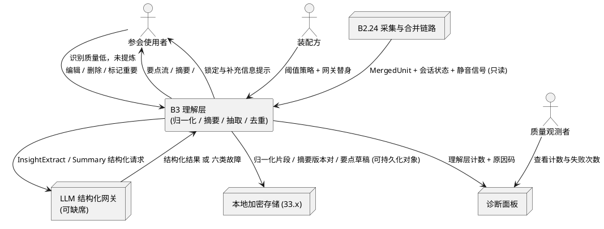
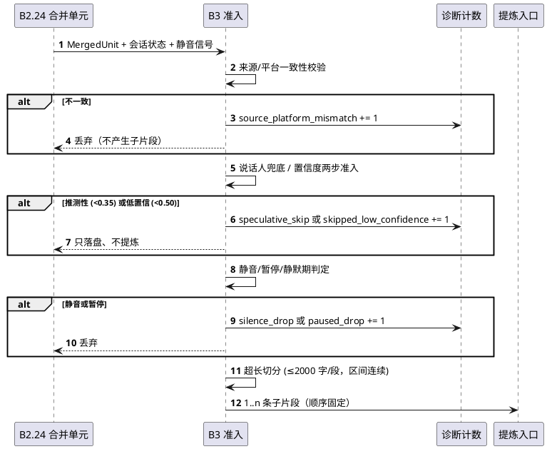
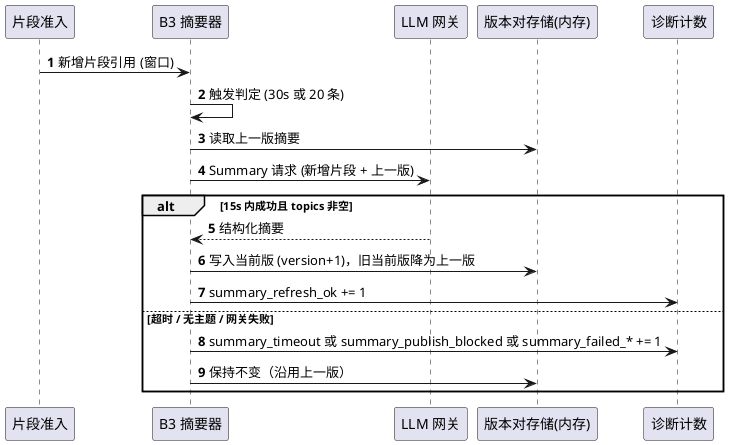
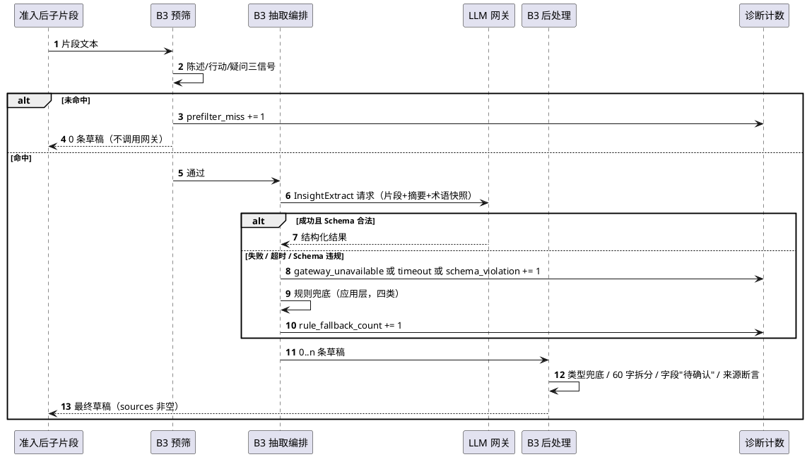
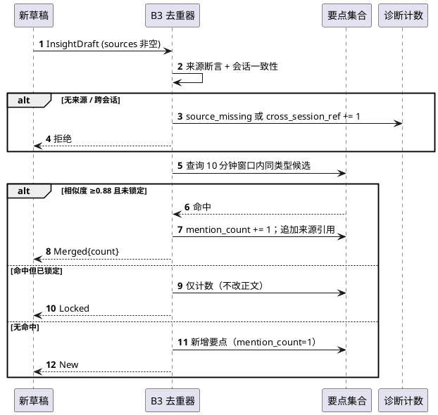

# b3_understanding · 增量需求规格

> 阶段：第一阶段（需求规格设计）。本文件只产出需求，不修改任何代码，`docs/sdd/**` 与 `docs/progress/**` 保持只读。
> 本轮范围：`docs/sdd/tasks.md` 批次 B3 的 **28 / 29 / 30 / 31** 四组任务（片段归一化、滚动摘要、要点抽取、去重与引用回溯）。**不含** 32（信息缺口识别）与 33（要点持久化、恢复与背压），二者依赖 B4 与本轮之后的批次。
> 基线文档：`docs/sdd/tasks.md`（1503 行）、`docs/sdd/spec.md`（948 行）、`docs/sdd/design.md`（1701 行）、`docs/progress/b2-24-merge.md`（78 行）、`docs/progress/b1-status.md`（327 行）、`docs/progress/test-names-before.txt`（365 条用例名）。
> 行号口径：均为 2026-11-22 快照；文档回写后行号会位移，回写以"章节号 + 条目号"为准。
> 既有交付基线（不得回归）：**40 targets / 442 passed / 0 failed / 9 ignored**（`docs/progress/b2-24-merge.md` §2），`removed=0`，macOS 真机项全部"不适用（无设备）"，G2 未通过、不宣称。

# **1. 组件定位**

## **1.1 核心职责**

本增量负责把 B2.24 合并后的发言片段转换为**可回溯的要点**与**可对比的滚动摘要**，并在其中承担准入、切分、分类与去重四项判定。

## **1.2 核心输入**

1. **合并后片段**：`MergedUnit`（`Single(SingleUtterance)` 或 `Merged(MergedUtterance)`），由 `crates/application/src/capture/{merge_types,dedupe_guard,service}.rs` 产出；已含 `Utterance`、`dual_channel`、`origin_pair`（双通道时）与 `overlap_marked`。
2. **会话状态**：`SessionState`（`NotStarted/Listening/Paused/Silent/Ended/Deleted`）与"暂停/静默期"标记，用于准入裁决。
3. **静音信号**：采集侧判定出的静音区间（可为空），以及"疑似无声"状态；本轮**消费**该信号，不重新实现 VAD。
4. **阈值配置**：理解层策略（置信门槛、静音时长、摘要触发、去重相似度、兜底降置信幅度），由装配方注入，默认值见 6.4。
5. **LLM 网关**：既有 `StructuredLlmGateway` 端口与 `LlmTask::{InsightExtract, Summary}` 两类结构化任务；真实端点仅在 `#[ignore]` 用例中启用。
6. **规则兜底能力**：既有 `RuleFallback`（`crates/infrastructure/src/llm/fallback.rs`）与 `kind_from_wire`（未知 kind → `KeyInfo`）。
7. **既有基线**：442 passed / 9 ignored、365 条用例名清单、既有 `Utterance::MIN_INSIGHT_CONFIDENCE = 0.35`、`ShortText::LIMIT = 60`、`UtteranceText::LIMIT = 2000`、`domain/merge/equivalence.rs` 的整数余弦。

## **1.3 核心输出**

1. **归一化片段**：通过准入的 `Utterance`（含来源一致性校验结果、说话人兜底、切分后的多条子片段），以及被拒片段的**拒绝原因计数**。
2. **滚动摘要**：`RollingSummary`（`version` 单调、`covered` 覆盖区间、`topics`/`entities` 可被下游消费）与**上一版保留副本**（供对比）。
3. **要点草稿**：0..n 条 `InsightDraft`（四类之一、≤60 字、`sources` 非空、字段缺失标"待确认"），以及拆分后的多条要点。
4. **去重结论**：`New | Merged{count} | Locked` 三态，人工锁定版本不被覆盖；每条要点至少一条 `UtteranceRef`，双通道要点额外保留两条原始引用。
5. **理解层计数与诊断**：准入拒绝、低置信跳过、摘要超时、Schema 违规、分类兜底、规则兜底率，供诊断面板与 AC 判定读取。
6. **可机器判定的验收集合**：AC-B3-01~48。

## **1.4 职责边界**

1. **不回写合并层**：B3 **只消费** `MergedUnit` → `Utterance`，不得修改 `capture/`、`merge/`、`dedupe_guard` 的任何既有行为、默认值或用例名；合并侧的"只计一次"（AC-DD-08）由合并层保证，B3 只保证"一条合并单元只触发一次提炼"。
2. **不做缺口识别**：32.x（`GapCandidate`、六类规则、2s 产出）不在本轮；B3 不得预埋缺口候选数据结构。
3. **不做持久化与恢复**：33.x（骨架 1s 落盘、60s 恢复、背压、结束补提炼）不在本轮；B3 只在内存中产出结果，落盘语义由 33.x 定义。
4. **不改 LLM 网关**：B3 复用 `StructuredLlmGateway` 与 `LlmTask::{InsightExtract, Summary}`，**不新增 LLM 端口、不修改** `infrastructure/llm/**` 的既有语义与用例名；`RuleFallback` 保持原样，B3 的"规则提炼兜底"在应用层另行实现（见 5.3.1 规则 13）。
5. **不引入新依赖**：不得为切分、向量、哈希、分词引入任何 crate；相似度复用 `domain/merge/equivalence.rs` 的整数余弦，哈希复用 `domain/merge/hash.rs` 的 FNV-1a/SimHash。
6. **不做音频指纹与声纹**：B3 只处理文本、时间与置信度，不读取 PCM、不产生音频特征。
7. **不改既有常量**：`Utterance::MIN_INSIGHT_CONFIDENCE`（0.35）、`ShortText::LIMIT`（60）、`UtteranceText::LIMIT`（2000）、`MergePolicy` 10 字段默认值一律不动；新增门槛以理解层策略承载（见 1.6）。
8. **不改既有用例名**：`merge_dedupe`、`capture_*`、`llm_*` 等既有 target 内用例名逐字不变；新增能力只允许**新增 target**（见 1.7）。
9. **不宣称 G3/G2**：本轮离线通过不等于 G3 通过（时延 p95 需真实回放）、更不等于 G2 通过（Windows 三款会议平台 30 分钟稳定运行未实测）。

## **1.5 与 B2.24 合并单元的衔接口径（本轮强制）**

1. **唯一入口**：B3 的片段入口是"合并后单元"，不是原始 `TextEvent`/`AsrTextEvent`；禁止从 `dedupe_guard.seen` 或原始事件流旁路取数。
2. **单条只提炼一次**：`Merged` 单元的 `insight_trigger_count=1`、被合并侧为 0（AC-DD-08 既有结论），B3 据此只加工 1 次；若同一 `UtteranceRef` 被重复投递，按 `UtteranceRef` 幂等去重，`duplicate_delivery_ignored` 计数递增，**不得**产生第二条要点。
3. **双引用保留**：`Merged` 单元的 `origin_pair = (subtitle_ref, asr_ref)` 必须原样带出；要点 `sources` 至少包含合并单元自身的 `UtteranceRef`，并**追加** `origin_pair` 两条原始引用（共可达 3 条），以保证"从要点可跳回两路原文"。
4. **不推断、不回填**：B3 不得依据合并结果去修正字幕文本、说话人或置信度；合并单元的置信度已是封顶值，直接继承。
5. **边界条件**：`MergedUnit::Single` 与 `MergedUnit::Merged` 走同一条准入与提炼路径，差异仅在"引用条数"与"是否额外记录 `dual_channel`"。

## **1.6 置信度门槛消歧（本轮强制裁决）**

既有实现存在两个数值，含义不同，**不得合并、不得互改**：

| 名称 | 取值 | 语义 | 归属 | 本轮处置 |
|---|---|---|---|---|
| `Utterance::MIN_INSIGHT_CONFIDENCE` | 0.35 | "推测性内容"边界，用于标记"待确认"与事实/推测分界（SPEC 5.2.1-8） | 领域既有常量 | **不改** |
| `InsightPolicy.insight_confidence_min` | 0.50（默认） | "是否值得提炼"准入门槛（SPEC 6.2-6、tasks 28.1/28.4） | 本轮新增策略 | 新增，可配置 |

准入判定按两步、顺序固定：

1. **硬准入**：`Utterance::is_eligible_for_insight()==false`（含 `<0.35`、占位文本"…"）→ 直接不进入理解层，不计数为"低置信跳过"。
2. **软准入**：`0.35 ≤ confidence < insight_confidence_min(0.50)` → 片段**落盘但不提炼**，计入 `insight.skipped_low_confidence`，界面标注"识别质量低，未提炼要点"。
3. **通过**：`confidence ≥ 0.50` → 进入提炼。

> 因此 `[0.35, 0.50)` 是"合法片段但不可提炼"的区间；`[0, 0.35)` 是"推测性片段"。两者都不得产出要点，但**理由码不同**（`low_confidence_skip` / `speculative_skip`），诊断面板须可分别查看。

## **1.7 新增 target 与用例名口径**

1. 本轮允许新增 4 个测试 target（仅新增，不改既有）：
   - `understanding_normalize`（`crates/application/tests/understanding_normalize.rs`）
   - `rolling_summary`（`crates/application/tests/rolling_summary.rs`）
   - `insight_extract`（`crates/application/tests/insight_extract.rs`）
   - `insight_dedup`（`crates/application/tests/insight_dedup.rs`）
2. 上述 4 项必须追加到 `scripts/test-name-inventory.sh` 的 `NEW_TARGETS`（当前 6 项：`capture_degraded_guard capture_status_push capture_fakes capture_offline_gate capture_contract_freeze merge_dedupe`），追加后共 10 项；缺少任一项时新增门禁 `--rule=targets` 必须返回 1。
3. 领域侧纯单测允许放在既有 lib 单测内，但**不得修改**既有 `#[test]` 的函数名；新增单测名必须可 grep 唯一。
4. 既有 9 个 `#[ignore]` 用例（`llm_live.rs` 8 个 + `ac25_control_request_skipped_construction_conflict`）数量与名称**不变**；本轮不得新增 `#[ignore]` 用例。

# **2. 领域术语**

**合并单元（Merged Unit）**
: 双通道场景下由字幕片段与音频回补片段合并而成的唯一片段，携带 `dual_channel=true` 与 `origin_pair` 两条原始引用；本增量的唯一片段入口。

**静音（Silence）**
: 采集侧判定的一段时间内无人说话（默认 >5 秒）的区间；该区间内不得生成空片段、不得计入要点统计。
: 备注：与"静默期（Silent）"不同，见下条。

**静默期（Silent Period）**
: 使用者主动设置的受限子模式，会话状态仍属"监听中"的受限形态；要点**继续记录**，但禁止主动提示与自动外发检索（SPEC 5.1.1-9、DESIGN 2.1.3-1）。
: 备注：易与"静音"混淆，本规格内所有"静默期"均指此含义。

**准入门槛（Insight Eligibility Threshold）**
: 决定片段"是否值得提炼"的置信度下限，默认 0.50；与判定"推测性"的 0.35 边界不是同一概念。

**子片段（Split Chunk）**
: 正文超过 2000 字的片段按句读边界切分后得到的各段；每条 1..=2000 字，区间连续不重叠，说话人与会话不变。

**滚动摘要（Rolling Summary）**
: 覆盖最近一段对话的压缩结果，含单调递增的 `version`、覆盖区间 `covered`、主题 `topics` 与实体 `entities`；仅用于上下文维持，不得作为对外结论。

**摘要版本对（Summary Version Pair）**
: 当前版摘要与其上一版的组合；版本对比只用"版本号 + 覆盖区间"，不引入内容哈希或差异算法。

**要点草稿（Insight Draft）**
: 抽取阶段的中间结果，含四类之一、≤60 字正文、非空来源引用、置信度与类型专属字段；尚未去重与锁定。

**分类兜底（Kind Fallback）**
: 无法判定要点类型时归入"关键信息"并降低置信度的行为；**兜底不等于丢弃**。

**引用回溯（Source Traceback）**
: 从要点跳回至少一条原始发言片段的能力；双通道要点须能跳到字幕与音频两路原文。

**规则提炼兜底（Rule Extraction Fallback）**
: LLM 不可用、断网或超时时，由应用层规则产出结构完整的四类要点的能力；准确率可降，但结构与引用必须完整。

**理解层计数（Understanding Counters）**
: 固定集合的只增不减计数项（准入拒绝、低置信跳过、静音丢弃、重复投递忽略、摘要刷新成功/超时/失败、Schema 违规、分类兜底、规则兜底、无来源拦截），供诊断面板与 AC 判定。

# **3. 角色与边界**

## **3.1 核心角色**

1. 参会使用者：查看要点流与摘要，编辑/删除/标记要点；本轮只定义"看到什么"，不定义交互实现。
2. 质量观测者（开发者/运维）：在诊断面板查看理解层计数、失败次数与原因码；不得看到会话原文以外的新增敏感面。
3. 装配方（集成工程师）：注入理解层策略与网关替身，决定离线/真实端点模式。

## **3.2 外部系统**

1. B2.24 采集与合并链路：上游，提供 `MergedUnit`、会话状态与静音信号；单向，不回写。
2. LLM 结构化网关（`StructuredLlmGateway`）：下游，接抽要与要点抽取两类任务；可整体缺席（离线/断网/未配置）。
3. 本地加密存储（33.x）：下游，本轮不定义落盘接口，只要求输出结果"可被持久化"（无不透明句柄）。
4. 诊断面板：下游，读取理解层计数与状态；不含原文、不含端点信息。

## **3.3 交互上下文**

> 图中不出现内部模块划分、不出现数据库表结构、不出现接口参数。

# **4. DFX 约束**

## **4.1 性能**

1. 单条片段从进入理解层到产出要点草稿，**离线批处理**口径 ≤50 ms（p95，纯规则路径）；该口径仅用于回归防退化，**不得**替代 SPEC 4.1-1/4.1-2 的端到端时延（需真实回放，本轮不判定）。
2. 规则预筛（30.1 第一段）单条 ≤2 ms（p95）；摘要增量压缩的本地预处理 ≤10 ms（p95）。
3. 1 小时会话的摘要刷新次数 ≥120 次（30 秒周期口径），且刷新过程不得阻塞片段准入（离线以"准入调用次数在刷新期间不减少"判定）。
4. 超长切分单条 ≤5 ms（p95），2000 字边界与 8000 字输入均须满足。
5. 理解层内存增量 ≤180 MB（对应 DESIGN 2.1.3(8)"归一化/向量/去重"分区预算）；本轮只断言"摘要仅保留 2 版、不无限累积"。

## **4.2 可靠性**

1. LLM 不可用、断网、超时、Schema 不符时，理解层必须**不抛错、不阻塞**片段准入，且规则兜底产出的要点结构与引用完整。
2. 摘要生成超过 15 秒未完成 → 沿用上一版、本次丢弃、失败计数 +1；用户侧无阻塞提示。
3. 摘要版本号在同一会话内**严格单调递增**，不得回退、不得重复；重启（33.x）后由持久化的最大版本续接，本轮只要求"内存内单调"。
4. 任一计数项只增不减，且不得因异常路径而缺失（异常也必须留下原因码）。
5. 同一 `UtteranceRef` 重复投递必须幂等：`duplicate_delivery_ignored` 递增，产出要点数不变。

## **4.3 安全性**

1. **零转录红线**：理解层产出的任何对象、日志、诊断项、测试夹具与文档中，**禁止**出现 API Key、完整端点 URL、模型名、`request_id`、原始音频、音频特征、声纹向量。
2. 要点正文与摘要文本**只**来自片段文本，不得拼接外部检索内容（本轮无检索）。
3. 说话人字段不得编造姓名；无标识时统一"未知说话人"，且 `identified=false`。
4. 诊断计数只含数值与原因码，不得含原文片段。
5. 静默期（Silent）内禁止任何自动外发能力；本轮虽无外发，但准入层必须拒绝为静默期片段生成"可外发"标记。

## **4.4 可维护性**

1. 必须可观测的计数（固定集合 **27 项 + 1 派生值**，见 6.5）：准入通过/拒绝（按原因 5 类）、低置信跳过、静音丢弃与部分重叠、暂停丢弃、重复投递忽略、空段丢弃、组合字符边界切分、可外发候选（恒 0）、预筛未命中、网关调用与冷却、规则兜底、Schema 违规、抽取为空、重复草稿、超长草稿拦截（恒 0）、摘要成功/超时/网关不可用/无主题拦截/乱序、无来源拦截（应恒 0）、跨会话引用拦截（应恒 0）、短文本跳过相似度、规则兜底率。
2. 日志只允许出现：会话标识哈希前缀、片段引用、计数、原因码、耗时毫秒；禁止原文与凭据。
3. 每条要点必须能回溯到 `UtteranceRef`；双通道要点必须能回溯到 `origin_pair` 两路。
4. 失败必须分类：`low_confidence_skip`、`speculative_skip`、`silence_drop`、`paused_drop`、`schema_violation`、`gateway_unavailable`、`summary_timeout` 七类，不得用单一"失败"笼统表示。

## **4.5 兼容性**

1. **用例名零回归**：`scripts/test-name-inventory.sh --diff docs/progress/test-names-before.txt` 的 `removed=0`；`cargo test --workspace` 的 passed ≥442、failed=0、ignored=9。
2. **不新增依赖**：`Cargo.toml` 与 `Cargo.lock` 的依赖集合不变（`cargo deny check` 通过，且新增 `[dependencies]` 条目为 0）。
3. **macOS 一律"不适用（无设备）"**：理解层含平台相关表述时，只允许出现在"不适用"语境；G2 口径为 **Windows 单平台**，不得出现"三平台真机稳定运行"类结论。
4. **数据可读**：`RollingSummary` 与 `Insight` 的新增字段必须可被旧版本忽略（未知字段透传），且不得改变既有字段语义。
5. **中英混合**：切分、预筛、分类、兜底规则均须对中英混排片段给出确定结果（同一输入同一输出）。

# **5. 核心能力**

## **5.1 片段归一化与准入（28.1~28.4）**

### **5.1.1 业务规则**

1. **来源与平台一致性**：片段来源为平台通道（平台字幕/平台系统音频）时，`platform` 必填且必须与会话绑定平台一致；来源为麦克风或外部转写时，`platform` 必须为空。
   a. 验收条件：When 平台字幕片段缺失 `platform` 或与绑定平台不等，系统 shall 拒绝准入并计入 `source_platform_mismatch`。
   b. 验收条件：When 麦克风片段携带 `platform`，系统 shall 拒绝准入并计入同一计数。
2. **说话人兜底**：无说话人标识时必须置"未知说话人"且 `identified=false`，禁止推断姓名。
   a. 验收条件：When 片段无说话人字段，系统 shall 输出 `speaker.label="未知说话人"`、`identified=false`。
3. **硬准入（推测性）**：`confidence < 0.35` 或正文为占位文本（"…"）时不得进入提炼。
   a. 验收条件：When `confidence=0.10`，系统 shall 不产出要点草稿，且计入 `speculative_skip`。
4. **软准入（低置信分流）**：`0.35 ≤ confidence < 0.50` 只落盘不提炼、不触发自动外发，计入 `skipped_low_confidence`，并输出界面标记"识别质量低，未提炼要点"。
   a. 验收条件：When `confidence=0.49`，系统 shall 产出 0 条要点草稿、`skipped_low_confidence=1`。
   b. 验收条件：When `confidence=0.50`（边界值），系统 shall 产出至少 1 条要点草稿（若预筛命中）。
5. **静音过滤**：片段区间完全落在静音区间内、或片段时长 <300 ms 且正文去空白后为空/仅标点，视为空片段，不得进入要点统计。
   a. 验收条件：When 静音区间 6000 ms 覆盖片段区间，系统 shall 丢弃该片段，`silence_dropped` 递增，要点数不变。
6. **正常停顿不误判**：≤500 ms 的停顿不得判为静音；静音判定只由上游静音信号或"时长 <300 ms 且无实质文本"触发。
   a. 验收条件：When 两片段间隔 400 ms 且均有实质文本，系统 shall 两条均准予进入理解层。
7. **暂停与已删除**：会话状态为 `Paused` 或已删除时，片段一律不进入理解层（SPEC 5.1.1-8）。
   a. 验收条件：While 会话为 `Paused`，系统 shall 丢弃全部新片段并计入 `paused_drop`。
8. **静默期照常记录**：会话状态为 `Silent` 时要点**继续记录**（SPEC 5.1.1-9、DESIGN 2.1.3-1），但不得标记为可外发、不得触发任何外发/推送动作。
   a. 验收条件：While 会话为 `Silent`，系统 shall 正常产出要点草稿，且外发候选数为 0。
9. **超长切分（2000 字）**：正文超过 2000 个 Unicode 标量值时，必须切分为多条子片段，每条 1..=2000；切分读取同等时长按字符比例分配，区间首尾相接、不重叠、结束严格大于开始。
   a. 验收条件：When 正文 4001 字、区间 [0,4000] ms，系统 shall 产出 ≥3 条子片段，每条 ≤2000 字，首段起点 0、末段终点 4000，相邻段"前段终点 = 后段起点"。
10. **切分不变量**：切分不得改变会话、说话人、来源、平台、`dual_channel`、`origin_pair`；不得跨会话；不得丢弃任何字符（去除切分边界空白后可逆）。
    a. 验收条件：When 拼接全部子片段正文并移除边界空白，系统 shall 得到与归一化原文相等的字符串。
11. **切分确定性**：同一输入必须得到同一组切分点；切分点优先落在句读符号之后（`。！？；!?;\n`、`,`/`.` 作为次级边界），无边界时按上限硬切；不得使用时间、随机数或哈希决定切分点。
    a. 验收条件：When 同一 4001 字文本连续切分 100 次，系统 shall 得到 100 组成员与边界完全相同的子片段。
12. **幂等与顺序稳定**：同一片段重复投递必须只加工一次（`duplicate_delivery_ignored` 递增）；批量准入必须保持输入顺序，不得因并发改变输出顺序。
    a. 验收条件：When 同一 `UtteranceRef` 投递 2 次，系统 shall 只产出 1 组草稿，`duplicate_delivery_ignored=1`。

### **5.1.2 交互流程**

### **5.1.3 异常场景**

1. **来源与平台不一致**
   a. 触发条件：平台字幕片段 `platform` 缺失、或与绑定平台不等；麦克风片段携带 `platform`。
   b. 系统行为：拒绝准入，不产生子片段，`source_platform_mismatch += 1`，写一条只含原因码的诊断项。
   c. 用户感知：该片段不出现在要点流；诊断面板显示计数，不显示原文。

2. **静音区间与片段区间冲突**
   a. 触发条件：上游给出的静音区间与片段区间部分重叠（起止边界相接但不完全覆盖）。
   b. 系统行为：按"实际重叠时长 / 片段时长 ≥0.8"判为静音丢弃；否则准予进入，并记录 `silence_partial_overlap` 计数。
   c. 用户感知：无提示；诊断面板可查。

3. **切分边界落在组合字符内部**
   a. 触发条件：文本含 emoji ZWJ 序列或组合附加符，切分点落在标量值之间。
   b. 系统行为：仍按标量值切分（不引入字素簇依赖），子片段仍满足 1..=2000 与区间不变量；写入一条 `split_grapheme_boundary` 诊断计数。
   c. 用户感知：极少数情况下要点正文可能出现半个组合字符；须在文档登记为已知偏差（D-B3-01），不得为此新增依赖。

4. **重复投递**
   a. 触发条件：同一 `UtteranceRef` 在竞态或重放中被投递多次。
   b. 系统行为：仅首次加工，后续忽略并计数；不产生第二条要点、不递增提及次数。
   c. 用户感知：要点流无重复卡片。

5. **正文为空或仅标点**
   a. 触发条件：切分后某段正文去空白后为空或仅标点。
   b. 系统行为：该段不进入提炼，`empty_chunk_dropped += 1`；不得因空段导致整条片段被丢弃。
   c. 用户感知：无提示。

## **5.2 滚动摘要（29.1~29.3）**

### **5.2.1 业务规则**

1. **双触发条件**：每累计 30 秒**或**累计 20 条新片段（取先到者）必须触发一次刷新；两次刷新之间不得重复刷新同一窗口。
   a. 验收条件：When 虚拟时钟推进 30 000 ms，系统 shall 触发 1 次刷新；When 新片段累计 20 条且时间不足 30 s，系统 shall 触发 1 次刷新。
2. **增量压缩**：刷新只消费"上次刷新以来的新增片段 + 上一版摘要"，不得全量重压整个会话。
   a. 验收条件：When 第 3 次刷新且有 7 条新增片段，系统 shall 提交恰好 7 条片段引用与 1 份上一版摘要。
3. **版本单调**：每次成功刷新 `version` 严格 +1，起点为 1；不得回退、不得跳号、不得重复。
   a. 验收条件：When 连续 3 次成功刷新，系统 shall 得到 1、2、3 三个版本。
4. **上一版保留**：内存中同时保留"当前版"与"上一版"两版，供对比与降级回退；保留上限 2 版，超出时丢弃更早版本。
   a. 验收条件：When 完成第 4 次刷新，系统 shall 保有版本 3 与 4，版本 ≤2 不再可达；`retained_versions ≤2`。
5. **覆盖区间**：`covered` 必须等于本版所消费新增片段的合并区间（首段起点到末段终点），且不得小于上一版的 `covered`。
   a. 验收条件：When 新增片段区间为 [10 000, 16 000] ms，系统 shall 输出 `covered.start=10 000`、`covered.end=16 000`。
6. **下游可消费字段**：成功刷新必须产出至少 1 个 `topics` 条目与 0..n 个 `entities`；`topics` 为空时不得发布该版本（视为失败，沿用上一版）。
   a. 验收条件：When 抽取结果无主题，系统 shall 不发布新版本，`summary_publish_blocked += 1`，当前版保持原版本号。
7. **摘要不得作为结论**：摘要只用于上下文维持与相关性评分输入，不得直接展示为"会议结论"，也不得进入要点正文。
   a. 验收条件：When 摘要生成完成，系统 shall 只将其提供给提炼上下文，产出的要点正文与摘要文本无整段复制关系（长度 >60 字的重合片段为 0）。
8. **15 秒超时丢弃**：单次刷新从发起到完成 >15 000 ms，必须丢弃本次结果、沿用上一版、`summary_timeout += 1`。
   a. 验收条件：When 替身网关延迟 15 001 ms，系统 shall 保持 `version` 不变、`summary_timeout=1`。
9. **超时不阻塞**：超时期间片段准入与要点提炼必须继续，准入调用次数不得因等待摘要而减少。
   a. 验收条件：When 摘要超时，系统 shall 在同一时段内完成 ≥1 次片段准入（由计数断言）。
10. **摘要不可用降级**：LLM 不可用/断网/未配置时，摘要刷新失败但不阻断主链；失败计数按原因（`gateway_unavailable`/`schema_violation`/`timeout`）分列。
    a. 验收条件：When 网关返回"未配置"，系统 shall `summary_failed_gateway_unavailable += 1`，且要点提炼照常。
11. **禁止项**：不得为摘要引入外部依赖（向量库、分词库、diff 库）；不得把摘要写入任何外发载荷。
    a. 验收条件：When 检查依赖闭包，系统 shall 无新增 crate；When 检查摘要对象，系统 shall 无 URL/Key/模型名/`request_id` 字段值。

### **5.2.2 交互流程**

### **5.2.3 异常场景**

1. **刷新中国 15 秒**
   a. 触发条件：单次摘要生成耗时超过 15 000 ms（含网关重试）。
   b. 系统行为：丢弃本次结果，保留上一版，`summary_timeout += 1`；不重试、不排队补做。
   c. 用户感知：无阻塞提示；诊断面板显示"摘要状态异常"与失败次数。

2. **摘要结果无主题**
   a. 触发条件：结构化结果 `topics` 为空，或主题全为空白。
   b. 系统行为：不发布新版本，`summary_publish_blocked += 1`，沿用上一版。
   c. 用户感知：无提示；诊断面板可查。

3. **版本号冲突**
   a. 触发条件：并发的两次刷新尝试使用同一 `version`。
   b. 系统行为：同一会话的摘要刷新必须串行（单通道），后到者等待并使用递增后的版本；禁止两个同版本摘要同时存在。
   c. 用户感知：无感知。

4. **覆盖区间回退**
   a. 触发条件：新增片段区间起点小于上一版 `covered.start`（乱序到达）。
   b. 系统行为：按时间排序后再计算 `covered`；若排序后仍小于上一版起点，则不发布并计 `summary_out_of_order`。
   c. 用户感知：无提示。

5. **网关整体缺席**
   a. 触发条件：未配置端点、或无网络、或冷却中。
   b. 系统行为：不发起网络调用，直接计失败（`gateway_unavailable`），保持上一版；主链不受影响。
   c. 用户感知：诊断面板可见；要点流正常。

## **5.3 要点抽取（30.1~30.5）**

### **5.3.1 业务规则**

1. **三段式（固定顺序）**：规则预筛 → 结构化抽取 → Schema 校验；任一段失败都不得跳过后续的"结构完整性兜底"。
   a. 验收条件：When 预筛命中、抽取返回合法结构，系统 shall 产出 `draft_count ≥1` 且 `schema_violation=0`。
2. **规则预筛三信号**：陈述性（"确认/上线/决定/是/为/将/已经"）、行动性（"我来/跟进/负责/下周/安排/待办"）、疑问性（"？/?/吗/是否/如何/为什么/能否"）；任一命中即进入抽取。
   a. 验收条件：When 文本为"下周三开始灰度"，系统 shall 预筛命中并调用网关 1 次。
3. **预筛未命中即短路**：三信号全不命中时不得调用网关（`gateway_calls=0`），计 `prefilter_miss += 1`。
   a. 验收条件：When 文本为"嗯，好的"，系统 shall `gateway_calls=0`、产出 0 条草稿。
4. **Schema 严格校验**：抽取结果必须通过严格解码（未知字段拒绝、类型不符拒绝、正文超 60 字拒绝）；不通过时产出 0 条草稿并计 `schema_violation += 1`。
   a. 验收条件：When 结果含未知字段，系统 shall 产出 0 条草稿、`schema_violation=1`。
5. **来源非空（编译期 + 运行期）**：草稿的来源引用必须非空；构造期即以非空类型表达，运行期再断言一次；无来源草稿**必须**被拒绝。
   a. 验收条件：When 抽取结果 `sources=[]`，系统 shall 不产出该条草稿，`source_missing += 1`；该计数在整轮回归中必须为 0（除注入用例）。
6. **四类与封闭枚举**：每条草稿必须归入关键信息/决策/待办/疑问之一；未分类要点必须为 0。
   a. 验收条件：When 产出 10 条草稿，系统 shall 四类计数之和 = 10，`unclassified=0`。
7. **分类兜底不丢要点**：无法判定类型（含未知枚举值、空类型、非法类型）时归入"关键信息"，置信度下降 `KIND_FALLBACK_PENALTY_MILLI=150`（即 −0.15，可配置），要点保留。
   a. 验收条件：When 结果类型为未知值 `"note"`，系统 shall 产出 1 条 `KeyInfo` 草稿，置信度 = 原值 −0.15（下限 0）。
8. **60 字强制拆分**：正文超过 60 字时必须在提炼器内拆成多条，每条 ≤60 字，各自保留原文引用；禁止 UI 截断、禁止整段复制原文。
   a. 验收条件：When 抽取正文 150 字，系统 shall 产出 ≥3 条草稿，每条 ≤60 字，`truncated_by_ui=0`（静态断言 UI 无 truncate 逻辑）。
9. **拆分后引用独立**：每条拆分草稿必须携带与其文本片段对应的来源引用（同一片段可被多条共享，但不得为空）。
   a. 验收条件：When 一条 150 字拆为 3 条，系统 shall 每条 `sources` 非空，且并集覆盖原片段引用。
10. **决策字段补全**：决策类缺失决策人或范围时，以"待确认"占位，不得留空、不得丢弃要点。
    a. 验收条件：When 决策草稿无 owner，系统 shall 输出 `decision.owner=None` 且界面语义为"待确认"，草稿仍产出。
11. **待办字段补全**：待办类缺失负责人或期限时，以"待确认"占位；动作字段必须非空。
    a. 验收条件：When 文本"我来跟进一下"，系统 shall 产出 `Todo` 草稿且 `todo.assignee=None`（展示"待确认"）。
12. **疑问闭环**：疑问类初始 `unanswered=true`；后续片段出现回应时置 `unanswered=false`，并把**回应片段引用追加到该要点的 `sources`**（以来源表达关联，不新增字段）。
    a. 验收条件：When 疑问要点已存在、随后 10 秒内出现回应片段，系统 shall 置 `unanswered=false` 且 `sources.len()` 增加 1（引用回应片段）。
13. **规则提炼兜底（应用层）**：LLM 不可用/断网/超时时，规则兜底必须产出结构完整的四类要点（准确率可降）；兜底在**应用层**实现，不修改 `infrastructure/llm/fallback.rs` 的既有语义；兜底不抛错、不阻塞采集。
    a. 验收条件：When 网关返回"不可用"，系统 shall 产出 ≥1 条草稿，`rule_fallback_count=1`，`gateway_unavailable` 计数 +1，无 panic。
14. **兜底可观测**：`insight.rule_fallback.rate = rule_fallback_count / extract_attempts`，取值 0..1，可被诊断面板读取。
15. **禁止项**：禁止把上一轮的抽取结果冒充本轮结果；禁止从暂停/已删除片段生成要点；禁止在无来源情况下产出要点。

### **5.3.2 交互流程**

### **5.3.3 异常场景**

1. **Schema 不符**
   a. 触发条件：结果含未知字段、类型错误、正文超 60 字、`sources` 为空。
   b. 系统行为：该次结果整体作废（不逐条救活），计 `schema_violation += 1`；随后进入规则兜底，保证结构完整。
   c. 用户感知：要点流出现兜底要点（置信度较低），诊断面板显示 Schema 违规次数。

2. **网关冷却/限流**
   a. 触发条件：网关处于冷却或超预算。
   b. 系统行为：不发起调用，直接规则兜底，计 `gateway_cooling += 1`；不重试风暴。
   c. 用户感知：无中断；要点略粗糙。

3. **抽取结果为 0 条**
   a. 触发条件：预筛命中但模型判定"无要点"。
   b. 系统行为：不产出草稿，不视为失败；计 `extract_empty += 1`；不得用兜底强行造要点。
   c. 用户感知：该片段无要点卡片。

4. **正文全为占位或重复**
   a. 触发条件：抽取正文与上一轮完全相同且来源相同。
   b. 系统行为：交给去重层合并计数（31.x），抽取层不重复产出；`duplicate_text_draft += 1`。
   c. 用户感知：显示"提及 N 次"。

5. **超长未拆分成功**
   a. 触发条件：拆分后仍存在 >60 字的草稿（拆分逻辑缺陷）。
   b. 系统行为：该条不得发布（视为 Schema 违规），计 `oversize_draft_blocked += 1`；其余草稿正常发布。
   c. 用户感知：无 >60 字卡片出现在流中。

## **5.4 去重与引用回溯（31.1~31.3）**

### **5.4.1 业务规则**

1. **语义合并**：同一会话内，正文相似度 ≥0.88（字符 3-gram 整数余弦，复用既有实现）且类型相同的要点必须合并为一条，`mention_count` 累加。
   a. 验收条件：When 两条要点相似度 0.90、类型均为 `KeyInfo`，系统 shall 合并为 1 条、`mention_count=2`。
2. **10 分钟窗口**：合并只在 10 分钟窗口内生效；超出窗口的同义要点视为新要点，`mention_count` 从 1 开始。
   a. 验收条件：When 两条同义要点相隔 601 000 ms，系统 shall 不合并、产出 2 条。
3. **类型不同不合并**：`Decision` 与 `Todo` 即使文本相似也不得合并（语义角色不同）。
   a. 验收条件：When 文本相似度 0.95、类型不同，系统 shall 产出 2 条。
4. **人工锁定优先**：`status=已编辑` 的要点被后续同义内容命中时，只增加 `mention_count`，不得修改正文、不得修改类型、不得覆盖字段。
   a. 验收条件：When 锁定要点被同义新内容命中，系统 shall 正文与原值逐字相等、`mention_count+1`、`status` 仍为"已编辑"。
5. **冲突并列**：锁定要点收到**内容冲突**（相似度 <0.88 但主题相同）的新表述时，新内容作为"补充信息"并列存在，不覆盖人工版本。
   a. 验收条件：When 冲突内容到达，系统 shall 新增一条 `mention_count=1` 的关联要点并标记"补充信息"，原锁定要点正文不变。
6. **删除后不可见**：`status=已删除` 的要点不得出现在要点流、纪要、相关性评分输入中；不得被再次合并（合并请求必须被拒绝）。
   a. 验收条件：When 删除某要点后投递同义内容，系统 shall 新产出 1 条可见要点，原删除要点保持"已删除"且不可见。
7. **引用回溯（必备）**：每条要点至少 1 条 `UtteranceRef`，且引用的片段必须属于同一会话；无来源要点必须被拒绝。
   a. 验收条件：When 草稿无来源，系统 shall 拒绝并入 `source_missing += 1`；全局该计数为 0（除注入用例）。
8. **双通道双引用**：来源为 `Merged` 单元的要点，其 `sources` 必须包含合并单元自身引用与 `origin_pair` 的两条原始引用（可跳回两路原文）。
   a. 验收条件：When 要点来自 `Merged` 单元，系统 shall `sources` 至少含 `subtitle_ref` 与 `asr_ref` 两个不同引用。
9. **单条只提炼一次**：同一合并单元只允许产生一组要点草稿；被合并侧不重复产出（承接 AC-DD-08）。
   a. 验收条件：When 合并单元与其被合并侧同时存在，系统 shall 只产出 1 组草稿，被合并侧 `insight_trigger_count=0`。
10. **重要标记与筛选**：可标记重要（`flagged_important=true`）；可按类型/关键词筛选；筛选不得改变存储状态。
    a. 验收条件：When 按 `Todo` 筛选，系统 shall 只返回 `Todo` 类型要点，其余类型的 `flagged_important` 与 `mention_count` 不变。
11. **禁止项**：禁止以"编辑人工要点"的方式实现自动补全；禁止删除被引用片段（本轮不做删除，但要点不得因为缺引用而被静默清空）。

### **5.4.2 交互流程**

### **5.4.3 异常场景**

1. **无来源草稿**
   a. 触发条件：抽取或兜底产出的草稿 `sources` 为空。
   b. 系统行为：拒绝入流，`source_missing += 1`；不得补造引用、不得用摘要文本当来源。
   c. 用户感知：无该条卡片；诊断面板该计数应为 0。

2. **跨会话引用**
   a. 触发条件：草稿引用的片段属于其他会话。
   b. 系统行为：拒绝，`cross_session_ref += 1`。
   c. 用户感知：无该条卡片。

3. **并发合并竞争**
   a. 触发条件：两条同义草稿同时进入去重（并发）。
   b. 系统行为：按"先到先合并"串行化；后到者合并计数，不得产生两条相同正文的可见要点。
   c. 用户感知：只看到一条要点，提及次数正确。

4. **锁定要点收到冲突内容**
   a. 触发条件：人工编辑后，同主题但不同表述的新内容到达。
   b. 系统行为：新增"补充信息"要点并关联原要点，不覆盖人工版本。
   c. 用户感知：显示"存在新的相关表述，查看补充"。

5. **相似度判定退化**
   a. 触发条件：正文长度 <8 字符（3-gram 不足）。
   b. 系统行为：不启用余弦级判定，退化为"归一化文本完全相等"才合并；计 `short_text_merge_skipped += 1`。
   c. 用户感知：短要点可能并列出现，属可接受偏差。

# **6. 数据约束**

## **6.1 发言片段（Utterance，B3 视角补充）**

1. **reference**：必填，全局唯一；同一 `UtteranceRef` 只允许被加工一次。
2. **span**：必填，`end_ms > start_ms`，且落在会话时间范围内；切分后各子片段区间连续、不重叠。
3. **text**：必填，1..=2000 字符（Unicode 标量值计数）；切分后每段仍满足该约束。
4. **speaker**：必填，不可为空字符串；无标识时固定为"未知说话人"且 `identified=false`。
5. **confidence**：0..=1；`<0.35` 为推测性，`[0.35,0.50)` 为低置信不可提炼，`≥0.50` 可提炼。
6. **source 与 platform**：平台通道（`PlatformSubtitle`/`PlatformAudio`）必填 `platform` 且等于会话绑定平台；`Microphone`/`ExternalTranscription` 时 `platform` 必须为空。
7. **dual_channel 与 origin_pair**：合并单元 `dual_channel=true` 且 `origin_pair` 为两条不同引用；单路片段 `dual_channel=false`、`origin_pair` 为空。

## **6.2 滚动摘要（RollingSummary）**

1. **version**：正整数，起点 1，同一会话内严格单调递增。
2. **covered**：必填区间，`start` 不早于上一版 `start`，`end` 不早于 `start`。
3. **topics**：成功发布时至少 1 条；每条含标签与权重（0..=1）；为空不得发布。
4. **entities**：0..n 条；每条含名称与归一化形式；不得含未脱敏的敏感人名（本轮只要求"不得编造"）。
5. **保留上限**：同一会话内存中最多 2 版（当前版 + 上一版），超出即淘汰最早版本。
6. **禁止字段**：不得含原文整段（长度 >200 字的连续原文片段为 0）、不得含 URL、Key、模型名、`request_id`。

## **6.3 要点草稿与要点（InsightDraft / Insight）**

1. **kind**：四类之一；无法判定时 `KeyInfo` 且置信度降 0.15（下限 0）。
2. **text**：1..=60 字符；超长必须拆分，不得截断。
3. **sources**：至少 1 条同会话 `UtteranceRef`；双通道要点至少含 `origin_pair` 两条。
4. **confidence**：0..=1，继承片段置信度并可因分类兜底下调；`<0.35` 时展示"待确认"。
5. **status**：自动/已编辑/已删除；"已编辑"不得被自动结果覆盖。
6. **mention_count**：≥1，合并时递增（`saturating_add`），不得回退。
7. **fields**：决策含决策人/范围（可"待确认"）；待办含动作（必填）/负责人/期限（可"待确认"）；疑问含答复状态（初始未答复）。
8. **疑问闭环引用**：疑问被回应后，回应片段引用追加到 `sources`，不新增字段。
9. **visible**：已删除要点不可见；可见性由纯函数判定，不得依赖 UI 过滤。
10. **supplement_of**：可选字段，指向被补充的原要点引用；仅在"人工锁定要点收到冲突内容"时非空。该字段属于新增可忽略字段：旧版本读取时应透传而不报错，不得改变既有字段语义。
11. **禁止字段**：不得含 URL、Key、模型名、`request_id`、原文音频地址。

## **6.4 理解层策略（InsightPolicy）**

1. **insight_confidence_min_milli**：整数，默认 500（0.50），取值 350~950；不得低于既有 0.35 推测边界。
2. **silence_min_ms**：整数，默认 5000，取值 1000~30000；小于该值的停顿不判静音。
3. **silence_overlap_ratio_min_milli**：整数，默认 800（0.80），取值 0~1000；重叠时长占比达阈值才判静音丢弃。
4. **split_char_limit**：整数，默认 2000，取值 200~2000；不得大于 `UtteranceText::LIMIT`。
5. **summary_interval_ms**：整数，默认 30000，取值 5000~60000。
6. **summary_utterance_count**：整数，默认 20，取值 1~200。
7. **summary_timeout_ms**：整数，默认 15000，取值 8000~30000；该超时由应用层守护，**不复用** `DeadlineMs`（既有上限 8000 ms）。
8. **summary_retained_versions**：整数，固定 2（不可配置为 >2，避免内存无界）。
9. **kind_fallback_penalty_milli**：整数，默认 150，取值 0~500。
10. **similarity_min_milli**：整数，默认 880，取值 0~1000。
11. **dedupe_window_ms**：整数，默认 600000（10 分钟），取值 60000~1800000。
12. **short_text_merge_min_chars**：整数，默认 8，取值 0~200。
13. **prefilter_enabled**：布尔值，默认 true；关闭时全部片段进入抽取（用于对照回归）。
14. **禁止项**：不得通过修改 `MergePolicy`、`CapturePolicy` 或 `Utterance::MIN_INSIGHT_CONFIDENCE` 来承载上述阈值。

## **6.5 理解层计数（UnderstandingCounters）**

固定 **27 项计数 + 1 项派生值**，计数均为 `u64` 只增不减：

1. **admitted**：通过准入的子片段数。
2. **speculative_skip**：`<0.35` 或占位文本被拒数。
3. **skipped_low_confidence**：`[0.35,0.50)` 只落盘数。
4. **silence_dropped**：静音丢弃数。
5. **silence_partial_overlap**：部分重叠但未达阈值的片段数。
6. **paused_drop**：暂停期丢弃数。
7. **source_platform_mismatch**：来源/平台不一致数。
8. **duplicate_delivery_ignored**：重复投递忽略数。
9. **empty_chunk_dropped**：切分后空段丢弃数。
10. **split_grapheme_boundary**：切分点落在组合字符边界的次数（已知偏差可观测，见 D-B3-01）。
11. **dispatch_candidates**：被标记为"可外发/可推送"的候选数；**必须恒为 0**。
12. **prefilter_miss**：预筛未命中数。
13. **gateway_calls**：网关调用次数（离线=替身调用次数）。
14. **gateway_cooling**：因网关冷却/限流而未发起的调用数。
15. **rule_fallback_count**：规则兜底次数。
16. **schema_violation**：Schema 违规次数。
17. **extract_empty**：预筛命中但模型判定"无要点"的次数。
18. **duplicate_text_draft**：正文与来源均与既有要点相同的草稿数。
19. **oversize_draft_blocked**：>60 字未拆分成功而被拦截的草稿数；正常回归**必须为 0**。
20. **summary_refresh_ok**：摘要成功发布次数。
21. **summary_timeout**：摘要超时丢弃次数。
22. **summary_failed_gateway_unavailable**：摘要因网关不可用失败次数。
23. **summary_publish_blocked**：因 `topics` 为空而不发布版本的次数。
24. **summary_out_of_order**：增量片段乱序且排序后仍早于上一版 `covered` 的次数。
25. **source_missing**：无来源草稿拦截数；正常回归**必须为 0**。
26. **cross_session_ref**：跨会话引用拦截数；正常回归**必须为 0**。
27. **short_text_merge_skipped**：正文 <8 字未启用相似度级的次数。

派生值：

28. **insight.rule_fallback.rate** = `rule_fallback_count / max(gateway_calls + rule_fallback_count, 1)`，范围 0..=1。

> 计数项名称即诊断面板字段名；AC 判定直接读取这些字段，无需解析日志。

# **7. 验收判定**

## **7.1 离线可判定与必须真实端点/真机判定的分界**

| 类别 | 判定方式 | 本增量覆盖 |
|---|---|---|
| **离线可判定（主体）** | `cargo test` 退出码、脚本退出码、静态 grep（含扫描面缺失退 2）、产物字段、计数结构、用例名差集 | AC-B3-01~42 全部；AC-B3-43~48 的静态与计数部分 |
| **必须真实端点** | 真实 LLM 服务连通、真实时延、真实抽取准确率 | **本轮不判定**；仅在既有 9 个 `#[ignore]` 用例中保留载体，不新增 |
| **必须真机（Windows）** | Windows 三款会议平台 30 分钟稳定运行、真实字幕/音频双通道、G2/G3 时延 p95 | **本轮不执行、不得宣称** |
| **必须真机（macOS）** | SCStream、屏幕录制/辅助功能授权、AX、DMG | 一律"**不适用（无设备）**"，不判定 |

> 纪律三条：
> 1. **离线通过 ≠ G3 通过**：AC-B3-01~48 全绿只证明"约束 100% 合规"的可离线部分，p95 时延与 60s 恢复仍待真机/回放。
> 2. **替身通过 ≠ 真实端点已验证**：`StructuredLlmGateway` 替身只证明编排与兜底，不证明模型质量。
> 3. **不得新增 `#[ignore]`**：真实端点用例仍为 9 个，数量与名称不变。

## **7.2 AC-B3-01~12：片段归一化与准入（28.x）**

| 编号 | EARS 陈述 | 可机器判定 |
|---|---|---|
| AC-B3-01 | When 片段来源为平台通道（平台字幕/平台系统音频）而 `platform` 缺失或与绑定平台不等，the 理解层 shall 拒绝准入并计入 `source_platform_mismatch`；When 来源为麦克风或外部转写却携带 `platform`，the 理解层 shall 同样拒绝并计入同一计数。 | 用例 `platform_subtitle_requires_matching_platform`、`microphone_rejects_platform_binding`；字段 `source_platform_mismatch` |
| AC-B3-02 | When 片段无说话人标识，the 理解层 shall 输出 `speaker.label="未知说话人"`、`identified=false`；且既有用例 `speaker_fallback_is_explicitly_unidentified` 必须仍通过。 | 用例 `missing_speaker_becomes_unknown_and_unidentified`；`cargo test -p meeting-copilot-domain --lib` 退出 0；`grep -c "fn speaker_fallback_is_explicitly_unidentified" crates/domain/src/model/utterance.rs` = 1 |
| AC-B3-03 | When `confidence=0.49`，the 理解层 shall 产出 0 条草稿并计入 `skipped_low_confidence=1`；When `confidence=0.50`（边界），the 理解层 shall 准予进入提炼。 | 用例 `below_half_confidence_is_stored_not_extracted`、`exactly_half_confidence_passes`；字段 `skipped_low_confidence` |
| AC-B3-04 | The 既有常量 `Utterance::MIN_INSIGHT_CONFIDENCE` shall 保持 0.35，且既有用例 `low_confidence_is_filtered`、`placeholder_text_is_filtered` 名与行为不变。 | `grep -c "MIN_INSIGHT_CONFIDENCE: f64 = 0.35" crates/domain/src/model/utterance.rs` = 1；`grep -c "fn low_confidence_is_filtered"` = 1；`grep -c "fn placeholder_text_is_filtered"` = 1；`cargo test -p meeting-copilot-domain --lib` 退出 0 |
| AC-B3-05 | When 静音区间 6000 ms 完全覆盖某片段区间，the 理解层 shall 丢弃该片段、使 `silence_dropped=1`、要点数不增。 | 用例 `silence_window_covering_fragment_is_dropped`；字段 `silence_dropped` |
| AC-B3-06 | While 会话处于静音判定中，the 诊断输出 shall 含 `silence_dropped` 计数，且"静音中"经既有状态通道上报（状态通道口径不变、载荷不含原文）；正常停顿（≤500 ms）不得计入 `silence_dropped`。 | 用例 `short_pause_is_not_counted_as_silence`（`silence_dropped=0`、`admitted=2`）、`silence_status_is_reported_without_text`（状态记录含"静音中"且无文本字段）；既有 `silence_requires_three_blocks_and_no_vad` 名逐字保留 |
| AC-B3-07 | When 会话状态为 `Paused`，the 理解层 shall 丢弃全部新片段并计入 `paused_drop`，产出 0 条草稿。 | 用例 `paused_session_drops_all_fragments`；字段 `paused_drop` |
| AC-B3-08 | While 会话状态为 `Silent`（静默期），the 理解层 shall 照常产出要点草稿，且"可外发标记"数为 0（不得触发任何外发/推送）。 | 用例 `silent_period_still_records_without_dispatch`；字段 `dispatch_candidates=0` |
| AC-B3-09 | When 正文 4001 字、区间 [0,4000] ms，the 切分器 shall 产出 ≥3 条子片段，每条 1..=2000 字，首段起点 0、末段终点 4000、相邻段"前段终点=后段起点"。 | 用例 `overlong_text_splits_with_contiguous_spans`；字段 `chunk.char_count ≤2000`、`chunk.span` |
| AC-B3-10 | When 拼接全部子片段正文并移除边界空白，the 结果 shall 与归一化原文逐字相等；且子片段的会话、说话人、来源、平台、`dual_channel`、`origin_pair` 与原片段一致。 | 用例 `split_is_reversible_and_preserves_attributes` |
| AC-B3-11 | When 对 512 条固定语料（含 CJK/英文/全角标点/emoji/无标点/2000 与 2001 边界）执行切分，the 失败数 shall 为 0，且同一输入 100 次切分结果完全相同（确定性）。 | 用例 `split_succeeds_on_fixed_corpus`、`split_is_deterministic_across_repeats`；`cargo test --test understanding_normalize` 退出 0 |
| AC-B3-12 | When 同一 `UtteranceRef` 被投递 2 次，the 理解层 shall 只产出 1 组草稿并使 `duplicate_delivery_ignored=1`；When 批量投递 20 条，输出顺序 shall 与输入顺序一致。 | 用例 `duplicate_delivery_is_idempotent`、`admission_preserves_input_order`；字段 `duplicate_delivery_ignored` |

## **7.3 AC-B3-13~21：滚动摘要（29.x）**

| 编号 | EARS 陈述 | 可机器判定 |
|---|---|---|
| AC-B3-13 | When 虚拟时钟推进 30 000 ms，the 摘要器 shall 触发恰好 1 次刷新；同一窗口内重复推进不得产生第二次刷新。 | 用例 `refresh_triggers_at_thirty_seconds_once`；`summary_refresh_ok=1` |
| AC-B3-14 | When 新片段累计 20 条且时间不足 30 s，the 摘要器 shall 触发 1 次刷新；累计 19 条时不触发。 | 用例 `refresh_triggers_at_twenty_utterances`、`nineteen_utterances_do_not_trigger` |
| AC-B3-15 | When 第 3 次刷新且有 7 条新增片段，the 摘要器 shall 只提交 7 条片段引用与 1 份上一版摘要（不含已压缩的旧片段）。 | 用例 `incremental_refresh_consumes_delta_plus_previous`；替身网关记录的 `utterance_refs.len()=7` |
| AC-B3-16 | When 连续 3 次成功刷新，the `version` shall 依次为 1、2、3，严格单调递增且不跳号。 | 用例 `version_is_monotonic_and_dense`；字段 `version` |
| AC-B3-17 | When 完成第 4 次刷新，the 内存中 shall 只保留版本 3 与 4 两版；`retained_versions` shall ≤2。 | 用例 `only_two_versions_are_retained`；字段 `retained_versions` |
| AC-B3-18 | When 新增片段区间为 [10 000,16 000] ms，the 新版本 `covered` shall 为 `start=10000,end=16000`，且 `start` 不小于上一版；When `topics` 为空，the 摘要器 shall 不发布该版本并使 `summary_publish_blocked=1`。 | 用例 `covered_span_equals_delta_window`、`empty_topics_blocks_publish`；字段 `covered`、`summary_publish_blocked` |
| AC-B3-19 | When 单次刷新耗时 15 001 ms，the 摘要器 shall 丢弃本次结果、保持 `version` 不变、使 `summary_timeout=1`。 | 用例 `timeout_discards_and_keeps_previous`；字段 `summary_timeout`、`version` |
| AC-B3-20 | While 摘要超时发生，the 片段准入 shall 继续并在同一时段完成 ≥1 次准入（不阻塞主链），且失败按原因分列。 | 用例 `timeout_does_not_block_admission`、`summary_failures_are_classified_by_cause`；字段 `admitted`、`summary_timeout`、`summary_failed_gateway_unavailable` |
| AC-B3-21 | When 以虚拟时钟模拟 1 小时会话（每 30 s 一次触发），the 刷新次数 shall ≥120 次，且不产生 `Instant::now`/`thread::sleep` 依赖。 | 用例 `hour_long_session_refreshes_at_least_120_times`；`bash scripts/check-understanding-offline.sh --rule=source` 退出 0（扫描面 `crates/application/src/understand` 中 `Instant::now`/`thread::sleep` 命中 0） |

## **7.4 AC-B3-22~34：要点抽取（30.x）**

| 编号 | EARS 陈述 | 可机器判定 |
|---|---|---|
| AC-B3-22 | When 文本含陈述性/行动性/疑问性任一信号，the 预筛 shall 判为命中并放行至抽取；三类各有一条正例。 | 用例 `prefilter_detects_statement_signal`、`prefilter_detects_action_signal`、`prefilter_detects_question_signal` |
| AC-B3-23 | When 文本三信号全不命中，the 抽取编排 shall 不调用网关（`gateway_calls=0`）、产出 0 条草稿并使 `prefilter_miss=1`。 | 用例 `prefilter_miss_skips_gateway_call`；字段 `gateway_calls`、`prefilter_miss` |
| AC-B3-24 | When 抽取结果含未知字段或类型不符，the 校验 shall 拒绝整次结果、产出 0 条草稿、使 `schema_violation=1`，并进入规则兜底。 | 用例 `schema_violation_rejects_whole_result`、`schema_violation_falls_back_to_rules`；字段 `schema_violation` |
| AC-B3-25 | When 抽取结果 `sources=[]`，the 校验 shall 拒绝该条并使 `source_missing=1`；正常回归中 `source_missing` 必须为 0。 | 用例 `draft_without_source_is_rejected`、`realistic_corpus_has_zero_source_missing`；字段 `source_missing` |
| AC-B3-26 | When 输入 4 条分别含决策/待办/疑问/陈述信号的片段，the 抽取 shall 产出四类各 1 条，`unclassified=0`。 | 用例 `four_kinds_are_classified`；字段 `kind_counts`、`unclassified` |
| AC-B3-27 | When 结果类型为未知值（如 `"note"`），the 分类 shall 归为 `KeyInfo` 并使置信度下降 0.15（0.80→0.65，下限 0）。 | 用例 `unknown_kind_falls_back_to_key_info`、`kind_fallback_penalty_is_configurable`；字段 `kind`、`confidence`、`kind_fallback_penalty_milli` |
| AC-B3-28 | When 抽取产出的每条草稿，the `kind` shall 属于四类封闭枚举；当类型缺失时仍产出 `KeyInfo`（要点数不得为 0）。 | 用例 `no_unclassified_draft_is_emitted`、`missing_kind_keeps_the_draft` |
| AC-B3-29 | When 抽取正文 150 字，the 拆分 shall 产出 ≥3 条草稿、每条 ≤60 字，且 `oversize_draft_blocked=0`。 | 用例 `overlong_insight_is_split`；字段 `draft_count`、`text.char_count ≤60` |
| AC-B3-30 | When 一条要点被拆为多条，the 每条 shall 携带非空 `sources`，且其并集覆盖原片段引用；UI 侧静态断言不存在截断逻辑。 | 用例 `split_drafts_keep_source_refs`；`bash scripts/check-understanding-offline.sh --rule=ui-truncate` 退出 0（`app/src` 中 `truncate` 命中 0） |
| AC-B3-31 | When 决策草稿缺 owner、或待办草稿缺 assignee，the 后处理 shall 保留要点并以"待确认"语义占位（字段为 `None`），不得丢要点；待办动作字段必须非空。 | 用例 `decision_missing_owner_is_pending`、`todo_missing_assignee_is_pending`、`todo_without_action_is_rejected` |
| AC-B3-32 | When 疑问要点首次产出，the `unanswered` shall 为 `true`；When 其后 10 s 内出现回应片段，the `unanswered` shall 置 `false` 且 `sources.len()` 增加 1。 | 用例 `question_starts_unanswered`、`question_closes_on_reply_with_source` |
| AC-B3-33 | When 网关返回不可用/超时/冷却，the 规则兜底 shall 产出 ≥1 条草稿（可四类），`rule_fallback_count=1`，无 panic，且 `infrastructure/llm/fallback.rs` 未被修改。 | 用例 `rule_fallback_produces_draft_when_gateway_unavailable`；`git diff --quiet HEAD -- crates/infrastructure/src/llm/fallback.rs` 退出 0；字段 `rule_fallback_count` |
| AC-B3-34 | When 一轮含 4 次抽取尝试、其中 1 次走兜底，the `insight.rule_fallback.rate` shall 为 0.25（±0.001），且该值可从诊断读取。 | 用例 `rule_fallback_rate_is_recorded`；字段 `insight.rule_fallback.rate` |

## **7.5 AC-B3-35~42：去重与引用回溯（31.x）**

| 编号 | EARS 陈述 | 可机器判定 |
|---|---|---|
| AC-B3-35 | When 两条同类型要点相似度 0.90，the 去重器 shall 合并为 1 条并令 `mention_count=2`；相似度 0.87 时不得合并。 | 用例 `similar_insights_merge_and_increment`、`below_similarity_threshold_does_not_merge`；字段 `mention_count`、`similarity_min_milli=880` |
| AC-B3-36 | When 两条同义要点相隔 601 000 ms，the 去重器 shall 不合并、产出 2 条；相隔 599 000 ms 时合并。 | 用例 `merge_window_expires_after_ten_minutes`、`merge_window_boundary_merges` |
| AC-B3-37 | When 文本相似度 0.95 但类型不同（决策 vs 待办），the 去重器 shall 不合并。 | 用例 `different_kinds_are_never_merged` |
| AC-B3-38 | When 锁定要点被同义新内容命中，the 正文 shall 逐字不变、`status` 仍为"已编辑"、`mention_count` 递增；既有用例 `manual_edit_is_not_overwritten_by_merge` 名与行为不变。 | 用例 `locked_insight_only_increments_count`；既有 `manual_edit_is_not_overwritten_by_merge` 保留 |
| AC-B3-39 | When 锁定要点收到冲突内容（相似度 <0.88 但主题相同），the 去重器 shall 新增 1 条"补充信息"要点并关联原要点，原正文不变。 | 用例 `conflicting_content_is_listed_as_supplement`；字段 `supplement_of`、`mention_count=1` |
| AC-B3-40 | When 要点被删除（`status=已删除`），the 要点流、纪要输入与相关性评分输入 shall 均不含该要点（不含原文的审计摘要除外）；同义内容再到达时不得合并进该已删除要点。 | 用例 `deleted_insight_is_hidden_everywhere`、`deleted_insight_rejects_merge`；既有 `deleted_insight_cannot_merge` 保留 |
| AC-B3-41 | When 草稿来自 `Merged` 单元，the `sources` shall 至少含 `subtitle_ref` 与 `asr_ref` 两条不同引用；When 草稿 `sources` 为空，the 去重器 shall 拒绝并使 `source_missing` 递增。 | 用例 `dual_channel_insight_keeps_origin_pair_refs`、`source_missing_is_rejected_at_dedup`；字段 `sources`、`source_missing` |
| AC-B3-42 | When 合并单元与其被合并侧同时进入理解层，the 只 shall 产出 1 组草稿（被合并侧 `insight_trigger_count=0`），且重复投递同引用不产生第二条要点。 | 用例 `merged_unit_triggers_insight_once`、`duplicate_merged_ref_is_ignored`；字段 `insight_trigger_count`、`duplicate_delivery_ignored` |

## **7.6 AC-B3-43~48：全局兼容与红线**

| 编号 | EARS 陈述 | 可机器判定 |
|---|---|---|
| AC-B3-43 | While 执行离线回归，the 理解层源码 shall 不包含网络调用与真实计时（`reqwest`/`TcpStream`/`native_tls`/`Instant::now`/`thread::sleep` 均 0 命中）；真实端点只允许出现在既有 `llm_live.rs` 的 `#[ignore]` 用例中。 | `bash scripts/check-understanding-offline.sh --rule=source` 退出 0；`cargo test --workspace -- --list --ignored` 计数 = 9 |
| AC-B3-44 | When 执行全量回归，the 结果 shall 为 passed ≥442、failed=0、ignored=9，且用例名差集 `removed=0`。 | `cargo test --workspace` 退出 0；`bash scripts/test-name-inventory.sh --diff docs/progress/test-names-before.txt` 退出 0 且输出含 `removed=0` |
| AC-B3-45 | When 扫描代码、夹具、日志样本与规格文档，the Key、完整端点 URL、模型名、`request_id` shall 均为 0 命中。 | `bash scripts/scan-secrets.sh` 退出 0；`bash scripts/check-understanding-offline.sh --rule=zero-transcript` 退出 0（扫描面 `crates/application/src/understand`、`crates/application/tests`、`.codeartsdoer/specs/b3_understanding`） |
| AC-B3-46 | While 文档与进度记录涉及平台范围，the 表述 shall 为"Windows 单平台"，macOS 一律"不适用（无设备）"，且不含"三平台真机稳定运行"类宣称。 | `bash scripts/check-mac-scope.sh --rule=claims` 退出 0；`bash scripts/check-g2-claims.sh` 退出 0；`grep -F "不适用（无设备）" .codeartsdoer/specs/b3_understanding/spec.md` 命中 ≥1 |
| AC-B3-47 | The 依赖集合 shall 不新增任何 crate，且既有禁止依赖（`infrastructure`/`platform-*`/`reqwest`/`hyper`/`sqlx`/`native-tls`/`tauri`）不得出现在 domain/application 的依赖闭包。 | `cargo deny check licenses bans sources advisories` 退出 0；`bash scripts/check-capture-offline.sh --rule=deps` 退出 0；`git diff --stat -- Cargo.toml Cargo.lock` 中新增依赖行 = 0 |
| AC-B3-48 | When 执行文档变更清单自检，the 清单中每个"文件 + 章节 + 动作"条目 shall 在目标文件中可定位（本次只校验清单自身完整性与路径存在性）。 | `bash scripts/check-understanding-offline.sh --rule=doc-plan` 退出 0（解析第 8 章表格，逐条断言文件存在）；退出 1 表示清单缺项或路径不存在 |

## **7.7 新增门禁脚本与规则集**

新增 `scripts/check-understanding-offline.sh`，退出码 0/1/2（0=通过、1=命中违规、2=扫描面缺失），规则固定 6 条：

| 规则 | 断言内容 |
|---|---|
| `--rule=source` | `crates/application/src/understand` 中 `reqwest::`/`TcpStream`/`native_tls::`/`Instant::now`/`thread::sleep`/`SystemTime::now`/`todo!(`/`unimplemented!(`/`panic!(` 命中 0 |
| `--rule=deps` | `cargo tree -p meeting-copilot-domain` 与 `-p meeting-copilot-application` 不含禁止依赖 |
| `--rule=zero-transcript` | `https?://`、`request_id`、`sk-`、`Bearer ` 在理解层源码/夹具/本规格中命中 0（自检脚本自身排除） |
| `--rule=targets` | `scripts/test-name-inventory.sh` 的 `NEW_TARGETS` 含 `understanding_normalize rolling_summary insight_extract insight_dedup` 四项 |
| `--rule=ui-truncate` | `app/src` 中 `truncate(` 命中 0（防止 UI 侧截断要点） |
| `--rule=doc-plan` | 第 8 章变更清单表格行数 ≥1，且每行"文件"列对应路径存在或标注"新增" |

> 该脚本**不得**修改 `scripts/check-capture-offline.sh` 与 `scripts/check-mac-scope.sh` 的既有规则语义；如需共享函数，以复制局部实现为准（避免回归既有自检 T1~T4）。

## **7.8 AC 汇总与任务映射**

| 范围 | 任务 | AC 编号 | 条数 |
|---|---|---|---|
| 28 片段归一化与来源标注 | 28.1 / 28.2 / 28.3 / 28.4 | AC-B3-01~12 | 12 |
| 29 滚动摘要器 | 29.1 / 29.2 / 29.3 | AC-B3-13~21 | 9 |
| 30 要点提炼器 | 30.1 / 30.2 / 30.3 / 30.4 / 30.5 | AC-B3-22~34 | 13 |
| 31 要点去重与人工锁定 | 31.1 / 31.2 / 31.3 | AC-B3-35~42 | 8 |
| 全局兼容与红线 | — | AC-B3-43~48 | 6 |
| **合计** | — | AC-B3-01~48 | **48** |

> 30.6（≥300 条质量回归集）与 G3 的时延/恢复指标**不在本轮 DoD**：前者需真实标注集与真实端点（沿用 `docs/progress/b1-status.md` 的 AC-18 口径：mock 数值不得替代实测），后者需真机回放。本轮只要求"结构完整、约束 100% 合规"可离线部分。

# **8. 文档变更清单（由后续阶段落地，本轮只读）**

| 文件 | 章节 | 动作 | 说明 |
|---|---|---|---|
| `docs/sdd/spec.md` | 5.2.1 | 改写 | 在规则 1~11 后补"准入两步阈值（0.35 推测 / 0.50 提炼）"与"静默期照常记录"的解释，消除与 5.2.1-11 的冲突 |
| `docs/sdd/spec.md` | 6.2 | 增补 | 增"切分后子片段区间连续不重叠、会话/说话人不跨段"两条约束 |
| `docs/sdd/spec.md` | 6.3 | 增补 | 增"疑问回应片段以 `sources` 追加表达"与"分类兜底不丢要点"两条约束 |
| `docs/sdd/design.md` | 2.2.2-C | 增补 | 补 `InsightPolicy` 的 13 项阈值字段与 1 条禁止项、理解层计数（27 项 + 1 派生值）的字段清单；明确不新增 LLM 端口 |
| `docs/sdd/design.md` | 2.3.2 | 增补 | `RollingSummary` 增"版本对保留 2 版"与 `topics` 非空约束；`Insight` 增可见性判定 |
| `docs/sdd/design.md` | 2.1.3(5) | 改写 | 时序 B 中"低置信(<0.5)只存不提炼"补"0.35 推测边界"两步口径 |
| `docs/sdd/design.md` | 2.1.3(7) | 增补 | 摘要 15 s 超时由应用层守护，不改 `DeadlineMs`（上限 8 s） |
| `docs/sdd/design.md` | 2.6.6 | 增补 | 指标表增 `insight.rule_fallback.rate`、`source_missing`（应为 0）、`summary_timeout` |
| `docs/sdd/tasks.md` | 28.1 / 28.4 | 改写 | DoD 的 "<0.5 不提炼"改为"硬准入 0.35 + 软准入 0.50"两步；补"不改既有常量" |
| `docs/sdd/tasks.md` | 29.2 | 增补 | 补 `topics` 非空的失败处置（不发布、沿用上一版）与 2 版保留上限 |
| `docs/sdd/tasks.md` | 30.5 | 改写 | 明确规则兜底在应用层实现，不改 `infrastructure/llm/fallback.rs` |
| `docs/sdd/tasks.md` | 30.6 | 标注 | 标注"需真实端点/标注集，本轮不判定"，并入 B9 质量门禁前置 |
| `docs/sdd/tasks.md` | 31.1 / 31.2 | 增补 | 补"类型不同不合并"、"冲突并列"与"删除后不可见"三条 DoD |
| `docs/sdd/tasks.md` | 附录 D | 增补 | 增 B3 离线判定口径：用例名差集、计数断言、扫描面缺失退 2 |
| `scripts/test-name-inventory.sh` | `NEW_TARGETS` | 改写 | 追加 `understanding_normalize rolling_summary insight_extract insight_dedup` 四项（6→10） |
| `scripts/check-understanding-offline.sh` | 全文 | 新增 | 6 条规则（source/deps/zero-transcript/targets/ui-truncate/doc-plan） |
| `docs/progress/b3-status.md` | 全文 | 新增 | 记录 48 条 AC 的三态、计数快照、偏差登记（含 D-B3-01 切分边界） |

> 本轮**不修改**上述任何文件；清单只作为下一阶段（编码任务规划）的输入。

# **9. 裁决登记与待设计阶段确认**

## **9.1 已裁决项（本规格内有约束力）**

| 编号 | 冲突/歧义 | 本规格裁决 |
|---|---|---|
| J-01 | 0.35（既有常量）vs 0.5（tasks 28.1/28.4、SPEC 6.2-6） | 两值并存、语义分离：0.35 为"推测性"边界，0.50 为"可提炼"门槛；新增 `InsightPolicy`，不改常量（见 1.6、6.4） |
| J-02 | `spec.md` 5.2.1-11"禁止从静默期生成要点" vs 5.1.1-9 / design 2.1.3-1"静默期要点继续记录" | 采纳 5.1.1-9 与 design：静默期**继续记录**、禁止外发与推送；5.2.1-11 收窄为"暂停/已删除片段禁止生成"（见 AC-B3-08） |
| J-03 | 摘要 15 s 超时 vs `DeadlineMs ≤ 8000` | 网关请求仍 ≤8 s；15 s 由应用层守护（`summary_timeout_ms`），超时丢弃并沿用上一版（见 6.4-7、AC-B3-19） |
| J-04 | 规则兜底放在 `infrastructure` 还是 `application` | 放应用层（tasks 30.5 已定路径），不改既有 `fallback.rs`；两者语义不可互相替代（见 AC-B3-33） |
| J-05 | 疑问"关联回应片段"无字段承载 | 以 `Insight.sources` 追加回应片段引用表达，不新增字段（避免破坏既有 `deny_unknown_fields` 契约） |
| J-06 | 双通道要点引用条数 | `sources` = 合并单元自身引用 + `origin_pair` 两条（可达 3 条），只读合并层、不回写（见 1.5-3、AC-B3-41） |
| J-07 | 切分按字符/句读/token | 按 Unicode 标量值上限 2000 + 句读优先边界；不引入分词/tokenizer（见 5.1.1-9~11） |
| J-08 | 摘要版本对比表达 | 版本号 + 覆盖区间；不引入内容哈希或 diff 依赖；保留 2 版（见 5.2.1-3~4） |

## **9.2 待设计阶段确认（1 项主冲突 + 2 项次冲突）**

1. **C-01（主）：LLM `Summary` Schema 与领域 `RollingSummary` 字段不对齐。**
   既有 `model::llm::Summary` 只有 `text/covered/version/carried_over/produced`，而 tasks 29.2 要求 `topics`/`entities` 非空可消费。B3 必须在设计阶段确定：`topics`/`entities` 的来源（规则抽取：术语表命中 + 首现实体 + 窗口高频词），以及"抽取不到主题时不发布"的判定边界。**若不裁决，AC-B3-18 无法实现。**
2. **C-02（次）：既有 `RollingSummary` 无 `text` 字段。**
   摘要是"文本 + 主题"还是"仅结构化字段"，需在设计阶段与 55.x（纪要）对齐，否则纪要侧无法复用摘要文本。
3. **C-03（次）：`app/src` 是否确实无 `truncate(`。**
   AC-B3-30/规则 `ui-truncate` 依赖该静态断言；若前端已有正当截断（如标题省略），需把断言收窄为"要点正文路径无截断"。

## **9.3 已知偏差与不可判定项**

| 编号 | 内容 | 处置 |
|---|---|---|
| D-B3-01 | 切分按 Unicode 标量值，可能切断 emoji ZWJ 序列/组合符 | 登记为已知偏差；不新增 `unicode-segmentation` 依赖；`split_grapheme_boundary` 计数可观测 |
| D-B3-02 | 摘要 `topics` 规则抽取准确率低于 LLM | 只要求"非空且可被消费"，质量留待 30.6 真实标注集 |
| D-B3-03 | 30.6（≥300 样本、准确率 ≥85%）与 G3 时延/60 s 恢复本轮不判定 | 明确列入"未实测"，不得宣称 |
| D-B3-04 | macOS 全部可执行项 | 一律"不适用（无设备）" |
| D-B3-05 | AC-B3-44 的 passed ≥442 为下限口径 | 新增 target 会带来 passed 增量；只约束"≥442 且 failed=0、ignored=9"，不锁死总数 |