# 一、需求与存量功能关系分析

> 设计基线：`.codeartsdoer/specs/b4_gate/spec.md`（866 行，AC-B4-01~50）为唯一需求基线；本文件只做"如何实现"的裁决，不重新解释需求、不重新裁决 spec §9.1 的 J-01~J-12。
> 代码基线：HEAD `63caa17`，`git status --short` 为空；`cargo test --workspace -- --list` 593 用例 / 584 passed / 9 ignored。
> 设计范围：`crates/domain/src/model/gate*.rs`（新增）、`crates/application/src/gate/**`（新增）、`scripts/check-b4-gates.sh`（新增）、6 个测试 target（新增）。**不改** `crates/application/src/understand/**`、`crates/infrastructure/src/llm/**`、`crates/application/src/governance.rs`、`docs/sdd/**`。
> 三个待裁决冲突按用户指令重新定名并裁决：**C-01** = 三套拒绝码表唯一映射；**C-02** = 可回放接口的"纯"边界；**C-03** = G4 并发 3 的确定性表达。另有两个设计侧新发现的冲突按 D-B4-D01/D02 登记（见 §2.7）。

## 1.1 需求功能与存量功能对比

### 1.1.1 已实现功能

判定口径：100% = 类型与规则可直接复用且无语义偏差；75% = 语义方向一致但需投影/包装；50% = 只提供部分字段或部分能力；25% = 仅有可借鉴的骨架。

| 需求功能 | 存量功能 | 代码位置 | 匹配度 |
|---|---|---|---|
| 门控只读要点输入（已去重、已可见，spec §1.5、AC-B4-37） | `Insight` 结构 + `visible_for_relevance` 过滤器 | `crates/domain/src/model/insight.rs:57`；`crates/application/src/understand/insight_ops.rs:52` | 100% |
| 会话隔离与"删除要点不可见"（spec §5.3.1-3、AC-B4-37） | `InsightStore::visible`、`deduplicator::is_visible` | `crates/application/src/understand/store.rs:58`；`crates/application/src/understand/deduplicator.rs:59` | 100% |
| 片段最小字段（text/span/speaker/confidence/dual_channel/session，spec §6.1-4） | `NormalizedFragment` | `crates/application/src/understand/types.rs:43` | 100% |
| 六类缺口类型封闭枚举（spec §5.1.1-2、AC-B4-06） | `GapKind` 6 变体 | `crates/domain/src/model/enums.rs:130` | 100% |
| 候选结构（kind/trigger_span/confidence/dedupe_key/state，spec §6.2） | `GapCandidate` 5 字段 | `crates/domain/src/model/card.rs:105` | 100% |
| 去重键 32 位十六进制严格校验（spec §5.3.1-2、AC-B4-06） | `DedupeKey::new` 拒绝非 32 hex | `crates/domain/src/model/card.rs:18` | 100% |
| 确定性整数余弦（G3 聚类兜底可复用） | `ngram_cosine_milli`（3-gram、u128 整数、上限 1000） | `crates/domain/src/merge/equivalence.rs:52` | 75% |
| 确定性哈希（去重键派生、实体键派生） | `fnv1a64`、`simhash64`、`hamming_distance` | `crates/domain/src/merge/hash.rs:14`、`:58` | 75% |
| 虚拟时钟注入范式（AC-B4-03/05/27 需要推进毫秒） | `UnderstandClock { now_millis }` + `ManualClock` | `crates/application/src/understand/ports.rs:6`；`crates/application/tests/support/mod.rs:40` | 100% |
| 拒绝码 11 项 + 中文文案（C-01 的既有腿） | `DenyCode::ALL` 11 项 + `user_message()` | `crates/domain/src/error.rs:62`、`:88`、`:118` | 100% |
| 不可伪造的脱敏查询 ≤200 字（spec §5.5.1-4、AC-B4-31） | `SanitizedQuery::issue`（`pub(crate)`）、`URL_LIMIT`、`Sanitizer::issue_query` 默认实现 | `crates/domain/src/vo/sanitized.rs:6`、`:34`；`crates/domain/src/port/governance.rs:60` | 100% |
| 审计失败即阻断的降级机制（spec §1.8-6、AC-B4-35） | `AuditGuard` 三态状态机（Available/Degraded/backfilled） | `crates/application/src/governance.rs`（全文） | 75% |
| 网关冷却只读能力位（spec §1.7、AC-B4-25） | `StructuredGateway::capability().cooling` | `crates/infrastructure/src/llm/gateway.rs:755` | 50% |
| 生效策略与 fail-closed 默认值（spec §1.2-4、§6.9） | `EffectivePolicy`、`fail_closed()`、`auto_outbound_allowed()` | `crates/domain/src/model/governance.rs:34`、`:49`、`:62` | 75% |
| 授权记录基线（spec §6.10 的前身） | `OutboundGrant{granted_at, notice_version, provider_scope}` | `crates/domain/src/model/governance.rs:26` | 25% |
| 平台门禁脚本与用例名差集范式（spec §7.8/§7.9） | `check-b3-gates.sh`、`test-name-inventory.sh --diff` | `scripts/check-b3-gates.sh`、`scripts/test-name-inventory.sh:18` | 100% |
| 全量回归基线（spec §4.5-1、AC-B4-39） | `cargo test --workspace` 584 passed / 9 ignored | HEAD `63caa17` 实测 | 100% |

### 1.1.2 需要扩展的功能

| 需求功能 | 存量功能 | 差异说明 | 扩展方向 |
|---|---|---|---|
| 授权 7 字段（spec §6.10、AC-B4-28/30/32） | `OutboundGrant` 仅 3 字段；缺 `status/content_types/max_query_chars/revoked_at`；`provider_scope` 与 `provider_ids` 语义不同 | 输入输出差异：既有结构无"状态"与"长度上限"概念；边界差异：既有无撤销时间，无法表达"不可自恢复" | **不扩既有结构**（避免破坏 `EffectivePolicy` 序列化与既有断言），新增 `GateAuthorization` 7 字段，并提供 `From<&OutboundGrant>` 单向投影；`EffectivePolicy` 字段零 diff。理由见 §2.2.3 与 C-02 裁决 |
| 审计 7 字段白名单（spec §5.5.1-7、AC-B4-34） | `AuditLog::append(action, summary: &str)` 只有 2 参，无结构化容器 | 业务逻辑差异：既有只承载"动作 + 自由文本"，G5 需要 7 个可断言字段 | 新增 `GateAuditEvent` + `GateAuditSink` 端口；适配器把白名单字段编码为 `k=v;` 形式的 summary（`action=OutboundQuery`），不改既有 `AuditLog` 签名 |
| 冷却期与"结束时刻"（spec §5.4.1-6、§6.1-8） | `LlmCapability{cooling: bool}` 无 `cooling_until`；`capability()` 内部读 `Instant` | 输入输出差异：缺"冷却剩余时间"，无法写 `cooldown_until_ms` | 新增 `LlmCapabilityView{cooling, cooling_until_ms}`，由装配方从 infrastructure 投影注入；`gateway.rs` 零 diff |
| 审计不可用即拒绝外发（spec §1.8-6、AC-B4-35） | `SensitiveOp` 4 变体，无 `Outbound` | 业务逻辑差异：既有只覆盖导出/上传/删除/配置变更 | 不改 `SensitiveOp`（新增变体会改既有枚举契约）；G5 直接读 `AuditGuard::status().is_available()` 一次，单次判定内不持锁 |
| 32 项门控计数（spec §4.4、AC-B4-08/13/16/17/20/23/25/35/36） | `UnderstandingCounters` 28 项（B3 命名空间） | 业务逻辑差异：命名空间与语义独立 | 新增 `GateCounters` + `GateCounter` 32 变体，单一 `bump` 入口；B3 计数零 diff |
| 6 个新测试 target 登记（spec §7.9、AC-B4-39/50） | `NEW_TARGETS` 当前 13 项 | 差异：缺 gate 目标 | 追加 6 项 → 19 项；既有 13 项与 9 个 `#[ignore]` 名称零改 |
| 缺口规则与基础分（spec §5.1.1-1、J-08） | 仅有 `GapKind` 6 变体，无规则与分值 | 差异：无 `GapRule`、无"机构/职务"内部子标签 | 新增 `GapRule` 7 变体（含 `Institution`）+ 基础分常量表；`GapKind` 零 diff，`Institution → ProperNoun` 显式映射 |
| 相关性评分器（spec §5.2） | domain 无任何评分实现 | 差异：完全缺失（既有 `classify_equivalence` 是合并判定，语义不同） | 新增 `score_relevance` + `RelevanceScore`；毫值整数运算，不引入浮点与向量模型 |

### 1.1.3 需要新增的功能或接口

按模块分组；每项说明输入、输出、核心逻辑与依赖关系。

**A. 领域契约（`crates/domain/src/model/gate.rs`，27 项类型）**

- **码表**：输入 `u8`/`serde` 值；输出 `GateRejectReason`（23 变体）及其 `to_deny_code()`、`ui_message_key()`、`visibility()`；核心逻辑为"唯一映射表 + 封闭枚举 + 未知值反序列化失败"（AC-B4-08/47）。依赖：`crate::error::DenyCode`、`serde`。
- **策略**：输入 `GatePolicy` 字段；输出 `Result<(), GatePolicyError>`；核心逻辑为"强制级 `skip_g1/g4/g5` 恒 false + 阈值档位 ∈ {520,620,720} + 上限范围 0..=600"（AC-B4-11、spec §6.9-8）。依赖：`ThresholdProfile`、`FrequencyProfile`。
- **预算**：输入 `GateBudget` 只读快照；输出余量与令牌桶毫值；核心逻辑为"整数令牌桶 + 固定槽位并发计数 + 窗口起点"（AC-B4-23/24/27）。依赖：无（纯数据）。
- **决策/记录**：输入 `GateInput` + `GateDecision` + `GateBudget`；输出 `GateRecord`（14 业务字段 + 未知字段容器）；核心逻辑为"零转录 + 字段封闭 + JSON 往返一致"（AC-B4-47）。依赖：`GateStage`、`PerStageResults`。
- **意图/审计事件**：输入截断后的脱敏结果；输出 `OutboundIntent`（无原文）、`GateAuditEvent`（7 字段）；核心逻辑为"查询原文不可达"（AC-B4-29/34）。依赖：`AuthorizationStatus`、`ProviderId`。
- **计数**：输入 `GateCounter`；输出单调递增快照；核心逻辑为"32 项固定集合、单一 bump"（spec §4.4）。依赖：无。
- **视图**：`LlmCapabilityView`、`ProviderView`、`NetworkState`、`ScoredCandidate`、`EntityKey`；核心逻辑为"外部状态只读投影，门控不做真实探测"。依赖：`Confidence`、`GapCandidate`。

**B. 领域回放契约（`crates/domain/src/model/gate_replay.rs`，12 项类型）**

- 输入：脱敏结构字段（无原文、无 URL、无 `request_id`）；输出 `GateReplayCase`、`ExpectedDecision`、`ReplayReport`；核心逻辑为"输入闭包 + 固定种子 + 逐字节可比"（AC-B4-48）。依赖：`gate.rs`、`GatePolicy`。**不含** runner（AC-B4-49）。

**C. 应用编排（`crates/application/src/gate/**`，10 项类型 + 4 个纯函数 + 2 个端口）**

- **输入投影**：`GateInput<'a>`（§6.1 的 10 字段 + `scan`）、`GapScanInput<'a>`、`RelevanceInput<'a>`；输出只读视图；核心逻辑为"同源构造，禁止 `InsightDraft`"（AC-B4-38）。依赖：`Insight`、`NormalizedFragment`、`GapCandidate`。
- **4 个纯函数**：`detect_gaps`、`evaluate_gate`、`score_relevance`、`record_from`（签名固定，全部集中在 `gate/api.rs` 单文件，见 §2.1.2 的 grep 约束）。
- **时钟**：`GateClock` trait + 生产/回放实现分工；核心逻辑为"只取值、不读 `Instant`/`SystemTime`"（AC-B4-07/43）。
- **租约**：`OutboundLease` + `LeaseId` + `LeaseOutcome`；核心逻辑为"C-03 固定 3 槽 + 单排队位"。
- **审计适配**：`GateAuditSink` trait；核心逻辑为"G5 唯一写入点"（AC-B4-33）。
- **错误**：`GateError`（局部错误，**不进** `ErrorCode` 冻结集）。
- **feature 开关**：`GateFeature{Disabled, Enabled}`，默认 `Disabled`（§2.4 回滚）。

依赖方向：`application → domain`（既有 `check-layering.sh` 约束）；`application` **不依赖** `infrastructure`，故 `LlmCapabilityView` 必须由装配方投影注入。

**D. 门禁与目标（`scripts/check-b4-gates.sh`、6 个测试 target）**

- 输入：扫描面路径；输出退出码 0/1/2；核心逻辑见 spec §7.8 七条规则；依赖：bash + `grep`（Windows git-bash 可用）。

## 1.2 存量功能详细分析

### 1.2.1 `Insight` 只读快照

- **接口契约**：`Insight { reference: InsightRef, kind: InsightKind, text: ShortText, confidence: Confidence, status: InsightStatus, flagged_important: bool, mention_count: u32, fields: InsightFields, sources: Vec<UtteranceRef>, manual_locked: bool, created_at: WallClock, supplement_of: Option<InsightRef> }`。构造入口 `Insight::new` 在 `sources` 为空时返回 `InsightError::MissingSource`。
- **业务规则**：`status ∈ {Auto, Edited, Deleted}`；`manual_locked=true` 时 `merge_repeated` 只累加 `mention_count`，不覆盖文本与来源；`Deleted` 不可合并。
- **扩展点**：无 trait、无钩子；字段 `pub`，门控可直接读取，无需包装。
- **约束**（对 B4 有决定性影响）：
  1. `ShortText::LIMIT = 60`，因此**要点正文不能直接充当检索查询**，G5 必须另行构造最小上下文并按 80/200 截断（AC-B4-31）。
  2. `created_at` 是 `WallClock`（i64 Unix 毫秒），**不是单调时钟**；窗口/冷却一律用注入的 `now_ms: u64`，不用 `created_at` 做窗口减法，避免墙钟回跳导致判定抖动（spec §4.2-2 的"逐字节一致"）。
  3. `sources: Vec<UtteranceRef>` 只用于"候选 → 要点"的可回溯引用，不作为外发内容。

### 1.2.2 `InsightStore` 与 `deduplicator` 的写边界（零回写依据）

- **接口契约**：`store.insert(Insight) -> bool`（同键重复返回 false）、`store.update(&InsightRef, F) -> bool`（闭包式可变访问）、`store.visible(&SessionId) -> Vec<Insight>`、`store.get/within/all`；`deduplicator::is_visible` 统一裁决 `Deleted`。
- **业务规则**：`register_refs` 建立 `UtteranceRef → SessionId`；`visible` 先按会话过滤再剔除 `Deleted`。
- **扩展点**：无。
- **约束**：`insert`/`update` 是 `pub`，且 `gate/` 与 `understand/` 同属 `meeting-copilot-application` crate，**模块可见性无法在类型层面阻止门控调用写方法**。因此 AC-B4-37 的零回写必须靠三重证明，不能靠"约定"：
  1. **类型层**：`GateInput.insights: &'a [Insight]`，不可变借用，编译期无法取得 `&mut` 或调用 `insert`；
  2. **用例层**：`gate_consumes_insights_readonly` 断言 `GateRecord`/`GateDecision` 中不存在可写回引用，且 `insight_write_back` 计数恒 0；
  3. **静态层**：`check-b4-gates.sh --rule=source` 的符号表增加 `InsightStore`（设计阶段增补 D-B4-D02，需同步 spec §7.8 该规则的符号清单）。

### 1.2.3 `Sanitizer` 与 `SanitizedQuery` 契约

- **接口契约**：`Sanitizer::sanitize_query(&str) -> Result<(String, u16), CopilotError>`；`issue_query(&str) -> Result<SanitizedQuery, CopilotError>`（默认实现：先 `sanitize_query`，再 `SanitizedQuery::issue`）；`scan(&str) -> Vec<SensitiveHit>`；`sanitize_output`。`SanitizedQuery::issue` 是 `pub(crate)`，`URL_LIMIT = 200`，空串与超长均返回错误。
- **业务规则**：`SanitizedQuery` 不可伪造（字段私有 + 构造受限），长度上限 200 字符（`chars().count()`）。
- **扩展点**：trait 可注入替身，G5 测试用它构造"脱敏失败"与"成功"两条路径。
- **约束**：
  1. `issue_query` 接受任意长度 `raw`，超长要等内部 `issue` 才失败；若 G5 直接把 201 字交给它，就违反 AC-B4-31 的"超长不得到达脱敏器"。**门控必须先按 80/200 截断，再调用**。
  2. `sanitize_query` 返回 `(String, u16)`，**不是** `SanitizedQuery`；G5 必须使用 `issue_query` 才能拿到不可伪造类型（AC-B4-33 要求唯一出口）。

### 1.2.4 `AuditLog` 与 `AuditGuard` 契约

- **接口契约**：`AuditLog::append(action: AuditAction, summary: &str) -> Result<(), CopilotError>`；`verify() -> Result<Option<AuditId>, CopilotError>`。`AuditGuard { availability, buffered }`，`status()` 返回 `AuditAvailability{Available | Degraded{backfilled}}`，`check(SensitiveOp)` 在降级态返回错误，`on_audit_failure(summary)` 入缓冲并降级。
- **业务规则**：写失败即降级；恢复需 `on_audit_recovered()` + `confirm_backfilled()` 两步。
- **扩展点**：`AuditLog` 是 trait；`AuditGuard` 不是 trait（可直接实例化）。
- **约束**：
  1. `append` 只有 2 参且 `summary: &str`，**无法承载 7 个结构化字段** → 必须新增 `GateAuditEvent` 与适配器（§1.1.2）。
  2. `AuditGuard` 内部是 `Mutex`，而 spec §4.1-4 要求"门控不得持有锁跨级" → G5 单次判定只在入口读一次 `status()`（拷贝 `Copy` 值），判定全程不再触碰 `AuditGuard`。

### 1.2.5 LLM 网关能力位

- **接口契约**：`StructuredGateway::capability() -> LlmCapability { task, endpoint_configured, model_configured, cooling }`；`cooling = !circuit.is_closed(clock.now())`。
- **业务规则**：冷却由 `EndpointCircuit` 的连续失败阈值与冷却时长决定；失败分类与退避由 `degrade.rs` 承担。
- **扩展点**：`LlmCapability` 的 `task` 字段固定为 `Summary`（既有实现），门控不使用它。
- **约束**：
  1. `capability()` 内部 `lock(circuit)` 且读 `Instant` → 门控**不得**在单次判定内多次调用（spec §5.4.3-2 要求"以首次读取为准"），且 application 不能依赖 infrastructure → 必须由装配方投影为 `LlmCapabilityView`。
  2. 门控不做重试、退避、熔断（spec §5.4.1-9），`gateway.rs`/`degrade.rs`/`fallback.rs` 零 diff。

### 1.2.6 冻结契约清单（不得改动）

| 契约 | 现值 | 位置 | B4 处置 |
|---|---|---|---|
| `DenyCode::ALL` | 11 项 | `crates/domain/src/error.rs:88` | 零 diff；`GateRejectReason::to_deny_code()` 单向映射 |
| `DenyCode::user_message` | 11 条中文 | `crates/domain/src/error.rs:118` | 零 diff；门控内部码另给 `gate.reason.*` 文案 |
| `GapKind` | 6 变体 | `crates/domain/src/model/enums.rs:130` | 零 diff；`GapRule::Institution` 映射 `ProperNoun` |
| `GapState` | 7 变体 | `crates/domain/src/model/enums.rs:141` | 门控只产出前 3 态语义，**不写** `Pushed` |
| `GapCandidate` | 5 字段 | `crates/domain/src/model/card.rs:105` | 零 diff；评分/主题/实体放 `ScoredCandidate` 外层 |
| `MIN_INSIGHT_CONFIDENCE` | 0.35 | B3 常量 | 零 diff；G1 用独立 0.50 门槛 |
| `ShortText::LIMIT` | 60 | `vo/text.rs` | 零 diff |
| `UtteranceText::LIMIT` | 2000 | `vo/text.rs` | 零 diff；门控只读 |
| `SanitizedQuery::URL_LIMIT` | 200 | `vo/sanitized.rs:6` | 零 diff；G5 截断到 80/200 后仍受 200 约束 |

### 1.2.7 虚拟时钟与测试替身范式

- **接口契约**：`UnderstandClock: Send + Sync { fn now_millis(&self) -> u64 }`；`ManualClock { mono_ms: Mutex<u64>, wall_base, wall_offset_ms, fail_mono }`，支持 `advance_by`。
- **业务规则**：时钟只暴露毫秒，不暴露墙钟；测试用手动推进。
- **扩展点**：`GateClock` 按同形定义 `fn now_ms(&self) -> u64`。
- **约束**：`ManualClock` 用 `Mutex` 且允许"制造失败"，适合集成测试但**不适合回放**（回放要逐字节可比、无锁、无状态）。回放使用新增的 `FixedClock { anchor_ms, tick_ms }`：第 n 次取值 = `anchor_ms + n × tick_ms`，同输入同输出（AC-B4-48）。

### 1.2.8 脚本与回归基线

- **脚本契约**：`scripts/test-name-inventory.sh` 的 `NEW_TARGETS` 当前 13 项（`capture_degraded_guard … merge_corpus`）；`--diff` 退出 0 = 无删除、1 = 有删除、2 = 扫描面缺失；支持 `CARGO` 环境变量覆盖。
- **环境约束**（`docs/progress/ci-readiness.md` §13.2）：Windows 上 rustup shim 损坏，必须前置 `export PATH="$HOME/.rustup/toolchains/stable-x86_64-pc-windows-msvc/bin:$PATH"`；测试需 `TEMP/TMP` 指向 `.tmp/test-temp`。
- **约束**：6 个 gate target 未登记时 `--rule=targets` 退 1（spec §7.9-2）；既有 9 个 `#[ignore]` 名称与数量不得变（AC-B4-44）。
# 二、增量设计方案

## 2.0 设计结论速览

| 编号 | 冲突 | 最终裁决（唯一） | 落点 |
|---|---|---|---|
| **C-01** | `DenyCode` 11 项 / design §2.2.2-F 的 12 码 / `GateRejectReason` 23 项三套并存，UI 与审计归因不统一 | 以 **23 项 `GateRejectReason` 为唯一对外标识**；其中 12 项通过 `to_deny_code()` 映射到既有 11 项 `DenyCode`（`RateLimited` 由 2 项多对一）；11 项为**纯内部码**（`to_deny_code() = None`）；design 12 码**降级为历史别名**，只出现在迁移表，不再对外；UI 统一走 `ui_message_key()` = `gate.reason.<snake_case>` | §2.2.3（唯一映射表 23 行 + 文案表） |
| **C-02** | `evaluate_gate` 需要预算/授权状态，回放又不得引入时钟与仓储 I/O | **全输入闭包**：`GateInput` 携带 `budget: GateBudget`、`authorization: &GateAuthorization`、`llm/network/provider` 只读快照与 `now_ms`；`GateReplayCase.input_fixture` 用 `GateInputFixture` 完整表达上述输入；时钟以 `FixedClock{anchor_ms, tick_ms}`（纯取值、无状态、无锁）实现 `GateClock`，因此 `evaluate_gate` 仍是纯函数 | §2.3.3 |
| **C-03** | 无异步 runtime 下"并发 3"的确定性表达 | `OutboundLease`：**固定 3 槽数组**（索引 0/1/2，无 HashMap 迭代序）+ **单排队位**（`queued_len ≤ 1`）+ 单调 `LeaseId(u64)`；判定阶段只读 `inflight`，`try_acquire/release` 只在判定之外的提交阶段以 `&mut self` 执行，全程无锁、无 await、无定时器 | §2.3.4 |

**文件落点（新增，共 15 个文件）**

| 层 | 路径 | 内容 |
|---|---|---|
| domain | `crates/domain/src/model/gate.rs` | 码表、策略、预算、决策、记录、意图、审计事件、视图、计数（31 项） |
| domain | `crates/domain/src/model/gate_replay.rs` | 回放夹具与报告（12 项，纯数据） |
| domain | `crates/domain/src/model/mod.rs`（改 2 行） | `pub mod gate; pub mod gate_replay;` + 同名 `pub use` |
| app | `crates/application/src/gate/mod.rs` | 门面导出 + 模块声明 |
| app | `crates/application/src/gate/api.rs` | **4 个纯函数全集中此单文件** |
| app | `crates/application/src/gate/input.rs` | `GateInput` / `GapScanInput` / `RelevanceInput` |
| app | `crates/application/src/gate/prefilter.rs` | G1：11 硬闸门 + 六规则 |
| app | `crates/application/src/gate/relevance.rs` | G2：毫值公式 |
| app | `crates/application/src/gate/dedupe.rs` | G3：7 步顺序 |
| app | `crates/application/src/gate/budget.rs` | G4：预算/令牌桶/冷却/离线 |
| app | `crates/application/src/gate/lease.rs` | C-03 租约表 |
| app | `crates/application/src/gate/outbound.rs` | G5：唯一 `issue_query`/审计写入点 |
| app | `crates/application/src/gate/record.rs` | `record_from` 的实现体与 `GateCounters` bump |
| app | `crates/application/src/gate/clock.rs` | `GateClock` trait + `FixedClock` |
| app | `crates/application/src/gate/replay.rs` | `GateInput::from_fixture` + `ReplayReport` 组装（**无 runner**） |
| script | `scripts/check-b4-gates.sh` | 7 条规则 |
| test | 6 个 target | `gate_prefilter` `gate_relevance` `gate_dedupe` `gate_budget` `gate_outbound` `gate_replay` |

> 扫描面硬约束（最易被忽略，见 §2.7 R-01）：`gate.rs`/`gate_replay.rs` **必须是 `model/` 下的扁平文件**，不得建 `model/gate/` 目录——否则 `--rule=source` 的扫描面 `crates/domain/src/model/gate*.rs` 缺失，脚本退 2。

## 2.1 实现模型

### 2.1.1 上下文视图

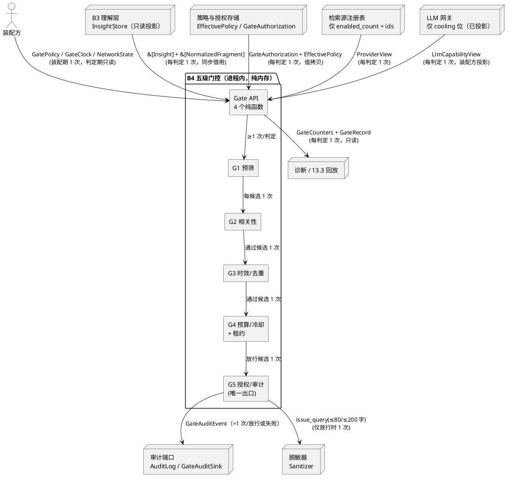

通信口径：全部为**同进程同步函数调用**；无消息队列、无缓存中间件、无跨进程协议。审计与脱敏是 trait 调用（可能落盘/可能失败），因此它们是唯一可能返回 `Err` 的下游，也是 fail-closed 的两个触发点。

### 2.1.2 服务/组件总体架构

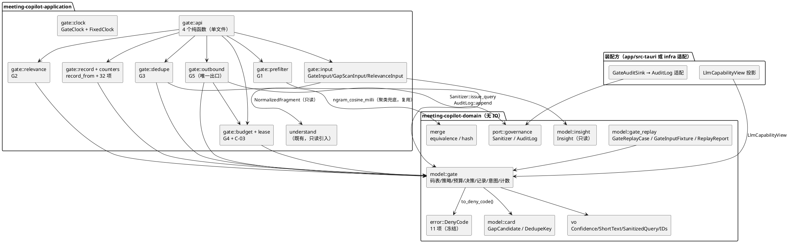

**模块职责与调用频率**

| 组件 | 职责 | 调用频率 | 关键约束 |
|---|---|---|---|
| `gate::api` | 4 个纯函数，唯一公开编排入口 | 每次判定 1 次 `evaluate_gate`；每次记录 1 次 `record_from` | 全文件仅 4 个 `pub fn`（AC-B4-46 grep 口径） |
| `gate::prefilter` | 11 项会话级硬闸门（按固定优先级）+ L0 六规则 | 每判定 1 次 + 每片段 1 次 | 无 IO、无锁、禁 `InsightStore` |
| `gate::relevance` | 4 分项加权 + 时间衰减，毫值整数 | 每候选 1 次 | 不调 LLM、不联网、无向量推理 |
| `gate::dedupe` | 7 步：聚类→去重键→配额→冷却→抑制→缓存年龄→收敛 | 每候选 1 次 | 只读窗口与抑制结果，不写存储 |
| `gate::budget` | 会话上限/全局窗口/主题窗口/冷却/离线/令牌桶 | 每候选 1 次 | 禁止读 `LLM_*`、禁止重试 |
| `gate::lease` | C-03 并发租约 | 放行时 1 次 `try_acquire`（判定外提交） | 固定 3 槽 + 单排队位 |
| `gate::outbound` | 7 字段授权校验、80/200 截断、脱敏、审计、fail-closed | 放行时 1 次 | 唯一 `issue_query`/`append` 调用点 |
| `gate::record` | `record_from` 实现 + `GateCounters::bump` | 每判定 1 次 | 零转录；计数单入口 |
| `gate::clock` | 毫秒取值 | 每判定 ≤5 次（各级用时） | 生产实现只读注入镜像；回放用 `FixedClock` |

**依赖方向**：`gate/** → domain（单向）`。`gate/**` 不出现 `infrastructure`、`reqwest`、`tokio`、`std::env`、`Instant::now`、`SystemTime::now`（`--rule=source` 机器判定）。

### 2.1.3 实现设计文档

#### 2.1.3.1 文件落点与"可被 grep 断言"的代码组织

1. **4 个纯函数集中单文件**：`detect_gaps` / `evaluate_gate` / `score_relevance` / `record_from` 全部定义在 `crates/application/src/gate/api.rs`，其余 `gate/*.rs` 只放 `pub(crate)` 实现体。原因：AC-B4-46 的判定式是 `grep -c "pub fn (...)" crates/application/src/gate/*.rs` = 4；若 4 个函数分散在多个文件，GNU grep 会输出多行 `file:count` 而非单一数字 4，断言不稳。
2. **各子模块的同名实现体加前缀**：`prefilter::run`、`relevance::compute`、`dedupe::apply`、`budget::check`、`outbound::authorize`，避免与 4 个公开名同形而污染 grep 计数。
3. **domain 文件扁平**：`model/gate.rs`（契约）与 `model/gate_replay.rs`（回放）不得放入子目录，否则 `--rule=source`/`--rule=budget`/`--rule=record` 的扫描面缺失 → 退 2。
4. **`gate/` 与既有 `proactive/` 的关系**：本轮**不创建** `crates/application/src/proactive/`；AC-B4-33 的 `proactive` 扫描面在 P0 由 `check-b4-gates.sh` 按"存在则扫、缺失则仅扫 `gate/`"处理，并在 `b4-status.md` 登记"`proactive/` 本轮不存在"。该口径需在 P0 与 spec §7.8 `outbound` 规则同步（D-B4-D02）。

#### 2.1.3.2 五级主编排伪代码与短路规则

```text
fn evaluate_gate(input, policy, clock) -> GateDecision:
    # 0. 策略前置：非法策略一律 fail-closed（spec §5.1.3-1、§4.2-1）
    if policy.validate() is Err:
        return Deny{ PolicyUnavailable, stopped_at = G1, per_stage = all NotReached }

    trace = PerStageResults::empty()            # 5 项 StageTrace，calls=0/result=NotReached
    stage = G1

    # 1. G1 预筛（强制级）
    t0 = clock.now_ms()
    r1 = prefilter::run(input, policy)          # 先 11 硬闸门，后六规则
    trace.set(G1, calls=1, result=r1, elapsed=clock.now_ms()-t0)
    if r1 is Deny(reason):  return Deny{reason, stopped_at=G1, per_stage=trace}
    if r1.candidates is empty:
        # 0 候选 ≠ 拒绝：不产外发意图，G2~G5 calls=0（AC-B4-03 只断言候选数）
        return Allow{ per_stage=trace, budget_remaining=input.budget.session_remaining(),
                      candidates=[], outbound=None, suppressed_notice=false,
                      stopped_at=Some(G1) }

    # 2. G2 相关性（可关闭；关闭必留痕）
    if policy.relevance_enabled == false:
        counters.bump(GateCounter::GateStageSkippedTotal)
        trace.mark_skipped(G2)                   # result=Skipped，score=None
    else:
        kept = []
        for candidate in r1.candidates:
            t = clock.now_ms()
            score = score_relevance(RelevanceInput::of(input, candidate), policy)
            trace.add(G2, calls+=1)
            if score.score_milli < policy.threshold_milli():
                counters.bump(GateCounter::GateL2LowRelevance)
                return Deny{ LowRelevance, stopped_at=G2, per_stage=trace }
            kept.push(ScoredCandidate{candidate, score})
        r1.candidates = kept

    # 3. G3 时效/去重（dedupe 子项可关闭；抑制列表与缓存年龄不可关闭）
    t = clock.now_ms()
    r3 = dedupe::apply(input, policy, r1.candidates)
    trace.set(G3, calls=1, result=r3, elapsed=clock.now_ms()-t)
    if r3 is Deny(reason):
        return Deny{reason, stopped_at=G3, per_stage=trace}
    if policy.dedupe_enabled == false:
        counters.bump(GateCounter::GateStageSkippedTotal)
        trace.mark_skipped(G3)                   # 只跳过"去重键/配额/冷却"四步

    # 4. G4 预算与冷却（强制级）
    t = clock.now_ms()
    r4 = budget::check(input, policy)            # 离线 → NoProvider → 冷却 → 预算 → 并发
    trace.set(G4, calls=1, result=r4, elapsed=clock.now_ms()-t)
    if r4 is Deny(reason):
        bump_by(reason)                          # 见 §2.1.3.10 映射
        return Deny{reason, stopped_at=G4, per_stage=trace}

    # 5. G5 外发授权与审计（强制级）
    t = clock.now_ms()
    r5 = outbound::authorize(input, policy, r3.selected)
    trace.set(G5, calls=1, result=r5, elapsed=clock.now_ms()-t)
    if r5 is Deny(reason):
        bump_by(reason)
        return Deny{reason, stopped_at=G5, per_stage=trace}

    counters.bump(GateCounter::GateAllowTotal)
    return Allow{ per_stage=trace, budget_remaining=r4.remaining,
                  candidates=r3.selected, outbound=Some(r5.intent),
                  suppressed_notice=r3.suppressed_notice,
                  stopped_at=None }
```

**短路规则（机器可判定口径，AC-B4-08/13/16/25/29/35/36、spec §4.1-2）**

1. 任一级返回 `Deny` 时立即 `return`，`stopped_at = 该级`，该级之后的 `StageTrace.calls = 0` 且 `result = NotReached`。
2. `PerStageResults` 用**固定 5 元素数组**（`[StageTrace; 5]`）而非 `Vec`，保证序列化顺序与字段数恒定（AC-B4-47 "字段封闭"）。
3. G1 的"0 候选"不是 `Deny`：`GateDecision::Allow` + `candidates=[]` + `outbound=None` + 后续级 `calls=0`；`stopped_at` 记为 `Some(G1)` 以保留"在哪一级结束"的可解释性。
4. 每级只读一次 `clock.now_ms()` 作为该级起点与终点（同级 2 次取值），不跨级缓存时间。
5. 任一级内部**异常（`Err`/`panic` 边界）**→ 由 `evaluate_gate` 外层统一转 `Deny{PolicyUnavailable}`，并保证 `deny_total` 与对应计数各 +1（spec §4.2-1、§4.2-3）。

#### 2.1.3.3 G1 判定（预筛 = 会话级硬闸门 + L0 六规则）

**A. 11 项硬闸门，按固定优先级取首个命中（spec §5.1.1-8；一个输入只产一个原因码）**

| # | 条件 | 原因码 | 计数 |
|---|---|---|---|
| 1 | `EffectivePolicy.auto_suggestion != Enabled` | `AutoDisabled` | `gate_l1_auto_disabled` |
| 2 | `consent == Explicit` 且未确认（`ConsentMissing`） | `ConsentMissing` | `gate_l1_consent_missing` |
| 3 | `SessionState::Paused` | `Paused` | `gate_l1_paused` |
| 4 | `SessionState::Silent` 或与静音区间重叠 | `SilentPeriod` | `gate_l1_silent_period` |
| 5 | 投屏保护开启且 `screen_share_protection_default` | `ScreenShareProtection` | `gate_l1_screen_share` |
| 6 | 片段 `confidence < 0.50` | `PreFilterLowConfidence` | `gate_l1_low_confidence` |
| 7 | 会话级全局抑制开关命中 | `Suppressed` | `gate_l1_suppressed` |
| 8 | 全局窗口配额已耗尽（只读快照） | `QuotaExhausted` | `gate_l1_quota_exhausted` |
| 9 | 会话级同键重复 | `Duplicate` | `gate_l1_duplicate` |
| 10 | `ProviderView.enabled_count == 0` | `NoProviderEnabled` | `gate_l1_no_provider` |
| 11 | 候选种子命中 `sensitive=true` 术语 | `SensitiveTerm` | `gate_l1_sensitive_term` |

> 主题/来源/实体抑制、窗口配额、实体冷却、逐键去重**只在 G3 判定**（spec §5.1.1-8 末句），G1 的第 7/8/9 项仅覆盖"会话级"开关与已耗尽状态，避免同一原因两级重复计数。

**B. L0 六规则的产出（`detect_gaps`，AC-B4-01~07）**

| `GapRule` | 基础分（毫值） | 映射 `GapKind` | 触发信号 |
|---|---|---|---|
| `ProperNoun` | 700 | `proper_noun` | 术语表差集 + 本次会话首现 |
| `Abbreviation` | 650 | `abbreviation` | 全大写 2–6 字母，白名单可配 |
| `Institution` | 600 | `proper_noun`（**内部子标签**） | 机构/职务词典 |
| `PolicyStandard` | 800 | `policy_standard` | GB/T、ISO、RFC、法条编号 |
| `Metric` | 750 | `metric` | 数字 + 单位/百分比 + 对比词 |
| `UnansweredQuestion` | 850 | `unanswered_question` | 问句 + 10 000 ms 无回应 |
| `Acronym` | 650 | `acronym` | 括号展开模式（与 `Abbreviation` 同分不同触发） |

`detect_gaps` 伪代码：

```text
fn detect_gaps(scan) -> Vec<GapCandidate>:
    out = []
    for fragment in scan.fragments:                       # 顺序即稳定前缀顺序
        if fragment.confidence < 0.50:                    # 片段级低置信
            counters.bump(GateL0LowConfidence); continue
        for rule in [ProperNoun, Abbreviation, Institution, PolicyStandard, Metric]:
            hit = rule.match(fragment.text, scan.lexicon, scan.explained, scan.acronym_whitelist)
            if hit is None: continue
            if hit.term is sensitive(scan.sensitive_terms):     # 敏感术语不入种子
                counters.bump(GateL0SensitiveSeedBlocked); continue
            if scan.is_first_seen(hit.term) == false:           # 首现判定
                continue                                        # 交给 G3 的 10 分钟窗口计 duplicate
            confidence = rule.base_milli / 1000
            if confidence < 0.50: counters.bump(GateL0LowConfidence); continue
            if scan.stable_prefix_ms(fragment) + 2000 > scan.now_ms: continue   # 2s 结构口径
            out.push(GapCandidate{ kind: rule.gap_kind(), trigger_span: fragment.span,
                                   confidence, dedupe_key: derive_key(hit), state: Detected })
    for question in scan.unanswered_questions:            # 10s 判定，独立于置信度
        if question.answered_within_ms <= 10000:
            counters.bump(GateL0QuestionAnsweredSkipped); continue
        if scan.now_ms - question.asked_ms < 10000: continue
        out.push(...UnansweredQuestion...)
    counters.bump(GateL0Candidates by out.len())
    out    # 排序：confidence 降序 → trigger_span.start_ms 升序 → dedupe_key 字典序（确定性）
```

要点：
- **敏感术语永不成为种子**（AC-B4-02）；命中即 `gate_l0_sensitive_seed_blocked += 1`。
- **首现判定**三重并集：术语表差集 ∪ 本会话已解释集合 ∪ 本次会话首现；三者为空（术语表未加载）时退化为"本次会话首现"，不 panic（spec §5.1.3-2）。
- **10 000 ms 边界**：`== 10 000` 产出候选、`9 999` 不产（AC-B4-03）；判定用 `now_ms - asked_ms >= 10_000`。
- **2 000 ms 边界**：`stable_prefix_ms + 2_000 <= now_ms` 才可读；`1 999` 不产（AC-B4-05）。
- 输出**排序三元组**固定，保证同输入同输出（AC-B4-07）。

#### 2.1.3.4 G2 判定（相关性，毫值整数）

```text
fn compute(input: RelevanceInput, policy) -> RelevanceScore:
    s = clamp_milli(input.semantic_milli)      # 注入快照；缺失按 0
    e = clamp_milli(input.entity_milli)
    g = clamp_milli(input.gain_milli)
    t = clamp_milli(input.source_trust_milli)
    # 加权分子：0.40/0.25/0.20/0.15 → 千分位权重 400/250/200/150
    base = (400*s + 250*e + 200*g + 150*t + 500) / 1000      # 四舍五入到毫值
    decay = decay_milli(input.delta_ms)                      # exp(-Δt/180000) 的毫值化
    score = (base * decay + 500) / 1000
    RelevanceScore{ semantic_milli: s, entity_milli: e, gain_milli: g,
                    source_trust_milli: t, decay_milli: decay, score_milli: score }
```

| 项 | 规则 | 机器判定 |
|---|---|---|
| 权重 | 400 / 250 / 200 / 150 千分位，末位四舍五入 | AC-B4-09：全分项=1000、Δt=0 → `score_milli == 1000` |
| 衰减 | `decay_milli = round(1000 × exp(-Δt/180000))`；`Δt=180000 → 368‰`（±1 接受 367/368） | AC-B4-10 |
| 阈值 | `Strict=720` / `Balanced=620`（默认）/ `Loose=520`；`score < threshold` 拒绝 | AC-B4-11：619 拒 / 620 放 |
| 六分项 | 六项必须同时出现；`NaN` 不可达（全部 `u16` 毫值，无浮点入参） | AC-B4-12 |
| 空主题/空实体 | `semantic=0`、`entity=0`，不 panic、除零不可达（整数运算） | AC-B4-13 |
| 纯性 | 无 `llm`/`network` 调用，中英混排 100 次一致 | AC-B4-14 |

**关键裁决**：整个公式用 `u32`/`u64` 整数，`exp` 用**整数查表 + 线性插值**（180 个 1s 桶 + 桶内 1000 步插值），避免 `f64::exp` 的平台差异破坏"逐字节一致"（spec §4.2-2）。毫值化的 `decay` 对同一 `delta_ms` 在 Windows/MSVC 上恒定。

#### 2.1.3.5 G3 判定（时效/去重，7 步固定顺序）

```text
fn apply(input, policy, candidates) -> G3Outcome:
    # ① 语义聚类：同主题合并（阈值 880‰）
    for c in candidates: c.topic_cluster_id = cluster_of(c, input.similarity_snapshot)
    # ② 去重键：10 分钟窗口内同键 0 重复放行
    for c in candidates:
        if policy.dedupe_enabled:
            if now - input.window.last_seen(c.dedupe_key) < 600_000:
                bump(GateL3Duplicate); return Deny{Duplicate}
    # ③ 主题配额 ≤2 / 全局 ≤3（10 分钟）
    if input.window.topic_used(c.topic_cluster_id) >= 2: bump(GateL3Quota); return Deny{QuotaExhausted}
    if input.window.global_used >= 3:                    bump(GateL3Quota); return Deny{QuotaExhausted}
    # ④ 实体冷却 5 分钟
    if now - input.window.entity_last_seen(c.entity_keys) < 300_000:
        bump(GateL3Duplicate); return Deny{Duplicate, cooldown_until = last + 300_000}
    # ⑤ 抑制列表（不可关闭）：自动拒绝 / 按需放行 + 提示
    if suppressed(c, input.suppression):
        bump(GateL3Suppressed)
        if input.trigger == Auto:      return Deny{Suppressed}
        else:                          suppressed_notice = true
    # ⑥ 缓存年龄：>24h 且无刷新来源 → stale
    if input.cache_age_ms > policy.max_cache_age_ms && input.refresh_available == false:
        bump(GateL3Stale); return Deny{Stale}
    # ⑦ 收敛：>10 候选取 score 前 3，其余丢弃
    if candidates.len() > 10:
        sort_by score desc, then dedupe_key asc
        dropped = candidates.len() - 3
        bump(GateL3Quota by dropped)
        candidates = candidates[..3]
    return Allow{ selected: candidates, suppressed_notice }
```

| 步 | 边界 | AC |
|---|---|---|
| ① 聚类 | 880‰ 归同主题；8799‰ 不归 | AC-B4-15 |
| ② 去重键 | 599 999 ms 拒 / 600 000 ms 放 | AC-B4-16 |
| ③ 配额 | 同主题第 3 次拒；全局第 4 次拒 | AC-B4-17 |
| ④ 冷却 | 299 999 ms 拒（`cooldown_until = last+300000`）/ 300 000 ms 放 | AC-B4-18 |
| ⑤ 抑制 | 自动 `Deny{Suppressed}`；按需 `Allow{suppressed_notice=true}` | AC-B4-19 |
| ⑥ 缓存 | 86 400 000 ms 放 / 86 400 001 ms 且无刷新 → `Deny{Stale}` | AC-B4-20 |
| ⑦ 收敛 | 10 候选全进；11 候选取 3 丢 8 | AC-B4-21 |

**聚类余弦来源裁决**：`similarity_snapshot` 由装配方注入（与 G2 的 `semantic` 同源快照）；注入缺失时用 `domain::merge::ngram_cosine_milli`（3-gram 整数余弦）作**确定性兜底**，并在 `GateRecord` 中标记 `topic_cluster_source = Injected|Fallback`（不新增计数项，字段放在 `ScoredCandidate`）。此裁决避免引入端侧向量模型（spec §1.11-N-08）。
#### 2.1.3.6 G4 判定（预算与冷却，强制级）

```text
fn check(input, policy) -> G4Outcome:
    # ① 离线：外部注入的 NetworkState（门控不探测）
    if input.network == Offline:      bump(GateL4Offline);          return Deny{Offline}
    # ② 无启用源（与 G1-10 同语义，此处复核装配后的快照）
    if input.provider.enabled_count == 0: bump(GateL1NoProvider);   return Deny{NoProviderEnabled}
    # ③ 冷却只读：单次判定只读一次能力快照，不重试、不阻塞
    if input.llm.cooling:
        bump(GateL4GatewayCooling)
        return Deny{GatewayCooling, cooldown_until = input.llm.cooling_until_ms}
    # ④ 会话上限（默认 120，可配 0..=600）
    if input.budget.session_outbound_used >= policy.session_outbound_cap:
        bump(GateL4BudgetExhausted); return Deny{BudgetExhausted}
    # ⑤ 10 分钟全局令牌桶（容量 3，补充速率按档位 1/3/5 每 600 000 ms）
    tokens = refill(input.budget.tokens_milli, input.budget.window_start_ms, input.now_ms, policy.frequency)
    if tokens < 1000:
        bump(GateL4BudgetExhausted); return Deny{BudgetExhausted}
    # ⑥ 单主题 10 分钟 ≤2（与 G3-③ 同源窗口，此处按预算口径复核）
    if input.budget.topic_used(candidate.topic_cluster_id) >= 2:
        bump(GateL4BudgetExhausted); return Deny{BudgetExhausted}
    # ⑦ 实体冷却 5 分钟（与 G3-④ 同源，预算口径复核）
    if input.now_ms - input.budget.entity_last_seen(candidate.entity_keys) < 300_000:
        bump(GateL4BudgetExhausted); return Deny{BudgetExhausted}
    # ⑧ 并发 ≤3：第 4 个排队（不拒绝、不丢候选），只断言 queued_len ≤1
    if input.budget.inflight >= 3:
        return Allow{ queued: true, remaining: session_remaining }
    return Allow{ queued: false, remaining: session_remaining }
```

**整数令牌桶（消除浮点与平台差异）**

```text
fn refill(tokens_milli: u16, window_start_ms: u64, now_ms: u64, freq) -> u16:
    elapsed = now_ms.saturating_sub(window_start_ms)
    per_window = match freq { Low => 1, Medium => 3, High => 5 }        # 次 / 600 000 ms
    add = (elapsed as u128 * per_window as u128 * 1000 / 600_000) as u16
    min(3000, tokens_milli.saturating_add(add))                         # 容量上限 3 000 毫令牌
```

| 规则 | 数值 | AC |
|---|---|---|
| 会话上限 | 第 120 次 `Allow`、第 121 次 `Deny{BudgetExhausted}` | AC-B4-23 |
| 全局配额 | 默认 3；档位 1/3/5；容量 3、补充 3/10 min；第 4 次拒 | AC-B4-24 |
| 冷却 | `cooling=true → Deny{GatewayCooling}`，`llm_calls=0`、`retries=0` | AC-B4-25 |
| 冷却不阻塞采集 | 冷却期片段准入继续（准入计数不减少） | AC-B4-26 |
| 恢复 | 推 600 001 ms 后预算恢复；冷却由能力位转 false 恢复；第 4 并发 → `Allow{queued=true}` | AC-B4-27 |
| 与 `LLM_LIVE_CALL_CAP` 无关 | `gate/` 中 `LLM_`/`std::env` 命中 0 | AC-B4-22 |

**关键裁决**：
1. **预算推进不在 `evaluate_gate` 内**。`evaluate_gate` 只读 `GateBudget` 快照；放行后的预占由调用方在判定之外调用 `GateBudget::commit(&decision)`（`&mut self`）。这同时满足"纯函数"（AC-B4-07/46）与"门控不持锁跨级"（spec §4.1-4）。
2. `GateBudget` 的窗口状态由外部快照注入，门控不改写存储；进程重启不去零依赖外部快照（spec §4.2-4、D-B4-05）。
3. 冷却与离线**不触发**重试/退避/熔断（spec §5.4.1-9），也不阻塞片段准入。

#### 2.1.3.7 G5 判定（外发授权与审计，强制级，唯一出口）

```text
fn authorize(input, policy, selected) -> G5Outcome:
    auth = input.authorization
    # ① 7 字段完整性：任一缺失 → Missing（fail-closed，不默认 Granted）
    if auth.is_complete() == false:                 return Deny{OutboundNotGranted}
    # ② 状态必须是 Granted（Revoked/Expired/Missing 一律拒）
    if auth.status != Granted:                      bump(GateL5NotGranted); return Deny{OutboundNotGranted}
    # ③ 内容类型只允许 TextQuery（音频永不在范围）
    if auth.content_types != [TextQuery]:           bump(GateL5NotGranted); return Deny{OutboundNotGranted}
    # ④ 授权范围与当前启用源一致（新增源 → 旧授权已 Expired，由装配方判定）
    if auth.provider_ids 非空 且 不是 input.provider.ids 的子集:
                                                    bump(GateL5ProviderOrDomainBlocked); return Deny{ProviderNotAllowed}
    # ⑤ 长度：自动 80 / 按需 200；先截断，再脱敏（超长不得到达脱敏器）
    limit = match input.trigger { Auto => 80, OnDemand => 200 }
    raw, truncated = truncate_chars(selected_query_seed, limit)
    # ⑥ 脱敏：失败 → 阻断 + 审计 1 条 + E-PRIV-004
    sanitized = match sanitizer.issue_query(raw):
        Err -> bump(GateL5SanitizeFailed); audit(Deny{SanitizeFailed}, len=0)
                return Deny{SanitizeFailed, user_error=E-PRIV-004}
    # ⑦ 审计：先写后放行；不可用 → 阻断 + 缓冲
    if input.audit_available == false:
        bump(GateL5AuditUnavailable); buffer(GateAuditEvent{...}); return Deny{AuditUnavailable}
    match audit_sink.append(GateAuditEvent{ auth_status, granted_at, content_type, len,
                                            provider_ids, result=Allow, reason=None, occurred_at }):
        Err -> bump(GateL5AuditUnavailable); buffer(event); return Deny{AuditUnavailable}
    return Allow{ OutboundIntent{ sanitized_query_len, content_type=TextQuery,
                                 provider_ids, authorization_status, truncated,
                                 queued, cooldown_until_ms } }
```

**关键裁决**：
1. **顺序不可交换**：`状态 → 范围 → 截断 → 脱敏 → 审计 → 放行`。审计永远在放行之前（AC-B4-35"未写审计前不得放行"）。
2. **截断在脱敏之前**：`truncated=true` 表示"已按最小上下文外发"（AC-B4-31）；截断按 `chars().count()`，与 `ShortText`/`SanitizedQuery` 同口径。
3. `OutboundIntent` **只有长度**（`sanitized_query_len`），不带 `SanitizedQuery` 本体，确保意图对象可序列化且零转录；`SanitizedQuery` 本体只在下游调度层的私有通道传递。
4. `E-PRIV-004` 通过 `GateError::SanitizeFailed{code}` 表达，**不新增 `ErrorCode` 变体**（冻结集 12 项保持），只在 `GateError` 的 `user_error_code()` 返回既有 `ErrorCode::PrivacyViolation`。
5. `GateAuditSink::append` 失败与 `AuditGuard` 降级都归一到 `Deny{AuditUnavailable}`，但**用户文案不同**（spec §5.5.3-2 明确不得冒用 `E-PRIV-004`）。

#### 2.1.3.8 状态机

**授权状态（单向不可自恢复，AC-B4-30）**

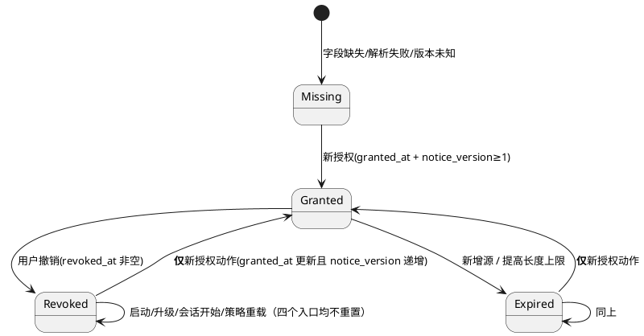

四个入口（启动、升级、会话开始、策略重载）的语义统一为：**读入持久化记录原样保留**，不写 `Granted`。`Granted` 的最小条件是 `revoked_at.is_none() && granted_at.is_some() && notice_version >= 1 && content_types == [TextQuery]`。

**门控执行状态**

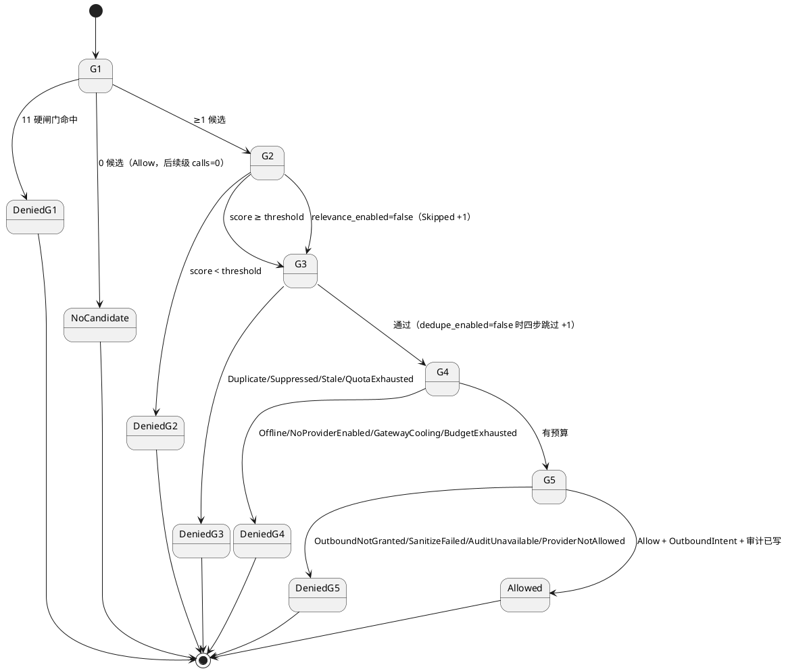

**租约状态（C-03）**

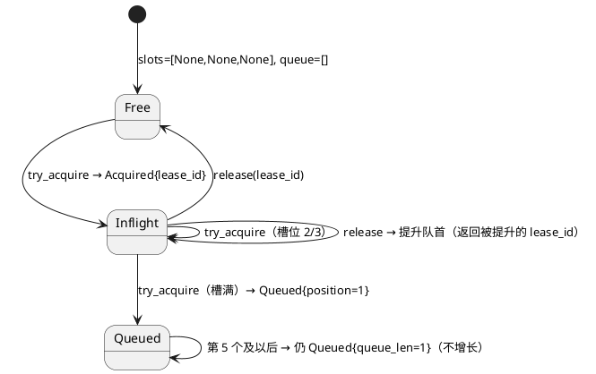

#### 2.1.3.9 可配置关闭的唯一开关

| 开关 | 默认 | 关闭后行为 | 强制留痕 | 校验 |
|---|---|---|---|---|
| `GateFeature`（B4 总开关） | `Disabled` | 门控完全不参与：`evaluate_gate` 不被调用，装配方走既有路径，行为与 B4 之前一致（§2.4） | 不产 `GateRecord` | 编译期/装配期选择 |
| `GatePolicy.relevance_enabled` | `true` | G2 跳过：`skipped_stages += G2`、`gate_stage_skipped_total += 1`、`score=None`、G3 以 `confidence` 作为排序键 | **必须** | 唯一允许关闭的**级** |
| `GatePolicy.dedupe_enabled` | `true` | G3 只跳过 ① 去重键、③ 配额、④ 冷却、⑦ 收敛；**⑤ 抑制、⑥ 缓存年龄仍生效** | **必须**（记录 `skipped_stages += G3`） | 唯一允许关闭的**子项** |
| `skip_g1` / `skip_g4` / `skip_g5` | 字段不存在 | 不接受该配置 | — | `GatePolicy::validate` 必须拒绝（`GatePolicyError::MandatoryStageCannotSkip`）；**禁止**用 `#[serde(default)]` 静默吸收 |
| `LLM_LIVE_CALL_CAP` | — | 与门控**无关**，缺失/为 0 不改变任何判定 | — | `--rule=budget` |

**唯一性裁决**：可关闭的只有两个字段且都必须在 `GatePolicy` 内显式声明；任何"运行时跳过 G1/G4/G5"的路径（包括 re-export 的 `skip_*` 参数、feature flag、环境变量）一律禁止，并由 `--rule=source` 的 `std::env` 命中 0 兜底。

#### 2.1.3.10 计数与观测（32 项，单一 bump 入口）

- `GateCounter` 是 32 变体封闭枚举（字段名即诊断字段名，spec §4.4）；`GateCounters::bump(GateCounter)` 是唯一写入方法，**禁止字符串键**。
- 计数与拒绝码的对应（`bump_by(reason)` 静态表）：

| 原因码 | 计数 |
|---|---|
| `AutoDisabled` | `gate_l1_auto_disabled` |
| `ConsentMissing` | `gate_l1_consent_missing` |
| `Paused` | `gate_l1_paused` |
| `SilentPeriod` | `gate_l1_silent_period` |
| `ScreenShareProtection` | `gate_l1_screen_share` |
| `PreFilterLowConfidence` | `gate_l1_low_confidence` |
| `Duplicate`（G1） / （G3） | `gate_l1_duplicate` / `gate_l3_duplicate` |
| `Suppressed`（G1） / （G3） | `gate_l1_suppressed` / `gate_l3_suppressed` |
| `QuotaExhausted`（G1） / （G3） | `gate_l1_quota_exhausted` / `gate_l3_quota` |
| `NoProviderEnabled` | `gate_l1_no_provider` |
| `SensitiveTerm` | `gate_l1_sensitive_term` |
| `LowRelevance` | `gate_l2_low_relevance` |
| `Stale` | `gate_l3_stale` |
| `BudgetExhausted` | `gate_l4_budget_exhausted` |
| `GatewayCooling` | `gate_l4_gateway_cooling` |
| `Offline` | `gate_l4_offline` |
| `OutboundNotGranted` | `gate_l5_not_granted` |
| `SanitizeFailed` | `gate_l5_sanitize_failed` |
| `AuditUnavailable` | `gate_l5_audit_unavailable` |
| `ProviderNotAllowed` / `DomainBlocked` | `gate_l5_provider_or_domain_blocked` |
| `PolicyUnavailable` | 不新增计数项：`gate_deny_total + 1`，并在 `StageTrace.reason` 留痕（spec §4.4 的 32 项已固定，无法扩容） |
| `RetentionExpired` | 同上（`gate_deny_total + 1`，`StageTrace.reason` 留痕） |

- 每次 `Deny` 必 `gate_deny_total += 1`；每次 `Allow` 必 `gate_allow_total += 1`；两者互斥（0 候选的 `Allow` 也计 allow）。
- 日志白名单：`trace_id`、原因码、计数、耗时毫秒、`domain`；**禁止**原文与 URL（AC-B4-42）。
## 2.2 接口设计

### 2.2.1 总体设计

**接口分类与稳定性**

| 分组 | 接口 | 稳定性 | 变更策略 | AC 追溯 |
|---|---|---|---|---|
| **可回放纯函数**（13.3 唯一依赖面） | `detect_gaps` / `evaluate_gate` / `score_relevance` / `record_from` | **稳定**（签名冻结） | 只允许追加带默认值的结构字段；签名变更需 spec 变更 | AC-B4-46/48 |
| **回放结构**（13.3 唯一依赖面） | `GateRecord` / `GateReplayCase` / `ReplayReport` | **实验** | 未知字段可忽略；`ReplayReport` 允许追加统计项 | AC-B4-48 |
| **端口** | `GateClock` / `GateAuditSink` | 稳定 | 只允许追加带默认实现的方法 | AC-B4-07/43 |
| **复用端口** | `Sanitizer` / `AuditLog`（既有，零 diff） | **冻结** | 不改签名 | AC-B4-33 |
| **类型级 API** | `GatePolicy::validate`、`GateBudget::commit`、`GateRejectReason::to_deny_code` 等 | 稳定 | 纯增量 | AC-B4-11/23/08 |
| **码表** | `GateRejectReason` 23 项 | 稳定 | **封闭**，新增需 spec 变更 | AC-B4-08/47 |

接口继承体系：无（Rust trait 组合，不存在继承树）。门控内部子模块之间只用 `pub(crate)` 函数，不暴露 trait，避免形成第二套可替换语义。

### 2.2.2 接口清单

#### A. 可回放纯函数（4 个，全部在 `gate/api.rs`）

```rust
pub fn detect_gaps(input: &GapScanInput<'_>) -> Vec<GapCandidate>;
pub fn evaluate_gate(input: &GateInput<'_>, policy: &GatePolicy, clock: &dyn GateClock) -> GateDecision;
pub fn score_relevance(input: &RelevanceInput<'_>, policy: &GatePolicy) -> RelevanceScore;
pub fn record_from(input: &GateInput<'_>, decision: &GateDecision, budget: &GateBudget) -> GateRecord;
```

| 接口 | 业务说明 | 前置条件 | 后置条件 | 异常映射 |
|---|---|---|---|---|
| `detect_gaps` | L0 六规则 → 候选（已排序、已去敏感、已过 2s/10s 边界） | 片段 `text ≤2000`、`confidence ∈[0,1]`；`now_ms` 已注入 | 返回候选数 = `gate_l0_candidates` 的本轮增量；同一输入同序同值 | 永不返回 `Err`；非法 `DedupeKey` 候选被丢弃并计 `gate_l0_low_confidence` |
| `evaluate_gate` | 五级漏斗唯一入口 | `policy.validate()` 必须已通过（未通过时由本函数内部 fail-closed） | `Deny` 后各级 `calls=0`；`Allow` 携带 `per_stage` 与 `budget_remaining` | 内部异常 → `Deny{PolicyUnavailable}`（不进 `ErrorCode`） |
| `score_relevance` | 单候选相关性（6 分项） | `Δms ≥ 0`；四注入值 ∈[0,1000] | `score_milli ∈[0,1000]`，六项齐全 | 越界钳制到 `[0,1000]`，不 panic、不返 `NaN` |
| `record_from` | 零转录记录构造 | `decision` 来自同一次 `evaluate_gate` | `GateRecord` 14 业务字段齐全；至少 `candidate_ref`/`insight_ref` 之一非空 | 二者皆空 → 结构违规，返回 `GateError`（由调用方转 `PolicyUnavailable`） |

**典型调用（真实代码形态，非伪代码）**

```rust
let decision = gate::evaluate_gate(&input, &policy, &clock);
let record = gate::record_from(&input, &decision, &input.budget);
match &decision {
    GateDecision::Allow { outbound: Some(intent), .. } => pipeline.enqueue(intent),
    GateDecision::Allow { .. } => { /* 0 候选或无放行意图 */ }
    GateDecision::Deny { reason, stopped_at, .. } => {
        counters.bump(GateCounter::GateDenyTotal);
        diagnostics.note(*reason, *stopped_at);
    }
}
```

#### B. 端口（2 个新增）

```rust
/// 仅暴露毫秒；实现方负责"不读系统时间"。
pub trait GateClock: Send + Sync {
    fn now_ms(&self) -> u64;
}

/// 审计写入端口：G5 是唯一调用点。`append` 失败即 fail-closed。
pub trait GateAuditSink: Send + Sync {
    fn append(&self, event: &GateAuditEvent) -> Result<(), GateError>;
    fn status(&self) -> AuditAvailability; // 复用 application::governance::AuditAvailability
}
```

| 端口 | 说明 | 前置/后置 | 异常映射 |
|---|---|---|---|
| `GateClock` | 生产实现读注入的 `AtomicU64` 镜像（由装配方按会话单调时钟推进）；回放实现为 `FixedClock` | 前置：单调不减；后置：无副作用 | 无 `Result`（纯取值） |
| `GateAuditSink` | 既有 `AuditLog` 的适配端口（结构化 7 字段 → `append(OutboundQuery, "k=v;…")`） | 前置：事件字段已脱敏；后置：成功即审计可见 | `Err` → `Deny{AuditUnavailable}`；`status().is_available()==false` → 不进 `append` 直接阻断 |

#### C. 类型级 API（签名要点）

| API | 说明 | AC |
|---|---|---|
| `GatePolicy::validate() -> Result<(), GatePolicyError>` | 强制级跳过字段必拒；阈值 ∈{520,620,720}；`session_outbound_cap ∈ 0..=600` | AC-B4-11 |
| `GateRejectReason::to_deny_code() -> Option<DenyCode>` | 12 项映射、11 项 `None` | AC-B4-08/34 |
| `GateRejectReason::ui_message_key() -> &'static str` | `gate.reason.<snake_case>`（23 项全有键） | C-01 |
| `GateRejectReason::visibility() -> ReasonVisibility` | `Public`（12）/`Internal`（11） | C-01 |
| `GateBudget::commit(&mut self, &GateDecision)` | 判定外推进用量（纯内存） | AC-B4-23/27 |
| `GateBudget::session_remaining() -> u16` | `cap - used`（`saturating`） | AC-B4-23 |
| `GateCounters::bump(GateCounter)` | 唯一写入口；`u64` 单调 | spec §4.4 |
| `GateInput::from_snapshot(&GateSnapshot) -> GateInput` | 同源构造（避免 `fragments/insights` 双份不一致） | AC-B4-38 |
| `OutboundLease::try_acquire/release` | C-03 | AC-B4-27 |

### 2.2.3 C-01：三套码表唯一映射（**最高优先级裁决**）

**裁决原则**（按优先级）：

1. **对外只有一个码**：`GateRejectReason` 23 项是唯一对外标识（UI、审计 `reason`、诊断、回放夹具）。
2. **兼容层只做投影，不做双写**：`to_deny_code()` 把 12 项投影到既有 11 项 `DenyCode`，供既有审计分析与 UI 兼容；**不把 `DenyCode` 作为 G5 判定输入**。
3. **design §2.2.2-F 的 12 码降级为"历史别名"**：只出现在本迁移表与 `b4-status.md` 的偏差登记中；新代码不出现这些名称，`--rule=record` 仅断言 23 项存在，不反向断言旧名。
4. **唯一性可机器判定**：`GateRejectReason::ALL` 长度 = 23；`to_deny_code()` 为非 `None` 的项数 = 12；每个 `DenyCode` 至少 1 个来源（11/11 覆盖）；`RateLimited` 恰好 2 个来源。

**唯一映射表（23 行，C-01 交付物）**

| # | `GateRejectReason`（serde 值） | 产生级 | design 12 码（历史别名） | `to_deny_code()` | UI 文案键 | 可见性 | 审计 `reason` |
|---|---|---|---|---|---|---|---|
| 1 | `pre_filter_low_confidence` | G1 | `LowConfidence` | `None` | `gate.reason.pre_filter_low_confidence` | Internal | `pre_filter_low_confidence` |
| 2 | `consent_missing` | G1 | `ConsentMissing` | `ConsentMissing` | `gate.reason.consent_missing` | Public | `consent_missing` |
| 3 | `auto_disabled` | G1 | `AutoDisabled` | `None` | `gate.reason.auto_disabled` | Internal | `auto_disabled` |
| 4 | `paused` | G1 | `Paused` | `None` | `gate.reason.paused` | Internal | `paused` |
| 5 | `silent_period` | G1 | `QuietPeriod`（改名） | `SilentPeriod` | `gate.reason.silent_period` | Public | `silent_period` |
| 6 | `screen_share_protection` | G1 | `ScreenShareMode`（改名） | `ScreenShareProtection` | `gate.reason.screen_share_protection` | Public | `screen_share_protection` |
| 7 | `sensitive_term` | G1 | `SensitiveTerm`（改名） | `SensitiveTermBlocked` | `gate.reason.sensitive_term` | Public | `sensitive_term` |
| 8 | `duplicate` | G1/G3 | `Duplicate` | `None` | `gate.reason.duplicate` | Internal | `duplicate` |
| 9 | `suppressed` | G1/G3 | `Suppressed` | `None` | `gate.reason.suppressed` | Internal | `suppressed` |
| 10 | `quota_exhausted` | G1/G3 | `QuotaExhausted` | `RateLimited` | `gate.reason.quota_exhausted` | Public | `quota_exhausted` |
| 11 | `no_provider_enabled` | G1/G4 | `NoProviderEnabled` | `None` | `gate.reason.no_provider_enabled` | Internal | `no_provider_enabled` |
| 12 | `low_relevance` | G2 | —（design 的 L2 层，无 L1 码） | `None` | `gate.reason.low_relevance` | Internal | `low_relevance` |
| 13 | `stale` | G3 | — | `None` | `gate.reason.stale` | Internal | `stale` |
| 14 | `budget_exhausted` | G4 | — | `RateLimited` | `gate.reason.budget_exhausted` | Public | `budget_exhausted` |
| 15 | `gateway_cooling` | G4 | — | `None` | `gate.reason.gateway_cooling` | Internal | `gateway_cooling` |
| 16 | `offline` | G4 | — | `None` | `gate.reason.offline` | Internal | `offline` |
| 17 | `outbound_not_granted` | G5 | `NotAuthorized`（改名） | `OutboundNotGranted` | `gate.reason.outbound_not_granted` | Public | `outbound_not_granted` |
| 18 | `sanitize_failed` | G5 | — | `SanitizeRequired` | `gate.reason.sanitize_failed` | Public | `sanitize_failed` |
| 19 | `audit_unavailable` | G5 | — | `None` | `gate.reason.audit_unavailable` | Internal | `audit_unavailable` |
| 20 | `provider_not_allowed` | G5 | — | `ProviderNotAllowed` | `gate.reason.provider_not_allowed` | Public | `provider_not_allowed` |
| 21 | `domain_blocked` | G5 | — | `DomainBlocked` | `gate.reason.domain_blocked` | Public | `domain_blocked` |
| 22 | `policy_unavailable` | 任意级异常 / G1 前置 | — | `PolicyUnavailable` | `gate.reason.policy_unavailable` | Public | `policy_unavailable` |
| 23 | `retention_expired` | G5 前置 / 下游回传 | — | `RetentionExpired` | `gate.reason.retention_expired` | Public | `retention_expired` |

**计数核对**：`Public` 12 项（2,5,6,7,10,14,17,18,20,21,22,23）；`Internal` 11 项（1,3,4,8,9,11,12,13,15,16,19）；`to_deny_code()` 非 `None` 12 项；映射目标 `DenyCode` 去重后 11 项，`RateLimited` 来源 2 项（10、14）。与 spec §6.5-1/§6.5-2 完全一致。

**`DenyCode` 覆盖矩阵（11 项 → 来源）**

| `DenyCode` | 来源 `GateRejectReason` | 数量 |
|---|---|---|
| `ConsentMissing` | 2 | 1 |
| `OutboundNotGranted` | 17 | 1 |
| `SensitiveTermBlocked` | 7 | 1 |
| `ProviderNotAllowed` | 20 | 1 |
| `DomainBlocked` | 21 | 1 |
| `ScreenShareProtection` | 6 | 1 |
| `SilentPeriod` | 5 | 1 |
| `RateLimited` | 10、14 | **2** |
| `SanitizeRequired` | 18 | 1 |
| `RetentionExpired` | 23 | 1 |
| `PolicyUnavailable` | 22 | 1 |
| **合计** | — | **12** |

**UI 文案表（23 条，键 + 中文）**

| 文案键 | 中文文案 | 复用既有 `DenyCode::user_message` |
|---|---|---|
| `gate.reason.pre_filter_low_confidence` | 片段置信度不足，暂不提示 | 否（新增） |
| `gate.reason.consent_missing` | 尚未取得会话采集同意 | 是 |
| `gate.reason.auto_disabled` | 自动提示已关闭 | 否（新增） |
| `gate.reason.paused` | 已暂停，暂不提示 | 否（新增） |
| `gate.reason.silent_period` | 处于静默期，暂不显示提示 | 是 |
| `gate.reason.screen_share_protection` | 投屏保护模式中，暂不显示提示 | 是 |
| `gate.reason.sensitive_term` | 命中敏感术语，已阻止外发 | 是 |
| `gate.reason.duplicate` | 内容重复，已合并 | 否（新增） |
| `gate.reason.suppressed` | 该主题/来源已加入抑制列表 | 否（新增） |
| `gate.reason.quota_exhausted` | 本时段同类提示已达上限 | 否（新增；虽映射 `RateLimited`，但不复用其泛化文案） |
| `gate.reason.no_provider_enabled` | 未启用任何检索源 | 否（新增） |
| `gate.reason.low_relevance` | 与当前话题关联度不足 | 否（新增） |
| `gate.reason.stale` | 缓存结果已超过 24 小时且无法刷新 | 否（新增） |
| `gate.reason.budget_exhausted` | 自动外发预算已用尽 | 否（新增；同上） |
| `gate.reason.gateway_cooling` | 模型服务暂不可用，已暂停自动检索 | 否（新增） |
| `gate.reason.offline` | 当前处于离线状态，已暂停自动检索 | 否（新增） |
| `gate.reason.outbound_not_granted` | 尚未授权自动外发检索 | 是 |
| `gate.reason.sanitize_failed` | 查询必须脱敏后才能外发（E-PRIV-004） | 是 |
| `gate.reason.audit_unavailable` | 审计不可用，已暂停自动提示 | 否（新增；**不得**冒用 E-PRIV-004） |
| `gate.reason.provider_not_allowed` | 当前检索源不在允许范围内 | 是 |
| `gate.reason.domain_blocked` | 目标域名已被策略屏蔽 | 是 |
| `gate.reason.policy_unavailable` | 组织策略不可用，已按最严格默认值拦截 | 是 |
| `gate.reason.retention_expired` | 数据已超过留存期 | 是 |

**审计口径**

- `GateAuditEvent.reason: Option<&'static str>` 写 `GateRejectReason` 的 serde 值；同时 `deny_code: Option<DenyCode>` 冗余投影（便于既有审计分析复用），二者由同一 `to_deny_code()` 派生，**不存在独立维护的第二张表**。
- `result` 字段为 `Allow | Deny`；`Allow` 时 `reason=None`。审计**不写** `stopped_at`（避免与 `per_stage` 重复信息）。
- `GateAuditEvent` 7 字段固定：`authorization_status`、`granted_at_ms: Option<i64>`、`content_type: GateContentType`、`query_len: usize`、`provider_ids: Vec<ProviderId>`、`result: AuditResult`、`reason: Option<&'static str>`；`occurred_at_ms` 作为第 8 个时间字段（spec §5.5.1-7 的"发生时间"）。

**为什么不让三套码并存**

| 并存方案 | 为什么被否 |
|---|---|
| 保留 design 12 码作为并列对外码 | UI 需要 3 套分支；AC-B4-08/34 无法稳定断言"11 个不同原因码"；误触发统计会分散在 12+11 桶 |
| 扩 `DenyCode::ALL` 到 23 | 直接违反 spec §4.5-2/§6.5-3 与 AC-B4-40；破坏既有 11 条文案与外部审计消费方 |
| 用字符串码（运行时拼接） | 无法封闭，未知值无法反序列化失败（AC-B4-47） |
## 2.3 数据模型

### 2.3.1 设计目标

1. **领域对象先于存储**：本轮**不建表、不建索引、不建缓存**；`GateBudget`、`GateAuthorization`、窗口与抑制结果都是"外部注入的只读快照"，门控不改写任何存储（spec §1.4-3/§4.2-4）。
2. **零转录**：`GateRecord`、`OutboundIntent`、`GateAuditEvent`、回放夹具都不得含查询原文、完整 URL、模型名、`request_id`、参会人姓名（spec §4.3-1、AC-B4-42）。
3. **确定性**：全部数值走整数（毫值/毫秒/计数），无浮点入参，无 `HashMap` 迭代序依赖（用 `BTreeMap`/固定数组），保证同输入逐字节一致（spec §4.2-2、AC-B4-07/48）。
4. **容量与兼容**：计数 32 项、拒绝码 23 项、记录 14 业务字段；新字段可被旧版本忽略（`#[serde(default)]`），既有 `EffectivePolicy`/`OutboundGrant`/`DenyCode` 序列化不变（spec §4.5-5、AC-B4-41）。
5. **生命周期**：`GateBudget` 由装配方持有并跨判定复用；`GateAuthorization` 由策略存储持有、门控只读；`GateRecord` 一次性产生、下游只读；`OutboundLease` 随一次外发开始/结束。

### 2.3.2 模型实现

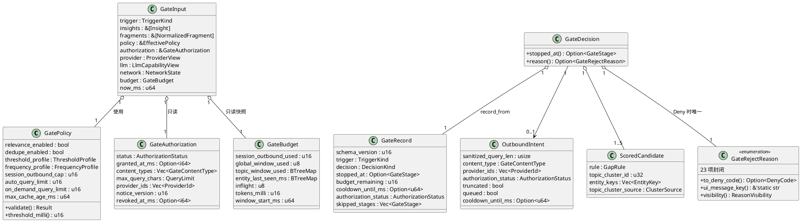

> 类图只列业务字段与方法签名；`trace_id`/`session_id`/`candidate_ref`/`insight_ref`/`decided_at_ms`/`per_stage` 等技术性与嵌套字段在下方定义草案中给出。

#### A. `crates/domain/src/model/gate.rs`（27 项类型定义草案）

```rust
use std::collections::BTreeMap;
use serde::{Deserialize, Serialize};
use crate::error::DenyCode;
use crate::model::card::{DedupeKey, GapCandidate};
use crate::vo::{Confidence, InsightRef, ProviderId, SessionId, TraceId};

/// 执行漏斗的级。**固定 5 项**，与 design L0~L4 正交（spec §1.6）。
#[derive(Debug, Clone, Copy, PartialEq, Eq, PartialOrd, Ord, Hash, Serialize, Deserialize)]
#[serde(rename_all = "snake_case")]
pub enum GateStage { G1, G2, G3, G4, G5 }

/// 单级结果；`NotReached` 与 `Skipped` 都必须可判定（AC-B4-47）。
#[derive(Debug, Clone, Copy, PartialEq, Eq, Serialize, Deserialize)]
#[serde(rename_all = "snake_case")]
pub enum StageResult { Allow, Deny, Skipped, NoCandidate, NotReached }

/// 拒绝原因码（23 项封闭集，spec §6.5）。
/// 未知字符串反序列化必须失败（AC-B4-47）——由封闭 enum 天然保证。
#[derive(Debug, Clone, Copy, PartialEq, Eq, Hash, Serialize, Deserialize)]
#[serde(rename_all = "snake_case")]
pub enum GateRejectReason {
    PreFilterLowConfidence, ConsentMissing, AutoDisabled, Paused, SilentPeriod,
    ScreenShareProtection, SensitiveTerm, Duplicate, Suppressed, QuotaExhausted,
    NoProviderEnabled, LowRelevance, Stale, BudgetExhausted, GatewayCooling, Offline,
    OutboundNotGranted, SanitizeFailed, AuditUnavailable, ProviderNotAllowed,
    DomainBlocked, PolicyUnavailable, RetentionExpired,
}

impl GateRejectReason {
    pub const ALL: [Self; 23] = [ /* 按上表 #1..#23 顺序，顺序即断言口径 */ ];
    /// 12 项返回 `Some`，11 项返回 `None`（C-01 唯一映射，见 §2.2.3）。
    pub const fn to_deny_code(self) -> Option<DenyCode> { /* 静态 match，无表驱动 */ }
    /// 恒为 `gate.reason.<snake_case>`，23 项全覆盖。
    pub const fn ui_message_key(self) -> &'static str { }
    pub const fn visibility(self) -> ReasonVisibility { }
}

#[derive(Debug, Clone, Copy, PartialEq, Eq, Serialize, Deserialize)]
#[serde(rename_all = "snake_case")]
pub enum ReasonVisibility { Public, Internal }

/// L0 六类规则的内部标签（7 变体：Institution 是 ProperNoun 的子标签，spec J-08）。
#[derive(Debug, Clone, Copy, PartialEq, Eq, Hash, Serialize, Deserialize)]
#[serde(rename_all = "snake_case")]
pub enum GapRule {
    ProperNoun, Abbreviation, Institution, PolicyStandard, Metric, UnansweredQuestion, Acronym,
}

impl GapRule {
    pub const ALL: [Self; 7] = [ /* … */ ];
    /// 基础分（毫值），见 §2.1.3.3-B。
    pub const fn base_milli(self) -> u16 { }
    /// 对外映射：Institution → ProperNoun，其余一一对应。
    pub const fn gap_kind_name(self) -> &'static str { }
}

/// 六分项相关性（全部毫值，0..=1000，无浮点）。
#[derive(Debug, Clone, Copy, PartialEq, Eq, Serialize, Deserialize)]
pub struct RelevanceScore {
    pub semantic_milli: u16,
    pub entity_milli: u16,
    pub gain_milli: u16,
    pub source_trust_milli: u16,
    pub decay_milli: u16,
    pub score_milli: u16,
}

#[derive(Debug, Clone, Copy, PartialEq, Eq, Serialize, Deserialize)]
#[serde(rename_all = "snake_case")]
pub enum ThresholdProfile { Strict, Balanced, Loose }

impl ThresholdProfile {
    /// 720 / 620 / 520（AC-B4-11）。
    pub const fn milli(self) -> u16 { }
}

#[derive(Debug, Clone, Copy, PartialEq, Eq, Serialize, Deserialize)]
#[serde(rename_all = "snake_case")]
pub enum FrequencyProfile { Low, Medium, High }

impl FrequencyProfile {
    /// 1 / 3 / 5 次每 600 000 ms（AC-B4-24）。
    pub const fn per_window(self) -> u8 { }
}

/// 门控策略（spec §6.9）。**强制级无 skip 字段**，从类型上杜绝非法配置。
#[derive(Debug, Clone, PartialEq, Eq, Serialize, Deserialize)]
#[serde(default)]
pub struct GatePolicy {
    pub relevance_enabled: bool,
    pub dedupe_enabled: bool,
    pub threshold_profile: ThresholdProfile,
    pub frequency_profile: FrequencyProfile,
    pub session_outbound_cap: u16,          // 0..=600，默认 120
    pub auto_query_limit: u16,              // 固定 80
    pub on_demand_query_limit: u16,         // 固定 200
    pub max_cache_age_ms: u64,              // 默认 86_400_000
}

#[derive(Debug, Clone, PartialEq, Eq, thiserror::Error)]
pub enum GatePolicyError {
    #[error("会话外发上限 {0} 超出 0..=600")]
    SessionCapOutOfRange(u16),
    #[error("阈值档位非法：{0}")]
    ThresholdProfileInvalid(u16),
    #[error("自动/按需长度上限固定为 80/200，实际 {auto}/{on_demand}")]
    QueryLimitNotFixed { auto: u16, on_demand: u16 },
    #[error("强制级 G{stage} 不可跳过")]
    MandatoryStageCannotSkip { stage: u8 },
}

#[derive(Debug, Clone, Copy, PartialEq, Eq, Serialize, Deserialize)]
#[serde(rename_all = "snake_case")]
pub enum AuthorizationStatus { Granted, Revoked, Expired, Missing }

/// 外发内容类型：**只允许 TextQuery**（音频永不在范围内，spec §6.10-3）。
#[derive(Debug, Clone, Copy, PartialEq, Eq, Serialize, Deserialize)]
#[serde(rename_all = "snake_case")]
pub enum GateContentType { TextQuery }

#[derive(Debug, Clone, Copy, PartialEq, Eq, Serialize, Deserialize)]
#[serde(rename_all = "snake_case")]
pub enum QueryLimit { Auto, OnDemand }

impl QueryLimit {
    /// 80 / 200（spec §6.10-4）。
    pub const fn chars(self) -> usize { }
}

/// 授权记录 7 字段（spec §6.10，AC-B4-28）。
#[derive(Debug, Clone, PartialEq, Eq, Serialize, Deserialize)]
pub struct GateAuthorization {
    pub status: AuthorizationStatus,
    #[serde(default)] pub granted_at_ms: Option<i64>,
    #[serde(default)] pub content_types: Vec<GateContentType>,
    #[serde(default)] pub max_query_chars: Option<u16>,
    #[serde(default)] pub provider_ids: Vec<ProviderId>,
    #[serde(default)] pub notice_version: u16,
    #[serde(default)] pub revoked_at_ms: Option<i64>,
}

impl GateAuthorization {
    /// 任一必需字段缺失 → false（fail-closed，不默认 Granted）。
    pub fn is_complete(&self) -> bool { }
    /// 撤销不可自恢复的机器口径（AC-B4-30）。
    pub fn is_grantable(&self) -> bool { }
    /// 从既有 `OutboundGrant` 的单向投影（不改既有结构）。
    pub fn from_legacy(grant: &crate::model::governance::OutboundGrant, status: AuthorizationStatus) -> Self { }
}

#[derive(Debug, Clone, Copy, PartialEq, Eq, Serialize, Deserialize)]
#[serde(rename_all = "snake_case")]
pub enum NetworkState { Online, Offline, Unknown }

/// 门控预算（spec §6.7）。纯数据，门控只读；`commit` 由调用方在判定外执行。
#[derive(Debug, Clone, PartialEq, Eq, Serialize, Deserialize)]
pub struct GateBudget {
    pub session_outbound_used: u16,                          // 0..=600
    pub global_window_used: u8,                              // 0..=5
    pub topic_window_used: BTreeMap<u32, u8>,                // 每桶 0..=2（BTreeMap 保证序）
    pub entity_last_seen_ms: BTreeMap<EntityKey, u64>,       // 冷却 300 000 ms
    pub inflight: u8,                                        // 0..=3
    #[serde(default)] pub tokens_milli: u16,                 // 0..=3000
    #[serde(default)] pub window_start_ms: u64,
}

impl GateBudget {
    pub fn session_remaining_with(&self, cap: u16) -> u16 { }
    pub fn commit(&mut self, decision: &GateDecision) { }     // 判定外推进
}

/// 32 项固定计数（spec §4.4，字段名即诊断名）。
#[derive(Debug, Clone, Copy, PartialEq, Eq, Hash, Serialize, Deserialize)]
#[serde(rename_all = "snake_case")]
pub enum GateCounter { GateL0Candidates, /* … 共 32 项，顺序固定 … */ GateReplayMismatch }

#[derive(Debug, Clone, PartialEq, Eq, Default, Serialize, Deserialize)]
pub struct GateCounters { /* 32 × u64，内部数组 + 按变体索引 */ }

impl GateCounters {
    pub fn bump(&mut self, counter: GateCounter) { }          // 唯一写入口（mutable）
    pub fn get(&self, counter: GateCounter) -> u64 { }
    pub fn snapshot(&self) -> [(GateCounter, u64); 32] { }
}

/// 单级轨迹（4 字段，spec §6.6-4）。
#[derive(Debug, Clone, Copy, PartialEq, Eq, Serialize, Deserialize)]
pub struct StageTrace {
    pub calls: u16,
    pub result: StageResult,
    pub reason: Option<GateRejectReason>,
    pub elapsed_ms: u32,
}

/// **固定 5 元素数组**，保证序列化顺序恒定。
#[derive(Debug, Clone, PartialEq, Eq, Serialize, Deserialize)]
pub struct PerStageResults(pub [StageTrace; 5]);

/// 决策（spec §6.4）。0 候选时走 `Allow` + `candidates=[]`，不引入第三变体。
#[derive(Debug, Clone, PartialEq, Serialize, Deserialize)]
#[serde(tag = "kind", rename_all = "snake_case")]
pub enum GateDecision {
    Allow {
        per_stage: PerStageResults,
        budget_remaining: u16,
        candidates: Vec<ScoredCandidate>,
        outbound: Option<OutboundIntent>,
        suppressed_notice: bool,
        stopped_at: Option<GateStage>,
    },
    Deny {
        reason: GateRejectReason,
        stopped_at: GateStage,
        per_stage: PerStageResults,
        cooldown_until_ms: Option<u64>,
    },
}

/// 记录层的轻量决策标签（不带候选/意图，控制记录体积与转录面）。
#[derive(Debug, Clone, Copy, PartialEq, Eq, Serialize, Deserialize)]
#[serde(rename_all = "snake_case")]
pub enum DecisionKind { Allow, Deny }

/// 门控记录（14 业务字段，spec §6.6；`unknown` 为透传容器，不计入业务字段数）。
#[derive(Debug, Clone, PartialEq, Serialize, Deserialize)]
pub struct GateRecord {
    pub schema_version: u16,
    pub trace_id: TraceId,
    pub session_id: SessionId,
    #[serde(default)] pub candidate_ref: Option<DedupeKey>,
    #[serde(default)] pub insight_ref: Option<InsightRef>,
    pub trigger: crate::model::enums::TriggerKind,
    pub per_stage: PerStageResults,
    pub decision: DecisionKind,
    pub stopped_at: Option<GateStage>,
    pub budget_remaining: u16,
    #[serde(default)] pub cooldown_until_ms: Option<u64>,
    pub authorization_status: AuthorizationStatus,
    #[serde(default)] pub skipped_stages: Vec<GateStage>,   // 仅允许 G2/G3
    pub decided_at_ms: u64,
    #[serde(default, flatten)] pub unknown: BTreeMap<String, serde_json::Value>,
}

/// 外发意图（**无原文**，spec §1.3-3）。
#[derive(Debug, Clone, PartialEq, Eq, Serialize, Deserialize)]
pub struct OutboundIntent {
    pub sanitized_query_len: usize,
    pub content_type: GateContentType,
    pub provider_ids: Vec<ProviderId>,
    pub authorization_status: AuthorizationStatus,
    pub truncated: bool,
    pub queued: bool,
    #[serde(default)] pub cooldown_until_ms: Option<u64>,
}

/// 审计事件（7 字段 + 发生时间，spec §5.5.1-7）。
#[derive(Debug, Clone, PartialEq, Eq, Serialize, Deserialize)]
pub struct GateAuditEvent {
    pub authorization_status: AuthorizationStatus,
    #[serde(default)] pub granted_at_ms: Option<i64>,
    pub content_type: GateContentType,
    pub query_len: usize,
    pub provider_ids: Vec<ProviderId>,
    pub result: AuditResult,                    // Allow | Deny
    #[serde(default)] pub reason: Option<GateRejectReason>,
    pub occurred_at_ms: u64,
}

#[derive(Debug, Clone, Copy, PartialEq, Eq, Serialize, Deserialize)]
#[serde(rename_all = "snake_case")]
pub enum AuditResult { Allow, Deny }

/// 网关能力快照（装配方投影；门控不读 infrastructure）。
#[derive(Debug, Clone, Copy, PartialEq, Eq, Serialize, Deserialize)]
pub struct LlmCapabilityView {
    pub cooling: bool,
    #[serde(default)] pub cooling_until_ms: Option<u64>,
}

/// 检索源视图（只有数量与 ID，**无端点/密钥**）。
#[derive(Debug, Clone, PartialEq, Eq, Serialize, Deserialize)]
pub struct ProviderView {
    pub enabled_count: u8,
    #[serde(default)] pub provider_ids: Vec<ProviderId>,
}

/// 实体键（FNV-1a 派生，32 hex 文本；不携带实体原文）。
#[derive(Debug, Clone, PartialEq, Eq, PartialOrd, Ord, Hash, Serialize, Deserialize)]
#[serde(transparent)]
pub struct EntityKey(String);   // 校验：32 位十六进制，构造期失败返回 GateError::InvalidEntityKey

/// 候选 + 评分 + 主题/实体（外层包裹，**不改 `GapCandidate`**）。
#[derive(Debug, Clone, PartialEq, Serialize, Deserialize)]
pub struct ScoredCandidate {
    pub candidate: GapCandidate,
    pub rule: GapRule,
    pub relevance: RelevanceScore,
    pub topic_cluster_id: u32,
    pub entity_keys: Vec<EntityKey>,
    pub topic_cluster_source: ClusterSource,
}

#[derive(Debug, Clone, Copy, PartialEq, Eq, Serialize, Deserialize)]
#[serde(rename_all = "snake_case")]
pub enum ClusterSource { Injected, Fallback }
```

> 注：`GateRecord.decision: DecisionKind` 是**记录层**的轻量标签（`Allow`/`Deny`），与 `GateDecision` 枚举区分，避免记录里嵌套完整决策（否则记录体积与零转录风险上升）。`DecisionKind` 计入类型清单（见 §2.3.2 统计）。

**校验边界与错误码（全部不进 `ErrorCode` 冻结集）**

| 校验点 | 边界 | 失败表现 |
|---|---|---|
| `GatePolicy::validate` | `session_outbound_cap ∈ 0..=600`；`auto=80`、`on_demand=200`；`threshold ∈{520,620,720}` | `GatePolicyError`（四变体），装配期返回；判定期降级为 `fail_closed()` 并 `Deny{PolicyUnavailable}` |
| `GateAuthorization::is_complete` | 7 字段全在；`content_types == [TextQuery]`；`notice_version ≥ 1`；`status=Granted → granted_at_ms.is_some()` | `Deny{OutboundNotGranted}`，计 `gate_l5_not_granted` |
| `EntityKey::new` | 32 位十六进制 | `GateError::InvalidEntityKey`；候选被丢弃，计 `gate_l0_low_confidence` |
| `GateRecord` 结构 | 14 业务字段齐全；`skipped_stages ⊆ {G2,G3}`；`candidate_ref`/`insight_ref` 至少 1 个 | `GateError::RecordStructureViolation` |
| `DetectedGap.dedupe_key` | 复用 `DedupeKey::new`（32 hex） | `GateError::InvalidDedupeKey` |
| `GateBudget` 上限 | `session_outbound_used ≤ 600`；`inflight ≤ 3`；`tokens_milli ≤ 3000` | 越界视为外部快照损坏 → `Deny{BudgetExhausted}`（fail-closed） |
#### B. `crates/domain/src/model/gate_replay.rs`（12 项类型定义草案）

```rust
use serde::{Deserialize, Serialize};
use crate::model::gate::*;
use crate::model::enums::{InsightKind, SessionState, TriggerKind};
use crate::model::session::TextRange;

/// 回放时钟：第 n 次取值 = anchor_ms + n × tick_ms（纯取值，无状态机）。
#[derive(Debug, Clone, Copy, PartialEq, Eq, Serialize, Deserialize)]
pub struct ClockFixture { pub anchor_ms: u64, pub tick_ms: u64 }

#[derive(Debug, Clone, PartialEq, Eq, Serialize, Deserialize)]
pub struct FragmentFixture {
    pub span: TextRange,
    pub confidence_milli: u16,          // 0..=1000
    pub dual_channel: bool,
    #[serde(default)] pub answered_ms: Option<u64>,   // 回应相对片段的时间
}

#[derive(Debug, Clone, PartialEq, Eq, Serialize, Deserialize)]
pub struct InsightFixture {
    pub reference_digest: String,       // 32 hex（引用 ID 的摘要，非原文）
    pub kind: InsightKind,
    pub confidence_milli: u16,
    pub manual_locked: bool,
}

#[derive(Debug, Clone, PartialEq, Eq, Serialize, Deserialize)]
pub struct BudgetFixture {
    pub session_outbound_used: u16,
    pub global_window_used: u8,
    #[serde(default)] pub topic_window_used: Vec<(u32, u8)>,
    #[serde(default)] pub entity_last_seen_ms: Vec<(String, u64)>,
    pub inflight: u8,
    #[serde(default)] pub tokens_milli: u16,
    #[serde(default)] pub window_start_ms: u64,
}

#[derive(Debug, Clone, PartialEq, Eq, Serialize, Deserialize)]
pub struct AuthorizationFixture {
    pub status: AuthorizationStatus,
    #[serde(default)] pub granted_at_ms: Option<i64>,
    #[serde(default)] pub content_types: Vec<GateContentType>,
    #[serde(default)] pub max_query_chars: Option<u16>,
    #[serde(default)] pub provider_ids: Vec<String>,
    #[serde(default)] pub notice_version: u16,
    #[serde(default)] pub revoked_at_ms: Option<i64>,
}

/// 注入的相关性快照（G2 四输入 + Δt）；G3 聚类也消费同一来源。
#[derive(Debug, Clone, Copy, PartialEq, Eq, Serialize, Deserialize)]
pub struct RelevanceFixture {
    pub semantic_milli: u16,
    pub entity_milli: u16,
    pub gain_milli: u16,
    pub source_trust_milli: u16,
    pub delta_ms: u64,
}

#[derive(Debug, Clone, PartialEq, Eq, Default, Serialize, Deserialize)]
pub struct SuppressionFixture {
    #[serde(default)] pub topics: Vec<u32>,
    #[serde(default)] pub providers: Vec<String>,
    #[serde(default)] pub entities: Vec<String>,
}

#[derive(Debug, Clone, PartialEq, Eq, Serialize, Deserialize)]
pub struct CandidateSeedFixture {
    pub rule: GapRule,
    pub confidence_milli: u16,
    pub dedupe_key: String,             // 32 hex
    pub topic_cluster_id: u32,
    #[serde(default)] pub entity_keys: Vec<String>,
    #[serde(default)] pub primary_domain: Option<String>,   // 域名，不含协议与路径
}

/// **全输入闭包**：一次判定所需的全部外部状态（C-02）。禁用原文/URL/request_id。
#[derive(Debug, Clone, PartialEq, Serialize, Deserialize)]
pub struct GateInputFixture {
    pub now_ms: u64,
    pub clock: ClockFixture,
    pub trigger: TriggerKind,
    pub session_state: SessionState,
    pub silent_period: bool,
    pub screen_share: bool,
    pub consent_confirmed: bool,
    pub auto_suggestion_enabled: bool,
    pub fragments: Vec<FragmentFixture>,
    pub insights: Vec<InsightFixture>,
    pub budget: BudgetFixture,
    pub authorization: AuthorizationFixture,
    pub provider_enabled_count: u8,
    #[serde(default)] pub provider_ids: Vec<String>,
    pub llm_cooling: bool,
    #[serde(default)] pub llm_cooling_until_ms: Option<u64>,
    pub network: NetworkState,
    pub audit_available: bool,
    pub relevance: RelevanceFixture,
    pub suppression: SuppressionFixture,
    pub candidate_seeds: Vec<CandidateSeedFixture>,
    #[serde(default)] pub cache_age_ms: Option<u64>,
    #[serde(default)] pub refresh_available: bool,
}

#[derive(Debug, Clone, Copy, PartialEq, Eq, Serialize, Deserialize)]
#[serde(rename_all = "snake_case")]
pub enum ExpectedDecision {
    Allow,
    Deny { reason: GateRejectReason, stopped_at: GateStage },
}

/// 回放用例（spec §6.8；AC-B4-48 200 例）。
#[derive(Debug, Clone, PartialEq, Serialize, Deserialize)]
pub struct GateReplayCase {
    pub case_id: String,
    pub input_fixture: GateInputFixture,
    pub policy_fixture: GatePolicy,
    pub expected: ExpectedDecision,
}

/// 回放报告（固定种子 + 虚拟时钟下两次运行逐字节一致）。
#[derive(Debug, Clone, PartialEq, Eq, Serialize, Deserialize)]
pub struct ReplayReport {
    pub total: u32,
    pub matched: u32,
    pub mismatched: u32,
    pub mismatch_cases: Vec<String>,     // 只存 case_id
    pub seed: u64,
}
```

#### C. `crates/application/src/gate/**`（10 项类型 + 2 端口 + 4 函数）

```rust
use std::collections::BTreeMap;
use crate::understand::types::NormalizedFragment;
use meeting_copilot_domain::vo::{SessionId, UtteranceRef};
use meeting_copilot_domain::model::gate::*;
use meeting_copilot_domain::model::insight::Insight;
use meeting_copilot_domain::model::governance::EffectivePolicy;

/// 装配方一次性注入的只读快照（与 `GateInput` 同源构造的唯一入口）。
pub struct GateSnapshot<'a> {
    pub session: &'a SessionId,
    pub trigger: TriggerKind,
    pub insights: &'a [Insight],
    pub fragments: &'a [NormalizedFragment],
    pub policy: &'a EffectivePolicy,
    pub authorization: &'a GateAuthorization,
    pub provider: ProviderView,
    pub llm: LlmCapabilityView,
    pub network: NetworkState,
    pub budget: GateBudget,
    pub now_ms: u64,
    pub audit_available: bool,
    pub scan: GapScanInput<'a>,
}

/// 门控输入（spec §6.1 的 11 字段 + `audit_available` + `scan`；见 D-B4-D01）。
pub struct GateInput<'a> {
    pub session: &'a SessionId,
    pub trigger: TriggerKind,
    pub insights: &'a [Insight],                 // 不可变借用 → 编译期禁止回写
    pub fragments: &'a [NormalizedFragment],
    pub policy: &'a EffectivePolicy,
    pub authorization: &'a GateAuthorization,
    pub provider: ProviderView,
    pub llm: LlmCapabilityView,
    pub network: NetworkState,
    pub now_ms: u64,
    pub budget: GateBudget,                       // 值拷贝快照（判定只读）
    pub audit_available: bool,                    // 审计可用性快照（回放可覆盖）
    pub scan: GapScanInput<'a>,                   // L0 专用子视图，与上面同源
}

/// L0 扫描输入（自给自足，保证 `detect_gaps` 单参签名可用）。
pub struct GapScanInput<'a> {
    pub session: &'a SessionId,
    pub fragments: &'a [NormalizedFragment],
    pub insights: &'a [Insight],
    pub lexicon_names: &'a [String],
    pub explained_terms: &'a [String],
    pub acronym_whitelist: &'a [String],
    pub sensitive_terms: &'a [String],
    pub question_wait_ms: u64,                    // 固定 10_000
    pub stable_prefix_ms: &'a BTreeMap<UtteranceRef, u64>,
    pub answered_at_ms: &'a BTreeMap<UtteranceRef, u64>,
    pub now_ms: u64,
}

/// 相关性输入（单候选）。
pub struct RelevanceInput<'a> {
    pub candidate: &'a GapCandidate,
    pub semantic_milli: u16,
    pub entity_milli: u16,
    pub gain_milli: u16,
    pub source_trust_milli: u16,
    pub delta_ms: u64,
    pub threshold_profile: ThresholdProfile,
}

/// 门控时钟（毫秒；不读系统时间）。
pub trait GateClock: Send + Sync { fn now_ms(&self) -> u64; }

/// 回放时钟（无状态、无锁）。
pub struct FixedClock { anchor_ms: u64, tick_ms: u64, calls: std::cell::Cell<u64> }

/// B4 总开关（默认关闭；见 §2.4）。
#[derive(Debug, Clone, Copy, PartialEq, Eq)]
pub enum GateFeature { Disabled, Enabled }

/// 门控局部错误（**不进** `ErrorCode` 冻结集）。
#[derive(Debug, Clone, PartialEq, Eq, thiserror::Error)]
pub enum GateError {
    #[error("实体键非法：必须为 32 位十六进制")]
    InvalidEntityKey,
    #[error("去重键非法：必须为 32 位十六进制")]
    InvalidDedupeKey,
    #[error("记录结构违规：{detail}")]
    RecordStructureViolation { detail: &'static str },
    #[error("脱敏失败（{code}）")]
    SanitizeFailed { code: &'static str },        // "E-PRIV-004"
    #[error("审计不可用")]
    AuditUnavailable,
    #[error("策略非法")]
    Policy,
}

impl GateError {
    pub fn user_error_code(&self) -> Option<meeting_copilot_domain::error::ErrorCode> { }
}

#[derive(Debug, Clone, Copy, PartialEq, Eq, PartialOrd, Ord, Serialize, Deserialize)]
#[serde(transparent)]
pub struct LeaseId(u64);

#[derive(Debug, Clone, Copy, PartialEq, Eq)]
pub enum LeaseOutcome {
    Acquired { lease_id: LeaseId, inflight: u8 },
    Queued { position: u8, queue_len: u8 },       // position 恒 1；queue_len ≤ 1
}

/// C-03：固定 3 槽 + 单排队位。
pub struct OutboundLease {
    slots: [Option<LeaseId>; 3],
    queue: Vec<LeaseId>,
    next_lease: u64,
}
```

**类型清单统计（与 §2.0 与总结一致）**

| 来源文件 | 类型数 | 明细 |
|---|---|---|
| `domain/src/model/gate.rs` | 31 | `GateStage` `StageResult` `GateRejectReason` `ReasonVisibility` `GapRule` `RelevanceScore` `ThresholdProfile` `FrequencyProfile` `GatePolicy` `GatePolicyError` `AuthorizationStatus` `GateContentType` `QueryLimit` `GateAuthorization` `NetworkState` `GateBudget` `GateCounter` `GateCounters` `StageTrace` `PerStageResults` `GateDecision` `DecisionKind` `GateRecord` `OutboundIntent` `GateAuditEvent` `AuditResult` `LlmCapabilityView` `ProviderView` `EntityKey` `ScoredCandidate` `ClusterSource` = 31 项（含 3 个轻量枚举 `DecisionKind`/`AuditResult`/`ClusterSource`） |
| `domain/src/model/gate_replay.rs` | 12 | `ClockFixture` `FragmentFixture` `InsightFixture` `BudgetFixture` `AuthorizationFixture` `RelevanceFixture` `SuppressionFixture` `CandidateSeedFixture` `GateInputFixture` `ExpectedDecision` `GateReplayCase` `ReplayReport` |
| `application/src/gate/**` | 10 | `GateSnapshot` `GateInput` `GapScanInput` `RelevanceInput` `GateClock`(trait) `FixedClock` `GateFeature` `GateError` `LeaseId` `LeaseOutcome` `OutboundLease` `GateAuditSink`(trait) = 12 |

> 更正后的精确计数：**domain `gate.rs` 31 项 + `gate_replay.rs` 12 项 + application 12 项 = 55 项新类型**（其中 2 个 trait、1 个 error enum、`GateCounters` 为计数容器）。§2.0 速览的"27 项"为业务对象数，统计以本表为准。

#### D. 与既有类型的边界（不改动清单）

| 既有类型 | B4 是否修改 | 关系 |
|---|---|---|
| `Insight` / `InsightDraft` | 否 | 只读引用 `Insight`；`InsightDraft` 不出现在 `gate/**`（AC-B4-38） |
| `InsightStore` / `deduplicator` | 否 | 只读 `visible_for_relevance` 的输出切片（AC-B4-37） |
| `OutboundGrant` | 否 | `GateAuthorization::from_legacy` 单向投影 |
| `EffectivePolicy` | 否 | `GateInput.policy: &EffectivePolicy` 只读；`auto_suggestion`/`mandatory_sanitize`/`screen_share_protection_default` 被 G1/G5 消费 |
| `DenyCode` | 否 | `to_deny_code()` 单向映射（C-01） |
| `GapCandidate` / `DedupeKey` / `GapKind` / `GapState` | 否 | `ScoredCandidate` 外层包裹 |
| `Sanitizer` / `SanitizedQuery` / `URL_LIMIT` | 否 | G5 调用 `issue_query`；截断在调用前 |
| `AuditLog` / `AuditGuard` | 否 | 适配为 `GateAuditSink` |
| `LlmCapability` | 否 | 投影为 `LlmCapabilityView` |
| `UnderstandingCounters` | 否 | 新增 `GateCounters`，命名空间独立 |

### 2.3.3 C-02：可回放接口的"纯"边界

**问题**：`evaluate_gate` 需要"预算状态 + 授权状态 + 时钟"，而 13.3 要求"不联网、不读系统时间、不碰存储"（spec §1.9）。若把预算做成 `&mut GateBudget`、把时钟做成 `GateClock::now()` 读 OS，则函数不纯；若把预算/授权做成仓储 trait，则回放必须构造假仓储。

**裁决：全输入闭包（closure of inputs）**，三层保证：

1. **状态全部进参数**：`GateInput` 携带 `budget: GateBudget`（值拷贝）、`authorization: &GateAuthorization`、`provider/llm/network/now_ms`；不通过任何全局变量、线程局部、环境变量获取状态。
2. **时钟是被注入的纯取值接口**：`GateClock { fn now_ms(&self) -> u64 }` 本身无 IO；生产实现读"外部推进的镜像值"，回放实现 `FixedClock` 返回 `anchor_ms + n × tick_ms`。因此 `&dyn GateClock` 不破坏纯度——`--rule=source` 断言 `gate/` 中 `Instant::now`/`SystemTime::now` 命中 0，就是"纯度"的机器判定（AC-B4-43）。
3. **推进在函数之外**：`evaluate_gate` 只读；`GateBudget::commit(&mut self, &GateDecision)` 在判定返回后由调用方执行。回放不需要 `commit`（`input_fixture.budget` 已是"判定前状态"，`expected` 直接比对决策）。

**`GateReplayCase` 如何表达预算与授权**

| 需要的状态 | fixture 字段 | 与生产输入的映射 |
|---|---|---|
| 会话外发已用 | `input_fixture.budget.session_outbound_used` | → `GateBudget.session_outbound_used` |
| 全局窗口/令牌桶 | `budget.global_window_used`、`budget.tokens_milli`、`budget.window_start_ms` | → 同名 |
| 主题窗口 | `budget.topic_window_used: Vec<(u32,u8)>` | → `BTreeMap`（排序去重后构造） |
| 实体冷却 | `budget.entity_last_seen_ms: Vec<(String,u64)>` | → `BTreeMap<EntityKey,u64>`（`EntityKey` 由 32 hex 校验） |
| 并发占用 | `budget.inflight` | → 同名 |
| 授权 7 字段 | `authorization.*` | → `GateAuthorization`（字段一一对应） |
| 时钟序列 | `clock{anchor_ms, tick_ms}` + `now_ms` | → `FixedClock` 的第 0 次取值 = `anchor_ms`；`now_ms` 用于所有窗口减法 |
| 网络/冷却/源视图 | `network`、`llm_cooling`、`provider_enabled_count`/`provider_ids` | → `NetworkState`/`LlmCapabilityView`/`ProviderView` |
| 审计可用性 | `input_fixture.audit_available: bool` | → `GateInput.audit_available`（G5-⑦ 只读该值） |
| 抑制与缓存 | `suppression`、`cache_age_ms`、`refresh_available` | → 只读窗口/抑制快照 |

**回放的确定性与边界断言**

- 回放入口为 `GateInput::from_fixture(&'a GateReplayCase) -> GateInput<'a>`（**fixture 持有所有权，input 借用**，零拷贝、零分配原文）。
- 200 例固定种子：`ReplayReport.seed` 只做记录与排序无关；`total=200`、`mismatched=0`（AC-B4-48）。
- `mismatch_cases` 只存 `case_id`，不存任何输入细节（零转录）。
- 13.3 只能依赖 4 个函数 + 3 个结构；**不**暴露 `OutboundLease`、`GateAuditSink`、`GateCounters` 给回放（AC-B4-49）。
- **审计可用性是输入，不是端口查询**：`GateInput.audit_available: bool`（由装配方在构造 `GateSnapshot` 时从 `GateAuditSink::status()` 拷贝一次）→ `evaluate_gate` 内的 G5 只读这个布尔，**不调用任何端口**，因此"审计不可用"分支可被 200 例回放完整覆盖（`input_fixture.audit_available=false`）。
- 回放模式下 `Sanitizer` 与 `GateAuditSink` 的替身分别固定为 `PassthroughSanitizer`（恒 `Ok`）与 `NoopAuditSink`（恒 `Ok`），二者的行为不参与决策；脱敏失败分支由 `sanitize_failure_blocks_outbound`（L1/L2）用手工失败替身覆盖，属**回放域之外**的用例，登记为 D-B4-D03。

### 2.3.4 C-03：G4 并发 3 的确定性实现

**问题**：门控是同步纯逻辑，没有 `tokio::sync::Semaphore`（application 无 tokio 依赖，且零新依赖）；并发 3 的语义"第 4 个排队、排队不得导致提示延迟 >15 s（本轮只断言排队计数 ≤1）"又必须是确定性的、可回放的。

**裁决：`OutboundLease` = 固定 3 槽数组 + 单排队位 + 单调租约号**

| 设计点 | 实现 | 确定性来源 |
|---|---|---|
| 槽位 | `slots: [Option<LeaseId>; 3]` | 固定长度数组，无哈希迭代序 |
| 排队 | `queue: Vec<LeaseId>`，**最多 1 个** | 第 5 个及以后返回 `Queued{position:1, queue_len:1}`，`queue_len` 不增长 |
| 租约号 | `next_lease: u64` 单调 +1 | 无随机、无时间戳参与 |
| 释放 | `release(lease_id)` 按 ID 找到槽位清空，然后提升队首到**最小空槽索引** | 提升顺序由槽索引决定，与线程调度无关 |
| 判定期 | `evaluate_gate` 只读 `budget.inflight`（值），不碰 `OutboundLease` | 纯函数不持有可变状态 |
| 提交期 | 调用方在 `Allow` 后调用 `lease.try_acquire(now_ms)`（`&mut self`） | 无锁、无 await、无定时器 |

```text
fn try_acquire(&mut self) -> LeaseOutcome:
    if let Some(index) = self.slots.iter().position(is_none):
        id = LeaseId(self.next_lease); self.next_lease += 1
        self.slots[index] = Some(id)
        return Acquired{ lease_id: id, inflight: self.slots.count(Some) }
    if self.queue.len() < 1:
        id = LeaseId(self.next_lease); self.next_lease += 1
        self.queue.push(id)
        return Queued{ position: 1, queue_len: 1 }
    # 队列已满：不增长、不拒绝（spec §5.4.3-3 "不拒绝、不丢候选"）
    return Queued{ position: 1, queue_len: 1 }

fn release(&mut self, lease_id) -> Option<LeaseId>:
    index = self.slots.iter().position(|slot| *slot == Some(lease_id))?
    self.slots[index] = None
    if let Some(promoted) = self.queue.pop_first():
        self.slots[index] = Some(promoted)
        return Some(promoted)
    None
```

**关键裁决**：

1. **判定与租约分离**：`evaluate_gate` 的第 ⑧ 步只看 `inflight >= 3` → `Allow{queued:true}`；真正的 `try_acquire/release` 在判定外由调度层执行。因此"排除后返回 `Allow{queued=true}`"在纯函数即可判定（AC-B4-27）。
2. **为什么不用计数信号量**：计数器无法表达"谁持有"，release 只能做减法，回放时两次运行的 `inflight` 可能因调用顺序不同而不同；租约号让"释放哪一个"成为显式输入，逐字节可比。
3. **为什么不实现 15 s 排队超时**：spec §5.4.1-5 明确"本轮只断言 `queued_count ≤ 1`"，不测真实延迟；超时逻辑留给 41.6 压测阶段，B4 不引入定时器（否则违反"门控内不得 sleep/无 IO"）。
4. **预算推进归属**：`GateBudget::commit` 负责 `session_outbound_used + 1`、窗口计数 +1、令牌扣减；租约负责 `inflight`。两者由调用方按"commit 成功 → try_acquire"顺序执行，失败则不 acquire（避免占用泄漏）。
## 2.4 回滚与兼容

### 2.4.1 B4 关闭（默认）时行为与现状一致

| 项 | 关闭时行为 | 证明方式 |
|---|---|---|
| `GateFeature::Disabled`（默认） | 装配方不调用 `evaluate_gate`；不创建 `GateCounters`；不写 `GateRecord`；不调用 `Sanitizer::issue_query` | 用例 `gate_feature_disabled_is_zero_effect`：断言 `gate_*` 计数全 0、`outbound_attempts=0`、`records.is_empty()` |
| 门控模块存在但未装配 | 模块可编译、可单测；对运行时零影响（无全局状态、无 `lazy_static`、无后台线程） | `cargo build --workspace` + 静态扫描（无 `static mut`/`OnceLock`/`thread::spawn`） |
| 9 个 `#[ignore]` | 数量与名称不变，不因 B4 增加真实端点用例 | `cargo test --workspace -- --list --ignored \| grep -c ": test"` = 9（AC-B4-44） |
| B3 用例名 | 零改；`removed=0` | `test-name-inventory.sh --diff` 退出 0 且打印 `removed=0`（AC-B4-39/40） |
| `store.rs`/`deduplicator.rs` | 零 diff | `git diff --quiet HEAD -- ...` 退出 0（AC-B4-37） |

### 2.4.2 三个"零 diff"的证明方式

1. **B3 存储零回写**（AC-B4-37）
   ```bash
   git diff --quiet HEAD -- crates/application/src/understand/store.rs \
                               crates/application/src/understand/deduplicator.rs
   echo "exit=$?"     # 必须 0
   ```
   另有类型层证明：`GateInput.insights: &'a [Insight]`（不可变借用）+ `gate/**` 不出现 `InsightStore`（`--rule=source`）。
2. **依赖零新增**（AC-B4-41）
   ```bash
   git diff --stat -- Cargo.toml Cargo.lock    # 依赖行新增 = 0
   cargo deny --offline check licenses bans sources advisories
   ```
   `domain` 已有 `serde_json`（`crates/domain/Cargo.toml`），故 `GateRecord.unknown: BTreeMap<String, serde_json::Value>` **不引入新依赖**；`application` 不新增 `serde_json`（回放 JSON 往返测试放 `domain` 侧与 `gate_replay` target 的 `dev` 面，使用 domain 已有依赖路径）。
3. **既有常量与枚举零改**（AC-B4-40）
   ```bash
   grep -c "MIN_INSIGHT_CONFIDENCE" crates/domain/src/model/utterance.rs        # 与基线一致
   grep -c "pub const ALL: \[Self; 11\]" crates/domain/src/error.rs             # =1
   grep -c "pub enum GapKind" crates/domain/src/model/enums.rs                  # =1
   ```

### 2.4.3 兼容矩阵

| 变更 | 旧版本能否读 | 新版本能否读旧数据 | 迁移 |
|---|---|---|---|
| `GateRecord` 新增字段 | 是（旧版忽略未知字段） | 是（新字段 `#[serde(default)]`） | 无 |
| `GateAuthorization` 由 `OutboundGrant` 投影 | 不涉及（新类型） | 是（3 字段 → 7 字段，缺项为 `None`） | `from_legacy` |
| `GatePolicy` 未知字段 | 是（`unknown` 容器透传） | 是 | 无 |
| `GateRejectReason` 新增变体 | **否**（封闭枚举） | — | 需 spec 变更（本轮不做） |
| design 12 码 → 23 码 | 旧 UI 用 `to_deny_code()` 兼容 | — | 一次性迁移表（§2.2.3） |

### 2.4.4 `GatePolicy` 的 `skip_g*` 防静默吸收（关键裁决）

spec §6.9-8 要求"`skip_g1/g4/g5=true` 必须 `validate` 失败"，同时要求"未知字段保留并透传"。两者叠加会导致 `#[serde(default)]` 把 `skip_g1` 静默吞掉。裁决：

- `GatePolicy` 增加 `#[serde(default, flatten)] unknown: BTreeMap<String, serde_json::Value>`；
- `validate()` 显式检查 `unknown` 的键集合是否包含 `skip_g1`/`skip_g4`/`skip_g5`（或 `skip_*` 前缀），命中即返回 `GatePolicyError::MandatoryStageCannotSkip`；
- 其余未知键原样保留并透传（满足 §4.5-5）。

## 2.5 测试映射表（AC-B4-01~50 → 验证方式）

**统一执行前置（Windows + git-bash）**

```bash
export PATH="$HOME/.rustup/toolchains/stable-x86_64-pc-windows-msvc/bin:$PATH"
mkdir -p .tmp/test-temp
export TEMP="$PWD/.tmp/test-temp" TMP="$PWD/.tmp/test-temp"
```

层级口径：**L1** = 离线单测（lib 单测或 `gate_*` target）；**L2** = 离线集成（装配替身 + 多模块）；**L3** = 本轮不判定（真实端点/真机/6s/10s p95/macOS）。

### 2.5.1 G1 预筛（AC-B4-01~08）

| AC | 用例名 | target / 命令 | 关键断言 | 层 |
|---|---|---|---|---|
| AC-B4-01 | `prefilter_scores_six_gap_rules`、`acronym_whitelist_is_configurable` | `cargo test -p meeting-copilot-application --test gate_prefilter` | 6 候选；`confidence`=700/650/600/800/750/850 毫值；改白名单后缩写候选数变 0 | L1 |
| AC-B4-02 | `first_seen_suppresses_second_candidate`、`sensitive_term_is_not_a_seed` | 同上 | 二次出现候选数=0；敏感术语输入候选=0 且 `gate_l0_sensitive_seed_blocked=1` | L1 |
| AC-B4-03 | `unanswered_question_yields_after_ten_seconds`、`answered_question_is_skipped` | 同上（`FixedClock` 推进） | 9 999 ms→0、10 000 ms→1；9 999 ms 内回应→0 且 `gate_l0_question_answered_skipped=1` | L1 |
| AC-B4-04 | `below_half_gap_confidence_yields_no_candidate`、`exactly_half_gap_confidence_passes` | 同上 | 0.49→0 候选 + `gate_l0_low_confidence=1`；0.50→1 | L1 |
| AC-B4-05 | `candidate_is_ready_within_two_seconds_of_stable_prefix` | 同上 | 1 999 ms→0；2 000 ms→1（结构口径） | L1 |
| AC-B4-06 | `gap_kind_is_closed_enum_and_institution_maps_to_proper_noun`、`dedupe_key_is_32_hex` | 同上 | `GapRule::Institution` → `kind=="proper_noun"`；`GapKind` 变体=6；`DedupeKey` 长度 32 且全 hex | L1 |
| AC-B4-07 | `prefilter_is_pure_and_deterministic` | 同上 + `bash scripts/check-b4-gates.sh --rule=source` | 100 次结果逐字段相等；`gate/` 中 `Instant::now/SystemTime::now/thread::sleep/std::env` 命中 0；脚本退出 **0**（扫描面缺失退 2 视为失败） | L1 |
| AC-B4-08 | `prefilter_denies_eleven_hard_cases` | `--test gate_prefilter` | 11 个不同 `GateRejectReason` 各 1 次；`stopped_at=G1`；`outbound_attempts=0`；G2~G5 `calls=0` | L1 |

### 2.5.2 G2 相关性（AC-B4-09~14）

| AC | 用例名 | target / 命令 | 关键断言 | 层 |
|---|---|---|---|---|
| AC-B4-09 | `relevance_weights_match_spec`、`relevance_full_score_is_thousand` | `--test gate_relevance` | 权重 400/250/200/150；全分项=1000、Δt=0 → `score_milli=1000` | L1 |
| AC-B4-10 | `time_decay_at_180_seconds_is_367_milli`、`time_decay_at_zero_is_thousand` | 同上 | `decay_milli ∈ {367,368}`（±1）；Δt=0 → 1000 | L1 |
| AC-B4-11 | `threshold_profiles_are_072_062_052`、`balanced_threshold_boundary` | 同上 | 720/620/520；619→`Deny`、620→`Allow` | L1 |
| AC-B4-12 | `relevance_parts_are_all_reported` | 同上 | 6 字段全部存在（结构断言，缺一即失败） | L1 |
| AC-B4-13 | `low_relevance_is_denied`、`empty_topic_is_deterministic` | 同上 | `gate_l2_low_relevance=1`；空主题/实体 → `semantic=0`/`entity=0`，不 panic | L1 |
| AC-B4-14 | `relevance_never_calls_llm_or_network`、`relevance_is_deterministic_for_mixed_text` | 同上 + `--rule=source` | `llm_calls=0`、`network_calls=0`（替身计数）；中英混排 100 次一致；脚本退 0 | L1 |

### 2.5.3 G3 时效/去重（AC-B4-15~21）

| AC | 用例名 | target / 命令 | 关键断言 | 层 |
|---|---|---|---|---|
| AC-B4-15 | `semantic_cluster_threshold_is_088`、`cluster_boundary_08799_08800` | `--test gate_dedupe` | 880‰ 归同主题；879‰ 不归；`topic_cluster_id` 相等/不等 | L1 |
| AC-B4-16 | `duplicate_key_blocks_within_ten_minutes`、`duplicate_key_expires_at_ten_minutes` | 同上 | 599 999 ms → `Deny{Duplicate}` + `gate_l3_duplicate=1`；600 000 ms → `Allow` | L1 |
| AC-B4-17 | `topic_quota_is_two_per_ten_minutes`、`global_quota_is_three_per_ten_minutes` | 同上 | 主题第 3 次 → `Deny{QuotaExhausted}`；全局第 4 次 → 同 | L1 |
| AC-B4-18 | `entity_cooldown_is_five_minutes`、`entity_cooldown_expires_at_five_minutes` | 同上 | 299 999 ms → `Deny{Duplicate}` 且 `cooldown_until_ms = last+300_000`；300 000 ms → `Allow` | L1 |
| AC-B4-19 | `suppression_blocks_auto_allows_on_demand` | 同上 | 自动 → `Deny{Suppressed}`；按需 → `Allow` + `suppressed_notice=true` | L1 |
| AC-B4-20 | `fresh_cache_is_allowed`、`stale_cache_is_denied` | 同上 | 86 400 000 ms → `Allow`；86 400 001 ms 且无刷新 → `Deny{Stale}` | L1 |
| AC-B4-21 | `candidate_convergence_keeps_top_three` | 同上 | 10 候选全进；11 候选 `kept=3`、`dropped=8`、`gate_l3_quota=8` | L1 |

### 2.5.4 G4 预算与冷却（AC-B4-22~27）

| AC | 用例名 | target / 命令 | 关键断言 | 层 |
|---|---|---|---|---|
| AC-B4-22 | `budget_is_independent_of_llm_live_cap` | `--test gate_budget` + `--rule=budget` | 环境变量缺失/为 0 时决策不变；`gate/` 中 `LLM_`/`std::env` 命中 0；脚本退 0 | L1 |
| AC-B4-23 | `session_outbound_cap_is_120` | 同上 | 第 120 次 `Allow`、第 121 次 `Deny{BudgetExhausted}` + `gate_l4_budget_exhausted=1`；`budget_remaining` 单调递减到 0 | L1 |
| AC-B4-24 | `token_bucket_capacity_and_refill`、`frequency_profiles_are_1_3_5` | 同上 | 容量 3 000 毫令牌；补充 3/600 000 ms；档位 1/3/5；第 4 次 `Deny` | L1 |
| AC-B4-25 | `gateway_cooling_denies_without_retry` | 同上 | `Deny{GatewayCooling}`；`llm_calls=0`、`retries=0`、`gate_l4_gateway_cooling=1` | L1 |
| AC-B4-26 | `gateway_cooling_does_not_block_admission` | `--test gate_budget` + B3 准入替身 | 冷却期 `admitted_during_cooldown ≥1` | L2 |
| AC-B4-27 | `budget_recovers_after_window`、`fourth_concurrent_request_is_queued` | 同上 | 推 600 001 ms → 恢复 `Allow`；第 4 并发 → `Allow{queued=true}`，`lease.queue_len=1` | L1 |

### 2.5.5 G5 外发授权与审计（AC-B4-28~36）

| AC | 用例名 | target / 命令 | 关键断言 | 层 |
|---|---|---|---|---|
| AC-B4-28 | `authorization_records_seven_required_fields` | `--test gate_outbound` | 7 字段逐一断言；`content_types==[TextQuery]`；含 `Audio` 即失败 | L1 |
| AC-B4-29 | `unauthorized_outbound_is_zero` | 同上 | `status != Granted` → `Deny{OutboundNotGranted}`；`outbound_attempts=0` | L1 |
| AC-B4-30 | `revoked_authorization_is_not_auto_restored`、`reauthorization_bumps_notice_version` | 同上 | 四入口 `status` 恒 `Revoked`；新授权 `notice_version` 递增 | L1 |
| AC-B4-31 | `auto_query_is_capped_at_80`、`on_demand_query_is_capped_at_200`、`oversize_never_reaches_sanitizer` | 同上 | 81→80 `truncated=true`；201→200；脱敏替身的 `call_count` 在超长路径为 0（证明截断在脱敏前） | L1 |
| AC-B4-32 | `authorization_change_invalidates_old_grant` | 同上 | 新增源/提高上限 → `status=Expired` → `Deny{OutboundNotGranted}` | L1 |
| AC-B4-33 | —（脚本） | `bash scripts/check-b4-gates.sh --rule=outbound` | `gate/`+`proactive/` 中 `reqwest::`=0；`issue_query`/`AuditLog::append` 只出现在 **1** 个文件；退 0 | L2 |
| AC-B4-34 | `outbound_audit_has_required_fields_without_text` | `--test gate_outbound` + `--rule=zero-transcript` | 审计 1 条、7 字段齐、原文/URL 命中 0；脚本退 0 | L2 |
| AC-B4-35 | `audit_unavailable_blocks_outbound` | 同上 | `Deny{AuditUnavailable}`；`outbound_attempts=0`；`gate_l5_audit_unavailable=1`；缓冲 ≥1 | L2 |
| AC-B4-36 | `sanitize_failure_blocks_outbound` | 同上 | `Deny{SanitizeFailed}`；外发 0；审计 1 条；`gate_l5_sanitize_failed=1`；`error_code="E-PRIV-004"` | L2 |

### 2.5.6 兼容 / 红线 / 回放 / 不做（AC-B4-37~50）

| AC | 用例名 / 命令 | 关键断言 | 层 |
|---|---|---|---|
| AC-B4-37 | `gate_consumes_insights_readonly` + `git diff --quiet HEAD -- ...store.rs ...deduplicator.rs` | `insight_write_back=0`；git 退出 0 | L2 |
| AC-B4-38 | `gate_input_has_no_insight_draft` + `grep -rn "InsightDraft" crates/application/src/gate` | 编译期类型断言；grep 命中 0（退出 1 视为通过，需包装脚本翻转） | L1 |
| AC-B4-39 | `cargo test --workspace` + `--list \| grep -c ": test"` + `test-name-inventory.sh --diff` | 退出 0；≥593；`removed=0` | L2 |
| AC-B4-40 | 常量 `grep -c` 5 项 + `cargo test --workspace` + `--diff` | 常量各 1；`DenyCode::ALL=11`；`GapKind` 6；`removed=0`；`AC-B3-` ≥48 | L2 |
| AC-B4-41 | `cargo deny --offline check licenses bans sources advisories` + `git diff --stat -- Cargo.toml Cargo.lock` | 四项 ok；依赖新增行 0 | L2 |
| AC-B4-42 | `scan-secrets.sh` + `--rule=zero-transcript` + `scan-secrets-docs.sh --all-md` | 三者均 0 命中、退 0 | L2 |
| AC-B4-43 | `--rule=source` | 六类符号（`reqwest`/`TcpStream`/`std::net`/`Instant::now`/`SystemTime::now`/`thread::sleep`/`std::env`）命中 0；扫描面缺失退 2 | L2 |
| AC-B4-44 | `cargo test --workspace -- --list --ignored \| grep -c ": test"` + `check-g2-claims.sh` | =9；脚本退 0；无"G4 通过"宣称 | L2 |
| AC-B4-45 | `check-mac-scope.sh --rule=claims` + `grep -F "不适用（无设备）"` spec | 退 0；命中 ≥1 | L2 |
| AC-B4-46 | `replay_interface_is_io_free` + `grep -c "pub fn \(detect_gaps\|evaluate_gate\|score_relevance\|record_from\)" crates/application/src/gate/*.rs` | 4 个函数；单文件计数 =4；无 IO 调用 | L1 |
| AC-B4-47 | `gate_record_roundtrips_with_closed_fields`、`skipped_stages_only_g2_g3` + `--rule=record` | 14 业务字段；JSON 往返逐字节；`skipped_stages ⊆ {G2,G3}`；23 变体 | L1 |
| AC-B4-48 | `replay_200_cases_is_byte_identical` | `total=200`、`mismatched=0`；两次运行 `ReplayReport` 逐字节一致 | L1 |
| AC-B4-49 | `test ! -d crates/application/tests/replay` + `grep -rn "composer\|validator\|outbox\|on_demand\|feedback_weights" crates/application/src/gate` | 目录不存在；符号命中 0 | L2 |
| AC-B4-50 | `--rule=doc-plan` | 第 8 章清单行数 ≥1 且每行路径存在或标"新增"；退 0 | L2 |

### 2.5.7 L3 不判定清单（明确不宣称）

| 项 | 原因 | 登记 |
|---|---|---|
| 门控五级全走 p95 ≤5 ms（spec §4.1-1） | 离线基准只作防退化，不作对外宣称 | 记录在 `b4-status.md`，不作为 AC |
| 6 s / 10 s 端到端 p95 / p99 | 需真机回放（D-B4-02） | 不判定、不宣称 G4 |
| 误触发率 ≤30%、采纳率 ≥20% | 需真实会议样本 ≥20 场 | 不判定 |
| 真实检索源连通、真实 LLM 冷却 | 需真实端点（D-B4-03） | 保持 9 个 `#[ignore]` |
| macOS 全部能力（SCStream/AX/DMG） | 无设备（D-B4-04/J-11） | 一律"不适用（无设备）" |
| G2 语义质量（`semantic` 来自注入快照） | 无端侧向量模型（D-B4-01/N-08） | 留待 40.2 真实回放 |
## 2.6 实施阶段划分与依赖顺序（P0~P3）

```text
P0 ──► P1 ──► P2 ──► P3
 │      │      │      └─ G5（依赖 G4 的 Allow 路径）+ 回放（C-02）+ 全量回归 + 文档口径
 │      │      └─ G2 + G3 + G4（含 C-03 租约）
 │      └─ 输入投影/时钟/G1/API 骨架（4 函数可编译）
 └─ C-01 码表 + domain 契约 + check-b4-gates.sh 骨架
```

> **硬依赖**：C-01 必须先于 P1（G1 的 11 个原因码与计数映射全部依赖唯一码表）；G5 必须晚于 G4（G5 只在 G4 `Allow` 路径上执行，且复用 `queued`/`cooldown_until_ms` 语义）。

### P0 · 码表与领域契约（不可压缩）

| 项 | 内容 |
|---|---|
| 前置 | 无（HEAD `63caa17` 基线） |
| 产出 | `domain/src/model/gate.rs`（31 项）、`model/mod.rs` 两行导出、`scripts/check-b4-gates.sh`（`source`/`budget`/`record`/`targets`/`doc-plan` 五条可先落） |
| 核心任务 | ① C-01 码表：`GateRejectReason::ALL[23]` + `to_deny_code()` + `ui_message_key()` + `visibility()`；② `GatePolicy::validate`（含 `skip_*` 拒绝）；③ `GateRecord` 14 字段 + `unknown` 透传 + JSON 往返；④ `GateBudget`/`GateCounters`（32 项）；⑤ AC-B4-47 用例 |
| 出口 | `cargo test -p meeting-copilot-domain` 退 0；`bash scripts/check-b4-gates.sh --rule=record` 退 0；`--rule=budget` 退 0 |
| 回滚点 | P0 完成即 commit；此后 `git revert` 该 commit 可完全回到 B4 之前（domain 仅新增文件 + 2 行 mod 导出） |

### P1 · 输入投影 + 时钟 + G1（预筛）

| 项 | 内容 |
|---|---|
| 前置 | P0（码表与 `GateRecord` 已冻结） |
| 产出 | `gate/{mod,api,input,clock,prefilter,record}.rs`；4 个 `pub fn` 骨架（G2~G5 返回 `NotReached`）；`tests/gate_prefilter.rs`；`NEW_TARGETS` 追加第 1 项 |
| 核心任务 | ① `GateSnapshot → GateInput` 同源构造（禁 `InsightDraft`）；② `GateClock`/`FixedClock`；③ 11 硬闸门固定优先级 + 六规则 + 首现/10 s/2 s 边界；④ `gate_l0_*` 计数 |
| 出口 | `cargo test -p meeting-copilot-application --test gate_prefilter` 退 0（AC-B4-01~08 全绿）；`--rule=source` 退 0；`--rule=targets` 退 0（1/6） |
| 注意 | `api.rs` 必须一次成形为"4 个 `pub fn` 单文件"，否则 AC-B4-46 的 grep 计数会在 P2/P3 反复返工 |

### P2 · G2 + G3 + G4（含 C-03）

| 项 | 内容 |
|---|---|
| 前置 | P1（`GateInput` 与 4 函数骨架） |
| 产出 | `gate/{relevance,dedupe,budget,lease}.rs`；`tests/{gate_relevance,gate_dedupe,gate_budget}.rs`；`NEW_TARGETS` → 4 项 |
| 核心任务 | ① 整数加权 + 整数衰减表（G2）；② 7 步 G3（抑制不可关、`dedupe_enabled` 只关四步）；③ 令牌桶/会话上限/冷却/离线（G4）；④ `OutboundLease` 3 槽 + 单排队位（C-03）；⑤ `GateBudget::commit` |
| 出口 | 三个 target 退 0（AC-B4-09~27）；`--rule=source`/`--rule=budget` 退 0 |
| 依赖风险 | G4 的"主题配额/实体冷却"与 G3 同源窗口：**同一窗口数据，两处复核**，不得各建一套（否则 AC-B4-17/18 与 AC-B4-23/27 会互相打脸） |

### P3 · G5 + 回放 + 回归与文档

| 项 | 内容 |
|---|---|
| 前置 | P2（G4 产生 `Allow` 路径与 `queued`/`cooldown_until_ms`） |
| 产出 | `gate/outbound.rs`、`gate/replay.rs`、`domain/model/gate_replay.rs`（12 项）、`tests/{gate_outbound,gate_replay}.rs`；`b4-status.md`（由后续阶段落地）；`NEW_TARGETS` 6/6 |
| 核心任务 | ① G5 顺序：状态→范围→截断→脱敏→审计→放行；② `GateAuditSink` 适配既有 `AuditLog`；③ fail-closed 两分支与 `E-PRIV-004`；④ C-02 的 `from_fixture` + 200 例回放；⑤ 全量回归 + `test-name-inventory --diff` |
| 出口 | 6 个 target 全退 0；`cargo test --workspace` 退 0 且 ≥584 passed/9 ignored；`--diff` 退 0 `removed=0`；`--rule=outbound`/`zero-transcript`/`doc-plan` 退 0 |
| 注意 | G5 是唯一允许出现 `issue_query`/`AuditLog::append` 的文件（AC-B4-33）；回放不得新增 `tests/replay/`（AC-B4-49） |

## 2.7 风险登记（含最易被忽略项）

| 编号 | 风险 | 影响 | 缓解 |
|---|---|---|---|
| **R-01** | domain 文件建成 `model/gate/` 子目录 | `--rule=source/budget/record` 扫描面 `gate*.rs` 缺失 → 脚本退 **2**，AC-B4-43/47 全挂 | P0 建文件时只允许 `model/gate.rs`、`model/gate_replay.rs` 两个扁平文件 |
| **R-02** | 4 个 `pub fn` 分散到多个文件 | AC-B4-46 的 `grep -c` 输出多行 `file:count`，断言 =4 失败 | 全部集中在 `gate/api.rs`；子模块实现体用 `run/compute/apply/check/authorize` 等不同名 |
| **R-03** | `crats/application/src/proactive/` 本轮不存在 | AC-B4-33 的 `gate/`+`proactive/` 扫描面缺一半 → 脚本可能退 2 | P0 在 `--rule=outbound` 内实现"面存在则扫、缺失则只扫 `gate/`"，并在 `b4-status.md` 登记（D-B4-D02） |
| **R-04** | `GateRecord` "14 字段封闭"与"未知字段透传"冲突 | AC-B4-47 的 `字段集合=14` 与 §6.6-9 无法同时满足 | `unknown` 用 `#[serde(flatten)] BTreeMap`，**不计入 14 业务字段**；`--rule=record` 按白名单 14 判定 |
| **R-05** | design 旧码 3 处改名（`NotAuthorized`/`QuietPeriod`/`ScreenShareMode`）未同步 | 文档与新代码语义漂移；排查时误以为两套码并存 | §2.2.3 迁移表 + `b4-status.md` 偏差登记 D-B4-04（design 码降级） |
| **R-06** | 把"第 4 个并发"实现成"拒绝"或"队列无限增长" | AC-B4-27 失败；spec §5.4.3-3 要求不拒绝不丢 | C-03 明示：`inflight>=3 → Allow{queued:true}`；`queue_len` 恒 ≤1 |
| **R-07** | 先脱敏后截断 | AC-B4-31 的 `oversize_never_reaches_sanitizer` 失败；`SanitizedQuery` 内部报错而非门控截断 | §2.1.3.7 固定顺序；用例断言脱敏替身 `call_count==0` |
| **R-08** | 先放行后写审计 | AC-B4-35 失败（"未写审计前放行"） | §2.1.3.7 顺序硬约束；`AuditGuard.status()` 在读一次后不再触碰 |
| **R-09** | `#[serde(default)]` 静默吸收 `skip_g1/g4/g5` | §6.9-8 要求"必须 validate 失败"，静默吸收即违规 | §2.4.4 的 `unknown` 键检查 |
| **R-10** | 为 B4 新增 `#[ignore]` 或改既有用例名 | AC-B4-39/44 失败（9→>9） | 全部新用例走 `gate_*` target，不加 `ignore` |
| **R-11** | Windows rustup shim 损坏 / `TEMP` 指向 | `cargo test` 报 `STATUS_DLL_NOT_FOUND` 或临时目录写入失败 | `export PATH=...toolchains/stable-x86_64-pc-windows-msvc/bin:$PATH`；`TEMP/TMP=$PWD/.tmp/test-temp` |
| **R-12** | 把 `GapKind` 新增"机构/职务" | AC-B4-06/40 失败（6→7 变体） | `GapRule::Institution` 为内部标签，`gap_kind_name()` 返回 `proper_noun` |

**设计阶段新发现的偏差（需回写 `b4-status.md`）**

| 编号 | 偏差 | 处置 |
|---|---|---|
| D-B4-D01 | `GateInput` 在 spec §6.1 的 10 必填字段之外增加 `scan: GapScanInput`（L0 子视图），使 `detect_gaps` 保持单参签名 | §6.1 是"必填清单"而非"封闭集"（区别于 §6.6 的"字段封闭 14 项"）；两处引用同源构造，无一致性问题 |
| D-B4-D02 | `check-b4-gates.sh --rule=source` 符号表拟增 `InsightStore`（零回写静态证明）；`--rule=outbound` 需支持 `proactive/` 缺失 | 与 spec §7.8 同步一次（不改变 7 条规则的语义边界，仅补齐符号与扫描面缺失口径） |
| D-B4-D03 | 回放覆盖"审计不可用"分支（`input_fixture.audit_available=false`），但**不覆盖**"脱敏失败"分支（脱敏替身恒 `Ok`） | 脱敏失败由 L1/L2 用例 `sanitize_failure_blocks_outbound` 用手工失败替身覆盖；`ReplayReport` 不新增"覆盖面"字段 |
| D-B4-D04 | design §2.2.2-F 的 12 码降级为历史别名（3 处改名 + 1 处改 `LowConfidence`） | §2.2.3 迁移表；新代码不出现旧名 |

## 2.8 AC-B4-01~50 → 章节落点索引

| AC | 设计落点 | 关键决策 |
|---|---|---|
| 01 | §2.1.3.3-B | 七规则基础分表（600/650/700/750/800/850）+ 白名单可配 |
| 02 | §2.1.3.3-B | 首现三重并集；敏感术语不入种子 |
| 03 | §2.1.3.3-B | `now - asked >= 10_000` 边界 |
| 04 | §2.1.3.3-B | `<0.50` 不产；`==0.50` 产 |
| 05 | §2.1.3.3-B | `stable_prefix + 2_000 <= now` |
| 06 | §2.1.3.3-B + 2.3.2 | `GapRule::Institution → proper_noun`；`DedupeKey` 32 hex |
| 07 | §2.1.3.2/§2.1.3.3 | 整数运算 + 固定排序；`--rule=source` |
| 08 | §2.1.3.3-A | 11 硬闸门固定优先级 + 11 个原因码 |
| 09 | §2.1.3.4 | 400/250/200/150 千分位权重 |
| 10 | §2.1.3.4 | 整数衰减表（367/368） |
| 11 | §2.1.3.4 + §2.3.2 | 720/620/520；619 拒 620 放 |
| 12 | §2.3.2 | 六分项结构强制 |
| 13 | §2.1.3.4 | `LowRelevance` + 空主题按 0 |
| 14 | §2.1.3.4 | 无 LLM/网络；中英混排确定性 |
| 15 | §2.1.3.5 | 880‰ 阈值 + 聚类来源裁决 |
| 16 | §2.1.3.5-② | `<600_000` 拒 |
| 17 | §2.1.3.5-③ | 主题 ≤2、全局 ≤3 |
| 18 | §2.1.3.5-④ | 冷却 300 000 + `cooldown_until_ms` |
| 19 | §2.1.3.5-⑤ | 自动拒 / 按需 `suppressed_notice` |
| 20 | §2.1.3.5-⑥ | 86 400 000 边界 + 刷新来源 |
| 21 | §2.1.3.5-⑦ | >10 取前 3，丢 8 |
| 22 | §2.1.3.6 + §2.1.3.9 | 与 `LLM_LIVE_CALL_CAP` 无耦合 |
| 23 | §2.1.3.6-④ | 120 上限 + 121 拒 |
| 24 | §2.1.3.6-⑤ | 整数令牌桶 3 000 毫令牌 |
| 25 | §2.1.3.6-③ | 冷却只读、0 重试 |
| 26 | §2.1.3.6-③ | 不阻塞准入 |
| 27 | §2.1.3.6-⑤/⑧ + §2.3.4 | 600 001 ms 恢复；`queued=true` |
| 28 | §2.3.2 | 7 字段 + `GateContentType` 仅 `TextQuery` |
| 29 | §2.1.3.7-①② | 未授权 → 0 外发 |
| 30 | §2.1.3.7-② + §2.1.3.8 | 四入口不重置；`notice_version` 递增 |
| 31 | §2.1.3.7-⑤ | 截断在脱敏前；80/200 |
| 32 | §2.1.3.7-④ + §2.1.3.8 | 变更即 `Expired` |
| 33 | §2.1.3.7 + §2.1.2 | G5 唯一出口；`--rule=outbound` |
| 34 | §2.1.3.7-⑦ + §2.2.3 | 审计 7 字段 + 无原文 |
| 35 | §2.1.3.7-⑦ | 审计不可用 → 阻断 + 缓冲 |
| 36 | §2.1.3.7-⑥ | 脱敏失败 → `E-PRIV-004` + 审计 1 条 |
| 37 | §1.2.2 + §2.4.2 | 只读借用 + `git diff --quiet` |
| 38 | §2.3.2-C | `GateInput` 无 `InsightDraft` |
| 39 | §2.4.1/§2.5.6 | 全量回归 + `--diff` |
| 40 | §1.2.6 + §2.4.2 | 6 项冻结契约 |
| 41 | §2.4.2 | 零新依赖（domain 已有 `serde_json`） |
| 42 | §2.1.3.10 + §2.5.6 | 日志白名单 + 零转录 |
| 43 | §2.1.3.1 + §2.1.2 | `gate/` 无网络/真实计时/环境变量 |
| 44 | §2.5.7 | 9 个 `#[ignore]` 不变 |
| 45 | §2.1.3.9 + §2.5.7 | Windows 单平台；mac 不适用 |
| 46 | §2.1.3.1 + §2.2.2-A | 4 函数单文件 |
| 47 | §2.3.2-A | 14 字段 + `unknown` 透传 + `skipped ⊆ {G2,G3}` |
| 48 | §2.3.3 | 200 例夹具 + `FixedClock` |
| 49 | §2.0 + §2.3.3 | 不建 `tests/replay/`；不出现 38/39/41.5/42/43 符号 |
| 50 | §2.0 文件落点表 | 清单可定位 |

## 2.9 交付自检（设计阶段出口）

| 检查 | 命令 / 依据 | 期望 |
|---|---|---|
| 设计文档存在 | `ls .codeartsdoer/specs/b4_gate/design.md` | 存在 |
| 50 条 AC 均有落点 | §2.8 表行数 | 50 行 |
| C-01 唯一映射 | §2.2.3 表行数 + 计数核对 | 23 行 / 12 对外 / 11 内部 / 11 覆盖 |
| C-02 纯边界 | §2.3.3 fixture 映射表 | 8 行全覆盖 |
| C-03 确定性 | §2.3.4 槽位/排队/租约号 | 3 槽 + 1 排队 |
| 未改代码与 `docs/sdd/**` | `git status --short` | 仅 `design.md` 新增 |

# 三、P0 剩余阶段落地设计（W-B4-2 ~ W-B4-8）

> **本章定位**：第一章把需求映射到存量功能，第二章把需求映射到架构；本章只回答一个问题——**P0 剩余 7 个主任务（约 30 个子任务）具体落在哪些文件、哪些签名、哪些 grep 表达式、哪些退出码**，使执行阶段不需要再做任何架构决策。
>
> **写作口径**：本章不含逐行实现代码；签名、封闭数、退出码、命令必须逐字可执行。凡与 requirements §9 六项默认裁决或 design §2.3.2 草案不一致处，一律在 §3.10 显式登记（含推翻理由），不做静默修改。

## 3.1 落地前提与裁决采用

**代码基线（本章写作时实测）**：`HEAD = ade9111`、`git status --short` 为空；`crates/domain/src/model/gate.rs` 为 241 行，仅含 `Visibility` 与 `GateRejectReason` 两项类型 + 7 个单测，`GateRejectReason::ALL` 23 项、`to_deny_code()` 12 项 `Some` 均已就位；`crates/domain/src/model/mod.rs` 已含 `pub mod gate;` 与 `pub use gate::{GateRejectReason, Visibility};`；`crates/application/src/gate/`、`crates/domain/src/model/gate_replay.rs`、`scripts/check-b4-gates.sh`、`docs/progress/b4-status.md` 均不存在。
**因此本章的"31 项"= 既有 2 项 + 新增 29 项**；新增项不得触碰既有 2 项的任何行。

**§9 六项默认裁决的采用情况**

| 裁决 | 采用 | 本章落点 | 说明 |
|---|---|---|---|
| Q1 W-B4-5.4 拆分 5.4a/5.4b | **采用** | §3.7.2、§3.2.1 | 5.4a = domain 侧 `GateRejectReason::counter_at(GateStage)` 静态表 + domain 单测；5.4b = `gate/record.rs::bump_by` 薄包装，随 W-B4-6.3 目录落地 |
| Q2 P0 断言落 domain 侧 | **采用并收窄** | §3.7.2、§3.2.1 | 主断言放 domain 单测（domain 已有 `serde_json`）；`application` **无 `serde_json` 依赖且不得新增**，故 `record.rs` 的 `#[cfg(test)]` 只允许纯 Rust 断言，禁止任何 JSON 往返 |
| Q3 四函数输入类型 P0 落最小骨架 | **采用，但需增补 2 字段** | §3.5.1、§3.10 D-B4-D05 | `GateInput` 按草案落 13 字段，另需 `candidate_ref`/`insight_ref` 两个可选借用字段，否则 `record_from` 无法满足"引用至少一个非空" |
| Q4 `record_from -> GateRecord` 不改 `Result` | **采用** | §3.5.3、§3.7.3 | 双空 refs 时产出**可识别**的违规记录；可识别性由 `GateRecord::refs_are_valid()` 谓词 + `validate_record` 双保险 |
| Q5 反例改由 `--self-test` | **采用** | §3.8.4 | 真实源码零改动；自检在 `mktemp -d` 内植入 4 条违规，不提供 `--expect-fail` 模式（成本高于收益） |
| Q6 P0 创建 `b4-status.md` 最小骨架 | **采用** | §3.9.4 | 6 段骨架；`--rule=zero-transcript` 与 `--rule=doc-plan` 都将该文件视为必需面 |

**本阶段新增裁决 2 项（推翻/修正既有口径）、偏差 3 项**，全部在 §3.10 登记，此处只给结论：
`D-B4-D06` 修正 `budget_remaining` 上限口径（120 → 600）；`D-B4-D07` 推翻 requirements §5.7.1-2 中"`--rule=targets` 必须退 0"；`D-B4-D05`/`D-B4-D08`/`D-B4-D09` 为落地偏差（非推翻语义）。

## 3.2 模块落位与文件清单

### 3.2.1 文件清单（新增 15 个文件 + 扩展 3 个既有文件）

| # | 路径 | 归属任务 | 内容 | 行数预算 | 封闭数 |
|---|---|---|---|---|---|
| 1 | `crates/domain/src/model/gate.rs` | W-B4-2/3/4/5 | 新增 29 项契约（+ 既有 2 项 = 31） | 620~900 | 31 类型 / 23 码 / 32 计数 / 14 字段 |
| 2 | `crates/domain/src/model/gate_replay.rs` | W-B4-2.2 | 12 项回放夹具（纯数据） | 220~280 | 12 类型 / 23 字段输入 |
| 3 | `crates/domain/src/model/mod.rs` | W-B4-2.3 | **仅追加** 3 行（见 §3.2.2） | +3 / -0 | 删除行 = 0 |
| 4 | `crates/application/src/gate/mod.rs` | W-B4-6.3 | 门面：`mod` 声明 11 项 + 导出 4 函数 | 35~50 | `pub fn` 计数不在此文件 |
| 5 | `crates/application/src/gate/api.rs` | W-B4-6 | **4 个 `pub fn` 唯一落点** | 90~140 | `^pub fn ` = 4 |
| 6 | `crates/application/src/gate/input.rs` | W-B4-6.3 / 9 | `GateSnapshot`/`GateInput`/`GapScanInput`/`RelevanceInput` | 90~130 | 4 类型 |
| 7 | `crates/application/src/gate/clock.rs` | W-B4-6.3 / 10 | `GateClock` trait + `FixedClock` | 45~70 | 2 类型 |
| 8 | `crates/application/src/gate/record.rs` | W-B4-6.3 / 5.4b | `validate_record` + `bump_by` + 单测 | 80~120 | 1 断言口径 |
| 9 | `crates/application/src/gate/prefilter.rs` | W-B4-6.3 骨架 | 仅 `//!` 说明（P1 填充） | ≤5 | — |
| 10 | `crates/application/src/gate/relevance.rs` | 同上 | 同上 | ≤5 | — |
| 11 | `crates/application/src/gate/dedupe.rs` | 同上 | 同上 | ≤5 | — |
| 12 | `crates/application/src/gate/budget.rs` | 同上 | 同上 | ≤5 | — |
| 13 | `crates/application/src/gate/lease.rs` | 同上 | 同上 | ≤5 | — |
| 14 | `crates/application/src/gate/outbound.rs` | 同上 | 同上 | ≤5 | — |
| 15 | `crates/application/src/gate/replay.rs` | 同上 | 同上 | ≤5 | — |
| 16 | `crates/application/src/lib.rs` | W-B4-6.3 | **仅追加** 1 行 `pub mod gate;` | +1 / -0 | `grep -c "pub mod gate;"` = 1 |
| 17 | `scripts/check-b4-gates.sh` | W-B4-7 | 7 条规则 + `--self-test` | 380~460 | 7 规则 / 3 退出码 |
| 18 | `docs/progress/b4-status.md` | W-B4-8.1 | 骨架 + 偏差登记 + 判据快照 | 90~140 | D-B4-D02/D04/R-01 各 ≥1 |

> **与 tasks §0.4 的差异（D-B4-D09）**：tasks 把 `prefilter/relevance/dedupe/budget/lease/outbound/replay` 7 个文件登记为 P1~P3 产出，但 W-B4-6.3 要求 `gate/mod.rs` **一次性声明 11 个子模块**。Rust 的 `mod x;` 在文件缺失时直接编译失败，而 W-B4-6.3 的 DoD 要求 `cargo build -p meeting-copilot-application` 退 0。裁决：**P0 在 W-B4-6.3 内一并创建这 7 个文件（各 ≤5 行 `//!` 说明）**，P1~P3 只填内容、不改文件名与模块名。因此 P0 新增文件恰为 15 个（#2、#4~#18 中的新建项，含 7 个骨架），另有 3 个既有文件（#1、#3、#16）只做**追加式扩展**；`test-name-inventory.sh` 与 6 个 `gate_*` target **P0 不动**。

### 3.2.2 改动行清单（逐行可核对）

| 文件 | 动作 | 精确内容 | 判据 |
|---|---|---|---|
| `model/mod.rs` | 追加 1 行 | `pub mod gate_replay;`（紧跟 `pub mod gate;` 之后） | `git diff --numstat` 新增列 ≥1 |
| `model/mod.rs` | 追加 1 行 | `pub use gate_replay::{BudgetFixture, AuthorizationFixture, CandidateSeedFixture, ClockFixture, ExpectedDecision, FragmentFixture, GateInputFixture, GateReplayCase, InsightFixture, RelevanceFixture, ReplayReport, SuppressionFixture};` | 12 名全导出 |
| `model/mod.rs` | 追加 1 行（独立新行，**不改写**既有行） | `pub use gate::{...29 项新增符号...};` | 既有 `pub use gate::{GateRejectReason, Visibility};` 原样保留 |
| `application/src/lib.rs` | 追加 1 行 | `pub mod gate;` | `grep -c "^pub mod gate;$"` = 1 |

**为什么 `pub use gate::{...}` 必须独立成行**：requirements REQ-B4P0-04 的判据是"删除列 0、新增列 ≤3"。若就地改写既有行，`git diff` 会记为 1 删 1 增，删除列 >0 即判失败。因此新增导出只能"另起一行"。

### 3.2.3 依赖方向（单向，可被脚本与 `check-layering.sh` 双重断言）

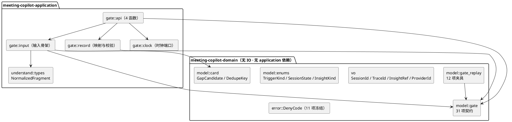

约束：`gate/**` 与 `gate*.rs` **不得**出现 `infrastructure`、`reqwest`、`tokio`、`std::env`、`Instant::now`、`SystemTime::now`、`thread::sleep`；`domain/model/gate.rs` 不得 `use crate::model::gate_replay::*`（方向只能是 replay→gate）。

### 3.2.4 P0 内编译顺序（每步都必须 `cargo build` 可过）

| 步 | 动作 | 完成后可执行的验证 |
|---|---|---|
| S1 | `gate.rs` 新增 29 项（无 `impl` 行为） | `cargo test -p meeting-copilot-domain` 编译通过 |
| S2 | `gate_replay.rs` 12 项 + `mod.rs` 3 行 | `cargo test -p meeting-copilot-domain` 退 0（既有 7 例不回归） |
| S3 | `gate.rs` 行为：`validate`/`threshold_milli`/`per_window`/`chars`/`session_remaining_with`/`counter_at` | `cargo test -p meeting-copilot-domain` 退 0 |
| S4 | `gate/**` 11 文件骨架 + `input/clock` + `mod.rs` + `lib.rs` | `cargo build -p meeting-copilot-application` 退 0 |
| S5 | `api.rs` 4 函数 + `record.rs` 校验/映射 | `cargo build`、三条 grep 断言退 0 |
| S6 | `check-b4-gates.sh` 7 规则 | 7 条 `--rule` 全部有确定退出码 |
| S7 | `--self-test` | 退 1 且 `git status` 为空 |
| S8 | `b4-status.md` + 取证 | §3.9 全部命令退 0 |

## 3.3 领域契约落地（`gate.rs` 31 项）

### 3.3.1 31 项清单与派生要求

| # | 类型 | 种类 | 关键派生 | 封闭数/约束 | 备注 |
|---|---|---|---|---|---|
| 1 | `GateStage` | enum | `Copy Ord Hash` + snake_case | 5 项，`ALL: [Self; 5]` | 顺序 G1..G5 即数组序 |
| 2 | `StageResult` | enum | `Copy` + snake_case | 5 项 | `NotReached` 为默认构造初值 |
| 3 | `GateRejectReason` | enum | **既有，零改** | **23 项** | `ALL`/`as_str`/`to_deny_code`/`ui_message_key`/`visibility` 已就位 |
| 4 | `Visibility` | enum | **既有，零改** | 2 项 | design 草案的 `ReasonVisibility` **不新建**（requirements §8.2-1） |
| 5 | `GapRule` | enum | `Copy Hash` | 7 项（Institution 为 ProperNoun 子标签） | `base_milli()` / `gap_kind()` |
| 6 | `RelevanceScore` | struct | `Copy Eq` | 6 项毫值 | 全部 `u16`，无浮点 |
| 7 | `ThresholdProfile` | enum | `Copy` + snake_case + `Default(Balanced)` | 3 项 | `milli()` = 720/620/520 |
| 8 | `FrequencyProfile` | enum | `Copy` + snake_case + `Default(Medium)` | 3 项 | `per_window()` = 1/3/5 |
| 9 | `GatePolicy` | struct | `Clone PartialEq` + `#[serde(default)]` | 8 业务字段 + 1 透传容器 | 无 `skip_g*` 字段 |
| 10 | `GatePolicyError` | enum | `thiserror::Error` | 4 变体 | 不进 `ErrorCode` |
| 11 | `AuthorizationStatus` | enum | `Copy` + snake_case | 4 项 | 缺失/未知 → `Missing`（由装配方给默认） |
| 12 | `GateContentType` | enum | `Copy` + snake_case | **1 项** | 仅 `TextQuery` |
| 13 | `QueryLimit` | enum | `Copy` + snake_case | 2 项 | `chars()` = 80/200 |
| 14 | `GateAuthorization` | struct | `Clone PartialEq` | **7 字段** | 全 `#[serde(default)]` 除 `status` |
| 15 | `NetworkState` | enum | `Copy` + snake_case | 3 项 | 门控不探测 |
| 16 | `GateBudget` | struct | `Clone PartialEq` | **7 字段** | 2 个 `BTreeMap` |
| 17 | `GateCounter` | enum | `Copy Hash` + 逐项 `rename` | **32 项** | `ALL`/`index()` |
| 18 | `GateCounters` | struct | `Clone Default` + transparent | `[u64; 32]` | `bump` 唯一写入口 |
| 19 | `StageTrace` | struct | `Copy` | 4 字段 | `calls/result/reason/elapsed_ms` |
| 20 | `PerStageResults` | newtype | `Clone PartialEq` | `[StageTrace; 5]` | 禁 `Vec` |
| 21 | `GateDecision` | enum | `PartialEq` + internally tagged | 2 变体 | `Allow`/`Deny` |
| 22 | `DecisionKind` | enum | `Copy` + snake_case | 2 项 | 记录层轻量标签 |
| 23 | `GateRecord` | struct | `PartialEq` | **14 业务字段** + 透传 | `flatten unknown` 不计入 |
| 24 | `OutboundIntent` | struct | `PartialEq Eq` | **7 字段** | 无原文 |
| 25 | `GateAuditEvent` | struct | `PartialEq Eq` | **7 字段 + `occurred_at_ms`** | 不写 `stopped_at` |
| 26 | `AuditResult` | enum | `Copy` + snake_case | 2 项 | `Allow`/`Deny` |
| 27 | `LlmCapabilityView` | struct | `Copy` | 2 字段 | 不含模型名/端点 |
| 28 | `ProviderView` | struct | `Clone` | 2 字段 | 不含端点/密钥 |
| 29 | `EntityKey` | newtype | `Ord Hash` + transparent | 32 hex | 构造用 `parse -> Option` |
| 30 | `ScoredCandidate` | struct | `Clone PartialEq` | 6 字段 | 外层包裹 `GapCandidate` |
| 31 | `ClusterSource` | enum | `Copy` + snake_case | 2 项 | `Injected`/`Fallback` |

> **计数自检口径**：`--rule=record` 不数"31"，但 domain 侧新增单测 `gate_contract_types_are_31` 以 `GateStage::ALL.len()==5`、`GateCounter::ALL.len()==32`、`GateRejectReason::ALL.len()==23`、`RecordField::ALL.len()==14`（一个仅供测试的常量数组，非 `pub` 类型）四项交叉锁定；`31` 本身由 §3.11 自检表人工复核一次，不进入脚本（避免脚本耦合类型清单导致后续 P1 追加类型即红）。

### 3.3.2 关键实现约定（P0 必须一次做对，否则 P1~P3 返工）

1. **确定性容器**：`GateBudget.topic_window_used: BTreeMap<u32, u8>`、`entity_last_seen_ms: BTreeMap<EntityKey, u64>`；**禁止 `HashMap`**。理由：JSON 往返逐字节一致（AC-B4-47）与脚本可静态断言（`grep -c HashMap gate.rs == 0`）。
2. **固定长度数组**：`PerStageResults(pub [StageTrace; 5])`、`GateCounters([u64; 32])`。理由：序列化长度恒定 5 / 32；`Vec` 会让"字段封闭"退化为"运行期约定"。
3. **32 项 serde 名逐项显式 `rename`**：`GateCounter` 变体名形如 `GateL0Candidates`，`rename_all="snake_case"` 对"字母-数字-字母"边界的处理依赖 serde 版本（`gate_l0_candidates` 与 `gate_l_0_candidates` 都可能出现）。P0 必须**逐变体写 `#[serde(rename = "gate_l0_candidates")]` 等 32 条**，并由 `gate_counter_names_match_spec_field_names` 与 spec §4.4 逐项比对锁定。这是本阶段最容易踩、且一旦错就使 `--rule=record` 与诊断面板同时失真的点。
4. **`GateRecord.unknown` 透传**：`#[serde(default, flatten)] pub unknown: BTreeMap<String, serde_json::Value>`；`serde_json` 是 domain 既有依赖（`crates/domain/Cargo.toml`），**零新增依赖**。`unknown` 不计入 14，`--rule=record` 的白名单显式排除它。
5. **`GatePolicy.unknown` 透传 + `skip_*` 拒绝**：`#[serde(default, flatten)] pub unknown: BTreeMap<String, serde_json::Value>`；`validate()` 先查 `unknown` 键：命中 `skip_g1`→`MandatoryStageCannotSkip{stage:1}`、`skip_g4`→`{stage:4}`、`skip_g5`→`{stage:5}`、其它 `skip_` 前缀→`{stage:0}`（表示"任意级尝试"），再校验数值。顺序固定：**先 skip 检查，后数值检查**，保证 `skip_g1=true` 叠加非法 cap 时报 `MandatoryStageCannotSkip`（安全优先）。
6. **`EntityKey` 不新增错误类型**：`pub fn parse(raw: &str) -> Option<Self>`（32 位十六进制、大小写归一为小写）。design 草案的 `GateError::InvalidEntityKey` 由 application 侧 `record_from`/`detect_gaps` 在 `parse` 返回 `None` 时产生。理由：31 项封闭数不能因一个错误枚举被打破（D-B4-D08）。
7. **`GateRecord` 只加判定谓词、不加错误类型**：`pub fn skipped_stages_are_valid(&self) -> bool`（仅 `G2`/`G3`）、`pub fn refs_are_valid(&self) -> bool`（`candidate_ref.is_some() || insight_ref.is_some()`）、`pub fn decision_tag_matches_stopped_at(&self) -> bool`（`Deny` ⟺ `stopped_at.is_some()`）。错误构造统一在 application 的 `GateError`（D-B4-D08 同源）。
8. **`ThresholdProfileInvalid` 必须可达**：`ThresholdProfile` 是封闭枚举，非法字符串在反序列化即失败，`GatePolicyError::ThresholdProfileInvalid(u16)` 永远无法由 JSON 触发。为使该错误变体"可测且有用"，P0 追加 `pub fn from_milli(milli: u16) -> Result<Self, GatePolicyError>`：`520/620/720` 三值命中，其余返回 `ThresholdProfileInvalid(milli)`。`validate()` 内仍做一次 `threshold_profile.milli()` ∈ {520,620,720} 的防御性断言（恒真，但保留以表达契约）。
9. **数值类型纪律**：新增契约内**零浮点**（`Confidence` 是既有 `f64` 包装，只作为 `GapCandidate` 的字段被包裹，不参与新计算）；全部用 `u16`（毫值/字符数/计数上限 600）、`u32`（耗时毫秒）、`u64`（毫秒时间戳/计数）。
10. **`#[serde(default)]` 覆盖面**：`GateRecord` 的 `candidate_ref`/`insight_ref`/`cooldown_until_ms`/`skipped_stages`/`unknown`；`GateAuthorization` 除 `status` 外全部；`GateBudget` 的 `tokens_milli`/`window_start_ms`；`LlmCapabilityView.cooling_until_ms`；`ProviderView.provider_ids`。**`status`、`session_outbound_used`、`inflight`、`schema_version`、`decision` 不加 default**——缺字段即反序列化失败，属 fail-closed 设计意图。

### 3.3.3 类图（仅业务字段与签名）

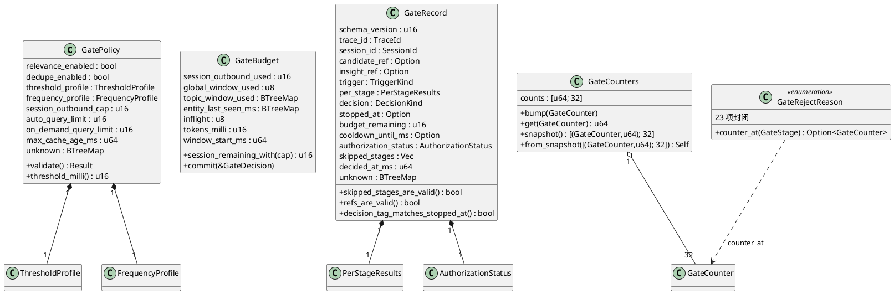

> 图只列业务字段；`GateCounters::from_snapshot` 是 P0 追加（计数"重启不清零"要求外部快照恢复，spec §4.2-4），它只接受既有 32 项，不改变封闭数。
## 3.4 回放夹具落地（`gate_replay.rs` 12 项）

**落位理由**：回放夹具与契约同属 domain（纯数据、无 IO、无 runner），但必须与 `gate.rs` **分文件**——`gate.rs` 承担 31 项封闭数与"零 runner"断言，夹具一旦混入会让 `--rule=record` 的字段抽取与 23 变体计数同时受污染（`Grep` 抽取到夹具里的 `GateStage` 使用行）。分文件的代价是多 1 行 `pub mod`。

| # | 类型 | 字段要点 | 约束/校验 |
|---|---|---|---|
| 1 | `ClockFixture` | `anchor_ms: u64`、`tick_ms: u64` | 第 n 次取值 = `anchor_ms + n*tick_ms`，纯取值无状态机 |
| 2 | `FragmentFixture` | `span: TextRange`、`confidence_milli: u16`、`dual_channel: bool`、`answered_ms: Option<u64>` | `confidence_milli ∈ 0..=1000`；**无原文/说话人字段** |
| 3 | `InsightFixture` | `reference_digest: String`（32 hex）、`kind: InsightKind`、`confidence_milli`、`manual_locked` | **无要点原文**；digest 非 `InsightRef`，避免与他人 ID 混淆 |
| 4 | `BudgetFixture` | 与 `GateBudget` 7 字段一一对应；分桶用 `Vec<(u32,u8)>`、实体用 `Vec<(String,u64)>` | 有序对表达，转 `BTreeMap` 时排序去重 |
| 5 | `AuthorizationFixture` | 与 `GateAuthorization` 7 字段一一对应（`provider_ids: Vec<String>`） | 转换期 `ProviderId::new` 校验 |
| 6 | `RelevanceFixture` | `semantic/entity/gain/source_trust` 各 `u16` + `delta_ms: u64` | 4 项 0..=1000；`delta_ms ≥ 0` |
| 7 | `SuppressionFixture` | `topics: Vec<u32>`、`providers: Vec<String>`、`entities: Vec<String>` | 只存 ID 或键，不存原文 |
| 8 | `CandidateSeedFixture` | `rule`、`confidence_milli`、`dedupe_key`（32 hex）、`topic_cluster_id`、`entity_keys`、`primary_domain: Option<String>` | `primary_domain` 仅域名，不含协议与路径 |
| 9 | `GateInputFixture` | **23 字段**（requirements §6.10-9 逐项） | 覆盖 §2.3.3 映射表 8 行全部状态 |
| 10 | `ExpectedDecision` | `Allow` \| `Deny{reason, stopped_at}` | `reason` ∈ 23 项 |
| 11 | `GateReplayCase` | `case_id`、`input_fixture`、`policy_fixture: GatePolicy`、`expected` | `case_id` 唯一（由用例集保证，类型层不校验） |
| 12 | `ReplayReport` | `total/matched/mismatched/mismatch_cases/seed` | `mismatch_cases` 只存 `case_id` |

**`GateInputFixture` 的 8 行覆盖自检（P0 只保证字段存在，P3 才跑 200 例）**

| 映射表行 | 覆盖字段 | P0 判据 |
|---|---|---|
| 预算 | `budget.{session_outbound_used,global_window_used,tokens_milli,window_start_ms,topic_window_used,entity_last_seen_ms,inflight}` | 7 字段全在（编译期） |
| 授权 | `authorization.*` | 7 字段全在 |
| 时钟 | `clock.{anchor_ms,tick_ms}` + `now_ms` | 3 字段全在 |
| 网络 / 冷却 / 源视图 | `network`、`llm_cooling`、`llm_cooling_until_ms`、`provider_enabled_count`、`provider_ids` | 5 字段全在 |
| 审计可用性 | `audit_available: bool` | 在 |
| 抑制 | `suppression.{topics,providers,entities}` | 3 组全在 |
| 缓存 | `cache_age_ms: Option<u64>`、`refresh_available: bool` | 2 字段全在 |
| 会话态 | `session_state`、`silent_period`、`screen_share`、`consent_confirmed`、`auto_suggestion_enabled` | 5 字段全在 |

**P0 的"不写 runner"判据**：`gate_replay.rs` 内 `grep -cE "fn (run|main|replay_all)"` = 0；不出现 `std::fs`、`println!`、`rand`、`Instant`。只做 `serde` 派生与常量。

## 3.5 应用层落位（`gate/**` 12 项 + 4 函数）

### 3.5.1 输入类型骨架（Q3 采用 + `candidate_ref`/`insight_ref` 增补）

```rust
// gate/input.rs —— P0 只落字段与空返回，不含 G1~G5 判定
pub struct GateSnapshot<'a> { /* 13 字段 + scan + candidate_ref + insight_ref */ }
pub struct GateInput<'a> { /* 同上，值拷贝 budget */ }
pub struct GapScanInput<'a> { /* 12 字段 */ }
pub struct RelevanceInput<'a> { /* 7 字段 */ }
```

| 类型 | 字段数 | 与 design §2.3.2-C 的差异 | 归属 |
|---|---|---|---|
| `GateSnapshot<'a>` | 16 | 草案 13 + `scan`；再 + `candidate_ref`/`insight_ref` | W-B4-6.3 骨架，W-B4-9 同源构造 |
| `GateInput<'a>` | 16 | 同上（D-B4-D05） | 同上 |
| `GapScanInput<'a>` | 12 | 与草案一致 | W-B4-9 |
| `RelevanceInput<'a>` | 7 | 与草案一致 | W-B4-9 |

**`candidate_ref`/`insight_ref` 的增补理由（D-B4-D05）**：`record_from(input, decision, budget) -> GateRecord` 需填 `candidate_ref: Option<DedupeKey>` 与 `insight_ref: Option<InsightRef>`，而草案 `GateInput` 两者皆无。若从 `decision.candidates[0]` 反推，则 G1 的"0 候选 `Allow`"路径（合法且常见）必然落为"引用双空"，与"至少一个非空"冲突，会把正常路径误判为结构违规。故 `GateInput`/`GateSnapshot` 各增 2 个**可选借用**字段：`candidate_ref: Option<&'a DedupeKey>`、`insight_ref: Option<&'a InsightRef>`，由装配方按"本次判定的锚点候选/要点"填充；`record_from` 取值优先级为 `input.candidate_ref` → `decision` 首个候选的 `dedupe_key`；`insight_ref` 只取 `input.insight_ref`。这不改变 spec §6.1 的必填清单语义（D-B4-D01 已确认 §6.1 为"必填清单"而非封闭集）。

**`GateInput::from_snapshot` 同源构造不变式（W-B4-9 起生效，P0 先冻结签名）**：

| 不变式 | 断言方式 |
|---|---|
| `fragments`/`insights`/`scan.fragments`/`scan.insights` 指向同一底层切片 | 指针相等（`std::ptr::eq`）单测；P0 只需签名存在 |
| `budget` 为值拷贝，判定只读 | 类型层：`evaluate_gate(&GateInput)` 接收 `&`，无可变借用入口 |
| 无 `InsightDraft` | `grep -rn "InsightDraft" crates/application/src/gate` = 0（AC-B4-38） |

### 3.5.2 4 个 `pub fn` 冻结签名（逐字，含参数名）

```rust
pub fn detect_gaps(input: &GapScanInput<'_>) -> Vec<GapCandidate>;
pub fn evaluate_gate(input: &GateInput<'_>, policy: &GatePolicy, clock: &dyn GateClock) -> GateDecision;
pub fn score_relevance(input: &RelevanceInput<'_>, policy: &GatePolicy) -> RelevanceScore;
pub fn record_from(input: &GateInput<'_>, decision: &GateDecision, budget: &GateBudget) -> GateRecord;
```

**签名不可动的三条机器判据**

| 判据 | 表达式 | 期望 |
|---|---|---|
| `pub fn` 总数 | `grep -c '^pub fn ' crates/application/src/gate/api.rs` | `4` |
| 四名合计 | `grep -cE 'pub fn (detect_gaps\|evaluate_gate\|score_relevance\|record_from)\(' crates/application/src/gate/api.rs` | `4` |
| 四名单文件 | `grep -rlE 'pub fn (detect_gaps\|evaluate_gate\|score_relevance\|record_from)\(' crates/application/src/gate/*.rs | wc -l` | `1` |

**为什么 `pub fn` 必须是行首无缩进**：`grep -c '^pub fn '` 只匹配顶格声明。若 P1 把某个函数包进 `mod` 或加 `#[inline]` 前缀行，计数仍为 4；但若写成 `pub(crate) fn` 或带缩进，计数立刻不等于 4。P0 必须写死"顶格 `pub fn`、不嵌套、不加属性行"。

**其余子模块的命名纪律（R-02）**：`prefilter::run`、`relevance::compute`、`dedupe::apply`、`budget::check`、`outbound::authorize`、`record::build`/`record::bump_by`、`lease::try_acquire`/`lease::release`，全部 `pub(crate)`，且**不得**与四个公开名同形（`grep -cE "fn (detect_gaps|evaluate_gate|score_relevance|record_from)" crates/application/src/gate/{prefilter,relevance,dedupe,budget,outbound,record,lease,replay}.rs` = 0）。

### 3.5.3 P0 占位实现语义（fail-closed，逐项可断言）

| 函数 | P0 返回 | 必须满足 | 禁止 |
|---|---|---|---|
| `detect_gaps` | `Vec::new()` | 空集合、`O(1)`、无 panic | 不得 `todo!`/`unimplemented!` |
| `evaluate_gate` | `Deny { reason: PolicyUnavailable, stopped_at: G1, per_stage: 全 NotReached, cooldown_until_ms: None }` | `per_stage[i].calls == 0` 且 `result == NotReached`（i=0..4）；`reason` 为 23 项之一 | 不得返回 `Allow`；不得读 `clock.now_ms()` |
| `score_relevance` | 6 项全 `0` | `score_milli == 0`；不 panic；不做除法 | 不得引用 `policy`（用 `_policy`） |
| `record_from` | 14 字段记录 | `schema_version=1`；`session_id` 取 `input.session.clone()`；`trace_id` 由装配方在 `GateSnapshot` 内提供（见下）；`decision` 由 `GateDecision` 投影为 `DecisionKind`；`per_stage` 克隆；`stopped_at` 取自决策；`budget_remaining = budget.session_remaining_with(600)` 再 `min(600)`；`authorization_status = input.authorization.status`；`skipped_stages` 为空；`decided_at_ms = input.now_ms`；`candidate_ref`/`insight_ref` 按 §3.5.1 优先级 | 不得 panic；不得读写 IO |

**`trace_id` 的来源问题（P0 必须解决）**：`GateRecord.trace_id: TraceId` 是必填，而草案 `GateInput` 无 `trace_id`。裁决：`GateInput`/`GateSnapshot` 的 `session: &'a SessionId` 之外，**追加 `trace_id: &'a TraceId`** 一个字段（与 D-B4-D05 同批登记为 D-B4-D05-b，理由：`trace_id` 由装配方在判定开始时生成并贯穿记录与诊断，不能由门控用 `session_id` 冒充——requirements §6.6-2 明确"不得等于 `request_id`"，同源复用 `session_id` 会让记录无法回溯单次判定）。并入 D-B4-D05 同一偏差登记项。

**`record_from` 双空 refs 的"可识别"口径（Q4）**：不 panic、不 `Result`；产出记录后由 `record::validate_record(&record)` 返回 `Err(GateError::RecordStructureViolation{ detail: "refs" })`。`record_from` 自身在双空时把 `unknown` 写入一个**结构化标记键** `gate_record_violation = "refs_empty"`（`serde_json::Value::String`），使"落盘后仍可识别"；`validate_record` 优先读该键，其次读 `refs_are_valid()`。这满足 W-B4-4.5 的"双空 → 结构违规信号、不 panic"，且不破坏签名冻结（Q4）。

**`per_stage 全 NotReached` 的构造**：`PerStageResults::empty()` 返回 `[StageTrace{calls:0,result:NotReached,reason:None,elapsed_ms:0}; 5]`。P0 必须提供该构造函数（P1 起复用）。

### 3.5.4 门面 `mod.rs` 与 `lib.rs`

```rust
// gate/mod.rs（P0 形态）
pub mod api;
pub(crate) mod budget;
pub(crate) mod clock;
pub(crate) mod dedupe;
pub mod input;
pub(crate) mod lease;
pub(crate) mod outbound;
pub(crate) mod prefilter;
pub(crate) mod record;
pub(crate) mod relevance;
pub(crate) mod replay;

pub use api::{detect_gaps, evaluate_gate, record_from, score_relevance};
pub use clock::{FixedClock, GateClock};
pub use input::{GapScanInput, GateInput, GateSnapshot, RelevanceInput};
```

| 约束 | 判据 |
|---|---|
| 声明 11 个子模块 | `grep -cE "^(pub |pub\(crate\) )?mod (api|input|clock|prefilter|relevance|dedupe|budget|lease|outbound|record|replay);" gate/mod.rs` = 11 |
| 导出 4 函数 | `grep -c "pub use api::{detect_gaps, evaluate_gate, record_from, score_relevance};"` = 1 |
| 回放面不扩散 | `grep -cE "pub use .*(OutboundLease\|GateAuditSink\|GateCounters)" gate/mod.rs` = 0 |
| `lib.rs` 仅 1 行 | `grep -c "^pub mod gate;$" crates/application/src/lib.rs` = 1 |

`GateAuditSink`、`OutboundLease`、`LeaseId`、`LeaseOutcome`、`GateFeature`、`GateError` 属于 P3/P2 才落地的类型，P0 **不创建**。理由：AC-B4-49 要求 `gate/` 不出现 `composer|validator|outbox|on_demand|feedback_weights`，且回放面只允许 4 函数 + 3 结构；提前创建端口类型会把"回放面不扩散"变成需要额外断言的负担，而它们对 P0 三条硬判据零贡献。

## 3.6 纯函数边界与确定性

### 3.6.1 纯度判据（机器口径，非主观）

| 维度 | 判据 | 扫描面 | 期望 |
|---|---|---|---|
| 无网络 | `reqwest::`、`hyper::`、`TcpStream`、`std::net` | `gate/**` + `gate*.rs` | 0 |
| 无真实计时 | `Instant::now`、`SystemTime::now`、`std::time::Duration::from_secs` 之外的时钟构造 | 同上 | 0 |
| 无睡眠 | `thread::sleep`、`tokio::time` | 同上 | 0 |
| 无环境变量 | `std::env`、`env::var`、`LLM_` | 同上 | 0 |
| 无 panic 占位 | `todo!(`、`unimplemented!(`、`panic!(` | 同上 | 0 |
| 无全局态 | `static mut`、`OnceLock`、`lazy_static`、`thread_local` | 同上 | 0 |
| 无锁跨级 | `Mutex`、`RwLock`、`AtomicU64`（`gate/**` 内） | 同上 | 0 |

> 例外口径：`#[cfg(test)] mod tests` 内的 `panic!`（由 `assert!` 展开）不计入——扫描时以**去掉 `#[cfg(test)]` 之后的行**为准，脚本实现见 §3.8.2。

### 3.6.2 "纯"的三层保证（沿用 C-02，P0 只落结构）

1. **状态全进参数**：`budget` 值拷贝、`authorization` 只读借用、`now_ms` 显式字段、`clock` 为注入 trait 对象。
2. **时钟不读 OS**：`GateClock` 只有 `fn now_ms(&self) -> u64`；P0 的 `FixedClock` 用 `Cell<u64>` 计数（`Send` 但不 `Sync`），生产实现留 P1。**P0 的 `evaluate_gate` 占位实现不得调用 `clock.now_ms()`**（占位不应消耗时钟序列，否则回放序列错位）。
3. **推进在函数之外**：`GateBudget::commit` 在 P0 只落签名与"仅 `Allow` 且 `outbound.is_some()` 时 `session_outbound_used += 1`、`global_window_used` 饱和 +1、`tokens_milli` 饱和 -1000"三条纯内存规则，且**不被 `evaluate_gate`/`record_from` 调用**（`grep -c "\.commit(" gate/**` = 0）。

### 3.6.3 确定性清单

| 项 | 做法 | 被谁断言 |
|---|---|---|
| 有序容器 | `BTreeMap` 两处；`Vec` 仅用于"顺序由输入顺序决定"的集合 | `grep -c HashMap gate.rs` = 0 |
| 固定数组 | `[StageTrace;5]`、`[u64;32]` | `per_stage_serializes_exactly_five_entries`、`gate_counter_all_is_32_in_spec_order` |
| 无浮点 | 新增契约零 `f32/f64`（`Confidence` 为既有包装，不新增使用） | `grep -cE "f32|f64"` 新增行 = 0 |
| 无随机 | 无 `rand`、无 `SystemTime` 派生种子 | `--rule=source` |
| 排序键显式 | 候选排序三元组（confidence↓ → start_ms↑ → dedupe_key↑）P1 落地，P0 只在 `ScoredCandidate` 文档注释中固定口径 | 设计口径，P1 断言 |
## 3.7 错误映射

### 3.7.1 三层错误类型与边界（不进 `ErrorCode` 冻结集）

| 层 | 类型 | 变体 | 产生位置 | 出口 |
|---|---|---|---|---|
| 契约校验（domain） | `GatePolicyError` | `SessionCapOutOfRange(u16)`、`ThresholdProfileInvalid(u16)`、`QueryLimitNotFixed{auto,on_demand}`、`MandatoryStageCannotSkip{stage: u8}` | `GatePolicy::validate` | 装配期 → 拒绝装配；判定期 → `Deny{PolicyUnavailable}` |
| 结构/端口（application） | `GateError`（P3 落地，P0 只落 `RecordStructureViolation`/`InvalidEntityKey`/`InvalidDedupeKey` 三个变体的前置文档口径） | `InvalidEntityKey`、`InvalidDedupeKey`、`RecordStructureViolation{detail}`、`SanitizeFailed{code}`、`AuditUnavailable`、`Policy` | `record::validate_record`、`detect_gaps`、G5 | 由 `evaluate_gate` 外层统一转 `Deny{PolicyUnavailable}`；`user_error_code()` 映射既有 `ErrorCode` |
| 决策（domain） | 无 error 类型 | — | `GateDecision::Deny{reason}` | 唯一对外的拒绝表达 |

**为什么 `GateError` 不在 P0 落地**：P0 的四函数签名不引用它（`record_from` 返回 `GateRecord`，不返回 `Result`），落地它会把 application 的 12 项类型清单提前扩张，而 `--rule=source` 已能覆盖"无 panic"要求。P0 的 `record.rs` 只用一个内部 `pub(crate) enum RecordViolation { RefsEmpty, IllegalSkipStage }` + `validate_record(&GateRecord) -> Option<RecordViolation>` 表达结构违规，并在 `#[cfg(test)]` 中断言两种违规可识别。P3 的 `record_from` 前置校验再把它升格为 `GateError::RecordStructureViolation`。此收敛登记为 D-B4-D10（避免在 P0 引入一个无人消费的错误枚举）。

### 3.7.2 双静态表（23 原因码 → 11 `DenyCode` / 32 计数）

**表 A（既有，零改）**：`GateRejectReason::to_deny_code() -> Option<DenyCode>`，12 项 `Some`（`RateLimited` 双来源）、11 项 `None`，已由 7 个既有单测锁定。

**表 B（P0 新增，5.4a）**：`GateRejectReason::counter_at(self, stage: GateStage) -> Option<GateCounter>`

| 原因码 | G1 | G2 | G3 | G4 | G5 | 说明 |
|---|---|---|---|---|---|---|
| `PreFilterLowConfidence` | `GateL1LowConfidence` | — | — | — | — | 仅 G1 |
| `ConsentMissing` | `GateL1ConsentMissing` | — | — | — | — | |
| `AutoDisabled` | `GateL1AutoDisabled` | — | — | — | — | |
| `Paused` | `GateL1Paused` | — | — | — | — | |
| `SilentPeriod` | `GateL1SilentPeriod` | — | — | — | — | |
| `ScreenShareProtection` | `GateL1ScreenShare` | — | — | — | — | |
| `SensitiveTerm` | `GateL1SensitiveTerm` | — | — | — | — | |
| `Duplicate` | `GateL1Duplicate` | — | `GateL3Duplicate` | — | — | **G1/G3 分流** |
| `Suppressed` | `GateL1Suppressed` | — | `GateL3Suppressed` | — | — | **G1/G3 分流** |
| `QuotaExhausted` | `GateL1QuotaExhausted` | — | `GateL3Quota` | — | — | **G1/G3 分流** |
| `NoProviderEnabled` | `GateL1NoProvider` | — | — | — | — | G1 优先；G4 复核时不再计数（避免双计） |
| `LowRelevance` | — | `GateL2LowRelevance` | — | — | — | |
| `Stale` | — | — | `GateL3Stale` | — | — | |
| `BudgetExhausted` | — | — | — | `GateL4BudgetExhausted` | — | |
| `GatewayCooling` | — | — | — | `GateL4GatewayCooling` | — | |
| `Offline` | — | — | — | `GateL4Offline` | — | |
| `OutboundNotGranted` | — | — | — | — | `GateL5NotGranted` | |
| `SanitizeFailed` | — | — | — | — | `GateL5SanitizeFailed` | |
| `AuditUnavailable` | — | — | — | — | `GateL5AuditUnavailable` | |
| `ProviderNotAllowed` | — | — | — | — | `GateL5ProviderOrDomainBlocked` | |
| `DomainBlocked` | — | — | — | — | `GateL5ProviderOrDomainBlocked` | 与上行共用一个计数项 |
| `PolicyUnavailable` | `None` | `None` | `None` | `None` | `None` | **不新增计数项**，只 `GateDenyTotal+1` + `StageTrace.reason` 留痕 |
| `RetentionExpired` | `None` | `None` | `None` | `None` | `None` | 同上 |

**`counter_at` 的实现纪律**：
1. **唯一参数是"产生级"**，同一原因在非产生级调用必须返回 `None`（例如 `Duplicate` + `G4` → `None`），使"同级双计"在类型层不可表达。
2. `Duplicate`/`Suppressed`/`QuotaExhausted` 的 G1/G3 分流是本表的**唯一复杂点**，必须由 3 条独立单测分别锁定（`bump_by_reason_matches_static_table` + `duplicate_splits_by_stage` + `no_provider_is_counted_once`）。
3. `Allow`/`Deny` 总量**不在本表**：由 `record::bump_by` 在每次判定末尾按 `DecisionKind` 互斥 +1（`gate_allow_total` 或 `gate_deny_total`），且 `counter_at` 不得返回这两个计数项。

**表 C（P0 追加，允许/拒绝互斥的机器口径）**

| 事件 | 增量 | 禁止 |
|---|---|---|
| `DecisionKind::Allow` | `gate_allow_total += 1` | 同时 `gate_deny_total` 不得增 |
| `DecisionKind::Deny` | `gate_deny_total += 1` + `counter_at(reason, stopped_at)`（若 `Some`） | 同时 `gate_allow_total` 不得增；同一 reason 不得在两级各计一次 |

### 3.7.3 fail-closed 转换矩阵（P0 可判定部分）

| 触发条件 | 层 | 直接结果 | 计数 | 记录表现 |
|---|---|---|---|---|
| `policy.validate()` 失败 | G1 前置 | `Deny{PolicyUnavailable, stopped_at:G1, per_stage 全 NotReached}` | `gate_deny_total+1`（无分项） | `decision=Deny`、`stopped_at=Some(G1)`、`unknown.gate_record_policy_violation=<reason>` |
| `candidate_ref`/`insight_ref` 双空 | `record_from` 后置 | 记录照常产出；`validate_record` → `RefsEmpty` | 无（记录不计数） | `unknown.gate_record_violation="refs_empty"` |
| `skipped_stages` 含 `G1/G4/G5` | `record_from` 后置 | `validate_record` → `IllegalSkipStage` | 无 | 记录保留原集合，供审计定位 |
| `GateBudget` 快照越界（`used>600`/`inflight>3`/`tokens>3000`/桶>2） | G4（P2） | `Deny{BudgetExhausted}` | `GateL4BudgetExhausted+1` | `stopped_at=Some(G4)` |
| `audit_available == false` | G5（P3） | `Deny{AuditUnavailable}` | `GateL5AuditUnavailable+1` | 审计 1 条（缓冲） |
| 脱敏失败 | G5（P3） | `Deny{SanitizeFailed}` | `GateL5SanitizeFailed+1` | 审计 1 条，`user_error=E-PRIV-004` |

**`budget_remaining` 的上限口径（D-B4-D06，修正 requirements §6.6-10）**：requirements 写"0..=120（默认上限口径），超过 120 视为结构违规"，但 `session_outbound_cap` 允许 0..=600（REQ-B4P0-05）。若 cap=600，余量必然可能 >120，记录会被自己的校验判违规。裁决：**`budget_remaining ∈ 0..=600`，默认装配（cap=120）下自然 ≤120**；`--rule=record` 只断言字段集合，不断言值域；`validate_record` 用 600 作上限。此修正不改变任何 AC 的断言，但推翻 requirements §6.6-10 的数字，故显式登记。

## 3.8 静态门禁脚本落地（`scripts/check-b4-gates.sh`）

### 3.8.1 骨架与退出码收敛

```text
参数：--rule=<source|zero-transcript|budget|outbound|record|targets|doc-plan> | --self-test
未知参数/未给规则 → 退 2（用法错误，等同"扫描面不可用"）
累积：FAIL=0/1、MISSING=0/1、ABSENT 列表（仅打印，不影响退出码）
收敛顺序：MISSING!=0 → 退 2；FAIL!=0 → 退 1；否则退 0
```

| 退出码 | 语义 | 允许的掩盖 |
|---|---|---|
| 0 | 规则通过 | 不得用 0 掩盖缺失面 |
| 1 | 命中违规 / 断言不成立 | — |
| 2 | 必需扫描面缺失 / 参数非法 | — |

**与既有脚本的关系**：`set -uo pipefail`（**不**用 `-e`，否则 `grep` 无命中即退出，无法区分 0/1）；`ROOT` 解析沿用 `check-b3-gates.sh` 的 `cd "$(dirname "${BASH_SOURCE[0]}")/.."`；**局部复制** `fail()`/`missing()`/`need_dir()`，不 source 其他脚本（requirements §5.6.1-10：共享逻辑以局部复制为准，不改既有脚本语义）。

### 3.8.2 七条规则的实现口径

| 规则 | 必需扫描面（缺失退 2） | 可选扫描面（缺失 → `SCAN-ABSENT`） | 断言（命中数必须 0，除注明） | 反例（应退 1） |
|---|---|---|---|---|
| `source` | `crates/application/src/gate`、`crates/domain/src/model/gate.rs`、`crates/domain/src/model/gate_replay.rs` | `crates/domain/src/gap` | 网络客户端调用、裸 TCP、网络命名空间、真实计时、线程睡眠、`std::env`、`todo!(`/`unimplemented!(`/`panic!(` | 在 `gate/api.rs` 写一行 `todo!()` |
| `budget` | 同上三面 | — | `LLM_LIVE_CALL_CAP`、`LLM_`、`std::env` = 0；`session_outbound_used`/`global_window_used`/`topic_window_used`/`entity_last_seen_ms`/`inflight` 各 ≥1；`tokens_milli`/`window_start_ms` ≥1（共 7 项） | 在 `gate.rs` 写 `std::env::var` |
| `record` | 同上三面 | — | 字段集合 = 14；`skipped_stages` 白名单 ⊆{`G2`,`G3`}；`GateRejectReason` 变体 = 23 | 白名单里加 `G4` |
| `outbound` | 同上三面 | `crates/application/src/proactive` | 协议客户端调用 = 0；`issue_query`/`AuditLog::append` 文件数 ≤1 | 第二个文件出现 `issue_query` |
| `zero-transcript` | `crates/application/src/gate`、`crates/application/tests`、`docs/progress/b4-status.md` | — | 内置模式（协议前缀、Key 前缀、鉴权头、模型名前缀、请求标识）命中 0 | 在 `b4-status.md` 写一条鉴权头示例 |
| `targets` | `scripts/test-name-inventory.sh` | — | `NEW_TARGETS` 含 6 个 `gate_*`；缺项逐个打印 | （见 D-B4-D07） |
| `doc-plan` | `.codeartsdoer/specs/b4_gate/spec.md` | — | 第 8 章表格行数 ≥1，每行第 1 列路径存在或该行动作含"新增" | 改一个路径为不存在 |

**规则 `source` 的具体实现要点**

1. 扫描面分三类：目录用 `grep -rn --include=*.rs`；`gate*.rs` 用 `grep -rn --include=gate*.rs`（**必须匹配扁平文件，不匹配 `model/gate/` 目录**，这样"文件被建成目录"时天然落到"必需面缺失 → 退 2"，正是 R-01 的设计意图）。
2. `#[cfg(test)]` 之后的内容（如单测里的 `panic!` 断言）不计入：实现为"对每个文件用 `awk` 截断到 `#[cfg(test)]` 首次出现前"再 grep。这是唯一允许的语义级处理，且必须写在一个 `strip_tests()` 函数里，供 7 条规则共用。
3. `panic!` 的正则必须是 `panic!\(`（带括号），避免误伤文档注释里的"不 panic"字样；同理 `todo!\(`、`unimplemented!\(`。
4. `std::env` 与 `LLM_` 同时出现在 `source` 与 `budget`：**故意重复**，因为两条规则的失败语义不同（`source` 表达"纯度"，`budget` 表达"预算独立性"），重复实现比引入共享状态更安全（requirements §4.4-3：规则之间不得共享隐式状态）。

**规则 `record` 的字段抽取（唯一需要解析 Rust 的地方）**

```text
输入：crates/domain/src/model/gate.rs
步骤 1：定位 "^pub struct GateRecord {" 到首个 "^}" 之间的行
步骤 2：抽取匹配 "^    pub [a-z_]+:" 的行，取字段名（去 pub/类型）
步骤 3：剔除 flatten 透传容器（字段名 == "unknown"）
步骤 4：与 14 项白名单逐项比对（集合相等，不是子集）：缺项 / 多项 → FAIL 并打印差集
步骤 5：在 "^pub enum GateRejectReason {" 到首个 "^}" 之间，统计 "^    [A-Z][A-Za-z0-9]*,$" 的行数 == 23
步骤 6：在 "skipped_stages" 相关实现中抽取 GateStage 白名单，断言只含 G2/G3
```

**为什么用"集合相等"而不是"≥14"**：AC-B4-47 的语义是"字段封闭"，多一个字段即破坏封闭性；`≥14` 会把"偷偷加字段"放行。

**规则 `targets` 的实现（D-B4-D07 的口径）**

```text
从 scripts/test-name-inventory.sh 提取 NEW_TARGETS='...' 单引号内词表；
对 6 个 gate_* 逐项检查；
缺失项 → 打印 "TARGETS-MISSING: <name>"，FAIL=1（最终退 1）；
齐全   → 退 0。
```

### 3.8.3 `SCAN-ABSENT` 与 `SCAN-MISSING` 的格式契约

| 标记 | 输出流 | 何时 | 对退出码影响 |
|---|---|---|---|
| `SCAN-ABSENT: <path>` | `stdout` | 可选扫描面本轮不存在 | 无（仅登记） |
| `SCAN-MISSING: <path>` | `stderr` | 必需扫描面不存在 | 使最终退 2 |
| `TARGETS-MISSING: <name>` | `stdout` | `targets` 规则发现缺项 | 使最终退 1 |

**为什么 `SCAN-ABSENT` 走 stdout**：`--rule=source` 的 DoD 是"退出 0 **且** 输出含 `SCAN-ABSENT: crates/domain/src/gap`"，证据命令通常是 `bash ... --rule=source; echo exit=$?`。走 stdout 才能被 `2>&1` 之外的管道自然捕获，也避免与 `SCAN-MISSING` 的告警语义混淆。

### 3.8.4 `--self-test` 的隔离方案（Q5）

| 步骤 | 动作 | 判据 |
|---|---|---|
| 1 | `tmp="$(mktemp -d)"`，`trap 'rm -rf "${tmp}"' EXIT` | 不触碰仓库 |
| 2 | 在 `tmp` 内构造 4 个反例：命中网络调用、命中 `LLM_`、`GateRecord` 字段少 1、白名单含 `G4` | 4 类规则都能被击穿 |
| 3 | 用同一组 `grep` 表达式对 `tmp` 内的**伪造文件**执行，逐一断言"检出" | 至少 1 条检出 |
| 4 | 断言退出码恰为 1；同时 `git status --porcelain` 行数为 0 | 退 1 + 工作区零变化 |

**为什么用 `mktemp -d` 而不是 `--expect-fail`**：`--expect-fail` 需要脚本在"真实扫描面"上运行再把结果取反，一旦实现有偏差（例如缺失面本该退 2 却被取反成 0）会掩盖缺陷；临时目录法只验证"正则能命中"，与扫描面无关，反例能力可证明且零污染。代价是 `--self-test` 只能证明"规则正则有效"，不能证明"规则在真实面上正确"——后者由 §3.9 的三条硬判据与五条旁证覆盖。

## 3.9 取证与零 diff

### 3.9.1 环境前置（每个 shell 会话一次）

```bash
export PATH="$HOME/.rustup/toolchains/stable-x86_64-pc-windows-msvc/bin:$PATH"
export TEMP="$PWD/.tmp/test-temp"; export TMP="$TEMP"; mkdir -p "$TEMP"
export CARGO="$HOME/.rustup/toolchains/stable-x86_64-pc-windows-msvc/bin/cargo.exe"
```

### 3.9.2 三条硬判据 + 五条旁证（一条命令，单退出码）

| 组 | 命令 | 期望 |
|---|---|---|
| E-01 | `"$CARGO" test -p meeting-copilot-domain` | 0 |
| E-02 | `bash scripts/check-b4-gates.sh --rule=record` | 0 |
| E-03 | `bash scripts/check-b4-gates.sh --rule=budget` | 0 |
| 串联 | `"$CARGO" test -p meeting-copilot-domain && bash scripts/check-b4-gates.sh --rule=record && bash scripts/check-b4-gates.sh --rule=budget; echo "exit=$?"` | `exit=0` |
| 旁证 | `--rule=source` / `--rule=outbound` / `--rule=zero-transcript` / `--rule=doc-plan` | 0 |
| 旁证（`targets`） | `--rule=targets` | **1**，且输出恰好 6 行 `TARGETS-MISSING: gate_*`（D-B4-D07） |

### 3.9.3 零改动校验矩阵

| 项 | 命令 | 期望 | AC |
|---|---|---|---|
| B3 存储零 diff | `git diff --quiet HEAD -- crates/application/src/understand/store.rs crates/application/src/understand/deduplicator.rs` | 退 0 | AC-B4-37 |
| B3 存储无未跟踪改动 | `git status --porcelain -- <同上两文件> \| wc -l` | `0` | AC-B4-37 |
| 依赖零新增 | `git diff --stat HEAD -- Cargo.toml Cargo.lock \| wc -l` | `0` | AC-B4-41 |
| application 无 `serde_json` | `grep -c serde_json crates/application/Cargo.toml` | `0` | AC-B4-41 |
| 常量零改（6 项） | 逐项 `grep -c`：`MIN_INSIGHT_CONFIDENCE`（1）、`pub const ALL: \[Self; 11\]`（1）、`pub enum GapKind`（1）、`ShortText::LIMIT`（1）、`UtteranceText::LIMIT`（1）、`URL_LIMIT`（1） | 全为 1 | AC-B4-40 |
| `GapKind` 6 变体 | 枚举块内 `^    [A-Z][A-Za-z0-9]*,` 计数 | `6` | AC-B4-40 |
| ignore 计数 | `"$CARGO" test --workspace -- --list --ignored \| grep -c ": test"` | `9` | AC-B4-44 |
| 既有脚本零改 | `git diff --quiet HEAD -- scripts/check-b3-gates.sh scripts/check-capture-offline.sh scripts/check-mac-scope.sh scripts/scan-secrets.sh scripts/scan-secrets-docs.sh scripts/check-g2-claims.sh scripts/check-layering.sh` | 退 0 | requirements §5.6.1-10 |
| `test-name-inventory.sh` 零改 | `git diff --quiet HEAD -- scripts/test-name-inventory.sh` | 退 0（P0 不改 targets 清单） | §7.9-2 由 P1 起执行 |
| 既有门禁不回退 | `"$CARGO" fmt --all -- --check && "$CARGO" clippy --workspace --all-targets -- -D warnings && bash scripts/check-layering.sh && bash scripts/scan-secrets.sh && bash scripts/check-b3-gates.sh --rule=source` | 串联退 0 | AC-B4-39/43 |
| 阶段结束工作区 | `git status --short` | 仅本阶段新增/改动文件（无临时反例残留） | §5.7.1-10 |

### 3.9.4 `docs/progress/b4-status.md` 最小骨架（P0 版）

| 段 | 必含内容 | 判据 |
|---|---|---|
| §1 阶段与基线 | `HEAD=ade9111`、P0 范围 W-B4-2~8、平台 "Windows 单平台 / macOS 不适用（无设备）" | 命中 ≥1 |
| §2 三条硬判据快照 | E-01/E-02/E-03 的命令、退出码、执行日期 | 3 行齐全 |
| §3 旁证快照 | 5 条（含 `targets` 的"退 1 且 6 项可枚举"） | 5 行齐全 |
| §4 偏差登记 | `D-B4-D02`（`gap/`、`proactive/` 不存在 → `SCAN-ABSENT`）、`D-B4-D04`（12 码降级为历史别名）、`R-01`（扁平落位）、`D-B4-D05~D10`（本章 §3.10） | 每个编号 ≥1 |
| §5 未判定清单 | G2/G3/G4 状态 = "未判定"；13.3 本体、38/39/41.5/42/43/51/52 一律未做 | 字段值 = 未判定 |
| §6 复跑方法 | §3.9.1 环境前置 + §3.9.2 串联命令 | 可粘贴执行 |

**零转录硬约束**：该文件不得出现查询原文、完整 URL、模型名、请求标识、鉴权头示例、Key 示例；`--rule=zero-transcript` 把它列为**必需面**（Q6），故它必须在 W-B4-8 之前创建。
### 3.9.5 逐任务落地映射（W-B4-2 ~ W-B4-8）

| 子任务 | 落位（文件 · 符号） | 本设计对应的机器判据 | 依赖 |
|---|---|---|---|
| 2.1 | `gate.rs` · 29 项新类型 | `test -f .../gate.rs && test ! -d .../gate`；`cargo test -p domain` 退 0 | S1 |
| 2.2 | `gate_replay.rs` · 12 项 | `test -f .../gate_replay.rs && test ! -d .../gate_replay` | S2 |
| 2.3 | `model/mod.rs` · +3 行 | `git diff --numstat` 删除列 0、新增列 ≤3 | S2 |
| 2.4 | 扫描面反例 | `--rule=source/budget/record` 均退 0 | S6 |
| 3.1 | `GatePolicy::validate` / `threshold_milli` / `ThresholdProfile::milli` | `policy_validate_rejects_out_of_range_and_fixes_query_limits` | S3 |
| 3.2 | `GatePolicy.unknown` + skip 检查 + `MandatoryStageCannotSkip` | `policy_rejects_skip_g1_g4_g5`；`grep -c "pub skip_g"` = 0 | S3 |
| 3.3 | `unknown` 透传 | `policy_keeps_unknown_fields_roundtrip` | S3 |
| 4.1 | `PerStageResults([StageTrace;5])` + `empty()` | `per_stage_serializes_exactly_five_entries` | S1 |
| 4.2 | `GateRecord` 14 字段 + flatten | `gate_record_roundtrips_with_closed_fields` | S1 |
| 4.3 | `GateRecord::skipped_stages_are_valid` + `record::validate_record` | `skipped_stages_only_g2_g3` | S1/S5 |
| 4.4 | `OutboundIntent` / `GateAuditEvent` | `outbound_intent_and_audit_event_have_no_content_fields` | S1 |
| 4.5 | `GateRecord::refs_are_valid` + `validate_record` | `record_rejects_empty_refs` | S1/S5 |
| 5.1 | `GateBudget` 7 字段 + `session_remaining_with` + `commit` | `budget_rejects_corrupted_snapshot_and_saturates_remaining` | S1/S3 |
| 5.2 | `GateCounter`(32) / `GateCounters` | `gate_counter_all_is_32_in_spec_order` | S1 |
| 5.3 | 32 项显式 `rename` | `gate_counter_names_match_spec_field_names` | S1 |
| 5.4a | `GateRejectReason::counter_at` + domain 单测 | `bump_by_reason_matches_static_table`（domain 侧同名） | S3 |
| 5.4b | `record::bump_by` | 同名窄断言（`#[cfg(test)]`，纯 Rust，无 JSON） | S5 |
| 6.1 | `api.rs` · 4 签名 | `cargo build -p application` 退 0 | S4/S5 |
| 6.2 | 三条 grep | §3.5.2 三行断言 | S5 |
| 6.3 | `gate/mod.rs` 11 声明 + `lib.rs` 1 行 + 7 个骨架文件 | `grep -c "^pub mod gate;$"` = 1；build 退 0 | S4 |
| 6.4 | 占位语义 | `--rule=source` 退 0；三类宏 0 命中 | S5/S6 |
| 7.1~7.5 | `check-b4-gates.sh` 7 规则 + self-test | §3.9.2 表格 | S6/S7 |
| 8.1~8.5 | 取证与登记 | §3.9.2 + §3.9.3 + §3.9.4 | S8 |

> 注：6.3 的模块路径与声明顺序以 §3.5.4 为准；本表只锁定"子任务 → 落位 → 判据 → 依赖步"的对应关系。

## 3.10 本阶段裁决与偏差登记

### 3.10.1 §9 六项默认裁决的采用结论（含一处收窄）

| 裁决 | 结论 | 收窄/补强 |
|---|---|---|
| Q1 | 采用 5.4a/5.4b 拆分 | 5.4a 落在 **domain 方法** `counter_at(self, GateStage)`（不是类表常量数组），使"产生级"成为类型参数，杜绝同级双计 |
| Q2 | 采用 domain 侧主断言 | **收窄**：`application` 无 `serde_json` 且不得新增，故 `record.rs` 的 `#[cfg(test)]` **禁止任何 JSON 往返**，只允许纯 Rust 断言；JSON 往返一律在 domain 侧 |
| Q3 | 采用最小骨架 | **补强**：`GateInput`/`GateSnapshot` 各增 3 个字段（`candidate_ref`、`insight_ref`、`trace_id`），否则 `record_from` 无法同时满足"引用至少一个非空"与"`trace_id` 必填" |
| Q4 | 采用 `-> GateRecord` | 补强"可识别"口径：`unknown.gate_record_violation = "refs_empty"` + `validate_record` 双保险 |
| Q5 | 采用 `--self-test` 临时目录 | 明确**不提供** `--expect-fail`，自检只证明正则有效，真实面正确性由三条硬判据覆盖 |
| Q6 | 采用 P0 创建 `b4-status.md` | 明确它同时是 `zero-transcript` 与 `doc-plan` 的必需面，须在 W-B4-8 前就位 |

### 3.10.2 推翻既有口径 2 项（需用户确认）

**D-B4-D06 · `budget_remaining` 上限由 120 修正为 600**

- 冲突：requirements §6.6-10 写"`budget_remaining` 0..=120，超过 120 视为结构违规"，而 REQ-B4P0-05 允许 `session_outbound_cap ∈ 0..=600`。
- 后果：cap=600 的合法装配下，记录余量可能为 599，会被自身校验判为结构违规。
- 裁决：上限改为 **600**；默认装配（cap=120）行为不变；`--rule=record` 不断言值域。
- 影响：无 AC 断言变化；仅 `validate_record` 与文档口径变化。若用户坚持 120，则须同时把 `session_outbound_cap` 收窄到 0..=120，二者必居其一。

**D-B4-D07 · `--rule=targets` 在 P0 退 1，而非退 0**

- 冲突：requirements §5.6.1-7 与 §7.3 W-B4-7.5 要求"缺项时退 1"，而 §5.7.1-2 要求"旁证五条必须全部退 0"。
- 后果：P0 不创建 6 个 `gate_*` target（tasks §0.4 把它们登记在 P1~P3），"必须退 0"只能靠预建 6 个空 target 实现，会产生"空 target 假绿"并违反"P0 不写测试 target"。
- 裁决：**以"退 1 + 6 项可枚举"为准**，推翻 §5.7.1-2 对 `targets` 的"必须退 0"；P0 出口判据改为"`--rule=targets` 退 1 且输出恰 6 行 `TARGETS-MISSING: gate_*`"；P1 起每完成一个 target 该项转为绿，P3 收口时退 0。
- 影响：`b4-status.md` §3 必须记录该口径；CI 不得把 P0 的 `targets` 红灯视为缺陷。

### 3.10.3 落地偏差 5 项（非推翻语义，仅补足草案缺口）

| 编号 | 偏差 | 理由 | 影响 |
|---|---|---|---|
| `D-B4-D05` | `GateInput`/`GateSnapshot` 增 `candidate_ref`、`insight_ref`、`trace_id` 三字段 | 草案缺这三项，`record_from` 无法产出合法 14 字段记录（见 §3.5.1、§3.5.3） | spec §6.1 是"必填清单"（D-B4-D01 同类），不构成封闭集冲突；P1 只填行为不改字段 |
| `D-B4-D08` | `EntityKey::parse(&str) -> Option<Self>` 替代"返回 `GateError`"；`GateRecord` 结构违规用**谓词方法**而非 domain 错误枚举 | domain 不能依赖 application 的 `GateError`；新增 domain 错误枚举会把 31 项封闭数变成 32 | 31 项不变；错误构造统一在 application |
| `D-B4-D09` | `prefilter/relevance/dedupe/budget/lease/outbound/replay` 7 个骨架文件在 W-B4-6.3 内一并创建（各 ≤5 行） | `mod x;` 要求文件存在，否则 W-B4-6.3 的 build 退 0 无法达成；tasks §0.4 把这些文件登记在 P1~P3 与此冲突 | 文件总数 15 → 17；P1~P3 只填内容不改名 |
| `D-B4-D10` | P0 的 `record.rs` 用内部 `RecordViolation{RefsEmpty, IllegalSkipStage}`，不落 `GateError` | P0 的四函数签名不引用 `GateError`，提前落地会扩张 application 类型面且无人消费 | P3 把内部枚举升格为 `GateError::RecordStructureViolation`，签名不变 |
| `D-B4-D11` | `GateCounter` 32 变体**逐项显式 `rename`**，不依赖 `rename_all` | `GateL0*` 的字母-数字边界在 serde 版本间可能生成 `gate_l0` 或 `gate_l_0`，一旦漂移则诊断字段名与 spec §4.4 不等 | 无行为影响；仅 32 行属性，锁定 AC-B4-08/42 |

### 3.10.4 与 requirements §9 的冲突清单（供人工复核）

| 冲突点 | requirements 原文 | 本设计 | 处置 |
|---|---|---|---|
| `budget_remaining` 上限 | §6.6-10：0..=120 | 0..=600 | D-B4-D06（需确认） |
| `targets` 出口判据 | §5.7.1-2：必须退 0；§5.6.1-7：缺项退 1 | 退 1 + 可枚举 | D-B4-D07（需确认） |
| `GateInput` 字段封闭性 | §6.1 列 10 必填；§6.1-3 明确"不得含 `InsightDraft`" | 13 必填 + 3 可选 | D-B4-D05（与 D-B4-D01 同源，不视为冲突） |
| `GateError` 落地时点 | W-B4-4.5 DoD 要求 `GateError::RecordStructureViolation` | P0 用内部枚举，P3 升格 | D-B4-D10（P0 判据改为"可识别"） |

## 3.11 交付自检（本章出口）

| # | 检查 | 命令 / 依据 | 期望 |
|---|---|---|---|
| 1 | 31 项类型齐备 | `grep -cE "^pub (struct\|enum) " crates/domain/src/model/gate.rs` | ≥31（含 31 项 + 无额外 `pub` 类型） |
| 2 | 12 项夹具齐备 | `grep -cE "^pub (struct\|enum) " crates/domain/src/model/gate_replay.rs` | 12 |
| 3 | 扁平落位 | `test -f .../gate.rs && test ! -d .../gate`；同 `gate_replay` | 退 0 |
| 4 | 4 函数单文件 | §3.5.2 三条断言 | 4 / 4 / 1 |
| 5 | 封闭数三件套 | `GateRejectReason::ALL.len()==23`、`GateCounter::ALL.len()==32`、`GateRecord` 字段集 =14 | 单测 + 脚本双绿 |
| 6 | 无 panic 占位 | `--rule=source` 退 0 | — |
| 7 | 7 规则可单独执行 | 逐条 `--rule=<name>; echo exit=$?` | 6×0 + `targets`=1 |
| 8 | 自检可击穿 | `--self-test; echo exit=$?` | `1`，且 `git status` 为空 |
| 9 | 三条硬判据 | §3.9.2 串联命令 | `exit=0` |
| 10 | 零 diff / 零依赖 / 零改常量 | §3.9.3 矩阵 | 全部达标 |
| 11 | 偏差可追溯 | `grep -c "D-B4-D0[2-9]" docs/progress/b4-status.md` | ≥6 |
| 12 | 未判定不宣称 | `grep -nE "G2\|G3\|G4" docs/progress/b4-status.md` 中状态列 | 均为"未判定" |
| 13 | 设计文档未被本阶段改写 | `git diff --stat HEAD -- .codeartsdoer/specs/b4_gate/{spec,requirements,tasks}.md` | 0 行 |

> **本章不覆盖**：P1~P3 的判定逻辑、6 个测试 target、`test-name-inventory.sh` 的 `NEW_TARGETS` 13→19、200 例回放。这些由 §2.6 的 P1~P3 章节与 tasks.md 对应主任务承接；本章只保证它们所需的契约、骨架、脚本与取证口径在 P0 内**不再变动**。

---

# 四、关键词卡片契约增量设计（AC-B4-51~57 / AC-B4-48 方案 A）

> **本章性质**：对既有 §1~§3 的**纯追加**。§1~§3 的已完成设计与落地结论（31 项 domain 类型、12 项回放夹具、`api.rs` 4 个 `pub fn`、`GateRecord` 14 字段、23 项 `GateRejectReason`、7 条门禁规则）**一字不改**；本章只定义"候选 → 卡片"的契约增量、点击权限状态与 200 例回放的判定方法。
> **需求来源**：`requirements.md` §10（AC-B4-51~57、§10.6 方案 A）、`spec.md` §5.6、§6.11~6.13、§7.11、§9.1 J-13/J-14/J-15。
> **进度基线**：`docs/progress/b4-status.md` §9（AC-B4-48 与 AC-B4-51~57 均为 `pending`）、§10.1 U-01/U-02。

## 4.0 增量结论速览

| 编号 | 增量冲突 / 缺口 | 唯一裁决 | 落点 |
|---|---|---|---|
| **K-01** | G1 的 `GapCandidate` 丢失"规则标签"：`diagnostics::rule_of(GapKind)` 把 `Institution` 反推成 `ProperNoun`，导致 `keyword_kind=institution_role` **不可达** | 在 G1 内新增**同源内部函数** `scan_candidates_with_rule`（返回 `(GapRule, GapCandidate)`），既有 `scan_candidates` 复用它并丢弃规则标签；`detect_gaps` 签名与行为不变 | §4.1.2、§4.2.3、§4.3.3 |
| **K-02** | 既有 `CardStatus(Shown/Collapsed/Withdrawn)`、`TrustTier(Official/AuthoritativeMedia/GeneralWeb/UserGenerated)`、`AccessStatus(Ok/LoginWall/RobotsDenied/Timeout/Blocked)` 与规格 §6.12/§6.13 的封闭值**不同名、不同基数** | 新增 7 个 B4 专属封闭枚举（`KeywordKind`、`KeywordCardStatus`、`ReferenceTrustTier`、`ReferenceAccessStatus`、`CitationAlignment`、`ClickState`、`ClickDisabledReason`）；对既有枚举做**单向投影表**，不修改 `enums.rs` | §4.3.2 |
| **K-03** | `KeywordCardDraft` 与既有 `SuggestionCard`（15 字段，含 `Reference.url/title/excerpt`）的关系未裁决（spec C-04） | **并列视图，不做子类型、不做嵌套**。理由：`SuggestionCard` 的 `Reference` 含 URL/标题/摘要，一旦复用即违反零转录与 13 字段封闭（AC-B4-53/56） | §4.3.1、§4.5 |
| **K-04** | "同会话同术语第二次出现 → 候选增量 0 **且** G3 计 `gate_l3_duplicate`"存在语义张力：若不产候选，则没有候选进入 G3 | 候选派生输出**两类**：`new_candidates`（首见，可入后续级）与 `reobservations`（同术语复现，仅携带既有 `candidate_ref` 重量判定）。前者增量可断言为 0，后者保证 G3 有输入 | §4.2.3、§4.3.3 |
| **K-05** | 六种 `Disabled{reason}` 可能同时命中，原因不唯一则不可判定 | `resolve_click_state` **固定优先级**：`StaleReference → AuthorizationRevoked → NotAllowed → EmergencyMasked → ScreenShareProtection → ReferenceUnverified`；输出恒为唯一原因 | §4.2.4 |
| **K-06** | 200 例回放若引入随机数则不可复现；若把文本写入报告则违反零转录 | 用**索引派生生成器**（无 `rand`、无 `seed` 读取随机源，`seed=7` 只作报告字段与分布偏移）；断言只输出 `case_id`/`index`/原因码，绝不输出文本 | §4.6 |
| **K-07** | AC-B4-57 禁止 `gate/**` 出现 `composer`/`validator`/`presenter`/`card_store`（AC-B4-49 另禁 `outbox`/`on_demand`/`feedback_weights`），端口无法在 `gate/` 内定义 | B4 只交付**契约类型 + 准入纯函数**；38/39/51 端口在本章以**签名预留**表达，实体文件由 38/39/51 各自创建，B4 不建端口文件 | §4.5 |

**新增 / 扩展文件清单（B4 增量范围）**

| 类别 | 路径 | 动作 | 内容 | 是否进入 4 函数回放面 |
|---|---|---|---|---|
| domain 契约 | `crates/domain/src/model/gate_keyword.rs` | 新增 | `KeywordCandidate` / `KeywordCardDraft` / `ReferenceView` / 7 个封闭枚举 / 5 个谓词 | 否 |
| domain 门面 | `crates/domain/src/model/mod.rs` | +2 行 | `pub mod gate_keyword;` + `pub use` | 否 |
| domain 值对象 | `crates/domain/src/vo/ids.rs` | +1 行 | `id_type!(KeywordRef, "关键词引用")` | 否 |
| domain 值对象 | `crates/domain/src/vo/text.rs` | +1 行 | `bounded_text!(NormalizedTerm, "归一化术语", 120)` | 否 |
| domain 门面 | `crates/domain/src/vo/mod.rs` | +2 行 | 导出 `KeywordRef` / `NormalizedTerm` | 否 |
| app 纯函数 | `crates/application/src/gate/keyword.rs` | 新增 | 候选派生 / 出卡准入 / `click_state` 解析 / `card_id` 派生 | **否** |
| app 内部 | `crates/application/src/gate/prefilter.rs` | 扩展 1 个 `pub(crate) fn` | 保留 `GapRule` 标签的同源扫描 | 否 |
| app 门面 | `crates/application/src/gate/mod.rs` | +1 行 | `pub mod keyword;` | 否 |
| 测试 | `crates/application/tests/gate_keyword.rs` | 新增 target | AC-B4-51~57 的 13 个用例 | 否 |
| 测试 | `crates/application/tests/gate_replay.rs` | 追加用例 | AC-B4-48 的 200 例与逐字节一致 | 否 |
| 脚本 | `scripts/check-b4-gates.sh` | 扩展扫描面变量 | `GATE_KEYWORD` 纳入 `source`/`budget`/`zero-transcript` 扫描面（规则集仍 7 条） | 否 |
| 脚本 | `scripts/test-name-inventory.sh` | 扩展 | `NEW_TARGETS` 19 → 20（追加 `gate_keyword`） | 否 |

## 4.1 增量需求与存量功能关系分析

### 4.1.1 已实现功能（可直接复用，不改写）

| 需求功能 | 存量功能 | 代码位置 | 匹配度 |
|---|---|---|---|
| 五类关键词来自 G1 既有规则 | `GapRule` 7 变体 + 基础分 + `gap_kind_name()` 对外映射 | `crates/domain/src/model/gate.rs:229-274` | 100% |
| 五类规则的实际识别（专名/缩写/机构/政策/指标） | `detect_terms` 五组识别 + 括号缩写 + 机构后缀表 | `crates/application/src/gate/prefilter.rs:206-324` | 75%（缺 `GapRule` 保留，见 K-01） |
| 未答提问不产关键词卡 | `looks_like_question` 与 `QUESTION_WAIT_MS=10_000` 的排除路径 | `crates/application/src/gate/prefilter.rs:169-188`、`input.rs:133-135` | 100%（关键词层只需"过滤 `UnansweredQuestion`"） |
| 同会话首见唯一（原串级） | `BTreeSet<String>` 去重 + `explained_terms` 排除 | `crates/application/src/gate/prefilter.rs:121-204` | 75%（规格要求按**归一化术语**，见 K-04） |
| 五级门控顺序与短路 | `evaluate_gate_with_counters` 的 G1→G5 线性编排 | `crates/application/src/gate/diagnostics.rs:20-181` | 100% |
| 只有 Allow 才有出卡依据 | `GateDecision::Allow/Deny` 封闭二态 + `record_from` 的 `DecisionKind` | `crates/domain/src/model/gate.rs:795-820`、`api.rs:31-89` | 100% |
| 13 字段中 `keyword_text`/`summary` 的长度约束 | `TitleText`（40）/`ConclusionText`（80）`bounded_text!` | `crates/domain/src/vo/text.rs:91-94` | 100% |
| 归一化术语 | `normalize_text`（全半角、ASCII 小写、去标点空白、繁简 24 对） | `crates/domain/src/merge/normalize.rs:51-60` | 100% |
| 候选置信度与去重键 | `Confidence`、`DedupeKey`（32 hex）、G1 的 `derive_dedupe_key` | `crates/domain/src/vo/confidence.rs`、`model/card.rs:16-36`、`prefilter.rs:352-380` | 100% |
| 触发区间与会话边界 | `TextRange` + `NormalizedFragment.session/reference/span` | `crates/domain/src/model/session.rs`、`application/src/understand/types.rs:43-53` | 100% |
| 零转录记录面 | `GateRecord` 14 字段白名单 + `--rule=record` | `crates/domain/src/model/gate.rs:822-845`、`scripts/check-b4-gates.sh:147-174` | 100% |
| 4 函数回放面 | `api.rs` 4 个 `pub fn` + 3 结构 + `FixedClock` | `crates/application/src/gate/api.rs`、`model/gate_replay.rs` | 100% |
| 测试夹具范式 | `Harness`（片段/策略/预算/信号/双端口） | `crates/application/tests/common/mod.rs:48-269` | 100% |
| 拒绝码与计数封闭 | 23 项 `GateRejectReason` + 32 项 `GateCounter` + `counter_at(stage)` | `crates/domain/src/model/gate.rs:49-198、564-737` | 100% |

### 4.1.2 需要扩展的功能

| 需求功能 | 存量功能 | 差异说明 | 扩展方向 |
|---|---|---|---|
| 关键词五类标签必须可区分"机构/职务" | G1 只返回 `GapCandidate`（`GapKind` 6 变体），`Institution` 在 `gap_kind` 处被并入 `ProperNoun`（`prefilter.rs:341-350`） | 输出差异：`diagnostics::rule_of(GapKind::ProperNoun)` 恒为 `GapRule::ProperNoun`，`institution_role` 不可达 | 新增 `pub(crate) fn scan_candidates_with_rule(scan, counters) -> Vec<(GapRule, GapCandidate)>`；`scan_candidates` 改为调用它并 `.map(|(_, c)| c)`。既有 20 条 G1 用例语义不变 |
| 归一化术语唯一（而非原串唯一） | `scan_candidates` 的 `seen` 为原串精确匹配 | 输入差异：`"AB"` 与 `"ab"` 被视为两个术语 | 关键词层独立 `BTreeSet<NormalizedTerm>`，键 = `normalize_text(term)`；G1 原串去重保持不变（AC-B4-02 回归零改动） |
| 同术语复现仍要驱动 G3 计数 | G1 第二次出现直接 `continue`，无任何下游输入 | 业务差异：`gate_l3_duplicate` 无来源 | 候选派生产出 `reobservations`（携带既有 `DedupeKey`），由装配方以该键作为 `candidate_ref` 重跑 `evaluate_gate`（见 §4.2.3） |
| 门禁脚本覆盖新契约文件 | `core_files()` 仅含 `gate.rs`/`gate_replay.rs`/`gate/*.rs` | 扫描面差异：新文件若是扫描盲区，静态断言失效 | 脚本新增 `GATE_KEYWORD="crates/domain/src/model/gate_keyword.rs"`，并加入 `core_files()`；`--rule` 集合仍 7 条 |
| 用例名清单 | `NEW_TARGETS` 19 项 | 清单差异：新增 target 需登记，否则 `--rule=targets` 与清单对不上 | 追加 `gate_keyword`（19→20）；既有 6 项断言不变 |
| `GateDecision` 的跳过级可判定 | `record_from` 恒写 `skipped_stages: Vec::new()`（`api.rs:85`） | 差异说明：`record_from` 未从决策投影 `skipped_stages`，而 AC-B4-52 要断言"跳过 G2/G3 仍须 Allow" | **本次不扩**（见 §4.8 D-B4-P24）；关键词用例以 `per_stage[1]/[2].result==Skipped` 断言跳过，不依赖记录字段 |

### 4.1.3 需要新增的功能与接口（按模块分组）

**A. domain 契约类型组（`crates/domain/src/model/gate_keyword.rs`）**

| 功能点 | 输入 | 输出 | 核心逻辑 | 依赖 |
|---|---|---|---|---|
| 关键词候选契约 | 由 application 派生后构造 | `KeywordCandidate` → `KeywordCandidate` | 构造期校验 `keyword_text≤40`、`confidence≥0.50`、`dedupe_key` 32 hex、`trigger_span` 起点<终点 | `TitleText`/`Confidence`/`DedupeKey`/`TextRange`/`NormalizedTerm`/`KeywordRef` |
| 卡片 13 字段契约 | 38 合成时填充 | `KeywordCardDraft` → `KeywordCardDraft` | 字段封闭 13；`summary` 与 `citation_alignment` 的一致性谓词；`click_state=Enabled` 的合取谓词 | `TitleText`/`ConclusionText`/`CardRef`/`AllowTraceRef`/`ReferenceView` |
| 引用视图 | 39/检索层投影 | `ReferenceView` → `ReferenceView` | 只允许 5 字段；禁止 URL/标题/摘要 | `ReferenceRef`、`ReferenceTrustTier`、`ReferenceAccessStatus` |
| 五类关键词封闭集 | `GapRule` | `KeywordKind` | `Abbreviation`/`Acronym` → `Acronym`；`UnansweredQuestion` → `None`（不产候选） | 无 |
| 点击状态封闭集 | 事实集合 | `ClickState` | 六因唯一解析 | 无 |

**B. application 纯函数组（`crates/application/src/gate/keyword.rs`）**

| 功能点 | 输入 | 输出 | 核心逻辑 | 依赖 |
|---|---|---|---|---|
| 关键词候选派生 | `&GapScanInput<'_>` | `KeywordCandidateSet { new_candidates, reobservations }` | G1 同源扫描 → 过滤 `UnansweredQuestion` → 五类映射 → 归一化首见唯一 → 构造候选 | `prefilter::scan_candidates_with_rule`、`merge::normalize::normalize_text` |
| 出卡准入判定 | `&KeywordCandidate`、`&GateDecision`、`&TraceId`、`CitationAlignment`、`&KeywordCardEnv<'_>` | `KeywordCardAdmission { card_drafts: bool, click_state: ClickState, allow_ref: Option<AllowTraceRef> }` | 决策非 Allow → 0 卡 + `NotAllowed`；Allow 但环境/对齐不满足 → 0 或 1 卡 + 对应 Disabled | `ClickState` 解析 |
| 点击状态解析 | `ClickFacts` | `ClickState` | 固定优先级，输出唯一原因 | 无 |
| `card_id` 确定性派生 | `&SessionId`、`&DedupeKey` | `CardRef` | `merge::hash::fnv1a64` 双段拼接，无随机、无时间 | `merge::hash` |

**C. 测试与脚本组**

| 功能点 | 载体 | 说明 |
|---|---|---|
| AC-B4-51~57 判定 | `crates/application/tests/gate_keyword.rs` | 13 个用例名与 spec §7.11 逐字一致 |
| AC-B4-48 判定 | `crates/application/tests/gate_replay.rs`（追加） | 2 个用例名与 spec §7.7 逐字一致 |
| 静态越界断言 | `scripts/check-b4-gates.sh` | 复用既有 `source`/`outbound`/`zero-transcript`；不新增规则 |
| 用例名清单 | `scripts/test-name-inventory.sh` | `gate_keyword` 追加，`removed=0` 保持 |

### 4.1.4 存量不可破坏面（本章的硬约束）

| 不可破坏面 | 现有断言 | 本章处置 |
|---|---|---|
| `api.rs` 恰 4 个 `pub fn` | `grep -c '^pub fn ' gate/api.rs = 4`（AC-B4-46） | 关键词函数**全部**在 `keyword.rs`；`api.rs` 零 diff |
| 回放只依赖 4 函数 + 3 结构 | `replay_interface_is_io_free`（AC-B4-46/48） | `KeywordCandidate`/`KeywordCardDraft` **不进入** `GateReplayCase`/`ReplayReport` |
| `GateRecord` 14 字段 | `--rule=record` 白名单（AC-B4-47） | 不增字段、不嵌套卡片对象；`unknown` 容器中不得出现 `keyword_*` |
| `GateAuditEvent` 字段白名单 | AC-B4-34 的 7 字段断言 | 不新增卡片审计字段；卡片可追溯性走 `gate_decision_ref → trace_id` |
| `GateInputFixture` 23 字段 | `gate_input_fixture_covers_all_input_state` | 零新增文本字段（方案 A 硬约束） |
| `GateInput`/`GateSnapshot` 27 字段 | `input.rs` 现有结构 | 类卡片环境用**独立入参** `KeywordCardEnv`，不扩 `GateInput` |
| 23 项拒绝码 / 32 项计数 | `GateRejectReason::ALL.len()==23`、`snapshot()==32` | 零新增变体、零新增计数 |
| `--rule=source` 无 IO/无锁 | `gate/` 中 `Mutex/RwLock/AtomicU64`=0 | `keyword.rs` 只用 `BTreeSet`/`Vec`/`&str` |
| `--rule=outbound` 单一出口 | `issue_query|AuditLog::append` 仅 1 文件 | `keyword.rs` 不引用这两个符号 |
| 禁用符号 0 命中 | `composer|validator|presenter|card_store`、`outbox|on_demand|feedback_weights` | 见 §4.5 的命名禁词表 |
| `tests/replay/` 不存在 | `test ! -d`（AC-B4-49/57） | 200 例放 `tests/gate_replay.rs`，不建目录 |
| 无新增 crate 依赖 | `cargo deny` + `Cargo.lock` 零 diff（AC-B4-41） | 只用既有 `serde`/`thiserror` + 既有 `merge` 哈希/归一化 |
## 4.2 增量实现模型

### 4.2.1 上下文视图（增量部分）

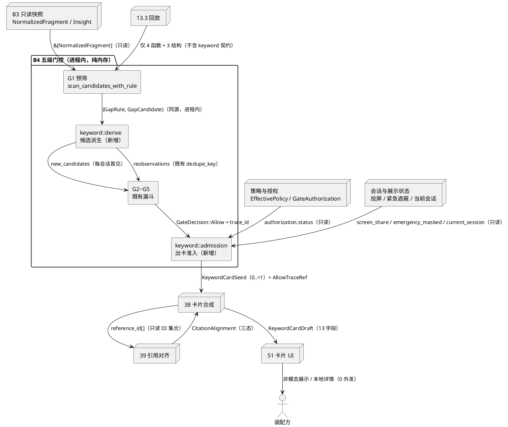

**通信口径**：全部同进程同步调用。`KD`/`KA` 不持有状态、不访问网络、不读系统时间、不写审计、不写 B3 存储；唯一"跨模块"数据是只读切片与值拷贝。

### 4.2.2 组件与文件落位

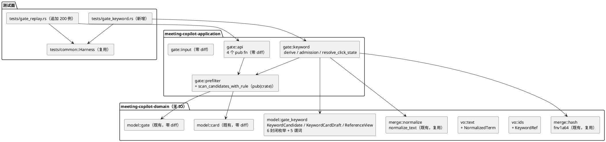

**依赖方向**（单向，`check-layering.sh` 可断言）：

| 从 | 到 | 允许 | 说明 |
|---|---|---|---|
| `domain::model::gate_keyword` | `domain::vo`、`domain::model::enums`、`domain::model::session`、`domain::model::gate` | 是 | 只用值对象与既有枚举 |
| `domain::model::gate_keyword` | `application::*` | **否** | domain 不得反向依赖 |
| `application::gate::keyword` | `domain::model::gate_keyword`、`gate::prefilter`、`gate::input` | 是 | 同层内部调用 |
| `application::gate::keyword` | `gate::outbound`、`gate::api` | **否** | 避免形成第二出口、避免回放面扩散 |
| `application::gate::keyword` | `reqwest`/`std::net`/`Instant`/`SystemTime`/`std::env`/`thread`/`Mutex`/`Atomic*` | **否** | `--rule=source` 机器判定 |
| `tests/gate_keyword.rs` | `application::gate::*`、`tests/common` | 是 | 测试面可全量引用 |

**命名禁词表（AC-B4-49/57 机器断言，新增符号必须避开）**

| 禁词 | 来源断言 | 安全替代命名 |
|---|---|---|
| `composer` | AC-B4-57 | `synthesizer`（仅文档描述）/ 由 38 侧定义，B4 不出现 |
| `validator` | AC-B4-57 | `alignment`（39 侧） |
| `presenter` | AC-B4-57 | `surface`（51 侧） |
| `card_store` | AC-B4-57 | 不涉及（B4 不存储） |
| `outbox` | AC-B4-49 | 不涉及 |
| `on_demand` | AC-B4-49 | 用 `TriggerKind::OnDemand`（CamelCase 不命中 `on_demand`） |
| `feedback_weights` | AC-B4-49 | 不涉及 |

> 注意：`keyword.rs` 中引用 `TriggerKind::OnDemand` 是安全的（grep 为大小写敏感）；但**禁止**写 `on_demand_card`、`on_demand_query` 等 snake_case 复合名。

### 4.2.3 与 G1~G5 的调用顺序（新增的确定性规则）

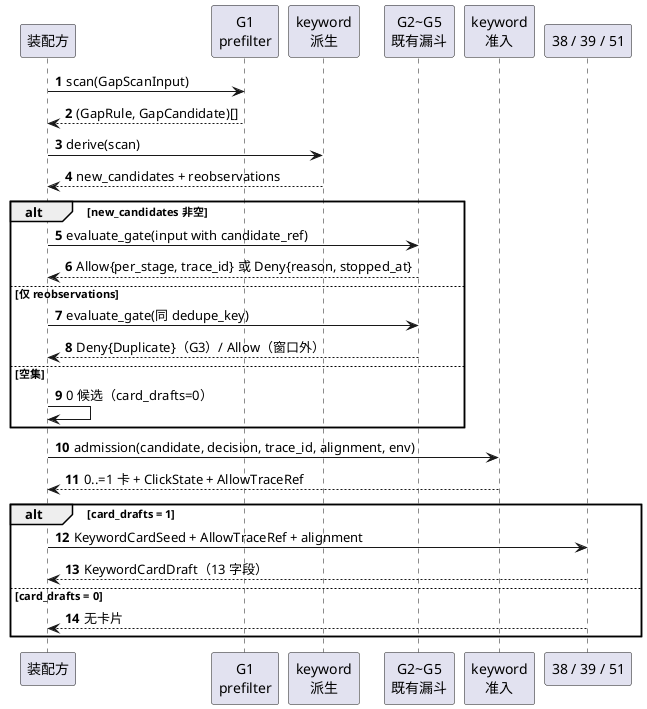

**固定规则（可机器判定）**

| 规则 | 内容 | 断言方式 |
|---|---|---|
| R-K1 | `keyword::derive` 只能在 G1 产出后调用；入参是 `GapScanInput`，**不调用** `evaluate_gate` | `grep -c "evaluate_gate" gate/keyword.rs` = 0 |
| R-K2 | `NotReached/Skipped` 判定：`Deny` 后不得调用 `keyword::admission` 产出卡片 | 用例 `deny_never_emits_clickable_card` 断言 `card_drafts=0` |
| R-K3 | `reobservations` 不产卡，只用于重量判定；其输出 `new_candidates` 增量 = 0 | 用例 `keyword_candidate_keeps_first_seen_only` |
| R-K4 | 首见键 = `(session_id, normalize_text(term))`；跨会话不共享 | 同用例第二个断言 |
| R-K5 | `KeywordKind` 由 `GapRule` 映射；`UnansweredQuestion` 直接丢弃（不产候选、不产卡） | 用例 `unanswered_question_is_not_a_keyword_card` |
| R-K6 | 跳过 G2/G3 **不豁免** G1/G4/G5；`per_stage[1]/[2].result==Skipped` 且 G1/G4/G5 全 `Allow` 时仍出 1 卡 | 用例 `keyword_card_requires_gate_allow` |
| R-K7 | `admission` 的 `allow_ref` 只能来自 `GateDecision::Allow`；`Deny` 时恒为 `None` | `AllowTraceRef::new` 的返回类型（`Option`） |
| R-K8 | 排序确定性：`new_candidates` 按 `(confidence desc, trigger_span.start_ms asc, dedupe_key asc)`，与 G1 排序口径一致 | 100 次调用逐字段相等（复用到 `prefilter_is_pure_and_deterministic` 范式） |

**`GapRule → KeywordKind` 映射表（五类封闭）**

| `GapRule`（7 变体） | `KeywordKind`（5 变体） | 是否产候选 |
|---|---|---|
| `ProperNoun` | `ProperNoun` | 是 |
| `Institution` | `InstitutionRole` | 是 |
| `Abbreviation` | `Acronym` | 是 |
| `Acronym` | `Acronym` | 是 |
| `PolicyStandard` | `PolicyStandard` | 是 |
| `Metric` | `Metric` | 是 |
| `UnansweredQuestion` | — | **否**（AC-B4-51） |

> 该表是 K-01 的唯一理由：若继续用 `rule_of(GapKind)`，`Institution` 与 `ProperNoun` 无法区分，`InstitutionRole` 永不可达，AC-B4-51 的"五类各 1 且 kind 匹配"不可满足。

### 4.2.4 出卡判定与 `click_state` 状态机

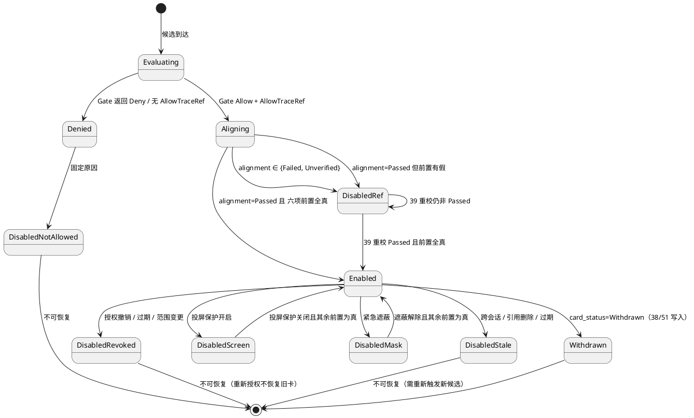

**六因固定优先级（K-05，输出唯一）**

| 优先级 | `ClickDisabledReason` | 触发事实 | 可恢复性 |
|---|---|---|---|
| 1 | `StaleReference` | 卡片 `session_id != 当前会话`；或引用被删除/过期 | 不可恢复（须新候选） |
| 2 | `AuthorizationRevoked` | 出卡后授权撤销/过期/范围变更 | 不可恢复（旧卡永不恢复） |
| 3 | `NotAllowed` | 无 `AllowTraceRef`；或 `card_status=Withdrawn` 且无其他原因 | 不可恢复 |
| 4 | `EmergencyMasked` | 紧急遮蔽开启 | 可恢复（遮蔽解除） |
| 5 | `ScreenShareProtection` | 投屏保护开启 | 可恢复（投屏关闭） |
| 6 | `ReferenceUnverified` | `citation_alignment ∈ {Failed, Unverified}` | 可恢复（39 重校 Passed） |

**优先级理由（必须写进文档，避免"随意排序"）**：

1. 越"结构性失效"越优先：会话/引用失效是数据层不可逆，优先于权限与展示态。
2. 授权撤销是"同意基础消失"，优先于"临时遮挡"，且规格明确"重新授权不恢复旧卡"。
3. `NotAllowed` 是契约根因（无 Allow 依据），先于任何表现层原因。
4. 两个屏蔽态按"紧急 > 投屏"排序：紧急遮蔽要求 1 秒内清空，语义更严。
5. `ReferenceUnverified` 最后：它只影响"结论可点击性"，不影响卡片可展示。

**`click_state=Enabled` 的合取谓词（7 项全真）**

```text
allow_ref.is_some()
∧ citation_alignment == Passed
∧ card_status != Withdrawn
∧ card.session_id == current_session
∧ authorization.status == Granted ∧ authorization.revoked_at_ms.is_none()
∧ !screen_share
∧ !emergency_masked
```

> 该谓词是 `KeywordCardDraft::click_state_is_consistent()` 的实现口径，也是 AC-B4-53/55 的机器判定点。任一为假必须落到唯一 `Disabled{reason}`，**禁止**出现"字段说 Enabled 但环境为假"的非法态。

## 4.3 增量类型与字段设计

### 4.3.1 domain 契约类型（`gate_keyword.rs`）

**13 项业务字段（`KeywordCardDraft`，封闭集，顺序即序列化断言口径）**

| # | 字段 | 类型 | 约束 | 归属 | 零转录 |
|---|---|---|---|---|---|
| 1 | `card_id` | `CardRef` | 全局唯一；由 §4.3.3 的派生规则产生 | B4 定契约 / 38 使用 | 安全（ID） |
| 2 | `keyword_text` | `TitleText` | 既有 40 字符上限；不得含完整句/姓名/联系方式/URL | 展示层 | **禁止进记录** |
| 3 | `normalized_term` | `NormalizedTerm` | `normalize_text` 结果，非空，≤120 | B4 | 展示层（不进记录） |
| 4 | `keyword_kind` | `KeywordKind` | 5 类封闭 | B4 | 安全（枚举） |
| 5 | `trigger` | `TriggerKind` | 既有 `Auto`/`OnDemand` | B4 | 安全（枚举） |
| 6 | `triggered_at_ms` | `u64` | 取 `candidate.trigger_span.end_ms` | B4 | 安全（毫值） |
| 7 | `confidence` | `Confidence` | 0..=1，且 ≥0.50 | B4 | 安全（数值） |
| 8 | `summary` | `Option<ConclusionText>` | 既有 80 字符上限；`alignment != Passed` 时必须 `None` 或固定文案 | 38 | **禁止进记录** |
| 9 | `references` | `Vec<ReferenceView>` | 0..*；元素 5 字段封闭 | 39 投影 / 38 组装 | 只含 ID |
| 10 | `citation_alignment` | `CitationAlignment` | `Passed`/`Failed`/`Unverified` | 39 产出 | 安全（枚举） |
| 11 | `gate_decision_ref` | `AllowTraceRef` | 只能由 `GateDecision::Allow` 构造 | B4 | 安全（trace_id） |
| 12 | `card_status` | `KeywordCardStatus` | `Displayed`/`Collapsed`/`Withdrawn`，B4 不写 | 38/51 | 安全（枚举） |
| 13 | `click_state` | `ClickState` | `Enabled` 或 `Disabled{reason}`，reason 6 项封闭 | B4 判定 | 安全（枚举） |

**字段封闭的机器判据**：`grep -oE '^    pub [a-z_]+:'` 在 `KeywordCardDraft` 块内恰 13 行，与白名单逐项排序相等（复用 `--rule=record` 的同款 awk 块解析范式）。

**`KeywordCandidate`（10 项，规格 §6.11）**

| # | 字段 | 类型 | 约束 |
|---|---|---|---|
| 1 | `keyword_ref` | `KeywordRef` | 新增 ID 类型，`id_type!`（非空、≤128、无空白）；**不得**等于原文、不得等于 `request_id` |
| 2 | `keyword_text` | `TitleText` | ≤40；只允许展示层 |
| 3 | `normalized_term` | `NormalizedTerm` | 归一化结果 |
| 4 | `keyword_kind` | `KeywordKind` | 5 类封闭 |
| 5 | `trigger_span` | `TextRange` | 起点<终点；同一会话 |
| 6 | `confidence` | `Confidence` | ≥0.50 |
| 7 | `dedupe_key` | `DedupeKey` | 复用 G1 派生值，32 hex |
| 8 | `state` | `GapState` | 既有 7 变体；候选阶段不得为 `Pushed` |
| 9 | `session_id` | `SessionId` | 跨会话拒绝 |
| 10 | `source_insight_ref` | `Option<InsightRef>` | 与 `trigger_span` 至少一个可定位 |

**`ReferenceView`（5 项，规格 §6.13）**

| # | 字段 | 类型 | 约束 |
|---|---|---|---|
| 1 | `reference_id` | `ReferenceRef` | 稳定 ID；不得是 URL |
| 2 | `trust_tier` | `ReferenceTrustTier` | 4 档封闭 |
| 3 | `access_status` | `ReferenceAccessStatus` | `Ok`/`Unavailable` 两态 |
| 4 | `published_at_ms` | `Option<u64>` | 为空时前端标注"发布时间未知" |
| 5 | `alignment` | `CitationAlignment` | 与卡片 `citation_alignment` 同源 |

> **禁止字段（结构性保证）**：`ReferenceView` 无 `url`/`title`/`excerpt`/`content`/`query` 字段；`KeywordCardDraft` 无 `transcript`/`model`/`request_id`/`speaker`/`contact` 字段。类型层面无法表达，故不需要运行时校验（但仍保留 `--rule=zero-transcript` 与键集合断言双保险）。

### 4.3.2 封闭枚举与单向投影

| 新增枚举 | 变体（封闭） | 外接映射来源 | 映射规则 |
|---|---|---|---|
| `KeywordKind` | `ProperNoun` / `Acronym` / `InstitutionRole` / `PolicyStandard` / `Metric` | `GapRule` 7 变体 | 见 §4.2.3 映射表；`UnansweredQuestion` 丢弃 |
| `KeywordCardStatus` | `Displayed` / `Collapsed` / `Withdrawn` | 既有 `CardStatus` ∈ {Shown, Collapsed, Withdrawn} | `Shown → Displayed`；其余同名。**新建枚举**，避免改 `enums.rs` |
| `ReferenceTrustTier` | `Official` / `Authority` / `General` / `UserGenerated` | 既有 `TrustTier` ∈ {Official, AuthoritativeMedia, GeneralWeb, UserGenerated} | 1:1 改名投影 |
| `ReferenceAccessStatus` | `Ok` / `Unavailable` | 既有 `AccessStatus` 5 态 | `Ok → Ok`；`LoginWall/RobotsDenied/Timeout/Blocked → Unavailable`（4→1 归并） |
| `CitationAlignment` | `Passed` / `Failed` / `Unverified` | 39 产出 | 无既有映射；B4 只读 |
| `ClickState` | `Enabled` / `Disabled(ClickDisabledReason)` | — | 由 §4.2.4 解析 |
| `ClickDisabledReason` | `NotAllowed` / `ReferenceUnverified` / `AuthorizationRevoked` / `ScreenShareProtection` / `EmergencyMasked` / `StaleReference` | — | 6 项封闭，顺序即优先级倒序 |

**为什么不复用既有枚举（K-02 论证）**：

1. **值域不一致即契约不一致**：规格 §6.13-3 只允许两态 `Ok/Unavailable`，复用 5 态 `AccessStatus` 会使 `click_state` 的原因判定出现 4 个未定义分支；规格 §6.12-8 的 `Displayed` 与既有 `Shown` serde 值不同，AC-B4-53 的字段值断言会直接失败。
2. **改既有枚举会破坏 B2/B3 的零 diff 与 AC-B4-40**：`enums.rs` 的 `CardStatus`/`TrustTier`/`AccessStatus` 被 `SuggestionCard`、`Reference`、UI DTO 与存储层共同消费；重命名或改值域会波及 `crates/ui-bridge`、`crates/infrastructure`。
3. **投影不双写**：新枚举只在 B4 契约面使用；38/39/51 在自己的边界做一次性投影，B4 不反向依赖它们。

### 4.3.3 纯函数与不变量（签名契约，不含实现）

```rust
// crates/application/src/gate/keyword.rs —— 不在 api.rs，不进入 4 函数回放面

/// 候选派生：只读扫描输入，输出首见候选与复现引用。
pub fn derive_keyword_candidates(scan: &GapScanInput<'_>) -> KeywordCandidateSet;

/// 出卡准入：只有 Allow 才可能 1 卡；否则 0 卡 + 唯一 Disabled 原因。
pub fn keyword_card_admission(
    candidate: &KeywordCandidate,
    decision: &GateDecision,
    trace_id: &TraceId,
    alignment: CitationAlignment,
    env: &KeywordCardEnv<'_>,
) -> KeywordCardAdmission;

/// 点击状态唯一解析（六因固定优先级）。
pub fn resolve_click_state(facts: ClickFacts) -> ClickState;

/// 卡片 ID 确定性派生（无随机、无时间）。
pub fn derive_card_id(session: &SessionId, dedupe_key: &DedupeKey) -> CardRef;
```

| 函数 | 前置条件 | 后置条件 | 失败语义 |
|---|---|---|---|
| `derive_keyword_candidates` | `scan` 的片段 `text≤2000`、`confidence∈[0,1]`、`now_ms` 已注入 | 返回集合按 R-K8 排序；`new_candidates` 的长度只对首见计数；`UnansweredQuestion` 不出现 | 永不 panic、永不 `Err`；不可构造的候选被丢弃（不写日志） |
| `keyword_card_admission` | `decision` 与 `trace_id` 来自同一次 `evaluate_gate` | `Deny → 0 卡 + Disabled{NotAllowed}`；`Allow + 全前置 → 1 卡 + Enabled` | 任一事实缺失按 fail-closed 落 `Disabled` |
| `resolve_click_state` | 无 | 输出唯一原因；`Enabled` 当且仅当 7 项合取全真 | 无 |
| `derive_card_id` | `session`/`dedupe_key` 合法 | 返回 `CardRef`，同一输入恒同值，长度 ≤36 | 构造失败不可能（36 字符、无空白） |

**不变量清单（用例逐条断言）**

| 编号 | 不变量 |
|---|---|
| I-01 | `KeywordCardDraft` 字段集恒 13（缺一/多一即结构违规） |
| I-02 | 一候选最多一卡：同一 `keyword_ref` 的 `derive_card_id` 恒等，故 38 重复触发仍得同一 `card_id` |
| I-03 | `summary.is_some() ⇒ citation_alignment == Passed`（或固定文案常量） |
| I-04 | `click_state == Enabled ⇒ 7 项合取全真` |
| I-05 | `click_state == Disabled(r) ⇒ r ∈ 6 项`，且 `resolve_click_state` 的返回值等于"按优先级第一个为真的事实" |
| I-06 | `gate_decision_ref` 恒可追溯到一次 `Allow`（`AllowTraceRef` 类型保证） |
| I-07 | `references` 元素均为 5 字段，且无 URL/标题/摘要 |
| I-08 | `derive_keyword_candidates` 对同输入 100 次逐字段相等 |
| I-09 | 跨会话同一术语各产 1 候选，`keyword_ref` 与 `card_id` 均不相等 |
| I-10 | `GateRecord`/`GateAuditEvent`/`ReplayReport` 键集合不含卡片文本键名 |
## 4.4 零转录与审计口径

### 4.4.1 分层边界（唯一口径）

| 层 | 载体 | 允许出现 | 禁止出现 | 机器断言 |
|---|---|---|---|---|
| 展示层 | `KeywordCandidate.keyword_text`、`KeywordCardDraft.keyword_text` / `summary` | 展示词、≤40/≤80 的解释文本 | 完整转写、说话人姓名、联系方式、完整 URL、查询原文 | `TitleText`/`ConclusionText` 的长度上限 + 类型无 URL 字段 |
| 契约层（ID 面） | `KeywordCandidate.keyword_ref`、`KeywordCardDraft.card_id`、`gate_decision_ref`、`references[].reference_id` | 稳定 ID、`trace_id`、长度、毫值、原因码、时间戳 | 任何原文片段 | `--rule=zero-transcript`；键集合断言 |
| 记录层 | `GateRecord`（14 字段） | 既有 14 项 | `keyword_text`/`summary`/`references` 正文/嵌套卡片对象 | `--rule=record` 白名单 + 键集合断言 |
| 审计层 | `GateAuditEvent`（7 字段） | 既有 7 项 | 卡片字段、关键词文本 | AC-B4-34 字段白名单 + 键集合断言 |
| 回放层 | `GateReplayCase`/`GateInputFixture`（23 字段）/`ReplayReport`（5 字段） | 既有字段 + `case_id`/`seed`/计数 | 文本字段、`keyword_text`、`summary` | `gate_input_fixture_covers_all_input_state` + 字节一致 |
| 日志/进度 | `docs/progress/b4-status.md`、诊断输出 | `AC 编号`、原因码、计数、毫值 | 关键词文本/摘要/URL/姓名 | `--rule=zero-transcript` 把该文件纳入扫描面 |
| 测试进程 | `tests/gate_keyword.rs`、`tests/gate_replay.rs` 的内存 | 短构造词（如 `format!("kw{index}")`） | 写入夹具/报告/日志/文件；断言消息中出现文本 | 断言只输出 `case_id`/`index`/原因码 |

### 4.4.2 审计口径（卡片不新增审计事件）

| 问题 | 裁决 | 理由 |
|---|---|---|
| 关键词卡出卡是否写 `GateAuditEvent`？ | **不写** | `GateAuditEvent` 是"外发审计"（7 字段含 `query_len`/`provider_ids`/`content_type`），卡片展示不产生外发；写入会污染 AC-B4-34 的字段白名单 |
| 卡片可追溯性如何保证？ | `gate_decision_ref.trace_id` → `GateRecord.trace_id` 的单向关联 | `AllowTraceRef` 只由 `Allow` 产生，关联在类型层成立 |
| 卡片展示/点击是否要审计（`CardShown`）？ | 归 52 的审计存储（`AuditAction::CardShown` 已存在），B4 不实现 | U-07 范围；B4 只定义 `click_state`，不写审计 |
| "继续检索"是否复用 G5 审计？ | 是，走 `evaluate_gate` 正常路径，由 G5 唯一出口写 1 条 | 与 AC-B4-54 的"重新过门"一致 |
| 诊断/计数是否新增？ | **不新增计数项**（保持 32） | 卡片 0/1 与 `click_state` 是判定结果，不是计数；卡片数量由测试断言，不进 `GateCounters` |

### 4.4.3 零转录的三重保证

1. **类型层**：`KeywordCardDraft`/`ReferenceView` 的字段表里没有 URL/标题/摘要/正文类型；`GateRecord`/`GateAuditEvent`/`ReplayReport` 的字段表里没有卡片文本类型。想写入必须先改类型定义 → 触发 AC-B4-47/53 的字段集断言失败。
2. **构造层**：`GateRecord` 只在 `record_from` 构造（`api.rs` 唯一入口），其入参 `GateInput` 不含卡片字段；`GateAuditEvent` 只在 `outbound::build_event` 构造（`outbound.rs:74-90`），入参为长度/结果/原因码。
3. **静态层**：`--rule=zero-transcript` 扫描 `gate/*.rs`、`tests/gate_*.rs`、`b4-status.md`；本章追加 `gate_keyword.rs` 到扫描面，禁止把示例文本写进契约文件。

## 4.5 归属拆分与 38 / 39 / 51 接口预留

### 4.5.1 归属矩阵（每个能力只有一个所有者）

| 能力 | 所有者 | B4 交付什么 | B4 不交付什么 | 越界判定 |
|---|---|---|---|---|
| 关键词候选契约与派生（五类、首见、归一化） | **B4** | `KeywordCandidate` + `derive_keyword_candidates` | 不做卡片展示、不写要点/片段存储 | `grep InsightDraft`/`InsightStore` 在 `gate/**` = 0 |
| 13 字段卡片契约 | **B4** | `KeywordCardDraft` 类型 + 谓词 | 不产出 `summary` 内容、不组装 `references`、不维护 `card_status` | `gate/**` 无 `composer`/字符串拼接摘要 |
| 出卡前置（只有 Allow） | **B4** | `keyword_card_admission` + `AllowTraceRef` | 不调用 38 合成函数、不入队渲染 | `gate/**` 无 `presenter`/`card_store` |
| 点击权限状态 | **B4** | `ClickState` + `resolve_click_state` + 六因优先级 | 不实现点击交互、不抢焦点、不渲染 | `gate/**` 无 UI/窗口句柄/焦点调用 |
| 卡片合成（标题、解释、置信度呈现、引用集合、状态流转） | **38** | 只给 `KeywordCardSeed` + `AllowTraceRef` | — | B4 侧无 38 实体文件 |
| 引用对齐校验（存在性、支撑、冲突、敏感词终检） | **39** | 只读 `CitationAlignment` | 不判断引用真假、不检索 | `gate/**` 无 `validator`/网络调用 |
| UI 三形态、投屏/紧急遮蔽的界面行为、焦点 | **51** | 只给 `ClickState` 与"正文隐藏"的契约要求 | 不写渲染代码 | 无前端/UI 依赖 |
| 卡片展示与点击审计存储 | **52** | 无 | 不新增审计表 | 无仓储 |
| 回放本体 | **13.3** | 4 函数 + 3 结构 | `tests/replay/` 仍不存在 | `test ! -d` = 0 |

### 4.5.2 接口预留（签名在本文档，文件在各自阶段创建）

```rust
// —— 38 侧（建议落位 crates/application/src/cards/synthesis.rs，B4 不创建）——
/// 38 只消费 B4 契约；B4 保证 seed 中的 allow_ref 已成立、候选已首见。
pub struct KeywordCardSeed {
    pub candidate: KeywordCandidate,
    pub allow_ref: AllowTraceRef,
    pub suppressed_notice: bool,
}
pub trait CardSynthesis {
    /// 填 summary / references / card_status；不得修改 B4 决定字段。
    fn synthesize(&self, seed: &KeywordCardSeed, refs: &[ReferenceView]) -> KeywordCardDraft;
}

// —— 39 侧（建议落位 crates/application/src/citation/align.rs，B4 不创建）——
pub trait CitationAlignmentProvider {
    /// 只返回三态；B4 不解释其内部依据。
    fn alignment(&self, reference_ids: &[ReferenceRef]) -> CitationAlignment;
}

// —— 51 侧（建议落位 crates/ui-bridge 或 app 层，B4 不创建）——
pub trait CardSurface {
    /// 只读 click_state；Enabled 才允许打开本地详情；投屏/遮蔽时只显示角标计数。
    fn present(&self, card: &KeywordCardDraft, visible_text: bool);
}
```

**预留的三条硬边界**

| 编号 | 边界 | 断言 |
|---|---|---|
| P-01 | 38 不得修改 `card_id`/`keyword_kind`/`triggered_at_ms`/`confidence`/`gate_decision_ref`/`click_state` | 类型上这些字段由 B4 派生或判定；38 的 `synthesize` 只接收 `KeywordCardSeed`（不含这些字段的可写入口） |
| P-02 | 39 只能返回三态，不得把 URL/标题/摘要写进 `ReferenceView` | `ReferenceView` 无对应字段；`alignment` 之外无其他输出 |
| P-03 | 51 不得用 UI 开关绕过 `click_state` | `CardSurface::present` 的 `visible_text` 只由"投屏/遮蔽"决定；`card.click_state` 只读 |

> **为何不在 `gate/` 定义这三个 trait**：AC-B4-57 在 `gate/**` 中断言 `composer|validator|presenter|card_store` 命中 0；即便换名（`synthesis`/`alignment`/`surface`），把 38/39/51 的端口放进门控也会形成"第二套可替换语义"，与 §2.2.1"内部只用 `pub(crate)`，不暴露 trait"的设计原则冲突。因此端口只在文档预留，实体由各自阶段创建。

### 4.5.3 38/39/51 接入时的回归门禁

| 接入方 | 接入前置 | 必须复跑的断言 |
|---|---|---|
| 38 | B4 契约类型编译通过、`gate_keyword` 用例全绿 | `--rule=record`、`--rule=zero-transcript`、`gate_keyword_has_closed_fields`、`keyword_card_zero_transcript_boundary` |
| 39 | `CitationAlignment` 可注入 | `click_permission_is_fail_closed`、`--rule=outbound` |
| 51 | `ClickState` 只读消费 | `keyword_card_hidden_under_screen_share`、`clicking_keyword_card_is_local_only` |
| 任一 | 不得回写 `GateRecord` | `grep -c "keyword_text\|summary" crates/application/src/gate/record.rs` = 0 |

## 4.6 AC-B4-48：200 例生成与固定种子方案（方案 A）

### 4.6.1 方案 A 的五条硬约束（与需求 §10.6 逐条对齐）

| # | 约束 | 设计落点 |
|---|---|---|
| 1 | 不改 `GateInputFixture`（仍 23 字段，零文本字段） | `model/gate_replay.rs` 零 diff |
| 2 | 在 `crates/application/tests/gate_replay.rs` 内本地构造 `NormalizedFragment`/`Insight` | 测试内 `fn fragment(index) -> NormalizedFragment`、`fn insight(index) -> Insight` |
| 3 | 200 例、`case_id` 唯一、覆盖可构造拒绝码与 `Allow`、`seed=7` | §4.6.2 的二维生成器 |
| 4 | `total=200`、`mismatched=0`、两次 `ReplayReport` 序列化字节相等 | `replay_200_cases_is_byte_identical` |
| 5 | 构造文本只在测试进程内存，不落盘、不进报告 | §4.6.4 的断言纪律 |

### 4.6.2 确定性生成器（无随机、无 `rand` 依赖）

**两维派生**（不使用任何随机源；`seed` 只参与报告字段与偏移，不参与不可复现的熵）：

```text
for index in 0..200:
    stage_slot = index % 6            // 0=G1 1=G2 2=G3 3=G4 4=G5 5=Allow
    variant    = (index / 6) % 12     // 每个阶段内的变体号
    phase      = index / 72           // 0..2，用于参数微扰（now_ms/confidence/budget）
```

| `stage_slot` | 变体 → 期望拒绝码（`variant` 取模后落到对应项） | 200 例中的大致例数 |
|---|---|---|
| 0（G1） | `AutoDisabled` / `ConsentMissing` / `Paused` / `SilentPeriod` / `ScreenShareProtection` / `PreFilterLowConfidence` / `SensitiveTerm` / `Suppressed` / `QuotaExhausted` / `Duplicate` / `NoProviderEnabled` / `PolicyUnavailable`（策略非法，G1 前置） | 33~34，12 变体各 ≥2 |
| 1（G2） | `LowRelevance`（阈值 620，注入 `score_milli=619`） | 33~34，全部同码不同参数 |
| 2（G3） | `Duplicate` / `Suppressed` / `QuotaExhausted` / `Stale`（4 变体轮转） | 33~34，4 变体各 ≥8 |
| 3（G4） | `BudgetExhausted` / `GatewayCooling` / `Offline`（3 变体轮转） | 33~34，各 ≥11 |
| 4（G5） | `OutboundNotGranted` / `SanitizeFailed` / `AuditUnavailable` / `ProviderNotAllowed`（4 变体轮转） | 33~34，各 ≥8 |
| 5（Allow） | 纯 Allow（四类子形：`Auto` 常规放行 / `OnDemand` 放行 / `per_stage[1..2]=Skipped` 放行 / `queued=true` 放行） | 32~33，4 子形各 ≥8 |

**`phase` 的参数微扰（保证不是 33 份完全相同的输入）**

| phase | `now_ms` 偏移 | `confidence_milli` | 预算用量 | 目的 |
|---|---|---|---|---|
| 0 | +0 | 0.90 | 0 | 基准形态 |
| 1 | +600 000 | 0.50 | 会话已用 119 | 窗口边界 / 阈值下沿 |
| 2 | +86 400 001 | 0.85 | 全局已用 4 | 缓存过期 / 配额临满 |

**排序与唯一性**：`case_id = format!("case-{:03}", index)`（`000..199`），严格唯一；`mismatched` 的 `mismatch_cases` 只存这类 ID。

### 4.6.3 覆盖矩阵与"不可构造"登记

| 目标 | 覆盖数 | 判定 |
|---|---|---|
| 23 项 `GateRejectReason` 中可构造项 | **21 项**（G1 11 + `PolicyUnavailable` + `LowRelevance` + `Stale` + G4 3 + G5 4） | 每项 ≥1，用例 `replay_200_cases_cover_all_reject_reasons` |
| `Allow` 路径 | 1 类 × 4 子形 | `DecisionKind::Allow` ≥1 且子形各 ≥1 |
| 跳过级 | G2/G3 同时 `Skipped` | `per_stage[1]/[2].result == Skipped` 且决策 `Allow` |
| 审计不可用下的 Allow | **不构造** | `audit_available=false` 必 `Deny{AuditUnavailable}`，故归 G5 变体 |
| 不可构造码 | **2 项**：`DomainBlocked`、`RetentionExpired` | 源码中仅有 `counter_at`/枚举定义，无判定分支（`grep` 证据见 §4.6.5）；作为测试内常量 `NON_CONSTRUCTIBLE: [GateRejectReason; 2]` 登记，**不进 `ReplayReport`**（保持 5 字段） |

> 覆盖断言写法：`EXPECTED_CONSTRUCTIBLE: [GateRejectReason; 21]` 与 `NON_CONSTRUCTIBLE: [GateRejectReason; 2]` 两个常量相加必须等于 `GateRejectReason::ALL`（编译期/运行期双向差集断言），避免"漏登记"。

### 4.6.4 逐字节一致与零转录纪律

| 要求 | 实现口径 | 断言 |
|---|---|---|
| 两次运行逐字节一致 | 对同一 200 例连续执行两次 `run`，各自 `serde_json::to_vec(&report)`；比较 `Vec<u8>` | `assert_eq!(first_bytes, second_bytes)`；不比较 `Debug` 字符串 |
| 无 `HashMap` 迭代序 | 输入用 `BTreeMap`/`Vec`；`references`/`candidates` 有序 | 与既有 `GateBudget` 的 `BTreeMap` 一致 |
| 无系统时间 | 只用 `FixedClock{anchor_ms, tick_ms}` 与注入 `now_ms` | `--rule=source` 退 0 |
| 无联网 | 测试导入的 crate 与既有测试一致；无 `reqwest` | `--rule=outbound` 退 0 |
| 文本不出进程 | 生成函数返回 `NormalizedFragment`/`Insight`；断言消息只含 `case_id`/`index`/原因码；不 `println!`、不写文件、不 `dbg!` | code review + `--rule=zero-transcript` |
| 不落盘 | 测试体内无 `std::fs`/`File` | `grep -c "std::fs\|File::" tests/gate_replay.rs` = 0 |
| 报告字段封闭 | `ReplayReport { total, matched, mismatched, mismatch_cases, seed }` 5 字段不变 | `replay_report_has_closed_fields` 保持绿 |

### 4.6.5 不可构造码的取证

| 码 | 证据 | 结论 |
|---|---|---|
| `DomainBlocked` | 仅出现在 `gate.rs` 枚举、`to_deny_code`、`counter_at`（`gate.rs:44/72/1375`）；`gate/*.rs` 中无产生点 | 不可构造（登记，不计 `mismatched`） |
| `RetentionExpired` | 仅出现在 `gate.rs` 枚举、`to_deny_code`、`visibility`（`gate.rs:46/74/119`）；无判定分支 | 不可构造（同） |

> 该登记不削弱 AC-B4-48 的"覆盖全部**可构造**拒绝码"口径（需求 §10.6-6 明确允许登记不可构造分支）。

### 4.6.6 AC-B4-48 验收命令

```bash
"$CARGO" test -p meeting-copilot-application --test gate_replay replay_200_cases_is_byte_identical
"$CARGO" test -p meeting-copilot-application --test gate_replay replay_200_cases_cover_all_reject_reasons
"$CARGO" test -p meeting-copilot-application --test gate_replay
bash scripts/check-b4-gates.sh --rule=source
bash scripts/check-b4-gates.sh --rule=zero-transcript
```

| 判据 | 期望 |
|---|---|
| `total` | 200 |
| `mismatched` | 0 |
| `seed` | 7 |
| 两次序列化 | 字节相等 |
| 可构造码覆盖 | 21/21 |
| `GateInputFixture` 字段数 | 23（零新增文本字段） |
| `tests/replay/` | 不存在 |
## 4.7 AC-B4-51~57 验收命令与三态判定

### 4.7.1 用例级判定（13 个用例，逐字对齐 spec §7.11）

| AC | 用例名 | 命令 | 期望 |
|---|---|---|---|
| AC-B4-51 | `keyword_candidates_cover_five_kinds` | `"$CARGO" test -p meeting-copilot-application --test gate_keyword keyword_candidates_cover_five_kinds` | 退 0；候选数 5，`keyword_kind` 五项各 1 |
| AC-B4-51 | `keyword_candidate_keeps_first_seen_only` | `... --test gate_keyword keyword_candidate_keeps_first_seen_only` | 退 0；同术语第二次 `new_candidates` 增量 0；599 999 ms 内 G3 `gate_l3_duplicate=1`；跨会话各 1 |
| AC-B4-51 | `unanswered_question_is_not_a_keyword_card` | `... --test gate_keyword unanswered_question_is_not_a_keyword_card` | 退 0；仅未答提问时候选 0、`card_drafts=0` |
| AC-B4-52 | `keyword_card_requires_gate_allow` | `... --test gate_keyword keyword_card_requires_gate_allow` | 退 0；五级 Allow → 1 卡；跳过 G2/G3 且 G1/G4/G5 Allow → 1 卡 |
| AC-B4-52 | `deny_never_emits_clickable_card` | `... --test gate_keyword deny_never_emits_clickable_card` | 退 0；G1~G5 逐级 Deny → `card_drafts=0` 且 `Disabled{NotAllowed}` |
| AC-B4-53 | `keyword_card_has_closed_fields` | `... --test gate_keyword keyword_card_has_closed_fields` | 退 0；字段集恰 13；`Disabled` 原因 ⊆ 6 |
| AC-B4-53 | `keyword_card_reference_is_id_only` | `... --test gate_keyword keyword_card_reference_is_id_only` | 退 0；引用元素 5 字段，无 URL/标题/摘要键 |
| AC-B4-54 | `clicking_keyword_card_is_local_only` | `... --test gate_keyword clicking_keyword_card_is_local_only` | 退 0；`outbound_attempts=0`、`llm_calls=0`、`network_calls=0` |
| AC-B4-54 | `continue_search_reenters_gate` | `... --test gate_keyword continue_search_reenters_gate` | 退 0；未获新 Allow 前外发 0；获新 Allow 后 `gate_decision_ref` 变化 |
| AC-B4-55 | `click_permission_is_fail_closed` | `... --test gate_keyword click_permission_is_fail_closed` | 退 0；五种原因逐项命中且唯一 |
| AC-B4-55 | `keyword_card_hidden_under_screen_share` | `... --test gate_keyword keyword_card_hidden_under_screen_share` | 退 0；可见正文 =0，点击被拒 |
| AC-B4-56 | `keyword_card_zero_transcript_boundary` | `... --test gate_keyword keyword_card_zero_transcript_boundary` | 退 0；记录/审计/回放/夹具键集合无文本；嵌套扫描 0 命中 |
| AC-B4-57 | `keyword_card_ownership_is_outside_gate` | `... --test gate_keyword keyword_card_ownership_is_outside_gate` | 退 0；禁词 0 命中；`tests/replay/` 不存在 |

### 4.7.2 静态判据（可与用例同批复跑）

| # | 判据 | 命令 | 期望 |
|---|---|---|---|
| S-01 | 回放面仍 4 函数 | `grep -c '^pub fn ' crates/application/src/gate/api.rs` | 4 |
| S-02 | `api.rs` 未被本增量改写 | `git diff --quiet HEAD -- crates/application/src/gate/api.rs; echo $?` | 0 |
| S-03 | 57 禁词（合成/校验/展示/存储） | `grep -rnE "composer|validator|presenter|card_store" crates/application/src/gate \| wc -l` | 0 |
| S-04 | 49 禁词（合成/校验/outbox/按需/反馈权重） | `grep -rnE "composer|validator|outbox|on_demand|feedback_weights" crates/application/src/gate \| wc -l` | 0 |
| S-05 | 回放目录不存在 | `test ! -d crates/application/tests/replay; echo $?` | 0 |
| S-06 | 记录字段仍 14 | `bash scripts/check-b4-gates.sh --rule=record` | 0 |
| S-07 | 零转录 | `bash scripts/check-b4-gates.sh --rule=zero-transcript` | 0 |
| S-08 | 外发单一出口 | `bash scripts/check-b4-gates.sh --rule=outbound` | 0 |
| S-09 | 纯度 | `bash scripts/check-b4-gates.sh --rule=source` | 0 |
| S-10 | target 清单 | `bash scripts/check-b4-gates.sh --rule=targets` | 0（既有 6 项齐备）；`NEW_TARGETS` 长度 20（含 `gate_keyword`） |
| S-11 | 夹具字段未变 | `grep -cE '^    pub [a-z_]+:' crates/domain/src/model/gate_replay.rs`（`GateInputFixture` 块） | 23 |
| S-12 | 依赖零新增 | `git diff --stat -- Cargo.toml Cargo.lock \| wc -l` | 0 |
| S-13 | 既有 6 target 全绿 | 逐个 `--test gate_{prefilter,relevance,dedupe,budget,outbound,replay}` | 全 0 |
| S-14 | 全量回归 | `"$CARGO" test --workspace` | 退 0、`failed=0`、`ignored=9` |
| S-15 | 用例名差集 | `bash scripts/test-name-inventory.sh --diff` | `removed=0` |

### 4.7.3 AC 三态（实现后的登记口径）

| AC | 实现后状态 | 证据 |
|---|---|---|
| AC-B4-51 | `passed` | 3 个用例（五类/首见/未答提问） |
| AC-B4-52 | `passed` | 2 个用例 + `api.rs` 4 函数 |
| AC-B4-53 | `passed` | 2 个用例（13 字段 / 引用 ID-only） |
| AC-B4-54 | `passed` | 2 个用例（本地查看 / 重新过门） |
| AC-B4-55 | `passed` | 2 个用例（fail-closed / 投屏隐藏） |
| AC-B4-56 | `passed` | 1 个用例 + S-07 |
| AC-B4-57 | `passed` | 1 个用例 + S-03/S-04/S-05 |
| AC-B4-48 | `passed` | 2 个用例 + 20 项已知用例名 |
| 38 / 39 / 51 实体能力 | **`pending`（不在 B4 判定）** | 归各自阶段；B4 只判定契约与前置 |

> 纪律不变：**离线通过 ≠ 38 合成质量通过**；**替身通过 ≠ 39 语义对齐通过**；**契约通过 ≠ 51 交互通过**；不得据此宣称 G3/G4 或真实端点达标。

## 4.8 决策登记：新增、收窄与推翻

### 4.8.1 新增决策（D-B4-P19 ~ D-B4-P26）

| 编号 | 决策 | 理由 | 影响面 |
|---|---|---|---|
| **D-B4-P19** | 关键词契约落位**新文件** `crates/domain/src/model/gate_keyword.rs`，不改 `gate.rs`（31 项）与 `gate_replay.rs`（12 项） | 避免 31 项封闭数漂移；契约与记录解耦；扁平落位符合 R-01 | `model/mod.rs` +2 行；`gate.rs`/`gate_replay.rs` 零 diff |
| **D-B4-P20** | 新增 7 个 B4 专属封闭枚举（`KeywordKind`/`KeywordCardStatus`/`ReferenceTrustTier`/`ReferenceAccessStatus`/`CitationAlignment`/`ClickState`/`ClickDisabledReason`），对既有枚举做单向投影 | 值域与命名不一致（K-02）；改既有枚举会波及 ui-bridge/infrastructure 与 AC-B4-40 | 不触碰 `enums.rs` |
| **D-B4-P21** | 复用既有 `TitleText`(40)/`ConclusionText`(80)/`Confidence`/`DedupeKey`/`TextRange`/`CardRef`；新增 `KeywordRef`（`id_type!`）与 `NormalizedTerm`（`bounded_text!` 120） | 13 字段的长度约束已有权威实现；新增类型保持类型安全，避免 `String` 裸用 | `vo/ids.rs` +1、`vo/text.rs` +1、`vo/mod.rs` +2 |
| **D-B4-P22** | `click_state` 六因**固定优先级**：`StaleReference → AuthorizationRevoked → NotAllowed → EmergencyMasked → ScreenShareProtection → ReferenceUnverified` | 多因并存时输出唯一，保证可判定；不可恢复原因优先 | `resolve_click_state` 单点实现 |
| **D-B4-P23** | 候选派生输出 `new_candidates` + `reobservations`；首见键 = `(session_id, normalize_text(term))`；G1 原串首见不改 | 同时满足"候选增量 0"与"G3 计 duplicate"（K-04）；不动 AC-B4-02 | `keyword::derive` + `prefilter::scan_candidates_with_rule` |
| **D-B4-P24** | 不扩 `GateInput`/`GateRecord`/`GateAuditEvent`/`ReplayReport`/`GateInputFixture`/`GateCounters`；`record_from.skipped_stages` 的既有缺口**本轮不修** | 任何扩展都会触碰 14/7/5/23/32 的封闭断言；`skipped_stages` 用 `per_stage` 断言替代 | 关键词用例不依赖记录字段 |
| **D-B4-P25** | 38/39/51 端口只在本章预留签名，不在 `gate/**` 建 trait/文件 | AC-B4-57 禁词与 §2.2.1"不暴露第二套语义" | 三个 trait 落位建议见 §4.5.2 |
| **D-B4-P26** | 新增 `gate_keyword` target（`NEW_TARGETS` 19→20）；`check-b4-gates.sh` 新增 `GATE_KEYWORD` 并纳入 `source`/`budget`/`zero-transcript` 扫描面 | 否则契约文件是静态盲区；`--rule` 集合仍 7 条 | tasks 中"该行含 19 个 target"的口径需在编码阶段改为 20 |

### 4.8.2 收窄既有决策（语义不变，范围澄清）

| 编号 | 原口径 | 收窄后 | 为什么不是推翻 |
|---|---|---|---|
| **D-B4-P18** | "关键词卡片仅定义契约，未实现；**不创建卡片实体文件**" | 允许创建**契约类型文件** `gate_keyword.rs`；仍**不创建**合成器/校验器/展示器/卡片存储/卡片表 | 原口径禁止的是"卡片实体能力"，契约类型是 AC-B4-51~57 的判定对象；归属矩阵（§4.5）与禁词断言（S-03/S-04）均未放宽 |
| **D-B4-P13** | 方案 A：`gate_replay.rs` 内本地构造 `NormalizedFragment`/`Insight` 驱动 200 例 | 补充：`KeywordCandidate` 也在测试内本地构造；`seed=7` 只作报告字段与分布偏移，不读随机源 | 方案 A 的"不改夹具、不写原文、文本不出进程"三条均保持 |
| **D-B4-D08** | `gate.rs` 31 项封闭数不变 | 仍不变（31）；关键词类型在独立文件独立计数（`gate_keyword.rs` 10 项：3 结构 + 7 枚举/原因集） | 只做文件隔离，不增 `gate.rs` 类型 |
| **§3.11 第 1 项** | `grep -cE "^pub (struct\|enum) " gate.rs` ≥31 | 仍为 `gate.rs` 单文件 ≥31；新增文件用独立断言 | 断言面未变 |

### 4.8.3 推翻既有口径（2 项，需用户确认）

**X-01 · 门禁脚本扫描面扩展（推翻"`core_files` 只含三处"）**

- 原口径：`scripts/check-b4-gates.sh` 的 `source`/`budget` 扫描面 = `gate.rs` + `gate_replay.rs` + `gate/*.rs`（`scripts/check-b4-gates.sh:14-18、92-95`）。
- 冲突：新增 `gate_keyword.rs` 后该文件成为**静态盲区**，纯度/预算/零转录断言对它失效；而 AC-B4-57 恰恰要求扫描"B4 契约与 `gate/**`"。
- 裁决：新增变量 `GATE_KEYWORD="crates/domain/src/model/gate_keyword.rs"`，加入 `core_files()` 与 `zero-transcript` 的 `files` 数组；**规则仍 7 条、退出码语义不变**。
- 影响：`--rule=source`/`--rule=budget`/`--rule=zero-transcript` 的命中数统计多 1 个文件；既有 6×0 结论不变（新文件不含禁词/IO）。若用户坚持脚本零 diff，则必须把契约并入 `gate.rs`（与 D-B4-P19 冲突）。

**X-02 · 新增第 7 个测试 target（推翻"仅 6 个 target"的隐含上限）**

- 原口径：spec §7.9-1"允许新增 6 个 target（仅新增，不改既有）"；tasks W-B4-28.5 与附录把 `NEW_TARGETS` 长度写死为 19。
- 冲突：AC-B4-51~57 的 13 个用例若塞进既有 6 个 target，会污染 `gate_prefilter`/`gate_outbound`/`gate_replay` 的职责边界与行数，且不利于"归属可 grep"。
- 裁决：新增 `crates/application/tests/gate_keyword.rs`，`NEW_TARGETS` 19→20；`--rule=targets` 只断言 6 项存在，**多出的 `gate_keyword` 不影响**现有断言。
- 影响：tasks.md 中"该行含 19 个 target"改为 20，属编码阶段的任务口径更新（本轮不改 tasks.md）；`removed=0` 不受影响。

### 4.8.4 与 requirements / spec 的冲突清单（供人工复核）

| 冲突点 | 需求/规格原文 | 本章设计 | 处置 |
|---|---|---|---|
| `keyword_kind` 可达性 | spec §5.6.1-1 要求五类各产 1 且 kind 匹配 | 既有 `rule_of(GapKind)` 使 `institution_role` 不可达 | 由 K-01 新增同源函数解决；若不允许改 `prefilter.rs`，则 AC-B4-51 不可满足 |
| `card_status` 取值 | spec §6.12-8 `Displayed` | 既有 `CardStatus::Shown` | D-B4-P20 新建枚举；投影 `Shown→Displayed` |
| 引用可访问性 | spec §6.13-3 两态 | 既有 `AccessStatus` 五态 | D-B4-P20 归并为 `Unavailable` |
| `skipped_stages` 记录 | spec §1.6/AC-B4-52 断言跳过可判定 | `record_from` 恒写空向量 | D-B4-P24 不修，改用 `per_stage` 断言；记录字段不变 |
| target 数 | spec §7.9-1"6 个" | 新增第 7 个 | X-02（需确认） |
| 脚本扫描面 | 既有脚本仅 3 处 | 扩 1 个文件 | X-01（需确认） |

## 4.9 实施顺序、风险与不宣称清单

### 4.9.1 建议实施顺序（供编码任务规划引用，本节不生成 tasks）

| 序 | 内容 | 前置 | 出口 |
|---|---|---|---|
| 1 | `KeywordRef`/`NormalizedTerm` + `gate_keyword.rs` 契约类型与 6 枚举 | — | `cargo build -p meeting-copilot-domain` 退 0；`gate.rs`/`gate_replay.rs` 零 diff |
| 2 | `prefilter::scan_candidates_with_rule`（既有 `scan_candidates` 改为复用） | 1 | 既有 `gate_prefilter` 20 用例全绿 |
| 3 | `keyword::derive_keyword_candidates`（五类/首见/复现/跳过未答） | 2 | 3 个 AC-51 用例 |
| 4 | `keyword::keyword_card_admission` + `resolve_click_state` + `derive_card_id` | 1、3 | 4 个 AC-52/54/55 用例 |
| 5 | 13 字段/引用/零转录/归属 4 个用例 | 4 | AC-53/56/57 用例 |
| 6 | `gate_replay.rs` 追加 200 例（生成器 + 覆盖 + 字节一致） | 4 | AC-48 两用例 |
| 7 | 脚本扫描面 + `NEW_TARGETS` + `b4-status.md` 三态 | 6 | 7 规则全绿、targets 含 20 项 |

### 4.9.2 风险登记

| 编号 | 风险 | 触发条件 | 缓解 |
|---|---|---|---|
| R-K-01 | `Institution` 标签在传递中丢失，`institution_role` 不可达 | 复用 `rule_of(GapKind)` 而非同源规则标签 | K-01；用例 `keyword_candidates_cover_five_kinds` 直接断言五项 |
| R-K-02 | 复现候选未复用同一 `dedupe_key`，G3 不产生 `Duplicate` | 复现时重新派生键 | `reobservations` 只存 `DedupeKey`（不重算）；用例断言 `gate_l3_duplicate=1` |
| R-K-03 | 多因并存时 `click_state` 抖动 | 未走 `resolve_click_state` 单点 | D-B4-P22；用例逐因构造 + 两因叠加例 |
| R-K-04 | 断言消息/日志泄露关键词文本 | `assert_eq!(text, ...)`、`dbg!` | 只断言 ID/计数/原因码；review 关键词 `dbg!/println!/assert_eq!.*text` |
| R-K-05 | 新增文件成静态盲区 | 未扩扫描面 | X-01 |
| R-K-06 | `gate_keyword.rs` 引入 `panic!`/`todo!`/锁 | 契约谓词用 `unwrap` | `--rule=source` 退 1 即阻断；谓词返回 `bool`/`Option` |
| R-K-07 | 把卡片塞进 `GateRecord.unknown` | 为省事复用 flatten 容器 | 键集合断言（AC-B4-56）+ `--rule=record`；`unknown` 仅允许既有违规键 |
| R-K-08 | 200 例"自证"（expected 由实际结果反填） | 生成器调用评估函数生成 expected | §4.6.2 规定 expected 由 `stage_slot/variant` **静态映射**给出，不调用 4 函数 |
| R-K-09 | 跨会话用例复用了同一 `SessionId` | 构造辅助默认同会话 | 用例显式构造两个 `SessionId`；断言 `keyword_ref` 与 `card_id` 均不等 |

### 4.9.3 明确不宣称

1. 离线用例通过**不**代表 38 的合成质量、39 的语义对齐质量、51 的交互质量通过。
2. `click_state=Enabled` 的判定**不**代表真实引用可访问（`access_status` 由 39/检索层给出）。
3. 200 例 `mismatched=0` **不**代表真实端点或真实 LLM 冷却已验证（AC-B4-25/26 仍以替身判定）。
4. 本轮**不新增** `#[ignore]`，仍为 9 个；不得宣称 G3/G4 或 macOS 达标。
5. 关键词卡片**不**进入 `GateRecord`/审计/回放夹具，因此"卡片数量"不是持久化事实，而是判定结果。

## 4.10 本章交付自检

| # | 检查 | 命令 / 依据 | 期望 |
|---|---|---|---|
| 1 | 契约字段 13 | `keyword_card_has_closed_fields` | 退 0 |
| 2 | 引用字段 5 且无 URL | `keyword_card_reference_is_id_only` | 退 0 |
| 3 | 五类可达 | `keyword_candidates_cover_five_kinds` | 退 0；5/5 |
| 4 | 首见唯一 + G3 计数 | `keyword_candidate_keeps_first_seen_only` | 退 0 |
| 5 | 未答提问 0 卡 | `unanswered_question_is_not_a_keyword_card` | 退 0 |
| 6 | 仅 Allow 出卡 | `keyword_card_requires_gate_allow`、`deny_never_emits_clickable_card` | 退 0 |
| 7 | 点击 0 外发 | `clicking_keyword_card_is_local_only` | 退 0 |
| 8 | 继续检索重过门 | `continue_search_reenters_gate` | 退 0 |
| 9 | 六因 fail-closed | `click_permission_is_fail_closed` | 退 0 |
| 10 | 投屏隐藏 | `keyword_card_hidden_under_screen_share` | 退 0 |
| 11 | 零转录 | `keyword_card_zero_transcript_boundary` + S-07 | 退 0 |
| 12 | 归属不越界 | `keyword_card_ownership_is_outside_gate` + S-03/S-04/S-05 | 退 0 |
| 13 | 200 例一致 | `replay_200_cases_is_byte_identical` | 退 0；`total=200`、`mismatched=0`、`seed=7` |
| 14 | 可构造码覆盖 | `replay_200_cases_cover_all_reject_reasons` | 退 0；21/21 + 2 登记 |
| 15 | 4 函数面不变 | S-01/S-02 | 4 / 0 |
| 16 | 记录 14 / 审计 7 / 夹具 23 / 报告 5 | S-06/S-11 + 既有用例 | 全绿 |
| 17 | 既有 6 target | S-13 | 全 0 |
| 18 | 全量回归 | S-14 | 退 0、`failed=0`、`ignored=9` |
| 19 | 用例名差集 | S-15 | `removed=0` |
| 20 | 依赖零新增 | S-12 | 0 行 |

> **本章边界**：只定义"契约 + 前置 + 判定方法 + 证据命令"。**不含** 38 合成实现、39 对齐算法、51 UI 实现、52 审计存储、13.3 回放本体；也不生成 tasks.md（由 spec-task-agent 承接）。

# 五、39 引用对齐校验增量设计（AC-B4-58~64）

> **本章性质**：对既有 §1~§4 的**纯追加**。§1~§4 的已完成设计、P0~P4 落地结论（`api.rs` 4 个 `pub fn`、`GateRecord` 14、`GateAuditEvent` 7、`GateInputFixture` 23、`ReplayReport` 5、`GateCounter` 32、`GateRejectReason` 23、`gate_keyword.rs` 11 项、7 条门禁规则、`NEW_TARGETS` 20 项）**一字不改**；本章只把"39 只读校验"翻译成可落地的类型、函数、判定顺序与证据命令。
> **需求来源**：`requirements.md` §11（AC-B4-58~64、§11.4 8/6 字段）、`spec.md` §5.7、§6.14~6.15、§7.12、§9.1 J-16~J-20、D-B4-05、N-10。
> **进度基线**：`docs/progress/b4-status.md` §10.1 U-04（**规格已定，待实现**）、§11（P4 快照：721 passed / 0 failed / 9 ignored、`NEW_TARGETS`=20）、§12（D-B4-P34~P37、AC-B4-58~64 全 `pending`）。

## 5.0 增量结论速览

| 编号 | 增量冲突 / 缺口 | 唯一裁决 | 落点 |
|---|---|---|---|
| **C-39-01** | 39 的 8 项输入与 6 项输出尚无 domain 类型；既有 `gate_keyword.rs` 只到卡片契约 | 新增独立契约文件 `crates/domain/src/model/citation.rs`（**6 项顶层类型**），`gate_keyword.rs` 零 diff | §5.3.1、§5.2.2 |
| **C-39-02** | 规格的 `Unverified`/`Authority`/`Ok` 与 P4 实况 `CitationAlignment::Unknown`/`ReferenceTrustTier::AuthoritativeMedia`/`ReferenceAccessStatus::Available` **命名不一致** | **不改既有枚举**；在 39 侧建立"实况别名"：`CONTRACT_UNVERIFIED`、`is_authority_tier()`、`is_accessible()`，并在本章登记 D-B4-P38（需用户确认） | §5.3.2、§5.10 |
| **C-39-03** | 39 的 `Failed` 三因（明确反驳 / 引用互斥 / 术语不匹配）需要语义信号，但 8 项输入只允许 ID 面 | 以 `ReferenceView.alignment`（既有 5 字段之一）作为**唯一上游判定信号**；`TermMismatch` 只做**结构化一致性**校验；`InsufficientEvidence` 用于"可访问但无任何有效信号"；**不抓正文** | §5.2.3、§5.3.3 |
| **C-39-04** | `Unknown→Unverified` 的投影位置若放在 38 或 51，会产生多入口漂移 | 投影只允许 `crates/application/src/citation/align.rs::project_alignment()` **一个入口**；domain 的 `AlignmentVerdict::to_contract()` 只做纯映射 | §5.3.2、§5.6.1 |
| **C-39-05** | 39 若直接产出 `click_state` 会越权，且与 AC-B4-60 冲突 | 39 **只输出 `alignment`**；点击仍由既有 `gate::keyword::keyword_card_admission` + `resolve_click_state` 的 7 项合取决定；`Failed/Unknown` 时 `card_drafts` 不受影响 | §5.2.4、§5.6.2 |
| **C-39-06** | `normalized_term` 是 39 唯一的展示层字段，`derive(Debug)` 会把它打进日志 | `CitationCheckInput` **手写 `Debug`**，只输出 ID/枚举/计数/毫值；`normalized_term` 永不输出、永不序列化 | §5.3.1、§5.7 |
| **C-39-07** | 39 若复用 `gate/api.rs` 会破坏 4 函数冻结 | 39 独立模块 `crates/application/src/citation/`，`lib.rs` +1 行；**不进入** `api.rs`、不新增 trait、不建端口 | §5.2.2、§5.4.1 |
| **C-39-08** | 39 契约文件是静态盲区 | 新增第 8 个 target `citation_align`（`NEW_TARGETS` 20→21）；`check-b4-gates.sh` 扩 `CITATION_*` 扫描面，**规则仍 7 条**、退出码语义不变 | §5.9 |

**新增 / 扩展文件清单（39 增量范围）**

| 类别 | 路径 | 动作 | 内容 | 是否进入 4 函数回放面 |
|---|---|---|---|---|
| domain 契约 | `crates/domain/src/model/citation.rs` | 新增 | `AlignmentVerdict`(3) / `AlignmentBasis`(11) / `JudgeCapability`(2) / `ClaimRef` / `CitationCheckInput`(8) / `CitationAlignmentResult`(6) + 投影与谓词 | 否 |
| domain 门面 | `crates/domain/src/model/mod.rs` | +2 行 | `pub mod citation;` + `pub use citation::*;` | 否 |
| app 校验 | `crates/application/src/citation/align.rs` | 新增 | 1 个 `pub fn check_citation_alignment` + 1 个 `pub fn project_alignment` + 1 个诊断类型 + 私有判定步骤 | 否 |
| app 门面 | `crates/application/src/citation/mod.rs` | 新增 | `pub mod align;` + 2 行 `pub use` | 否 |
| app 门面 | `crates/application/src/lib.rs` | +1 行 | `pub mod citation;` | 否 |
| 测试 | `crates/application/tests/citation_align.rs` | 新增 target | AC-B4-58~64 的 12 个用例 | 否 |
| 脚本 | `scripts/check-b4-gates.sh` | 扩展扫描面变量 | `CITATION_APP_DIR`/`CITATION_MODEL`/`CITATION_TEST` 纳入 `require_core_faces()`、`core_files()`、`zero-transcript`；规则集仍 7 条 | 否 |
| 脚本 | `scripts/test-name-inventory.sh` | 扩展 | `NEW_TARGETS` 20 → 21（追加 `citation_align`） | 否 |

> **零 diff 清单（39 阶段必须证明）**：`gate/api.rs`、`gate/input.rs`、`gate/replay.rs`、`gate/keyword.rs`、`gate/mod.rs`、`gate_keyword.rs`、`gate_replay.rs`、`gate.rs`、`enums.rs`、`Cargo.toml`、`Cargo.lock`、`understand/store.rs`、`understand/deduplicator.rs`。

## 5.1 增量需求与存量功能关系分析

### 5.1.1 已实现功能（可直接复用，不改写）

| 需求功能 | 存量功能 | 代码位置 | 匹配度 |
|---|---|---|---|
| 只读 13 字段卡片 | `KeywordCardDraft`（13 字段，`Serialize`/`Deserialize`） | `crates/domain/src/model/gate_keyword.rs:202` | 100% |
| 只读 5 字段引用 | `ReferenceView`（`reference_id`/`trust_tier`/`access_status`/`published_at_ms`/`alignment`） | `crates/domain/src/model/gate_keyword.rs:193` | 100% |
| 4 档信任 | `ReferenceTrustTier` 4 变体（实况 `Official`/`AuthoritativeMedia`/`GeneralWeb`/`UserGenerated`） | `gate_keyword.rs:65` | 75%（命名差异，见 C-39-02） |
| 2 态可访问性 | `ReferenceAccessStatus` 2 变体（实况 `Available`/`Unavailable`） | `gate_keyword.rs:83` | 75%（`Ok`↔`Available` 别名） |
| 既有三态契约 | `CitationAlignment` 3 变体（实况 `Passed`/`Failed`/`Unknown`） | `gate_keyword.rs:100` | 75%（`Unverified`↔`Unknown` 别名） |
| 点击 7 项合取 | `ClickFacts` + `resolve_click_state` + `keyword_card_admission` | `crates/application/src/gate/keyword.rs:158、171、212` | 100% |
| 卡片可展示但不可点 | `card_drafts` 只由 `Allow` 决定；`alignment != Passed → ReferenceUnverified` | `gate/keyword.rs:171-191、212-250` | 100% |
| 固定文案 | `KeywordCardDraft::NO_RELIABLE_SOURCE` 与 `summary_is_consistent()` | `gate_keyword.rs:222-240` | 100% |
| 术语归一化 | `NormalizedTerm`（`bounded_text!` 120） | `crates/domain/src/vo/text.rs:95` | 100% |
| 稳定 ID | `KeywordRef`/`ReferenceRef`/`CardRef`（`id_type!`，`Ord`/`Hash`，≤128、无空白） | `crates/domain/src/vo/ids.rs:82-88` | 100% |
| 虚拟时间注入 | 既有 `GateClock` 与 `now_ms` 参数惯例 | `crates/application/src/gate/input.rs`、`tests/common/mod.rs` | 100% |
| 静态门禁范式 | `strip_tests()`/`scan_files()`/`core_files()`/`require_core_faces()` | `scripts/check-b4-gates.sh:58-99` | 100% |
| target 清单 | `NEW_TARGETS` 20 项（含 `gate_keyword`） | `scripts/test-name-inventory.sh:18` | 100%（本阶段 20→21） |

### 5.1.2 需要扩展的功能

| 需求功能 | 存量功能 | 差异说明 | 扩展方向 |
|---|---|---|---|
| 39 契约文件可见性 | 门禁脚本仅扫 `gate.rs`/`gate_replay.rs`/`gate_keyword.rs`/`gate/**` | 39 两文件未进入 `source`/`zero-transcript` 扫描面，属静态盲区 | `check-b4-gates.sh` 增 `CITATION_APP_DIR`/`CITATION_MODEL`/`CITATION_TEST`，加入 `require_core_faces()`/`core_files()`/`zero-transcript`；见 §5.9 |
| 应用层模块 | `lib.rs` 仅 `capture/gate/governance/mirror_clock/understand` | 39 需要一个不进入 `gate/**` 的独立模块 | `lib.rs` +1 行 `pub mod citation;`；`citation/mod.rs` 只导出 2 个纯函数 |
| `CitationAlignment` 变体计数可断言 | 既有枚举无 `ALL` 常量 | AC-B4-59 需要 `CitationAlignment::ALL.len()==3` | 在 `citation.rs` 内补 `impl CitationAlignment { pub const ALL: [Self; 3] }`，**不改** `gate_keyword.rs` |
| 诊断计数 | `GateCounter` 32 项冻结 | 39 不得新增计数器 | 39 使用 `CitationDiagnostics`（测试/诊断局部结构），不进 `GateCounter` |

### 5.1.3 需要新增的功能与接口（按模块分组）

**domain 契约（`citation.rs`）**

1. `AlignmentVerdict`（3）：`Passed`/`Failed`/`Unknown`；`ALL` 常量。
2. `AlignmentBasis`（11）：11 个原因码；`ALL` 常量；单值输出。
3. `JudgeCapability`（2）：`Available`/`Unavailable`。
4. `ClaimRef`：≤128；只允许 `A-Za-z0-9._:-`；拒绝 `/`、`@`、空白与 `://`。
5. `CitationCheckInput`（8）：`card_id`/`keyword_ref`/`normalized_term`/`keyword_kind`/`references`/`now_ms`/`judge_capability`/`claim_ref`。
6. `CitationAlignmentResult`（6）：`alignment`/`basis`/`reference_count`/`accessible_reference_count`/`checked_at_ms`/`contract_version`。
7. 投影与谓词：`AlignmentVerdict::to_contract()`、`CONTRACT_UNVERIFIED`、`is_authority_tier()`、`is_accessible()`、`is_general_tier()`。

**application 校验（`citation/align.rs`）**

1. `check_citation_alignment(&CitationCheckInput) -> CitationAlignmentResult`：唯一判定入口。
2. `project_alignment(&CitationAlignmentResult) -> CitationAlignment`：唯一投影入口。
3. `CitationDiagnostics`：`checks`/`passed`/`failed`/`unknown` 四项（只增不减），仅测试与诊断使用。
4. 私有步骤：`validate_shape`/`sort_references`/`detect_term_mismatch`/`resolve_basis`。

**测试（`tests/citation_align.rs`）**

12 个用例，逐字对齐 §5.8；不建 `tests/replay/`、不建 `citation/` 之外的能力目录。

### 5.1.4 存量不可破坏面（本章硬约束）

| 面 | 约束 | 断言 |
|---|---|---|
| 回放面 | `gate/api.rs` 仍 4 个 `pub fn` 且零 diff | `grep -c '^pub fn '` = 4；`git diff --quiet HEAD` 退 0 |
| 记录面 | `GateRecord` 14 / `GateAuditEvent` 7 / `GateInputFixture` 23 / `ReplayReport` 5 | `--rule=record` 退 0；既有字段数断言 |
| 计数面 | `GateCounter` 32 / `GateRejectReason` 23 | `snapshot().len()` = 32；`--rule=record` |
| 卡片契约 | `KeywordCardDraft` 13 / `ReferenceView` 5 / `CitationAlignment` 3 | 既有 `keyword_card_has_thirteen_fields` 等全绿；`CitationAlignment::ALL.len()` = 3 |
| 关键词模块 | `gate/keyword.rs` 零 diff | `git diff --quiet HEAD -- crates/application/src/gate/keyword.rs` 退 0 |
| 依赖 | 不新增 crate | `Cargo.toml`/`Cargo.lock` 零 diff；`cargo deny` 退 0 |
| 回放目录 | `crates/application/tests/replay/` 不存在 | `test ! -d` 退 0 |

## 5.2 增量实现模型

### 5.2.1 上下文视图

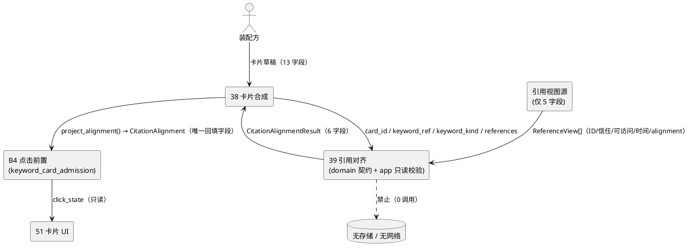

**通信口径**：全部同进程纯函数调用；39 不订阅消息、不写缓存、不调用端口。上游只传值，下游只读返回值。

### 5.2.2 组件与文件落位

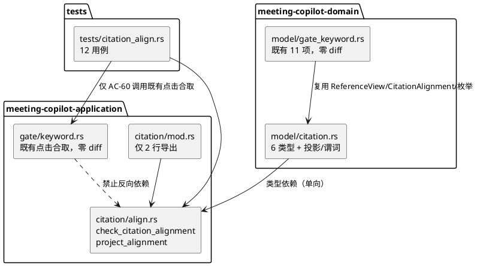

**依赖方向（单向，可被 `check-layering.sh` 断言）**：`domain::model::citation` ← `application::citation::align` ← `tests::citation_align`。`application/src/citation/**` **不得**出现 `use ...::gate::`（AC-60 在测试侧调用 `gate::keyword`，不在库内反向依赖）。

**文件落位与行数预算**

| 文件 | 动作 | 预算 | 关键内容 |
|---|---|---|---|
| `crates/domain/src/model/citation.rs` | 新增 | 180~260 行 | 6 顶层类型 + `ALL` 常量 + 3 谓词 + 投影 + 单测 |
| `crates/domain/src/model/mod.rs` | +2 行 | — | `pub mod citation;` + `pub use citation::*;` |
| `crates/application/src/citation/align.rs` | 新增 | 160~240 行 | 判定主流程 + 5 私有步骤 + 诊断 |
| `crates/application/src/citation/mod.rs` | 新增 | 4 行 | `pub mod align;` + `pub use align::{...};` |
| `crates/application/src/lib.rs` | +1 行 | — | `pub mod citation;` |
| `crates/application/tests/citation_align.rs` | 新增 | 320~460 行 | 12 用例 + 本地构造器 |
| `scripts/check-b4-gates.sh` | 扩展 | +8/-2 行 | 3 个变量 + 4 处引用 |
| `scripts/test-name-inventory.sh` | +1 token | — | `citation_align` |

### 5.2.3 判定主流程（S0~S11，唯一顺序）

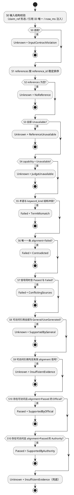

**判定顺序的机器口径**（与 spec §6.15-7 逐项对齐）：

| 序 | 条件 | verdict | basis |
|---|---|---|---|
| 1 | 引用 ID 重复（结构违规；`claim_ref` 形态由 `ClaimRef::new` 类型层拒绝） | `Unknown` | `InputContractViolation` |
| 2 | `references.is_empty()` | `Unknown` | `NoReference` |
| 3 | 全部 `access_status != Available` | `Unknown` | `ReferenceUnavailable` |
| 4 | `judge_capability == Unavailable` | `Unknown` | `JudgeUnavailable` |
| 5 | 术语与 `keyword_kind` 结构冲突 | `Failed` | `TermMismatch` |
| 6 | 可访问引用中**恰一条** `alignment == Failed`，其余无 `Passed` | `Failed` | `Contradicted` |
| 7 | 可访问引用中存在 ≥2 条 `Failed`，或 `Failed` 与 `Passed` 并存 | `Failed` | `ConflictingSources` |
| 8 | 可访问引用全部为 `General`/`UserGenerated` | `Unknown` | `SupportedByGeneral` |
| 9 | 可访问引用全部 `alignment == Unknown`（无有效信号） | `Unknown` | `InsufficientEvidence` |
| 10 | 存在可访问 `Official` 且其 `alignment=Passed`，无 Failed 信号 | `Passed` | `SupportedByOfficial` |
| 11 | 存在可访问 `Authority`（`AuthoritativeMedia`）且其 `alignment=Passed`，无 Failed 信号 | `Passed` | `SupportedByAuthority` |
| 12 | 其余（理论上不可达） | `Unknown` | `InsufficientEvidence` |

**"无冲突"与"术语一致"的可判定口径**

- **无冲突**：S6/S7 已排除所有 `Failed` 信号；39 **不读取引用正文**，因此"无冲突"只表示"上游信号无冲突"，不宣称真实语义一致（D-B4-05）。
- **术语一致**：S5 只做**结构一致性**，规则表见 §5.3.3；不做语义相似度计算。
- **证据不足**：S9 表示"引用可访问但没有任何 `alignment` 信号"，不是"部分断言未覆盖"的语义推断；后者需正文，39 不抓。

### 5.2.4 与点击前置的调用顺序

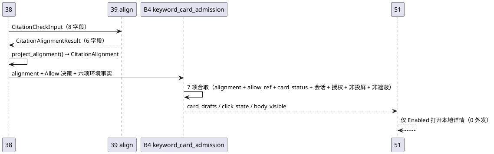

**唯一性**：39 输出不包含 `click_state`、`card_status`、`allow_ref`；B4 的 `keyword_card_admission` 签名不变；`Failed/Unknown` 时 `card_drafts` 仍由 `Allow` 决定，不撤回卡片。

## 5.3 增量类型与字段设计

### 5.3.1 domain 契约类型（`citation.rs`，6 项顶层类型）

**`CitationCheckInput`（封闭 8 项）**

| # | 字段 | 类型 | 只读来源 | 约束 | 零转录 |
|---|---|---|---|---|---|
| 1 | `card_id` | `CardRef` | `KeywordCardDraft.card_id` | 与卡片恒等；非空 | 安全（ID） |
| 2 | `keyword_ref` | `KeywordRef` | `KeywordCardDraft` / 候选 | 一卡一候选；不得为原文 | 安全（ID） |
| 3 | `normalized_term` | `NormalizedTerm` | `KeywordCardDraft.normalized_term` | 仅内存比对；不实现 Serialize；手写 `Debug` **不输出** | **禁止出结构体** |
| 4 | `keyword_kind` | `KeywordKind` | `KeywordCardDraft.keyword_kind` | 5 类封闭 | 安全（枚举） |
| 5 | `references` | `Vec<ReferenceView>` | 卡片引用集合 | 0..*；元素恰 5 字段 | 只含 ID/枚举/毫值 |
| 6 | `now_ms` | `u64` | 装配方注入 | 禁止 `SystemTime::now`；输出恒等 | 安全（毫值） |
| 7 | `judge_capability` | `JudgeCapability` | 装配方注入 | `Available`/`Unavailable` | 安全（枚举） |
| 8 | `claim_ref` | `Option<ClaimRef>` | 38 结论引用 | 引用 ID 或摘要哈希；拒绝 URL 形态 | 安全（ID/哈希） |

**`CitationAlignmentResult`（封闭 6 项）**

| # | 字段 | 类型 | 约束 | 零转录 |
|---|---|---|---|---|
| 1 | `alignment` | `AlignmentVerdict` | 3 态封闭 | 安全（枚举） |
| 2 | `basis` | `AlignmentBasis` | 11 项封闭、单值 | 安全（原因码） |
| 3 | `reference_count` | `u32` | 恒等于 `input.references.len()` | 安全（计数） |
| 4 | `accessible_reference_count` | `u32` | 0..=`reference_count`；只计 `Available` | 安全（计数） |
| 5 | `checked_at_ms` | `u64` | 恒等于 `input.now_ms` | 安全（毫值） |
| 6 | `contract_version` | `u16` | 常量 `CITATION_CONTRACT_VERSION = 1` | 安全（版本号） |

**`AlignmentVerdict`（3）**：`Passed` / `Failed` / `Unknown`；`pub const ALL: [Self; 3]`。
**`AlignmentBasis`（11）**：`SupportedByOfficial`/`SupportedByAuthority`/`SupportedByGeneral`/`Contradicted`/`TermMismatch`/`ConflictingSources`/`NoReference`/`ReferenceUnavailable`/`InsufficientEvidence`/`JudgeUnavailable`/`InputContractViolation`；`pub const ALL: [Self; 11]`。
**`JudgeCapability`（2）**：`Available` / `Unavailable`。
**`ClaimRef`**：独立值对象，≤128 字符；构造期拒绝空、空白、`://`、`@`；`as_str()` 只读。

> **字段封闭的机器判据**：`kw_fields CitationCheckInput` = 8、`kw_fields CitationAlignmentResult` = 6（复用 P4 的 awk 块解析）；`grep -cE '^pub (struct|enum) ' citation.rs` = 6。**不得**把 39 类型并入 `gate.rs` 的 31 项或 `gate_keyword.rs` 的 11 项计数。

### 5.3.2 口径别名与投影（P4 实况偏差的唯一处理点）

| 规格口径 | P4 代码实况 | 39 侧别名 / 判定 | 是否改既有 |
|---|---|---|---|
| `Unverified` | `CitationAlignment::Unknown` | `CONTRACT_UNVERIFIED: CitationAlignment = CitationAlignment::Unknown`；语义名 `Unverified` | **否** |
| `Official`（区分支撑档） | `ReferenceTrustTier::Official` | `is_official_tier(tier)` = `tier == Official`，用于选 `SupportedByOfficial` | **否** |
| `Authority` | `ReferenceTrustTier::AuthoritativeMedia` | `is_authority_tier(tier)` = `Official ∨ AuthoritativeMedia` | **否** |
| `General` | `ReferenceTrustTier::GeneralWeb` | `is_general_tier(tier)` = `GeneralWeb ∨ UserGenerated` | **否** |
| `Ok` | `ReferenceAccessStatus::Available` | `is_accessible(status)` = `status == Available` | **否** |
| `Unknown`（39 API 面） | 既有 `CitationAlignment::Unknown` 同名 | `AlignmentVerdict::Unknown` 是 **39 自有类型**，与既有枚举不混用 | **否** |

**投影函数（唯一入口）**

```rust
// domain：纯映射，无 IO、无分配
impl AlignmentVerdict {
    pub const fn to_contract(self) -> CitationAlignment;
}
pub const CONTRACT_UNVERIFIED: CitationAlignment = CitationAlignment::Unknown;

// application：唯一对外投影入口，38 只能调用它
pub fn project_alignment(result: &CitationAlignmentResult) -> CitationAlignment;
```

**投影唯一性判据**

1. `to_contract(Passed) == CitationAlignment::Passed`。
2. `to_contract(Failed) == CitationAlignment::Failed`。
3. `to_contract(Unknown) == CONTRACT_UNVERIFIED`（语义 `Unverified`）。
4. 三输入映射到三个**不同**变体（单射）；`AlignmentVerdict::ALL.len() == 3`、`CitationAlignment::ALL.len() == 3`。
5. 不存在第二个投影入口：`grep -rn "CitationAlignment::Unknown" crates/application/src/citation` 只允许出现在 `project_alignment` 与测试断言中，且以 `CONTRACT_UNVERIFIED` 形式出现。

> **为什么不改既有枚举**：`CitationAlignment` 被 `gate_keyword.rs` 的 13 字段、`gate/keyword.rs` 的 `ClickFacts`、`tests/gate_keyword.rs` 的 8 处直接使用；改名会同时改变 serde 值（`unknown`→`unverified`），触碰 AC-B4-53/55/57 与 P4 已绿的 14 个用例，违反"既有三变体不变"。因此采用**语义别名**，把差异收敛在 `citation.rs` 的两个常量/谓词内；该裁决登记为 D-B4-P38，**需用户确认**（见 §5.10.2 X-04）。

### 5.3.3 术语结构一致性规则（`TermMismatch` 的唯一口径）

| `keyword_kind` | 结构一致性规则（全部可离线判定） | 反例 → `TermMismatch` |
|---|---|---|
| `Metric` | 归一化术语含 ASCII 数字或中文数字（一二三四五六七八九十百千万亿） | "转化率提升"（无数字） |
| `PolicyStandard` | 含标准编号模式：`gb`/`iso`/`iec`/`t/`/`q/` + 数字，或"第…号" | "环保政策"（无编号） |
| `Acronym` | 归一化后为纯 ASCII 字母且长度 2..=10 | "中国科学院"（含中文） |
| `ProperNoun` | 长度 ≥2 且非纯数字 | "30"（纯数字） |
| `InstitutionRole` | 含机构/职务后缀（公司/大学/学院/院/局/委/部/中心/主任/经理/教授） | "OKR"（无机构后缀） |

> **口径声明**：该表只做"明显结构冲突"的 fail-closed 检查，**不计算语义相似度**、不读取引用正文；`TermMismatch` 的命中不代表真实语义不匹配（D-B4-05）。规则表是唯一实现口径，测试用例直接构造五类反例。

### 5.3.4 不变量清单（用例逐条断言）

| 编号 | 不变量 |
|---|---|
| I-39-01 | `citation_check_input` 字段集恒 8；`kw_fields CitationCheckInput` = 8 |
| I-39-02 | `citation_alignment_result` 字段集恒 6；`kw_fields CitationAlignmentResult` = 6 |
| I-39-03 | `reference_count == input.references.len()`；`accessible_reference_count == count(is_accessible)` |
| I-39-04 | `checked_at_ms == input.now_ms`；无 `SystemTime::now`/`Instant::now` |
| I-39-05 | `Passed ⇒ reference_count ≥1 ∧ accessible_reference_count ≥1 ∧ 存在可访问且 alignment=Passed 的 Official/Authority` |
| I-39-06 | `basis` 单值；`AlignmentBasis::ALL.len() == 11`；每个输入只命中一个 basis |
| I-39-07 | 投影单射且全函数；`AlignmentVerdict::ALL.len() = 3`、`CitationAlignment::ALL.len() = 3` |
| I-39-08 | 同输入 100 次 `serde_json::to_vec` 字节相等 |
| I-39-09 | 引用顺序打乱后结果与 basis 不变（判定前按 `reference_id` 排序） |
| I-39-10 | 输出/`Debug`/日志不含 `normalized_term`、`claim_ref` 文本、URL、标题、摘要、正文、查询、片段、姓名、联系方式 |
| I-39-11 | `Failed/Unknown` 时 `card_drafts` 不变；`click_state != Enabled` |
| I-39-12 | 39 不新增 `GateCounter`；`GateCounters::default().snapshot().len() == 32` |

## 5.4 接口与纯函数签名

### 5.4.1 模块边界（domain 契约 vs application 校验）

| 层 | 文件 | 拥有 | 允许依赖 | 禁止依赖 | 机器断言 |
|---|---|---|---|---|---|
| domain 契约 | `crates/domain/src/model/citation.rs` | 6 个类型、`ALL` 常量、投影纯映射、3 个谓词、`ClaimRef` 构造校验 | `serde`、`crate::model::gate_keyword`、`crate::vo` | IO、时间、随机、日志、`Vec` 排序、`gate::*` | `--rule=source` 退 0；`check-layering.sh` 退 0 |
| application 校验 | `crates/application/src/citation/align.rs` | 判定编排、引用稳定排序、计数、诊断 | `meeting_copilot_domain::model::citation`、`gate_keyword` | `crate::gate::*`（库内反向依赖）、`reqwest`/`std::net`、`Instant::now`/`SystemTime::now`、`std::env`、`std::fs`、锁、trait/端口 | `--rule=source` 退 0；`grep -c 'use crate::gate'` = 0 |
| 测试 | `crates/application/tests/citation_align.rs` | 12 个 AC 用例、本地构造器 | 上述两层 + 既有 `gate::keyword`（仅 AC-60） | 网络、系统时间、落盘、正文 | `--rule=source`/`--rule=zero-transcript` 退 0 |

> **边界理由**：39 是"只读判定"，不是门控编排。若 application 校验反依赖 `gate::keyword`，就会形成"39 驱动点击"的隐式耦合，违反 J-19；AC-60 的合取验证必须放在测试侧，不能进库内。

### 5.4.2 纯函数签名（逐字，不含实现）

```rust
// —————— crates/domain/src/model/citation.rs ——————
pub enum AlignmentVerdict { Passed, Failed, Unknown }
pub enum AlignmentBasis { /* 11 项，见 §5.5.2 */ }
pub enum JudgeCapability { Available, Unavailable }

impl AlignmentVerdict {
    pub const ALL: [Self; 3];
    pub const fn to_contract(self) -> CitationAlignment;   // 唯一纯映射
}
impl AlignmentBasis {
    pub const ALL: [Self; 11];
    pub const fn verdict(self) -> AlignmentVerdict;
    pub const fn index(self) -> usize;                     // 诊断数组下标
}
impl CitationAlignment {
    pub const ALL: [Self; 3];                              // 补既有枚举常量，不改文件
}

pub struct ClaimRef(String);
impl ClaimRef {
    pub fn new(raw: impl Into<String>) -> Result<Self, ClaimRefError>;
    pub fn as_str(&self) -> &str;
}

pub struct CitationCheckInput { /* 8 公有字段，手写 Debug，见 §5.3.1 */ }
impl CitationCheckInput {
    pub fn validate_shape(&self) -> bool;                  // 纯布尔，不 panic
}
impl core::fmt::Debug for CitationCheckInput { /* 仅输出安全字段 */ }

pub struct CitationAlignmentResult { /* 6 公有字段，见 §5.3.1 */ }
pub const CITATION_CONTRACT_VERSION: u16 = 1;
pub const CONTRACT_UNVERIFIED: CitationAlignment = CitationAlignment::Unknown; // 语义 = 规格 Unverified
pub const fn is_official_tier(tier: ReferenceTrustTier) -> bool;
pub const fn is_authority_tier(tier: ReferenceTrustTier) -> bool;
pub const fn is_general_tier(tier: ReferenceTrustTier) -> bool;
pub const fn is_accessible(status: ReferenceAccessStatus) -> bool;

// —————— crates/application/src/citation/align.rs ——————
pub fn check_citation_alignment(input: &CitationCheckInput) -> CitationAlignmentResult;
pub fn project_alignment(result: &CitationAlignmentResult) -> CitationAlignment;

pub struct CitationDiagnostics { /* checks / passed / failed / unknown / bases[11] */ }
impl CitationDiagnostics {
    pub fn record(&mut self, result: &CitationAlignmentResult); // 只由调用方调用
}
```

**签名契约表**

| 函数 | 前置条件 | 后置条件 | 失败语义 |
|---|---|---|---|
| `check_citation_alignment` | 输入已通过类型构造；`now_ms` 由装配方注入 | 恒返回 6 字段结果；`reference_count`/`accessible_reference_count`/`checked_at_ms` 与输入一致 | **永不 panic、永不 `Err`**；不可判定一律 `Unknown`（fail-closed） |
| `project_alignment` | 任意合法结果 | 恒返回既有 3 变体之一；`Unknown → CONTRACT_UNVERIFIED` | 无（全函数） |
| `validate_shape` | 无 | 结构违规返回 `false`，不读取 `normalized_term` | 无（返回 `bool`） |
| `record` | 结果非空引用 | 只增计数，不改判定 | 无（纯计数） |

### 5.4.3 公开面与回放面隔离

1. `crates/application/src/citation/mod.rs` 只做两行导出：
   - `pub mod align;`
   - `pub use align::{check_citation_alignment, project_alignment, CitationDiagnostics};`
2. `crates/application/src/lib.rs` 只追加 `pub mod citation;`（1 行），**不**加入任何 `pub use` 顶层再导出，避免回放面符号扩散。
3. `gate/api.rs` 不新增任何函数；39 **不**定义 trait、不定义端口、不定义 `CardSynthesis`/`CitationAlignmentProvider` 实体（§4.5.2 的签名预留仍只停留在文档）。
4. 38 回填路径：`CitationAlignmentResult → project_alignment() → KeywordCardDraft.citation_alignment`，**只有这一条**。

## 5.5 三态与 `basis` 判定流程

### 5.5.1 判定状态机（单输入、单输出、无重试）

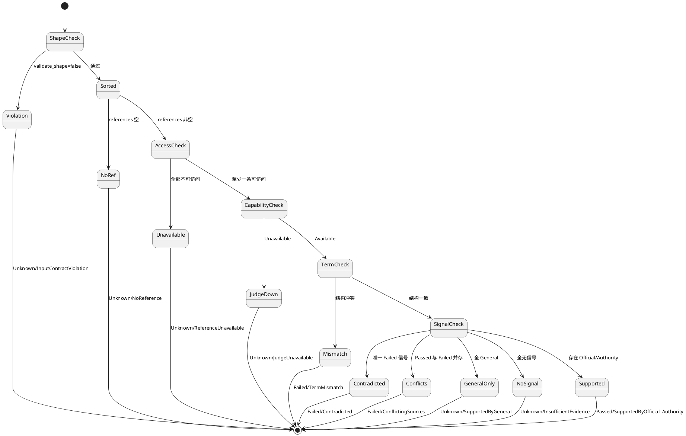

**判定伪代码（结构化口径，不是实现代码）**

```text
result.alignment, result.basis = resolve(input)
resolve(input):
  if !input.validate_shape():                 return (Unknown, InputContractViolation)
  refs = stable_sort_by_reference_id(input.references)
  if refs.is_empty():                         return (Unknown, NoReference)
  accessible = refs.filter(is_accessible)
  if accessible.is_empty():                   return (Unknown, ReferenceUnavailable)
  if input.judge_capability == Unavailable:   return (Unknown, JudgeUnavailable)
  if term_structure_conflicts(input):         return (Failed, TermMismatch)
  signals = accessible.map(|r| r.alignment)   // 既有 3 态，只读
  failed_n = signals.count(Failed)
  if failed_n == 1 && signals.count(Passed) == 0:  return (Failed, Contradicted)
  if failed_n >= 1 && (signals.count(Passed) >= 1 || failed_n >= 2):
                                              return (Failed, ConflictingSources)
  if accessible.all(is_general_tier):         return (Unknown, SupportedByGeneral)
  if signals.all(Unknown):                    return (Unknown, InsufficientEvidence)
  if accessible.any(|r| is_official_tier(r) && r.alignment == Passed):
                                              return (Passed, SupportedByOfficial)
  if accessible.any(|r| is_authority_tier(r) && r.alignment == Passed):
                                              return (Passed, SupportedByAuthority)
  return (Unknown, InsufficientEvidence)      // 兜底，fail-closed
```

> **顺序不可交换**：`TermMismatch` 必须早于 `Contradicted`；`Contradicted` 必须早于 `ConflictingSources`；所有 `Failed` 判定必须早于 `SupportedByGeneral`；`SupportedByGeneral` 必须早于 `SupportedByOfficial`。任何顺序调整都会改变多因并存时的唯一 `basis`（AC-B4-59/64 失败）。

### 5.5.2 `basis` 11 项与 verdict 映射

| # | `basis` | verdict | 触发条件 | 可构造性（v1） |
|---|---|---|---|---|
| 1 | `SupportedByOfficial` | `Passed` | 至少一条可访问 `Official`，无 Failed 信号，术语结构一致 | 可构造 |
| 2 | `SupportedByAuthority` | `Passed` | 至少一条可访问 `Authority`（`AuthoritativeMedia`），无 Failed 信号 | 可构造 |
| 3 | `SupportedByGeneral` | `Unknown` | 可访问引用全部为 `General`/`UserGenerated` | 可构造 |
| 4 | `Contradicted` | `Failed` | 可访问引用中恰一条 `Failed`，其余无 `Passed` | 可构造 |
| 5 | `TermMismatch` | `Failed` | 术语与 `keyword_kind` 结构冲突（§5.3.3） | 可构造 |
| 6 | `ConflictingSources` | `Failed` | 可访问引用含 ≥2 条 `Failed`，或 `Failed` 与 `Passed` 并存 | 可构造 |
| 7 | `NoReference` | `Unknown` | `references` 为空 | 可构造 |
| 8 | `ReferenceUnavailable` | `Unknown` | 引用非空但全部不可访问 | 可构造 |
| 9 | `InsufficientEvidence` | `Unknown` | 可访问引用均无有效 `alignment` 信号（全 `Unknown`） | 可构造 |
| 10 | `JudgeUnavailable` | `Unknown` | `judge_capability == Unavailable` | 可构造 |
| 11 | `InputContractViolation` | `Unknown` | 结构违规（`claim_ref` 非法、引用 ID 重复、`now_ms` 未注入等） | 可构造 |

**`basis` 分布与"不可构造"登记**：v1 的 11 项全部可构造（与 AC-B4-48 的 21/23 不同，39 的 11 项无枚举死码）。若实现中某项不可达，必须在 `b4-status.md` §12 登记为"不可构造 + 原因 + 证据"，且不得从 `AlignmentBasis::ALL` 删除。

### 5.5.3 多因并存的唯一结果（固定优先级）

| 组合 | 唯一结果 | 依据 |
|---|---|---|
| 空引用 + 能力不可用 | `Unknown / NoReference` | 存在性先于能力位（序 2 < 4） |
| 全不可访问 + 能力不可用 | `Unknown / ReferenceUnavailable` | 可访问性先于能力位（序 3 < 4） |
| 术语冲突 + 单条反驳 | `Failed / TermMismatch` | 术语先于反驳（序 5 < 6） |
| 单条反驳 + 混合信号 | `Failed / Contradicted` | 明确反驳先于互斥（序 6 < 7） |
| 全 General + 存在 Failed 信号 | `Failed / Contradicted` 或 `ConflictingSources` | Failed 先于 General（序 6/7 < 8） |
| 全 General + 全无信号（不可能：General 也是信号来源） | `Unknown / SupportedByGeneral` | 序 8 先于 9 |
| Official 可访问 + Failed 信号 | `Failed / Contradicted` | Failed 先于支撑通过 |
| Official 与 Authority 同时可访问且均有 `Passed` 信号 | `Passed / SupportedByOfficial` | 高档优先 |

### 5.5.4 边界条件

| 边界 | 处理 |
|---|---|
| `references.len() == 0` | `NoReference`，不计 `accessible_reference_count` |
| `references` 含重复 `reference_id` | `InputContractViolation`（不静默去重） |
| `published_at_ms` 为空 | 不参与判定；不推断时效（时效归 G3/38.4） |
| `published_at_ms > now_ms` | 不判违规（时钟偏差由上游保证）；不读系统时间 |
| `claim_ref` 为空 | 允许；不因此判违规 |
| `claim_ref` 含 `/`/`@`/空白 | `ClaimRef::new` 返回 `Err`（类型层拒绝），不进入 39 判定 |
| `references` 顺序打乱 | 排序后判定，结果字节不变 |
| 引用全部 `alignment=Unknown` 且至少一条 Official | `InsufficientEvidence`（无信号，不推断为 Passed） |

## 5.6 `Unknown→Unverified` 投影与点击前置

### 5.6.1 投影位置（唯一）

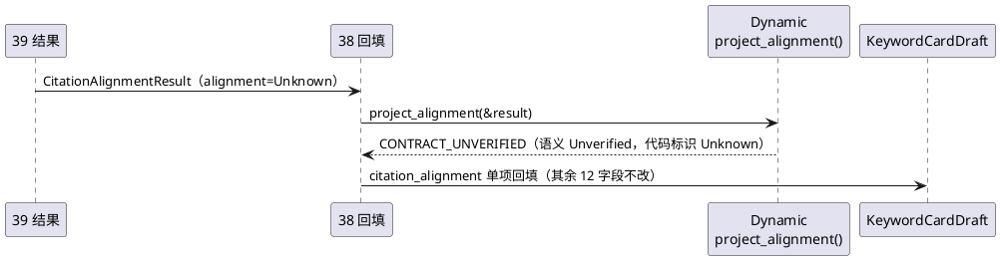

| 层 | 位置 | 允许做什么 | 禁止做什么 |
|---|---|---|---|
| domain | `AlignmentVerdict::to_contract()` | 纯映射 3→3 | 读写 IO、读 `ReferenceView`、改卡片 |
| application | `align::project_alignment()` | 唯一对外投影入口 | 返回 `Option`/`Result`、分支到第 4 个变体 |
| 38 | 回填 `KeywordCardDraft.citation_alignment` | 只写该 1 项 | 改写 `keyword_text`/`summary`/`card_id`/`gate_decision_ref`/`card_status` |
| B4 | `keyword_card_admission(alignment, ...)` | 只读该值 | 反推 39 内部 `basis` |
| 51 | 只读 `click_state` | 展示 | 用 UI 开关绕过 |

**唯一性断言**：
- `project_alignment(Passed) == CitationAlignment::Passed`
- `project_alignment(Failed) == CitationAlignment::Failed`
- `project_alignment(Unknown) == CONTRACT_UNVERIFIED == CitationAlignment::Unknown`
- 三个结果互不相等；`AlignmentVerdict::ALL.len()` 与 `CitationAlignment::ALL.len()` 均为 3。
- `grep -rn "pub fn project_alignment" crates/application/src` = 1。

### 5.6.2 点击矩阵（verdict × 其余六项）

| 39 verdict | `allow_ref` | `card_status` | 会话 | 授权 | 投屏 | 遮蔽 | 最终 `click_state` | `card_drafts` |
|---|---|---|---|---|---|---|---|---|
| `Passed` | 有 | ≠Withdrawn | 一致 | Granted 且未撤销 | 否 | 否 | **`Enabled`** | 1（Allow） |
| `Passed` | 有 | **Withdrawn** | 一致 | Granted | 否 | 否 | `Disabled{NotAllowed}` | 1 |
| `Passed` | 有 | ≠Withdrawn | 一致 | **撤销** | 否 | 否 | `Disabled{AuthorizationRevoked}` | 1 |
| `Passed` | **无** | 任意 | 任意 | 任意 | 任意 | 任意 | `Disabled{NotAllowed}` | 1 |
| `Passed` | 有 | ≠Withdrawn | 一致 | Granted | **是** | 否 | `Disabled{ScreenShareProtection}` | 1 |
| `Passed` | 有 | ≠Withdrawn | 一致 | Granted | 否 | **是** | `Disabled{EmergencyMasked}` | 1 |
| `Failed` | 有 | ≠Withdrawn | 一致 | Granted | 否 | 否 | **`Disabled{ReferenceUnverified}`** | **1（不撤回）** |
| `Unknown` | 有 | ≠Withdrawn | 一致 | Granted | 否 | 否 | **`Disabled{ReferenceUnverified}`** | **1（不撤回）** |
| `Failed`/`Unknown` | 有 | ≠Withdrawn | 一致 | **撤销** | 否 | 否 | `Disabled{AuthorizationRevoked}` | 1 |
| `Failed`/`Unknown` | 有 | ≠Withdrawn | 一致 | Granted | 否 | **是** | `Disabled{EmergencyMasked}` | 1 |
| `Failed`/`Unknown` | 有 | **Withdrawn** | 任意 | 任意 | 任意 | 任意 | `Disabled{NotAllowed}` | 1 |

> **合取口径**：`Enabled ⇔ allow_ref ∧ alignment=Passed ∧ card_status≠Withdrawn ∧ 会话一致 ∧ 授权 Granted 且未撤销 ∧ 非投屏 ∧ 非遮蔽`。`Passed` 只是 7 项中的 1 项，**不是** `Enabled` 的充分条件。多因并存时仍按 §4.2.4 的六因固定优先级输出唯一原因。

### 5.6.3 卡片可展示、`summary` 与 `body_visible`

1. `card_drafts` 只由 `GateDecision::Allow` 决定；`Failed/Unknown` **不**把 `card_drafts` 置 0（`citation_failed_still_displayed_but_disabled` 断言）。
2. `summary` 为 `None` 或固定文案 `NO_RELIABLE_SOURCE`；`KeywordCardDraft::summary_is_consistent()` 必须为 `true`。
3. `body_visible` 由投屏/紧急遮蔽决定（既有 `KeywordCardAdmission.body_visible`），与 39 无关；39 不读取、不写入。
4. 39 **不**输出 `card_status`、`allow_ref`、`click_state`；三者在 B4/38/51 侧。

### 5.6.4 禁止项与机器判据

| 禁止项 | 判据 |
|---|---|
| 39 写 `click_state`/`card_status` | `grep -rnE 'ClickState|KeywordCardStatus' crates/application/src/citation crates/domain/src/model/citation.rs` 命中仅允许出现在测试断言，库内为 0 |
| 39 把 `Passed` 当 `Enabled` | AC-60 三用例：授权撤销/无 allow_ref/投屏任一为假必须 `Disabled` |
| 39 撤回 `Failed` 卡片 | AC-60 `card_drafts` 断言为 1 |
| 39 生成摘要/标题 | `grep -rnE 'summary|keyword_text|ConclusionText|TitleText' crates/application/src/citation` = 0 |
| 39 写记录/审计/夹具 | `--rule=record`/`--rule=zero-transcript` 退 0；`GateRecord` 14 不变 |
## 5.7 零转录、离线与确定性保证

### 5.7.1 零转录的四层保证

| 层 | 载体 | 允许出现 | 禁止出现 | 机器断言 |
|---|---|---|---|---|
| 类型层 | `CitationCheckInput` | `CardRef`/`KeywordRef`/`KeywordKind`/`ReferenceView`/`u64`/`JudgeCapability`/`ClaimRef` | `NormalizedTerm` 的序列化/Debug 输出；URL/标题/摘要/正文类型 | `grep -cEi 'url\|title\|excerpt\|content\|snippet\|query' citation.rs` = 0 |
| 构造层 | `CitationCheckInput` / `ClaimRef` | ID 面、摘要哈希 | URL 形态、空白载荷 | `ClaimRef::new("https://…")` 返回 `Err`；重复 `reference_id` 返回结构违规 |
| 输出层 | `CitationAlignmentResult` | 6 项枚举/计数/毫值/版本号 | 引用列表、术语、正文、卡片字段 | `serde_json::to_value(result)` 键集合恰 6 项 |
| 静态层 | 39 两文件 + 测试 + `b4-status.md` | 原因码、ID、计数 | URL/Key/鉴权头/模型名/`request_id` | `--rule=zero-transcript` 退 0 |

**`CitationCheckInput` 的 `Debug` 白名单**（手写实现）：`card_id`、`keyword_ref`、`keyword_kind`、`reference_count`、`now_ms`、`judge_capability`、`claim_ref` 是否存在（`bool`）。**不输出** `normalized_term`、不输出 `claim_ref` 的文本值。理由：`normalized_term` 是规格明确"只内存比对、禁止写入记录/日志/夹具"的字段；`derive(Debug)` 会把它打进 panic 消息与测试失败输出。

### 5.7.2 离线保证

| 禁止项 | 扫描面 | 判据 |
|---|---|---|
| 协议客户端 | `citation.rs`、`citation/**` | `reqwest`/`hyper`/`TcpStream`/`std::net` 命中 0 |
| 真实计时 | 同上 | `Instant::now`/`SystemTime::now`/`thread::sleep`/`tokio::time` 命中 0 |
| 环境变量 | 同上 | `std::env`/`env::var` 命中 0 |
| 文件/存储 | 同上 + 测试 | `std::fs`/`File::`/`OpenOptions` 命中 0 |
| 锁与原子 | 可选增强 | `Mutex`/`RwLock`/`AtomicU64` 命中 0（39 为纯函数，建议纳入 `source`） |
| 占位 panic | 同上 | `todo!(`/`unimplemented!(`/`panic!(` 命中 0（测试区由 `strip_tests` 排除） |

**能力位是注入值**：`judge_capability` 由装配方给出，39 **不探测**网络、不尝试降级、不重试；`Unavailable` 一律 `Unknown/JudgeUnavailable`。

### 5.7.3 确定性保证

| 要求 | 实现口径 | 断言 |
|---|---|---|
| 引用顺序无关 | 判定前按 `reference_id`（`Ord`，`id_type!` 已派生）稳定排序 | 3 种排列 → 结果字节相等 |
| 无 `HashMap` 迭代序 | 只用 `Vec`/`BTreeMap`/`BTreeSet` | `grep -c 'HashMap'` = 0 |
| 无随机 | 无 `rand`、无 `seed` | `Cargo.toml` 零 diff |
| 无系统时间 | 只用 `input.now_ms` | `--rule=source` 退 0 |
| 固定版本号 | `CITATION_CONTRACT_VERSION: u16 = 1` | 结果 `contract_version == 1` |
| 字段序固定 | struct 字段顺序即序列化顺序 | 同输入 100 次 `serde_json::to_vec` 字节相等 |
| 单值 `basis` | 固定优先级，不并列 | `basis` 恒为 1 个枚举值 |

> **确定性边界**：100 次字节一致只证明"同输入同输出"，**不**证明真实引用可访问或语义对齐质量（D-B4-05）。

### 5.7.4 与既有零转录分层的差异

1. 39 **不进入** `GateRecord`/`GateAuditEvent`/`GateInputFixture`/`ReplayReport`；`basis` 只允许进入诊断与测试断言，不得写入记录。
2. 39 的 `contract_version` 是整数，不是模型名/`request_id`（AC-B4-61 的禁止项）。
3. 39 的引用说明只能按 `reference_id` 从上游读取；39 不复制标题/摘要/正文。
4. 39 的测试构造词只允许 `format!("术语{index}")` 这类短词；断言失败只输出 `case_id`/`basis`/计数，不输出文本。

## 5.8 AC-B4-58~64 用例名与验收命令

### 5.8.1 用例级判定（12 个，逐字对齐 spec §7.12）

| AC | 用例名 | 构造要点 | 核心断言 |
|---|---|---|---|
| AC-B4-58 | `citation_input_is_readonly_and_closed` | 从一张 13 字段卡片取 8 项输入；调用 39；再比较卡片 JSON | 卡片 JSON 键集合与值前后相等；输入字段集 8；`api.rs` 4 个 `pub fn`；`GateRecord` 14/审计 7/夹具 23/报告 5 |
| AC-B4-59 | `citation_alignment_is_three_state_and_fail_closed` | 11 个输入覆盖 11 项 `basis`（见 §5.5.2） | 每例 verdict+basis 唯一且正确；空引用/全不可访问/能力不可用/输入违规均非 `Passed` |
| AC-B4-59 | `unknown_projects_to_unverified_only` | 分别构造 `Unknown` 的 5 个 basis | `project_alignment(Unknown) == CONTRACT_UNVERIFIED`；`CitationAlignment::ALL.len()==3`；三输入映射三不同变体 |
| AC-B4-60 | `citation_passed_enables_click_only_with_other_facts` | 39 `Passed` → `keyword_card_admission`（Allow） | 六项全真 → `Enabled`；授权撤销 → `AuthorizationRevoked`；无 allow_ref → `NotAllowed`；投屏 → `ScreenShareProtection` |
| AC-B4-60 | `citation_failed_still_displayed_but_disabled` | 39 `Failed` + Allow 决策 | `card_drafts=true`；`Disabled{ReferenceUnverified}`；`summary` 为 `None` 或固定文案；`summary_is_consistent()` |
| AC-B4-60 | `citation_unknown_is_conservative` | 39 `Unknown` 的 4 个来源 | 投影 `CONTRACT_UNVERIFIED`；`card_drafts=true`；`Disabled{ReferenceUnverified}`；不等于 `Passed` |
| AC-B4-61 | `citation_result_is_id_only` | 结果序列化 + `Debug` + 引用 5 字段 | 结果键集 6；`Debug` 不含 `normalized_term` 值；引用键集 5；禁止词命中 0 |
| AC-B4-62 | `citation_check_is_offline_and_deterministic` | 同输入 100 次 | `serde_json::to_vec` 100 次逐字节相等；`--rule=source` 退 0 |
| AC-B4-62 | `citation_ignores_reference_order` | 3 种引用排列 | 结果与 basis 字节相等 |
| AC-B4-63 | `citation_ownership_is_outside_b4_and_ui` | 静态扫描 + 计数 | 6 项禁词命中 0；`tests/replay/` 不存在；`snapshot().len()==32` |
| AC-B4-64 | （无新增用例） | target 全绿 + 静态判据 | 见 §5.8.3 |
| 辅助 | `citation_basis_is_unique_and_ordered` | 8 组多因并存 | 唯一结果符合 §5.5.3 优先级 |
| 辅助 | `citation_counts_match_inputs` | 0/1/3 条引用、混合可访问 | `reference_count`/`accessible_reference_count`/`checked_at_ms` 与输入一致 |

### 5.8.2 验收命令

```bash
export PATH="$HOME/.rustup/toolchains/stable-x86_64-pc-windows-msvc/bin:$PATH"
export TEMP="$PWD/.tmp/test-temp"; export TMP="$TEMP"; mkdir -p "$TEMP"
export CARGO="$HOME/.rustup/toolchains/stable-x86_64-pc-windows-msvc/bin/cargo.exe"

# 1) 39 全量用例
"$CARGO" test -p meeting-copilot-application --test citation_align

# 2) 静态规则（7 条不变）
bash scripts/check-b4-gates.sh --rule=source
bash scripts/check-b4-gates.sh --rule=zero-transcript
bash scripts/check-b4-gates.sh --rule=record
bash scripts/check-b4-gates.sh --rule=targets

# 3) 回放面与封闭字段
grep -c '^pub fn ' crates/application/src/gate/api.rs            # 期望 4
git diff --quiet HEAD -- crates/application/src/gate/api.rs; echo $?  # 期望 0
grep -c '^| AC-B4-' .codeartsdoer/specs/b4_gate/spec.md           # 期望 64
grep -c 'U-04.*规格已定' docs/progress/b4-status.md               # 期望 ≥1

# 4) target 清单 20→21
grep -m1 '^NEW_TARGETS=' scripts/test-name-inventory.sh \
  | sed -E "s/^NEW_TARGETS='//; s/'$//" | wc -w                 # 期望 21

# 5) 字段/类型封闭
awk '/^pub struct CitationCheckInput \{/{f=1;next} f&&/^\}/{exit} f' \
  crates/domain/src/model/citation.rs | grep -cE '^    pub [a-z_]+:'   # 期望 8
awk '/^pub struct CitationAlignmentResult \{/{f=1;next} f&&/^\}/{exit} f' \
  crates/domain/src/model/citation.rs | grep -cE '^    pub [a-z_]+:'   # 期望 6
grep -cE '^pub (struct|enum) ' crates/domain/src/model/citation.rs    # 期望 6

# 6) 全量回归
"$CARGO" test --workspace                                        # 退 0；failed=0；ignored=9
bash scripts/test-name-inventory.sh --diff docs/progress/test-names-before.txt  # removed=0
```

**判据汇总**

| 判据 | 期望 |
|---|---|
| `citation_align` target | 12 passed / 0 failed |
| `reference_count` / `accessible_reference_count` | 与输入一致 |
| `basis` 覆盖 | 11/11 |
| 投影 | 3→3 单射，`CONTRACT_UNVERIFIED` 唯一 |
| 零转录 | `--rule=zero-transcript` 退 0 |
| 离线 | `--rule=source` 退 0 |
| 记录面 | `--rule=record` 退 0；14/7/23/5/32/23 不变 |
| target 清单 | 21 项，含 `citation_align` |
| 全量 | 721+ passed、failed=0、ignored=9、removed=0 |

### 5.8.3 AC 三态（实现后的登记口径）

| AC | 实现后状态 | 证据 |
|---|---|---|
| AC-B4-58 | `passed` | `citation_input_is_readonly_and_closed` + 4 函数/字段数静态判据 |
| AC-B4-59 | `passed` | `citation_alignment_is_three_state_and_fail_closed`、`unknown_projects_to_unverified_only` + `CitationAlignment::ALL` =3 |
| AC-B4-60 | `passed` | 3 个点击合取用例 + `card_drafts` 断言 |
| AC-B4-61 | `passed` | `citation_result_is_id_only` + `--rule=zero-transcript` |
| AC-B4-62 | `passed` | 2 个离线/确定性用例 + `--rule=source` |
| AC-B4-63 | `passed` | `citation_ownership_is_outside_b4_and_ui` + 禁词/目录/计数 |
| AC-B4-64 | `passed` | target 全绿 + `NEW_TARGETS`=21 + AC 合计 64 + U-04 口径 |

> 纪律：**离线通过 ≠ 真实引用可访问**；**结构一致 ≠ 语义对齐质量**；**契约通过 ≠ 51 交互通过**。AC-B4-58~64 不宣称 G3/G4/真机。

## 5.9 脚本与 target 改动点

### 5.9.1 `scripts/check-b4-gates.sh`（规则仍 7 条，退出码不变）

| 位置 | 现状 | 改动 | 断言 |
|---|---|---|---|
| 变量区（`GATE_KEYWORD` 后） | 3 个门控面 | 新增 `CITATION_APP_DIR="crates/application/src/citation"`、`CITATION_MODEL="crates/domain/src/model/citation.rs"`、`CITATION_TEST="crates/application/tests/citation_align.rs"` | `grep -c 'CITATION_MODEL='` = 1 |
| `require_core_faces()` | 4 个必需面 | 增加 `need_dir "${CITATION_APP_DIR}"`、`need_file "${CITATION_MODEL}"` | 39 文件缺失时退 2（X-03） |
| `core_files()` | 3 个固定文件 + `gate_files()` | 增加 `citation_files()`（遍历 `CITATION_APP_DIR/*.rs`）与 `CITATION_MODEL` | `--rule=source`/`--rule=budget` 自动覆盖 39 |
| `rule_zero_transcript()` | `gate_files()` + `GATE_KEYWORD` + `gate_*.rs` + 状态文件 | 增加 `CITATION_MODEL` + `citation_files()` + `CITATION_TEST`（存在时） | 39 契约/实现/测试均被扫描 |
| `rule_targets()` | 断言 7 项 `gate_*` 存在 | **不改循环**；`citation_align` 由 inventory token 与 AC-64 单独断言 | `--rule=targets` 仍退 0 |
| 规则数 | 7 | **仍 7** | `--rule` 名称集合不变 |

**扫描面口径**：
- `--rule=source`：`CITATION_MODEL` + `CITATION_APP_DIR/*.rs`，模式与既有 `source` 一致（网络/计时/睡眠/环境变量/占位 panic/全局态）。
- `--rule=zero-transcript`：上述 + `CITATION_TEST` + `STATUS_FILE`；模式与既有 `zero-transcript` 一致（URL/Key/鉴权头/模型名/`request_id`）。
- `--rule=budget`：因 `core_files()` 扩展而覆盖 39；39 不含 `LLM_`（断言 0）。
- `--rule=record`/`rule_outbound`：仅 `require_core_faces()` 增加必需面，扫描逻辑不变。

### 5.9.2 `scripts/test-name-inventory.sh`

| 位置 | 改动 | 断言 |
|---|---|---|
| 第 18 行 `NEW_TARGETS` | 尾部追加 `citation_align`（20→21） | `wc -w` = 21；`grep -c 'citation_align'` = 1 |
| `--diff` 语义 | 不变 | `removed=0` |

### 5.9.3 文件级改动预算

| 文件 | 动作 | 预算 | 零 diff 面 |
|---|---|---|---|
| `crates/domain/src/model/citation.rs` | 新增 | 180~260 行 | — |
| `crates/domain/src/model/mod.rs` | +2 | — | `gate.rs`/`gate_keyword.rs`/`gate_replay.rs`/`enums.rs` |
| `crates/application/src/citation/align.rs` | 新增 | 160~240 行 | — |
| `crates/application/src/citation/mod.rs` | 新增 | 4 行 | — |
| `crates/application/src/lib.rs` | +1 | — | 其余 mod 行 |
| `crates/application/tests/citation_align.rs` | 新增 | 320~460 行 | — |
| `scripts/check-b4-gates.sh` | +8/-2 | — | 7 条规则语义、退出码 |
| `scripts/test-name-inventory.sh` | +1 token | — | 既有 20 项 |

### 5.9.4 零 diff 校验矩阵

| 面 | 命令 | 期望 |
|---|---|---|
| 回放面 | `git diff --quiet HEAD -- crates/application/src/gate/api.rs` | 0 |
| 门控模块 | `git diff --quiet HEAD -- crates/application/src/gate/**` | 0 |
| 关键词契约 | `git diff --quiet HEAD -- crates/domain/src/model/gate_keyword.rs` | 0 |
| 门控契约 | `git diff --quiet HEAD -- crates/domain/src/model/gate.rs crates/domain/src/model/gate_replay.rs crates/domain/src/model/enums.rs` | 0 |
| 依赖 | `git diff --stat -- Cargo.toml Cargo.lock` | 0 行 |
| 理解层 | `git diff --quiet HEAD -- crates/application/src/understand/store.rs crates/application/src/understand/deduplicator.rs` | 0 |

## 5.10 决策登记

### 5.10.1 采用既有决策（不重复裁决）

| 编号 | 采用内容 |
|---|---|
| J-16 / D-B4-P34 | 39 = domain 契约 + application 只读校验；不建 UI/合成/存储/回放目录 |
| J-17 / D-B4-P35 | 39 API 三态；`Unknown` 唯一投影到既有契约；不重命名/不扩展既有 3 变体 |
| J-18 | `Passed`/`Failed`/`Unknown` 门槛；禁止"无引用即通过" |
| J-19 | 39 只提供 `alignment`；点击由 B4/51 六项合取 |
| J-20 / D-B4-P36 | 引用只存 5 字段；不联网、不读系统时间/环境、不写存储 |
| D-B4-P37 | 新增 `citation_align` target；脚本扫描面扩展；封闭字段全部不变 |
| D-B4-05 / N-10 | 真实可访问性、语义质量不可离线判定；不宣称 G3/G4 |

### 5.10.2 新增决策（D-B4-P38 ~ D-B4-P43）

| 编号 | 决策 | 理由 | 影响面 |
|---|---|---|---|
| **D-B4-P38** | **实况别名**：规格 `Unverified` ≡ 代码 `CitationAlignment::Unknown`；`Authority` ≡ `ReferenceTrustTier::AuthoritativeMedia`；`Ok` ≡ `ReferenceAccessStatus::Available`。39 侧以 `CONTRACT_UNVERIFIED`/`is_authority_tier()`/`is_accessible()` 封装 | P4 实况与规格字面不一致；改既有枚举会破坏 57 条既有 AC 与 14 个 P4 用例 | 不改 `gate_keyword.rs`；差异收敛在 `citation.rs` |
| **D-B4-P39** | 39 输入复用 `Vec<ReferenceView>`（既有 5 字段），**不新增引用类型** | 避免 38/39 双重投影；`ReferenceView` 已无 URL/标题/摘要字段 | `CitationCheckInput` 第 5 项类型确定 |
| **D-B4-P40** | `Failed` 三因的判定信号：`ReferenceView.alignment` 是**唯一上游信号**；单条 `Failed → Contradicted`、`Passed` 与 `Failed` 并存 → `ConflictingSources`、全无信号 → `InsufficientEvidence`；`TermMismatch` 用 §5.3.3 结构规则 | 8 项封闭输入无正文/立场字段；不抓正文是硬约束 | `citation/align.rs` 的 `resolve_basis` |
| **D-B4-P41** | `CitationCheckInput` 手写 `Debug`，`normalized_term` 永不输出；`ClaimRef` 构造期拒绝 URL 形态 | `derive(Debug)` 会把禁止落记录的术语打进 panic/日志 | `citation.rs` 的 `Debug`/`ClaimRef` |
| **D-B4-P42** | 在 `citation.rs` 内补 `impl CitationAlignment { pub const ALL }`；`contract_version: u16 = 1` | 满足 AC-59 的 3 变体断言，且不改既有文件；整数版本号避免模型名/URL | `citation.rs`，既有文件零 diff |
| **D-B4-P43** | 39 独立模块 `application/src/citation/`（`mod.rs` + `align.rs`），`lib.rs` +1 行；不进 `api.rs`、不建 trait | 回放面 4 函数冻结；AC-57/63 禁词只允许在自有模块 | `lib.rs`、`citation/**` |

### 5.10.3 收窄（语义不变，范围澄清）

| 编号 | 原口径 | 收窄后 | 为什么不是推翻 |
|---|---|---|---|
| D-B4-P34 | "39 两个文件：`citation.rs` + `citation/align.rs`" | 实际 **3 个源文件**（多 `citation/mod.rs`）+ 1 个 test target | Rust 模块必须有 `mod.rs`；`lib.rs` +1 行是模块声明的必要成本；原口径"不建 UI/合成/存储/回放"未放宽 |
| D-B4-P37 | "`source`/`zero-transcript` 扫描面追加 39 两文件" | 追加 3 处：`CITATION_MODEL`、`citation_files()`、`CITATION_TEST` | 测试文件也必须零转录；规则数与退出码不变 |
| J-18 | "`InsufficientEvidence` = 证据仅覆盖部分断言" | v1 定义为"可访问引用均无有效 `alignment` 信号"；不做覆盖度推断 | 8 项输入无覆盖度字段；不引入正文；仍 fail-closed |
| J-17 | "`Unknown→Unverified` 唯一投影" | 投影语义不变，代码标识为 `Unknown`（D-B4-P38） | 既有 3 变体未改；投影仍 1:1 |

### 5.10.4 推翻 / 需用户确认（4 项）

**X-04（主）· `Unverified` 字面 vs 实况 `Unknown`**

- 原口径：AC-B4-59 要求"`Unknown` 对 B4 契约的唯一投影 shall 为 `Unverified`"。
- 实况：`crates/domain/src/model/gate_keyword.rs:100` 的 `CitationAlignment` 是 `Passed/Failed/Unknown`，**不存在 `Unverified` 变体**；`gate/keyword.rs` 与 14 个 P4 用例均使用 `Unknown`。
- 方案 A（本章采用）：保持既有枚举不变，新增 `CONTRACT_UNVERIFIED = CitationAlignment::Unknown`，语义名 `Unverified`；AC-59 断言"投影到 `CONTRACT_UNVERIFIED` 且变体数 3"。
- 方案 B（需用户确认才可采纳）：把既有 `Unknown` 重命名为 `Unverified`，同步改 8 处代码与 serde 值；会触碰 AC-53/55/57 与 P4 用例。
- **请用户裁决**：接受方案 A（语义别名、代码零改动），还是要求方案 B（字面改名、破坏既有封闭面）。

**X-06（主）· `ReferenceView.alignment` 作为 `Failed` 信号**

- 冲突：spec §6.13-5 说 `alignment` "与卡片 `citation_alignment` 同源"；本章把它解释为"该引用已有的对齐判定信号"，用于推导 `Contradicted`/`ConflictingSources`。
- 理由：8 项封闭输入没有"引用立场/结论"字段；不抓正文的前提下，这是唯一可离线使用的信号。
- 影响：`Passed` 语义变为"上游信号无冲突且存在高档可访问引用"，**不**等于真实语义一致。
- **请用户裁决**：是否接受该信号口径；若不接受，则 `Failed` 三因在 v1 **不可构造**，AC-B4-59 的 Failed 分支必须改为 `pending` 并登记 D-B4-05。

**X-03（次）· 脚本必需扫描面导致 39 编码前红**

- 冲突：`require_core_faces()` 加入 `citation/` 后，39 文件未创建时既有 7 条规则会退 2（`SCAN-MISSING`）。
- 裁决：脚本改动与 39 文件**同批提交**；设计阶段不改脚本，P4 基线保持绿。
- 影响：编码任务顺序必须"先建 `citation.rs`/`citation/align.rs`，再改脚本"，不可倒置。

**X-05（次）· `--rule=targets` 是否断言 `citation_align`**

- 原口径：spec §7.9-5 明确"`--rule=targets` 仍只断言既有 6 项存在，多出的 `gate_keyword`/`citation_align` 不影响既有断言"。
- 本章裁决：循环列表**不加** `citation_align`；`citation_align` 由 `NEW_TARGETS` token 计数（AC-64）与 target 实跑断言。
- **请用户确认**：是否需要把 `citation_align` 也加入 `--rule=targets` 的循环（会使规则从"6 项"变"8 项"，与 spec 字面冲突）。

### 5.10.5 与 requirements / spec 的冲突清单（供人工复核）

| 冲突点 | 需求/规格原文 | 本章设计 | 处置 |
|---|---|---|---|
| `Unverified` 命名 | AC-59/§6.15 `Unknown→Unverified` | 实况枚举为 `Unknown`，用 `CONTRACT_UNVERIFIED` 别名 | X-04 |
| `Authority` 命名 | §6.13-2 `Official/Authority/General/UserGenerated` | 实况 `AuthoritativeMedia`/`GeneralWeb` | D-B4-P38 别名 |
| `Ok` 命名 | §6.13-3 `Ok/Unavailable` | 实况 `Available/Unavailable` | D-B4-P38 别名 |
| `Failed` 三因 | §5.7.1-4 明确反驳/互斥/术语不匹配 | 仅 `ReferenceView.alignment` 信号 + 结构规则 | X-06；D-B4-05 登记 |
| `InsufficientEvidence` | §5.7.1-5 "证据仅覆盖部分断言" | v1 = "可访问但全无信号" | D-B4-P38 收窄；不引入正文 |
| 8 项输入无覆盖度 | §6.14 封闭 8 项 | 不扩字段 | J-18 收窄 |
| `snapshot()==32` | AC-63 | 不新增 `GateCounter`，用局部诊断 | D-B4-P42 |

## 5.11 本章交付自检

| # | 检查 | 命令 / 依据 | 期望 |
|---|---|---|---|
| 1 | 39 契约 6 项顶层类型 | `grep -cE '^pub (struct|enum) ' citation.rs` | 6 |
| 2 | 输入 8 字段 | `kw_fields CitationCheckInput` | 8 |
| 3 | 输出 6 字段 | `kw_fields CitationAlignmentResult` | 6 |
| 4 | 引用 5 字段 | `kw_fields ReferenceView`（既有） | 5 |
| 5 | `basis` 11 项 | `AlignmentBasis::ALL.len()` | 11 |
| 6 | 三态 3 变体 | `AlignmentVerdict::ALL.len()`、`CitationAlignment::ALL.len()` | 3 / 3 |
| 7 | 投影唯一 | `unknown_projects_to_unverified_only` | 退 0 |
| 8 | 三态 fail-closed | `citation_alignment_is_three_state_and_fail_closed` | 退 0；11/11 |
| 9 | 只读封闭 | `citation_input_is_readonly_and_closed` | 退 0 |
| 10 | `Passed` ≠ `Enabled` | `citation_passed_enables_click_only_with_other_facts` | 退 0 |
| 11 | `Failed` 可展示不可点 | `citation_failed_still_displayed_but_disabled` | 退 0 |
| 12 | `Unknown` 保守 | `citation_unknown_is_conservative` | 退 0 |
| 13 | 零转录 | `citation_result_is_id_only` + `--rule=zero-transcript` | 退 0 |
| 14 | 离线 | `citation_check_is_offline_and_deterministic` + `--rule=source` | 退 0 |
| 15 | 顺序无关 | `citation_ignores_reference_order` | 退 0 |
| 16 | 归属不越界 | `citation_ownership_is_outside_b4_and_ui` + 6 禁词 | 退 0 |
| 17 | 4 函数面 | `grep -c '^pub fn ' api.rs` + `git diff --quiet` | 4 / 0 |
| 18 | 封闭字段 | `--rule=record`；14/7/23/5/32/23 | 退 0 |
| 19 | target 21 | `NEW_TARGETS` token 数 | 21 |
| 20 | 全量回归 | `cargo test --workspace`；`--diff` | failed=0/ignored=9/removed=0 |

> **本章边界**：只定义"39 契约 + 只读判定 + 投影 + 点击前置 + 证据命令"。**不含** 真实检索、正文抓取、语义模型、38 合成实现、51 UI、52 存储、13.3 回放本体；也不生成 tasks.md（由 spec-task-agent 承接）。
> **当前状态**：AC-B4-58~64 均为 `pending`（规格已定，待实现）；本章完成后由 39 编码阶段落地 3 个源文件 + 1 个 target + 2 处脚本扩展。
# 六、38 卡片合成增量设计（AC-B4-65~74）

> **本章性质**：对既有 §1~§五 的**纯追加**。§1~§4（B4 契约与门控）与 §五（39 引用对齐）的设计结论、P0~P5 落地实况（`api.rs` 4 个 `pub fn`、`GateRecord` 14、`GateAuditEvent` 7、`GateInputFixture` 23、`ReplayReport` 5、`GateCounter` 32、`GateRejectReason` 23、`gate_keyword.rs` 11 项、`citation.rs` 6 项、7 条门禁规则、`NEW_TARGETS` 21）**一字不改**；本章只把"38 只做卡片合成"翻译成可落地的类型、纯函数、判定顺序与证据命令。
> **需求来源**：`requirements.md` §12（REQ-B4S-01~04、AC-B4-65~74、§12.4 7/11/2/6 字段）、`spec.md` §5.8、§6.16~6.18、§7.13、§9.1 J-21~J-26、D-B4-06；`docs/progress/b4-status.md` §13（P5 快照）、§14（D-B4-P45~P52、AC-B4-65~74 全 `pending`）。
> **进度基线**：P5 后 `cargo test --workspace` 721 passed / 0 failed / 9 ignored；`citation_align` 12 passed；`NEW_TARGETS`=21；`api.rs` 4 函数零 diff；`tests/replay/` 不存在。
> **不宣称**：本章不判定 38 的解释语义质量、真实引用可访问性、51 渲染与交互质量；不宣称 G3/G4/真机，不宣称产品级"可点击关键词卡片"已交付（D-B4-06）。

## 6.0 增量结论速览

| 编号 | 增量冲突 / 缺口 | 唯一裁决 | 落点 |
|---|---|---|---|
| **C-38-01** | 38 的 4 个契约类型（`CardComposeInput`/`ComposedCard`/`CardComposeOutcome`/`ComposeRejectReason`）放 domain 还是 application；用户建议"domain 卡片契约"，但 requirements §12.4.4-4 与 J-21 要求 `domain/src/model/**` **零 diff** | **不新增 domain 契约**。4 个类型全部落 `crates/application/src/cards/compose.rs`；domain 只被复用、零 diff。`kw_fields` 判据作用在 application 文件 | §6.2.2、§6.3.1、D-B4-P53（需确认） |
| **C-38-02** | `allow_ref` 为"必填"，但异常要求"缺失或来自 `Deny` → `GateNotAllowed`"；`AllowTraceRef` 只能由 `Allow` 构造，"来自 Deny" 类型层不可构造 | `allow_ref: Option<AllowTraceRef>`（仍算 1 项）；`None` 是"未获 Allow"的唯一表达，`GateNotAllowed` 判定在 S1 | §6.3.1、§6.6、D-B4-P54 |
| **C-38-03** | "撤回信号"在 7 项封闭输入中没有字段；`next_card_status(current, signal)` 的 `signal` 无处来 | 撤回信号的唯一表达 = 装配方把只读 `current_card_status` 置为 `Withdrawn`；38 侧 `CardStatusSignal` 为私有 2 变体，不进输入；`compose` 在 S3 短路为 `CardWithdrawn`（0 卡） | §6.3.1、§6.6、D-B4-P55 |
| **C-38-04** | `DuplicateCard` 需"已有非 Withdrawn 卡片"信号，但 38 是无状态纯函数、不读卡片表 | `DuplicateCard` 的唯一信号 = `suppressed_notice == true`；顺序固定在 `CardWithdrawn` 之后；38 不维护卡片表 | §6.3.1、§6.6、D-B4-P56（需确认） |
| **C-38-05** | AC-66 要求"41 字展示词 → `TitleTooLong`"，但 `TitleText::LIMIT=40`，41 字在类型层不可构造 | `TitleTooLong` 为**类型层不可构造**的防御性原因码：41 字在 `TitleText::new` 层返回 `Err`，38 内 `title_fits_limit()` 分支由单测直调覆盖；AC-66 判据收窄为"类型层拒绝 + 40 字通过 + 防御分支单测" | §6.6、§6.9、D-B4-P57（需确认） |
| **C-38-06** | 11 项 → 13 字段的补齐若由 38 提供函数，会越界判定点击 | **38 不提供装配函数**；`gate_decision_ref`/`click_state` 由装配方调用既有 `keyword_card_admission` 补 2 项；38 源码中 `gate_decision_ref`/`click_state` 命中必须为 0 | §6.7、§6.9、D-B4-P46（沿用） |
| **C-38-07** | 解释降级是 `None` 还是固定文案 `NO_RELIABLE_SOURCE`（规格二者皆可） | 38 **一律输出 `None`**（`Failed`/`Unverified`）；固定文案归 51 展示层；`ComposedCard::summary_is_consistent()` 仍为 AC-69 的机器判据 | §6.5、§6.6、D-B4-P58 |
| **C-38-08** | AC-71 要求 `--rule=source` 扫描面含 `tests/card_compose.rs`；39 的口径是 test 只进 `zero-transcript` | `CARDS_TEST` **同时**进 `core_files()`（source/budget）与 `zero-transcript`；与 39 的差异登记为 D-B4-P59 | §6.10、D-B4-P59 |
| **C-38-09** | 38 诊断计数若进 `GateCounter` 会破坏 32 项冻结 | 38 私有 `CardComposeDiagnostics`（`composes`/`succeeded`/`rejected`/`reasons[6]`），不进 `GateCounter`、不进 `GateRejectReason` | §6.3.1、D-B4-P60 |
| **C-38-10** | `--rule=targets` 是否追加 `card_compose` | **不追加**（沿用 X-05）：循环保持 7 项；`card_compose` 由 `NEW_TARGETS` token=22 与 target 实跑断言；`grep -c 'card_compose' check-b4-gates.sh` = 0 | §6.10、D-B4-P50（沿用） |

**新增 / 扩展文件清单（38 增量范围）**

| 类别 | 路径 | 动作 | 内容 | 是否进入 4 函数回放面 |
|---|---|---|---|---|
| app 契约与合成 | `crates/application/src/cards/compose.rs` | 新增 | 4 类型（7/11/2/6）+ 2 纯函数（`compose_keyword_card`/`next_card_status`）+ 1 诊断类型 + 私有步骤 | 否 |
| app 门面 | `crates/application/src/cards/mod.rs` | 新增 | `pub mod compose;` + 1 行 `pub use` | 否 |
| app 门面 | `crates/application/src/lib.rs` | +1 行 | `pub mod cards;`（`capture` 与 `citation` 之间） | 否 |
| 测试 | `crates/application/tests/card_compose.rs` | 新增 target | AC-B4-65~74 的 14 个用例 | 否 |
| 脚本 | `scripts/check-b4-gates.sh` | 扩展扫描面 | `CARDS_APP_DIR`/`CARDS_TEST` + `cards_files()` + 3 处引用；规则仍 7 条 | 否 |
| 脚本 | `scripts/test-name-inventory.sh` | 扩展 | `NEW_TARGETS` 21 → 22（追加 `card_compose`） | 否 |

> **零 diff 清单（38 阶段必须证明）**：`crates/application/src/gate/api.rs`、`crates/application/src/gate/**`、`crates/domain/src/model/**`（含 `gate.rs`/`gate_keyword.rs`/`gate_replay.rs`/`enums.rs`/`citation.rs`/`mod.rs`）、`Cargo.toml`、`Cargo.lock`、`scripts/check-capture-offline.sh`、`scripts/check-b3-gates.sh`、`scripts/check-mac-scope.sh`、`crates/application/src/understand/store.rs`、`crates/application/src/understand/deduplicator.rs`。

## 6.1 增量需求与存量功能关系分析

### 6.1.1 已实现功能（可直接复用，不改写）

| 需求功能 | 存量功能 | 代码位置 | 匹配度 |
|---|---|---|---|
| 只读 10 字段候选 | `KeywordCandidate` + `validate()`（置信度 ≥0.50、区间正向、`state != Pushed`、展示词非空） | `crates/domain/src/model/gate_keyword.rs:170、184` | 100% |
| 只读 5 字段引用 | `ReferenceView`（`reference_id`/`trust_tier`/`access_status`/`published_at_ms`/`alignment`） | `gate_keyword.rs:193` | 100% |
| 只读三态对齐结果 | `CitationAlignmentResult`（6 字段） | `crates/domain/src/model/citation.rs` | 100% |
| `Unknown→Unverified` 唯一投影 | `project_alignment()`（`result.alignment.to_contract()`） | `crates/application/src/citation/align.rs:189` | 100% |
| 三态既有枚举 | `CitationAlignment`（实况 `Passed`/`Failed`/`Unknown`，语义 `Unverified`） | `gate_keyword.rs:100` | 100%（别名口径见 D-B4-P38） |
| Allow 溯源 | `AllowTraceRef`（只由 `GateDecision::Allow` 构造；`new` 对 `Deny` 返回 `None`） | `gate_keyword.rs:137-158` | 100% |
| 标题 / 结论长度上限 | `TitleText`（40）/`ConclusionText`（80） | `crates/domain/src/vo/text.rs:92-93` | 100% |
| 固定文案与一致性谓词 | `KeywordCardDraft::NO_RELIABLE_SOURCE`、`summary_is_consistent()` | `gate_keyword.rs:219-229` | 100% |
| 13 字段卡片契约 | `KeywordCardDraft`（11 展示 + `gate_decision_ref`/`click_state`） | `gate_keyword.rs:202` | 100% |
| 点击 7 项合取与 2 项补齐 | `keyword_card_admission`（返回 `allow_ref`/`click_state`/`card_drafts`/`body_visible`） | `crates/application/src/gate/keyword.rs:212` | 100%（装配方复用，38 不调用） |
| 诊断计数范式 | `CitationDiagnostics`（只增计数、`bases[11]`） | `crates/application/src/citation/align.rs:11` | 100%（38 平移为 `reasons[6]`） |
| 静态门禁范式 | `strip_tests()`/`scan_files()`/`core_files()`/`require_core_faces()` | `scripts/check-b4-gates.sh:58-110` | 100% |
| target 清单 | `NEW_TARGETS` 21 项（含 `citation_align`） | `scripts/test-name-inventory.sh:18` | 100%（本阶段 21→22） |

### 6.1.2 需要扩展的功能

| 需求功能 | 存量功能 | 差异说明 | 扩展方向 |
|---|---|---|---|
| 38 文件可见性 | 门禁脚本仅扫 `gate/**`、`citation/**`、三个 domain 契约文件 | `cards/**` 与 `tests/card_compose.rs` 未进入扫描面，属静态盲区；AC-71/72/73 无法判定 | `check-b4-gates.sh` 增 `CARDS_APP_DIR`/`CARDS_TEST`，加入 `require_core_faces()`/`core_files()`/`zero-transcript`；见 §6.10 |
| 应用层模块 | `lib.rs` 仅 `capture/citation/gate/governance/mirror_clock/understand` | 38 需要不进入 `gate/**`、不反向依赖 `crate::gate` 的独立模块 | `lib.rs` +1 行 `pub mod cards;`；`cards/mod.rs` 只导出 1 个合成函数 + 1 个状态函数 + 4 类型 + 1 诊断 |
| `CitationAlignment::ALL` 可断言 | `citation.rs` 已补 `impl CitationAlignment { pub const ALL }` | 38 需要断言投影后变体数 3 | 只读复用 `CitationAlignment::ALL`，不新增定义（`grep -c 'impl CitationAlignment' cards/**` 必须 = 0） |
| 诊断计数 | `GateCounter` 32 项冻结 | 38 需要 6 类拒绝原因计数 | `CardComposeDiagnostics`（局部结构），不进 `GateCounter` |
| 引用排序 | 39 内部 `sorted_references` 为私有 | 38 需要独立排序且在判定前完成，不能复用 39 私有函数 | `cards/compose.rs` 内新增私有 `sorted_references()`（`sort_by_key` 稳定排序），与 39 同口径但**不跨模块调用私有项** |

### 6.1.3 需要新增的功能与接口（按模块分组）

**application 合成（`cards/compose.rs`）**

1. `ComposeRejectReason`（6）：`GateNotAllowed`/`CandidateInvalid`/`TitleTooLong`/`DuplicateCard`/`CardWithdrawn`/`InputContractViolation`；`ALL: [Self; 6]`、`index(): usize`。
2. `CardComposeInput`（7）：`card_id`/`candidate`/`allow_ref`/`alignment_result`/`references`/`current_card_status`/`suppressed_notice`；**手写 `Debug`**，**不实现 `Serialize`**。
3. `ComposedCard`（11）：`card_id`/`keyword_text`/`normalized_term`/`keyword_kind`/`trigger`/`triggered_at_ms`/`confidence`/`summary`/`references`/`citation_alignment`/`card_status`；`Serialize`；`summary_is_consistent()`。
4. `CardComposeOutcome`（2）：`card: Option<ComposedCard>`、`reason: Option<ComposeRejectReason>`，XOR。
5. `CardStatusSignal`（2，私有面）：`Present`/`Withdraw`；只用于 `next_card_status`，不进 7 项输入、不序列化。
6. `compose_keyword_card(&CardComposeInput) -> CardComposeOutcome`：唯一合成入口；永不 `panic`、永不 `Err`。
7. `next_card_status(current: KeywordCardStatus, signal: CardStatusSignal) -> KeywordCardStatus`：只输出 `Displayed`/`Withdrawn`。
8. `CardComposeDiagnostics`：`composes`/`succeeded`/`rejected`/`reasons[6]`；`record(&CardComposeOutcome)` 只增计数。
9. 私有步骤：`validate_references`/`sorted_references`/`title_fits_limit`/`compose_summary`/`assemble_card`。

**测试（`tests/card_compose.rs`）**

14 个用例，逐字对齐 spec §7.13；不建 `tests/replay/`、不建 38 之外的能力目录、不建 UI/存储桩。

### 6.1.4 存量不可破坏面（本章硬约束）

| 面 | 约束 | 断言 |
|---|---|---|
| 回放面 | `gate/api.rs` 4 个 `pub fn`，零 diff | `grep -c '^pub fn '` = 4；`git diff --quiet HEAD` |
| 门控模块 | `gate/**` 零 diff（38 不 `use crate::gate`） | `git diff --quiet HEAD -- crates/application/src/gate`；`grep -rn 'use crate::gate' cards` = 0 |
| domain 契约 | 6 个文件零 diff（38 不新增 domain 契约） | `git diff --quiet HEAD -- crates/domain/src/model` |
| 卡片 13 / 引用 5 / 对齐 3 | 字段与变体数不变 | `kw_fields` 断言；`CitationAlignment::ALL.len()` = 3 |
| 记录/审计/夹具/报告/计数/原因码 | 14 / 7 / 23 / 5 / 32 / 23 | `--rule=record` 退 0 |
| 依赖 | 不新增 crate、不改 `Cargo.toml`/`Cargo.lock` | `git diff --stat` 0 行 |
| 目录 | 不建 `tests/replay/`、不建 51 UI、不建 52 存储 | `test ! -d`；禁词命中 0 |

## 6.2 增量实现模型

### 6.2.1 上下文视图

```plantuml
@startuml
skinparam componentStyle rectangle
package "装配方（38 之外）" {
  [B4 门控\nAllow + 候选] as G
  [39 引用对齐\nCitationAlignmentResult] as V
  [引用视图\nReferenceView[]] as R
  [卡片落位\nkeyword_card_admission 补 2 项] as ASM
}
package "38 卡片合成" {
  [compose_keyword_card\n7 项只读 → 11 项] as C
  [next_card_status\nDisplayed/Withdrawn] as S
}
package "下游（38 不直连）" {
  [51 卡片 UI] as UI
  [52 展示审计/存储] as A52
  [13.3 回放本体] as RP
}
G --> ASM : Allow 决策 + trace_id
V --> C : alignment_result（6 字段，只读）
R --> C : references（0..*，只读）
ASM --> C : CardComposeInput（7 项，只读）
C --> ASM : ComposedCard（11 项）/ CardComposeOutcome
ASM -> ASM : 调 keyword_card_admission\n补 gate_decision_ref + click_state
ASM --> UI : KeywordCardDraft（13 字段）
UI --> A52 : 展示/点击审计（38 不参与）
C ..> A52 : 禁止直连（0 写入）
C ..> RP : 禁止直连（不建 tests/replay）
@enduml
```

> 图只表达"只读输入、纯函数合成、装配方补齐、下游不直连"。38 侧不出现 `ClickState`、`gate_decision_ref`、渲染、卡片表、网络、正文与系统时间；`click_state` 只出现在装配方 → 51 一侧。

### 6.2.2 组件与文件落位

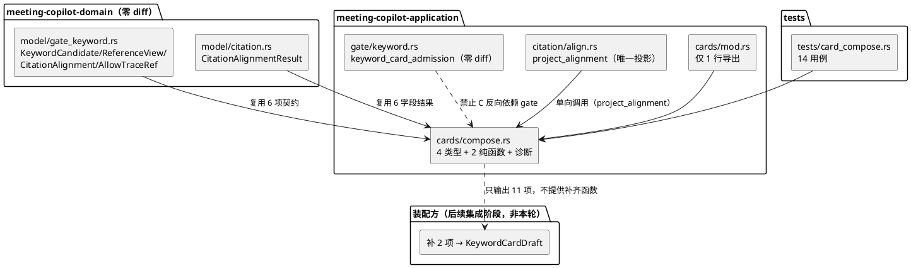

**依赖方向（单向，可被 `check-layering.sh` 断言）**：`domain::model::{gate_keyword, citation}` ← `application::citation::align` ← `application::cards::compose` ← `tests::card_compose`。`application/src/cards/**` **不得**出现 `use crate::gate`；**不得**反向被 `gate/**` 依赖。

**文件落位与行数预算**

| 文件 | 动作 | 预算 | 关键内容 |
|---|---|---|---|
| `crates/application/src/cards/compose.rs` | 新增 | 240~360 行 | 4 类型 + 2 纯函数 + 1 诊断 + 5 私有步骤 + 单测 |
| `crates/application/src/cards/mod.rs` | 新增 | 4 行 | `pub mod compose;` + 1 行 `pub use` |
| `crates/application/src/lib.rs` | +1 行 | — | `pub mod cards;` |
| `crates/application/tests/card_compose.rs` | 新增 | 380~520 行 | 14 用例 + 本地构造器 |
| `scripts/check-b4-gates.sh` | 扩展 | +12/-2 行 | 2 个变量 + `cards_files()` + 4 处引用 |
| `scripts/test-name-inventory.sh` | +1 token | — | `card_compose` |

> **为什么不在 domain 新增 `card_compose.rs`**：requirements §12.4.4-4 "38 不新增 domain 契约文件；`crates/domain/src/model/**` 零 diff" 与 J-21/D-B4-P45 是硬约束；38 的 4 个类型只被 application 使用、不被 B4/39/51 共享，放 application 可缩小封闭面。**这是对"建议 domain 卡片契约"的收窄**，登记 D-B4-P53（需用户确认）。

### 6.2.3 合成主流程（S0~S11，唯一顺序）

```plantuml
@startuml
start
:S0 输入结构校验
（7 项齐备 / 引用元素 5 字段 / reference_id 唯一）;
if (S0 违规?) then (是)
  :0 卡 + InputContractViolation;
  stop
endif
if (S1 allow_ref = None?) then (是)
  :0 卡 + GateNotAllowed;
  stop
endif
if (S2 candidate.validate() = false?) then (是)
  :0 卡 + CandidateInvalid;
  stop
endif
if (S3 current_card_status = Withdrawn?) then (是)
  :0 卡 + CardWithdrawn;
  stop
endif
if (S4 suppressed_notice = true?) then (是)
  :0 卡 + DuplicateCard;
  stop
endif
if (S5 标题长度 > TitleText::LIMIT?) then (是)
  :0 卡 + TitleTooLong（防御分支）;
  stop
endif
:S6 citation_alignment = project_alignment(alignment_result)（唯一投影）;
:S7 references 按 reference_id 稳定排序（不 dedup）;
:S8 summary = compose_summary(alignment, term, refs)
（仅 Passed ∧ refs 非空；>80 → None）;
:S9 card_status = next_card_status(current, signal)（只两态）;
:S10 组装 11 项（triggered_at_ms = candidate.trigger_span.end_ms）;
:11 项 ComposedCard + reason=None;
stop
@enduml
```

**判定顺序的机器口径（与 spec §5.8.1/§5.8.3 逐项对齐）**

| 序 | 条件 | 输出 | 依据 |
|---|---|---|---|
| S0 | 引用元素越界 / `reference_id` 重复（`BTreeSet` 长度 ≠ `len()`） | 0 卡 + `InputContractViolation` | spec §5.8.1-7、§5.8.3-5 |
| S1 | `allow_ref.is_none()`（未获 Allow；"来自 Deny" 类型层不可构造） | 0 卡 + `GateNotAllowed` | spec §5.8.1-1、§5.8.3-1 |
| S2 | `!candidate.validate()` | 0 卡 + `CandidateInvalid` | spec §5.8.1-1、§5.8.3-2 |
| S3 | `current_card_status == Withdrawn` | 0 卡 + `CardWithdrawn` | spec §5.8.1-8、§5.8.3-6 |
| S4 | `suppressed_notice == true`（装配方检测到同候选已有非 `Withdrawn` 卡片） | 0 卡 + `DuplicateCard` | spec §5.8.1-2、§5.8.3-6 |
| S5 | 标题字数 > 40（类型层不可达，防御分支） | 0 卡 + `TitleTooLong` | spec §5.8.1-3、§5.8.3-3 |
| S6 | 唯一投影 `project_alignment` | `citation_alignment` | spec §5.8.1-5 |
| S7 | 引用稳定排序 | 排序后的 5 字段引用 | spec §5.8.1-7 |
| S8 | 有据才解释；超 80 或非 `Passed` → `None` | `summary` | spec §5.8.1-4、§5.8.3-4 |
| S9 | 状态最小流转 | `Displayed`/`Withdrawn` | spec §5.8.1-8 |
| S10 | 组装 11 项，透传 6 项不漂移 | `ComposedCard` | spec §5.8.1-2/6 |
| S11 | 成功 | `CardComposeOutcome{card=Some, reason=None}` | spec §6.18-1 |

> **顺序不可重排的三点**：① S0 必须最先（结构违规优先于门控，避免对非法输入做语义判定）；② S3 必须早于 S4（已撤回优先于重复，spec §5.8.3-6"已撤回不得复活"）；③ S5 必须早于 S6~S8（标题超限时不消耗投影与模板，且不得产出半截标题）。

### 6.2.4 与点击前置、装配补 2 项的调用顺序

```plantuml
@startuml
autonumber
participant "装配方" as A
participant "38 compose" as C
participant "39 align" as V
participant "B4 keyword_card_admission" as B4
participant "51" as UI
A -> V : CitationCheckInput（8 字段）
V --> A : CitationAlignmentResult（6 字段）
A -> C : CardComposeInput（7 项，只读）
C --> A : CardComposeOutcome（11 项 或 唯一原因码）
opt card = Some
  A -> B4 : candidate + Allow 决策 + trace_id + 11 项中的 citation_alignment + 6 项环境事实
  B4 --> A : allow_ref（gate_decision_ref）+ click_state
  A -> A : 补 2 项 → KeywordCardDraft（13 字段）
  A --> UI : KeywordCardDraft（只读）
end
UI --> UI : 仅 click_state=Enabled 打开本地详情（0 外发）
@enduml
```

**唯一性**：38 输出不含 `gate_decision_ref`/`click_state`/`card_drafts`；`keyword_card_admission` 签名不变、`gate/**` 零 diff；`Failed`/`Unverified` 时 38 仍返回 `Some(card)`（S6/S8 不短路），不撤回卡片（spec §5.8.1-4/8）。

## 6.3 增量类型与字段设计

### 6.3.1 application 契约类型（`cards/compose.rs`，4 项顶层类型）

**`CardComposeInput`（封闭 7 项）**

| # | 字段 | 类型 | 只读来源 | 约束 | 零转录 |
|---|---|---|---|---|---|
| 1 | `card_id` | `CardRef` | 装配方按 B4 派生规则注入 | 非空（类型层保证）；38 不重算、不派生 | 安全（ID） |
| 2 | `candidate` | `KeywordCandidate` | B4 候选（10 字段） | 必须 `validate()==true`；38 只读 | 展示词见第 2 项规则 |
| 3 | `allow_ref` | `Option<AllowTraceRef>` | `GateDecision::Allow` | `None` = 未获 Allow；`Some` 即 Allow 溯源 | 安全（trace_id） |
| 4 | `alignment_result` | `CitationAlignmentResult` | 39（6 字段） | 38 只读 `alignment`；`basis` 不进入输出/日志 | 安全（枚举/计数） |
| 5 | `references` | `Vec<ReferenceView>` | 引用视图 | 0..*；元素恰 5 字段；`reference_id` 唯一；顺序无语义 | 只含 ID/枚举/毫值 |
| 6 | `current_card_status` | `KeywordCardStatus` | 装配方（三态） | 只读；`Withdrawn` 表示"已撤回"信号；38 不写 `Collapsed` | 安全（枚举） |
| 7 | `suppressed_notice` | `bool` | 装配方 | `true` = 同候选已有非 `Withdrawn` 卡片；**不进** 11 项输出 | 安全（布尔） |

> **封闭判据**：`kw_fields CardComposeInput` = 7（作用于 `cards/compose.rs`）。**禁止**第 8 字段（URL/标题/摘要/正文/转写/姓名/联系方式/`model`/`request_id`/`api_key`）。`allow_ref` 用 `Option` 是"缺失"与"Allow"的唯一二值表达，不新增"决策"字段（D-B4-P54）。

**`ComposedCard`（封闭 11 项，顺序即序列化断言口径）**

| # | 字段 | 类型 | 约束 | 零转录 |
|---|---|---|---|---|
| 1 | `card_id` | `CardRef` | 与输入恒等；一候选最多一卡 | 安全（ID） |
| 2 | `keyword_text` | `TitleText` | 与候选恒等；≤40；不截断、不改写 | **禁止进记录** |
| 3 | `normalized_term` | `NormalizedTerm` | 与候选恒等；仅内存/展示层 | **禁止出结构体** |
| 4 | `keyword_kind` | `KeywordKind` | 五类封闭 | 安全（枚举） |
| 5 | `trigger` | `TriggerKind` | `Auto`/`OnDemand`，与候选恒等 | 安全（枚举） |
| 6 | `triggered_at_ms` | `u64` | **必须** = `candidate.trigger_span.end_ms`；不读系统时间 | 安全（毫值） |
| 7 | `confidence` | `Confidence` | 与候选恒等；0..=1；不重算、不四舍五入 | 安全（数值） |
| 8 | `summary` | `Option<ConclusionText>` | ≤80；`Some ⇒ citation_alignment == Passed`；`Failed`/`Unverified` → `None` | **禁止进记录** |
| 9 | `references` | `Vec<ReferenceView>` | 5 字段/元素；按 `reference_id` 升序；重复 ID 已在 S0 拒绝 | 只含 ID |
| 10 | `citation_alignment` | `CitationAlignment` | = `project_alignment(&alignment_result)`；三态封闭 | 安全（枚举） |
| 11 | `card_status` | `KeywordCardStatus` | 只 `Displayed`/`Withdrawn`；**不得** `Collapsed` | 安全（枚举） |

> **禁止字段（结构性保证）**：无 `gate_decision_ref`、无 `click_state`、无 `card_drafts`、无 `body_visible`；无 `url`/`title`/`excerpt`/`content`/`query`。`ComposedCard` 实现 `Serialize`（11 键断言）与 `summary_is_consistent()`；**不实现** `Deserialize`（输入不从字节解析）。

**`CardComposeOutcome`（2 项，XOR）**

| # | 字段 | 类型 | 约束 |
|---|---|---|---|
| 1 | `card` | `Option<ComposedCard>` | 与 `reason` 恰一为 `Some` |
| 2 | `reason` | `Option<ComposeRejectReason>` | 单输入单原因；6 项封闭 |

**`ComposeRejectReason`（6 项封闭）**

| # | 变体 | 触发步骤 | 是否可构造 | 说明 |
|---|---|---|---|---|
| 1 | `GateNotAllowed` | S1 | 可（`allow_ref=None`） | 未获 Allow |
| 2 | `CandidateInvalid` | S2 | 可（`validate()==false`） | 候选非法 |
| 3 | `TitleTooLong` | S5 | **类型层不可构造**（防御分支） | 41 字在 `TitleText` 层被拒绝（D-B4-P57） |
| 4 | `DuplicateCard` | S4 | 可（`suppressed_notice=true`） | 同候选已有卡（D-B4-P56） |
| 5 | `CardWithdrawn` | S3 | 可（`current=Withdrawn`） | 已撤回不复活 |
| 6 | `InputContractViolation` | S0 | 可（引用重复/越界） | 输入结构违规 |

> `ComposeRejectReason` 是 38 私有码：**不并入** `GateRejectReason`（23）、**不新增** `GateCounter`（32）。`impl ComposeRejectReason { pub const ALL: [Self; 6]; pub const fn index(self) -> usize }`，`index()` 仅用于 `reasons[6]` 诊断下标。

### 6.3.2 状态流转类型（`CardStatusSignal`，私有面）

| 变体 | 来源 | 语义 |
|---|---|---|
| `Present` | `current != Withdrawn` | 请求展示态（新卡或已展示） |
| `Withdraw` | `current == Withdrawn` | 撤回信号（装配方在撤回时把只读当前态置为 `Withdrawn`） |

**真值表（`next_card_status` 唯一输出）**

| `current` | `signal` | 输出 | 理由 |
|---|---|---|---|
| `Displayed` | `Present` | `Displayed` | 保持展示 |
| `Displayed` | `Withdraw` | `Withdrawn` | 撤回 |
| `Collapsed` | `Present` | `Displayed` | 38 不写 `Collapsed`，投影为展示态 |
| `Collapsed` | `Withdraw` | `Withdrawn` | 撤回 |
| `Withdrawn` | `Present` | `Withdrawn` | 不可复活 |
| `Withdrawn` | `Withdraw` | `Withdrawn` | 幂等 |

> `ComposeRejectReason::CardWithdrawn` 与 `next_card_status(_, Withdraw)` 是两条路径：前者是 `compose` 的 S3 短路（0 卡），后者是纯函数真值表（供 51 内部与单测）；二者一致指向"`Withdrawn` 不可复活"。

### 6.3.3 不变量清单（用例逐条断言）

| 编号 | 不变量 |
|---|---|
| I-38-01 | `CardComposeInput` 字段集恒 7；`kw_fields CardComposeInput` = 7 |
| I-38-02 | `ComposedCard` 字段集恒 11；序列化键集合恰 11 项 |
| I-38-03 | `CardComposeOutcome` 的 `card`/`reason` 恰一为 `Some`（XOR） |
| I-38-04 | `ComposeRejectReason::ALL.len() == 6`；每输入只命中一个原因 |
| I-38-05 | `keyword_text` 与候选恒等；`confidence`/`trigger`/`keyword_kind`/`card_id`/`normalized_term` 差异为 0 |
| I-38-06 | `triggered_at_ms == candidate.trigger_span.end_ms`；无 `SystemTime::now`/`Instant::now` |
| I-38-07 | `summary.is_some() ⇒ citation_alignment == Passed`；`summary_is_consistent() == true` |
| I-38-08 | `citation_alignment` 三态单射投影；`Unknown → CONTRACT_UNVERIFIED`（语义 `Unverified`） |
| I-38-09 | `references` 元素恰 5 字段、按 `reference_id` 升序、无重复 ID |
| I-38-10 | 输出不含 `gate_decision_ref`/`click_state`；`cards/**` 中 `ClickState` 命中 0 |
| I-38-11 | `card_status ∈ {Displayed, Withdrawn}`；`Withdrawn` 输入不产出卡片（`CardWithdrawn`） |
| I-38-12 | 同输入 100 次 `serde_json::to_vec` 逐字节相等；引用顺序打乱后结果不变 |
| I-38-13 | `format!("{:?}", input)` 不含 `normalized_term`、`keyword_text`、`summary` 取值 |
| I-38-14 | 38 不新增 `GateCounter`；`GateCounters::default().snapshot().len() == 32` |
| I-38-15 | 38 不新增 domain 契约；`crates/domain/src/model/**` 零 diff |
| I-38-16 | 38 不依赖 `gate`；`grep -rn 'use crate::gate' cards` = 0 |

## 6.4 接口与纯函数签名

### 6.4.1 模块边界（application 合成 vs 既有契约）

| 层 | 文件 | 拥有 | 允许依赖 | 禁止依赖 | 机器断言 |
|---|---|---|---|---|---|
| domain 契约 | `crates/domain/src/model/gate_keyword.rs`、`citation.rs` | 既有 11 项 + 6 项类型 | — | 38 的任何符号 | `git diff --quiet HEAD -- crates/domain/src/model` |
| app 投影 | `crates/application/src/citation/align.rs` | `project_alignment` 唯一入口 | domain | 38 的符号（不得反向） | `grep -c 'pub fn project_alignment'` = 1 |
| app 合成 | `crates/application/src/cards/compose.rs` | 4 类型、2 纯函数、1 诊断、5 私有步骤 | `domain::{gate_keyword, citation}`、`crate::citation::align::project_alignment` | `crate::gate::*`（Layering 倒挂）、`reqwest`/`std::net`、`Instant::now`/`SystemTime::now`、`std::env`、`std::fs`、`thread::sleep`、锁、trait/端口 | `--rule=source`/`--rule=budget` 退 0；`grep -rn 'use crate::gate'` = 0 |
| 测试 | `crates/application/tests/card_compose.rs` | 14 个 AC 用例、本地构造器 | 上述 + `domain`（构造 `KeywordCandidate`/`ReferenceView`） | 网络、系统时间、落盘、正文、`gate` 库内调用 | `--rule=source`/`--rule=zero-transcript` 退 0 |

> **边界理由**：38 是"确定性组装"，不是门控编排，也不是点击判定。若 38 反依赖 `gate::keyword`，就会形成"合成器驱动点击"的隐式耦合，违反 J-22；点击合取与 2 项补齐只能发生在装配方（后续集成阶段），38 源码中不得出现 `KeywordCardDraft`/`ClickState`/`gate_decision_ref`。

### 6.4.2 纯函数签名（逐字，不含实现）

```rust
// —————— crates/application/src/cards/compose.rs ——————
pub enum ComposeRejectReason {
    GateNotAllowed, CandidateInvalid, TitleTooLong,
    DuplicateCard, CardWithdrawn, InputContractViolation,
}
impl ComposeRejectReason {
    pub const ALL: [Self; 6];
    pub const fn index(self) -> usize;                 // reasons[6] 下标
}

pub struct CardComposeInput { /* 7 公有字段，手写 Debug，不 Serialize */ }
impl core::fmt::Debug for CardComposeInput { /* 仅 ID/枚举/计数/毫值/布尔 */ }

pub struct ComposedCard { /* 11 公有字段，Serialize */ }
impl ComposedCard {
    pub fn summary_is_consistent(&self) -> bool;       // summary.is_some() ⇒ Passed
}

pub struct CardComposeOutcome {
    pub card: Option<ComposedCard>,
    pub reason: Option<ComposeRejectReason>,
}

pub enum CardStatusSignal { Present, Withdraw }

pub fn compose_keyword_card(input: &CardComposeInput) -> CardComposeOutcome;
pub fn next_card_status(current: KeywordCardStatus, signal: CardStatusSignal) -> KeywordCardStatus;

pub struct CardComposeDiagnostics {
    pub composes: u32, pub succeeded: u32, pub rejected: u32, pub reasons: [u32; 6],
}
impl CardComposeDiagnostics {
    pub fn record(&mut self, outcome: &CardComposeOutcome);  // 只增计数
}

// —————— crates/application/src/cards/mod.rs（1 行导出）——————
pub mod compose;
pub use compose::{
    compose_keyword_card, next_card_status, CardComposeDiagnostics, CardComposeInput,
    CardComposeOutcome, CardStatusSignal, ComposedCard, ComposeRejectReason,
};
```

**签名契约表**

| 函数 | 前置条件 | 后置条件 | 失败语义 |
|---|---|---|---|
| `compose_keyword_card` | `CardComposeInput` 已由类型构造；`card_id`/`candidate`/`alignment_result` 只读 | 恒返回 2 项 outcome；成功时 11 项齐备且 6 项透传恒等；失败时 0 卡 + 唯一原因 | **永不 `panic`、永不 `Err`**；任何不可判定按 S0~S5 顺序 fail-closed |
| `next_card_status` | 无 | 恒返回 `Displayed`/`Withdrawn`；`Withdrawn` 不可复活 | 无（全函数、无 panic） |
| `summary_is_consistent` | 无 | `None → true`；`Some → alignment == Passed` | 无（返回 `bool`） |
| `record` | outcome 合法 | 只增 `composes`/`succeeded`/`rejected`/`reasons[index]` | 无（纯计数，`saturating_add`） |

### 6.4.3 公开面与回放面隔离

1. `crates/application/src/cards/mod.rs` 只做 1 行导出（9 个符号），不导出私有步骤与 `CardStatusSignal` 之外的任何内部类型。
2. `crates/application/src/lib.rs` 只追加 `pub mod cards;`（1 行），**不**加入 `pub use cards::*` 顶层再导出，避免回放面符号扩散。
3. `gate/api.rs` 不新增任何函数；38 **不**定义 trait、不定义端口、不实现 §4.5.2 预留的 `CardSynthesis` 实体（该预留仍停留在文档）。
4. 38 不提供"补 2 项"函数；`gate_decision_ref`/`click_state` 的补齐只在装配方，且用既有 `keyword_card_admission`。

## 6.5 十二条合成规则 → 设计落点

| 规则（spec §5.8.1） | 设计落点 | 机器判据 |
|---|---|---|
| 1 唯一前置：`Allow` + 候选合法 | S1 + S2；`allow_ref: Option` | `card_compose_requires_gate_allow` |
| 2 一候选一卡且幂等 | S4（`suppressed_notice`）+ `card_id` 注入；纯函数无状态 | `card_compose_is_idempotent_per_candidate` |
| 3 标题与解释长度 | S5（防御）+ S8（>80 → `None`）+ 类型层 `TitleText`/`ConclusionText` | `card_compose_title_and_summary_limits` |
| 4 解释只在有据时生成 | S8：`Passed ∧ refs 非空` → 模板；否则 `None` | `card_compose_failed_stays_displayed_without_conclusion` |
| 5 对齐唯一回填 | S6：`project_alignment(&alignment_result)` 唯一入口 | `card_compose_aligns_unknown_to_unverified` |
| 6 透传字段不得漂移 | S10：6 项逐项恒等；`triggered_at_ms = end_ms` | `card_compose_preserves_confidence_and_trigger` |
| 7 引用只存 ID 面 | S0（唯一性）+ S7（升序） | `card_compose_references_are_id_only_and_sorted` |
| 8 状态只做最小流转 | S3 + S9；`next_card_status` 真值表 | `card_compose_withdrawn_is_not_revived` |
| 9 点击与门控引用不在 38 | 类型层无 `gate_decision_ref`/`click_state`；装配方补齐 | `card_compose_leaves_click_state_to_b4` |
| 10 零转录与隐私 | `CardComposeInput` 手写 `Debug`；输出仅 11 项 | `card_compose_zero_transcript_boundary` |
| 11 离线与确定性 | 无时间/网络/环境/文件/锁；排序后判定 | `card_compose_is_offline_and_deterministic`、`card_compose_ignores_reference_order` |
| 12 归属与禁止项 | 模块边界 + 禁词 + 目录断言 | `card_compose_ownership_is_outside_gate_and_ui` |

**解释模板（唯一文本来源）**

| 常量 | 值（示例口径） | 使用条件 | 长度控制 |
|---|---|---|---|
| `SUMMARY_TEMPLATE_PREFIX` | `"该术语可参考可靠来源："` | `Passed ∧ refs 非空` | 拼接 `normalized_term` 后 `chars().count() <= 80`，超限 → `None` |
| `KeywordCardDraft::NO_RELIABLE_SOURCE` | 既有 `"未找到可靠来源"` | **38 不输出**；51 展示层使用 | 不进入 `ComposedCard` |

> 模板常量**不得**含 URL/标题/摘要/正文；`normalized_term` 是唯一变量；**不调用 LLM、不做语义生成**。`Failed`/`Unverified` 一律 `None`（D-B4-P58），既满足 AC-69 的"`None` 或固定文案"，也避免 38 输出结论性措辞。
## 6.6 七类降级与判定顺序

### 6.6.1 七类降级（与 spec §5.8.3 一一对应）

| 类 | 触发条件 | 判定步骤 | 38 行为 | 是否出卡 | 原因码 / 结果 |
|---|---|---|---|---|---|
| DG-1 门控拒绝 / 缺 Allow | `allow_ref = None`（"来自 `Deny`" 类型层不可构造） | S1 | 0 卡；不改既有卡片 | 否 | `GateNotAllowed` |
| DG-2 候选非法 | 置信度 <0.50 / 区间反向或为零 / `state=Pushed` / 展示词空白 | S2 | 0 卡；不自行修正候选 | 否 | `CandidateInvalid` |
| DG-3 标题超长 | 展示词 >40 字 | S5（防御） | 拒绝；不截断、不换行 | 否 | `TitleTooLong` |
| DG-4 解释超长 / 无可靠来源 | 模板拼接 >80 字，或 `alignment ∈ {Failed, Unverified}` | S8 | `summary=None`；卡片照常产出；不撤回 | **是** | `summary=None`（非拒绝降级） |
| DG-5 引用输入违规 | `reference_id` 重复 / 元素越界 5 字段 | S0 | 拒绝；不读取越界字段、不回显 | 否 | `InputContractViolation` |
| DG-6 重复触发 / 已撤回 | `suppressed_notice=true` / `current_card_status=Withdrawn` | S3 → S4 | 已撤回优先 → 0 卡；重复 → 0 卡 | 否 | `CardWithdrawn` / `DuplicateCard` |
| DG-7 被误用为渲染或存储 | `cards/**` 出现渲染、焦点、卡片表、网络、审计写入、`use crate::gate` | 静态（门禁） | 不进运行期；门禁命中即不放行 | — | `--rule=source` / 禁词 / 目录断言 |

> **"7 类降级"与"6 个原因码"的关系**：DG-6 含两个原因码；DG-4 是非拒绝降级（仍出卡）；DG-7 是静态归属降级（运行期不存在）。六码之和恰为 `ComposeRejectReason::ALL.len() == 6`。

### 6.6.2 唯一判定顺序与优先级理由

```text
S0 结构 ─► S1 Allow ─► S2 候选 ─► S3 已撤回 ─► S4 重复 ─► S5 标题 ─► S6 投影 ─► S7 排序 ─► S8 解释 ─► S9 状态 ─► S10 组装 ─► S11 成功
```

| 比较对 | 优先者 | 理由 |
|---|---|---|
| S0 vs S1 | S0 | 结构违规（引用重复/越界）是"输入不可用"，优先于门控语义；避免对含越界字段的输入做任何语义判定（零转录） |
| S1 vs S2 | S1 | 无 Allow 时不允许任何卡片产出，候选合法性无从谈起；spec §5.8.1-1 "唯一前置" |
| S2 vs S3 | S2 | 非法候选即便已撤回也不应进入状态判定；`CandidateInvalid` 是更早的输入事实 |
| S3 vs S4 | S3 | "已撤回不可复活"优先于"重复"；spec §5.8.3-6 明确已撤回返回 `CardWithdrawn` |
| S4 vs S5 | S4 | 重复触发不产出新卡，标题长度不必再判；保持"0 卡优先" |
| S5 vs S6 | S5 | 标题超限时不消耗投影与模板，且不得产出半截标题 |
| S6 vs S8 | S6 | `summary` 的生成条件依赖投影结果，投影必须唯一且先行 |
| S7 vs S8 | S7 | `summary` 的"引用非空"判定与输出顺序都以排序后集合为准，保证顺序无关 |
| S8 vs S9 | S8 | 解释降级不影响状态流转；二者互不依赖，但固定此序以保可复现 |
| S9 vs S11 | S9 | 状态两态封闭后才组装；避免带 `Collapsed` 的中间态进入输出 |

**多因并存的唯一结果（8 组，测试逐组断言）**

| # | 并存条件 | 唯一结果 |
|---|---|---|
| 1 | 引用重复 + `allow_ref=None` | `InputContractViolation` |
| 2 | `allow_ref=None` + 候选非法 | `GateNotAllowed` |
| 3 | 候选非法 + 已撤回 | `CandidateInvalid` |
| 4 | 已撤回 + `suppressed_notice=true` | `CardWithdrawn` |
| 5 | `suppressed_notice=true` + 标题 41 字 | `DuplicateCard` |
| 6 | `Failed` + 引用为空 | 出卡；`citation_alignment=Failed`；`summary=None`；`references=[]` |
| 7 | `Passed` + 引用全不可访问 | 出卡（39 已判 `Unknown`/`Unverified` 的情形由投影决定）；`summary=None` |
| 8 | `Passed` + 引用非空 + 模板 >80 字 | 出卡；`summary=None` |

## 6.7 Allow 前置与 13 字段补齐

### 6.7.1 `Allow` 前置的唯一位置

| 环节 | 谁做 | 做什么 | 38 是否参与 |
|---|---|---|---|
| 门控判定 | B4 `evaluate_gate` | 产 `GateDecision::Allow` 或 `Deny` | 否（只读结果） |
| Allow 溯源 | B4 `AllowTraceRef::new/with_trace` | `Deny` → `None`；`Allow` → `Some` | 否（只读 `Option`） |
| 前置判定 | **38 S1** | `allow_ref.is_none()` → `GateNotAllowed` | 是（唯一前置点） |
| 候选合法性 | **38 S2** | 复用 `KeywordCandidate::validate()` | 是 |
| 出卡数量 | 装配方 | `card_drafts ≤ 1`；38 纯函数不维护计数 | 否（38 只保证同输入同输出） |

> **"来自 `Deny`" 的处理**：`AllowTraceRef` 的构造函数只在 `GateDecision::Allow` 返回 `Some`，因此"来自 `Deny` 的 `allow_ref`"在类型层无法构造；38 不需要第二个"决策类型"字段，`None` 即覆盖"缺失 / Deny / 未获授权"三种上游情形（D-B4-P54）。

### 6.7.2 11 + 2 = 13 字段补齐契约（38 之外）

| # | `KeywordCardDraft` 字段 | 来源 | 补齐方 | 38 是否产出 |
|---|---|---|---|---|
| 1 | `card_id` | `ComposedCard.card_id`（装配方注入） | 装配方 | **是**（透传） |
| 2 | `keyword_text` | `ComposedCard.keyword_text` | 装配方 | **是**（透传） |
| 3 | `normalized_term` | `ComposedCard.normalized_term` | 装配方 | **是**（透传） |
| 4 | `keyword_kind` | `ComposedCard.keyword_kind` | 装配方 | **是**（透传） |
| 5 | `trigger` | `ComposedCard.trigger` | 装配方 | **是**（透传） |
| 6 | `triggered_at_ms` | `ComposedCard.triggered_at_ms` | 装配方 | **是**（透传） |
| 7 | `confidence` | `ComposedCard.confidence` | 装配方 | **是**（透传） |
| 8 | `summary` | `ComposedCard.summary` | 装配方 | **是**（透传） |
| 9 | `references` | `ComposedCard.references`（已排序） | 装配方 | **是**（透传） |
| 10 | `citation_alignment` | `ComposedCard.citation_alignment`（唯一投影） | 装配方 | **是**（透传） |
| 11 | `card_status` | `ComposedCard.card_status`（两态） | 装配方 | **是**（透传） |
| 12 | `gate_decision_ref` | `KeywordCardAdmission.allow_ref`（`Some`） | **装配方**（既有 `keyword_card_admission`） | **否** |
| 13 | `click_state` | `KeywordCardAdmission.click_state`（7 项合取） | **装配方**（既有 `keyword_card_admission`） | **否** |

**补齐的三条硬约束**

1. **唯一来源**：`gate_decision_ref` 只能来自 `AllowTraceRef`（类型层只由 `Allow` 构造）；`click_state` 只能来自 `resolve_click_state` 的 7 项合取。38 不重算、不判定、不写。
2. **唯一位置**：补齐发生在装配方；`cards/**` **不提供** `assemble_card_draft`/`to_draft`/`补 2 项` 函数。判据：`grep -rn 'gate_decision_ref\|click_state\|KeywordCardDraft\|ClickState' crates/application/src/cards` = **0**。
3. **顺序**：`compose_keyword_card` →（成功）→ `keyword_card_admission` → `KeywordCardDraft` → 51。38 不参与后三步。

> **与 §4.5.2 预留的差异**：§4.5.2 预留 `KeywordCardSeed` + `CardSynthesis::synthesize`（返回 13 字段 `KeywordCardDraft`）。本章以"7 项输入 + 11 项输出"取代该预留（J-21/J-22），**不实现该 trait**，`synthesize` 的"填 13 字段"能力被拆成"38 填 11 项 + 装配方补 2 项"。这是对 §4.5.2 的收窄，登记 D-B4-P53/P61（需确认）。

## 6.8 零转录、离线与确定性

### 6.8.1 零转录的四层保证

| 层 | 载体 | 允许 | 禁止 | 机器判据 |
|---|---|---|---|---|
| 类型层 | `CardComposeInput`/`ComposedCard` | 6 个 ID/枚举/毫值 + 2 个展示字段（仅输出） | URL/标题/摘要/正文/转写/姓名/联系方式/`model`/`request_id`/`api_key` | `kw_fields` + 类型无对应字段 |
| 构造层 | `card_id` 由装配方注入；`summary` 由模板常量 + `normalized_term` | 固定模板 | 引用标题/摘要/正文复制、LLM 生成 | `compose_summary` 唯一入口；`--rule=source`（`LLM_`/`reqwest` = 0） |
| 输出层 | `ComposedCard` 11 项 | `keyword_text`/`summary`（展示层） | 写入 `GateRecord`/`GateAuditEvent`/`ReplayReport`/夹具/日志/进度 | `--rule=zero-transcript`；键集合 = 11 |
| 诊断/调试层 | `CardComposeDiagnostics`、`Debug` | 计数、原因码、ID、枚举、毫值 | `normalized_term`/展示词/解释取值 | `format!("{:?}", input)` 断言 |

**`CardComposeInput` 手写 `Debug` 白名单（9 项）**：`card_id`、`keyword_ref`、`keyword_kind`、`reference_count`、`has_allow_ref`、`current_card_status`、`suppressed_notice`、`alignment`、`basis`。**不输出** `normalized_term`、`keyword_text`、`summary`、`trigger_span` 文本面。

### 6.8.2 离线保证

| 禁止项 | 判据 |
|---|---|
| 网络 | `cards/**` 中 `reqwest`/`hyper`/`TcpStream`/`std::net` 命中 0 |
| 系统时间 | `Instant::now`/`SystemTime::now` 命中 0；`triggered_at_ms` 只用 `candidate.trigger_span.end_ms` |
| 环境变量 | `std::env`/`env::var` 命中 0 |
| 文件 | `std::fs`/`File::` 命中 0 |
| 睡眠 | `thread::sleep` 命中 0 |
| 锁 / 全局态 | `Mutex`/`RwLock`/`AtomicU64`/`static mut`/`OnceLock`/`lazy_static`/`thread_local` 命中 0 |
| LLM | `LLM_` 前缀常量、模型名、`request_id` 命中 0 |
| 存储/UI | `presenter`/`card_store`/`outbox`/`on_demand`/`feedback_weights`/`Sqlite` 命中 0 |

### 6.8.3 确定性保证

1. **无随机、无时间、无哈希迭代序**：引用用 `Vec` + 显式排序；重复性检查用 `BTreeSet`；诊断数组用固定长度。
2. **排序在判定前**：S0 的唯一性检查不改变输入顺序；S7 生成新 `Vec` 并稳定排序，**不 `dedup`**（重复已在 S0 拒绝）。
3. **同输入 100 次逐字节一致**：`serde_json::to_vec(&card)` 比较 `Vec<u8>`；不比较 `Debug` 字符串。
4. **顺序无关**：3 种引用乱序输入 → 输出逐字节相同；候选顺序不影响单输入结果（单输入单输出）。
5. **`summary` 模板无外部输入**：只有常量 + `normalized_term`；不含计数、时间、ID。

> **与既有零转录分层的差异**：38 的 `keyword_text`/`summary` 属"展示层"，只允许存在于 `ComposedCard` 与测试进程内存；`normalized_term` 属"仅内存比对 + 展示"，禁止进任何日志/记录/夹具（与 39 的 D-B4-P39 同口径，见 D-B4-P52 沿用）。

## 6.9 AC-B4-65~74 用例名与验收命令

### 6.9.1 用例级判定（14 个，逐字对齐 spec §7.13）

| AC | 用例名（逐字） | 断言要点 |
|---|---|---|
| AC-B4-65 | `card_compose_input_is_readonly_and_closed` | `kw_fields CardComposeInput`=7；输入只读；`api.rs`=4；`--rule=record` 退 0；domain 零 diff |
| AC-B4-66 | `card_compose_title_and_summary_limits` | `TitleText::LIMIT`=40、`ConclusionText::LIMIT`=80；41 字 `TitleText::new` → `Err`；40 字通过；81 字模板 → `summary=None` |
| AC-B4-66 | `card_compose_preserves_confidence_and_trigger` | `confidence`/`trigger`/`triggered_at_ms`/`card_id` 逐项恒等 |
| AC-B4-67 | `card_compose_requires_gate_allow` | `allow_ref=None` → `GateNotAllowed`；`Some` + 合法候选 → 1 卡 11 项 |
| AC-B4-67 | `card_compose_is_idempotent_per_candidate` | 同输入 100 次字节相等；`card_drafts` ≤1（装配侧计数，38 不维护） |
| AC-B4-67 | `card_compose_withdrawn_is_not_revived` | `current=Withdrawn` → `CardWithdrawn`；`next_card_status(Withdrawn, Present)=Withdrawn` |
| AC-B4-68 | `card_compose_aligns_unknown_to_unverified` | `Unknown → CONTRACT_UNVERIFIED`；`Passed`/`Failed` 同名；`kw_fields ComposedCard`=11 |
| AC-B4-68 | `card_compose_leaves_click_state_to_b4` | `cards/**` 中 `ClickState`/`gate_decision_ref` 命中 0；`project_alignment` 定义 =1 |
| AC-B4-69 | `card_compose_failed_stays_displayed_without_conclusion` | `Failed/Unverified` 仍 `Some(card)`；`summary=None`；`card_status=Displayed`；`summary_is_consistent()`=true |
| AC-B4-70 | `card_compose_references_are_id_only_and_sorted` | `kw_fields ReferenceView`=5；3 种乱序输出相同；重复 ID → `InputContractViolation`；空集合合法 |
| AC-B4-71 | `card_compose_is_offline_and_deterministic` | 8 类禁止符号命中 0；100 次字节相等 |
| AC-B4-71 | `card_compose_ignores_reference_order` | 引用乱序结果不变 |
| AC-B4-72 | `card_compose_zero_transcript_boundary` | `Debug` 不含术语/展示词；输出键集合 =11；`--rule=zero-transcript` 退 0 |
| AC-B4-73 | `card_compose_ownership_is_outside_gate_and_ui` | `use crate::gate`=0；禁词=0；`tests/replay/` 不存在 |
| AC-B4-74 | `--test card_compose` 全绿 | `NEW_TARGETS`=22；`--rule=targets` 退 0；`grep -c 'card_compose' check-b4-gates.sh`=0 |

> AC-B4-74 的"AC 汇总合计 =74"与"`b4-status.md` U-03 口径"属于**规格/状态文档判据**，由实现后收口复核；本章不修改 spec 与状态文件。

### 6.9.2 验收命令（按 AC 分组，全部离线）

```bash
# 0) 38 全量用例（14 个）
cargo test -p meeting-copilot-application --test card_compose

# 1) AC-65：输入 7 项 + 只读面 + 回放面 + 封闭字段
CARDS=crates/application/src/cards/compose.rs
kw_fields() { awk -v s="pub struct $1 {" 'index($0,s)==1 {f=1; next} f && /^\}/{exit} f' "$2" | grep -cE '^    pub [a-z_]+:'; }
[ "$(kw_fields CardComposeInput "$CARDS")" = "7" ]
[ "$(grep -c '^pub fn ' crates/application/src/gate/api.rs)" = "4" ]
bash scripts/check-b4-gates.sh --rule=record

# 2) AC-66/68：输出 11 项 + 两处上限常量
[ "$(kw_fields ComposedCard "$CARDS")" = "11" ]
grep -q 'pub const LIMIT: usize = 40' crates/domain/src/vo/text.rs
grep -q 'pub const LIMIT: usize = 80' crates/domain/src/vo/text.rs

# 3) AC-68/70：唯一投影与引用 5 字段
[ "$(grep -rc 'pub fn project_alignment' crates/application/src | grep -v ':0' | wc -l)" = "1" ]
[ "$(kw_fields ReferenceView crates/domain/src/model/gate_keyword.rs)" = "5" ]

# 4) AC-71/72：离线、零转录、目标扫描
bash scripts/check-b4-gates.sh --rule=source
bash scripts/check-b4-gates.sh --rule=zero-transcript

# 5) AC-73：归属与目录
[ "$(grep -rn 'use crate::gate' crates/application/src/cards | wc -l)" = "0" ]
[ "$(grep -rnE 'presenter|card_store|outbox|on_demand|feedback_weights|reqwest|ClickState|gate_decision_ref|KeywordCardDraft' crates/application/src/cards | wc -l)" = "0" ]
test ! -d crates/application/tests/replay

# 6) AC-74：target 与清单
new_targets_count() { grep -m1 '^NEW_TARGETS=' scripts/test-name-inventory.sh | sed -E "s/^NEW_TARGETS='//; s/'$//" | wc -w; }
[ "$(new_targets_count)" = "22" ]
bash scripts/check-b4-gates.sh --rule=targets
[ "$(grep -c 'card_compose' scripts/check-b4-gates.sh)" = "0" ]

# 7) 七规则 + 全量回归
for r in source zero-transcript budget outbound record targets doc-plan; do
  bash scripts/check-b4-gates.sh --rule="$r" || exit 1
done
cargo test --workspace
```

> **反例演练（`mktemp -d`，不入库）**：① 把 `CARDS_APP_DIR` 改名 → `--rule=source` 必须退 **2** 且打印 `SCAN-MISSING`；② 在 test 副本追加一行含协议前缀的文本 → `--rule=zero-transcript` 退 **1**；③ 在 `cards/compose.rs` 副本插入 `ClickState` → AC-68/73 的 grep 判据命中。

## 6.10 脚本与 target 改动点

### 6.10.1 `scripts/check-b4-gates.sh`（规则仍 7 条，退出码不变）

| 位置 | 现状 | 改动 | 断言 |
|---|---|---|---|
| 变量区（`CITATION_TEST` 后） | 3 个 39 面 | 新增 `CARDS_APP_DIR="crates/application/src/cards"`、`CARDS_TEST="crates/application/tests/card_compose.rs"` | `grep -c 'CARDS_APP_DIR='` = 1；`grep -c 'CARDS_TEST='` = 1 |
| `require_core_faces()` | 6 个必需面 | 增加 `need_dir "${CARDS_APP_DIR}" \|\| ok=1` | 38 目录缺失时退 2（X-03 同口径） |
| `core_files()` | `CITATION_MODEL` + `gate_files` + `citation_files` | 增加 `cards_files` **与** `CARDS_TEST`（D-B4-P59） | `--rule=source`/`--rule=budget` 覆盖 38 源码与测试 |
| `rule_zero_transcript()` | `CITATION_MODEL`/`CITATION_TEST`/`citation_files` | 增加 `cards_files` 与 `CARDS_TEST` | 38 源码与测试同权扫描 |
| `rule_targets()` | 循环 7 项 | **零改动**（X-05 冻结） | `--rule=targets` 退 0 且 `grep -c 'card_compose'` = 0 |
| 新增 `cards_files()` | — | `for file in "${CARDS_APP_DIR}"/*.rs; do [[ -f ... ]] && printf ...; done` | `grep -c 'cards_files'` ≥ 3（定义 + `core_files` + `zero-transcript`） |
| 规则数 | 7 | **仍 7** | `--rule` 名称集合不变 |

**扫描面口径**

- `--rule=source`：`CARDS_APP_DIR/*.rs` + `CARDS_TEST`（模式沿用既有：网络/计时/睡眠/环境变量/占位 panic/全局态/`LLM_`）。**注意**：`strip_tests()` 对 `tests/card_compose.rs` 无 `#[cfg(test)]` 行，因此测试文件**整体**参与扫描——测试内禁止 `panic!`/`todo!`/`SystemTime::now`/`std::env`/`reqwest`。
- `--rule=budget`：随 `core_files()` 覆盖 38；38 不含 `LLM_`（断言 0）。
- `--rule=zero-transcript`：`CARDS_APP_DIR/*.rs` + `CARDS_TEST` + `STATUS_FILE`（模式沿用既有：URL/Key/鉴权头/模型名/`request_id`）。
- `--rule=record`/`rule_outbound`：仅 `require_core_faces()` 增加必需面，扫描逻辑不变（`outbound` 仍只扫 `gate_files`，38 不在其中，但 `source` 已覆盖 `reqwest`）。

> **X-03 同口径提交纪律**：`require_core_faces()` 一旦加入 `CARDS_APP_DIR`，38 目录缺失即令**全部** `--rule` 退 **2**。因此脚本改动必须与 `cards/compose.rs`、`cards/mod.rs` 落盘**同批提交**；禁止先改脚本。

### 6.10.2 `scripts/test-name-inventory.sh`

| 位置 | 改动 | 断言 |
|---|---|---|
| `NEW_TARGETS` | 尾部追加 `card_compose`（21→22） | `wc -w` = 22；`grep -c 'card_compose'` = 1 |
| `--diff` 语义 | 不变 | `removed=0` |

### 6.10.3 文件级改动预算

| 文件 | 动作 | 预算 | 零 diff 面 |
|---|---|---|---|
| `crates/application/src/cards/compose.rs` | 新增 | 240~360 行 | — |
| `crates/application/src/cards/mod.rs` | 新增 | 4 行 | — |
| `crates/application/src/lib.rs` | +1 | — | 其余 mod 行 |
| `crates/application/tests/card_compose.rs` | 新增 | 340~480 行 | — |
| `scripts/check-b4-gates.sh` | +12/-2 | — | 7 条规则语义、退出码 |
| `scripts/test-name-inventory.sh` | +1 token | — | 既有 21 项 |

### 6.10.4 零 diff 校验矩阵

| 面 | 命令 | 期望 |
|---|---|---|
| 回放面 | `[ "$(grep -c '^pub fn ' crates/application/src/gate/api.rs)" = "4" ]`；`git diff --quiet HEAD -- crates/application/src/gate/api.rs` | 4 / 0 |
| 门控模块 | `git diff --quiet HEAD -- crates/application/src/gate` | 0 |
| domain 契约（全部） | `git diff --quiet HEAD -- crates/domain/src/model` | 0 |
| 卡片 13 / 引用 5 / 对齐 3 | `kw_fields KeywordCardDraft`=13；`kw_fields ReferenceView`=5；`CitationAlignment::ALL.len()`=3 | 13 / 5 / 3 |
| 记录/审计/夹具/报告/计数/原因码 | `bash scripts/check-b4-gates.sh --rule=record` | 退 0（14/7/23/5/32/23） |
| 依赖 | `git diff --stat -- Cargo.toml Cargo.lock` | 0 行 |
| 理解层 | `git diff --quiet HEAD -- crates/application/src/understand/store.rs crates/application/src/understand/deduplicator.rs` | 0 |
| 目录 | `test ! -d crates/application/tests/replay`；`test ! -d crates/ui-bridge/src/keyword_card` | 0 |
| 38 分层 | `grep -rn 'use crate::gate' crates/application/src/cards \| wc -l` | 0 |
| 38 补 2 项越界 | `grep -rnE 'KeywordCardDraft\|ClickState\|gate_decision_ref\|click_state' crates/application/src/cards \| wc -l` | 0 |

**一条串联取证命令**

```bash
set -e
[ "$(grep -c '^pub fn ' crates/application/src/gate/api.rs)" = "4" ]
git diff --quiet HEAD -- crates/application/src/gate
git diff --quiet HEAD -- crates/domain/src/model
[ "$(git diff --stat -- Cargo.toml Cargo.lock | wc -l | tr -d ' ')" = "0" ]
git diff --quiet HEAD -- crates/application/src/understand/store.rs crates/application/src/understand/deduplicator.rs
bash scripts/check-b4-gates.sh --rule=record
test ! -d crates/application/tests/replay
[ "$(grep -rn 'use crate::gate' crates/application/src/cards | wc -l)" = "0" ]
echo "exit=$?"
```

### 6.10.5 实施顺序、风险与不宣称

| # | 顺序 | 依赖 |
|---|---|---|
| 1 | `cards/mod.rs` + `cards/compose.rs` 最小可编译骨架（4 类型 + 2 函数签名） | 无（先 `cargo build`；本步不依赖既有模块改动） |
| 2 | S0~S5 判定链与 `next_card_status` 真值表 | 1 |
| 3 | S6~S11（投影/排序/解释/组装）+ 诊断 | 2 |
| 4 | `tests/card_compose.rs` 14 用例 | 3 |
| 5 | `lib.rs` +1 与脚本扩展（同批） | 1（文件已落盘） |
| 6 | `NEW_TARGETS` 22 + 三态登记 | 4、5 |

| 风险 | 影响 | 处置 |
|---|---|---|
| R-38-01 `CARDS_TEST` 进 `source` 后测试文件被全量扫描 | 测试含 `panic!`/`expect` 即退 1 | 测试只用 `assert!`/`assert_eq!`；断言消息只含 ID/枚举/计数 |
| R-38-02 `TitleTooLong` 类型层不可构造，AC-66 字面判据无法直测 | 用例可能被误判"未覆盖" | 单测直调私有 `title_fits_limit` + `TitleText::new(41)` 的 `Err` 双证据（D-B4-P57） |
| R-38-03 `DuplicateCard` 依赖 `suppressed_notice` 语义 | 装配方未按约定置位则重复不拦 | 装配契约写死"已有非 `Withdrawn` 卡片 → `suppressed_notice=true`"；测试构造两态（D-B4-P56） |
| R-38-04 脚本与文件不同批 | 7 条规则中途退 2 | X-03 同口径：脚本改动与文件同批 |
| R-38-05 38 误用 `gate::keyword` 直接补 2 项 | 破坏 4 函数面与分层 | 静态判据 `grep 'KeywordCardDraft\|ClickState'` = 0 |

**明确不宣称**：38 的解释语义正确性、真实引用可访问性、51 渲染/三形态/投屏遮蔽、52 存储与展示审计、13.3 回放本体、G3/G4/真机；AC-B4-65~74 只判定"输入封闭、长度与一致性、Allow 前置、唯一回填、降级展示、引用 ID 面、离线确定性、零转录、归属、交付登记"。

## 6.11 决策登记

### 6.11.1 采用既有决策（不重复裁决）

| 编号 | 采用内容 |
|---|---|
| J-21 / D-B4-P45 | 38 = `application/src/cards/**`；不建 UI/存储/回放目录；**不新增 domain 契约** |
| J-22 / D-B4-P46 | 输出 11 项，不含 `gate_decision_ref`/`click_state`；装配方补 2 项 |
| J-23 / D-B4-P47 | `card_id` 装配方注入；38 不重算 |
| J-24 / D-B4-P48 | 解释只允许固定模板 + `normalized_term`；不调 LLM |
| J-25 / D-B4-P49 | `ComposeRejectReason` 6 项私有；`GateRejectReason` 23、`GateCounter` 32 不变 |
| J-26 / D-B4-P50 | `card_compose` target（21→22）；扫描面扩展；`--rule=targets` 不追加 |
| D-B4-P51 | 只 `Displayed`/`Withdrawn`；`Withdrawn` 不可复活 |
| D-B4-P52 | `CardComposeInput` 手写 `Debug` 白名单 |
| D-B4-P38 | `Unverified` ≡ `CitationAlignment::Unknown`；投影经 `CONTRACT_UNVERIFIED` |

### 6.11.2 新增决策（D-B4-P53 ~ D-B4-P62）

| 编号 | 决策 | 理由 | 影响面 |
|---|---|---|---|
| **D-B4-P53** | 38 的 4 个契约类型落 `application/src/cards/compose.rs`，**不新增 domain 契约**；`kw_fields` 判据作用于该文件 | requirements §12.4.4-4 与 J-21 要求 `domain/src/model/**` 零 diff；4 类型仅被 38 使用，放 application 可缩小封闭面。**收窄"建议 domain 卡片契约"** | `domain/**` 零 diff；`cards/**` 新增；§4.5.2 预留不实现 |
| **D-B4-P54** | `allow_ref: Option<AllowTraceRef>`；`None` 覆盖"缺失/Deny/未获 Allow" | `AllowTraceRef` 只在 `Allow` 构造，`Deny` 类型层不可伪造；不引入第 8 字段 | 7 项封闭不变；S1 唯一前置 |
| **D-B4-P55** | 撤回信号 = 装配方把只读 `current_card_status` 置 `Withdrawn`；`CardStatusSignal` 私有 2 变体，不进 7 项输入 | 7 项封闭且无"信号"字段；状态与交互态分离（`Collapsed` 归 51）；避免第 8 字段 | `next_card_status` 真值表；S3 短路 |
| **D-B4-P56** | `DuplicateCard` 的唯一信号 = `suppressed_notice == true`，固定排在 `CardWithdrawn` 之后 | 38 是无状态纯函数，不读卡片表；`suppressed_notice` 是 7 项内唯一的"重复/抑制"语义位，且不进 11 项输出 | AC-67；装配契约需置位 |
| **D-B4-P57** | `TitleTooLong` 为类型层不可构造的防御码；AC-66 判据 = `TitleText::new(41)` 拒绝 + 40 通过 + 私有分支单测 | `TitleText::LIMIT=40` 使 41 字无法进入合法 `KeywordCandidate`；38 仍保留"不截断"的防御分支 | 收窄 AC-66 机器判据；**需用户确认** |
| **D-B4-P58** | `Failed`/`Unverified` 的 `summary` 一律 `None`；固定文案归 51 | `None` 天然满足 `summary.is_some() ⇒ Passed`；38 不输出结论性措辞 | AC-69 通过（允许 `None`） |
| **D-B4-P59** | `CARDS_TEST` 同时进 `core_files()`（source/budget）与 `zero-transcript`；与 39 的"test 只进 zero-transcript"不同 | AC-71 明文要求 `--rule=source` 扫描面含 `tests/card_compose.rs` | 测试文件受 source 模式约束（禁 `panic!`/时间/网络） |
| **D-B4-P60** | `CardComposeDiagnostics`（`composes`/`succeeded`/`rejected`/`reasons[6]`）为 38 私有，不进 `GateCounter`/`GateRejectReason` | 6 类拒绝是合成器诊断，不是门控原因；扩展 B4 封闭集会破坏 AC-08/47 | `snapshot()` 仍 32；`GateRejectReason` 仍 23 |
| **D-B4-P61** | 38 模块 = 2 个源文件（`cards/mod.rs` + `cards/compose.rs`）+ 1 test target；`lib.rs` +1 行；不建 trait/端口 | Rust 模块必须有 `mod.rs`；回放面 4 函数冻结；§4.5.2 的 `CardSynthesis` 实体不实现 | `lib.rs` +1；`gate/**` 零 diff |
| **D-B4-P62** | 引用排序在 `cards/compose.rs` 内独立实现（`sort_by_key`，稳定、不 `dedup`），**不复用** 39 的私有 `sorted_references` | 39 的私有项不可跨模块调用；38 与 39 各自承担"排序后判定"的确定性 | 与 39 同口径、无耦合 |

### 6.11.3 需用户确认（3 项，X-07~X-09）

**X-07（主）· 4 个契约类型放 application 还是 domain**

- 用户建议："domain 卡片契约 + application `cards/` 只读合成函数"。
- 规格硬约束：requirements §12.4.4-4 "38 不新增 domain 契约文件；`crates/domain/src/model/**` 零 diff"；J-21/D-B4-P45 同口径。
- 本章采用：**application 落位**（4 类型 + 2 函数同文件），domain 零 diff。
- 影响：`kw_fields CardComposeInput`/`ComposedCard` 的判据改为指向 `cards/compose.rs`；若改为 domain 落位，则 AC-65 的"domain 三契约文件零 diff"必须放宽为"四契约文件"。
- **请用户裁决**：接受 application 落位（推荐），还是要求 domain 落位并放宽零 diff 判据。

**X-08（次）· `DuplicateCard` 依赖 `suppressed_notice`**

- 规格：`DuplicateCard` 需"已有非 `Withdrawn` 卡片"信号，但 7 项输入无"已有卡片"字段。
- 本章采用：`suppressed_notice=true` 作为唯一信号，且装配方负责在"同候选已有非 `Withdrawn` 卡片"时置位。
- 备选：`DuplicateCard` 在 38 内**不可构造**（登记为不可构造码），"一候选一卡"完全由装配方 `card_drafts ≤1` 保证。
- **请用户裁决**：接受 `suppressed_notice` 信号，还是把 `DuplicateCard` 登记为不可构造。

**X-09（次）· `TitleTooLong` 的类型层不可构造**

- 规格：AC-66 "41 字展示词 → `Rejected{TitleTooLong}`"。
- 实况：`KeywordCandidate.keyword_text: TitleText`，`LIMIT=40`，41 字在构造期即 `Err`。
- 本章采用：`TitleTooLong` 保留为防御码；AC-66 判据为"41 字在 `TitleText` 层拒绝 + 40 字通过 + 私有 `title_fits_limit` 单测"。
- 备选：为 38 引入 raw 字符串输入以构造 41 字——会破坏 7 项封闭，**不推荐**。
- **请用户裁决**：接受上述收窄，还是要求 38 新增可构造 41 字的入口（需放宽 7 项封闭）。

## 6.12 与 requirements / spec 的冲突清单（供人工复核）

| 冲突点 | 需求/规格原文 | 本章设计 | 处置 |
|---|---|---|---|
| 契约落位 | 用户建议"domain 卡片契约"；requirements §12.4.4-4 "domain 零 diff" | 全部落 application `cards/compose.rs` | X-07 / D-B4-P53 |
| `allow_ref` 必填 vs 缺失/Deny | §6.16-3 "必填"；§5.8.3-1 "缺失或来自 Deny" | `Option<AllowTraceRef>`；`None` 即缺失/未获 Allow | D-B4-P54 |
| 撤回信号 | §5.8.1-8 "收到撤回信号 → `Withdrawn`"；7 项无信号字段 | 信号 = `current_card_status == Withdrawn`；`compose` 短路为 0 卡 `CardWithdrawn` | D-B4-P55 |
| `DuplicateCard` | §5.8.1-2 "已有非 Withdrawn 卡片 → `DuplicateCard` 或同一张卡" | 唯一信号 `suppressed_notice`；纯函数不读卡片表 | X-08 / D-B4-P56 |
| `TitleTooLong` | AC-66 "41 字 → `Rejected{TitleTooLong}`" | 类型层不可构造；防御分支 + 单测覆盖 | X-09 / D-B4-P57 |
| 解释降级 | §5.8.1-4 "`None` 或固定文案" | 38 一律 `None`；固定文案归 51 | D-B4-P58（不改 AC 语义） |
| test 扫描面 | AC-71 "`--rule=source` 扫描面含 `tests/card_compose.rs`" | `CARDS_TEST` 进 `core_files()` | D-B4-P59（与 39 口径不同） |
| §4.5.2 预留 | `KeywordCardSeed` + `CardSynthesis::synthesize -> KeywordCardDraft` | 不实现；改为 7 项 → 11 项 + 装配方补 2 项 | D-B4-P53/P61（收窄） |
| `--rule=targets` | AC-74 "循环沿用 X-05 不追加" | 循环保持 7 项；`grep 'card_compose'` = 0 | D-B4-P50（沿用） |

## 6.13 本章交付自检

| # | 检查 | 命令 / 依据 | 期望 |
|---|---|---|---|
| 1 | 38 顶层类型 4 项 | `grep -cE '^pub (struct|enum) ' cards/compose.rs` | 4 |
| 2 | 输入 7 字段 | `kw_fields CardComposeInput` | 7 |
| 3 | 输出 11 字段 | `kw_fields ComposedCard` | 11 |
| 4 | outcome 2 字段 | `kw_fields CardComposeOutcome` | 2 |
| 5 | 原因码 6 变体 | `ComposeRejectReason::ALL.len()` | 6 |
| 6 | 引用 5 字段 | `kw_fields ReferenceView`（既有） | 5 |
| 7 | 对齐 3 变体 | `CitationAlignment::ALL.len()` | 3 |
| 8 | 投影唯一 | `grep -c 'pub fn project_alignment'` | 1 |
| 9 | Allow 前置 | `card_compose_requires_gate_allow` | 退 0 |
| 10 | 幂等与撤回 | `card_compose_is_idempotent_per_candidate`、`card_compose_withdrawn_is_not_revived` | 退 0 |
| 11 | 长度与透传 | `card_compose_title_and_summary_limits`、`card_compose_preserves_confidence_and_trigger` | 退 0 |
| 12 | 唯一回填 / 不写点击 | `card_compose_aligns_unknown_to_unverified`、`card_compose_leaves_click_state_to_b4` | 退 0 |
| 13 | 失败仍展示 | `card_compose_failed_stays_displayed_without_conclusion` | 退 0 |
| 14 | 引用 ID 面与排序 | `card_compose_references_are_id_only_and_sorted` | 退 0 |
| 15 | 离线与顺序无关 | `card_compose_is_offline_and_deterministic`、`card_compose_ignores_reference_order` + `--rule=source` | 退 0 |
| 16 | 零转录 | `card_compose_zero_transcript_boundary` + `--rule=zero-transcript` | 退 0 |
| 17 | 归属不越界 | `card_compose_ownership_is_outside_gate_and_ui` + 禁词/目录 | 退 0 |
| 18 | 4 函数面与封闭字段 | `api.rs`=4；`--rule=record`；14/7/23/5/32/23 | 4 / 退 0 |
| 19 | target 22 | `new_targets_count`；`--rule=targets` | 22 / 退 0 |
| 20 | 全量回归 | `cargo test --workspace`；`--diff` | failed=0 / ignored=9 / removed=0 |

> **本章边界**：只定义"38 契约类型 + 确定性合成 + 状态最小流转 + 装配补 2 项 + 证据命令"。**不含** 51 UI、52 存储/展示审计、13.3 回放本体、真实检索、正文抓取；也不生成 `tasks.md`（由 spec-task-agent 承接）。
> **当前状态**：AC-B4-65~74 均为 `pending`（规格已定，待实现）；本章完成后由 38 编码阶段落地 2 个源文件 + 1 个 target + 2 处脚本扩展，并保持 `domain/**`、`gate/**`、`Cargo.*` 零 diff。
> **待确认**：X-07（契约落位）、X-08（`DuplicateCard` 信号）、X-09（`TitleTooLong` 不可构造）；确认前不进入编码。
# 七、51 设置向导增量设计（AC-B4-85~94）

> **本章性质**：对既有 §一~§六 的**纯追加**。§一~§四（B4 契约与门控）、§五（39 引用对齐）、§六（38 卡片合成）的设计结论与 P0~P6 落地实况（`api.rs` 4 个 `pub fn`、`GateRecord` 14、`GateAuditEvent` 7、`GateInputFixture` 23、`ReplayReport` 5、`GateCounter` 32、`GateRejectReason` 23、`gate_keyword.rs` 11 项、`citation.rs` 6 项、`cards/**` 6 项、7 条门禁规则、`NEW_TARGETS` **22**）**一字不改**；本章只把"51 只做设置视图 + 交互契约"翻译成可落地的类型、纯函数、状态机与证据命令。
> **需求来源**：`requirements.md` §14（REQ-B4W-01~07、AC-B4-85~94、§14.4 的 8/6/5/3/6/5/8/6/2/4 封闭面）、`spec.md` §5.10、§6.24~6.28、§7.15、§9.1 J-31~J-34、D-B4-09、N-11/N-12；`docs/progress/b4-status.md` §16（51 点击 UI）、§17（D-B4-P75~P84、AC-B4-85~94 全 `pending`）。
> **实况基线**（本章逐项核对，均为 HEAD 实况）：`crates/ui-bridge/src/` 仅 `lib.rs`（9 行）+ `dto.rs`（65 行）；无 `settings/`、无 `keyword_card/`；`crates/ui-bridge/tests/` 仅 `schema.rs`；`crates/ui-bridge/Cargo.toml` 仅 `serde`（normal）+ `serde_json`（dev）；`NEW_TARGETS`=**22**（`keyword_card_view` 尚未落地）；`crates/infrastructure/src/llm/mod.rs:89` 的 `request_timeout_ms` 默认 **6_000**；白名单常量只在 `crates/infrastructure/src/llm/live/policy.rs:6`。
> **不宣称**：本章不判定真实像素/焦点、真实操作系统安全存储读写/迁移、真实网关连通性（首字节、错误码映射准确性、限流与额度真实表现）、真实模型质量；不宣称"设置向导已可用"、不宣称 G3/G4/真机（D-B4-09）。

## 7.0 增量结论速览

| 编号 | 增量冲突 / 缺口 | 唯一裁决 | 落点 |
|---|---|---|---|
| **C-51S-01** | 18 项顶层 `pub` 类型是硬判据，但投影函数需要聚合"事实 + 清单 + 默认值"，若引入 `SettingsContext` 会变第 19 项 | **不引入上下文类型**；7 个函数参数直接展开（`&SettingsFacts` / `&SettingsInput` / `&[String]` / `&SettingsDefaults`）；`next_probe_state` 恰 7 参数，不触发 `clippy::too_many_arguments` | §7.4.2、D-B4-P86 |
| **C-51S-02** | 7 个顶层 `pub fn` 是硬判据，但保存/清除意图必须有产出入口 | 7 个顶层 `pub fn` 只含 `apply_defaults`/`project_settings_view`/`validate_settings_input`/`mask_api_key`/`resolve_model_name`/`next_probe_state`/`humanize_probe_failure`；意图由 `impl SettingsInput` 方法产出（4 空格缩进，`^pub fn ` 不命中） | §7.4.2、§7.8.1、D-B4-P87 |
| **C-51S-03** | `SettingsView.has_key` 要求"已保存用户可直接测试"，但 51 不读凭据来源、`ProbeRequest.credential` 必须是 `SecretInput` | `SecretInput` 内部 2 态（`Draft(Option<String>)`/`Stored`）；`apply_defaults` 在 `has_stored_key=true` 时给 `Stored`；`ProbeRequest.credential` **逐字保持** `SecretInput`；`is_provided()` 对两态均为 true，`is_stored()` 供装配层分流 | §7.5.1、D-B4-P88 |
| **C-51S-04** | `SettingsView.form_state` 要来自状态机，但 `SettingsFacts` 只有 `probe_in_flight`/冷却位，无法区分 `Verified`/`Failed` | `project_settings_view` 接收 `state: SettingsFormState`（装配层持有 `next_probe_state` 的上一结果），并按固定优先级用事实归一：`has_key=false → NotConfigured`；`probe_in_flight=true → Testing`；`cooldown_until_ms>now_ms → Cooling` | §7.2.3、D-B4-P89 |
| **C-51S-05** | 冷却剩余时间"只读网关镜像"，但 `ClockTick{now_ms}` 自带毫值 | 只有 `ClockTick` 用事件自带 `now_ms` 计算 `remaining_ms`；其余事件用 `facts.now_ms`；`remaining_ms = cooldown_until_ms.saturating_sub(now_ms)`，不读系统时间、不建计时器 | §7.7.3、D-B4-P90 |
| **C-51S-06** | "连续失败后进入 Cooling"在无状态纯函数中不可计数 | 失败后是否 `Cooling` **只由** `facts.cooldown_until_ms > facts.now_ms` 决定；51 不维护失败计数、不建熔断器 | §7.7.3、D-B4-P91 |
| **C-51S-07** | 安全存储拒绝的"降级 Memory + 显式提示"需要回执，但 18 项类型无 `PersistOutcome`，视图也恰 8 项 | **不新增第 19 类型、不扩视图**：降级 = 装配层回执后由 UI 调 `SettingsInput::persist_intent(PersistTarget::Memory)`；提示为 `pub const PERSIST_FALLBACK_NOTICE`（常量，不计 18/7）。AC-92 的降级判据映射为"`Memory` 意图 + 常量含'仅本次运行有效'" | §7.8.3、D-B4-P92、**X-10（需确认）** |
| **C-51S-08** | "字段失焦后展示错误"需要失焦信号，但 `SettingsInput` 恰 5 项、无 `blurred` | 失焦等价于 `submitted=true`（UI 在失焦时置位）；不新增第 6 字段；`submitted=false` 时 `inline_errors` 恒空 | §7.6.4、D-B4-P93 |
| **C-51S-09** | `SettingsView` 要供 UI 渲染（含展示名）且要能手写 `Debug` 白名单；`SettingsIntent`/`SettingsInput` 不得序列化 | `SettingsView` 与 3 个选择/掩码/状态枚举 `derive(Serialize)`（仅渲染，不落盘），**手写 `Debug`** 不输出展示名/自定义名；`SettingsInput`/`SettingsIntent`/`ProbeRequest`/`SecretInput` **不实现** `Serialize`/`Deserialize` | §7.5.3、D-B4-P94 |
| **C-51S-10** | AC-91 要求 `--rule=source` 覆盖 settings 源码；D-B4-P83 要求测试只进 `zero-transcript` | `core_files()` 追加 `ui_settings_files()`（**源码**进 source/budget）；`rule_zero_transcript()` 追加 `ui_settings_files()` + `UI_SETTINGS_TEST`；**测试不进** `core_files()`（与 38 的 D-B4-P59 不同） | §7.10.1、D-B4-P95 |
| **C-51S-11** | 口径写 `NEW_TARGETS` 23→24，但实况为 **22**（`keyword_card_view` 未落） | **执行顺序前置**：P7（51 点击 UI）先落，settings 批次再把 23→24；若用户坚持 settings 先落，则 `22→23` 并在 `b4-status` 登记"基准+1"，AC-94 的 `=24` 判据待 P7 落盘后复核 | §7.10.2、D-B4-P85、**X-11（需确认）** |
| **C-51S-12** | 8 条失败文案要"人话化"，又不得让 `zero-transcript` 自伤 | 文案只用中文 + 标点，**不含**协议前缀、Key 形态、模型名、域名、`request_id`；源码注释同样不写禁词字面量；测试样本统一 `test-key-` 前缀 | §7.6.3、§7.10.1、D-B4-P96 |
| **C-51S-13** | 预设下标/端点下标可能越界（注入清单与草稿不同步） | 越界一律 fail-closed：`ModelDraft::PresetIndex(i>=len)` → `ModelSelectionView::Custom{name:""}`（→ `ModelMissing`）；`EndpointDraft::Index(i>=len)` → `EndpointSelectionView::Unavailable`（→ `EndpointUnavailable`） | §7.6.1、D-B4-P97 |
| **C-51S-14** | `inline_errors` 要求稳定排序去重 | `FieldIssue` 派生 `Ord`，用 `BTreeSet<FieldIssue>` 去重后按声明序输出；顺序固定 `ApiKeyMissing < ApiKeyTooShort < ApiKeyHasWhitespace < ModelMissing < ModelTooLong < EndpointUnavailable` | §7.3.5、D-B4-P98 |
| **C-51S-15** | 规格内部冲突：§5.10.1-3 "`submitted=false` → `inline_errors` 为空" vs §5.10.1-1/§5.10.3-1 "清单为空 → `inline_errors` 含 `ModelMissing`/`EndpointUnavailable`" | **`submitted=false` 时 `inline_errors` 恒空**；清单为空通过 `endpoint_choice=Unavailable`/`model_choice=Custom{""}`/`can_test=false` 表达；两码只在 `submitted=true` 时进入 `inline_errors` | §7.6.1、D-B4-P101 |

**新增 / 扩展文件清单（51 设置向导增量范围）**

| 类别 | 路径 | 动作 | 内容 | 是否进入记录面 |
|---|---|---|---|---|
| UI 门面 | `crates/ui-bridge/src/settings/mod.rs` | 新增 | `pub mod` ×4 + `pub use` 7 函数/18 类型 + `SECTION_ORDER`/`MASK_TOKEN`/`PERSIST_FALLBACK_NOTICE` | 否 |
| UI 视图 | `crates/ui-bridge/src/settings/view.rs` | 新增 | 视图/事实/默认值/掩码/模型/端点/字段问题/状态 + 5 个纯函数 | 否 |
| UI 输入 | `crates/ui-bridge/src/settings/input.rs` | 新增 | `SecretInput`/`SettingsInput`/`ModelDraft`/`EndpointDraft`/`SettingsIntent`/`PersistTarget`/`ProbeRequest` + 意图方法 | 否 |
| UI 探针 | `crates/ui-bridge/src/settings/probe.rs` | 新增 | `ProbeEvent`/`ProbeFailureKind`/`ProbeOutcome` + 文案表 + 2 个纯函数 | 否 |
| UI 门面 | `crates/ui-bridge/src/lib.rs` | +1 行 | `pub mod settings;`（`pub mod dto;` 之后） | 否 |
| 测试 | `crates/ui-bridge/tests/llm_settings_view.rs` | 新增 target | AC-B4-85~94 的 18 个用例 + 本地夹具 | 否（仅测试进程内存） |
| 脚本 | `scripts/check-b4-gates.sh` | 扩展扫描面 | `UI_SETTINGS_DIR`/`UI_SETTINGS_TEST`（拼接写法）+ `ui_settings_files()` + 3 处引用；规则仍 7 条 | 否 |
| 脚本 | `scripts/test-name-inventory.sh` | 扩展 | `NEW_TARGETS` 尾部追加 `llm_settings_view`（基准 +1） | 否 |

> **零 diff 清单（51 设置向导阶段必须证明）**：`crates/application/src/gate/api.rs`、`crates/application/src/gate/**`、`crates/application/src/cards/**`、`crates/domain/src/model/**`、`crates/infrastructure/src/llm/**`、`crates/ui-bridge/Cargo.toml`、根 `Cargo.toml`/`Cargo.lock`、`scripts/check-capture-offline.sh`、`scripts/check-b3-gates.sh`、`scripts/check-mac-scope.sh`、`crates/ui-bridge/src/dto.rs`、`crates/ui-bridge/tests/schema.rs`、`crates/ui-bridge/src/keyword_card/**`（若 P7 已落）。
> **不建清单**：不建 `crates/ui-bridge/src/keyword_card/**`（由 P7 负责）、不建 52 存储、不建 `crates/application/tests/replay/`、不建平台适配/窗口句柄/密钥链句柄、不新增 `tests/schema.rs` 之外的测试文件。

## 7.1 增量需求与存量功能关系分析

### 7.1.1 已实现功能（可直接复用，不改写）

判定口径同 §1.1.1：100% = 可直接复用且无语义偏差；75% = 方向一致但需投影/包装；50% = 部分字段/能力；25% = 仅有骨架。

| 需求功能 | 存量功能 | 代码位置 | 匹配度 |
|---|---|---|---|
| 视图层 crate 与模块门面 | `meeting-copilot-ui-bridge` + `pub mod dto;` | `crates/ui-bridge/src/lib.rs:1`、`:6` | 100% |
| `serde` 派生范式（业务 DTO 严格、配置类透传） | `#[derive(Serialize, Deserialize)]` + `rename_all` | `crates/ui-bridge/src/dto.rs:5`、`:12` | 75% |
| 手写 `Debug` 白名单范式 | 既有 `IpcErrorDto`/`SuggestionCardDto` 展示字段边界 | `crates/ui-bridge/src/dto.rs:37` | 50%（需在 settings 面新建） |
| integration test 范式 | `crates/ui-bridge/tests/schema.rs`（`std::fs` + `panic!`，**不纳入** settings 扫描面） | `crates/ui-bridge/tests/schema.rs:1` | 25%（只借鉴结构，不借鉴 IO） |
| 依赖基线 | 仅 `serde`（normal）+ `serde_json`（dev） | `crates/ui-bridge/Cargo.toml:9-13` | 100%（**零新增依赖**） |
| 网关超时口径（6 000 ms） | `LlmConfig::default().request_timeout_ms = 6_000` | `crates/infrastructure/src/llm/mod.rs:89` | 100%（只读口径，不引用类型） |
| 端点白名单与路径常量（只读） | `DEEPSEEK_HOSTS`、`PATH_CONSTANT`、`host_is_locked` | `crates/infrastructure/src/llm/live/policy.rs:6`、`:9`、`:50` | 100%（**不引用**，只保证零 diff） |
| 静态门禁范式 | `require_core_faces`/`core_files`/`scan_files`/`strip_tests` | `scripts/check-b4-gates.sh:58-118` | 100% |
| `zero-transcript` 模式表 | URL/Key/鉴权头/模型名/`request_id` | `scripts/check-b4-gates.sh:274` | 100% |
| `--rule=targets` 冻结口径（X-05） | 循环 7 项、不追增量 target | `scripts/check-b4-gates.sh:282-296` | 100% |
| target 清单范式 | `NEW_TARGETS` 单行 token 列表 | `scripts/test-name-inventory.sh:18` | 100%（本阶段基准 +1） |
| 零转录/凭据红线 | 规格 §4.3-6/7、§5.10.1-4/5/10 | `spec.md` §4.3、§5.10 | 100%（沿用） |
| 设置向导规格基线 | 8/6/5/3 字段、6/5/8/6/2/4 封闭集 | `spec.md` §6.24~6.28 | 100%（逐字实现） |

### 7.1.2 需要扩展的功能

| 需求功能 | 存量功能 | 差异说明 | 扩展方向 |
|---|---|---|---|
| settings 面进入静态扫描 | 门禁脚本只扫 `gate/**`、`citation/**`、`cards/**` 与 3 个契约文件 | `crates/ui-bridge/src/settings/**` 是静态盲区；AC-91/93 无法判定 | `check-b4-gates.sh` 增 `UI_SETTINGS_DIR`/`UI_SETTINGS_TEST` + `ui_settings_files()`；`core_files()` 加源码、`rule_zero_transcript()` 加源码与测试；见 §7.10.1 |
| 视图层模块门面 | `lib.rs` 仅 `pub mod dto;` | settings 需要独立模块且不能与 `dto`/`keyword_card` 耦合 | `lib.rs` +1 行 `pub mod settings;`；`settings/mod.rs` 只导出 7 函数 + 18 类型 + 3 常量 |
| 意图不落盘的可判定性 | 既有 DTO 全部 `Serialize`/`Deserialize` | 设置意图含内存凭据，不能进 IPC/记录 | `SettingsInput`/`SettingsIntent`/`ProbeRequest`/`SecretInput` **不实现** `Serialize`/`Deserialize`；`SettingsView` 单独 `Serialize`（仅渲染） |
| 手写 `Debug` 白名单 | 既有 DTO 用 `derive(Debug)` | settings 的 `Debug` 会泄露 Key/展示名 | `SecretInput`/`SettingsInput`/`SettingsIntent`/`ProbeRequest`/`SettingsView`/`ModelSelectionView`/`EndpointSelectionView`/`ModelDraft`/`EndpointDraft`/`MaskedKey` 全部手写 `Debug` |
| target 清单 | `NEW_TARGETS`=22 | 缺 settings target；且 `keyword_card_view` 未落 | 基准 +1 追加 `llm_settings_view`；执行顺序见 D-B4-P85 |
| 平台/依赖边界 | ui-bridge 无 application/domain 依赖 | settings 不应复用 51 点击 UI 的 path 依赖 | **零新增依赖**；settings 只消费注入的纯数据；`cargo tree` 禁词 0 |

### 7.1.3 需要新增的功能与接口（按模块分组）

**A. 视图与事实（`settings/view.rs`，12 项顶层类型 + 5 个纯函数）**

1. `SettingsView`（8）：`form_state`/`has_key`/`key_display`/`model_choice`/`endpoint_choice`/`inline_errors`/`can_test`/`can_save`；`Serialize` + 手写 `Debug`。
2. `SettingsFacts`（6）：`has_stored_key`/`model_count`/`endpoint_count`/`now_ms`/`cooldown_until_ms`/`probe_in_flight`；**不** `Serialize`。
3. `SettingsDefaults`（4）：`model_index`/`endpoint_index`/`timeout_ms`/`auto_save_on_verified`；`Default` = 0/0/6_000/true。
4. `MaskedKey`（2）：`Masked`/`None`；`Masked` **无载荷**；手写 `Serialize`（`"***"`/`null`）与 `Debug`。
5. `ModelSelectionView`（2）：`Preset{display_name}`/`Custom{name}`；`Serialize` + 手写 `Debug`。
6. `EndpointSelectionView`（2）：`Option{display_name}`/`Unavailable`；`Serialize` + 手写 `Debug`。
7. `FieldIssue`（6）：`ApiKeyMissing`/`ApiKeyTooShort`/`ApiKeyHasWhitespace`/`ModelMissing`/`ModelTooLong`/`EndpointUnavailable`；`Ord` + `Serialize`。
8. `SettingsFormState`（6）：`NotConfigured`/`ConfiguredUnverified`/`Testing`/`Verified`/`Failed{failure}`/`Cooling{remaining_ms}`；`Serialize`。
9. `apply_defaults`、`project_settings_view`、`validate_settings_input`、`mask_api_key`、`resolve_model_name`（5 个顶层 `pub fn`）。

**B. 输入与意图（`settings/input.rs`，6 项顶层类型 + 0 个顶层函数）**

1. `SecretInput`（struct，私有 2 态）：无 `Serialize`/`Deserialize`/`Display`；`Debug` 恒 `***`；`is_provided()`/`is_stored()`；**无**长度/前后缀/as_str 访问器。
2. `SettingsInput`（5）：`api_key_draft`/`model_draft`/`endpoint_draft`/`submitted`/`clear_confirmed`；手写 `Debug`。
3. `ModelDraft`（3）：`PresetIndex(usize)`/`CustomName(String)`/`None`；手写 `Debug`（不输出 name）。
4. `EndpointDraft`（2）：`Index(usize)`/`None`；手写 `Debug`。
5. `SettingsIntent`（3）：`Persist{target}`/`Clear`/`Probe{request}`；手写 `Debug`（credential 走 `SecretInput` 的 `***`）。
6. `PersistTarget`（2）：`Memory`/`OsSecureStore`。
7. `ProbeRequest`（4）：`credential`/`model`/`endpoint_index`/`timeout_ms`；手写 `Debug`。
8. 意图方法（`impl SettingsInput`，4 空格缩进，不计 7）：`persist_intent(PersistTarget) -> Option<SettingsIntent>`、`clear_intent() -> Option<SettingsIntent>`。

**C. 探针与文案（`settings/probe.rs`，3 项顶层类型 + 2 个纯函数）**

1. `ProbeEvent`（5）：`UserTest`/`UserCancel`/`ProbeSucceeded`/`ProbeFailed{failure}`/`ClockTick{now_ms}`。
2. `ProbeFailureKind`（8）：`MissingKey`/`KeyRejected`/`EndpointUnreachable`/`Timeout`/`RateLimited`/`QuotaExceeded`/`ServerError`/`Unknown`。
3. `ProbeOutcome`（2 XOR）：`Succeeded{elapsed_ms}`/`Failed{failure}`（规格语义名 `succeeded`/`failed`；Rust 变体大写，见 D-B4-P100）；`impl ProbeOutcome { pub fn to_event(self) -> ProbeEvent }` 供装配层/UI 转成状态机事件。
4. `next_probe_state`、`humanize_probe_failure`（2 个顶层 `pub fn`）。
5. 私有文案表 `FAILURE_MESSAGES: [(&str); 8]` 与 `ProbeFailureKind::ALL: [Self; 8]`。

**D. 门面与常量（`settings/mod.rs`）**

1. `pub mod view; pub mod input; pub mod probe;`（`mod.rs` 自身不新增第 5 个源文件）。
2. `pub use` 7 函数 + 18 类型。
3. `pub const SECTION_ORDER: [&str; 4]`（固定 4 段，逐字顺序）。
4. `pub const MASK_TOKEN: &str = "***"`（掩码唯一常量）。
5. `pub const PERSIST_FALLBACK_NOTICE: &str = "已保存，但仅本次运行有效"`（降级提示；不进入 `SettingsView`）。

**E. 测试（`crates/ui-bridge/tests/llm_settings_view.rs`）**

18 个用例 + 本地夹具构造器；不建平台桩、不建存储桩、不建回放目录。

### 7.1.4 存量不可破坏面（本章硬约束）

| 面 | 约束 | 断言 |
|---|---|---|
| 回放面 | `gate/api.rs` 4 个 `pub fn`，零 diff | `grep -c '^pub fn ' .../api.rs` = 4；`git diff --quiet HEAD` |
| 门控模块 | `gate/**` 零 diff | `git diff --quiet HEAD -- crates/application/src/gate` |
| 卡片模块 | `cards/**` 零 diff（51 不合成） | `git diff --quiet HEAD -- crates/application/src/cards` |
| domain 契约 | `domain/src/model/**` 零 diff | `git diff --quiet HEAD -- crates/domain/src/model` |
| 网关与白名单 | `infrastructure/src/llm/**` 零 diff；白名单/路径常量不变 | `git diff --quiet HEAD -- crates/infrastructure/src/llm` |
| 既有 DTO | `ui-bridge/src/dto.rs` 零 diff；`tests/schema.rs` 不纳入扫描面 | `git diff --quiet HEAD -- crates/ui-bridge/src/dto.rs` |
| 卡片面隔离 | `settings/**` 与 `keyword_card/**` 互不依赖 | `grep -rn 'keyword_card' settings` = 0；反向 = 0 |
| 13 项封闭面 | 13/5/3/11/7/2/6/14/7/23/5/32/23 不变 | `--rule=record` 退 0 |
| 依赖 | 不新增 crate、不改 `Cargo.toml`/`Cargo.lock` | `git diff --stat` 0 行 |
| 目录 | 不建 52 存储、`tests/replay/`、平台适配 | `test ! -d`；禁词 0 |
## 7.2 增量实现模型

### 7.2.1 上下文视图

```plantuml
@startuml
skinparam componentStyle rectangle
package "app 装配层（51 之外）" {
  [事实注入\nSettingsFacts + 模型清单 + 端点清单] as F
  [意图执行\nPersist / Clear / Probe] as X
  [既有 LLM 网关端口\n白名单/超时/鉴权] as G
  [OS 安全存储适配\n读写/迁移] as S
}
package "51 设置向导（crates/ui-bridge/src/settings）" {
  [project_settings_view\nvalidate_settings_input] as P
  [apply_defaults\nmask_api_key\nresolve_model_name] as D
  [next_probe_state\nhumanize_probe_failure] as M
}
package "51 渲染层（后续真机阶段）" {
  [设置面板\nKey 输入/模型/端点/测试] as U
}
package "其余模块（51 不直连）" {
  [B4 门控预算/冷却] as B4
  [52 存储/审计] as A52
}
F --> P : 只读纯数据（6 项 + 2 清单）
U --> D : 用户草稿（5 项）
U --> M : 5 类事件
M --> X : SettingsIntent（3 变体）
X --> G : 既有端口调用（51 不参与）
X --> S : 安全存储写入（51 不参与）
G --> F : 冷却镜像/回执（51 只读）
U --> U : 渲染固定掩码/人话文案
M ..> B4 : 禁止直连（0 读写）
D ..> A52 : 禁止直连（0 写入）
@enduml
```

> 图只表达"只读注入 + 纯函数 + 意图外置"：51 侧不出现网络客户端、文件、环境变量、系统时间、密钥链句柄、窗口句柄；装配层是唯一执行 IO 的一侧。

### 7.2.2 组件与文件落位

```plantuml
@startuml
skinparam componentStyle rectangle
package "meeting-copilot-ui-bridge" {
  [src/lib.rs\npub mod dto; + pub mod settings;] as L
  [src/dto.rs（零 diff）] as DTO
  [src/settings/mod.rs\n门面 + 3 常量] as MOD
  [src/settings/view.rs\n视图/事实/默认值/掩码/模型/端点\n+ 5 函数] as VIEW
  [src/settings/input.rs\n凭据/草稿/意图/请求\n+ 意图方法] as INPUT
  [src/settings/probe.rs\n事件/失败/回执/文案\n+ 2 函数] as PROBE
}
package "tests" {
  [tests/llm_settings_view.rs\n18 用例] as T
  [tests/schema.rs（零 diff，不纳入扫描）] as SCHEMA
}
MOD --> VIEW
MOD --> INPUT
MOD --> PROBE
VIEW --> INPUT : 只读 input 字段
PROBE --> INPUT : 构造 ProbeRequest/意图
T --> MOD : 只经门面导出
L --> MOD
@enduml
```

**依赖方向（单向，可被脚本断言）**：`ui-bridge/src/settings/{view,input,probe}` ← `ui-bridge/src/settings/mod.rs` ← `ui-bridge/src/lib.rs` ← `tests/llm_settings_view.rs`。`settings/**` **不得** `use crate::dto`、**不得** `use crate::keyword_card`、**不得** 依赖 application/domain/infrastructure 任何 crate。

**文件职责与行数预算**

| 文件 | 动作 | 预算 | 关键内容 |
|---|---|---|---|
| `settings/mod.rs` | 新增 | 24~36 行 | 3 个 `pub mod` + 1 个 `pub use` 块 + 3 常量 |
| `settings/view.rs` | 新增 | 300~420 行 | 8 项视图 + 6 项事实 + 4 项默认值 + 4 个视图子类型 + 5 函数 + 单测 |
| `settings/input.rs` | 新增 | 220~320 行 | `SecretInput`/`SettingsInput`/2 草稿/3 变体意图/2 目标/4 项请求 + 2 意图方法 + 单测 |
| `settings/probe.rs` | 新增 | 200~300 行 | 5 事件 + 8 失败 + 2 回执 + 文案表 + 2 函数 + 单测 |
| `ui-bridge/src/lib.rs` | +1 行 | — | `pub mod settings;`（`pub mod dto;` 之后） |
| `tests/llm_settings_view.rs` | 新增 | 420~620 行 | 18 用例 + 本地夹具 |
| `scripts/check-b4-gates.sh` | 扩展 | +12/-2 行 | 2 变量 + `ui_settings_files()` + 3 处引用 |
| `scripts/test-name-inventory.sh` | +1 token | — | `llm_settings_view` |

> **为什么必须 4 个源文件**：18 项顶层类型与 7 个顶层函数是同文件/跨文件的**计数口径**；把类型拆到 4 个文件可让 `grep -rhE '^pub (struct|enum) '` 与 `grep -rhE '^pub fn '` 的计数稳定在 18/7，避免"单文件超 1000 行"导致后续维护时 `impl` 方法被误计为顶层函数。`settings/mod.rs` 自身只做声明与再导出，不定义类型/函数。

### 7.2.3 视图投影主流程（S0~S10，唯一顺序）

```plantuml
@startuml
start
:S0 事实归一化
has_key = draft.is_provided() || facts.has_stored_key;
:P0 if has_key=false → form_state=NotConfigured
key_display=None；仍继续 S1~S8（展示清单为空/模型缺失）;
:P1 否则 if facts.probe_in_flight → form_state=Testing;
:P2 否则 if cooldown_until_ms>now_ms → form_state=Cooling{remaining_ms};
:P3 否则采用传入 state
（state=NotConfigured ∧ has_key=true → ConfiguredUnverified）;
:S1 key_display = mask_api_key(&draft)
（非空 → Masked；空 → None）;
:S2 model_choice = resolve_model_name(&model_draft, models);
:S3 endpoint_choice = resolve_endpoint(&endpoint_draft, endpoints);
:S4 inline_errors = validate_settings_input(facts, input, models, endpoints)
（submitted=false → 空）;
:S5 模型有效 = model_choice 非空名 且 无 ModelMissing/ModelTooLong;
:S6 端点可用 = endpoint_choice ≠ Unavailable;
:S7 can_test = has_key ∧ form_state ∉ {Testing,Cooling} ∧ 模型有效 ∧ 端点可用;
:S8 can_save = has_key ∧ 模型有效 ∧ 端点可用;
:S9 组装 8 项（inline_errors 稳定排序去重）;
:S10 SettingsView;
stop
@enduml
```

**归一化优先级（与 §6.24/§6.28 逐项对齐）**

| 序 | 条件 | 结果 | 依据 |
|---|---|---|---|
| S0-a | `has_key=false`（**最高优先级 P0**） | `form_state=NotConfigured`，`key_display=None`，`can_test=false`，`can_save=false` | §6.28-1 |
| S0-b | `has_key=true ∧ probe_in_flight=true`（**P1**） | `form_state=Testing`（高于冷却；在途事实更强） | §6.28-4 |
| S0-c | `has_key=true ∧ !probe_in_flight ∧ cooldown_until_ms > now_ms`（**P2**） | `form_state=Cooling{remaining_ms}` | §6.28-3 |
| S0-d | 其余（**P3**） | 采用传入 `state`；若 `state=NotConfigured ∧ has_key=true` → `ConfiguredUnverified` | §6.24-1 |
| S1 | 掩码 | 仅按 `is_provided()` 返回 `Masked`/`None` | §6.28-7 |
| S2 | 模型 | 预设下标命中 → `Preset{display_name}`；越界 → `Custom{""}`；自定义合法 → `Custom{name}` | §6.24-4 |
| S3 | 端点 | 下标命中 → `Option{display_name}`；空/越界 → `Unavailable` | §6.24-5 |
| S4 | 校验 | `submitted=false` → 空；否则 6 项稳定排序去重 | §6.24-6 |
| S5/S6 | 有效/可用 | `ModelMissing`/`ModelTooLong` 任一存在 → 模型无效；`EndpointUnavailable` → 端点不可用 | §6.28-5 |
| S7/S8 | 可测/可存 | 按 §6.24-7/8 公式，**不要求**测试通过 | §6.24-7/8 |

> **顺序不可重排三点**：① S0 必须最先（事实归一化优先于字段校验，保证 `has_key=false` 时不出现 `can_test=true`）；② S1 必须早于 S4（掩码不参与校验，避免用掩码长度反推 Key）；③ S5/S6 必须早于 S7/S8（可测/可存依赖模型/端点有效性）。

### 7.2.4 两段式探针与装配层调用顺序

```plantuml
@startuml
autonumber
participant "51 设置面板" as U
participant "51 settings\n(纯函数)" as W
participant "app 装配层" as A
participant "既有 LLM 网关端口" as G
participant "OS 安全存储" as S

A --> W : SettingsFacts（6）+ 模型清单 + 端点清单 + 默认值
U -> W : 粘贴 Key → apply_defaults / validate_settings_input
W --> U : SettingsView（Masked + 默认模型/端点 + can_test）
U -> W : UserTest
W --> A : SettingsIntent::Probe{ProbeRequest}（内存凭据/模型/端点下标/超时）
A -> S : 若 credential.is_stored() → 读取已存凭据（51 不参与）
A -> G : 既有端口调用（白名单/超时/鉴权口径不变）
G --> A : ProbeOutcome（succeeded/failed）
A --> W : 回注 facts（probe_in_flight=false + 冷却镜像）+ ProbeOutcome
W -> W : next_probe_state → Verified + Persist（或 Failed/Cooling）
W --> A : SettingsIntent::Persist{OsSecureStore}（自动保存）
A -> S : 写入安全存储（51 不参与）
S --> A : 成功 / 拒绝
A --> W : 拒绝 → 调 SettingsInput::persist_intent(Memory)
W --> U : PERSIST_FALLBACK_NOTICE（“仅本次运行有效”）
@enduml
```

**唯一性**：51 的 `ProbeRequest` 只含 `credential`/`model`/`endpoint_index`/`timeout_ms`，**不含**端点原始串、请求体、鉴权头、`request_id`；51 不调用网关、不读安全存储、不写文件；冷却与预算仍归 B4/网关。

## 7.3 增量类型与字段设计

### 7.3.1 18 项顶层类型清册（顺序即 `grep` 计数口径）

| # | 类型 | 种类 | 项数 | 所在文件 | 派生要求 |
|---|---|---|---|---|---|
| 1 | `SettingsView` | struct | 8 | `view.rs` | `Clone`+`PartialEq`+`Serialize`；**手写 `Debug`** |
| 2 | `SettingsFacts` | struct | 6 | `view.rs` | `Debug`+`Clone`+`Copy`+`PartialEq`+`Eq`；不 `Serialize` |
| 3 | `SettingsDefaults` | struct | 4 | `view.rs` | 同上；`Default` 走 `single_step()` |
| 4 | `MaskedKey` | enum | 2 | `view.rs` | `Clone`+`Copy`+`PartialEq`+`Eq`；**手写 `Debug`/`Serialize`** |
| 5 | `ModelSelectionView` | enum | 2 | `view.rs` | `Clone`+`PartialEq`+`Serialize`；**手写 `Debug`** |
| 6 | `EndpointSelectionView` | enum | 2 | `view.rs` | 同上 |
| 7 | `FieldIssue` | enum | 6 | `view.rs` | `Debug`+`Clone`+`Copy`+`PartialEq`+`Eq`+`Ord`+`Serialize` |
| 8 | `SettingsFormState` | enum | 6 | `view.rs` | `Debug`+`Clone`+`Copy`+`PartialEq`+`Eq`+`Serialize` |
| 9 | `SecretInput` | struct | 私有 1 | `input.rs` | `Clone`+手写 `PartialEq`；**手写 `Debug`**；**不 `Serialize`/`Deserialize`/`Display`** |
| 10 | `SettingsInput` | struct | 5 | `input.rs` | `Clone`+`PartialEq`；**手写 `Debug`**；不 `Serialize` |
| 11 | `ModelDraft` | enum | 3 | `input.rs` | `Clone`+`PartialEq`；**手写 `Debug`** |
| 12 | `EndpointDraft` | enum | 2 | `input.rs` | 同上 |
| 13 | `SettingsIntent` | enum | 3 | `input.rs` | `Clone`；**手写 `Debug`**；**不 `Serialize`/`Deserialize`** |
| 14 | `PersistTarget` | enum | 2 | `input.rs` | `Debug`+`Clone`+`Copy`+`PartialEq`+`Eq` |
| 15 | `ProbeRequest` | struct | 4 | `input.rs` | `Clone`；**手写 `Debug`**；**不 `Serialize`** |
| 16 | `ProbeEvent` | enum | 5 | `probe.rs` | `Debug`+`Clone`+`Copy`+`PartialEq`+`Eq` |
| 17 | `ProbeFailureKind` | enum | 8 | `probe.rs` | `Debug`+`Clone`+`Copy`+`PartialEq`+`Eq`+`Ord`+`Serialize` |
| 18 | `ProbeOutcome` | enum | 2 | `probe.rs` | `Debug`+`Clone`+`Copy`+`PartialEq`+`Eq` |

> **计数口径**：`grep -rhE '^pub (struct|enum) ' crates/ui-bridge/src/settings | wc -l` = **18**；`grep -rhE '^pub fn ' crates/ui-bridge/src/settings | wc -l` = **7**。`impl` 内方法缩进 4 空格，不命中；`pub(crate)`/`pub(super)` 不命中；`pub const` 不命中。

### 7.3.2 核心四表

**`SettingsView`（封闭 8 项，顺序即序列化断言口径）**

| # | 字段 | 类型 | 约束 | 记录面 |
|---|---|---|---|---|
| 1 | `form_state` | `SettingsFormState` | 6 态；归一化见 §7.2.3 | 安全（枚举） |
| 2 | `has_key` | `bool` | `false ⇒ form_state=NotConfigured ∧ key_display=None` | 安全（布尔） |
| 3 | `key_display` | `MaskedKey` | `Masked` 无载荷；与输入无关 | 安全（掩码态） |
| 4 | `model_choice` | `ModelSelectionView` | 2 态；`display_name`/`name` 只来自注入清单或用户输入 | **展示层可含名称**；`Debug` 不输出 |
| 5 | `endpoint_choice` | `EndpointSelectionView` | 2 态；只允许清单下标，无原始地址 | **展示层可含显示名**；`Debug` 不输出 |
| 6 | `inline_errors` | `Vec<FieldIssue>` | 6 项；稳定排序去重；`submitted=false` → 空 | 安全（枚举） |
| 7 | `can_test` | `bool` | `has_key ∧ state∉{Testing,Cooling} ∧ 模型有效 ∧ 端点可用` | 安全（布尔） |
| 8 | `can_save` | `bool` | `has_key ∧ 模型有效 ∧ 端点可用`（不要求测试通过） | 安全（布尔） |

> **禁止字段**：`api_key`/`key_plain`/`key_len`/`key_prefix`/`key_suffix`/`url`/`host`/`endpoint_raw`/`request_id`/`request_body`/`model_catalog_raw`/`sections`。

**`SettingsFacts`（封闭 6 项）**

| # | 字段 | 类型 | 约束 | 来源 |
|---|---|---|---|---|
| 1 | `has_stored_key` | `bool` | 装配层读安全存储后注入；51 不读 | 装配层 |
| 2 | `model_count` | `usize` | 预设清单长度；0 允许 | 装配层 |
| 3 | `endpoint_count` | `usize` | 允许端点长度；0 允许 | 装配层 |
| 4 | `now_ms` | `u64` | 注入毫值；**不取系统时间** | 装配层 |
| 5 | `cooldown_until_ms` | `Option<u64>` | 网关冷却只读镜像；51 不建计时器 | 网关/装配层 |
| 6 | `probe_in_flight` | `bool` | 单飞标记；与 `Testing` 双向一致 | 装配层 |

> **禁止字段**：`current_key`/`api_key`/`host`/`url`/`endpoint`（原始串）/`model_name`/`form_state`（状态由 `project_settings_view` 参数传入）。

**`SettingsInput`（封闭 5 项）**

| # | 字段 | 类型 | 约束 | 记录面 |
|---|---|---|---|---|
| 1 | `api_key_draft` | `SecretInput` | 2 私有态；`Debug=***`；无长度/前后缀访问器 | **禁止出结构体** |
| 2 | `model_draft` | `ModelDraft` | 3 态；自定义名 ≤128 字符、ASCII 受限 | 展示层可含名称；`Debug` 不输出 |
| 3 | `endpoint_draft` | `EndpointDraft` | 2 态；只允许下标 | 安全（下标） |
| 4 | `submitted` | `bool` | 控制错误展示；失焦等价置 true | 安全（布尔） |
| 5 | `clear_confirmed` | `bool` | 清除二次确认 | 安全（布尔） |

**`SettingsDefaults`（封闭 4 项）**

| # | 字段 | 默认值 | 约束 |
|---|---|---|---|
| 1 | `model_index` | `0` | 清单非空时取首项；为空时不使用 |
| 2 | `endpoint_index` | `0` | 清单非空时取首项；为空时不使用 |
| 3 | `timeout_ms` | `6_000` | 与网关既有 `request_timeout_ms` 默认值一致；测试断言 |
| 4 | `auto_save_on_verified` | `true` | 测试通过自动保存（`Persist{OsSecureStore}`） |

### 7.3.3 掩码 / 模型 / 端点 / 意图 / 回执类型

**`MaskedKey`（2 态，无载荷）**

| 变体 | 载荷 | 序列化 | `Debug` | 语义 |
|---|---|---|---|---|
| `Masked` | **无** | `"***"` | `"***"` | 已有 Key（草稿或已存） |
| `None` | 无 | `null` | `"None"` | 无 Key |

**`ModelSelectionView` / `EndpointSelectionView`（各 2 态）**

| 类型 | 变体 | 载荷 | 约束 |
|---|---|---|---|
| `ModelSelectionView` | `Preset{display_name: String}` | 逐字节等于注入清单对应项 | 只来自清单 |
| `ModelSelectionView` | `Custom{name: String}` | 用户自定义；非空、≤128 字符、ASCII 受限 | 只来自用户输入 |
| `EndpointSelectionView` | `Option{display_name: String}` | 逐字节等于注入清单对应项 | 只来自清单 |
| `EndpointSelectionView` | `Unavailable` | 无 | 清单为空/下标越界/无草稿 |

**`SettingsIntent`（3 变体，不序列化）**

| 变体 | 载荷 | 产出条件 | 语义 |
|---|---|---|---|
| `Persist{target}` | `PersistTarget` | `SettingsInput::persist_intent` 或 `next_probe_state(ProbeSucceeded ∧ auto_save)` | 请求装配层保存；51 不落盘 |
| `Clear` | 无 | `SettingsInput::clear_intent` 且 `clear_confirmed=true` | 请求装配层清除；51 不落盘 |
| `Probe{request}` | `ProbeRequest` | `next_probe_state(UserTest)` 且可测 | 请求装配层调用既有网关 |

**`ProbeRequest`（4 项）**

| # | 字段 | 类型 | 约束 |
|---|---|---|---|
| 1 | `credential` | `SecretInput` | 内存凭据或 `Stored` 占位；**不序列化** |
| 2 | `model` | `ModelDraft` | 3 态；预设下标或自定义名 |
| 3 | `endpoint_index` | `Option<usize>` | 只允许 `0..endpoint_count`；`None` 表示清单为空（此时不产出 Probe） |
| 4 | `timeout_ms` | `u64` | 默认 6_000；由 `SettingsDefaults` 注入 |

**`ProbeOutcome`（2 项 XOR）**

| 变体 | 载荷 | 约束 |
|---|---|---|
| `Succeeded{elapsed_ms}` | `u64` | 与 `Failed` 恰一存在；`to_event()` → `ProbeSucceeded` |
| `Failed{failure}` | `ProbeFailureKind` | 8 项封闭；`to_event()` → `ProbeFailed{failure}`；不回显请求体/端点串/内部码 |

> `ProbeOutcome` 是装配层回执的只读载体；51 的 `next_probe_state` 只接收 `ProbeEvent`，两者通过 `impl ProbeOutcome { pub fn to_event(self) -> ProbeEvent }`（4 空格缩进，不计 7 个顶层 `pub fn`）完成唯一映射。

### 7.3.4 状态、事件、失败与字段问题

**`SettingsFormState`（6 态）**

| 变体 | 载荷 | 进入条件 | 退出条件 |
|---|---|---|---|
| `NotConfigured` | 无 | `has_key=false` | 有 Key → `ConfiguredUnverified` |
| `ConfiguredUnverified` | 无 | 有 Key 且未测/取消/冷却结束 | `UserTest` → `Testing` |
| `Testing` | 无 | `UserTest` 且可测 | 回执/取消 |
| `Verified` | 无 | `ProbeSucceeded` | 重测 → `Testing` |
| `Failed{failure}` | `ProbeFailureKind` | `ProbeFailed` 且不在冷却 | 重测 → `Testing` |
| `Cooling{remaining_ms}` | `u64` | 冷却镜像 > now | `ClockTick` 归零 → `ConfiguredUnverified` |

**`ProbeEvent`（5 项）**：`UserTest`/`UserCancel`/`ProbeSucceeded`/`ProbeFailed{failure}`/`ClockTick{now_ms}`。

**`ProbeFailureKind`（8 项）与文案一一对应**

| # | 变体 | 固定中文文案（逐字） |
|---|---|---|
| 1 | `MissingKey` | 请先粘贴 API Key |
| 2 | `KeyRejected` | API Key 无效或已过期，请重新复制粘贴 |
| 3 | `EndpointUnreachable` | 连不上服务器，请检查网络或代理 |
| 4 | `Timeout` | 服务器响应太慢，已超时，请稍后重试 |
| 5 | `RateLimited` | 请求太频繁，请稍后再试 |
| 6 | `QuotaExceeded` | 账户额度不足，请检查余额 |
| 7 | `ServerError` | 服务器暂时不可用，请稍后重试 |
| 8 | `Unknown` | 连接失败，请检查网络后重试 |

**`FieldIssue`（6 项，顺序即排序口径）**

| # | 变体 | 触发条件 | 用户可见提示（固定） |
|---|---|---|---|
| 1 | `ApiKeyMissing` | 去首尾空白后为空 | 请粘贴 API Key |
| 2 | `ApiKeyTooShort` | 去空白后长度 <16 | 看起来没复制完整，请重新复制 |
| 3 | `ApiKeyHasWhitespace` | 内部含空白/换行 | Key 中间不能有空格或换行 |
| 4 | `ModelMissing` | 自定义名为空或含非法字符 | 模型名不能为空，且只能含字母、数字与 `._:-` |
| 5 | `ModelTooLong` | 自定义名 >128 字符 | 模型名过长，请缩短到 128 字符以内 |
| 6 | `EndpointUnavailable` | 端点清单为空/下标越界 | 暂不可用，请联系管理员 |

### 7.3.5 不变量清单（用例逐条断言）

| 编号 | 不变量 |
|---|---|
| I-51S-01 | `SettingsView` 字段集恒 8；`SettingsFacts`=6；`SettingsInput`=5；`SettingsDefaults`=4 |
| I-51S-02 | 顶层 `pub` 类型 = 18；顶层 `pub fn` = 7；`SECTION_ORDER.len()` = 4 |
| I-51S-03 | `has_key=false ⇒ form_state=NotConfigured ∧ key_display=None ∧ can_test=false ∧ can_save=false` |
| I-51S-04 | 合法输入（`has_key=true`）下 `probe_in_flight=true ⇔ form_state=Testing`；若 `has_key=false` 与 `probe_in_flight=true` 并存，以 `has_key=false → NotConfigured` 为准（fail-closed） |
| I-51S-05 | `Cooling{remaining_ms>0} ⇒ can_test=false`；`remaining_ms` 只来自 `cooldown_until_ms - now_ms` |
| I-51S-06 | `can_test=true ⇒ has_key ∧ 存在模型选择 ∧ endpoint_count>0 ∧ state∉{Testing,Cooling}` |
| I-51S-07 | `can_save=true ⇒ has_key ∧ 模型有效 ∧ 端点可用`；不要求 `Verified` |
| I-51S-08 | `mask_api_key` 对任意非空输入恒返回 `Masked`，与长度/字符集/前后缀无关；`Masked` 无载荷 |
| I-51S-09 | `SecretInput` 的 `Debug`/`Debug` 嵌套输出恒为 `***`；无 `Display`/`Serialize`/`Deserialize` |
| I-51S-10 | `SettingsInput`/`SettingsIntent`/`ProbeRequest` 均不实现 `Serialize`/`Deserialize` |
| I-51S-11 | `inline_errors` 按 `FieldIssue` 声明序稳定排序去重；`submitted=false` 时为空 |
| I-51S-12 | `ModelSelectionView` 恰 2 态；预设名逐字节等于清单项；自定义名 ≤128 字符且 ASCII 受限 |
| I-51S-13 | `EndpointSelectionView` 恰 2 态；可选下标恒为 `0..endpoint_count`；无原始地址 |
| I-51S-14 | `SettingsFormState` 恰 6 态；`ProbeEvent` 恰 5 项；`ProbeFailureKind` 恰 8 项；`FieldIssue` 恰 6 项 |
| I-51S-15 | 8 条失败文案一一对应、互不相同、不含 Key/请求体/端点串/内部码 |
| I-51S-16 | 失败后保留 `has_key`/`model_choice`/`endpoint_choice`；非冷却期 `can_test=true` |
| I-51S-17 | 清除未确认时 `intent=None` 且 `form_state` 不变 |
| I-51S-18 | 同输入 100 次投影/转移逐字节一致；无网络/系统时间/环境变量/文件/锁/全局态 |
## 7.4 接口与纯函数签名

### 7.4.1 模块边界（UI 视图面 vs 既有 DTO / 其余能力）

| 层 | 文件 | 拥有 | 允许依赖 | 禁止依赖 | 机器断言 |
|---|---|---|---|---|---|
| UI DTO | `crates/ui-bridge/src/dto.rs` | 既有 4 个 IPC DTO | `serde` | settings 的任何符号 | `git diff --quiet HEAD -- crates/ui-bridge/src/dto.rs` |
| settings 门面 | `crates/ui-bridge/src/settings/mod.rs` | 3 个 `pub mod` + 7 函数/18 类型再导出 + 3 常量 | 仅 settings 子模块 | `crate::dto`、`crate::keyword_card`、application/domain/infrastructure | `grep -rn 'use crate::dto\|use crate::keyword_card' settings` = 0 |
| settings 视图 | `settings/view.rs` | 8 项视图 + 6 项事实 + 4 项默认值 + 4 视图子类型 + 5 函数 | `crate::settings::input`（只读） | `serde_json`、`std::fs`、`std::env`、网络、系统时间、锁、trait/端口 | `--rule=source`/`--rule=budget` 退 0 |
| settings 输入 | `settings/input.rs` | `SecretInput`/`SettingsInput`/2 草稿/3 意图/2 目标/4 请求 + 2 意图方法 | `crate::settings::view`（只读 `SettingsDefaults`） | 序列化派生、`Display`、网络、文件、环境变量 | `grep -c 'Serialize\|Deserialize' input.rs` = 0 |
| settings 探针 | `settings/probe.rs` | 5 事件 + 8 失败 + 2 回执 + 文案表 + 2 函数 | `crate::settings::{input, view}`（只读） | 网关符号、网络、计时、睡眠、环境变量 | `--rule=source` 退 0；`grep -rnE 'reqwest|TcpStream|std::net|Instant::now|SystemTime::now|thread::sleep' settings` = 0 |
| 测试 | `crates/ui-bridge/tests/llm_settings_view.rs` | 18 个 AC 用例 + 本地夹具 | settings 门面 + `std`（测试允许 `std::fs` 读仓库做明文扫描） | 网络、真实凭据、真实网关、真实安全存储 | `--rule=zero-transcript` 退 0 |

> **边界理由**：51 是"确定性投影 + 交互契约"，不是门控、合成、校验或存储。若 settings 反向依赖 `dto`/`keyword_card`/`application`/`domain`，就会形成"UI 面互串"与"视图层承担业务语义"的双重耦合，违反 J-31/J-34 与 D-B4-P84。settings 只消费注入的 `String`/布尔/毫值与用户草稿。

### 7.4.2 7 个顶层纯函数签名（逐字，不含实现）

```rust
// —————— crates/ui-bridge/src/settings/view.rs ——————
pub fn apply_defaults(facts: &SettingsFacts, defaults: &SettingsDefaults) -> SettingsInput;

pub fn project_settings_view(
    facts: &SettingsFacts,
    input: &SettingsInput,
    state: SettingsFormState,
    models: &[String],
    endpoints: &[String],
) -> SettingsView;

pub fn validate_settings_input(
    facts: &SettingsFacts,
    input: &SettingsInput,
    models: &[String],
    endpoints: &[String],
) -> Vec<FieldIssue>;

pub fn mask_api_key(input: &SecretInput) -> MaskedKey;

pub fn resolve_model_name(draft: &ModelDraft, models: &[String]) -> ModelSelectionView;

// —————— crates/ui-bridge/src/settings/probe.rs ——————
pub fn next_probe_state(
    facts: &SettingsFacts,
    input: &SettingsInput,
    state: SettingsFormState,
    event: ProbeEvent,
    models: &[String],
    endpoints: &[String],
    defaults: &SettingsDefaults,
) -> (SettingsFormState, Option<SettingsIntent>);

pub fn humanize_probe_failure(kind: ProbeFailureKind) -> &'static str;
```

**`impl` 方法（4 空格缩进，不计 7 个顶层 `pub fn`）**

```rust
impl SecretInput {
    pub fn empty() -> Self;
    pub fn stored() -> Self;
    pub fn from_draft(raw: &str) -> Self;   // 内部 trim；空串 → empty
    pub fn is_provided(&self) -> bool;      // 仅布尔，不泄露长度
    pub fn is_stored(&self) -> bool;        // 供装配层分流；不泄露 Key
}
impl SettingsInput {
    pub fn persist_intent(&self, target: PersistTarget) -> Option<SettingsIntent>;
    pub fn clear_intent(&self) -> Option<SettingsIntent>;
}
impl SettingsDefaults {
    pub fn single_step() -> Self;           // 0/0/6_000/true
}
impl ProbeOutcome {
    pub fn to_event(self) -> ProbeEvent;    // 回执 → 事件唯一映射（不计 7）
}
impl ProbeFailureKind {
    pub const ALL: [Self; 8];
}
impl FieldIssue {
    pub const ALL: [Self; 6];
}
impl PersistTarget {
    pub const ALL: [Self; 2];
}
```

> **计数豁免的机器口径**：`grep -rhE '^pub fn ' crates/ui-bridge/src/settings | wc -l` 只统计行首 `pub fn`（无缩进）。`impl` 内方法全部缩进 4 空格，故不计入 7；`pub const` 不匹配 `^pub fn `；`fn`（无 `pub`）是私有步骤，不计入 18/7。

### 7.4.3 签名契约表（前置 / 后置 / 失败语义）

| 函数 | 前置条件 | 后置条件 | 失败语义 |
|---|---|---|---|
| `apply_defaults` | `defaults` 合法（`timeout_ms` 默认 6_000）；`facts.*_count` 与清单长度一致 | 返回 5 项 `SettingsInput`：`api_key_draft = if facts.has_stored_key { stored } else { empty }`；`model_draft = PresetIndex(defaults.model_index)` 当 `model_count > defaults.model_index`，否则 `None`；`endpoint_draft = Index(defaults.endpoint_index)` 当 `endpoint_count > defaults.endpoint_index`，否则 `None`；`submitted=false`；`clear_confirmed=false` | 无（全函数、无 panic）；下标越界返回 `None` 草稿，不制造越界下标 |
| `project_settings_view` | 输入只读；`models`/`endpoints` 为注入清单切片 | 恒返回 8 项视图；先按 §7.2.3 归一化事实，再投影；`inline_errors` 稳定排序去重 | 无 `panic`/`Err`；越界/空清单按 `Custom{""}`/`Unavailable` fail-closed |
| `validate_settings_input` | `submitted` 可为 false | `submitted=false` → `Vec::new()`；否则返回 6 项中命中的去重排序列表 | 无（纯函数）；Key 校验只做空/长度/内部空白，不判前缀/真伪 |
| `mask_api_key` | 无 | 非空 → `Masked`；空 → `None`；输出与输入内容/长度无关 | 无 |
| `resolve_model_name` | `models` 为注入清单 | `PresetIndex(i<len)` → `Preset{display_name=models[i]}`；`CustomName(nonempty)` → `Custom{name}`；`PresetIndex(i>=len)` → `Custom{""}`；`None` → `Custom{""}` | 无；越界 fail-closed 为 `Custom{""}`（随后校验为 `ModelMissing`） |
| `next_probe_state` | `facts`/`input` 只读；`models`/`endpoints`/`defaults` 注入 | 返回 `(新状态, 可选意图)`；单飞/取消/冷却/自动保存按 §7.7 | 无 `panic`/`Err`；不可测时 `(原状态, None)`；回执优先于本地猜测 |
| `humanize_probe_failure` | 无 | 恒返回 8 条固定文案之一；互不相同；不含 Key/请求体/端点串/内部码 | 无（返回 `&'static str`） |

**后置断言（测试逐条）**

1. `apply_defaults` 的 5 项与 `SettingsDefaults::single_step()` 组合后，`can_test=true` 当且仅当仅填 Key 且清单非空（AC-85）。
2. `project_settings_view` 对同输入 100 次输出 `serde_json::to_vec` 逐字节相同（AC-91/93）。
3. `validate_settings_input` 的 15/16 边界：15 → `ApiKeyTooShort`；16 → 不含（AC-86）。
4. `mask_api_key` 对 1/16/64/256 长度输出逐字节相同（AC-87）。
5. `resolve_model_name` 对预设第 0 项逐字节等于清单第 0 项（AC-89）。
6. `next_probe_state` 的 `UserTest` 在 `probe_in_flight=true` 时返回 `(原状态, None)`（AC-91）。
7. `humanize_probe_failure` 遍历 `ALL` 得到 8 条互不相同文案（AC-92）。

### 7.4.4 公开面与记录面隔离

1. `settings/mod.rs` 只做声明与再导出：`pub mod view; pub mod input; pub mod probe;` + 一个 `pub use` 块；**不**再导出私有步骤、`SecretInput` 内部态、文案表。
2. `ui-bridge/src/lib.rs` 只追加 `pub mod settings;`（1 行），**不**加 `pub use settings::*` 顶层再导出，避免 18/7 计数被 `pub use` 干扰。
3. `gate/api.rs` 不新增任何函数；settings **不**定义 trait、不定义端口、不实现任何既有 trait（含不实现 `CardSurface`）。
4. `SettingsIntent` 不作为 IPC DTO；如跨进程，由装配层重新构造只含枚举/布尔/计数/毫值的只读 DTO（不含 Key/端点原始串/模型名取值）。
5. 记录面只允许：`SettingsFormState`（枚举/毫值）、`FieldIssue`（枚举）、`ProbeFailureKind`（枚举）、`MaskedKey`（掩码态）、`can_test`/`can_save`/`has_key`（布尔）、`elapsed_ms`/`remaining_ms`/`timeout_ms`（毫值）、8 条固定文案。

## 7.5 掩码与零回放实现方式

### 7.5.1 `SecretInput` 的 2 私有态与公开面

| 内部态 | 载荷 | 构造 | `is_provided` | `is_stored` | `Debug` |
|---|---|---|---|---|---|
| `Draft(Option<String>)` | 去首尾空白后的明文（仅内存） | `from_draft(&str)` | `Some` → true；`None` → false | false | `***` |
| `Stored` | **无** | `stored()` | true | true | `***` |

**公开面白名单**：`empty()`、`stored()`、`from_draft()`、`is_provided()`、`is_stored()`。**禁止**：`as_str()`/`len()`/`chars()`/`prefix()`/`suffix()`/`last4()`/`Display`/`Serialize`/`Deserialize`/`Hash`/`Ord`。`PartialEq` 仅用于内部等值与测试，手写实现（比较内部态；不输出任何内容）。

> 为什么允许 `Stored`：`has_stored_key=true` 的用户不应被要求重新粘贴 Key（傻瓜化），但 51 又不允许读凭据来源。`Stored` 是无载荷占位，装配层看到 `is_stored()==true` 时才去读安全存储；51 全程不接触明文。

### 7.5.2 固定掩码的唯一常量

1. `MASK_TOKEN = "***"` 是**唯一**掩码常量，定义在 `settings/mod.rs`。
2. `MaskedKey::Masked` **无载荷**；`Serialize` 手写为 `"***"`；`Debug` 手写为 `"***"`；`None` 序列化为 `null`、`Debug` 为 `"None"`。
3. `mask_api_key` 只按 `is_provided()` 返回 `Masked`/`None`，**不读长度、不读前后缀、不读字符类别**。
4. 视图/诊断/测试/进度**禁止**出现"已保存 N 位""前 3 后 4""长度 32"等任何元数据。

**逐字节断言**：1/16/64/256 长度输入 → `serde_json::to_vec(&key_display)` 均等于 `"\"***\""` 的字节序列；`format!("{:?}", key_display)` 均等于 `"Masked"` 的固定串（不含输入）。

### 7.5.3 `Debug` 白名单（手写，不用 `derive`）

| 类型 | 允许输出 | 禁止输出 |
|---|---|---|
| `SecretInput` | 固定 `***` | 明文、长度、前后缀、`Stored`/`Draft` 的载荷 |
| `SettingsInput` | `has_key`（布尔）、`model_draft` 标签（`PresetIndex`/`CustomName`/`None`）、`endpoint_draft` 标签、`submitted`、`clear_confirmed` | 自定义模型名、`SecretInput` 载荷 |
| `SettingsIntent` | 变体标签；`Persist{target}` 的 `target`；`Probe` 的 `timeout_ms`/`endpoint_index` | `ProbeRequest.credential` 载荷、模型名 |
| `ProbeRequest` | `SecretInput` 的 `***`、`model` 标签、`endpoint_index`、`timeout_ms` | 模型名、端点原始串 |
| `SettingsView` | `form_state`、`has_key`、`key_display`（`***`/`None`）、`model_choice` 标签、`endpoint_choice` 标签、`inline_errors`、`can_test`、`can_save` | `display_name`/`name` 取值 |
| `ModelSelectionView` / `EndpointSelectionView` | 变体标签 | `display_name`/`name` 取值 |
| `ModelDraft` / `EndpointDraft` | 变体标签；`PresetIndex`/`Index` 下标 | `CustomName` 的 name |

**断言**：`format!("{:?}", input)` 与 `format!("{:?}", view)` 不含 `test-key`；`format!("{:?}", view)` 不含注入清单中的展示名与自定义名。

### 7.5.4 零转录的四层保证

| 层 | 载体 | 允许 | 禁止 | 机器判据 |
|---|---|---|---|---|
| 类型层 | `SecretInput`/`SettingsInput`/`SettingsIntent`/`ProbeRequest` | 内存态、布尔、下标、毫值 | `Serialize`/`Deserialize`/`Display`；`pub` 明文/长度访问器 | `grep -c 'Serialize\|Deserialize' input.rs` = 0；`grep -c 'fn as_str\|fn len\|fn prefix\|fn suffix' input.rs` = 0 |
| 构造层 | `apply_defaults`/`from_draft`/`next_probe_state` | 去首尾空白、`Stored` 占位 | 读环境变量/文件/安全存储/系统时间；网络预检 | `--rule=source` 退 0（无网络/时间/环境变量） |
| 视图层 | `SettingsView` | `MaskedKey`/枚举/布尔/计数/毫值/展示名（仅渲染） | Key 明文/片段/长度；端点原始串；请求体/`request_id` | `--rule=zero-transcript` 退 0；`SettingsView` 无禁止字段 |
| 诊断/测试层 | `Debug`/测试输出/进度 | 掩码态、枚举、计数、毫值 | Key 任何子串、模型名取值、端点串 | `format!("{:?}")` 断言；全仓明文扫描 0 |

> **"零回放"的含义**：51 不提供任何"回放 Key/请求"的入口；`SettingsIntent`/`ProbeRequest` 不进记录层；测试只回放"掩码态/枚举/计数/毫值"，不回放明文与请求体。

## 7.6 白名单下标与失败文案映射

### 7.6.1 端点：只允许注入清单下标

| 输入 | 解析结果 | 说明 |
|---|---|---|
| `endpoint_count=0` | `Unavailable`；`submitted=true` 时 `inline_errors` 含 `EndpointUnavailable` | 显示"暂不可用，请联系管理员"，禁用测试/保存 |
| `endpoints.len()=n>0`，`Index(i)` 且 `i<n` | `Option{display_name=endpoints[i]}` | 逐字节等于清单项；无原始地址 |
| `Index(i>=n)` | `Unavailable`；`submitted=true` 时 `EndpointUnavailable` | 越界 fail-closed |
| `None` | `Unavailable`；`submitted=true` 时 `EndpointUnavailable` | 未选择/清单为空 |

**硬约束**：`settings/**` 不出现协议前缀、域名片段、白名单常量名、`host_is_locked`/`DEEPSEEK_HOSTS`/`PATH_CONSTANT`；端点原始串不可达（类型只有 `display_name`）。`git diff --quiet HEAD -- crates/infrastructure/src/llm` 必须退 0。

### 7.6.2 模型：预设优先 + 允许自定义

| 输入 | 解析结果 | 校验 |
|---|---|---|
| `PresetIndex(i<len)` | `Preset{display_name=models[i]}` | 逐字节等于清单；无 `ModelMissing/TooLong` |
| `PresetIndex(i>=len)` | `Custom{name=""}` | → `ModelMissing`（fail-closed） |
| `CustomName(n)` | `Custom{name=n}` | 非空、`chars().count()<=128`、字符集 `[A-Za-z0-9._:-]` |
| `None`（清单非空） | `Custom{name=""}` | → `ModelMissing`（提示可手动填写） |
| 任意（清单为空） | `Custom{name=""}` | → `ModelMissing`；保留自定义入口 |

**校验口径**：129 字符 → `ModelTooLong`；空/空格/中文/URL 标点/其他非 ASCII 字符 → `ModelMissing`（统一归一，不细分）。**源码/测试/进度零模型名字面量**：`grep -rhE '(deepseek|claude|gpt)-[A-Za-z0-9]' settings tests/llm_settings_view.rs docs/progress/b4-status.md` = 0。

### 7.6.3 8 类失败 → 固定文案映射

| `ProbeFailureKind` | 固定文案 | 用户下一步 | 是否可重试 |
|---|---|---|---|
| `MissingKey` | 请先粘贴 API Key | 粘贴 Key | 否（先补 Key） |
| `KeyRejected` | API Key 无效或已过期，请重新复制粘贴 | 重新复制 | 是 |
| `EndpointUnreachable` | 连不上服务器，请检查网络或代理 | 检查网络/代理 | 是 |
| `Timeout` | 服务器响应太慢，已超时，请稍后重试 | 稍后重试 | 是 |
| `RateLimited` | 请求太频繁，请稍后再试 | 等待 | 冷却期后 |
| `QuotaExceeded` | 账户额度不足，请检查余额 | 检查余额 | 冷却期后 |
| `ServerError` | 服务器暂时不可用，请稍后重试 | 稍后重试 | 是 |
| `Unknown` | 连接失败，请检查网络后重试 | 重试 | 是 |

**唯一性**：8 条互不相同；`ProbeFailureKind::ALL.len()==8`；`humanize_probe_failure` 对 `ALL` 的映射与表逐字一致；文案不含 Key 子串、请求体、端点串、内部错误码。

> **"缺失 Key"与网关回执的关系**：`MissingKey` 既可由本地校验在点击前拦截（不产出 `Probe`），也可由网关回执映射；51 侧统一映射到同一文案，不新增第 9 类。

### 7.6.4 校验时机与文案自伤纪律

1. **宽松即时校验**：去首尾空白后非空；长度 <16 → `ApiKeyTooShort`；内部含空白/换行 → `ApiKeyHasWhitespace`；**不**校验前缀、**不**判真伪、**不**联网预检。
2. **展示时机**：仅 `submitted=true`（含字段失焦）时展示；`submitted=false` → `inline_errors` 为空，避免"边输边红"。
3. **不新增字段**：失焦由 UI 置 `submitted=true` 表达；`SettingsInput` 仍恰 5 项（D-B4-P93）。
4. **文案自伤纪律**：源码/测试/进度不写 `sk-` 形态样本、协议前缀、模型名、`request_id`；测试假 Key 统一 `test-key-` 前缀（≥16 字符）；源码注释同样不写 `--rule=source`/`--rule=zero-transcript` 的禁词字面量（用中文描述"网络符号/环境变量"等）。
5. **不清空输入**：任何校验失败/测试失败都保留草稿、模型与端点选择；不回首屏、不要求重填。

## 7.7 探针状态机与单飞 / 冷却

### 7.7.1 6 态 × 5 事件转移表（唯一口径）

| 当前态 \ 事件 | `UserTest` | `UserCancel` | `ProbeSucceeded` | `ProbeFailed{f}` | `ClockTick{now}` |
|---|---|---|---|---|---|
| `NotConfigured` | 不变 / `None`（不可测） | 不变 / `None` | `Verified` / 自动保存意图 | `Failed{f}` / `None` | 不变 / `None` |
| `ConfiguredUnverified` | `Testing` / `Probe` | 不变 / `None` | `Verified` / 自动保存意图 | `Failed{f}` / `None` | 不变 / `None` |
| `Testing` | **不变 / `None`**（单飞；`probe_in_flight=true`） | `ConfiguredUnverified` / `None` | `Verified` / 自动保存意图 | 冷却位 > now → `Cooling{r}`；否则 `Failed{f}` | 不变 / `None` |
| `Verified` | `Testing` / `Probe` | 不变 / `None` | `Verified` / 自动保存意图 | `Failed{f}` / 冷却判定 | 不变 / `None` |
| `Failed{f}` | `Testing` / `Probe` | 不变 / `None` | `Verified` / 自动保存意图 | `Failed{f}` / 冷却判定 | 不变 / `None` |
| `Cooling{r}` | 不变 / `None`（`can_test=false`） | 不变 / `None` | `Verified` / 自动保存意图（回执优先） | `Cooling{新 r}` / `None` | `r'=0` → `ConfiguredUnverified`；否则 `Cooling{r'}` |

**三条不可违反**：
1. `probe_in_flight=true` 时 `UserTest` **必须**被忽略（不改变状态、不产出意图）；`probe_in_flight` 由装配层在回执后清 false。
2. `Testing` + `UserCancel` → `ConfiguredUnverified`；不产生"半保存"、不写任何记录。
3. 回执优先：`ProbeSucceeded`/`ProbeFailed` 是权威，即使本地状态不是 `Testing` 也按回执推进（异常 4）。

### 7.7.2 单飞与可取消

| 项 | 实现口径 | 断言 |
|---|---|---|
| 单飞 | `next_probe_state` 在 `facts.probe_in_flight=true` 时对 `UserTest` 返回 `(state, None)`；不排队、不合并 | 连续两次 `UserTest` 只产出 1 个 `Probe` |
| 在途标记 | 装配层在调用网关前把 `probe_in_flight` 置 true 并回注；回执后置 false | `probe_in_flight ⇔ Testing`（不变量 I-51S-04） |
| 取消 | `UserCancel` 只回退状态，不产出 `Clear`/`Persist` | `has_key` 不变；`intent=None` |
| 无隐式重试 | 不自动重发、不轮询、不 `thread::sleep` | `--rule=source` 退 0 |

### 7.7.3 冷却只读与 `ClockTick`

1. 冷却位只读 `facts.cooldown_until_ms`；`remaining_ms = cooldown_until_ms.saturating_sub(now_ms)`。
2. 进入 `Cooling` 的唯一条件：`cooldown_until_ms > now_ms`；**不计数"连续失败次数"**，不建熔断器（D-B4-P91）。
3. `ClockTick{now_ms}` 用**事件自带** `now_ms` 重算 `remaining_ms`；归零 → `ConfiguredUnverified`（不自动重试）。
4. 其余事件用 `facts.now_ms`；不读 `Instant::now`/`SystemTime::now`。
5. `Cooling` 期 `can_test=false`；UI 显示剩余秒数（`remaining_ms / 1000` 向上取整仅由 UI 层做，51 只给毫值）。

### 7.7.4 测试通过后的自动保存

| 条件 | 状态 | 意图 |
|---|---|---|
| `ProbeSucceeded ∧ defaults.auto_save_on_verified=true` | `Verified` | `Some(Persist{OsSecureStore})` |
| `ProbeSucceeded ∧ defaults.auto_save_on_verified=false` | `Verified` | `None`（用户手动保存） |
| `ProbeFailed{f} ∧ 冷却位 > now` | `Cooling{r}` | `None` |
| `ProbeFailed{f} ∧ 无冷却` | `Failed{f}` | `None` |

> **默认目标**：一键式默认保存到 `OsSecureStore`；若装配层回执"安全存储拒绝"，由 UI 调 `persist_intent(Memory)` 降级并显示 `PERSIST_FALLBACK_NOTICE`（见 §7.8.3）。51 不自行决定降级目标，也不静默失败。
## 7.8 保存意图与清除确认

### 7.8.1 意图产出矩阵（唯一口径）

| 输入条件 | 入口 | 结果 | 说明 |
|---|---|---|---|
| `api_key_draft.is_provided()` 且 `persist_intent(OsSecureStore)` | `SettingsInput::persist_intent` | `Some(Persist{OsSecureStore})` | 手动保存/自动保存默认目标 |
| `api_key_draft.is_provided()` 且 `persist_intent(Memory)` | 同上 | `Some(Persist{Memory})` | 安全存储拒绝后的显式降级 |
| `!api_key_draft.is_provided()` 且任意 `target` | 同上 | `None` | 无 Key 不产出保存意图 |
| `clear_confirmed=true` 且 `api_key_draft.is_provided()` | `SettingsInput::clear_intent` | `Some(Clear)` | 二次确认后清除 |
| `clear_confirmed=false` | 同上 | `None` | 未确认不产出、状态不变 |
| `can_test=true` 且 `event=UserTest` | `next_probe_state` | `Some(Probe{ProbeRequest})` | 单飞；不可测时 `None` |
| `event=ProbeSucceeded` 且 `auto_save_on_verified=true` | `next_probe_state` | `Some(Persist{OsSecureStore})` | 一键式自动保存 |
| 其余事件/条件 | 两个入口 | `None` | 不臆造意图 |

> **意图不是 DTO**：`SettingsIntent` 只供装配层在同一进程内消费；不实现 `Serialize`/`Deserialize`；不跨 IPC 直传；不在任何记录/审计/回放/夹具中出现。

### 7.8.2 清除的二次确认

```plantuml
@startuml
autonumber
actor "用户" as U
participant "51 设置面板" as W
participant "51 SettingsInput" as I
participant "app 装配层" as A
participant "OS 安全存储" as S

U -> W : 点“清除”
W --> U : 二次确认（未置 clear_confirmed）
U -> W : 确认
W -> I : clear_confirmed = true
W -> I : clear_intent()
I --> W : Some(Clear)
W --> A : SettingsIntent::Clear
A -> S : 删除已存凭据（51 不参与）
A --> W : 重新注入 facts（has_stored_key=false）
W -> W : project_settings_view → NotConfigured
@enduml
```

| 步骤 | 51 做什么 | 51 不做什么 | 断言 |
|---|---|---|---|
| 首次点击清除 | 仅展示确认提示；`clear_confirmed` 保持 false | 不产出 `Clear`、不改状态 | `clear_intent()==None` |
| 确认 | UI 置 `clear_confirmed=true` | 不直接改 `form_state` | `clear_intent()==Some(Clear)` |
| 执行后 | 由装配层重新注入 `has_stored_key=false`；投影归一为 `NotConfigured` | 不写存储、不缓存旧 Key | `has_key=false`、`key_display=None` |
| 取消确认 | `clear_confirmed` 保持 false | 不产出意图 | `intent=None`、状态不变 |

### 7.8.3 安全存储拒绝的降级口径（X-10，需用户确认）

| 项 | 口径 |
|---|---|
| 触发 | 装配层对 `Persist{OsSecureStore}` 回执"拒绝/不可用" |
| 51 行为 | UI 调 `SettingsInput::persist_intent(PersistTarget::Memory)` → `Some(Persist{Memory})` |
| 提示 | `pub const PERSIST_FALLBACK_NOTICE: &str = "已保存，但仅本次运行有效"`（由 UI 直接引用常量渲染） |
| 视图 | **不新增第 9 字段**；`SettingsView` 仍恰 8 项 |
| 禁止 | 静默失败；回退明文落盘；在 51 侧读/写安全存储 |
| 可机器判定 | `persist_intent(Memory)` 返回 `Persist{Memory}`；常量逐字含"仅本次运行有效"；`settings/**` 无 `keyring`/`std::fs` |

> **为什么不新增 `PersistOutcome`**：新增回执类型会使顶层 `pub` 类型从 18 变 19，破坏 AC-85 的字面判据；把"降级"表达为"一条显式的 `Memory` 意图 + 一条固定提示常量"既保留可判定性，也不让 51 承担平台 IO。**这是对 spec §5.10.3-8 的可判定口径收窄，不是推翻语义**；若用户要求"回执必须进入视图"，则必须放宽 18 项封闭（不推荐）。

### 7.8.4 不落盘证明（四类证据）

| 证据 | 命令 | 期望 |
|---|---|---|
| 无文件/密钥链/存储 | `grep -rnE 'std::fs|File::|keyring|card_store|Sqlite|outbox' crates/ui-bridge/src/settings` | 0 |
| 无日志/打印 | `grep -rnE 'println!|eprintln!|dbg!|tracing|log::' crates/ui-bridge/src/settings` | 0 |
| 意图不可序列化 | `grep -c 'Serialize\|Deserialize' crates/ui-bridge/src/settings/input.rs` | 0 |
| 全仓无明文 Key 形态 | `git grep -nE 'sk-[A-Za-z0-9]{8,}' -- crates` | 0 |

## 7.9 AC-B4-85~94 用例名与验收命令

### 7.9.1 用例级判定（18 个，逐字对齐 spec §7.15）

| AC | 用例名（逐字） | 断言要点 |
|---|---|---|
| AC-B4-85 | `settings_view_is_closed_and_single_step` | `kw_fields SettingsView`=8；`SECTION_ORDER.len()`=4；顶层 `pub` 类型=18；顶层 `pub fn`=7；默认 0/0/6_000/true |
| AC-B4-85 | `settings_defaults_need_only_api_key` | 仅填 Key（清单非空）→ `can_test=true`；`apply_defaults` 后下标 0、超时 6_000 |
| AC-B4-86 | `settings_api_key_inline_errors_are_lenient` | 空 → `ApiKeyMissing`；15 → `ApiKeyTooShort`；16 → 不含；内部空格 → `ApiKeyHasWhitespace` |
| AC-B4-86 | `settings_errors_only_after_submit` | `submitted=false` → `inline_errors` 为空；`true` → 展示；裁剪换行/首尾空白不报错 |
| AC-B4-87 | `settings_api_key_is_masked_without_payload` | 1/16/64/256 → 掩码逐字节相同；JSON 不含输入字符/长度；`Masked` 无载荷 |
| AC-B4-87 | `settings_debug_and_errors_never_leak_key` | `format!("{:?}", input/intent/view)` 不含 `test-key`；文案不含 Key 子串 |
| AC-B4-88 | `settings_persists_intent_only_and_clears_with_confirmation` | `Persist{Memory\|OsSecureStore}` 两态；未确认 `clear_intent=None`；确认后 `Some(Clear)` |
| AC-B4-88 | `settings_repo_has_no_plaintext_key` | settings 源码无 `std::fs`/`keyring`/`card_store`/`Sqlite`；全仓无 Key 形态明文 |
| AC-B4-89 | `settings_model_preset_or_custom_is_closed` | 2 态；预设第 0 项逐字节等于清单；129 → `ModelTooLong`；非法字符 → `ModelMissing` |
| AC-B4-89 | `settings_model_name_is_not_inlined` | settings 源码/测试/进度无模型名前缀命中；清单只来自注入 |
| AC-B4-90 | `settings_endpoint_is_allowlist_index_only` | 下标恒 `0..n`；清单空 → `Unavailable` + `EndpointUnavailable`；无原始地址 |
| AC-B4-90 | `settings_endpoint_never_expands_allowlist` | 源码无协议前缀/域名/白名单常量名；`infrastructure/src/llm` 零 diff |
| AC-B4-91 | `settings_probe_state_machine_is_single_flight` | 6 态/5 事件；在途 `UserTest` 不改变状态、不产意图；100 次转移一致 |
| AC-B4-91 | `settings_probe_cancel_and_cooldown` | `Testing + UserCancel → ConfiguredUnverified`；`Cooling` 期 `can_test=false`；`ClockTick` 归零 |
| AC-B4-92 | `settings_failure_messages_are_humanized` | 8 条互不相同；与枚举一一对应；不含 Key/请求体/端点串/内部码 |
| AC-B4-92 | `settings_failure_keeps_user_input` | 失败后 `has_key`/`model_choice`/`endpoint_choice` 不变；非冷却期 `can_test=true` |
| AC-B4-93 | `settings_boundary_is_offline_and_credential_safe` | 无网络/时间/环境变量/文件/锁；`cargo tree` 禁词 0；`--rule=zero-transcript` 退 0 |
| AC-B4-93 | `settings_debug_is_whitelisted` | `format!("{:?}", view)` 不含展示名/自定义名/Key；`Debug` 手写 |
| AC-B4-94 | （target 实跑，无独立用例） | `cargo test -p meeting-copilot-ui-bridge --test llm_settings_view` 退 0；`NEW_TARGETS` 含 `llm_settings_view`；`--rule=targets` 退 0；AC 汇总=94 |

> **样本纪律**：测试假 Key 统一 `test-key-` 前缀（如 `test-key-000000000000`，≥16 字符）；不写真实 Key 形态、协议前缀、模型名、`request_id`；模型/端点一律走本地注入清单（如 `["model-a"]`/`["endpoint-a"]`），不写真实名称。

### 7.9.2 验收命令（按 AC 分组，全部离线）

```bash
# 0) settings 全量用例（18 个）
cargo test -p meeting-copilot-ui-bridge --test llm_settings_view

# 1) 计数口径（AC-85/94）
SETTINGS=crates/ui-bridge/src/settings
kw_fields() { awk -v s="pub struct $1 {" 'index($0,s)==1 {f=1; next} f && /^\}/{exit} f' "$2" | grep -cE '^    pub [a-z_]+:'; }
kw_variants() { awk -v e="pub enum $1 {" 'index($0,e)==1 {f=1; next} f && /^\}/{exit} f' "$2" | grep -cE '^    [A-Z][A-Za-z0-9]*[[:space:]]*([({]|,)'; }
[ "$(grep -rhE '^pub (struct|enum) ' "$SETTINGS" | wc -l | tr -d ' ')" = "18" ]
[ "$(grep -rhE '^pub fn ' "$SETTINGS" | wc -l | tr -d ' ')" = "7" ]
[ "$(kw_fields SettingsView "$SETTINGS/view.rs")" = "8" ]
[ "$(kw_fields SettingsFacts "$SETTINGS/view.rs")" = "6" ]
[ "$(kw_fields SettingsInput "$SETTINGS/input.rs")" = "5" ]
[ "$(kw_fields SettingsDefaults "$SETTINGS/view.rs")" = "4" ]
[ "$(kw_fields ProbeRequest "$SETTINGS/input.rs")" = "4" ]

# 2) 变体数（AC-85/89/90/91/92）
[ "$(kw_variants SettingsFormState "$SETTINGS/view.rs")" = "6" ]
[ "$(kw_variants ProbeEvent "$SETTINGS/probe.rs")" = "5" ]
[ "$(kw_variants ProbeFailureKind "$SETTINGS/probe.rs")" = "8" ]
[ "$(kw_variants FieldIssue "$SETTINGS/view.rs")" = "6" ]
[ "$(kw_variants ProbeOutcome "$SETTINGS/probe.rs")" = "2" ]
[ "$(kw_variants SettingsIntent "$SETTINGS/input.rs")" = "3" ]
[ "$(kw_variants MaskedKey "$SETTINGS/view.rs")" = "2" ]
[ "$(kw_variants ModelSelectionView "$SETTINGS/view.rs")" = "2" ]
[ "$(kw_variants EndpointSelectionView "$SETTINGS/view.rs")" = "2" ]
[ "$(kw_variants ModelDraft "$SETTINGS/input.rs")" = "3" ]
[ "$(kw_variants EndpointDraft "$SETTINGS/input.rs")" = "2" ]
[ "$(kw_variants PersistTarget "$SETTINGS/input.rs")" = "2" ]

# 3) 清单与默认值（AC-85/89/90）
grep -q 'SECTION_ORDER' "$SETTINGS/mod.rs"
grep -q '6_000' "$SETTINGS/view.rs"

# 4) 零转录与离线（AC-91/93）
bash scripts/check-b4-gates.sh --rule=source
bash scripts/check-b4-gates.sh --rule=budget
bash scripts/check-b4-gates.sh --rule=zero-transcript
cargo tree -p meeting-copilot-ui-bridge --edges normal --prefix none

# 5) 明文/意图边界（AC-87/88）
[ "$(grep -rnE 'std::fs|File::|keyring|card_store|Sqlite|outbox' "$SETTINGS" | wc -l | tr -d ' ')" = "0" ]
[ "$(grep -c 'Serialize\|Deserialize' "$SETTINGS/input.rs")" = "0" ]
[ "$(git grep -nE 'sk-[A-Za-z0-9]{8,}' -- crates | wc -l | tr -d ' ')" = "0" ]

# 6) 白名单零 diff（AC-90）
git diff --quiet HEAD -- crates/infrastructure/src/llm

# 7) target 与清单（AC-94）
new_targets_count() { grep -m1 '^NEW_TARGETS=' scripts/test-name-inventory.sh | sed -E "s/^NEW_TARGETS='//; s/'$//" | wc -w; }
# P7 已落（keyword_card_view 已存在）时断言 =24；settings 先落时断言 =23（见 D-B4-P85 / X-11）
[ "$(new_targets_count)" = "24" ] || [ "$(new_targets_count)" = "23" ]
bash scripts/check-b4-gates.sh --rule=targets
[ "$(grep -c 'llm_settings_view' scripts/check-b4-gates.sh)" = "0" ]

# 8) 七规则 + 全量回归
for r in source budget record outbound zero-transcript targets doc-plan; do
  bash scripts/check-b4-gates.sh --rule="$r" || exit 1
done
cargo test --workspace
```

> **反例演练（`mktemp -d`，不入库）**：① 把 `UI_SETTINGS_DIR` 改名 → `--rule=source` 必须退 **2** 且打印 `SCAN-MISSING`；② 在 settings 源码副本插入网络符号 → `--rule=source` 退 **1**；③ 在测试副本追加模型名前缀 → `--rule=zero-transcript` 退 **1**；④ 在 `SettingsView` 副本加第 9 字段 → `kw_fields` 断言失败。

### 7.9.3 AC 三态（实现后的登记口径）

| AC | 当前状态 | 实现后目标 | 证据口径 |
|---|---|---|---|
| AC-B4-85 | pending | passed | 18/7 计数 + 8/6/5/4 字段 + `settings_defaults_need_only_api_key` |
| AC-B4-86 | pending | passed | 15/16 边界 + `submitted` 开关 |
| AC-B4-87 | pending | passed | 1/16/64/256 掩码逐字节 + `Debug` 断言 |
| AC-B4-88 | pending | passed | 意图两态 + 清除确认 + 明文扫描 |
| AC-B4-89 | pending | passed | 2 态 + 128/129 + 非法字符 + 零内联 |
| AC-B4-90 | pending | passed | 下标 `0..n` + 空清单 + 白名单零 diff |
| AC-B4-91 | pending | passed | 单飞/取消/冷却 + 100 次一致 + `--rule=source` |
| AC-B4-92 | pending | passed | 8 文案 + 保留输入 + `can_test` 恢复 |
| AC-B4-93 | pending | passed | `--rule=zero-transcript` + `cargo tree` + `Debug` |
| AC-B4-94 | pending | passed | target 全绿 + `NEW_TARGETS` + `--rule=targets` + AC=94 |

> AC-B4-85~94 在编码阶段完成前保持 `pending`；本章不修改 `spec.md`/`b4-status.md` 的 AC 状态。

## 7.10 脚本与 target 改动点

### 7.10.1 `scripts/check-b4-gates.sh`（规则仍 7 条，退出码不变）

| 位置 | 现状 | 改动 | 断言 |
|---|---|---|---|
| 变量区（`CARDS_TEST` 后） | 4 个卡片面 | 新增 `UI_SETTINGS_DIR="crates/ui-bridge/src/settings"`、`UI_SETTINGS_TEST="crates/ui-bridge/tests/llm_settings""_view.rs"`（**拼接写法**） | `grep -c 'UI_SETTINGS_DIR='`=1；`grep -c 'UI_SETTINGS_TEST='`=1；`grep -c 'llm_settings_view'`=**0** |
| `require_core_faces()` | 8 个必需面 | 增加 `need_dir "${UI_SETTINGS_DIR}" \|\| ok=1` | settings 目录缺失时退 **2**（X-03 同口径） |
| `core_files()` | gate/citation/cards 源码 | 增加 `ui_settings_files()`（**只加源码**，不加 `UI_SETTINGS_TEST`） | `--rule=source`/`--rule=budget` 覆盖 settings 源码 |
| `rule_zero_transcript()` | cards 源码 + 测试 + 状态文件 | 增加 `ui_settings_files()` + `UI_SETTINGS_TEST` | settings 源码与测试同权零转录扫描 |
| `rule_targets()` | 循环 7 项 | **零改动**（X-05 冻结） | `--rule=targets` 退 0；`grep -c 'llm_settings_view'`=0 |
| 新增 `ui_settings_files()` | — | `for file in "${UI_SETTINGS_DIR}"/*.rs; do ... done` | `grep -c 'ui_settings_files'` ≥ 3（定义 + `core_files` + `zero-transcript`） |
| 规则数 | 7 | **仍 7** | `--rule` 名称集合不变 |

**扫描面口径**

- `--rule=source`：`UI_SETTINGS_DIR/*.rs`（**不含**测试）；模式沿用既有（网络/计时/睡眠/环境变量/占位 panic/全局态/`LLM_`）。因此 settings 源码**禁止**出现这些字面量（含注释）。
- `--rule=budget`：随 `core_files()` 覆盖 settings；settings 不含 `LLM_`/环境变量（断言 0）。
- `--rule=zero-transcript`：`UI_SETTINGS_DIR/*.rs` + `UI_SETTINGS_TEST` + `STATUS_FILE`；模式沿用既有（协议前缀/Key 形态/鉴权头/模型名/`request_id`）。测试样本 `test-key-` 不命中 `sk-` 模式。
- `--rule=record`/`rule_outbound`：仅 `require_core_faces()` 增加必需目录，扫描逻辑不变。
- **测试文件不进 `core_files()`**：`tests/llm_settings_view.rs` 允许 `std::fs`（用于 `settings_repo_has_no_plaintext_key`），但**禁止**协议前缀/Key 形态/模型名/`request_id`。

> **X-03 同口径提交纪律**：`require_core_faces()` 一旦加入 `UI_SETTINGS_DIR`，settings 目录缺失即令**全部** `--rule` 退 **2**。因此脚本改动必须与 4 个 settings 源文件、`lib.rs` +1、测试文件**同批提交**；禁止先改脚本，禁止单独提交脚本改动。

### 7.10.2 `scripts/test-name-inventory.sh`

| 位置 | 改动 | 断言 |
|---|---|---|
| `NEW_TARGETS` | 尾部追加 `llm_settings_view`（**基准 +1**） | `wc -w` = 基准+1；`grep -c 'llm_settings_view'`=1 |
| 执行顺序 | **P7（51 点击 UI）先落**：23→24；若 settings 先落：22→23，并在 `b4-status` 登记"基准+1" | AC-94 的 `=24` 判据待 P7 落盘后复核（D-B4-P85 / X-11） |
| `--diff` 语义 | 不变 | `removed=0` |

### 7.10.3 文件级改动预算

| 文件 | 动作 | 预算 | 零 diff 面 |
|---|---|---|---|
| `crates/ui-bridge/src/settings/mod.rs` | 新增 | 24~36 行 | — |
| `crates/ui-bridge/src/settings/view.rs` | 新增 | 300~420 行 | — |
| `crates/ui-bridge/src/settings/input.rs` | 新增 | 220~320 行 | — |
| `crates/ui-bridge/src/settings/probe.rs` | 新增 | 200~300 行 | — |
| `crates/ui-bridge/src/lib.rs` | +1 行 | — | `pub mod dto;` 与 `IPC_PROTOCOL_VERSION` |
| `crates/ui-bridge/tests/llm_settings_view.rs` | 新增 | 420~620 行 | — |
| `scripts/check-b4-gates.sh` | +12/-2 | — | 7 条规则语义、退出码 |
| `scripts/test-name-inventory.sh` | +1 token | — | 既有 target 项 |

### 7.10.4 零 diff 校验矩阵

| 面 | 命令 | 期望 |
|---|---|---|
| 回放面 | `[ "$(grep -c '^pub fn ' crates/application/src/gate/api.rs)" = "4" ]`；`git diff --quiet HEAD -- crates/application/src/gate/api.rs` | 4 / 0 |
| 门控模块 | `git diff --quiet HEAD -- crates/application/src/gate` | 0 |
| 卡片模块 | `git diff --quiet HEAD -- crates/application/src/cards` | 0 |
| domain 契约 | `git diff --quiet HEAD -- crates/domain/src/model` | 0 |
| 网关与白名单 | `git diff --quiet HEAD -- crates/infrastructure/src/llm` | 0 |
| 既有 DTO | `git diff --quiet HEAD -- crates/ui-bridge/src/dto.rs crates/ui-bridge/tests/schema.rs` | 0 |
| 依赖 | `git diff --stat -- Cargo.toml Cargo.lock crates/ui-bridge/Cargo.toml` | 0 行 |
| 卡片面隔离 | `grep -rn 'keyword_card' crates/ui-bridge/src/settings \| wc -l` | 0 |
| 目录 | `test ! -d crates/application/tests/replay`；`test ! -d crates/ui-bridge/src/platform` | 0 |
| 13 项封闭面 | `bash scripts/check-b4-gates.sh --rule=record` | 退 0（14/7/23/5/32/23） |

**一条串联取证命令**

```bash
set -e
[ "$(grep -c '^pub fn ' crates/application/src/gate/api.rs)" = "4" ]
git diff --quiet HEAD -- crates/application/src/gate
git diff --quiet HEAD -- crates/application/src/cards
git diff --quiet HEAD -- crates/domain/src/model
git diff --quiet HEAD -- crates/infrastructure/src/llm
git diff --quiet HEAD -- crates/ui-bridge/src/dto.rs crates/ui-bridge/tests/schema.rs
[ "$(git diff --stat -- Cargo.toml Cargo.lock crates/ui-bridge/Cargo.toml | wc -l | tr -d ' ')" = "0" ]
[ "$(grep -rn 'keyword_card' crates/ui-bridge/src/settings | wc -l | tr -d ' ')" = "0" ]
bash scripts/check-b4-gates.sh --rule=record
test ! -d crates/application/tests/replay
echo "exit=$?"
```

### 7.10.5 实施顺序、风险与不宣称

| # | 顺序 | 依赖 |
|---|---|---|
| 1 | `settings/{mod,view,input,probe}.rs` 最小可编译骨架（18 类型 + 7 函数签名 + 3 常量） | 无；先 `cargo build -p meeting-copilot-ui-bridge` |
| 2 | `SecretInput` 2 态 + `apply_defaults` + `mask_api_key` + `validate_settings_input` | 1 |
| 3 | `resolve_model_name` + 端点解析 + `project_settings_view` 归一化 | 2 |
| 4 | `next_probe_state` 6×5 转移表 + 8 文案 + 意图方法 | 3 |
| 5 | `lib.rs` +1 与 4 个源文件落盘 | 4 |
| 6 | `tests/llm_settings_view.rs` 18 用例 | 5 |
| 7 | 脚本扩展与 `NEW_TARGETS`（**同批**） | 5 |
| 8 | 三态登记与 `b4-status` §18 收口 | 6、7 |

| 风险 | 影响 | 处置 |
|---|---|---|
| R-51S-01 脚本先改导致 7 条规则退 2 | 全部门禁红 | X-03：脚本与文件同批提交 |
| R-51S-02 `SettingsView` `derive(Debug)` 泄露展示名 | AC-93 失败 | 手写 `Debug` 白名单；`grep -c 'derive(Debug)' view.rs` 对 `SettingsView` 为 0 |
| R-51S-03 `SettingsInput` `derive(Serialize)` 泄露 Key | AC-87/88 失败 | `input.rs` 中 `Serialize`/`Deserialize` 命中 0 |
| R-51S-04 源码注释写入网络/环境变量字面量 | `--rule=source` 自伤 | 注释用中文描述，不写禁词字面量 |
| R-51S-05 `NEW_TARGETS` 基准误判（22 vs 23） | AC-94 计数失败 | 以落地时实际 token 数为基数 +1；P7 前置见 D-B4-P85 |
| R-51S-06 安全存储降级提示无处渲染 | 用户误以为已持久化 | `PERSIST_FALLBACK_NOTICE` 常量 + `persist_intent(Memory)`；X-10 确认 |
| R-51S-07 `Stored` 态被误用为"读存储" | 51 越界 | `Stored` 无载荷；`settings/**` 无 `keyring`/`std::fs`；`is_stored()` 只供装配层 |
| R-51S-08 清单长度与 facts 计数不一致 | 越界/空下拉 | 以 `models.len()`/`endpoints.len()` 为准；`facts.*_count` 不一致时 fail-closed（D-B4-P99） |

**明确不宣称**：真实像素渲染、真实焦点/键盘可达性、真实安全存储读写/权限/迁移、真实网关连通性与错误码映射准确性、真实模型质量、G3/G4/真机；AC-B4-85~94 只判定"视图字段封闭、一步式默认、Key 内联校验、固定掩码、明文不落盘、模型/端点封闭、单飞状态机、失败人话化与可恢复、零转录与平台边界、归属与交付登记"。
## 7.11 决策登记

### 7.11.1 采用既有决策（不重复裁决）

| 编号 | 采用内容 |
|---|---|
| J-31 / D-B4-P75 | 51 设置向导 = `crates/ui-bridge/src/settings/**`（4 文件）+ `lib.rs` +1 + 1 个 test target；7 函数 + 18 类型；不建平台句柄/安全存储适配/52 存储/`tests/replay/`；`Cargo.toml`/`Cargo.lock` 零 diff |
| J-32 / D-B4-P77 | Key 明文只在 `SecretInput`；不 `Serialize`/`Deserialize`/`Display`；`Debug` 恒 `***`；无长度/前后缀访问器；视图只含无载荷掩码 |
| J-33 / D-B4-P80 | 两段式：51 产 `Probe`，装配层调既有网关后回填 `ProbeOutcome`；51 不直连、不重试、不建熔断/计时器；冷却只读注入镜像 |
| J-34 / D-B4-P79 | 预设模型名与端点显示名只来自注入清单；源码/测试/进度零内联模型名/域名；端点只允许下标；白名单与路径常量零 diff |
| D-B4-P76 | 视图 8 / 事实 6 / 输入 5 / 意图 3；分区恰 4 段且顺序固定 |
| D-B4-P78 | 一步式默认：0/0/6_000/true；只填 Key 可测；清单为空保留自定义入口并禁用测试/保存 |
| D-B4-P81 | 8 条失败文案一一对应；不含 Key/请求体/端点串/内部码；失败保留输入并恢复可测 |
| D-B4-P82 | 保存/清除只产意图；清除需二次确认；安全存储拒绝降级 `Memory` 并显式提示；禁止静默失败/明文落盘 |
| D-B4-P83 | `llm_settings_view` target；脚本新增 `UI_SETTINGS_DIR`/`UI_SETTINGS_TEST`（拼接写法）+ `ui_settings_files()`；`source` 扫源码、`zero-transcript` 扫源码与测试；规则仍 7；`--rule=targets` 不追加；脚本与文件同批 |
| D-B4-P84 | 零新增依赖；不复用 51 点击 UI 的 path 依赖；与 `keyword_card/**` 互不依赖；AC 85~94；U-05 口径更新 |
| D-B4-09 | 真实 UI/安全存储/网关连通性不可离线判定；不宣称"设置向导已可用"、不宣称 G3/G4 |
| N-11 / N-12 | 不实现实体 UI/平台句柄/真实连通性；不扩白名单/模型清单/`LLM_*` 变量 |

### 7.11.2 新增决策（D-B4-P85 ~ D-B4-P101）

| 编号 | 决策 | 理由 | 影响面 |
|---|---|---|---|
| **D-B4-P85** | **执行顺序前置**：51 点击 UI（`keyword_card_view`）先落，settings 批次把 `NEW_TARGETS` 23→24；若 settings 先落，则 22→23 并在 `b4-status` 登记"基准+1"，AC-94 的 `=24` 待 P7 落盘后复核 | 实况 `NEW_TARGETS`=**22**（`keyword_card_view` 未落），与口径"23→24"差 1；不虚构已完成项 | §7.10.2；X-11（需确认） |
| **D-B4-P86** | 不引入 `SettingsContext`；7 个函数参数直接展开（`&SettingsFacts`/`&SettingsInput`/`&[String]`/`&SettingsDefaults`） | 引入上下文会成第 19 个顶层 `pub` 类型，破坏 AC-85 的 18 项判据；`next_probe_state` 恰 7 参数，不触发 clippy 阈值 | §7.4.2；18/7 计数 |
| **D-B4-P87** | 7 个顶层 `pub fn` 仅含 5 个视图函数 + 2 个探针函数；保存/清除意图由 `impl SettingsInput` 方法产出（4 空格缩进） | 意图必须有入口，但不能破坏 7 函数计数；`^pub fn ` 只匹配行首，`impl` 方法天然豁免 | §7.4.2、§7.8.1 |
| **D-B4-P88** | `SecretInput` 内部 2 态（`Draft(Option<String>)`/`Stored`）；公开面只 `is_provided()`/`is_stored()`；`ProbeRequest.credential` **保持** `SecretInput` | 已保存用户应"零输入可测"，但 51 不能读存储；`Stored` 是无载荷占位，装配层据此分流，51 仍不接触明文 | §7.5.1；`credential` 字段不变 |
| **D-B4-P89** | `project_settings_view` 接收 `state: SettingsFormState`，并按 `has_key=false → NotConfigured`、`probe_in_flight → Testing`、冷却 → `Cooling` 的优先级归一化 | `SettingsFacts` 无法区分 `Verified`/`Failed`；状态必须由状态机持有，事实只做 fail-closed 覆盖 | §7.2.3；I-51S-03/04 |
| **D-B4-P90** | 只有 `ClockTick{now_ms}` 用事件自带毫值；其余事件用 `facts.now_ms`；`remaining_ms = cooldown_until_ms.saturating_sub(now_ms)` | 冷却剩余必须可注入、可复现；不读系统时间、不建计时器 | §7.7.3；100 次一致 |
| **D-B4-P91** | 失败后是否 `Cooling` **只由** `facts.cooldown_until_ms > facts.now_ms` 决定；51 不维护连续失败计数 | 纯函数无状态，无法计数"连续失败"；冷却归网关/B4，51 只读镜像 | §7.7.3；AC-91 |
| **D-B4-P92** | 安全存储降级**不新增第 19 类型、不扩视图**：降级 = `persist_intent(Memory)` + `PERSIST_FALLBACK_NOTICE` 常量 | 新增回执类型会破坏 18 项封闭；常量+意图已可机器判定"仅本次运行有效"与 `Memory` 目标 | §7.8.3；**X-10（需确认）** |
| **D-B4-P93** | "字段失焦"等价于 `submitted=true`；`SettingsInput` 仍恰 5 项 | 失焦是 UI 事件，不是数据模型字段；新增第 6 项会破坏 AC-85 的 5 项判据 | §7.6.4；AC-86 |
| **D-B4-P94** | `SettingsView` 与 3 个选择/掩码/状态枚举 `derive(Serialize)`（仅渲染，不落盘），但全部**手写 `Debug`**；`SettingsInput`/`SettingsIntent`/`ProbeRequest`/`SecretInput` **不实现** `Serialize`/`Deserialize` | UI 需要序列化渲染；`Debug` 会进 panic/测试输出，必须白名单；意图/凭据不能进 IPC | §7.5.3/§7.5.4；AC-87/93 |
| **D-B4-P95** | `core_files()` 追加 settings **源码**；`rule_zero_transcript()` 追加 settings **源码 + 测试**；测试**不进** `core_files()` | AC-91 要求 source 覆盖 settings 源码；测试含 `std::fs`（明文扫描）不宜进 source 禁词面；与 38 的 D-B4-P59 口径不同 | §7.10.1；AC-91/93 |
| **D-B4-P96** | 8 条文案只用中文 + 标点，不含协议前缀/Key 形态/模型名/域名/`request_id`；源码注释同样不写禁词字面量；测试假 Key 统一 `test-key-` 前缀 | 文案是零转录高危面；注释也会被 `--rule=source` 扫描；`test-key-` 不命中 `sk-` 模式 | §7.6.3/§7.6.4；AC-92 |
| **D-B4-P97** | 越界下标 fail-closed：`PresetIndex(i>=len)` → `Custom{""}`（→`ModelMissing`）；`Index(i>=len)` → `Unavailable`（→`EndpointUnavailable`） | 注入清单与草稿可能不同步；越界不得 panic，也不得回退到"第一个" | §7.6.1/§7.6.2；AC-89/90 |
| **D-B4-P98** | `FieldIssue` 派生 `Ord`；`inline_errors` 用 `BTreeSet<FieldIssue>` 去重后按声明序输出 | 稳定排序去重是 AC-85/86 的可机器判据；`Ord` 保证同输入同输出 | §7.3.4；I-51S-11 |
| **D-B4-P99** | 模型/端点清单以 `&[String]` 注入，**下标 0 即推荐位**；`facts.model_count`/`endpoint_count` 与清单长度不一致时**以清单长度为准**并 fail-closed | 新增 `ModelCatalogEntry` 会成第 19 类型；"推荐位"用下标 0 已足够满足一步式默认 | §7.2.3/§7.6.2；AC-85/89/90 |
| **D-B4-P100** | `ProbeOutcome` 的 Rust 变体名为 `Succeeded`/`Failed`（规格语义名 `succeeded`/`failed`），并提供 `to_event()` 唯一映射；settings 口径的 `kw_variants` 正则用 `[[:space:]]*([({]|,)`，把结构体变体（`Preset { ... }`/`Failed { ... }`/`Cooling { ... }`）计入 | Rust 变体必须大写，否则 `kw_variants` 数不到；结构体变体在 rustfmt 后会变成 `Failed {`（带空格），旧正则只支持元组/无载荷变体 | §7.3.3/§7.9.2；AC-85 |
| **D-B4-P101** | `submitted=false` 时 `inline_errors` **恒空**；清单为空的"不死路"由 `endpoint_choice=Unavailable`/`model_choice=Custom{""}`/`can_test=false` 承担；`ModelMissing`/`EndpointUnavailable` 只在 `submitted=true` 时进入 `inline_errors` | AC-86 字面要求 `submitted=false` 为空；AC-90/§5.10.1-1 的"清单为空提示"由状态字段承担，不必依赖 `inline_errors`，两者可同时满足 | §7.6.1；AC-86/90 |

### 7.11.3 收窄（语义不变，范围澄清）

| 编号 | 原口径 | 收窄后 | 为什么不是推翻 |
|---|---|---|---|
| D-B4-P92 | spec §5.10.3-8 "安全存储拒绝 → 降级 Memory 并显式提示" | 提示不进入 8 项视图；用 `PERSIST_FALLBACK_NOTICE` 常量 + `persist_intent(Memory)` 意图表达 | "显式提示"仍存在（UI 直接渲染常量）；只是不新增视图字段 |
| D-B4-P93 | spec §5.10.1-3 "字段失焦后展示错误" | 失焦由 UI 置 `submitted=true`，不新增 `blurred` 字段 | "失焦展示"仍成立；只是用既有 5 项内的布尔表达 |
| D-B4-P88 | spec §6.26-3 `credential: SecretInput`（隐含仅草稿） | 字段类型不变；`SecretInput` 内部增加无载荷 `Stored` 态，支持已保存用户 | 不改变字段名/类型/数量；仅扩展内部态 |

### 7.11.4 推翻 / 需用户确认（2 项，X-10 / X-11）

**X-10（主）· 安全存储降级的"回执"是否必须进入视图**

- 原口径：requirements §14.3.5.1-4 "注入'安全存储拒绝'回执，提示含'仅本次运行有效'且 `target` 为 `Memory`"；spec §5.10.3-8 同义。
- 实况约束：`SettingsView` 恰 8 项、18 项顶层类型封闭；新增 `PersistOutcome`/`notice` 字段会破坏 AC-85/88/92 的字面判据。
- 本章采用：**不新增类型/字段**；降级 = UI 调 `persist_intent(Memory)` + 直接渲染 `PERSIST_FALLBACK_NOTICE`；AC-92 的降级判据映射为"`Memory` 意图 + 常量逐字含'仅本次运行有效'"。
- 备选（不推荐）：新增 `PersistOutcome`（19 类型）与 `SettingsView.notice`（9 字段），需同步放宽 AC-85/88/92。
- **请用户裁决**：接受"常量 + 意图"收窄，还是要求"回执进入视图"并放宽 18/8 封闭。

**X-11（次）· `NEW_TARGETS` 实况 22 vs 口径 24**

- 原口径：AC-B4-94 "`NEW_TARGETS` 23→24"；spec §7.15 同义。
- 实况：`scripts/test-name-inventory.sh:18` 当前 **22** 项（`keyword_card_view` 尚未落盘）。
- 本章采用：**P7（51 点击 UI）先落**，settings 批次 23→24；若用户要求 settings 先落，则 22→23，并在 `b4-status` 登记"基准+1"，AC-94 的 `=24` 判据待 P7 落盘后复核。
- **请用户裁决**：接受"P7 先落"的执行顺序，还是接受"settings 先落 + 基准+1 + AC-94 延后复核"。

> **推翻项：0 项**。本章不推翻任何既有 AC 编号/语义、不推翻 J-31~J-34/D-B4-P75~P84；若 X-10 不接受，则需推翻"18 项顶层类型/8 项视图"的封闭口径（属于 AC 级变更，必须回流 spec/requirements）。

## 7.12 与 requirements / spec 的冲突清单（供人工复核）

| 冲突点 | 需求/规格原文 | 本章设计 | 处置 |
|---|---|---|---|
| 上下文类型 | §6.24/§7.15 要求 18 项顶层类型；投影需要聚合事实/清单/默认值 | 不引入 `SettingsContext`，参数展开 | D-B4-P86 |
| 意图入口 | §6.26 要求 `SettingsIntent` 3 变体；§7.15 要求 7 个顶层函数 | 意图由 `impl SettingsInput` 方法产出（不计 7） | D-B4-P87 |
| 已保存凭据 | §5.10.1-1 "只填 Key 即可测"；§6.26-3 `credential: SecretInput` | `SecretInput` 内部 `Stored` 无载荷态；字段类型不变 | D-B4-P88 |
| 状态来源 | §6.24-1 "由注入事实与事件推进"；事实无 `form_state` | `project_settings_view` 接收 `state`，事实只做归一化覆盖 | D-B4-P89 |
| 冷却剩余 | §6.27-1 `Cooling{remaining_ms}`；§5.10.1-8 "只读镜像" | `ClockTick` 用事件毫值；其余用 `facts.now_ms` | D-B4-P90 |
| 连续失败 | §5.10.1-8 "连续失败后进入 Cooling" | 只由冷却镜像决定，不计数 | D-B4-P91 |
| 降级回执 | §5.10.3-8 "安全存储拒绝 → 降级 Memory 并显式提示" | 常量 + `persist_intent(Memory)`；视图不扩字段 | D-B4-P92 / X-10 |
| 失焦 | §5.10.1-3 "字段失焦后展示错误" | 失焦 = `submitted=true`；不新增字段 | D-B4-P93 |
| 序列化 | §6.24 未禁止 `SettingsView` 序列化；§6.26-4 禁止意图序列化 | 视图可序列化（仅渲染）；意图/凭据不序列化；`Debug` 全白名单 | D-B4-P94 |
| 测试扫描面 | AC-91 "source 含 settings 源码"；D-B4-P83 "测试只进 zero-transcript" | 源码进 `core_files`；测试只进 zero-transcript | D-B4-P95 |
| 文案 | §5.10.1-9 "固定中文文案"；zero-transcript 禁模型名/URL | 只中文 + 标点；测试样 `test-key-` | D-B4-P96 |
| 越界下标 | §6.24-4/5 仅 2 态；未定义越界 | `Custom{""}`/`Unavailable` fail-closed | D-B4-P97 |
| 排序 | §6.24-6 "稳定排序去重" | `FieldIssue` `Ord` + `BTreeSet` | D-B4-P98 |
| 清单载体 | §5.10 "预设清单 + 推荐标记"；18 类型无清单类型 | `&[String]` 注入，下标 0 即推荐 | D-B4-P99 |
| target 计数 | AC-94 "23→24"；实况 22 | P7 先落；否则基准+1 | D-B4-P85 / X-11 |
| 回执变体大小写 | §6.27-5 `succeeded{elapsed_ms}`/`failed{failure}` | Rust 变体 `Succeeded`/`Failed`；`to_event()` 唯一映射 | D-B4-P100 |
| 结构体变体计数 | P4/P6 的 `kw_variants` 只匹配 `(`/`,` | settings 口径正则改 `[[:space:]]*([({]|,)`，把 `{ ... }` 结构体变体计入 | D-B4-P100 |
| 未提交时的错误 | §5.10.1-3 "`submitted=false` → 空" vs §5.10.1-1 "清单为空 → 含 `ModelMissing`/`EndpointUnavailable`" | `submitted=false` 恒空；空清单由 `Unavailable`/`Custom{""}`/`can_test=false` 表达 | D-B4-P101 |

## 7.13 本章交付自检

| # | 检查 | 命令 / 依据 | 期望 |
|---|---|---|---|
| 1 | 顶层类型 18 | `grep -rhE '^pub (struct|enum) ' crates/ui-bridge/src/settings \| wc -l` | 18 |
| 2 | 顶层函数 7 | `grep -rhE '^pub fn ' crates/ui-bridge/src/settings \| wc -l` | 7 |
| 3 | 视图 8 字段 | `kw_fields SettingsView` | 8 |
| 4 | 事实 6 字段 | `kw_fields SettingsFacts` | 6 |
| 5 | 输入 5 字段 | `kw_fields SettingsInput` | 5 |
| 6 | 默认值 4 字段 | `kw_fields SettingsDefaults` | 4 |
| 7 | 状态 6 / 事件 5 | `kw_variants SettingsFormState`、`ProbeEvent` | 6 / 5 |
| 8 | 失败 8 / 字段问题 6 | `kw_variants ProbeFailureKind`、`FieldIssue` | 8 / 6 |
| 9 | 意图 3 / 掩码 2 | `kw_variants SettingsIntent`、`MaskedKey` | 3 / 2 |
| 10 | 分区 4 段 | `SECTION_ORDER.len()` | 4 |
| 11 | 一步式默认 | `settings_defaults_need_only_api_key` | 退 0；0/0/6_000/true |
| 12 | Key 校验 | `settings_api_key_inline_errors_are_lenient`、`settings_errors_only_after_submit` | 退 0 |
| 13 | 固定掩码 | `settings_api_key_is_masked_without_payload`、`settings_debug_and_errors_never_leak_key` | 退 0；1/16/64/256 一致 |
| 14 | 意图/清除 | `settings_persists_intent_only_and_clears_with_confirmation` | 退 0 |
| 15 | 模型 2 态/128 | `settings_model_preset_or_custom_is_closed`、`settings_model_name_is_not_inlined` | 退 0 |
| 16 | 端点下标 | `settings_endpoint_is_allowlist_index_only`、`settings_endpoint_never_expands_allowlist` | 退 0 |
| 17 | 单飞/取消/冷却 | `settings_probe_state_machine_is_single_flight`、`settings_probe_cancel_and_cooldown` | 退 0；100 次一致 |
| 18 | 8 文案/保留输入 | `settings_failure_messages_are_humanized`、`settings_failure_keeps_user_input` | 退 0 |
| 19 | 零转录/平台边界 | `settings_boundary_is_offline_and_credential_safe`、`settings_debug_is_whitelisted` + `--rule=zero-transcript` + `cargo tree` | 退 0 / 禁词 0 |
| 20 | target 与零 diff | `--test llm_settings_view`；`NEW_TARGETS` 基准+1；`--rule=targets`；`api.rs`=4；`gate/**`/`cards/**`/`domain/**`/`infrastructure/src/llm` 零 diff；`Cargo.*` 零 diff | 退 0 / 全绿 |

> **本章边界**：只定义"设置视图 + 输入校验 + 固定掩码 + 测试状态机 + 文案映射 + 保存/清除意图 + 证据命令"。**不含** 实体 UI 渲染、平台窗口/焦点、密钥链 API、真实网关调用、52 存储、13.3 回放本体；也不生成 `tasks.md`（由 spec-task-agent 承接）。
> **当前状态**：AC-B4-85~94 均为 `pending`（规格已定，待实现）；本章完成后由 51 编码阶段落地 4 个源文件 + 1 个 target + 2 处脚本扩展，并保持 `gate/**`、`cards/**`、`domain/**`、`infrastructure/src/llm`、`Cargo.*` 零 diff。
> **待确认**：X-10（降级提示是否进视图）、X-11（`NEW_TARGETS` 22 vs 24 的执行顺序）；确认前不进入编码。

# 八、13.3 回放本体增量设计（AC-B4-95~104）

> **本章性质**：对既有 §一~§七 的**纯追加**。§一~§四（B4 契约与门控、`api.rs` 4 个 `pub fn`、`GateRecord` 14、`GateAuditEvent` 7、`GateInputFixture` 23、`ReplayReport` 5、`GateCounter` 32、`GateRejectReason` 23、7 条门禁规则）、§五（39 引用对齐）、§六（38 卡片合成）、§七（51 点击 UI 与设置向导）的结论**一字不改**；本章只把"13.3 回放本体 = 驱动 + 用例装载 + 确定性比对 + 失败报告"翻译成可落地的类型、调用顺序、自检集与证据命令。
> **需求来源**：`requirements.md` §15（REQ-B4R-01~05、AC-B4-95~104、§15.4 的 4/1+2/1/3/2/5/3 封闭面）、`spec.md` §5.11（12 条规则 + 7 类异常）、§6.29（封闭 7 项）、§7.16、§9.1 J-35~J-44、D-B4-10、N-01；`docs/progress/b4-status.md` §13（P5 基线）、§18/§19（P7/P8 收口）、§20（D-B4-P108~P117，AC-95~104 全 `pending`）。
> **实况基线（本章逐项核对，均为 HEAD 实况）**：`crates/application/src/gate/replay.rs` 仅 **1 行**注释骨架；`gate/mod.rs:35` 已有 `pub(crate) mod replay;`（**模块声明已存在，只欠 `pub use`**）；`gate/api.rs` 4 个 `pub fn`（`:14/:19/:27/:31`）；`FixedClock` 在 `gate/clock.rs:12`（`new(anchor_ms, tick_ms)`，`now_ms` 递减式递增）；`GateRecord` 14 字段在 `crates/domain/src/model/gate.rs:824`，自带 `skipped_stages_are_valid()`/`refs_are_valid()`/`decision_tag_matches_stopped_at()`（`:849/:855/:860`）；`ReplayReport` 5 字段在 `crates/domain/src/model/gate_replay.rs:150`；`tests/gate_replay.rs` **6 用例**、`total=200`/`mismatched=0`/`seed=7`；`NEW_TARGETS` **24 项**（`scripts/test-name-inventory.sh:18`，尾部 `llm_settings_view`）；`crates/application/tests/replay/` **不存在**；`gate_*.rs` 与 `gate/*.rs` 已被 `--rule=zero-transcript`/`--rule=source` 覆盖。
> **不宣称**：本章不判定分组统计报表、覆盖矩阵报表、真实端点时延、6s/10s p95、误触发率、产品级回放平台；不宣称 G3/G4/真机（D-B4-09 同口径）。

## 8.0 增量结论速览

| 编号 | 增量冲突 / 缺口 | 唯一裁决 | 落点 |
|---|---|---|---|
| **C-13R-01** | 13.3 与 B4 判定面的边界：驱动必须"跑一遍门控"，但不能出现第二套判定 | **纯封装**：只调 `detect_gaps`→`evaluate_gate`→`record_from`；`gate/replay.rs` 内**不得**出现 `prefilter::`/`relevance::`/`budget::`/`dedupe::`/`outbound::` 任何直接调用 | §8.2.4、D-B4-P118 |
| **C-13R-02** | `gate/replay.rs` 是"零改"还是"唯一改写" | **唯一改写文件**（1 行骨架 → 实现）；`gate/mod.rs` **+1 行**（`pub use replay::*;`）；其余 12 个 `gate/*.rs` + `api.rs` **零 diff** | §8.2.2、§8.8.4、D-B4-P118/P125 |
| **C-13R-03** | 报告层 `GateReplayCase`（零文本）与执行层 `ReplayCase`（借用 arena）的关系 | **双层不复用**：报告层契约保持 4/23/5 不变；执行层新建 `ReplayCase`（4 项）；**禁止** `from_fixture` 反构、禁止 `InsightDraft` | §8.3.2、D-B4-P119 |
| **C-13R-04** | 3 类装载错误的判定优先级未定；同时"空 ID + 重复 ID"会撞码 | **固定单射顺序**：空集 → 逐项形态（空/＞64/字符集）→ 唯一性 → 稳定排序；`InvalidCaseId` **先于** `DuplicateCaseId`；每类恰 1 例 | §8.5.1、D-B4-P120 |
| **C-13R-05** | 一例可能同时"决策不匹配 + 记录违规"，会破 `mismatched == failures.len()` | **每例恰 0/1 个失败码**；判定顺序"决策 4 码 → 记录核验 1 码"，决策失配时不再核验记录 | §8.4.2、D-B4-P121 |
| **C-13R-06** | "断言 `GateRecord` 14 字段"在 Rust 中无运行时反射 | 运行时只核验 **4 个谓词 + `schema_version`**；"14 字段"由**编译期结构体 + shell 计数（`kw_fields`=15，剔除 `unknown` 后 14）** 双证；**不读** `unknown` 私有键名 | §8.3.5、D-B4-P122 |
| **C-13R-07** | `detect_gaps` 的返回值在驱动里"无消费者" | `detect_gaps` 结果**不进报告、不产失败码**，只作链首调用与局部一致性核验（`gaps.len()` 与 `Allow{stopped_at:Some(G1)}` 的关系由测试侧断言）；`score_relevance` 由测试侧独立比对 | §8.2.4、D-B4-P123 |
| **C-13R-08** | "两次 / 乱序 / 100 次逐字节一致"但 application 无 `serde_json` | 以 `ReplayReport` 5 字段 + `failures` + `records` **逐项相等**判定（均实现 `PartialEq`）；零新依赖；`ReplayReport` 不扩字段 | §8.5.3、D-B4-P124（沿用 D-B4-P114） |
| **C-13R-09** | 自检集"≥20 例"指 Rust 测试函数还是回放用例 | **两者都 ≥20**：测试函数 **22 个**；全绿集成集 **24 例**（另 5 例探针集单独运行） | §8.6.1/§8.6.5、D-B4-P126 |
| **C-13R-10** | 200 例的私有构造器（`build_cases`/`Kind`/`run`）会被顺手复用 | **不复用、不迁移、不修改**；自检集用本地 `Arena` + `build_self_check`；测试内用 `include_str!` 自扫证明"无 `build_cases`/`enum Kind`/`mod common`" | §8.6.4、D-B4-P127 |
| **C-13R-11** | `gate/mod.rs` 逐项 `pub use` 会被 rustfmt 拆成 7 行，破坏"+1 行" | 采用 `pub use replay::*;`（单行）；`replay.rs` 顶层 `pub` 项**恰 7**，通配语义与逐项等价 | §8.8.1、D-B4-P125 |
| **C-13R-12** | `NEW_TARGETS` 口径"24→25"与实况是否一致 | 实况 **24**（`llm_settings_view` 已落）→ **25**，**无基准偏差**（与 §7 的 X-11 情形不同）；`--rule=targets` 仍 7 项、脚本零改动 | §8.8.2、D-B4-P128 |
| **C-13R-13** | `ReplayCase` 含 `GateInput`（无 `Debug`），`derive(Debug)` 不可行 | `ReplayCase` **手写** `Debug`（只输出 `case_id`）；`ReplayRun` 手写（`report` + 两个计数，不展开 `records`）；`ReplayFailure` 允许 `derive`（封闭 2 项无文本） | §8.3.3、D-B4-P129 |
| **C-13R-14** | 失败码 5 变体的互斥优先级（`ReasonMismatch` 与 `StageMismatch` 可能同时成立） | 顺序固定：`ExpectedAllowGotDeny` → `ExpectedDenyGotAllow` → `ReasonMismatch`（码不同）→ `StageMismatch`（码同阶不同）→ `RecordViolation`；**码不同永远报 `ReasonMismatch`**，不叠加 | §8.3.4、D-B4-P130 |

**新增 / 扩展文件清单（13.3 增量范围）**

| 类别 | 路径 | 动作 | 内容 | 是否进入记录面 |
|---|---|---|---|---|
| 应用层 | `crates/application/src/gate/replay.rs` | **改写**（1 行 → 实现） | 7 项顶层封闭契约 + `ReplayDriver` 驱动算法 + 私有 `record_check`/`compare_decision` | 否（不写审计/存储/计数） |
| 模块门面 | `crates/application/src/gate/mod.rs` | **+1 行** | `pub use replay::*;`（`pub(crate) mod replay;` 保留于 `:35`） | 否 |
| 测试 | `crates/application/tests/gate_replay_driver.rs` | **新增 target** | 22 个测试函数 + 本地 `Arena` + 24 例全绿集 + 5 例探针集 + `record_check` 合成记录单测 | 否（仅测试进程内存） |
| 清单 | `scripts/test-name-inventory.sh` | **+1 token** | `NEW_TARGETS` 尾部追加 `gate_replay_driver`（24→25） | 否 |
| 状态 | `docs/progress/b4-status.md` | 扩展 | §20.3 AC-95~104 三态、§20.5 U-06 口径与 `NEW_TARGETS`=25 | 否 |

> **零 diff 清单（13.3 阶段必须证明）**：`crates/application/src/gate/api.rs`、`crates/application/src/gate/{prefilter,relevance,dedupe,budget,lease,outbound,record,diagnostics,input,clock,keyword}.rs`、`crates/application/src/cards/**`、`crates/domain/src/model/**`（含 `gate.rs`/`gate_replay.rs`）、`crates/ui-bridge/**`、`crates/infrastructure/**`、`crates/application/tests/gate_replay.rs`、`scripts/check-b4-gates.sh`、根 `Cargo.toml`/`Cargo.lock`、`crates/application/Cargo.toml`。
> **不建清单**：不建 `crates/application/tests/replay/`（目录）、不建 JSON/CSV 用例文件格式、不建分组统计报表类型、不建第 8 条门禁规则、不建 `GateCounter`/`GateRejectReason` 新变体、不建第 6 个失败码、不建 13.4 基线。

## 8.1 增量需求与存量功能关系分析

### 8.1.1 已实现功能（可直接复用，不改写）

判定口径同 §1.1.1：100% = 可直接复用且无语义偏差；75% = 方向一致但需投影/包装；50% = 部分字段/能力；25% = 仅有骨架。

| 需求功能 | 存量功能 | 代码位置 | 匹配度 |
|---|---|---|---|
| 只读调用 4 个纯函数取得判定与记录 | `detect_gaps`/`evaluate_gate`/`score_relevance`/`record_from` | `crates/application/src/gate/api.rs:14`、`:19`、`:27`、`:31` | 100% |
| 常量时钟（不读系统时间） | `FixedClock::new(anchor_ms, tick_ms)`；`tick_ms=0` 即恒值 | `crates/application/src/gate/clock.rs:12`、`:19`、`:27` | 100% |
| 一次判定所需的只读输入闭包 | `GateInput<'a>`（27 字段）、`GapScanInput<'a>`（11 字段） | `crates/application/src/gate/input.rs:50`、`:119` | 100% |
| 记录结构与其 4 个谓词 | `GateRecord`（14）、`refs_are_valid`/`skipped_stages_are_valid`/`decision_tag_matches_stopped_at` | `crates/domain/src/model/gate.rs:824`、`:849`、`:855`、`:860` | 100% |
| 报告层 5 字段契约 | `ReplayReport{total,matched,mismatched,mismatch_cases,seed}` | `crates/domain/src/model/gate_replay.rs:150` | 100% |
| 报告层用例 4 字段（零文本、可交换） | `GateReplayCase{case_id,input_fixture,policy_fixture,expected}` | `crates/domain/src/model/gate_replay.rs:142` | 100%（**只保留契约，不参与本驱动**） |
| 期望决策 2 变体（封闭） | `ExpectedDecision::{Allow, Deny{reason,stopped_at}}` | `crates/domain/src/model/gate_replay.rs:133` | 100% |
| 输入夹具 23 字段（零文本） | `GateInputFixture` | `crates/domain/src/model/gate_replay.rs:101` | 100%（**零 diff、零新增字段**） |
| 无副作用端口实现（借用型 arena 可持有） | `PassthroughSanitizer`、`NoopSink` | `crates/application/src/gate/mod.rs:45`（再导出）；`crates/application/src/gate/outbound.rs` | 100% |
| 回放模块声明 | `pub(crate) mod replay;` | `crates/application/src/gate/mod.rs:35` | 100%（已存在，仅欠再导出） |
| 200 例回放证据（方案 A） | `build_cases`（25 种形态 × 200）、`run`、`total=200`/`mismatched=0`/`seed=7` | `crates/application/tests/gate_replay.rs:121`、`:251`、`:285` | 100%（**零 diff，本章不改不迁不复用**） |
| 集成测试自动 target 发现（无需改 `Cargo.toml`） | `tests/*.rs` 由 Cargo 自动识别为 target | `crates/application/Cargo.toml`（无 `[[test]]`，仅 `domain`/`serde`/`thiserror`） | 100% |
| 静态门禁扫描面已覆盖新文件 | `gate_files()` 覆盖 `gate/*.rs`；`zero-transcript` 覆盖 `tests/gate_*.rs` | `scripts/check-b4-gates.sh:74`、`:239`、`:284` | 100%（**脚本零改动即可覆盖**） |

### 8.1.2 需要扩展的功能（部分匹配）

| 需求功能 | 存量功能 | 差异说明 | 扩展方向 |
|---|---|---|---|
| 回放驱动与契约承载 | `gate/replay.rs` 仅 1 行注释（`//! 回放驱动骨架；P0 骨架，P3 填充 200 例对比。`） | 输入：无；输出：无；逻辑：无。且该注释的"填充 200 例对比"与 U-06 裁决**不符**（200 例留在 `tests/gate_replay.rs`） | 改写为 7 项顶层契约 + `impl ReplayDriver`；注释改为"13.3 回放本体：驱动/装载/比对/报告（0 IO/0 网络/0 随机/0 生产计数）"；**不**实现 200 例生成器 |
| 回放契约的对外可见性 | `pub(crate) mod replay;`（模块已声明） | 模块不可从 crate 外访问，测试无法 `use` | `gate/mod.rs` **+1 行** `pub use replay::*;`；`pub(crate) mod replay;` 保留（与既有 `pub(crate) mod budget;` + `pub use budget::refill;` 同范式） |
| target 清单登记 | `NEW_TARGETS` 含 24 项（尾部 `llm_settings_view`） | 新 target 未登记，`--diff` 会把 `gate_replay_driver` 判为"新增未登记" | 尾部追加 1 个 token；`--rule=targets` 循环**仍 7 项、不追加**（X-05 冻结） |
| AC 三态与 U-06 口径 | `b4-status.md` §20.3 十行全 `pending`、§20.5 记"待实现" | 实现后需登记 `passed` 与 25 项 | 按 §8.7.3 口径回写；保留"规格已定"原文（AC-104 的 `grep` 依赖它） |

### 8.1.3 需要新增的功能与接口（按模块分组）

**A. 契约面（`gate/replay.rs`，顶层封闭 7 项）**

1. `ReplayCase<'a>`（4 项）：`case_id` / `input: GateInput<'a>` / `policy` / `expected`；由用例源在测试进程 arena 内构造。
2. `ReplayCaseSource`（trait，2 方法）：`seed() -> u64`、`cases() -> Vec<ReplayCase<'_>>`；同步、只读、无 IO。
3. `ReplayDriver`（unit struct，1 方法）：`run(&self, &dyn ReplayCaseSource) -> Result<ReplayRun, ReplayLoadError>`。
4. `ReplayRun`（3 项）：`report` / `failures` / `records`。
5. `ReplayFailure`（2 项）：`case_id` / `code`。
6. `ReplayMismatchCode`（5 变体）：`ExpectedAllowGotDeny` / `ExpectedDenyGotAllow` / `ReasonMismatch` / `StageMismatch` / `RecordViolation`。
7. `ReplayLoadError`（3 变体）：`EmptyCaseSet` / `DuplicateCaseId` / `InvalidCaseId`。

**B. 驱动逻辑（私有，不增顶层 `pub` 项）**

- 装载校验 `load_guard`（空集 → 形态 → 唯一）；
- 升序稳定排序（`sort_by(|a, b| a.case_id.cmp(b.case_id))`，**稳定**排序）；
- 逐例三调用 + 常量时钟 + 决策比对 + 记录核验；
- 报告汇总（`total`/`matched`/`mismatched`/`mismatch_cases`/`seed`）。

**C. 测试面（`tests/gate_replay_driver.rs`）**

- 本地 `Arena`（会话/轨迹/片段/夹具/端口/常量串）——**不 `mod common`**、**不复用** 200 例构造器；
- 24 例全绿集成集 + 5 例失配探针集 + 22 个测试函数；
- `record_check` 合成记录单测（`skipped_stages=[G4]` 等"驱动不可触发"的违规分支）。

**D. 与既有模块的依赖关系**

- 依赖：`crate::gate::{detect_gaps, evaluate_gate, score_relevance, record_from, FixedClock, GateInput, GapScanInput, PassthroughSanitizer, NoopSink}`、`meeting_copilot_domain::model::gate::*`、`meeting_copilot_domain::model::gate_replay::*`。
- 反向依赖：**无**。`gate/**` 其余文件、`cards/**`、`ui-bridge/**` 均不引用 `replay.rs`（`gate/mod.rs` 的 `pub use` 除外）。

### 8.1.4 存量不可破坏面（本章硬约束）

| # | 面 | 判据 | 本章处置 |
|---|---|---|---|
| 1 | `gate/api.rs` | `grep -c '^pub fn '`=4 | 零 diff |
| 2 | `gate/**` 其余 12 文件 | `git diff --quiet HEAD -- gate/{prefilter,relevance,dedupe,budget,lease,outbound,record,diagnostics,input,clock,keyword}.rs` | 零 diff |
| 3 | `GateRecord` | `kw_fields`=15（14 业务 + `unknown`）；剔除后=14；`skipped_stages` 仅 G2/G3 | 零 diff；驱动只读不写 |
| 4 | `GateAuditEvent` / 审计 | 7 字段；`--rule=record` 退 0 | 不写审计 |
| 5 | `GateInputFixture` | 23 字段、文本新增 0 | `domain/**` 零 diff |
| 6 | `ReplayReport` | 5 字段，不扩"覆盖矩阵/分组统计" | 零 diff |
| 7 | `GateCounter` | `snapshot()`=32 | 不推进任何计数 |
| 8 | `GateRejectReason` | 23 变体 | 不并入失败码 |
| 9 | `ComposedCard` / `KeywordCardView` / `SettingsView` | 11 / 10 / 8 | `cards/**`、`ui-bridge/**` 零 diff |
| 10 | 200 例证据 | `tests/gate_replay.rs` 零 diff、6 用例全绿 | 不改不迁 |
| 11 | 目录 | `test ! -d crates/application/tests/replay` | 不建 |
| 12 | 门禁 | `check-b4-gates.sh` 零 diff、规则 7 条、`--rule=targets` 7 项 | 零 diff |
| 13 | 依赖 | `Cargo.toml`/`Cargo.lock` 零 diff | 不新增 crate（无 `serde_json`/`rand`） |
## 8.2 增量实现模型

### 8.2.1 上下文视图

```plantuml
@startuml
skinparam componentStyle rectangle
[13.3 用例源\nReplayCaseSource\n(测试进程 arena)] --> [13.3 驱动\nReplayDriver::run]
[13.3 驱动] --> [B4 纯函数面\ndetect_gaps / evaluate_gate / record_from]
[B4 纯函数面] --> [13.3 驱动 : GateDecision + GateRecord]
[13.3 驱动] --> [13.3 结果\nReplayRun(report/failures/records)]
[13.3 结果] --> [验收者\ncargo test / CI]
note right of [B4 纯函数面]
  只读调用：无状态、无 IO、
  无生产计数；clock = FixedClock(now_ms, 0)
end note
note bottom of [13.3 用例源]
  同步 / 只读 / 无 IO / 无全局可变状态
  文本只在 arena 内借用，随进程结束释放
end note
@enduml
```

| 上游 / 下游 | 方式 | 频率 | 契约 |
|---|---|---|---|
| `ReplayCaseSource` → `ReplayDriver` | 进程内同步调用（`&dyn`） | 每次 `run` 1 次 `seed()` + 1 次 `cases()` | `Vec<ReplayCase<'_>>` 借用 arena |
| `ReplayDriver` → 4 函数面 | 进程内同步调用 | 每例 1 次 `detect_gaps`、1 次 `evaluate_gate`、1 次 `record_from` | 3 个函数签名逐字节不变 |
| `ReplayDriver` → `ReplayRun` | 值返回 | 每次 `run` 1 次 | `ReplayReport`(5) + `failures` + `records` |
| `ReplayRun` → 验收者 | 进程内断言 | 每个测试函数 1~100 次 | 只比较字段/`Debug` 白名单 |

> **图中不出现**：文件、网络、数据库、UI、计时器、随机源、分组报表。`seed` 与 `FixedClock` 只是确定性输入，不读系统时间/随机源。

### 8.2.2 组件与文件落位

```plantuml
@startuml
skinparam componentStyle rectangle
package "crates/application/src/gate" {
  [api.rs\n4 个 pub fn（零 diff）] as API
  [clock.rs\nFixedClock（零 diff）] as CLK
  [input.rs\nGateInput/GapScanInput（零 diff）] as IN
  [record.rs\nvalidate_record（零 diff）] as REC
  [replay.rs\n7 项封闭契约\n+ ReplayDriver（本章唯一改写）] as RP
  [mod.rs\n+1 行 pub use replay::*] as MOD
}
package "crates/domain/src/model" {
  [gate.rs\nGateRecord 14（零 diff）] as GR
  [gate_replay.rs\nReplayReport 5 / GateReplayCase 4\nGateInputFixture 23（零 diff）] as GRP
}
package "crates/application/tests" {
  [gate_replay_driver.rs\n22 个测试函数（新增）] as T
  [gate_replay.rs\n200 例 6 用例（零 diff）] as T200
}
MOD --> RP
RP --> API
RP --> CLK
API --> IN
API --> GR
RP --> GRP
T --> RP
T --> GR
T200 --> API
@enduml
```

| 文件 | 职责 | 本次改动 | 预算 |
|---|---|---|---|
| `gate/replay.rs` | 7 项顶层契约 + 驱动算法 + 3 个私有助手 | **改写**（1 行 → 实现） | 180~240 行 |
| `gate/mod.rs` | 再导出 7 项 | **+1 行** | 1 行 |
| `tests/gate_replay_driver.rs` | 22 个测试函数 + `Arena` + 两个数据集 | 新增 | 560~760 行 |
| `scripts/test-name-inventory.sh` | `NEW_TARGETS` +1 token | +1 token | — |
| `docs/progress/b4-status.md` | AC 三态 / U-06 / 25 项 | 扩展 | 约 20 行 |

**私有助手（3 个，均 `fn`（无 `pub`），不破坏"顶层 `pub fn` = 0"）**

| 助手 | 签名（设计态） | 职责 | 禁止 |
|---|---|---|---|
| `load_guard` | `fn load_guard(cases: &[ReplayCase<'_>]) -> Result<(), ReplayLoadError>` | 空集 → 形态 → 唯一性 | 不做排序、不执行判定、不 `panic!` |
| `compare_decision` | `fn compare_decision(&ExpectedDecision, &GateDecision) -> Option<ReplayMismatchCode>` | 4 码互斥判定 | 不读记录、不读文本 |
| `record_check` | `fn record_check(record: &GateRecord) -> Option<ReplayMismatchCode>` | 4 谓词 + `schema_version` | 不读 `unknown` 键名、不改记录 |

> **`u32` 转换纪律**：`total = u32::try_from(cases.len()).map_or(u32::MAX, |n| n)`；不使用 `unwrap()`/`expect()`（AC-97 的 `grep 'panic!\|unwrap()'`=0 覆盖 `#[cfg(test)]` 之外全部区域）。

### 8.2.3 驱动主流程（D0~D7，唯一顺序）

```plantuml
@startuml
start
:D0 seed = source.seed();
:D1 cases = source.cases();
if (D2 空集?) then (是)
  :return Err(EmptyCaseSet)
  stop
endif
:D3 逐项形态校验（非空 / ≤64 / ASCII 字母数字-_）
if (形态非法?) then (是)
  :return Err(InvalidCaseId)
  stop
endif
:D4 唯一性校验（BTreeSet 去重计数）
if (有重复?) then (是)
  :return Err(DuplicateCaseId)
  stop
endif
:D5 按 case_id 升序稳定排序（sort_by）
:D6 逐例：detect_gaps → evaluate_gate(FixedClock(now_ms,0)) → record_from
:D6b compare_decision → 未中则 record_check
if (失败码?) then (有)
  :failures.push(ReplayFailure{case_id, code})
else (无)
endif
:records.push(record)
:D7 汇总 report(total/matched/mismatched/mismatch_cases/seed)
:return Ok(ReplayRun{report, failures, records})
stop
@enduml
```

| 步骤 | 输入 | 输出 | 失败出口 | 不变量 |
|---|---|---|---|---|
| D0 | `&dyn ReplayCaseSource` | `seed: u64` | — | 只写 `report.seed`，不参与排序/筛选 |
| D1 | 同上 | `Vec<ReplayCase<'_>>` | — | 不修改 source、不缓存全局 |
| D2 | `cases` | — | `EmptyCaseSet` | 不生成 `ReplayReport` |
| D3 | 每项 `case_id` | — | `InvalidCaseId` | 不执行判定 |
| D4 | 每项 `case_id` | — | `DuplicateCaseId` | 不执行判定 |
| D5 | `cases` | 升序 `cases` | — | 稳定排序；同 `case_id` 已被 D4 拒绝，故无次序歧义 |
| D6 | 单个 `case` | `GateDecision`/`GateRecord` | — | 每例新建 `FixedClock`，不共享 |
| D6b | `expected` + `decision` + `record` | `Option<ReplayMismatchCode>` | — | 每例**恰 0/1 个**码 |
| D7 | 全部中间结果 | `ReplayRun` | — | `total==records.len()`；`mismatched==failures.len()`；`matched+mismatched==total` |

> **D6 的 `detect_gaps` 结果处置**：`gaps` 只用于链首调用与 `debug_assert!(gaps.len() <= 64)`（预筛候选上限），**不进入 `ReplayRun`、不参与失败码**。理由见 §8.2.4 与 D-B4-P123。

### 8.2.4 与 4 个纯函数的调用契约

| 函数 | 驱动是否调用 | 调用参数 | 结果用途 | 禁止 |
|---|---|---|---|---|
| `detect_gaps` | **是**（每例 1 次） | `&case.input.scan` | 链首调用证据 + `debug_assert` 上限核验；**不进报告** | 不把结果与 `expected` 比对（会自证第二套判定） |
| `evaluate_gate` | **是**（每例 1 次） | `&case.input`、`&case.policy`、`&FixedClock::new(case.input.now_ms, 0)` | 唯一决策来源，供 `compare_decision` | 不复制级序/阈值/预算/冷却；`gate/replay.rs` 内 `GateStage::G1..G5` 出现 ≤2（仅 `stopped_at` 比对） |
| `score_relevance` | **否**（驱动不调） | — | 由测试侧独立调用，与 `evaluate_gate` 的 `Allow.candidates[*].relevance` 比对，证明"未被改写" | 驱动不得用其结果覆盖/修正决策 |
| `record_from` | **是**（每例 1 次） | `&case.input`、`&decision`、`&case.input.budget` | 唯一记录来源，供 `record_check` | 不改记录、不写审计/计数 |

**为什么 `score_relevance` 不在驱动内调用（D-B4-P123 的理由）**

1. 规格 §5.11.1-4 的固定流程只列 3 个函数；§5.11.1-5 明确 `score_relevance` 是"**可**作为独立比对项被调用"，即可选。
2. 若驱动调用它并发现漂移，需要第 6 个失败码承载；而 5 码封闭（§6.29-6）禁止扩码。不引入码就不能把它变成失败。
3. 因此把它放在**测试侧**做"独立比对"更有信息量：`replay_driver_uses_only_four_functions` 用同一 `RelevanceInput` 分别调 `score_relevance` 与读 `Allow.candidates[0].relevance`，断言相等——这恰好证明"驱动没有改写 `evaluate_gate` 的相关性结果"。
4. AC-98 的可机器判定不含"`gate/replay.rs` 中 `score_relevance` 命中 ≥1"，只要求常量时钟 ≥1、`GateStage::G[1-5]` ≤2、`--rule=source` 退 0，与上述设计一致。

## 8.3 增量类型与字段设计

### 8.3.1 7 项顶层类型清册（顺序即 `grep` 计数口径）

> 计数口径：`grep -cE '^pub (struct|enum|trait) ' crates/application/src/gate/replay.rs` = **7**；顶层 `grep -cE '^pub fn '` = **0**（逻辑全在 `impl ReplayDriver`，方法 4 空格缩进）。

| # | 类型 | 类别 | 字段/变体数 | 派生 | 计数贡献 |
|---|---|---|---|---|---|
| 1 | `ReplayCase<'a>` | struct | **4** | `Clone` + 手写 `Debug` | 1 |
| 2 | `ReplayCaseSource` | trait | **2 方法** | — | 1 |
| 3 | `ReplayDriver` | struct（unit） | **1 方法** | `Debug + Clone + Copy + Default` | 1 |
| 4 | `ReplayRun` | struct | **3** | `Clone + PartialEq` + 手写 `Debug` | 1 |
| 5 | `ReplayFailure` | struct | **2** | `Debug + Clone + PartialEq + Eq` | 1 |
| 6 | `ReplayMismatchCode` | enum | **5** | `Debug + Clone + Copy + PartialEq + Eq` + `ALL: [Self; 5]` | 1 |
| 7 | `ReplayLoadError` | enum | **3** | `Debug + Clone + Copy + PartialEq + Eq` + `ALL: [Self; 3]` | 1 |

> `ALL` 常量定义在 `impl` 块内（`pub const ALL`），不计入顶层 `pub` 类型/函数。

### 8.3.2 逐字段语义表

**`ReplayCase<'a>`（4 项封闭）**

| 字段 | 类型 | 契约 | 非法处置 |
|---|---|---|---|
| `case_id` | `&'a str` | 非空、≤64 字节、仅 `[A-Za-z0-9_-]`、同运行唯一 | `ReplayLoadError::InvalidCaseId` / `DuplicateCaseId` |
| `input` | `GateInput<'a>` | 只读借用；`scan` 供 `detect_gaps`，其余字段供 `evaluate_gate`/`record_from` | 编译期不可回写（`&'a`） |
| `policy` | `GatePolicy` | 值；取自已裁决策略夹具；driver **不**重解析阈值档 | 非法策略由 `evaluate_gate` 返回 `PolicyUnavailable@G1` |
| `expected` | `ExpectedDecision` | 既有 2 变体，不扩展 | 与 `Allow`/`Deny` 组配由 `compare_decision` 归一 |

**`ReplayRun`（3 项封闭）**

| 字段 | 类型 | 契约 |
|---|---|---|
| `report` | `ReplayReport` | 5 字段不增不减；`total == records.len()`、`mismatched == failures.len()`、`matched + mismatched == total`、`seed == source.seed()` |
| `failures` | `Vec<ReplayFailure>` | 顺序与 `case_id` 升序一致；`report.mismatch_cases` 与其 `case_id` 序列**逐项相等** |
| `records` | `Vec<GateRecord>` | 每例恰 1 条、顺序同 `failures` 源（即升序）；14 字段封闭 |

**`ReplayFailure`（2 项封闭）**

| 字段 | 类型 | 契约 | 禁止 |
|---|---|---|---|
| `case_id` | `String` | 只引用 ID 形态 | 不含原文、摘要、URL、姓名、联系方式、模型名、`request_id` |
| `code` | `ReplayMismatchCode` | 5 变体之一 | 不携带期望/实际决策结构 |

**`ReplayMismatchCode`（5 变体封闭）**

| 变体 | 触发条件（互斥，按此顺序判定） | 典型探针（§8.6.3） |
|---|---|---|
| `ExpectedAllowGotDeny` | `expected = Allow` 且 `decision = Deny` | `p01` |
| `ExpectedDenyGotAllow` | `expected = Deny` 且 `decision = Allow` | `p02` |
| `ReasonMismatch` | 双方 `Deny` 且 `reason` 不同（**码不同永远报此码**） | `p03` |
| `StageMismatch` | 双方 `Deny`、`reason` 相同、`stopped_at` 不同 | `p04` |
| `RecordViolation` | 决策已匹配，但 `record_check` 返回 `Some` | `p05` |

**`ReplayLoadError`（3 变体封闭）**

| 变体 | 触发条件（按此顺序判定，单射） | 是否执行判定 |
|---|---|---|
| `EmptyCaseSet` | `cases().is_empty()` | 否 |
| `InvalidCaseId` | 任一 `case_id` 为空、`> 64` 字节、或含 `[A-Za-z0-9_-]` 之外字符 | 否 |
| `DuplicateCaseId` | 形态全合法后，`BTreeSet` 插入时已存在 | 否 |

### 8.3.3 派生与 `Debug` 白名单

| 类型 | `derive` | `Debug` | 理由 |
|---|---|---|---|
| `ReplayCase<'a>` | `Clone` | **手写**：`ReplayCase { case_id }` | `GateInput` 无 `Debug` 且含文本借用；`derive(Debug)` 不可编译且会外泄 |
| `ReplayCaseSource` | — | — | trait |
| `ReplayDriver` | `Debug + Clone + Copy + Default` | 派生（unit） | 无字段 |
| `ReplayRun` | `Clone + PartialEq` | **手写**：`ReplayRun { report, failures: N, records: N }` | `GateRecord::Debug` 会展开 `per_stage`/`trace_id`；回放调试只允许计数 |
| `ReplayFailure` | `Debug + Clone + PartialEq + Eq` | 派生 | 封闭 2 项、无文本，派生输出即白名单 |
| `ReplayMismatchCode` | `Debug + Clone + Copy + PartialEq + Eq` | 派生 | 仅变体名 |
| `ReplayLoadError` | `Debug + Clone + Copy + PartialEq + Eq` | 派生 | 仅变体名、无载荷 |

> **禁止**：`ReplayCase`/`ReplayRun` 出现 `derive(Debug)`；`ReplayRun` 不得实现 `Serialize`（application 无 `serde_json`，也不需要交换格式）。`ReplayFailure` 允许派生 `Debug`，因为其字段已是最小闭集。

### 8.3.4 装载错误与失败码单射表（无歧义口径）

| 输入情形 | 判定阶段 | 返回 | 是否 `Ok(ReplayRun)` |
|---|---|---|---|
| `cases == []` | D2 | `Err(EmptyCaseSet)` | 否 |
| 同时有 `""` 与 `"x"`×65 | D3（逐项形态） | `Err(InvalidCaseId)` | 否 |
| 同时有 `""` 与两个 `"a"` | D3 先命中空 ID | `Err(InvalidCaseId)` | 否 |
| 两个 `"a"`（均合法） | D4 | `Err(DuplicateCaseId)` | 否 |
| 全部合法、顺序打乱 | D5 | `Ok`，`report.mismatch_cases` 升序 | 是 |

> **单射纪律**：同一输入只能落到一个码；`InvalidCaseId` 优先于 `DuplicateCaseId`（形态不合法时"是否重复"无意义）。这是 D-B4-P120 的唯一裁决。

### 8.3.5 不变量清单（用例逐条断言）

| 编号 | 不变量 | 断言位置 | 违反后现象 |
|---|---|---|---|
| I-13R-01 | `report.total == records.len()` | `replay_driver_records_are_closed` | AC-99 失败 |
| I-13R-02 | `report.mismatched == failures.len()` | `replay_driver_records_are_closed` | AC-100 失败 |
| I-13R-03 | `report.matched + report.mismatched == report.total` | `replay_driver_reports_totals_are_consistent` | AC-100 失败 |
| I-13R-04 | `report.mismatch_cases == failures.iter().map(case_id)` | `replay_failure_reports_case_id_and_code_only` | AC-100 失败 |
| I-13R-05 | `report.seed == source.seed()` | `replay_driver_seed_is_report_only` | AC-101 失败 |
| I-13R-06 | 每例恰 0/1 个 `ReplayFailure` | `replay_failure_codes_cover_all_mismatch_kinds` | AC-100 失败 |
| I-13R-07 | `case_id` 升序（`failures`/`records` 同源） | `replay_case_set_is_sorted_by_case_id` | AC-97 失败 |
| I-13R-08 | 每条记录 `schema_version == 1`、`refs_are_valid()`、`skipped_stages_are_valid()`、`decision_tag_matches_stopped_at()` | `replay_driver_records_are_closed` | AC-99 失败 |
| I-13R-09 | `per_stage[*].elapsed_ms == 0`（常量时钟推论） | `replay_driver_injects_constant_clock` | AC-98 失败 |
| I-13R-10 | `format!("{:?}", run)` 不含 arena 文本取值 | `replay_driver_debug_is_whitelisted` | AC-102 失败 |
| I-13R-11 | 两次 / 逆序 / 100 次运行 `report`+`failures`+`records` 逐项相等 | `replay_driver_is_deterministic_twice`/`..._order_insensitive` | AC-101 失败 |
| I-13R-12 | 装载非法时**零** `GateRecord` 产出（不执行判定） | 3 个装载用例的"无副作用"断言 | AC-97 失败 |
## 8.4 接口与函数签名

### 8.4.1 逐字签名（不含实现）

```rust
// 1) 执行层用例（4 项封闭）
pub struct ReplayCase<'a> {
    pub case_id: &'a str,
    pub input: GateInput<'a>,
    pub policy: GatePolicy,
    pub expected: ExpectedDecision,
}

// 2) 用例源（1 trait / 2 方法）
pub trait ReplayCaseSource {
    fn seed(&self) -> u64;
    fn cases(&self) -> Vec<ReplayCase<'_>>;
}

// 3) 驱动（unit struct / 1 方法）
pub struct ReplayDriver;

impl ReplayDriver {
    pub fn run(&self, source: &dyn ReplayCaseSource) -> Result<ReplayRun, ReplayLoadError>;
}

// 4) 运行结果（3 项封闭）
pub struct ReplayRun {
    pub report: ReplayReport,
    pub failures: Vec<ReplayFailure>,
    pub records: Vec<GateRecord>,
}

// 5) 失败项（2 项封闭）
pub struct ReplayFailure {
    pub case_id: String,
    pub code: ReplayMismatchCode,
}

// 6) 失败原因码（5 变体封闭）
pub enum ReplayMismatchCode {
    ExpectedAllowGotDeny,
    ExpectedDenyGotAllow,
    ReasonMismatch,
    StageMismatch,
    RecordViolation,
}

// 7) 装载错误（3 变体封闭）
pub enum ReplayLoadError {
    EmptyCaseSet,
    DuplicateCaseId,
    InvalidCaseId,
}
```

> 生命周期说明：`cases(&self) -> Vec<ReplayCase<'_>>` 中的 `'_` 绑定到 `&self`，即返回的用例借用**用例源内部 arena** 的寿命；`run(&self, source: &dyn ReplayCaseSource)` 内 `source.cases()` 得到的借用与 `source` 同寿，逐例执行时仍有效。`ReplayDriver` 不持有任何引用或缓存。
> **实现口径（`Vec` 不变性）**：`Vec<ReplayCase<'a>>` 不能直接当作 `Vec<ReplayCase<'_>>` 返回（`Vec<T>` 对 `T` 不变），用例源需 `let out: Vec<ReplayCase<'_>> = stored.iter().map(|c| ReplayCase { case_id: c.case_id, input: c.input.clone(), policy: c.policy.clone(), expected: c.expected }).collect();` 逐项**重借用**（`GateInput: Clone`、`GatePolicy: Clone`、`ExpectedDecision: Copy`，已在实况核对）；不得用 `transmute`/`unsafe`。

### 8.4.2 接口契约表（前置 / 后置 / 失败语义）

| 方法 | 前置条件 | 后置条件 | 失败语义 |
|---|---|---|---|
| `ReplayCaseSource::seed()` | 无 | 返回常量 `u64`；**不**参与排序/筛选/抽样 | 无失败路径（纯返回值） |
| `ReplayCaseSource::cases()` | 无 | 同步返回**本次运行的全部**用例；同一 source 连续两次调用应得到相同集合（顺序可变、允许不同） | 无失败路径；非法 ID 不在此处报，由 `run` 统一校验 |
| `ReplayDriver::run()` | `source` 有效且可借用 | 装载合法 → `Ok(ReplayRun)`，其中 `failures`/`records` 与升序 `case_id` 对齐；装载非法 → `Err(ReplayLoadError)`，且**零记录、零判定、零计数** | 只用 3 个错误变体；不 `panic!`、不 `unwrap()`、不回显文本 |

**后置条件的机器判据**

| 后置条件 | 判据 |
|---|---|
| `records.len() == total` | `replay_driver_records_are_closed` |
| `failures` 与 `mismatch_cases` 逐项相等 | `replay_failure_reports_case_id_and_code_only` |
| 装载失败时零产出 | 3 个装载用例断言 `Err` 且 `source` 未被修改（`cases()` 再取仍原样） |
| 同源两次一致 | `replay_driver_is_deterministic_twice` |
| 逆序装载一致 | `replay_driver_is_order_insensitive`（X-17：以 spec 逐字为准） |

### 8.4.3 为什么没有第 8 个顶层 `pub fn`

| 备选 | 为何不采用 |
|---|---|
| `pub fn run_replay(&dyn ReplayCaseSource) -> Result<...>` | 会成为第 8 项既不是 7 类型也不是 `impl` 方法，破坏 AC-95 的"7 项顶层封闭"与"顶层 `pub fn`=0" |
| `pub fn compare(...)` / `pub fn check(...)` | 同上；且把内部判定暴露为公开面，会让 13.3 看起来像"第二套判定 API" |
| `impl ReplayDriver { pub fn run }` | **采用**：唯一入口是类型方法，既能被测试调用，又不增加顶层项；4 空格缩进天然不命中 `^pub fn ` |

> 结论：公开面只有 **7 个类型 + 1 个方法**。测试与装配层一律经 `ReplayDriver::run` 进入。

### 8.4.4 与 `api.rs` 4 函数的并存关系

| 面 | 归属 | 本次改动 | 关系 |
|---|---|---|---|
| `detect_gaps`/`evaluate_gate`/`score_relevance`/`record_from` | B4（§3.5） | **零 diff** | 13.3 只读调用；签名逐字节不变 |
| `GateRecord`（14）/`ReplayReport`（5）/`GateReplayCase`（4）/`GateInputFixture`（23） | domain（§3.4） | **零 diff** | 13.3 复用不放宽 |
| `ReplayCase`/`ReplayRun`/`ReplayFailure`/`ReplayMismatchCode`/`ReplayLoadError`/`ReplayCaseSource`/`ReplayDriver` | 13.3（本章） | **新增** | 只落 application，不进 domain |
| 200 例（`tests/gate_replay.rs`） | B4 测试面（§4.6） | **零 diff** | 并存：200 例证"方案 A"，13.3 证"驱动契约" |

> **并存的三条纪律**：①两者**不共享**私有构造器（`build_cases`/`KINDS`/`run`）；②13.3 **不** `mod common;`（避免把 P2 夹具的 `AtomicU64`/`TestClock` 引入"无全局态"口径）；③两者互不调用，任一 target 单独运行都能全绿。

## 8.5 确定性实现（排序 / 常量时钟 / 无随机）

### 8.5.1 排序与唯一性

| 环节 | 实现口径 | 为什么这样 |
|---|---|---|
| 唯一性 | `BTreeSet<&str>` 逐项插入，`!insert` 即重复 | 有序集合无迭代序歧义；不依赖 `HashSet` 随机化 |
| 排序 | `cases.sort_by(\|a, b\| a.case_id.cmp(b.case_id))` | `sort_by` 是**稳定**排序（`sort_unstable_by` 不是）；同 `case_id` 已在 D4 拒绝，故无并列 |
| ID 形态 | 长度按**字节**（`case_id.len()`）判断 ≤64；字符集 `c.is_ascii_alphanumeric() \|\| c == '-' \|\| c == '_'` | 与 §6.29-1 逐字一致；非 ASCII 直接 `InvalidCaseId`，避免多字节误判 |
| 失败顺序 | `failures` 按遍历顺序 `push`，遍历顺序即升序 | 不再二次排序（避免"排序两次"的口径漂移） |

> **乱序装载如何构造**：用例源提供 `order: &'a [usize]`，`cases()` 按 `order` 索引 arena 产出。逆序 = `(0..n).rev()`；**不用随机打乱**（无 `rand`）。同一集合的两种顺序必须得到相等的 `report`/`failures`/`records`。

### 8.5.2 常量时钟与 `elapsed_ms == 0`

| 项 | 口径 |
|---|---|
| 时钟构造 | 每例新建 `FixedClock::new(case.input.now_ms, 0)`；**不**跨例共享、**不**复用 `TestClock` |
| 直接后果 | `FixedClock` 的 `now_ms()` 恒返回 `anchor_ms`，故 `diagnostics::elapsed_ms(started, ended)` 恒为 `0` |
| 可观测判据 | 每条记录 `per_stage.0[i].elapsed_ms == 0`（5 级全覆盖）→ 这就是"注入了常量时钟"的**行为证据** |
| 反例 | 若改用 `FixedClock::new(now_ms, 250)`，`elapsed_ms` 会出现 250/500 等非零值，`replay_driver_injects_constant_clock` 立即失败 |
| 不写真实时间 | `gate/replay.rs` 无 `Instant::now`/`SystemTime::now`/`thread::sleep`（`--rule=source` 覆盖） |

> **注意**：`record.decided_at_ms` 来自 `input.now_ms`（`record_from` 内部），**不是**时钟读数；因此"`decided_at_ms` 等于 `input.now_ms`"不能证明常量时钟，必须用 `elapsed_ms == 0`。

### 8.5.3 三次确定性断言（两次 / 乱序 / 100 次）

| 用例 | 构造 | 断言 | 说明 |
|---|---|---|---|
| `replay_driver_is_deterministic_twice` | 同一 source 实例连续 `run` 两次 | `first.report == second.report` 且 `first.failures == second.failures` 且 `first.records == second.records` | `ReplayRun` 不需要 `PartialEq`，逐字段比较即可；`ReplayReport`/`GateRecord` 均实现 `PartialEq` |
| `replay_driver_is_order_insensitive` | source A（正序）、source B（逆序），同一 arena、同一 `seed` | 三者逐项相等 | 证明排序发生在装载后、执行前 |
| `replay_driver_is_deterministic_twice`（100 次段） | 循环 100 次 `run`，以第 1 次为基准 | 100 次全部与基准逐项相等；断言消息只带 `iter` 序号 | 不比较 `Debug` 字符串（`Debug` 白名单只承载计数） |
| `replay_driver_seed_is_report_only` | 同一 cases，`seed=13` vs `seed=29` | 仅 `report.seed` 不同；`total`/`matched`/`mismatched`/`mismatch_cases` 相同；`failures`/`records` 相等 | 证明 seed 不参与排序/抽样 |

> **为什么不是"逐字节"**：application 无 `serde_json` 依赖，且 13.3 不新增依赖（D-B4-P114 / D-B4-10）。字段逐项相等是更强的结构判据（`Vec` 顺序 + 每个字段），且不依赖序列化器的键序。

### 8.5.4 零转录四层保证

| 层 | 机制 | 判据 |
|---|---|---|
| L1 类型层 | `ReplayFailure` 只有 `case_id` + `code`；`ReplayRun.report` 只有计数与 `case_id` 列表 | `kw_fields ReplayFailure`=2、`ReplayReport`=5 |
| L2 调试层 | `ReplayCase`/`ReplayRun` 手写 `Debug`；`ReplayFailure` 派生（封闭 2 项） | `format!("{:?}", run)` 不含 arena 文本；`format!("{:?}", case)` 只含 `case_id` |
| L3 断言消息层 | 模板固定为 `"{case_id} {code:?}"` / `"iter={n}"` / `"case={case_id}"`；**禁止**拼接 `expected`/`decision` 结构 | 测试内 `format!` 只出现上述三段之一 |
| L4 静态扫描层 | `--rule=zero-transcript` 覆盖 `gate/*.rs` + `tests/gate_*.rs` + `b4-status.md`；`--rule=source` 覆盖 `gate/replay.rs` | 两规则退 0；`gate_replay_driver.rs` 不含协议前缀/Key 形态/鉴权头/模型名前缀/`request_id:` |

**断言消息模板（逐字，测试内只允许这三种形态）**

| 场景 | 模板 | 例 |
|---|---|---|
| 决策/记录失配 | `assert!(..., "{} {:?}", case_id, code)` | `"r01-g1-auto-disabled ReasonMismatch"` |
| 计数不一致 | `assert_eq!(..., ..., "case={}", case_id)` | `"case=r22-allow-auto"` |
| 循环一致性 | `assert_eq!(..., ..., "iter={}", iter)` | `"iter=42"` |

> **样本纪律**：arena 内的示例文本统一为 `"内部示例文本-13r"`（不含真实姓名/URL/查询原文）；`case_id` 统一 `r01-`/`p01-` 形态；`seed` 用 `13`/`29`；会话/轨迹 ID 用 `session-13r`/`trace-13r`/`dedupe-13r`。这些串**不**命中 `zero-transcript` 的五类模式。

## 8.6 自检集设计（≥20 例生成与覆盖矩阵）

### 8.6.1 双层数据集（全绿集成集 / 5 码探针集）

| 数据集 | 用例数 | 目的 | 期望 `report` |
|---|---|---|---|
| 全绿集成集 `build_self_check()` | **24** | 覆盖可构造拒绝码 + Allow 子形，证明"驱动能跑通且不误报" | `total=24`/`matched=24`/`mismatched=0`/`seed=13` |
| 失配探针集 `build_probe()` | **5** | 每码恰 1 例，证明"5 码可达且互斥" | `total=5`/`matched=0`/`mismatched=5` |
| `record_check` 合成记录单测 | 2~3 条记录（**不是**回放用例） | 覆盖"驱动路径不可触发"的违规分支（`skipped_stages=[G4]`、`Deny` 无 `stopped_at`） | 不产生 `ReplayRun` |

> **为什么拆两个数据集**：若把"故意写错 expected"的用例混进集成集，`mismatched` 恒 >0，就失去"主集全绿"的回归价值。探针集单独运行，断言 5 码全覆盖。

### 8.6.2 全绿集成集 24 例覆盖矩阵

| # | `case_id` | 输入差异（相对基准 arena） | `expected` | 覆盖点 |
|---|---|---|---|---|
| 1 | `r01-g1-auto-disabled` | `auto_suggestion_enabled=false` | `Deny{AutoDisabled,G1}` | G1 硬闸门 |
| 2 | `r02-g1-consent-missing` | `consent_confirmed=false` | `Deny{ConsentMissing,G1}` | G1 同意缺失 |
| 3 | `r03-g1-paused` | `session_state=Paused` | `Deny{Paused,G1}` | G1 会话态 |
| 4 | `r04-g1-silent` | `silent_period=true` | `Deny{SilentPeriod,G1}` | G1 静默期 |
| 5 | `r05-g1-screen-share` | `screen_share=true` | `Deny{ScreenShareProtection,G1}` | G1 投屏保护 |
| 6 | `r06-g1-low-confidence` | 片段置信 0.49 | `Deny{PreFilterLowConfidence,G1}` | G1 置信阈值下沿 |
| 7 | `r07-g1-suppressed` | `session_suppressed=true` | `Deny{Suppressed,G1}` | G1 抑制 |
| 8 | `r08-g1-quota` | `budget.global_window_used=5` | `Deny{QuotaExhausted,G1}` | G1 配额 |
| 9 | `r09-g1-duplicate` | `duplicate_detected=true` | `Deny{Duplicate,G1}` | G1 重入 |
| 10 | `r10-g1-no-provider` | `provider_enabled=0` | `Deny{NoProviderEnabled,G1}` | G1 无可用提供方 |
| 11 | `r11-g1-sensitive` | 敏感词表 `sensitive_terms=["内部示例文本-13r"]`（与片段文本同串） | `Deny{SensitiveTerm,G1}` | G1 敏感词 |
| 12 | `r12-g1-policy-invalid` | `policy.session_outbound_cap=601` | `Deny{PolicyUnavailable,G1}` | 策略前置校验 |
| 13 | `r13-g2-low-relevance` | 四注入值全 0 | `Deny{LowRelevance,G2}` | G2 阈值 |
| 14 | `r14-g3-stale` | `cache_age_ms=86_400_001` | `Deny{Stale,G3}` | G3 时效 |
| 15 | `r15-g4-budget` | `budget.session_outbound_used=120` | `Deny{BudgetExhausted,G4}` | G4 会话上限 |
| 16 | `r16-g4-cooling` | `llm.cooling=true` | `Deny{GatewayCooling,G4}` | G4 冷却 |
| 17 | `r17-g4-offline` | `network=Offline` | `Deny{Offline,G4}` | G4 离线 |
| 18 | `r18-g5-not-granted` | `authorization.status=Revoked` | `Deny{OutboundNotGranted,G5}` | G5 授权 |
| 19 | `r19-g5-sanitize-failed` | 注入失败型脱敏端口 + `query_seed` 非空 | `Deny{SanitizeFailed,G5}` | G5 脱敏 |
| 20 | `r20-g5-audit-unavailable` | `audit_available=false` | `Deny{AuditUnavailable,G5}` | G5 审计 fail-closed |
| 21 | `r21-g5-provider-blocked` | 授权白名单不含当前提供方 | `Deny{ProviderNotAllowed,G5}` | G5 提供方 |
| 22 | `r22-allow-auto` | 基准形态 | `Allow` | 全通放行 |
| 23 | `r23-allow-on-demand` | `trigger=OnDemand` | `Allow` | 触发形态差异 |
| 24 | `r24-allow-skip-g3` | `policy.dedupe_enabled=false` | `Allow`（`per_stage[2]=Skipped`） | 可跳过级 |

**覆盖统计**

| 目标 | 覆盖 | 判据 |
|---|---|---|
| `GateRejectReason` 可构造项 | **21/21**（G1 11 + `PolicyUnavailable` + `LowRelevance` + `Stale` + G4 3 + G5 4） | 与 §4.6.3 的"可构造 21 项"同口径；不可构造 2 项（`DomainBlocked`/`RetentionExpired`）**不构造、不登记进报告** |
| `Allow` | 3 子形（常规 / 按需 / 跳 G3） | `r22`/`r23`/`r24` |
| 阶段分布 | G1×12、G2×1、G3×1、G4×3、G5×4、Allow×3 = **24** | 每阶段 ≥1 |
| 跳级 | G3 `Skipped` | `r24` 断言 `per_stage.0[2].result == Skipped` |

> **不做"分组统计报表"**：上表只是**设计文档**里的覆盖登记，`ReplayRun` 不提供任何分组字段；若实施阶段想校验覆盖，由测试侧从 `records` 自行归集（`BTreeMap`），不进出口径。

### 8.6.3 5 码探针集（每码恰 1 例）

| # | `case_id` | 输入 | 故意偏差的 `expected` | 实际决策 | 期望码 |
|---|---|---|---|---|---|
| 1 | `p01-expect-allow-got-deny` | 同 `r01` 输入 | `Allow` | `Deny{AutoDisabled,G1}` | `ExpectedAllowGotDeny` |
| 2 | `p02-expect-deny-got-allow` | 同 `r22` 输入 | `Deny{LowRelevance,G2}` | `Allow` | `ExpectedDenyGotAllow` |
| 3 | `p03-reason-differs` | 同 `r14` 输入 | `Deny{LowRelevance,G2}` | `Deny{Stale,G3}` | `ReasonMismatch` |
| 4 | `p04-stage-differs` | 同 `r14` 输入 | `Deny{Stale,G4}` | `Deny{Stale,G3}` | `StageMismatch` |
| 5 | `p05-record-refs-empty` | 同 `r01` 输入，但 `candidate_ref=None` 且 `insight_ref=None` | `Deny{AutoDisabled,G1}`（与实得一致） | `Deny{AutoDisabled,G1}` | `RecordViolation` |

> **`p05` 的机理**：`record_from`（`api.rs:68-70` 的 `if candidate_ref.is_none() && insight_ref.is_none()` 分支，写入点在 `:69`）在 `candidate_ref`/`insight_ref` 均空时向 `unknown` 写入 `gate_record_violation: "refs_empty"`，`GateRecord::refs_are_valid()` 随之为 `false` → `record_check` 返回 `RecordViolation`。**驱动不读该键名**（只读 `refs_are_valid()`），因此不依赖 `api.rs` 的私有约定；`api.rs` 保持零 diff。
> **`p04` 的合法性**：`Stale` 在 G3 产生，`expected` 写 `G4` 是"人为写错阶段"，`reason` 相同 → 命中 `StageMismatch`；这证明"码同阶不同"可被单独识别，而不是被 `ReasonMismatch` 吞掉。

### 8.6.4 本地 arena 与夹具（不复用 200 例构造器、不 `mod common`）

| 项 | 设计 | 为什么 |
|---|---|---|
| `mod common` | **不使用** | 避免把 P2 夹具的 `AtomicU64`/`TestClock` 引入；保持 13.3 自检集"无全局可变状态"的自证 |
| 归属 | 全部定义在 `tests/gate_replay_driver.rs` 内（`Arena`/`Seed`/`CaseShape`/`build_self_check`/`build_probe`） | 单文件、单 target，不新建目录 |
| 命名纪律 | **禁止**出现 `fn build_cases`、`enum Kind`、`fn run(`（顶层） | AC-103 的 `grep -cE 'fn build_cases\|enum Kind'`=0；同时自扫 `include_str!` 断言 |
| 借用形态 | `Arena` 持有 `SessionId`/`TraceId`/`Vec<NormalizedFragment>`/`GateAuthorization`/`GateBudget`/`PassthroughSanitizer`/`NoopSink` 等；`ReplayCase<'a>` 借用 `&'a Arena` | 满足"执行层借用 arena、文本不出进程" |
| 文本样本 | 统一 `"内部示例文本-13r"`（片段文本、`lexicon_names`、`sensitive_terms`、`query_seed` 同串复用；不再使用另一套 `"示例词-13r"`） | 不命中 `zero-transcript` 五类模式；不含真实姓名/URL；同串保证 `contains` 命中可构造 |
| 端口 | `PassthroughSanitizer`（放行）+ 本地 `FailingSanitizer`（仅 `r19` 使用） | `r19` 需要"脱敏失败"路径；本地实现 `Sanitizer` 即可，不改 `gate/**` |
| 自扫证据 | `const SELF_SRC: &str = include_str!("gate_replay_driver.rs");` | 编译期读取自身源码（**零运行期 IO**）；断言不含 `fn build_cases`/`enum Kind`/`mod common`/`gate_replay::` |

> **`include_str!` 与门禁**：`env!`/`include_str!` 是编译期宏，不产生运行期文件访问；`--rule=source` 不扫 `tests/**`，`--rule=zero-transcript` 的模式不含 `include_str`。因此不触碰 `std::fs` 红线。

**基准 arena 固定值（即 `r22-allow-auto` 形态；其余 23 例只改表中标注的 1~2 项）**

| 项 | 固定值 | 用途 |
|---|---|---|
| `session` / `trace` | `session-13r` / `trace-13r` | ID 形态、无文本 |
| `fragments` | 1 条 `NormalizedFragment`（9 字段全量）：`reference=parent_reference="u1"`（**必须与 `stable_prefix_ms` 的键一致**）、文本 `"内部示例文本-13r"`、置信 0.90、span `0..100`、`speaker=SpeakerRef::anonymous("A")`、`dual_channel=false`、`origin_pair=None` | `detect_gaps` 产候选；`r06` 只改置信为 0.49 |
| `lexicon_names` | `["内部示例文本-13r"]`（**与片段文本同串**，`text.contains(name)` 成立才产候选） | 保证 `r22` 真放行（非 `NoCandidate`） |
| `insights` | 空 | 不影响判定；`insight_ref=None` |
| `candidate_ref` | `None`（允许路径由 `record_from` 的 fallback 取首个候选 `dedupe_key`） | `r22`~`r24` 的 refs 有效 |
| `policy` | `GatePolicy::default()`（120/80/200/86_400_000/`Balanced`/`Medium`） | 阈值与上限基准 |
| `effective_policy`（`GateInput.policy`） | `EffectivePolicy::fail_closed()` 后置 `auto_suggestion = Enabled`、`consent = Explicit`；`screen_share_protection_default` 保持默认 `true`（与 `r05` 的 `screen_share=true` 配合产生 `Deny{ScreenShareProtection,G1}`） | G1 放行基准；不后置则 `auto_suggestion` 为 `DisabledByPolicy`，G1 硬闸门恒拒，`r22`~`r24` 的 `Allow` 不可达；默认 `true` 不可改，否则 `r05` 不可构造 |
| G1 布尔/枚举基准 | `auto_suggestion_enabled=true`、`consent_confirmed=true`、`session_state=SessionState::Listening`（**枚举无 `Active` 变体**，实况仅 `NotStarted`/`Listening`/`Paused`/`Silent`/`Ended`/`Deleted`）、`silent_period=false`、`screen_share=false`、`session_suppressed=false`、`duplicate_detected=false`、`trigger=Auto` | `r01`~`r12`/`r23` 各只改其中 1 项即得对应 `Deny`；`screen_share` 基准必须为 `false`，`r05` 才靠"改 `true` + `effective_policy.screen_share_protection_default=true`"产生 `Deny{ScreenShareProtection,G1}` |
| `authorization` | `Granted`、`granted_at_ms=Some(0)`、`TextQuery`、`max_query_chars=Some(200)`、`provider_ids=["provider-1"]`、`notice_version=1`、`revoked_at_ms=None`（7 字段齐备；缺 `granted_at_ms` 会使 `is_complete()` 为 false → `OutboundNotGranted`） | G5 放行基准 |
| `provider` / `llm` | `enabled_count=1`、`provider_ids=["provider-1"]`（必须与授权白名单同集，否则 `provider_scope_valid()` 失败 → `ProviderNotAllowed`）、`cooling=false` | G4/G5 放行基准 |
| `network` / `audit_available` | `Online` / `true` | G4/G5 放行基准 |
| `budget` | 全 0（含 `window_start_ms=0`、`topic_window_used` 空、`entity_last_seen_ms` 空）、`tokens_milli=3000`、`inflight=0` | G4 放行基准；`window_start_ms=0` 使 `now_ms=10_000` 未触发窗口重置，`tokens` 仍为 3000 |
| `signals.relevance` | 四值 1000、`delta_ms=0`（`RelevanceSnapshot` 5 子字段）；`GateSignals` 其余 9 项（`similarity_milli`/`duplicate_last_seen_ms`/`cluster_id`/`entity_keys`/`suppression_topics`/`suppression_providers`/`suppression_entities`/`cache_age_ms`/`refresh_available`）取 `GateSignals::default()`，合计 10 字段封闭 | 相关性满分（越过 620） |
| `now_ms` | `10_000` | 与 `FixedClock` 的 anchor 一致 |
| `scan` 其余 6 项 | `explained_terms=[]`、`acronym_whitelist=[]`、`sensitive_terms=[]`（基准必须为空，否则 `sensitive_term_present()` 会把 `r22`~`r24` 也拒成 `SensitiveTerm`；`r11` 唯一设为 `["内部示例文本-13r"]`）、`question_wait_ms=10_000`、`stable_prefix_ms={u1:0}`、`answered_at_ms={}`（`GapScanInput` 共 11 字段，其余 4 项见上表） | 保持 G1 全通；`r11` 靠"`sensitive_terms` 与片段文本同串"命中 `Deny{SensitiveTerm,G1}` |
| `query_seed` | `"内部示例文本-13r"` | `r19` 需要非空；其余例不影响 |
| `sanitizer` / `audit_sink` | `PassthroughSanitizer` / `NoopSink`（`r19` 换 `FailingSanitizer`） | 零副作用端口 |
| `seed` | `13`（`replay_driver_seed_is_report_only` 另造 `29`） | 只写 `report.seed` |
| **变体载体**（24 例借用型替换源） | `fragments_low_confidence`（0.49 置信，`r06`）、`sensitive_terms_nonempty=["内部示例文本-13r"]`（`r11`）、`authorization_revoked`（`r18`）、`authorization_blocked`（`r21`：`provider_ids=[provider-2]`，与 `provider.provider_ids=[provider-1]` 不同集 → `ProviderNotAllowed`） | 借用型字段（`&'a [..]` / `&'a GateAuthorization`）不能由 `mutate` 凭空造切片，Arena 必须预置这 4 个载体；`r06` 须**同时**替换 `input.fragments` 与 `input.scan.fragments`（同源纪律） |

> **`r22` 的 `Allow` 形态**：`detect_gaps` 产 1 个候选 → G2 相关性 1000 ≥ 620 → G3 去重放行 → G4 预算/冷却/网络放行 → G5 授权/脱敏/审计/提供方放行 → `Allow{stopped_at: None}`；`record_from` 用 `candidates.first().map(|c| c.candidate.dedupe_key.clone())` 作为 `candidate_ref` fallback（`api.rs:46-49`），故 `refs_are_valid()` 为真。
> **`r24` 的跳级**：`policy.dedupe_enabled=false` → `per_stage[2].result == Skipped`；`record_from` 的 `skipped_stages` 仍为**空**（`api.rs:85` 恒 `Vec::new()`），空集合合法 → 不产生 `RecordViolation`。这一点必须在设计上明确，避免实施者误以为"跳级 ⇒ 记录违规"。

### 8.6.5 22 个测试函数清单（AC 映射）

| # | 测试函数（逐字） | AC | 主要断言 |
|---|---|---|---|
| 1 | `replay_driver_types_are_closed` | 95 | 7 类型可用；`ReplayMismatchCode::ALL.len()=5`、`ReplayLoadError::ALL.len()=3`；`ReplayDriver` 可 `Default` |
| 2 | `replay_case_layers_are_separated` | 96 | `ReplayCase` 在 arena 借用构造；本文件不引用 `GateInputFixture`；`ReplayCase` 无 `from_fixture` 入口 |
| 3 | `replay_case_source_rejects_empty_set` | 97 | `Err(EmptyCaseSet)`；`source.cases()` 未被消费（二次调用原样） |
| 4 | `replay_case_source_rejects_invalid_case_id` | 97 | 空 ID / 65 字节 / 含空格 三态均 `InvalidCaseId` |
| 5 | `replay_case_source_rejects_duplicate_ids` | 97 | 两个合法同名 → `DuplicateCaseId`；且"空 ID + 重复"仍报 `InvalidCaseId` |
| 6 | `replay_case_set_is_sorted_by_case_id` | 97 | 逆序装载 → `failures`/`records` 与升序 `case_id` 对齐 |
| 7 | `replay_driver_uses_only_four_functions` | 98 | `score_relevance` 结果 == `Allow.candidates[0].relevance`；改阈值后决策随 `evaluate_gate` 变化 |
| 8 | `replay_driver_injects_constant_clock` | 98 | 全部 `per_stage[*].elapsed_ms == 0` |
| 9 | `replay_driver_records_are_closed` | 99 | `records.len()==total`；4 谓词；`Debug` 禁词 0 |
| 10 | `replay_driver_record_violation_is_reported` | 99 | `p05` → `failures==[RecordViolation]` 且记录不被丢弃 |
| 11 | `replay_record_check_rejects_illegal_skip_stage` | 99 | 合成记录 `skipped_stages=[G4]` → 违规（驱动路径不可触发的分支）。**X-26 口径**：`record_check` 为 `$RP` 私有 `fn`，集成测试不可直接调用；改为断言 `record.skipped_stages_are_valid()==false` 与 `record.decision_tag_matches_stopped_at()==false`（即 `record_check` 的两个 pub 谓词输入）+ `$RP` 静态消费证据（`grep` ≥1），语义等价 |
| 12 | `replay_failure_reports_case_id_and_code_only` | 100 | `kw_fields`=2（shell）；`Debug` 只含 `case_id`+码名；`mismatch_cases==failures.map(case_id)` |
| 13 | `replay_failure_codes_cover_all_mismatch_kinds` | 100 | 探针集 5 例 → 5 码集合相等；每例恰 1 条失败 |
| 14 | `replay_driver_reports_totals_are_consistent` | 100 | `matched+mismatched==total`；`mismatched==failures.len()` |
| 15 | `replay_driver_is_deterministic_twice` | 101 | 两次 + 100 次逐项相等 |
| 16 | `replay_driver_is_order_insensitive` | 101 | 正序 vs 逆序逐项相等（X-17 唯一名） |
| 17 | `replay_driver_seed_is_report_only` | 101 | `seed=13` vs `29` → 仅 `report.seed` 不同 |
| 18 | `replay_driver_zero_transcript_boundary` | 102 | `format!("{:?}", run)`/断言消息不含 arena 文本 |
| 19 | `replay_driver_debug_is_whitelisted` | 102 | `case`/`run` `Debug` 白名单；`failure` 只 2 项 |
| 20 | `replay_driver_coexists_with_gate_replay_fixture` | 103 | `GateReplayCase` 4 字段 + `ReplayReport` 5 字段均可构造；本 target 独立编译 |
| 21 | `replay_driver_does_not_touch_200_cases` | 103 | `include_str!` 自扫：无 `fn build_cases`/`enum Kind`/`mod common`/`tests/gate_replay` |
| 22 | `replay_driver_load_is_io_free_and_read_only` | 97/102 | 同 source 两次 `cases()` 集合相等、数量相等；本文件无 `std::fs`/`File::`/`std::env`/`Instant::now`/`rand` |

> **计数**：22 个 `#[test]` 函数 ≥ 20（AC-103 的 `--list | grep -c ': test'`）；全绿集成集 24 例 ≥ 20（AC-103 的"自检集 ≥20 例"）。两个口径同时满足。
## 8.7 AC-B4-95~104 用例名与验收命令

### 8.7.1 用例级判定（22 个，逐字对齐 spec §7.16）

| AC | 用例名（逐字） | 断言要点 |
|---|---|---|
| AC-B4-95 | `replay_driver_types_are_closed` | 7 类型可用；5 码/3 错误 `ALL` 长度正确；顶层 `pub` 类型=7、顶层 `pub fn`=0；`api.rs`=4；其余 `gate/**` 零 diff |
| AC-B4-96 | `replay_case_layers_are_separated` | `ReplayCase` 4 项、`GateInputFixture` 23 项零文本；`from_fixture`/`InsightDraft` 命中 0；`domain` 零 diff |
| AC-B4-97 | `replay_case_source_rejects_empty_set` | `EmptyCaseSet`；零判定、零记录 |
| AC-B4-97 | `replay_case_source_rejects_invalid_case_id` | 空 / 65 字节 / 含空格 → `InvalidCaseId` |
| AC-B4-97 | `replay_case_source_rejects_duplicate_ids` | 两个合法同名 → `DuplicateCaseId`；形态优先于唯一 |
| AC-B4-97 | `replay_case_set_is_sorted_by_case_id` | 逆序装载 → 结果升序对齐 |
| AC-B4-98 | `replay_driver_uses_only_four_functions` | `score_relevance` 独立比对相等；改阈值决策随 `evaluate_gate` 变化；`--rule=source` 退 0 |
| AC-B4-98 | `replay_driver_injects_constant_clock` | `elapsed_ms == 0`（5 级） |
| AC-B4-99 | `replay_driver_records_are_closed` | `records.len()==total`；4 谓词；`GateRecord` 业务字段=14（`kw_fields`=15，含 `unknown`）；`Debug` 禁词 0 |
| AC-B4-99 | `replay_driver_record_violation_is_reported` | `p05` → `RecordViolation`；记录不丢弃 |
| AC-B4-99 | `replay_record_check_rejects_illegal_skip_stage` | 合成记录 `skipped_stages=[G4]` / `Deny` 无 `stopped_at` → 违规（X-26：以 pub 谓词断言 + `$RP` 静态消费证据等价证明，不直接调私有 `record_check`） |
| AC-B4-100 | `replay_failure_reports_case_id_and_code_only` | `kw_fields ReplayFailure`=2、`ReplayRun`=3；`mismatch_cases` 与 `failures` 一致 |
| AC-B4-100 | `replay_failure_codes_cover_all_mismatch_kinds` | 5 探针 → 5 码全覆盖；每例恰 1 条 |
| AC-B4-100 | `replay_driver_reports_totals_are_consistent` | `matched+mismatched==total`、`mismatched==failures.len()` |
| AC-B4-101 | `replay_driver_is_deterministic_twice` | 两次 + 100 次逐项相等 |
| AC-B4-101 | `replay_driver_is_order_insensitive` | 正序/逆序逐项相等（X-17） |
| AC-B4-101 | `replay_driver_seed_is_report_only` | 仅 `report.seed` 不同 |
| AC-B4-102 | `replay_driver_zero_transcript_boundary` | `run` 的 `Debug` 不含文本；断言消息三段模板 |
| AC-B4-102 | `replay_driver_debug_is_whitelisted` | `case`/`run` 手写白名单；`failure` 只 2 项；`--rule=zero-transcript` 退 0 |
| AC-B4-103 | `replay_driver_coexists_with_gate_replay_fixture` | `GateReplayCase` 4 字段 + `ReplayReport` 5 字段均可构造；本 target 独立编译 |
| AC-B4-103 | `replay_driver_does_not_touch_200_cases` | `include_str!` 自扫为 0；`gate_replay.rs` 零 diff；`--list` ≥20 |
| AC-B4-97/102 | `replay_driver_load_is_io_free_and_read_only` | 两次 `cases()` 同集合；无 `std::fs`/`File::`/`std::env`/`rand` |
| AC-B4-104 | （target 实跑，无独立用例） | `gate_replay_driver` 全绿；`NEW_TARGETS`=25；`tests/replay/` 不存在；脚本零 diff；AC 汇总=104 |

> **AC-B4-104 无独立用例**的理由与 §7.9.1 的 AC-94 相同：它是"target 存在 + 清单 + 脚本 + 目录 + 汇总"的元判据，由命令组判定，不写测试函数。

### 8.7.2 验收命令（按 AC 分组，全部离线，Windows git-bash）

```bash
export PATH="$HOME/.rustup/toolchains/stable-x86_64-pc-windows-msvc/bin:$PATH"
export TEMP="$PWD/.tmp/test-temp"; export TMP="$TEMP"; mkdir -p "$TEMP"
CARGO="$HOME/.rustup/toolchains/stable-x86_64-pc-windows-msvc/bin/cargo.exe"
GATE="crates/application/src/gate"
RP="$GATE/replay.rs"
DRV="crates/application/tests/gate_replay_driver.rs"

kw_fields() { awk -v s="pub struct $1 {" 'index($0,s)==1 {f=1; next} f && /^\}/{exit} f' "$2" | grep -cE '^    pub [a-z_]+:'; }
kw_fields_life() { awk -v s="pub struct $1<" 'index($0,s)==1 {f=1; next} f && /^\}/{exit} f' "$2" | grep -cE '^    pub [a-z_]+:'; }
kw_variants2() { awk -v e="pub enum $1 {" 'index($0,e)==1 {f=1; next} f && /^\}/{exit} f' "$2" | grep -cE '^    [A-Z][A-Za-z0-9]*[[:space:]]*([({]|,)'; }
new_targets() { grep -m1 '^NEW_TARGETS=' scripts/test-name-inventory.sh | sed -E "s/^NEW_TARGETS='//; s/'$//"; }

# 0) 全量用例（22 个）
"$CARGO" test -p meeting-copilot-application --test gate_replay_driver

# 1) AC-95：契约封闭与只读面
[ "$(grep -cE '^pub (struct|enum|trait) ' "$RP")" = "7" ]
[ "$(grep -cE '^pub fn ' "$RP")" = "0" ]
[ "$(grep -c 'pub fn \(detect_gaps\|evaluate_gate\|score_relevance\|record_from\)' "$GATE/api.rs")" = "4" ]
git diff --quiet HEAD -- "$GATE/api.rs" "$GATE/prefilter.rs" "$GATE/relevance.rs" "$GATE/dedupe.rs" \
  "$GATE/budget.rs" "$GATE/lease.rs" "$GATE/outbound.rs" "$GATE/record.rs" "$GATE/diagnostics.rs" \
  "$GATE/input.rs" "$GATE/clock.rs" "$GATE/keyword.rs"

# 2) AC-96：双层与字段封闭
[ "$(kw_fields_life ReplayCase "$RP")" = "4" ]
[ "$(kw_fields ReplayRun "$RP")" = "3" ]
[ "$(kw_fields ReplayFailure "$RP")" = "2" ]
[ "$(kw_fields GateInputFixture crates/domain/src/model/gate_replay.rs)" = "23" ]
[ "$(grep -c 'from_fixture\|InsightDraft' "$RP")" = "0" ]
git diff --quiet HEAD -- crates/domain/src/model

# 3) AC-97：装载三错误与排序（无 panic/unwrap）
[ "$(grep -c 'panic!(\|unwrap()' "$RP")" = "0" ]
"$CARGO" test -p meeting-copilot-application --test gate_replay_driver replay_case_source_rejects_empty_set
"$CARGO" test -p meeting-copilot-application --test gate_replay_driver replay_case_source_rejects_invalid_case_id
"$CARGO" test -p meeting-copilot-application --test gate_replay_driver replay_case_source_rejects_duplicate_ids
"$CARGO" test -p meeting-copilot-application --test gate_replay_driver replay_case_set_is_sorted_by_case_id

# 4) AC-98：常量时钟 + 无级序复制
[ "$(grep -c 'FixedClock::new' "$RP")" = "1" ]
[ "$(grep -cE 'GateStage::G[1-5]' "$RP")" -le 2 ]
[ "$(grep -cE 'prefilter::|relevance::|dedupe::|budget::|outbound::' "$RP")" = "0" ]
bash scripts/check-b4-gates.sh --rule=source

# 5) AC-99：记录封闭
# GateRecord 口径：kw_fields=15（14 业务字段 + unknown 透传容器）；剔除 unknown 后集合=14（同 --rule=record）
[ "$(kw_fields GateRecord crates/domain/src/model/gate.rs)" = "15" ]
[ "$(awk '/^pub struct GateRecord \{/{f=1;next} f&&/^\}/{exit} f' crates/domain/src/model/gate.rs \
     | grep -oE '^    pub [a-z_]+:' | grep -vc '^    pub unknown:$')" = "14" ]
[ "$(kw_fields ReplayReport crates/domain/src/model/gate_replay.rs)" = "5" ]
"$CARGO" test -p meeting-copilot-application --test gate_replay_driver replay_driver_records_are_closed
"$CARGO" test -p meeting-copilot-application --test gate_replay_driver replay_driver_record_violation_is_reported
"$CARGO" test -p meeting-copilot-application --test gate_replay_driver replay_record_check_rejects_illegal_skip_stage

# 6) AC-100：失败报告封闭与 5 码
[ "$(kw_variants2 ReplayMismatchCode "$RP")" = "5" ]
[ "$(kw_variants2 ReplayLoadError "$RP")" = "3" ]
"$CARGO" test -p meeting-copilot-application --test gate_replay_driver replay_failure_reports_case_id_and_code_only
"$CARGO" test -p meeting-copilot-application --test gate_replay_driver replay_failure_codes_cover_all_mismatch_kinds
"$CARGO" test -p meeting-copilot-application --test gate_replay_driver replay_driver_reports_totals_are_consistent

# 7) AC-101：确定性
[ "$(grep -cE 'rand::|getrandom' "$RP" "$DRV" | awk -F: '{s+=$2} END {print s}')" = "0" ]
"$CARGO" test -p meeting-copilot-application --test gate_replay_driver replay_driver_is_deterministic_twice
"$CARGO" test -p meeting-copilot-application --test gate_replay_driver replay_driver_is_order_insensitive
"$CARGO" test -p meeting-copilot-application --test gate_replay_driver replay_driver_seed_is_report_only

# 8) AC-102：零转录与 Debug 白名单
bash scripts/check-b4-gates.sh --rule=zero-transcript
[ "$(grep -cE 'std::fs|File::|std::env|SystemTime::now|Instant::now|thread::sleep' "$RP" "$DRV" | awk -F: '{s+=$2} END {print s}')" = "0" ]

# 9) AC-103：与 200 例并存
git diff --quiet HEAD -- crates/application/tests/gate_replay.rs
"$CARGO" test -p meeting-copilot-application --test gate_replay
[ "$(grep -cE 'fn build_cases|enum Kind' "$RP" "$DRV" | awk -F: '{s+=$2} END {print s}')" = "0" ]
[ "$("$CARGO" test -p meeting-copilot-application --test gate_replay_driver -- --list | grep -c ': test')" -ge 20 ]

# 10) AC-104：target / 目录 / 脚本 / 汇总
[ "$(new_targets | wc -w | tr -d ' ')" = "25" ]
printf '%s\n' "$(new_targets)" | tr ' ' '\n' | grep -qx gate_replay_driver
test ! -d crates/application/tests/replay
git diff --quiet HEAD -- scripts/check-b4-gates.sh Cargo.toml Cargo.lock crates/application/Cargo.toml
bash scripts/check-b4-gates.sh --rule=targets
[ "$(awk '/^rule_targets\(\)/{f=1} f&&/^\}/{exit} f' scripts/check-b4-gates.sh | grep -c 'gate_replay_driver')" = "0" ]
[ "$(grep -c '^| AC-B4-' .codeartsdoer/specs/b4_gate/spec.md)" = "104" ]

# 11) 七规则 + 全量回归
for r in source budget record outbound zero-transcript targets doc-plan; do
  bash scripts/check-b4-gates.sh --rule="$r" || exit 1
done
"$CARGO" test --workspace
```

**关键期望值汇总**

| 判据 | 期望 | 依据 |
|---|---|---|
| `gate_replay_driver` | 22 passed / 0 failed | §8.6.5 |
| `gate_replay` | 6 passed / 0 failed（含 200 例两条） | §4.6.6 |
| 顶层 `pub` 类型 / `pub fn` | 7 / 0 | AC-95 |
| `ReplayCase`/`ReplayRun`/`ReplayFailure` 字段 | 4 / 3 / 2 | AC-96/100 |
| 5 码 / 3 错误 | 5 / 3 | AC-100/97 |
| `GateRecord` / `ReplayReport` / `GateInputFixture` | 14（`kw_fields`=15 含 `unknown`）/ 5 / 23 | AC-99/96 |
| `api.rs` `pub fn` | 4 | AC-95 |
| `NEW_TARGETS` | 25 | AC-104 |
| `tests/replay/` | 不存在 | AC-104 |
| 七规则 | 7 × 退 0 | AC-104 |
| `cargo test --workspace` | failed=0 / ignored=9 | P8 基线不变 |

> **反例演练（`mktemp -d` 副本，不入库）**：① `replay.rs` 副本插入 `prefilter::run` → `--rule=source` 不收，但 §8.7.2 第 4 组的 `grep` 必失败；② 副本把 `FixedClock::new(now_ms, 0)` 改成 `250` → `replay_driver_injects_constant_clock` 失败；③ 副本给 `ReplayRun` 加第 4 字段 → `kw_fields`=3 断言失败（编译期也会失败，`ReplayRun` 是闭构造）；④ 副本在 `gate/mod.rs` 追加 `gate_replay_driver` 到 targets 循环 → AC-104 的 `awk grep`=0 断言失败。

### 8.7.3 AC 三态（实现后的登记口径）

| AC | 当前状态 | 实现后目标 | 证据口径 |
|---|---|---|---|
| AC-B4-95 | pending | passed | 7/0 + `api.rs`=4 + 12 文件零 diff |
| AC-B4-96 | pending | passed | 4/3/2 + 夹具 23 + `from_fixture`=0 |
| AC-B4-97 | pending | passed | 3 类错误 + 升序 + `panic!`/`unwrap()`=0 |
| AC-B4-98 | pending | passed | `FixedClock::new`=1 + `G[1-5]`≤2 + 无私有模块调用 + `--rule=source` |
| AC-B4-99 | pending | passed | 14 业务字段（`kw_fields`=15 含 `unknown`）+ 4 谓词 + `records.len()=total` + `RecordViolation` 可达 |
| AC-B4-100 | pending | passed | 2/3/5 + 5 探针 + `mismatch_cases` 一致 |
| AC-B4-101 | pending | passed | 两次/逆序/100 次 + `seed` 只作报告字段 |
| AC-B4-102 | pending | passed | `--rule=zero-transcript` + `run` 的 `Debug` 白名单 |
| AC-B4-103 | pending | passed | `gate_replay.rs` 零 diff + 6 用例 + `--list` ≥20 + 自扫 0 |
| AC-B4-104 | pending | passed | target 全绿 + 25 项 + 目录不存在 + 脚本零 diff + AC=104 |

> AC-B4-95~104 在编码阶段完成前保持 `pending`；本章不修改 `spec.md`/`b4-status.md` 的 AC 状态。

## 8.8 脚本与 target 改动点

### 8.8.1 `scripts/check-b4-gates.sh`（零改动，规则仍 7 条）

| 位置 | 现状 | 13.3 是否需要改 | 论证 |
|---|---|---|---|
| `gate_files()`（`:74`） | 遍历 `crates/application/src/gate/*.rs` | **否** | `gate/replay.rs` 已在该 glob 内 → `--rule=source`/`--rule=budget` 自动覆盖 |
| `core_files()`（`:124`） | 拼接 `gate_files()` | **否** | 同上 |
| `rule_zero_transcript()`（`:239`） | `gate_files()` + `compgen -G "crates/application/tests/gate_*.rs"`（`:264`） | **否** | 新测试文件名 `gate_replay_driver.rs` 命中 `gate_*.rs` glob |
| `rule_targets()`（`:300`） | 循环 7 项 | **否**（X-05 冻结） | 只校验既有 7 项存在；`gate_replay_driver` **不追加** |
| `rule_record()`（`:189`） | 14/7/23/5/32/23 | **否** | 本章不增删这些面 |
| `require_core_faces()`（`:95`） | 10 个必需面 | **否** | 脚本变量 `GATE_REPLAY` 实际指向 **`crates/domain/src/model/gate_replay.rs`**（`:16`，非本阶段的 `crates/application/src/gate/replay.rs`），且已存在、零 diff；本阶段文件 `application/src/gate/replay.rs` 早已存在（1 行骨架）并被 `gate_files()` 的 `gate/*.rs` glob 覆盖，故无需新增必需面断言 |
| 规则数与退出码 | 7 / 0-1-2 | **否** | 无新增规则；`SCAN-MISSING`/`SCAN-ABSENT` 语义不变 |

> **为什么这次不需要像 §7.10 那样"脚本与文件同批"**：§7 的 `settings/` 是**新目录**，`require_core_faces()` 必须加目录断言，故脚本先改会让全规则退 2。13.3 的 `gate/replay.rs` **文件已存在**、测试文件命中既有 glob、target 循环不追加，因此**脚本零改动**是最小且安全的路径（D-B4-P125/P128）。
> **零改动证明**：`git diff --quiet HEAD -- scripts/check-b4-gates.sh` 退 0；`grep -c 'gate_replay_driver' scripts/check-b4-gates.sh` = 0。

### 8.8.2 `scripts/test-name-inventory.sh`

| 位置 | 改动 | 断言 |
|---|---|---|
| `NEW_TARGETS`（`:18`） | 尾部追加 `gate_replay_driver`（**24 → 25**） | `wc -w` = 25；`grep -x` 命中 |
| 顺序 | 追加在 `llm_settings_view` 之后（与 P8 收口顺序一致） | 既有 24 项顺序不变 |
| `--diff` 语义 | 不变 | `removed=0` |
| 提交纪律 | 与 `replay.rs` 改写、`mod.rs` +1、新测试文件**同批提交** | 否则 `--diff` 把新 target 判为"未登记" |

### 8.8.3 文件级改动预算

| 文件 | 动作 | 预算 | 零 diff 面 |
|---|---|---|---|
| `crates/application/src/gate/replay.rs` | 改写（1 → 实现） | 180~240 行 | — |
| `crates/application/src/gate/mod.rs` | +1 行 | — | `pub(crate) mod replay;`（`:35`）及既有 **9 条 `pub use` 语句（共 11 行，`input` 一条跨 3 行）** |
| `crates/application/tests/gate_replay_driver.rs` | 新增 | 560~760 行 | — |
| `scripts/test-name-inventory.sh` | +1 token | — | 既有 24 项 |
| `scripts/check-b4-gates.sh` | **0** | — | 全文 |
| `docs/progress/b4-status.md` | 扩展 | 约 20 行 | 既有 §1~§19 |

> **`gate/mod.rs` 的 `pub use` 写法（D-B4-P125）**：采用 `pub use replay::*;`（单行）。逐项写会超过 100 列，rustfmt 会拆成 7 行，使"仅 +1 行"失效；通配导出语义等价（`replay.rs` 顶层 `pub` 项恰 7），且 `grep -c 'pub use replay'`=1。

### 8.8.4 零 diff 校验矩阵

| 面 | 命令 | 期望 |
|---|---|---|
| 回放面 | `[ "$(grep -c '^pub fn ' crates/application/src/gate/api.rs)" = "4" ]` | 4 |
| 门控其余文件 | `git diff --quiet HEAD -- crates/application/src/gate/api.rs crates/application/src/gate/prefilter.rs … crates/application/src/gate/keyword.rs` | 0 |
| 门面行数 | `[ "$(git diff --numstat -- crates/application/src/gate/mod.rs \| awk '{print $1" "$2}')" = "1 0" ]` | 1 增 0 删 |
| 卡片/UI/基础设施 | `git diff --quiet HEAD -- crates/application/src/cards crates/ui-bridge crates/infrastructure` | 0 |
| domain 契约 | `git diff --quiet HEAD -- crates/domain/src/model` | 0 |
| 200 例证据 | `git diff --quiet HEAD -- crates/application/tests/gate_replay.rs` | 0 |
| 门禁脚本 | `git diff --quiet HEAD -- scripts/check-b4-gates.sh` | 0 |
| 依赖 | `git diff --quiet HEAD -- Cargo.toml Cargo.lock crates/application/Cargo.toml` | 0 |
| 目录 | `test ! -d crates/application/tests/replay` | 0 |
| 无随机/IO | `grep -cE 'rand::\|getrandom\|std::fs\|File::\|std::env\|SystemTime::now\|Instant::now\|thread::sleep' gate/replay.rs tests/gate_replay_driver.rs` | 0 |
| 13 项封闭面 | `bash scripts/check-b4-gates.sh --rule=record` | 退 0（14/7/23/5/32/23） |

**一条串联取证命令**

```bash
set -e
G=crates/application/src/gate
[ "$(grep -c '^pub fn ' "$G/api.rs")" = "4" ]
[ "$(grep -cE '^pub (struct|enum|trait) ' "$G/replay.rs")" = "7" ]
[ "$(grep -cE '^pub fn ' "$G/replay.rs")" = "0" ]
[ "$(git diff --numstat -- "$G/mod.rs" | awk '{print $1" "$2}')" = "1 0" ]
git diff --quiet HEAD -- "$G/api.rs" "$G/prefilter.rs" "$G/relevance.rs" "$G/dedupe.rs" "$G/budget.rs" \
  "$G/lease.rs" "$G/outbound.rs" "$G/record.rs" "$G/diagnostics.rs" "$G/input.rs" "$G/clock.rs" "$G/keyword.rs"
git diff --quiet HEAD -- crates/application/src/cards crates/ui-bridge crates/infrastructure crates/domain/src/model
git diff --quiet HEAD -- crates/application/tests/gate_replay.rs scripts/check-b4-gates.sh
git diff --quiet HEAD -- Cargo.toml Cargo.lock crates/application/Cargo.toml
test ! -d crates/application/tests/replay
[ "$(grep -cE 'rand::|getrandom|std::fs|File::|std::env|SystemTime::now|Instant::now|thread::sleep' "$G/replay.rs" crates/application/tests/gate_replay_driver.rs | awk -F: '{s+=$2} END {print s}')" = "0" ]
bash scripts/check-b4-gates.sh --rule=record
echo "exit=$?"
```

### 8.8.5 实施顺序、风险与不宣称

| # | 顺序 | 依赖 |
|---|---|---|
| 1 | `gate/replay.rs` 7 类型 + `impl ReplayDriver::run` 骨架（装载/排序/三调用/汇总可跑） | 无；先 `cargo build -p meeting-copilot-application` |
| 2 | `compare_decision` + `record_check` + 3 个私有助手收敛 | 1 |
| 3 | `gate/mod.rs` +1 行 `pub use replay::*;` | 1 |
| 4 | `tests/gate_replay_driver.rs` 本地 `Arena` + 24 例全绿集 | 3 |
| 5 | 5 例探针集 + `record_check` 合成单测 + 22 个测试函数收敛 | 4 |
| 6 | `NEW_TARGETS` +1（**同批提交**） | 5 |
| 7 | 七规则 + 全量回归 + AC 三态与 U-06 登记 | 6 |

| 风险 | 影响 | 处置 |
|---|---|---|
| R-13R-01 `FixedClock` 每例共享 | 100 次结果漂移 | 每例 `FixedClock::new(now_ms, 0)` 局部变量；断言 `elapsed_ms==0` |
| R-13R-02 用 `sort_unstable_by` | 乱序装载时并列次序不稳定 | 用 `sort_by`（稳定）；`case_id` 已在 D4 唯一 |
| R-13R-03 顺手把 200 例构造器搬进新测试 | AC-103 的 `grep` 失败、证据重复 | `include_str!` 自扫；命名 `Arena`/`build_self_check` |
| R-13R-04 `ReplayRun` 加第 4 字段（如 `gap_counts`） | AC-100 的 3 项判断失败 | 分组/统计只在测试侧局部变量；契约 3 项封闭 |
| R-13R-05 `detect_gaps` 结果参与比对 | 出现第二套判定，`--rule=source` 与 AC-98 双重风险 | 只做链首调用 + `debug_assert` 上限 |
| R-13R-06 `gate/mod.rs` 逐项 `pub use` 被 rustfmt 拆行 | "仅 +1 行"判据失败 | 用 `pub use replay::*;` |
| R-13R-07 断言消息拼 `expected`/`decision` | `zero-transcript` 与 `Debug` 白名单双重失败 | 三段模板；拼接只允许 `case_id`/码名/`iter` |
| R-13R-08 `record_check` 读 `unknown["gate_record_violation"]` | 依赖 `api.rs` 私有键，未来改动即断 | 只读 `refs_are_valid()` 等 3 个公开谓词 + `schema_version` |
| R-13R-09 `NEW_TARGETS` 与文件不同批 | `--diff` 报新增未登记 | 第 6 步与第 1~5 步同批提交 |
| R-13R-10 把 `tests/replay/` 一并建了 | 既有 AC-49/57/63/73/83 目录断言失守 | 单文件 `tests/gate_replay_driver.rs`；`test ! -d` |

**明确不宣称**：分组统计报表、覆盖矩阵报表、HTML/JSON 报表、真实端点时延、6s/10s p95、误触发率 ≤30%、产品级回放平台、G3/G4/真机；AC-B4-95~104 只判定"契约封闭、双层用例、装载校验、只调 4 函数、记录核验、失败报告封闭、确定性、零转录、与 200 例并存、目录/门禁/依赖边界"。

## 8.9 决策登记

### 8.9.1 采用既有裁决（不重复裁决）

| 编号 | 采用内容 |
|---|---|
| J-35 / D-B4-P108 | 契约落 `gate/replay.rs`（7 项顶层封闭 + `ReplayDriver::run`）；`gate/mod.rs` 仅 +1 行；不新增 domain 契约；不改 4 函数 |
| J-36 / D-B4-P109 | **不从 `GateInputFixture` 反构 `GateInput`**；报告层保留 `GateReplayCase`，执行层借用 arena |
| J-37 / D-B4-P111 | **`tests/replay/` 不解禁**；单文件 `tests/gate_replay_driver.rs`，target `gate_replay_driver` |
| J-38 / D-B4-P110 | 与 200 例**并存，不复用、不迁移、不修改**；自检集独立 ≥20 例；不复刻 `build_cases`/`KINDS`/`run` |
| J-39 / D-B4-P112 | 只调 `detect_gaps`/`evaluate_gate`/`record_from`（`score_relevance` 独立比对）；`FixedClock{anchor_ms: input.now_ms, tick_ms: 0}` |
| J-40 / D-B4-P113 | `ReplayReport` 5 字段不变；新增 `ReplayFailure{case_id, code}` 2 项 + 5 码；`mismatch_cases` 与 `failures.case_id` 一致 |
| J-41 / D-B4-P114 / D-B4-10 | 确定性以 5 字段 + `failures` + `records` **逐项相等**判定；零新依赖 |
| J-42 / D-B4-P115 | 第 12 个 target `gate_replay_driver`（24→25）；脚本零改动；`--rule=targets` 7 项不追加 |
| J-43 / D-B4-P116 | 每例 1 条 `GateRecord`，核验 14 字段/跳级/`refs`/`stopped_at`；违规记 `RecordViolation`；`Debug` 白名单 |
| J-44 / D-B4-P117 | AC-50/64/74/84/94 的"汇总/清单"等值为**阶段时点断言**；U-06 起以 104/25 为准 |
| N-01 | 不实现用例生成器/分组报表/`tests/replay/`；只交付驱动 + 装载 + 比对 + 报告 |

### 8.9.2 新增决策（D-B4-P118 ~ D-B4-P130）

| 编号 | 决策 | 理由 | 影响面 |
|---|---|---|---|
| **D-B4-P118** | `gate/replay.rs` 是**唯一改写**的源码文件（1 行骨架 → 实现）；`gate/mod.rs` +1 行；其余 12 个 `gate/*.rs` 与 `api.rs` **零 diff**；不动 `domain/**`/`cards/**`/`ui-bridge/**` | 骨架本就预留给 U-06；纯封装不复制门控逻辑，可离线判定；"零改"表述必须精确到文件，避免把 `replay.rs` 误记为不改 | §8.2.2、§8.8.4、AC-95 |
| **D-B4-P119** | 报告层 `GateReplayCase`（4, 零文本）与执行层 `ReplayCase`（4, 借用 `GateInput<'a>`）**双层不复用**；`from_fixture`/`InsightDraft` 命中 0；禁止 `mod common` | 夹具 23 字段无文本，反构会强塞文本；`mod common` 会把 `AtomicU64` 引入"无全局态"自证 | AC-96、AC-103 |
| **D-B4-P120** | 装载校验**单射顺序**：空集 → 逐项形态（空/＞64 字节/字符集）→ 唯一性 → 升序稳定排序；`InvalidCaseId` 优先于 `DuplicateCaseId` | 形态不合法时"是否重复"无意义；单射保证同一输入只落一个码，可机器判定 | §8.3.4、AC-97 |
| **D-B4-P121** | **每例恰 0/1 个失败码**；判定顺序"决策 4 码 → 记录核验 1 码"；决策失配时**不再**核验记录（记录仍入 `records`） | 叠加会让 `mismatched != failures.len()`，破坏 AC-100；"不丢弃案例"只要求入 `records` | §8.4.2、AC-99/100 |
| **D-B4-P122** | 记录核验的运行时口径 = `schema_version == 1` + `refs_are_valid()` + `skipped_stages_are_valid()` + `decision_tag_matches_stopped_at()`；"14 字段"由编译期结构 + shell 计数（`kw_fields`=15，剔除 `unknown` 后 14）双证；**不读** `unknown` 私有键 | Rust 无运行时反射；读 `unknown["gate_record_violation"]` 会耦合 `api.rs` 私有约定 | §8.2.2、AC-99 |
| **D-B4-P123** | `detect_gaps` 结果**不进报告、不产失败码**，只作链首调用 + `debug_assert!(gaps.len() <= 64)`；`score_relevance` **不在驱动内调用**，由测试侧独立比对 | 无第 6 码承载"相关性漂移"；扩码破坏封闭；测试侧比对信息量更大且可证"未改写决策" | §8.2.4、AC-98 |
| **D-B4-P124** | 确定性判据用 `PartialEq` 逐项相等（`report`/`failures`/`records`），**不**序列化、**不**新增 `serde_json` | application 仅 `serde`/`thiserror`；零新依赖是硬红线；结构相等比字节相等更强 | §8.5.3、AC-101 |
| **D-B4-P125** | `gate/mod.rs` 用 `pub use replay::*;`（单行），不用逐项导出 | 逐项写会超 100 列被 rustfmt 拆成 7 行，破坏"仅 +1 行"；通配语义等价（`replay.rs` 顶层 `pub` 项恰 7） | §8.8.1/§8.8.3、AC-95 |
| **D-B4-P126** | 自检集**双层口径同时满足**：22 个 `#[test]` 函数（≥20）+ 全绿集成集 24 例（≥20）；探针集 5 例单独运行 | AC-103 的 `--list` 数测试函数、§5.11.1-10 数回放用例，两者不可互相替代；取最严可同时满足 | §8.6.1/§8.6.5、AC-103 |
| **D-B4-P127** | 自检集用本地 `Arena` + `build_self_check`/`build_probe`；**禁止** `fn build_cases`/`enum Kind`/`mod common`；用 `include_str!("gate_replay_driver.rs")` 自扫取证 | 避免与被冻结的 200 例构造器同名同形；`include_str!` 是编译期宏、零运行期 IO | §8.6.4、AC-103 |
| **D-B4-P128** | `NEW_TARGETS` 实况 **24** → **25**（无基准偏差，与 §7 的 X-11 不同）；`check-b4-gates.sh` **零改动**；`--rule=targets` 仍 7 项 | `gate/replay.rs` 与 `tests/gate_*.rs` 已被既有扫描面覆盖；`require_core_faces` 的 `GATE_REPLAY` 是 domain 模型文件（非本阶段文件），本阶段文件由 `gate_files()` glob 覆盖，无需新增必需面 | §8.8.1/§8.8.2、AC-104 |
| **D-B4-P129** | `ReplayCase`/`ReplayRun` **手写** `Debug`（只输出 `case_id` / `report`+两计数）；`ReplayFailure` 允许派生；`ReplayDriver` 派生（unit） | `GateInput` 无 `Debug` 且含文本借用，`derive` 不可编译且会外泄；`GateRecord::Debug` 会展开 `per_stage` | §8.3.3、AC-102 |
| **D-B4-P130** | `ReplayMismatchCode` 互斥优先级：`ExpectedAllowGotDeny` → `ExpectedDenyGotAllow` → `ReasonMismatch`（码不同）→ `StageMismatch`（码同阶不同）→ `RecordViolation`；**码不同永远报 `ReasonMismatch`**，不叠加 | 两码同时成立（码与阶段都不同）必须归一，否则 5 码不是单射；固定顺序可机器判定 | §8.3.4、AC-100 |

### 8.9.3 收窄（语义不变，范围澄清）

| 编号 | 原口径 | 收窄后 | 为什么不是推翻 |
|---|---|---|---|
| D-B4-P123 | spec §5.11.1-4 "依次 `detect_gaps`→`evaluate_gate`→`record_from`"；§5.11.1-5 "`score_relevance` **可**独立比对" | `detect_gaps` 只作链首调用与上限 `debug_assert`；`score_relevance` 移出驱动、在测试侧比对 | 三项调用顺序不变；`score_relevance` 原文是"可"而非"必须" |
| D-B4-P122 | §5.11.1-6 "断言字段封闭 14 项" | 运行时断言 4 谓词 + `schema_version`；14 项（`kw_fields`=15，剔除 `unknown`）由编译期 + shell 证明 | "断言 14 项"仍被证明，只是分层取证（Rust 无反射） |
| D-B4-P124 | §5.11.1-7 "逐字节相等" | 5 字段 + `failures` + `records` 逐项相等 | 结构相等蕴含字节相等（无 `HashMap` 迭代序、无浮点），且不新增依赖 |
| D-B4-P126 | AC-103 "自检集 ≥20 例" | 22 测试函数 + 24 回放用例（两口径都 ≥20） | 更严，不放松任何判据 |

### 8.9.4 推翻 / 需用户确认（0 项）

> **推翻项：0 项**。本章不推翻任何既有 AC 编号/语义（AC-B4-01~94 全保留），不推翻 J-35~J-44 与 D-B4-P108~P117，不修改 §一~§七 的任何结论。
> **需用户确认项：0 项**。用户已冻结的 5 条裁决（`tests/replay/` 不解禁；与 200 例并存不复用不迁移不修改；`NEW_TARGETS` 24→25 且 `--rule=targets` 7 项不追加、脚本零改动；不破坏封闭面；只调 4 函数 + 常量时钟 + 零转录 + 两次/乱序 100 次一致）在本章逐条落为 D-B4-P118~P130，**无冲突**。
> 唯一需要提请注意的口径细节（**已按最严处理，不需裁决**）：AC-103 的"≥20例"分别指"测试函数"与"回放用例"，本章同时做到 22 与 24；若验收方只认其中一种口径，另一种仍超额满足。

### 8.9.5 P9 零 diff 基线与快照章节（2026-11-22 收口）

| 项 | 裁决 |
|---|---|
| **零 diff 基线** | P9 全部 `git diff --quiet HEAD -- …` 类判据的 HEAD 指针为 **`f153d7f`**（`docs(b4): 登记 CI deny 修复取证（§22）`）。该提交含 CI cargo-deny 修复（`Cargo.lock` 的 `url` 2.5.8→2.5.9、`form_urlencoded` 1.2.2→1.2.3，以及 `deny.toml`/`ui-bridge/Cargo.toml` 改动）；因此基线**不是** P8 的 `4ae54a9`。判据语义不变：仍是"相对基线 HEAD 零 diff"，只是基线指针前移到 `f153d7f`。`Cargo.lock` 在 P9 内仍必须相对 `f153d7f` 零 diff（不得再动版本）。 |
| **快照章节号（X-22）** | `docs/progress/b4-status.md` 的 `## §21`（CI cargo-deny 需求登记）与 `## §22`（CI 修复快照）已被占用，P9 快照改用 **`## §23 P9 增量快照（W-B4-73 ~ W-B4-81）`**，其子节为 §23.1~§23.5；W-B4-81.4 的全部 DoD 锚点同步为 `^## §23` 与 `sed -n '/^## §23/,$p'`。 |
| **P10 基线指针（X-29）** | P9 已作为单提交 **`1b0dbf7`**（`feat(gate): 落地 13.3 回放本体与 22 例自检集`，5 文件 / +1380−4）落库。因此 P9 章节内 `git diff [--quiet\|--numstat\|--stat] HEAD -- …` 类判据在提交后恒为 0，**复跑时基线前移为 `1b0dbf7^`**（实测：`gate/mod.rs`=`1 0`、`scripts/test-name-inventory.sh`=`1 1`、`1b0dbf7^..1b0dbf7` 为 5 files）。**P10 及其后的零 diff 基线 = `1b0dbf7`**；判据语义、阈值与计数均不变。 |
| **P10 快照章节号（X-22 顺延）** | `b4-status.md` 的 `## §24` 已被 README 更新快照占用，P10 快照改用 **`## §25 P10 文档实况收口（W-B4-82）`**，子节 §25.1~§25.5；W-B4-82.2 的 DoD 锚点同步为 `^## §25` 与 `^### §25\.[1-4]`。 |

> 本节只更新基线指针与章节号，不改变任何既有判据的语义、阈值或计数（`NEW_TARGETS` 仍 24→25、规则仍 7 条、封闭面仍 14/7/23/5/32/23/11/10/8）。P10 追加行同样不新增 target/AC：`NEW_TARGETS` **仍 25**、AC 汇总 **仍 104**。

### 8.9.6 P11 clippy 全目标收敛（2026-11-22 收口）

> 触发：CI `rust` matrix 的 `cargo clippy --workspace --all-targets -- -D warnings`（`.github/workflows/ci.yml:93-94`）实测红；`feature-coverage (C2)` 因 `needs: rust`（同文件 `:177-179`）未获 `llm-https-coverage-*` artifact 而级联失败。本节只登记**lint 层面**的最小补正，不改变 §8.0~§8.9.5 的任何结论、AC 编号或阈值。

| 项 | 裁决 |
|---|---|
| **P11 基线指针** | P10 已作为单提交 **`52c4bd3`**（`docs(status): 校准 README 实况并登记 P10 收口（§25）`，2 文件）落库。P11 全部 `git diff [--quiet\|--numstat\|--stat] HEAD -- …` 类判据的基线 = **`52c4bd3`**；P11 提交面**恰 3 文件**（`crates/application/src/gate/replay.rs`、`crates/application/tests/gate_replay_driver.rs`、`docs/progress/b4-status.md`）。`design.md` 本节与 `tasks.md` 的 X-34/X-35 登记属规划侧，不进入代码提交。 |
| **`map_or` → `unwrap_or`（X-34）** | §8.2.2 的"`u32` 转换纪律"写作 `u32::try_from(len).map_or(u32::MAX, \|n\| n)`。cargo 1.100.0 的 `clippy::map_or_identity` 在 `replay.rs:81,82` 各报 1 处，使 `--all-targets -D warnings` 退 1。等价改写为 `u32::try_from(len).unwrap_or(u32::MAX)`：`map_or` 的恒等闭包与 `unwrap_or` 对 `Ok/Err` 两支逐一等价（`Ok(v)`→`v`、`Err(_)`→`u32::MAX`），`u32::MAX` 溢出哨兵、`matched = total.saturating_sub(mismatched)` 与 `ReplayReport` 5 字段语义**不变**。P9 判据 `grep -cE 'panic!\(\|unwrap\(\)\|expect\(' "$RP"`=0 **不误伤**：`unwrap_or(` 不含 `unwrap()`，`--rule=source` 禁词表亦无 `unwrap_or`。 |
| **test-target 22 处（X-35）** | 临时 allow 后 `gate_replay_driver.rs` 暴露 22 处：`dead_code` 1（`Arena.reference` 只写不读）/ `field_reassign_with_default` 3 / `default_constructed_unit_structs` 17 / `unnecessary_min_or_max` 1。处置：① 删 `Arena.reference` 字段与初始化行，局部 `reference` 仍被 `fragment(...)` 与 `stable_prefix_ms.insert(...)` 读取，**不产生 `unused_variables`**；② 3 处（`invalid_policy`/`skip_dedupe`/`strict`）改结构体更新语法 `GatePolicy { …, ..GatePolicy::default() }`；③ 16 处 `ReplayDriver::default()` → `ReplayDriver`（零尺寸 unit struct 等价构造），第 17 处 `replay_driver_types_are_closed` 保留 `let driver: ReplayDriver = Default::default();` 作 `Default` 派生**可用性的编译期证据**（该写法不触发 `default_constructed_unit_structs`，lint 只匹配 `Type::default()` 调用路径）；④ `0.max(report.mismatch_cases.len())` → `report.mismatch_cases.len()`（`usize` 下界恒等，`mismatched as usize == mismatch_cases.len()` 断言**不变**）。**禁止以 `#[allow]`/`#[expect]` 规避**。 |
| **CI 处置（`feature-coverage (C2)`）** | C2 为 `needs: rust` 的**级联失败**（rust job 在 clippy 步骤即退出，未产出 coverage artifact），**不是独立缺陷**；rust 转绿即自愈。`.github/workflows/ci.yml` **零 diff**：`clippy` 步骤命令、`matrix` 与 `needs` 关系均不改；不宣称"修好了 C2"。 |

> 本节只补 lint 口径与基线指针，不改变任何既有判据的语义、阈值或计数（`NEW_TARGETS` **仍 25**、AC 汇总 **仍 104**、规则仍 7 条、`#[ignore]` 仍 9 个 ignored / grep 12 处、封闭面 14/7/23/5/32/23/11/10/8 不变）。

## 8.10 与 requirements / spec 的冲突清单（供人工复核）

| 冲突点 | 需求/规格原文 | 本章设计 | 处置 |
|---|---|---|---|
| `gate/replay.rs` 是否零改 | 用户裁决"明确 `gate/replay.rs` 是否零改" | **否**：它是唯一改写文件；其余 `gate/**` 零改 | D-B4-P118 |
| `score_relevance` 是否被驱动调用 | §5.11.1-4 只列 3 函数；§5.11.1-5 "**可**独立比对"；AC-98 标题 "four functions" | 驱动调 3 个；`score_relevance` 在测试侧独立比对 | D-B4-P123 |
| `detect_gaps` 结果去向 | §5.11.1-4 要求调用；未规定结果用途 | 只作链首调用 + 上限 `debug_assert`，不进报告 | D-B4-P123 |
| 记录核验的"14 字段" | §5.11.1-6/AC-99 字面 "断言 14 字段" | 运行时 4 谓词 + `schema_version`；14（`kw_fields`=15，剔除 `unknown`）由编译期 + shell | D-B4-P122 |
| 一例多码 | §5.11.3-3/4 分别定义"不匹配"与"违规"，未定叠加规则 | 每例恰 0/1 码；决策先、记录后 | D-B4-P121 |
| `ReasonMismatch` vs `StageMismatch` | §6.29-6 分别定义，未定两者同时成立时归属 | 码不同永远 `ReasonMismatch`，不叠加 | D-B4-P130 |
| 装载错误优先级 | §6.29-7 列 3 变体，未定"空 ID+重复"归属 | 形态先于唯一；单射 | D-B4-P120 |
| "逐字节一致" | §5.11.1-7 字面 | 结构逐项相等（不序列化） | D-B4-P124 / D-B4-10 |
| 自检集"≥20 例" | §5.11.1-10 与 AC-103 口径不同 | 22 测试函数 + 24 回放用例 | D-B4-P126 |
| `gate/mod.rs` 行数 | §5.11.1-1 "仅 +1 行 `pub use`" | `pub use replay::*;` 单行 | D-B4-P125 |
| `NEW_TARGETS` 基准 | 口径 "24→25"；实况 24 | 一致，无偏差 | D-B4-P128 |
| `Debug` 派生 | §5.11.1-9 "`Debug` 必须白名单" | `ReplayCase`/`ReplayRun` 手写；`ReplayFailure` 派生 | D-B4-P129 |
| ac 三态与汇总 | AC-50/64/74/84/94 含"=57/64/74/84/94、`NEW_TARGETS`=21/22/23/24" | 视为阶段时点断言；U-06 起 104/25 | D-B4-P117 沿用 |
| 乱序用例名 | spec §5.11.1-7 与 §7.16 AC-101 逐字为 `replay_driver_is_order_insensitive`；本章原文曾写 `replay_driver_order_insensitive` | 已按 spec 逐字统一为 `replay_driver_is_order_insensitive`（§8.4.2/§8.5.3/§8.6.5-16/§8.7.1/§8.7.2 共 5 处） | **X-17**（tasks §0 已登记）；不另建第 23 个函数 |
| 快照章节号 | tasks W-B4-81.4 原要求 `## §21`；`b4-status.md` 的 `§21`（CI deny 需求登记）与 `§22`（CI 修复快照）已被占用 | 改为 `## §23 P9 增量快照`，DoD 锚点同步为 `^## §23` / `sed -n '/^## §23/,$p'` | **X-22**（已裁决）；见 §8.9.5 |
| 基准 arena 实况缺项 | 原基准 `session_state=Active`（枚举无此变体）、`authorization` 缺 `granted_at_ms`/`provider_ids`、`provider` 缺 `provider_ids`、`sensitive_terms` 未列且 `lexicon_names` 与片段文本**不同串** | 已按源码实况补正：`SessionState::Listening`、授权 7 字段齐备、provider 白名单同集、单一恒串 `"内部示例文本-13r"` 复用于片段/词表/敏感词/`query_seed` | **X-24**（本轮新增，已补正 §8.6.4） |
| 判据可执行性 | tasks 原判据 4 处不可执行：① `kw_fields ReplayCase` 的锚 `pub struct ReplayCase {` 不匹配泛型行；② `record_check` 为 `$RP` 私有 `fn`，集成测试 crate 不可见；③ `LlmCapabilityView`/`GateBudget`/`GateInputFixture` 无 `Default`，简写会编译失败；④ 74.1 全文件 `grep -n` 比较三错误顺序会被枚举定义序（`Empty`/`Duplicate`/`Invalid`）污染 | 改 `kw_fields_life`（§8.7.2）、谓词等价证明（§8.6.5-11）、逐字段写全（§8.6.4）、`awk` 截取 `load_guard` 函数体（tasks 74.1）；不新增公开项、不改 AC-95 的 7/0 | **X-26**（已补正；判据语义/阈值不变） |

## 8.11 本章交付自检

| # | 检查 | 命令 / 依据 | 期望 |
|---|---|---|---|
| 1 | 顶层类型 7 | `grep -cE '^pub (struct\|enum\|trait) ' gate/replay.rs` | 7 |
| 2 | 顶层 `pub fn` 0 | `grep -cE '^pub fn ' gate/replay.rs` | 0 |
| 3 | `ReplayCase` 4 / `ReplayRun` 3 / `ReplayFailure` 2 | `kw_fields_life`（`ReplayCase` 为泛型行，不能用 `kw_fields`）/ `kw_fields` | 4 / 3 / 2 |
| 4 | 5 码 / 3 错误 | `kw_variants2` | 5 / 3 |
| 5 | 双层分离 | `grep -c 'from_fixture\|InsightDraft' gate/replay.rs`；`kw_fields GateInputFixture` | 0 / 23 |
| 6 | 装载三错误 | 3 个 `replay_case_source_*` 用例 | 退 0；零判定 |
| 7 | 升序稳定排序 | `replay_case_set_is_sorted_by_case_id` | 退 0 |
| 8 | 只调 3 函数 + 常量时钟 | `FixedClock::new`=1；`G[1-5]`≤2；无私有模块调用；`elapsed_ms==0` | 退 0 |
| 9 | 记录封闭 | `records.len()==total`；4 谓词；`GateRecord` 业务字段=14（`kw_fields`=15 含 `unknown`） | 退 0 |
| 10 | 失败报告封闭 | `mismatch_cases==failures.map(case_id)`；5 探针覆盖 5 码 | 退 0 |
| 11 | 确定性 | 两次 / 逆序 / 100 次逐项相等；`seed` 只作报告字段 | 退 0 |
| 12 | 零转录 | `--rule=zero-transcript`；`run` 的 `Debug` 白名单；断言三段模板 | 退 0 |
| 13 | 与 200 例并存 | `git diff --quiet HEAD -- tests/gate_replay.rs`；6 用例；`--list` ≥20；自扫 0 | 0 / 全绿 |
| 14 | 目录与清单 | `test ! -d tests/replay`；`NEW_TARGETS`=25 | 0 / 25 |
| 15 | 脚本与规则 | `git diff --quiet HEAD -- scripts/check-b4-gates.sh`；七规则 7×0；`rule_targets` 命中 0 | 0 |
| 16 | 零 diff 矩阵 | §8.8.4 串联命令 | 全 0 |
| 17 | AC 汇总 | `grep -c '^\| AC-B4-' spec.md` | 104 |

> **本章边界**：只定义"驱动契约 + 用例装载 + 确定性比对 + 失败报告 + 自检集 + 证据命令"。**不含**分组统计报表、JSON/CSV 用例格式、真实端点/真机实验、13.4 基线；也不生成 `tasks.md`（由 spec-task-agent 承接）。
> **当前状态**：AC-B4-95~104 均为 `pending`（规格已定，待实现）；本章完成后由 13.3 编码阶段落地 `gate/replay.rs` 改写 + `gate/mod.rs` +1 行 + 1 个 target + `NEW_TARGETS` +1 token，并保持 `api.rs` 4、其余 `gate/**`、`domain/**`、`cards/**`、`ui-bridge/**`、`tests/gate_replay.rs`、`scripts/check-b4-gates.sh`、`Cargo.*` 零 diff。
> **不宣称**：离线全绿 ≠ 分组报表/真实端点时延/6s/10s p95/误触发率/产品级回放平台；不宣称 G3/G4/真机。