# b4_gate · P0 剩余阶段需求规格（W-B4-2 ~ W-B4-8）

> **阶段定位**：第三阶段（编码任务规划）内部的 **P0 剩余契约段**需求规格。本文件是 `.codeartsdoer/specs/b4_gate/spec.md`（1033 行、既有 AC-B4-01~50 + 增量 AC-B4-51~57）与 `.codeartsdoer/specs/b4_gate/design.md`（2006 行）在 **P0 剩余范围**上的可执行展开；既有 01~50 语义不变，增量部分见 §10。
> **增量修订（2026-11-22）**：新增 **§10 可点击关键词卡片（AC-B4-51~57）**，并把 **AC-B4-48** 的 200 例回放判定方法固化为"方案 A：测试内本地构造输入"。既有 **AC-B4-01~50 编号不重排、语义不变**；§10 只扩展 B4 契约边界，不实现 38/39/51 的实体能力。
> **增量修订（2026-11-22 · 51 设置向导）**：新增 **§14 51 设置向导（AC-B4-85~94）**，覆盖"API Key 输入、模型选择/自定义、端点（仅白名单）、一键连通性测试、保存/清除、失败人话化"与"面向非技术用户的傻瓜化"要求。既有 **AC-B4-01~84 编号与语义全部不变**；`crates/ui-bridge/src/settings/**` 为 51 独立新增面，**不直连网络、不读环境变量/文件、不建 OS 安全存储句柄、不写日志**；真实网关调用由装配层执行。
> **增量修订（2026-11-22 · 13.3 回放本体 / U-06）**：新增 **§15 13.3 回放本体（AC-B4-95~104）**，覆盖"驱动契约 7 项封闭、双层用例、装载校验、只调 4 函数、记录核验、失败报告 2 项/5 码、确定性、零转录、与 200 例并存、`tests/replay/` 不解禁与 `NEW_TARGETS` 24→25"。既有 **AC-B4-01~94 编号与语义全部不变**；`gate/replay.rs` 为 13.3 独立扩展面，**不重算门控、不写生产计数、不联网/不读系统时间/随机源**；门禁脚本零改动。
> **代码基线（本文件写作时实测）**：`HEAD = ade9111`（`feat(gate): 落地 B4 C-01 码表与投影（P0 首项）`）；`git status --short` 为空。`crates/domain/src/model/gate.rs` 已存在但仅 241 行（`Visibility` + 23 项 `GateRejectReason` + 4 个投影方法 + 7 例单测）；`crates/application/src/gate/`、`crates/domain/src/model/gate_replay.rs`、`scripts/check-b4-gates.sh`、`docs/progress/b4-status.md` **均不存在**。因此 W-B4-1 已完成，本阶段从 **W-B4-2** 起算。
> **本阶段唯一目标**：在冻结码表之上，交付「领域契约 + 可回放接口面 + 静态门禁脚本 + P0 取证」，使 P1~P3 的 G1~G5 判定逻辑可以在**不再改动契约**的前提下增量实现。
> **编号口径**：本文件使用 `REQ-B4P0-xx` 标识阶段需求；括号内标注其对位的 `W-B4-x.y` 子任务与 `AC-B4-xx`。任务 DoD 的原文口径保留在 §7.3，供执行阶段直接比对。

---

# **1. 组件定位**

## **1.1 核心职责**

本阶段负责交付 B4 五级门控的**领域契约与静态门禁骨架**，实现"契约先冻结、判定后填充"的可增量交付。

## **1.2 核心输入**

1. **需求基线**：`.codeartsdoer/specs/b4_gate/spec.md`（既有 AC-B4-01~50 + 增量 AC-B4-51~57；本阶段原消费 17 条直接相关 AC，§10 另消费 7 条增量 AC）。
2. **技术设计基线**：`.codeartsdoer/specs/b4_gate/design.md` §2.2.3（23 项码表与 12→11 投影表）、§2.3.2-A/B/C（31+12+12 项类型草案）、§2.1.3.10（32 项计数与原因码映射）、§2.4.4（`skip_*` 防静默吸收）。
3. **编码任务基线**：`.codeartsdoer/specs/b4_gate/tasks.md` §0.4（产出文件清单）、§0.7（P0 出口三判据）、W-B4-2~W-B4-8。
4. **已交付代码**：`gate.rs` 的 23 项码表与既有 `DenyCode`（11 项封闭集）。
5. **既有只读模型**：`Insight`、`GapCandidate`、`DedupeKey`、`EffectivePolicy`、`OutboundGrant`、`NormalizedFragment`、`ProviderId`、`TraceId`、`SessionId`、`InsightRef`。
6. **既有常量与基线**：`MIN_INSIGHT_CONFIDENCE=0.35`、`ShortText::LIMIT=60`、`UtteranceText::LIMIT=2000`、`SanitizedQuery::URL_LIMIT=200`、`DenyCode::ALL=11`、`GapKind` 6 变体；`cargo test --workspace` 基线 584 passed / 9 ignored。
7. **既有门禁设施**：`cargo fmt`/`clippy`/`deny`、`check-layering.sh`、`scan-secrets.sh`、`scan-secrets-docs.sh`、`check-b3-gates.sh`、`check-g2-claims.sh`、`check-mac-scope.sh`、`test-name-inventory.sh`。

## **1.3 核心输出**

1. **领域契约**：`crates/domain/src/model/gate.rs` 共 31 项类型（含已交付 23 项码表）；`crates/domain/src/model/gate_replay.rs` 共 12 项回放夹具。
2. **模块导出**：`model/mod.rs` 对 `gate_replay` 的声明与同名导出（仅增量）。
3. **可回放接口面**：`crates/application/src/gate/api.rs` 中 4 个纯函数（`detect_gaps`/`evaluate_gate`/`score_relevance`/`record_from`）的冻结签名与 fail-closed 占位实现；`gate/mod.rs` 门面；`application/src/lib.rs` 的 `pub mod gate;`。
4. **静态门禁**：`scripts/check-b4-gates.sh` 七条规则（`source`/`zero-transcript`/`budget`/`outbound`/`record`/`targets`/`doc-plan`）+ `--self-test`。
5. **P0 取证**：三条硬判据的复跑结果、`store.rs`/`deduplicator.rs` 零 diff、既有常量与枚举零改、零新依赖、既有门禁不回退的证据。
6. **偏差登记**：`docs/progress/b4-status.md` 的最小骨架（D-B4-D02、D-B4-D04、R-01 及本阶段裁决）。

## **1.4 职责边界**

1. **不实现 G1~G5 判定逻辑**：六类规则、11 项硬闸门、相关性公式、7 步去重、令牌桶、租约、G5 授权顺序均在 P1~P3；本阶段只保证契约与占位实现可编译、可静态扫描。
2. **不创建回放框架**：不建 `crates/application/tests/replay/`、不写 runner、不做分组报表（AC-B4-49）。
3. **不改 B3 存储**：`understand/{store,deduplicator,service,insight_ops}.rs` 零 diff（AC-B4-37）。
4. **不改既有幂等与枚举契约**：`DenyCode` 保持 11 项、`GapKind` 保持 6 变体、既有常量数值与位置不变（AC-B4-40）。
5. **不引入新依赖**：`Cargo.toml`/`Cargo.lock` 零改动；`application` 不新增 `serde_json` 依赖（AC-B4-41）。
6. **不创建 `proactive/`**：AC-B4-33 的 `proactive` 扫描面本轮不存在，由脚本按"仅登记不判失败"处理（D-B4-D02）。
7. **不实现 51/52 实体能力**：授权 UI 与审计存储不在本轮；G5 只定义 7 字段契约与 fail-closed 语义。
8. **不新增 `#[ignore]`**：9 个既有 ignore 用例数量与名称不变（AC-B4-44）。
9. **不宣称 G2/G3/G4 通过**：本阶段所有通过项只证明"离线契约合规"，不构成质量层级结论。
10. **不修改 `spec.md`/`design.md`/`tasks.md`/`docs/sdd/**`**：本阶段只产代码、脚本与进度登记。

---

# **2. 领域术语**

**门控策略（GatePolicy）**
: 装配方注入的只读配置对象，决定 G2/G3 是否可跳过、相关性阈值档位、频率档位、会话外发上限、自动/按需查询长度上限与缓存有效期。

**阈值档位（ThresholdProfile）**
: 相关性放行阈值的三档枚举：`Strict=720‰`、`Balanced=620‰`、`Loose=520‰`；默认 `Balanced`。
: 备注：毫值（milli）指以千分之一为单位的整数，1000‰ = 1.0。

**频率档位（FrequencyProfile）**
: 10 分钟窗口内全局候选放行次数的三档枚举：`Low=1`、`Medium=3`、`High=5`；默认 `Medium`。

**门控预算（GateBudget）**
: 一次判定前后的用量快照，独立于 `LLM_LIVE_CALL_CAP`；包含会话外发已用、全局窗口已用、主题窗口分桶、实体最后出现时间、并发占用、令牌余量与窗口起点。

**门控计数（GateCounters / GateCounter）**
: 固定 32 项、只增不减的诊断计数器；`GateCounter` 是封闭枚举，字段名即诊断名；唯一写入口为 `bump`。

**门控记录（GateRecord）**
: 一次判定产生的、可 JSON 往返的零转录记录，业务字段封闭为 14 项，另有不计入字段数的未知字段透传容器。

**门控执行级（GateStage）**
: 执行漏斗的五级标识：`G1` 预筛、`G2` 相关性、`G3` 时效/去重、`G4` 预算与冷却、`G5` 外发授权与审计；顺序固定、拒绝即短路。

**逐级结果（PerStageResults）**
: 固定 5 个元素的轨迹数组，每元素为 `StageTrace`（调用次数、结果、原因码、耗时毫秒），序列化长度恒为 5。

**外发授权（GateAuthorization）**
: 授权状态、授权时间、内容类型、长度上限、启用源清单、通知版本、撤销时间共 7 字段的只读快照；字段缺失一律按未授权处理。

**外发意图（OutboundIntent）**
: 放行后交给下游调度的最小意图描述，只含脱敏后长度、内容类型、源 ID、授权状态、截断标记、排队标记与冷却截止时间，**不含查询原文**。

**门控审计事件（GateAuditEvent）**
: G5 写入审计端口的结构化事件，7 个业务字段 + 1 个发生时间；`Allow` 时原因为空，`Deny` 时原因码为 23 项之一。

**可回放纯函数面（Four Pure Functions）**
: `detect_gaps`/`evaluate_gate`/`score_relevance`/`record_from` 四个无 IO、无锁、无系统时间、无随机的纯函数；13.3 回放只允许依赖这 4 个符号与 `GateRecord`/`GateReplayCase`/`ReplayReport` 3 个结构。

**扫描面（Scan Surface）**
: 门禁脚本静态断言的目录或文件集合；必需扫描面缺失时脚本必须返回退出码 **2**，可选扫描面缺失时只打印 `SCAN-ABSENT: <path>` 并登记，不判失败。

**零 diff**
: 指定文件相对 `HEAD` 的工作区与暂存区均无改动；用 `git diff --quiet HEAD -- <paths>` 退出 0 且 `git status --porcelain` 输出 0 行判定。

**23 / 32 / 14 三个封闭数**
: 拒绝原因码 23 项、诊断计数 32 项、记录业务字段 14 项；三者是本阶段所有静态断言的核心基数，任何一项变化都必须走 spec 变更。

---

# **3. 角色与边界**

## **3.1 核心角色**

装配方：在会话启动时注入 `GatePolicy`、`GateAuthorization`、`GateBudget`、`ProviderView`、`LlmCapabilityView`、`NetworkState` 与虚拟时钟，并持有 `GateBudget` 跨判定复用。

P1~P3 实现者：在已冻结契约上填充 G1~G5 判定逻辑，不得修改本阶段冻结的签名、字段集合与封闭数。

维护者 / CI：执行 `cargo test`、`cargo fmt`、`cargo clippy`、`cargo deny` 与七条门禁规则，依据退出码判定阶段是否可交付。

安全审计者：依据零转录规则审查记录、意图、审计事件、回放夹具与进度文档，确认无原文、URL、模型名、`request_id`。

## **3.2 外部系统**

既有领域模型：提供 `Insight`、`GapCandidate`、`DedupeKey`、`EffectivePolicy`、`OutboundGrant` 等只读类型与既有常量。

Git 基线：提供 `HEAD` 快照，用于零 diff 与依赖零改动的取证。

既有门禁脚本：`check-layering.sh`、`scan-secrets.sh`、`scan-secrets-docs.sh`、`check-b3-gates.sh`、`check-g2-claims.sh`、`check-mac-scope.sh`、`test-name-inventory.sh` 提供兼容性与红线判定。

构建与依赖链：`cargo`/`rustc` 提供编译、测试、格式、静态检查与依赖审计能力。

CI 流水线：消费上述退出码与 `b4-status.md`，决定 P0 是否放行到 P1。

## **3.3 交互上下文**

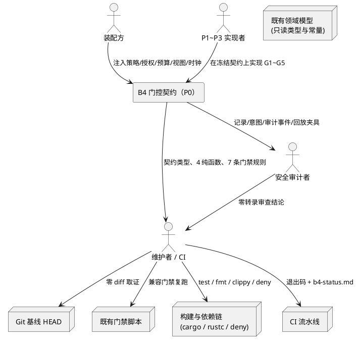

---

# **4. DFX 约束**

## **4.1 性能**

1. 本阶段交付的契约类型与占位函数**不得引入**运行时 IO、锁、线程或定时器；`gate/api.rs` 的 4 个函数在占位状态下单次调用耗时应 ≤1 ms（离线基准，仅防退化）。
2. 契约层序列化必须为线性复杂度：`GateRecord`/`GateCounters`/`PerStageResults` 的往返不得嵌套循环展开或二次分配爆炸。
3. 门禁脚本单条规则在 Windows + git-bash 下执行时间应 ≤10 s；七条规则全跑 ≤60 s。
4. 单次判定（P1 起）的 5 ms p95 结构约束不变，本阶段只保证不引入阻塞源。

## **4.2 可靠性**

1. 同一输入 + 同一策略 + 同一时钟的判定结果必须逐字节一致；本阶段的契约必须不依赖无序哈希迭代序。
2. 占位实现必须 fail-closed：非法策略或未实现分支返回 `Deny{PolicyUnavailable}`，不得 panic、不得 `todo!`/`unimplemented!`。
3. 计数只增不减，`bump` 是唯一写入口，`snapshot` 恒返回 32 项。
4. 授权与预算的非法/越界快照一律按最严格结果拦截，不得默认放行。
5. 门禁脚本退出码语义固定：0=通过、1=命中违规、2=扫描面缺失；**不得**用 0 掩盖缺失面。

## **4.3 安全性**

1. 零转录：`GateRecord`、`OutboundIntent`、`GateAuditEvent`、回放夹具、脚本输出与 `b4-status.md` 中，查询原文、完整 URL、模型名、`request_id`、API Key、参会人姓名命中必须为 0。
2. `gate/` 与 `gate*.rs` 中 `std::env`、`LLM_`、`LLM_LIVE_CALL_CAP` 命中必须为 0。
3. `gate/` 与 `gate*.rs` 中网络客户端、裸 TCP、真实计时、线程睡眠命中必须为 0。
4. `GateAuditEvent` 不得写入 `stopped_at`、查询文本、端点或密钥；原因码只写 23 项 serde 值。
5. `GateAuthorization.provider_ids` 只存 ID，不得出现端点或密钥。

## **4.4 可维护性**

1. 诊断字段名与计数枚举名一一对应，禁止字符串键写入。
2. 4 个纯函数必须集中在单一文件，保证 `grep -c` 断言稳定输出单一数字。
3. 每条门禁规则必须可单独执行、可自检；规则之间不得共享隐式状态。
4. 计数、码表、记录字段的封闭数必须可被脚本直接断言，不依赖人工核对。
5. 阶段进度与偏差必须写入 `docs/progress/b4-status.md`，不得只存在于会话记录。

## **4.5 兼容性**

1. `cargo test --workspace` 必须保持 passed ≥584、failed=0、ignored=9；用例名差集 `removed=0`。
2. 既有常量与枚举零改：`MIN_INSIGHT_CONFIDENCE=0.35`、`ShortText::LIMIT=60`、`UtteranceText::LIMIT=2000`、`SanitizedQuery::URL_LIMIT=200`、`DenyCode::ALL=11`、`GapKind` 6 变体。
3. 依赖集合零变化；`cargo deny check` 四项通过。
4. 新增字段必须可被旧版本忽略（默认值可构造），既有字段语义不得改变。
5. `GatePolicy` 的未知字段必须保留并透传，但 `skip_g1`/`skip_g4`/`skip_g5` 及任何 `skip_` 前缀键必须被校验拒绝。

---

# **5. 核心能力**

## **5.1 契约扁平落位与领域骨架**

对应 W-B4-2；对位 AC-B4-43、AC-B4-47；设计依据 design §2.0 文件落点、§2.3.2-A/B、R-01。

### **5.1.1 业务规则**

1. **扁平文件约束（REQ-B4P0-01）**：`gate.rs` 与 `gate_replay.rs` 必须是 `crates/domain/src/model/` 下的**扁平文件**，禁止建成同名子目录。
   a. 验收条件：When 检查 `crates/domain/src/model/gate.rs` 与 `gate_replay.rs`，the 门控契约 shall 同时满足"文件存在"与"同名目录不存在"；`check-b4-gates.sh --rule=source/budget/record` 均退 **0**（不得退 2）。
2. **31 项领域契约齐备（REQ-B4P0-02）**：`gate.rs` 必须定义 `GateStage`、`StageResult`、`GateRejectReason`、`ReasonVisibility/Visibility`、`GapRule`、`RelevanceScore`、`ThresholdProfile`、`FrequencyProfile`、`GatePolicy`、`GatePolicyError`、`AuthorizationStatus`、`GateContentType`、`QueryLimit`、`GateAuthorization`、`NetworkState`、`GateBudget`、`GateCounter`、`GateCounters`、`StageTrace`、`PerStageResults`、`GateDecision`、`DecisionKind`、`GateRecord`、`OutboundIntent`、`GateAuditEvent`、`AuditResult`、`LlmCapabilityView`、`ProviderView`、`EntityKey`、`ScoredCandidate`、`ClusterSource` 共 31 项。
   a. 验收条件：When 以 `cargo test -p meeting-copilot-domain` 编译并运行，the 31 项类型 shall 全部可解析、可序列化且互不冲突；既有 23 项码表的行为不回归。
3. **12 项回放夹具齐备（REQ-B4P0-03）**：`gate_replay.rs` 必须定义 `ClockFixture`、`FragmentFixture`、`InsightFixture`、`BudgetFixture`、`AuthorizationFixture`、`RelevanceFixture`、`SuppressionFixture`、`CandidateSeedFixture`、`GateInputFixture`、`ExpectedDecision`、`GateReplayCase`、`ReplayReport` 共 12 项；`GateInputFixture` 必须覆盖 design §2.3.3 映射表 8 行全部状态（预算、授权、时钟、网络/冷却/源视图、审计可用性、抑制与缓存）。
   a. 验收条件：When 构造包含全部 8 类状态的 `GateInputFixture` 并序列化，the 回放夹具 shall 字段齐全、往返逐字节一致，且不含 runner、不含原文与 URL 字段。
4. **占位字段默认值（REQ-B4P0-02）**：可缺省的契约字段必须能由默认值构造，保证旧版本数据可读。
   a. 验收条件：When 以最小 JSON（仅必填字段）反序列化 `GateRecord`/`GateAuthorization`/`GateBudget`/`OutboundIntent`，the 契约 shall 成功构造且缺省字段取文档声明的默认值。
5. **禁止项**：禁止在 `model/` 下创建 `gate/` 或 `gate_replay/` 子目录；禁止把回放 runner 放进 `gate_replay.rs`。
   a. 验收条件：When 执行 `test -d crates/domain/src/model/gate`，the 结果 shall 为"不存在"；When 扫描 `gate_replay.rs` 中 runner 相关符号，命中 shall 为 0。
6. **模块导出仅增量（REQ-B4P0-04）**：`model/mod.rs` 只允许新增 `pub mod gate_replay;`、对应 `pub use gate_replay::{...};`，以及为新增契约符号追加一条独立的 `pub use gate::{...};` 行（**不得就地改写既有 `pub use gate::{GateRejectReason, Visibility};`**）；删除行必须为 0，既有 17 个模块声明与既有 `pub use` 不得改动。
   a. 验收条件：When 执行 `git diff --numstat HEAD -- crates/domain/src/model/mod.rs`，the 删除列 shall 为 0，新增列 shall ≤3（新增 `gate_replay` 2 行 + 追加 `gate` 导出 1 行）；When 检查文件内容，既有 `pub use gate::{GateRejectReason, Visibility};` 行 shall 原样保留。

### **5.1.2 交互流程**

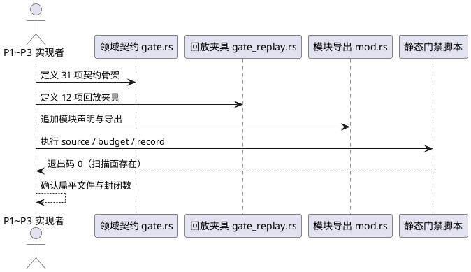

### **5.1.3 异常场景**

1. **契约文件被建成目录**
   a. 触发条件：在 `model/` 下创建 `gate/` 或 `gate_replay/` 目录。
   b. 系统行为：`--rule=source/budget/record` 的必需扫描面解析为缺失。
   c. 用户感知：脚本退 **2** 并输出 `SCAN-MISSING`；阶段判定失败。
2. **回放夹具夹带原文**
   a. 触发条件：`GateInputFixture` 或 `CandidateSeedFixture` 写入查询文本、完整 URL 或 `request_id`。
   b. 系统行为：零转录扫描命中。
   c. 用户感知：`--rule=zero-transcript` 退 1，并打印命中文件与行号。
3. **模块导出误删既有行**
   a. 触发条件：为新增导出而重排或删除既有 `pub use` 行。
   b. 系统行为：`git diff --numstat` 删除列 >0。
   c. 用户感知：W-B4-2.3 判据失败，阶段不放行。

## **5.2 门控策略校验与强制级防跳过**

对应 W-B4-3；对位 AC-B4-11、AC-B4-24、AC-B4-08；设计依据 spec §6.9、design §2.3.2-A、§2.4.4。

### **5.2.1 业务规则**

1. **8 字段默认值（REQ-B4P0-05）**：`GatePolicy` 必须含 `relevance_enabled=true`、`dedupe_enabled=true`、`threshold_profile=Balanced`、`frequency_profile=Medium`、`session_outbound_cap=120`、`auto_query_limit=80`、`on_demand_query_limit=200`、`max_cache_age_ms=86_400_000`。
   a. 验收条件：When 以空 JSON 反序列化 `GatePolicy` 并校验，the 策略 shall 通过校验且 8 个字段等于上述默认值。
2. **取值范围（REQ-B4P0-05）**：`session_outbound_cap` 必须在 0..=600；`threshold_profile` 只允许 `Strict/Balanced/Loose`；`auto_query_limit` 必须恒为 80、`on_demand_query_limit` 必须恒为 200。
   a. 验收条件：When `session_outbound_cap=601`、阈值档位非法、`auto=81` 或 `on_demand=201`，the 校验 shall 分别返回对应策略错误；When `session_outbound_cap=0`，shall 合法且一切自动外发被预算拦截。
3. **阈值投影（REQ-B4P0-05）**：`threshold_milli()` 必须返回 `Strict=720`、`Balanced=620`、`Loose=520`。
   a. 验收条件：When 依次读取三档阈值，the 返回值 shall 为 720/620/520 的整数毫值。
4. **强制级不可跳过（REQ-B4P0-06）**：`GatePolicy` 类型上不得存在 `skip_g1`/`skip_g4`/`skip_g5` 字段；反序列化含 `skip_g1`/`skip_g4`/`skip_g5` 或任何 `skip_` 前缀键的 JSON 后，校验必须返回 `MandatoryStageCannotSkip{stage}`。
   a. 验收条件：When 用含 `skip_g1=true` 的 JSON 构造并校验，the 结果 shall 为失败且错误变体为 `MandatoryStageCannotSkip`；When 扫描 `gate.rs` 中 `pub skip_g`，命中 shall 为 0。
5. **未知字段透传（REQ-B4P0-07）**：非 `skip_` 前缀的未知键必须保留在透传容器中，序列化后原样出现。
   a. 验收条件：When 反序列化含 `future_flag=1` 的策略并重新序列化，the `future_flag` shall 仍在且值不变；既有字段语义零变化。
6. **禁止项**：禁止用默认值构造把 `skip_*` 静默吞掉；禁止运行时通过参数、环境变量或开关跳过 G1/G4/G5。
   a. 验收条件：When `--rule=source` 扫描 `std::env`，命中 shall 为 0；When 传入任意 `skip_*`，校验 shall 失败而非放行。

### **5.2.2 交互流程**

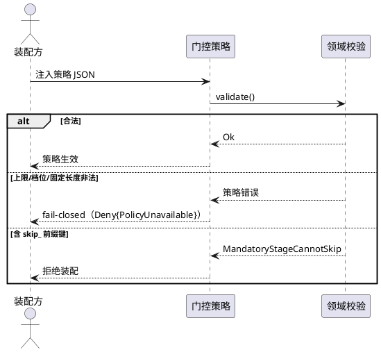

### **5.2.3 异常场景**

1. **跳过强制级配置**
   a. 触发条件：策略 JSON 出现 `skip_g1`/`skip_g4`/`skip_g5` 或任意 `skip_*` 键。
   b. 系统行为：校验显式检查未知键集合并拒绝，不进入判定。
   c. 用户感知：装配期返回 `MandatoryStageCannotSkip{stage}`；若发生在判定期，则 `Deny{PolicyUnavailable}`。
2. **会话上限越界**
   a. 触发条件：`session_outbound_cap > 600`。
   b. 系统行为：校验失败，不吸收为默认值。
   c. 用户感知：`SessionCapOutOfRange`，装配被拒。
3. **查询长度上限被改写**
   a. 触发条件：`auto_query_limit≠80` 或 `on_demand_query_limit≠200`。
   b. 系统行为：校验失败，不静默纠正。
   c. 用户感知：`QueryLimitNotFixed`，装配被拒。

## **5.3 决策、记录、意图与审计事件契约**

对应 W-B4-4；对位 AC-B4-47、AC-B4-34、AC-B4-29；设计依据 spec §6.4/§6.6、design §2.3.2-A。

### **5.3.1 业务规则**

1. **五级轨迹固定 5 元素（REQ-B4P0-08）**：逐级结果必须是固定 5 元素的数组（禁止可变长度列表），`StageTrace` 含 `calls`、`result`、`reason`、`elapsed_ms`；`StageResult` 含 `Allow/Deny/Skipped/NoCandidate/NotReached`。
   a. 验收条件：When 序列化任意 `PerStageResults`，the 数组长度 shall 恒为 5，顺序恒为 G1→G5；When 某级 `Deny`，其后各级 `calls` shall 为 0 且 `result=NotReached`。
2. **记录 14 业务字段（REQ-B4P0-09）**：`GateRecord` 业务字段必须恰为 `schema_version`、`trace_id`、`session_id`、`candidate_ref`、`insight_ref`、`trigger`、`per_stage`、`decision`、`stopped_at`、`budget_remaining`、`cooldown_until_ms`、`authorization_status`、`skipped_stages`、`decided_at_ms` 共 14 项；未知字段透传容器不计入 14。
   a. 验收条件：When 以 `--rule=record` 断言，the 字段集合 shall 等于 14 项白名单；When 连续两次 JSON 往返，the 两次序列化字节 shall 相等。
3. **跳过级白名单（REQ-B4P0-10）**：`skipped_stages` 只允许 `G2`、`G3`；含 `G1`/`G4`/`G5` 的组合必须判为结构违规。
   a. 验收条件：When `skipped_stages=[G2,G3]` 或其中任一单项，the 记录 shall 合法；When 含 `G1`/`G4`/`G5`，the 构造或校验 shall 返回 `RecordStructureViolation`。
4. **引用至少一个（REQ-B4P0-11）**：`candidate_ref` 与 `insight_ref` 可各为空，但必须至少一个非空。
   a. 验收条件：When 二者皆空，the 记录构造 shall 返回结构违规信号且**不得 panic**；When 任一非空，shall 成功。
5. **零转录意图与审计（REQ-B4P0-12）**：`OutboundIntent` 只允许 `sanitized_query_len`、`content_type`、`provider_ids`、`authorization_status`、`truncated`、`queued`、`cooldown_until_ms`；`GateAuditEvent` 为 `authorization_status`、`granted_at_ms`、`content_type`、`query_len`、`provider_ids`、`result`、`reason` 共 7 项 + `occurred_at_ms`。
   a. 验收条件：When 序列化二者并扫描，查询文本、完整 URL、`request_id`、模型名、API Key 字段名与取值命中 shall 均为 0。
6. **内容类型封闭（REQ-B4P0-12）**：`GateContentType` 只允许 `TextQuery`；音频不在外发范围内。
   a. 验收条件：When 构造音频内容类型，the 编译或反序列化 shall 失败；When 序列化允许值，shall 为 `text_query`。
7. **禁止项**：禁止在 `GateRecord` 中嵌套完整 `GateDecision`；禁止把 `stopped_at` 写入审计事件。
   a. 验收条件：When 扫描 `GateRecord` 字段，`decision` shall 仅为 `Allow/Deny` 轻量标签；When 扫描 `GateAuditEvent`，`stopped_at` 命中 shall 为 0。

### **5.3.2 交互流程**

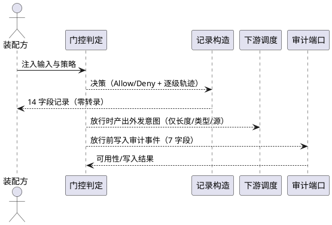

### **5.3.3 异常场景**

1. **引用全空**
   a. 触发条件：`candidate_ref` 与 `insight_ref` 同时为空。
   b. 系统行为：返回结构违规，由调用方转 `Deny{PolicyUnavailable}`。
   c. 用户感知：不放行、不产生外发意图；记录中保留原因码。
2. **跳过级越界**
   a. 触发条件：`skipped_stages` 出现 G1/G4/G5。
   b. 系统行为：结构校验失败，不产出记录。
   c. 用户感知：`RecordStructureViolation`；`--rule=record` 退 1。
3. **记录往返不稳定**
   a. 触发条件：依赖无序容器或非确定性默认值。
   b. 系统行为：两次序列化字节不等。
   c. 用户感知：`gate_record_roundtrips_with_closed_fields` 失败。

## **5.4 独立预算与 32 项计数**

对应 W-B4-5；对位 AC-B4-08、AC-B4-13、AC-B4-22、AC-B4-23、AC-B4-24、AC-B4-35、AC-B4-36；设计依据 spec §4.4/§6.7、design §2.1.3.6、§2.1.3.10。

### **5.4.1 业务规则**

1. **预算 7 字段（REQ-B4P0-13）**：`GateBudget` 必须含 `session_outbound_used`（0..=600）、`global_window_used`（0..=5）、`topic_window_used`（每桶 0..=2）、`entity_last_seen_ms`（冷却 300 000 ms）、`inflight`（0..=3）、`tokens_milli`（0..=3000）、`window_start_ms`。
   a. 验收条件：When 以合法快照构造，the 7 字段 shall 齐备且可 JSON 往返；When 任一分桶越界，the 判定 shall 返回 `Deny{BudgetExhausted}`（fail-closed）。
2. **剩余量计算（REQ-B4P0-13）**：`session_remaining_with(cap)` 必须使用饱和减法，`cap < used` 时返回 0 且不回绕。
   a. 验收条件：When `used=120`、`cap=120`，剩余 shall 为 0；When `used=121`、`cap=120`，剩余 shall 为 0 而非 65535。
3. **预算独立性（REQ-B4P0-13）**：门控预算不得读取 `LLM_LIVE_CALL_CAP` 或任何 `LLM_` 环境变量；该变量缺失、为 0 或极大时，预算判定不变。
   a. 验收条件：When 扫描 `gate/**` 与 `gate*.rs`，`LLM_`/`std::env` 命中 shall 为 0；When 该变量取不同值，同一输入的判定 shall 一致。
4. **32 项计数（REQ-B4P0-14）**：`GateCounter` 必须恰为 32 变体，顺序等于 spec §4.4 的 1..32；`GateCounters` 内部为固定容量容器；`bump(GateCounter)` 是唯一写入口，`get`/`snapshot` 只读；`snapshot()` 恒返回 32 项；计数只增不减。
   a. 验收条件：When 断言 `GateCounter::ALL`，长度 shall 为 32 且逐项名称与 spec §4.4 字符串相等；When 连续 `bump` 同一项 3 次，`get` shall 为 3、`snapshot` 长度 shall 为 32。
5. **原因码到计数映射（REQ-B4P0-15）**：23 个原因码必须按 design §2.1.3.10 静态映射；`Duplicate`/`Suppressed`/`QuotaExhausted` 必须按产生级（G1 或 G3）分流；`PolicyUnavailable`/`RetentionExpired` 不新增计数项，只使 `gate_deny_total+1` 并在 `StageTrace.reason` 留痕。
   a. 验收条件：When 以 G1 产生的 `Duplicate` 计数，the 命中的 shall 为 `gate_l1_duplicate`；When 以 G3 产生，shall 为 `gate_l3_duplicate`；When `PolicyUnavailable`，shall 只增 `gate_deny_total`。
6. **允许/拒绝互斥（REQ-B4P0-14）**：每次 `Allow` 必须 `gate_allow_total+1`；每次 `Deny` 必须 `gate_deny_total+1`；两者不得同时增加。
   a. 验收条件：When 单次判定为 `Allow`，allow 增量 shall 为 1、deny 增量 shall 为 0；When 为 `Deny`，反之。
7. **禁止项**：禁止以字符串键写计数；禁止新增计数项或改变 32 项顺序；禁止让计数随重启清零。
   a. 验收条件：When 扫描计数写入路径，字符串键命中 shall 为 0；When 重启后读快照，既有累计值 shall 由外部快照恢复而非门控清零。

### **5.4.2 交互流程**

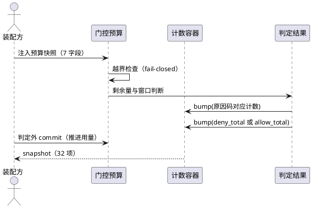

### **5.4.3 异常场景**

1. **预算快照损坏**
   a. 触发条件：`session_outbound_used>600`、`inflight>3`、`tokens_milli>3000` 或分桶 `>2`。
   b. 系统行为：视为外部快照损坏，直接 fail-closed。
   c. 用户感知：`Deny{BudgetExhausted}`，`gate_l4_budget_exhausted+1`。
2. **计数项缺失或重排**
   a. 触发条件：32 项少一项、多一项或顺序变化。
   b. 系统行为：脚本与单测同时失败。
   c. 用户感知：`gate_counter_all_is_32_in_spec_order` 失败；`--rule=record/budget` 不得退 0。
3. **重复计数**
   a. 触发条件：同一拒绝在两级各计一次（如 G1 与 G3 都计 `duplicate`）。
   b. 系统行为：分流规则要求按产生级唯一计数。
   c. 用户感知：AC-B4-08/16 断言失败。

## **5.5 可回放纯函数契约冻结**

对应 W-B4-6；对位 AC-B4-46、AC-B4-43；设计依据 spec §1.9、design §2.2.2-A、§2.1.3.1、R-02。

### **5.5.1 业务规则**

1. **四个纯函数（REQ-B4P0-16）**：必须暴露且仅暴露 `detect_gaps`、`evaluate_gate`、`score_relevance`、`record_from` 四个公开纯函数，语义分别为：L0 缺口识别、五级主编排唯一入口、单候选相关性评分、零转录记录构造。
   a. 验收条件：When 扫描 `crates/application/src/gate/api.rs`，`pub fn` 计数 shall 恰为 4，四名合计计数 shall 为 4，且四名只出现在 1 个文件。
2. **签名冻结（REQ-B4P0-16）**：四个函数的参数与返回必须与 spec §1.9 一致：`detect_gaps` 接收 L0 扫描输入并返回候选集合；`evaluate_gate` 接收门控输入、策略与时钟并返回决策；`score_relevance` 接收相关性输入与策略并返回六分项评分；`record_from` 接收门控输入、决策与预算并返回记录。
   a. 验收条件：When `cargo build -p meeting-copilot-application` 执行，the 签名 shall 一次性编译通过；When 任一签名被改动，shall 需要 spec 变更而非在本阶段自行调整。
3. **单一文件（REQ-B4P0-16）**：4 个函数全部定义在 `gate/api.rs`；其余 `gate/*.rs` 只允许 `pub(crate)` 实现体，且名称不得与四名同形。
   a. 验收条件：When `grep -rl` 检索四名定义，输出文件数 shall 为 1；When 检索其余子模块，四名同形定义命中 shall 为 0。
4. **门面与模块声明（REQ-B4P0-16）**：`gate/mod.rs` 必须导出四名并声明 `api/input/clock/prefilter/relevance/dedupe/budget/lease/outbound/record/replay`；`application/src/lib.rs` 必须新增且仅新增 1 行 `pub mod gate;`。
   a. 验收条件：When 编译 application，the 门面 shall 可用；When 计数 `pub mod gate;`，shall 为 1。
5. **占位实现 fail-closed（REQ-B4P0-17）**：P0 阶段占位行为必须为：`evaluate_gate` 返回 `Deny{PolicyUnavailable, stopped_at:G1, per_stage 全 NotReached}`；`detect_gaps` 返回空集合；`score_relevance` 返回六分项全 0；`record_from` 产出 14 字段记录；源码中 `todo!`/`unimplemented!`/`panic!` 命中必须为 0。
   a. 验收条件：When 调用四个占位函数，the 结果 shall 满足上述语义且不 panic；When 扫描源码，三类宏命中 shall 为 0。
6. **支撑类型最小骨架（REQ-B4P0-17）**：为使四函数可编译，P0 必须同时落地其输入类型（门控输入、L0 扫描输入、相关性输入）与时钟端口的最小骨架；数值行为留 P1/P2。
   a. 验收条件：When 检查 `gate/input.rs` 与 `gate/clock.rs`，the 输入类型与时钟端口 shall 存在且字段与 design §2.3.2-C 一致；When 检查其函数体，G1~G5 判定逻辑命中 shall 为 0。
7. **回放面不扩散（REQ-B4P0-17）**：`gate/**` 不得向回放面 re-export `OutboundLease`、`GateAuditSink`、`GateCounters`；13.3 只允许依赖 4 函数 + 3 结构。
   a. 验收条件：When 扫描 `gate/mod.rs` 的 `pub use`，上述三类符号命中 shall 为 0（或仅 crate 内可见）。
8. **禁止项**：禁止把四函数分散到多个文件；禁止在 `api.rs` 放置任何判定实现细节；禁止用 `todo!`/`unimplemented!`/`panic!` 占位。
   a. 验收条件：When 执行 `--rule=source`，三类宏命中 shall 为 0；When 检查 `api.rs` 行数构成，实现体只允许委托给 `pub(crate)` 子模块或返回 fail-closed 常量。

### **5.5.2 交互流程**

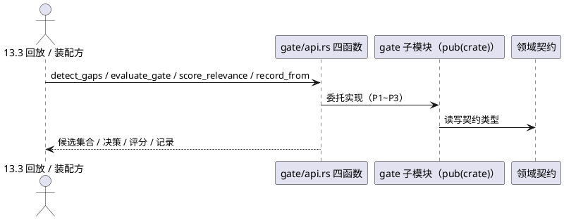

### **5.5.3 异常场景**

1. **函数分散**
   a. 触发条件：把 `record_from` 放进 `record.rs` 并设为 `pub fn`。
   b. 系统行为：`grep -rl` 输出文件数变为 2。
   c. 用户感知：AC-B4-46 断言失败，`--rule=source` 仍可能退 0，必须在阶段验收单独拦截。
2. **占位实现 panic**
   a. 触发条件：用 `todo!()` 占位。
   b. 系统行为：静态扫描命中。
   c. 用户感知：`--rule=source` 退 1，P0 不放行。
3. **回放依赖越界**
   a. 触发条件：`mod.rs` 中 `pub use` 暴露 `OutboundLease`/`GateAuditSink`/`GateCounters`。
   b. 系统行为：违反 13.3 依赖边界。
   c. 用户感知：AC-B4-49 相关断言失败，需回退导出。

## **5.6 静态门禁七规则与自检**

对应 W-B4-7；对位 AC-B4-07、AC-B4-22、AC-B4-33、AC-B4-34、AC-B4-42、AC-B4-43、AC-B4-47、AC-B4-50；设计依据 spec §7.8、design §2.1.2/§2.1.3.1、D-B4-D02、R-03。

### **5.6.1 业务规则**

1. **脚本与退出码（REQ-B4P0-18）**：必须新增 `scripts/check-b4-gates.sh`，支持 `--rule=<name>` 与 `--self-test`；退出码固定 0=通过、1=命中违规、2=扫描面缺失。
   a. 验收条件：When 传入未知参数，the 脚本 shall 退 2；When 全部规则通过，shall 退 0；When 植入违规，shall 退 1。
2. **规则 source（REQ-B4P0-18/19）**：扫描 `crates/application/src/gate`（必需）、`crates/domain/src/model/gate*.rs`（必需）、`crates/domain/src/gap`（本轮不存在）；命中 0 的符号为协议客户端调用、裸 TCP 类型、网络命名空间、真实计时、线程睡眠、环境变量读取、`todo!`/`unimplemented!`/`panic!`；必需面缺失退 2，可选面缺失打印 `SCAN-ABSENT: crates/domain/src/gap` 且不判失败。
   a. 验收条件：When 执行 `--rule=source`，the 退出码 shall 为 0，输出 shall 含 `SCAN-ABSENT: crates/domain/src/gap`。
3. **规则 budget（REQ-B4P0-18）**：扫描 `gate/**` 与 `gate*.rs`，`LLM_LIVE_CALL_CAP`/`LLM_`/`std::env` 命中 0；`GateBudget` 的 5 个必填字段名各至少出现 1 次；任一必需面缺失退 2。
   a. 验收条件：When 执行 `--rule=budget`，the 退出码 shall 为 0；When 人为加入 `std::env`，shall 退 1。
4. **规则 record（REQ-B4P0-18）**：`GateRecord` 业务字段集合必须等于 14（透传容器不计）；`skipped_stages` 白名单仅 `G2`/`G3`；`GateRejectReason` 变体数必须为 23；缺一退 1。
   a. 验收条件：When 执行 `--rule=record`，the 退出码 shall 为 0；When 白名单被扩为含 `G4`，shall 退 1。
5. **规则 outbound（REQ-B4P0-19）**：`gate/**` 中协议客户端调用命中 0；`crates/application/src/proactive/` 不存在时打印 `SCAN-ABSENT` 并只扫 `gate/`，不判失败、不退 2；`issue_query` 与 `AuditLog::append` 出现在 1 个文件（P0 允许 0，P3 必须 1）。
   a. 验收条件：When 执行 `--rule=outbound`，the 退出码 shall 为 0；When 统计 `issue_query|AuditLog::append` 的文件数，P0 shall 为 0。
6. **规则 zero-transcript（REQ-B4P0-18）**：扫描 `gate/**`、`crates/application/tests/**`、`docs/progress/b4-status.md`（后两者缺失时只登记 `SCAN-ABSENT`）；内置模式（协议前缀、API Key 前缀、鉴权头、模型名前缀、`request_id`）命中 0。
   a. 验收条件：When 执行 `--rule=zero-transcript`，the 退出码 shall 为 0；When 植入一条含鉴权头的注释，shall 退 1。
7. **规则 targets（REQ-B4P0-18）**：断言 `scripts/test-name-inventory.sh` 的 `NEW_TARGETS` 含 6 个 `gate_*`；P0 允许缺项但必须可逐项转绿，缺项时退 1。
   a. 验收条件：When 执行 `--rule=targets`，the 输出的缺失项 shall 可枚举；When 6 项齐全，shall 退 0。
8. **规则 doc-plan（REQ-B4P0-18）**：断言 spec §8 表格行数 ≥1，且每行路径存在或标"新增"；缺项退 1。
   a. 验收条件：When 执行 `--rule=doc-plan`，the 退出码 shall 为 0。
9. **自检（REQ-B4P0-20）**：`--self-test` 必须植入至少一条违规并证明脚本能退 1；自检不得读写真实源码（用临时目录）。
   a. 验收条件：When 执行 `--self-test`，the 退出码 shall 恰为 1，且真实源码与临时文件在自检后保持原状。
10. **禁止项**：禁止修改 `check-capture-offline.sh`/`check-b3-gates.sh`/`check-mac-scope.sh` 的既有规则语义；共享逻辑以局部复制为准。
    a. 验收条件：When 对比上述脚本的 `git diff`，删除行与语义改动 shall 为 0。

### **5.6.2 交互流程**

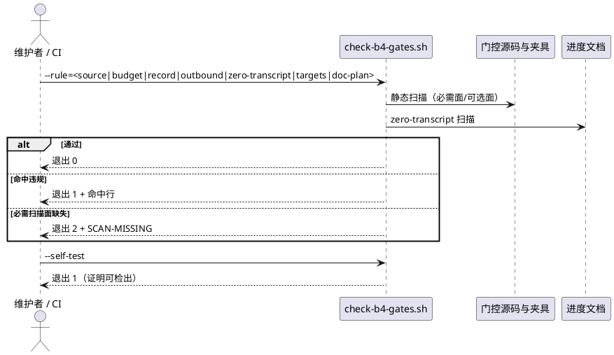

### **5.6.3 异常场景**

1. **扫描面缺失被误判为通过**
   a. 触发条件：`gate.rs` 被建成目录或 `application/src/gate` 未创建。
   b. 系统行为：必需面解析失败。
   c. 用户感知：退 2；`--rule=source` 不得返回 0。
2. **可选面缺失导致永久红**
   a. 触发条件：`domain/src/gap` 或 `application/src/proactive` 本轮不存在。
   b. 系统行为：打印 `SCAN-ABSENT` 并仅登记，不判失败。
   c. 用户感知：退 0，`b4-status.md` 有对应登记。
3. **自检污染工作区**
   a. 触发条件：自检直接改真实源码。
   b. 系统行为：违反自检隔离要求。
   c. 用户感知：`git status` 出现非预期改动，阶段取证失败。

## **5.7 P0 出口与零 diff 取证**

对应 W-B4-8；对位 AC-B4-08、AC-B4-22、AC-B4-37、AC-B4-39、AC-B4-40、AC-B4-41、AC-B4-43、AC-B4-44、AC-B4-45、AC-B4-47；设计依据 tasks §0.7、design §2.6-P0 出口、§2.4.2。

### **5.7.1 业务规则**

1. **三条硬判据（REQ-B4P0-21）**：`cargo test -p meeting-copilot-domain` 退 0；`--rule=record` 退 0；`--rule=budget` 退 0；三条缺一即 P0 未完成。
   a. 验收条件：When 一次性串联执行三条命令，the 总退出码 shall 为 0。
2. **旁证五条（REQ-B4P0-21）**：`--rule=source`/`targets`/`outbound`/`zero-transcript`/`doc-plan` 必须全部退 0；任一退 2 视为失败。
   a. 验收条件：When 逐条执行五条规则，the 退出码 shall 均为 0 或（targets 允许的缺失项导致的 1 之外）不得为 2。
3. **B3 零 diff（REQ-B4P0-22）**：`understand/store.rs` 与 `understand/deduplicator.rs` 相对 HEAD 零 diff（工作区与暂存区）。
   a. 验收条件：When 执行 `git diff --quiet HEAD -- <两文件>`，the 退出码 shall 为 0；When 统计 `git status --porcelain -- <两文件>`，行数 shall 为 0。
4. **既有常量与枚举零改（REQ-B4P0-22）**：`MIN_INSIGHT_CONFIDENCE`、`ShortText::LIMIT`、`UtteranceText::LIMIT`、`SanitizedQuery::URL_LIMIT`、`DenyCode::ALL: [Self; 11]`、`pub enum GapKind` 各恰 1 处定义，取值不变，`GapKind` 变体数 6。
   a. 验收条件：When 逐项 grep 定义位置与取值，the 结果 shall 与基线快照一致；When 新增 `GapKind` 变体，shall 判定失败。
5. **零新依赖（REQ-B4P0-22）**：`Cargo.toml`/`Cargo.lock` 相对 HEAD 新增依赖行必须为 0；`gate.rs` 只允许使用 domain 既有依赖；`application/Cargo.toml` 不得新增 `serde_json`。
   a. 验收条件：When 执行 `git diff --stat HEAD -- Cargo.toml Cargo.lock`，the 输出行数 shall 为 0；When 计数 `application/Cargo.toml` 中 `serde_json`，shall 为 0。
6. **既有门禁不回退（REQ-B4P0-23）**：`cargo fmt --all -- --check`、`cargo clippy --workspace --all-targets -- -D warnings`、`check-layering.sh`、`scan-secrets.sh`、`check-b3-gates.sh` 六条规则、`cargo deny check` 四项必须全部通过；`check-b3-gates.sh --self-test` 预期退 1。
   a. 验收条件：When 串联执行上述门禁，the 总退出码 shall 为 0；When 单独执行 b3 自检，shall 退 1。
7. **全量回归与 ignore 计数（REQ-B4P0-23）**：`cargo test --workspace` 必须 passed ≥584 / failed=0 / ignored=9；`--list --ignored` 计数为 9 且名称不变；不得新增 `#[ignore]`。
   a. 验收条件：When 执行全量测试并统计，the 三项计数 shall 满足上述阈值；When 比对 ignore 名称清单，差异 shall 为 0。
8. **平台口径（REQ-B4P0-23）**：Windows 单平台；macOS 一律"不适用（无设备）"；不得新增 macOS 依赖、路径或分支。
   a. 验收条件：When 执行 `check-mac-scope.sh --rule=claims`，the 退出码 shall 为 0。
9. **偏差登记（REQ-B4P0-24）**：`docs/progress/b4-status.md` 必须建立最小骨架，并登记 D-B4-D02（`gap/` 与 `proactive/` 不存在）、D-B4-D04（design 12 码降级为历史别名）、R-01（扁平落位）与本阶段裁决。
   a. 验收条件：When 检索 `D-B4-D02`、`D-B4-D04` 与 `SCAN-ABSENT` 口径，命中 shall 各 ≥1；When `--rule=zero-transcript` 扫描该文件，命中 shall 为 0。
10. **禁止项**：禁止以"离线通过"宣称 G2/G3/G4 通过；禁止用临时改源码的方式制造反例后不还原；禁止把取证命令结果只留在会话中而不落 `b4-status.md`。
    a. 验收条件：When 检索 `b4-status.md`，G2/G3/G4 状态 shall 为"未判定"；When 检查 `git status`，阶段结束时 shall 为空。

### **5.7.2 交互流程**

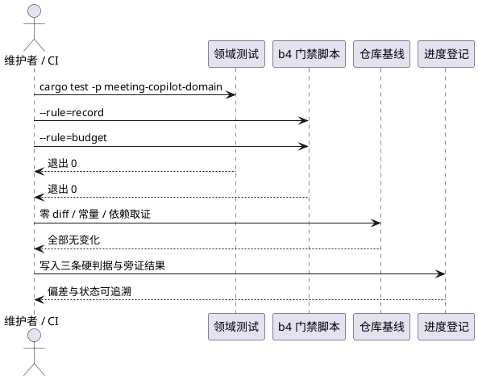

### **5.7.3 异常场景**

1. **硬判据单项失败**
   a. 触发条件：`cargo test -p meeting-copilot-domain`、`--rule=record`、`--rule=budget` 任一非 0。
   b. 系统行为：P0 判定失败，不进入 W-B4-9。
   c. 用户感知：CI 红灯，`b4-status.md` 记录失败项与退出码。
2. **零 diff 被破坏**
   a. 触发条件：为接入门控而修改 `store.rs`/`deduplicator.rs`。
   b. 系统行为：`git diff --quiet HEAD` 退 1。
   c. 用户感知：AC-B4-37 失败，必须回退改动。
3. **依赖漂移**
   a. 触发条件：为 JSON 往返在 application 引入 `serde_json`。
   b. 系统行为：依赖差集非空。
   c. 用户感知：AC-B4-41 失败，必须改为 domain 侧测试或移除依赖。
4. **ignore 计数变化**
   a. 触发条件：新增 `#[ignore]` 规避真实端点用例。
   b. 系统行为：ignored 计数 >9。
   c. 用户感知：AC-B4-44 失败。

---

# **6. 数据约束**

## **6.1 门控策略（GatePolicy）**

1. **relevance_enabled**：布尔，默认 true；仅控制 G2 是否可跳过。
2. **dedupe_enabled**：布尔，默认 true；仅控制 G3 的去重/配额/冷却/收敛四个子项，不控制抑制与缓存年龄。
3. **threshold_profile**：只允许 `Strict`/`Balanced`/`Loose`，默认 `Balanced`；投影值 720/620/520。
4. **frequency_profile**：只允许 `Low`/`Medium`/`High`，默认 `Medium`；每窗口次数 1/3/5。
5. **session_outbound_cap**：0..=600，默认 120；越界即校验失败。
6. **auto_query_limit**：必须恒为 80；不等于 80 即校验失败。
7. **on_demand_query_limit**：必须恒为 200；不等于 200 即校验失败。
8. **max_cache_age_ms**：默认 86 400 000；0 表示缓存永不新鲜。
9. **unknown（透传容器）**：可含任意非 `skip_` 前缀键；不计入业务字段；序列化后原样保留。

## **6.2 档位与长度枚举**

1. **ThresholdProfile**：`Strict=720‰`、`Balanced=620‰`、`Loose=520‰`；值域 0..=1000。
2. **FrequencyProfile**：`Low=1`、`Medium=3`、`High=5`（每 600 000 ms）。
3. **QueryLimit**：`Auto=80` 字符、`OnDemand=200` 字符；字符数按 Unicode 字符计，不按字节。
4. **GateContentType**：仅 `TextQuery`；音频不在外发范围内。

## **6.3 预算（GateBudget）**

1. **session_outbound_used**：0..=600；超过上限视为快照损坏。
2. **global_window_used**：0..=5；窗口 600 000 ms。
3. **topic_window_used**：按主题分桶，每桶 0..=2；分桶序必须确定，序列化逐字节一致。
4. **entity_last_seen_ms**：按实体键记录最后出现毫秒；冷却 300 000 ms；实体键必须是 32 位十六进制文本。
5. **inflight**：0..=3；>3 视为快照损坏。
6. **tokens_milli**：0..=3000；容量 3 个令牌、补充 3/10 min。
7. **window_start_ms**：窗口起点毫秒；必须与 `now_ms` 同源时钟。

## **6.4 计数（GateCounter / GateCounters）**

`GateCounter` 必须恰为 32 项，顺序如下，名称与 spec §4.4 逐项字符串相等：

1. `gate_l0_candidates`
2. `gate_l0_low_confidence`
3. `gate_l0_question_answered_skipped`
4. `gate_l0_sensitive_seed_blocked`
5. `gate_allow_total`
6. `gate_deny_total`
7. `gate_stage_skipped_total`
8. `gate_l1_auto_disabled`
9. `gate_l1_consent_missing`
10. `gate_l1_paused`
11. `gate_l1_silent_period`
12. `gate_l1_screen_share`
13. `gate_l1_low_confidence`
14. `gate_l1_duplicate`
15. `gate_l1_suppressed`
16. `gate_l1_quota_exhausted`
17. `gate_l1_no_provider`
18. `gate_l1_sensitive_term`
19. `gate_l2_low_relevance`
20. `gate_l3_duplicate`
21. `gate_l3_suppressed`
22. `gate_l3_stale`
23. `gate_l3_quota`
24. `gate_l4_budget_exhausted`
25. `gate_l4_gateway_cooling`
26. `gate_l4_offline`
27. `gate_l5_not_granted`
28. `gate_l5_sanitize_failed`
29. `gate_l5_audit_unavailable`
30. `gate_l5_provider_or_domain_blocked`
31. `gate_replay_runs`
32. `gate_replay_mismatch`

- **GateCounters**：固定 32 项 `u64` 累加器；`bump` 唯一写入口；`get`/`snapshot` 只读；`snapshot()` 长度恒 32；不得回绕、不得清零（除进程初始化）。

## **6.5 逐级轨迹（GateStage / StageResult / StageTrace / PerStageResults）**

1. **GateStage**：`G1`/`G2`/`G3`/`G4`/`G5`，固定 5 项，顺序固定。
2. **StageResult**：`Allow`/`Deny`/`Skipped`/`NoCandidate`/`NotReached`，5 项封闭。
3. **StageTrace.calls**：0..=u16；短路后必须为 0。
4. **StageTrace.reason**：`Deny` 时必须在 23 项之内；`Allow`/`Skipped`/`NoCandidate`/`NotReached` 时必须为空。
5. **StageTrace.elapsed_ms**：由注入时钟计算；占位阶段可为 0。
6. **PerStageResults**：固定 5 元素，元素序 = G1..G5；序列化长度恒 5。

## **6.6 门控记录（GateRecord）**

1. **schema_version**：必填；本轮固定为 1。
2. **trace_id**：必填，可回溯；不得等于 `request_id`。
3. **session_id**：必填，跨会话输入必须被拒绝。
4. **candidate_ref**：可选；与 `insight_ref` 至少一个非空。
5. **insight_ref**：可选；与 `candidate_ref` 至少一个非空。
6. **trigger**：必填，`Auto`/`OnDemand`；决定 80/200 长度上限。
7. **per_stage**：必填，固定 5 元素轨迹。
8. **decision**：必填，轻量标签 `Allow`/`Deny`。
9. **stopped_at**：可选；`Deny` 时必填且等于短路级。
10. **budget_remaining**：0..=120（默认上限口径）；超过 120 视为结构违规。
11. **cooldown_until_ms**：可选；出现时必须是毫秒时间戳。
12. **authorization_status**：必填，`Granted`/`Revoked`/`Expired`/`Missing`。
13. **skipped_stages**：可选集合；元素仅允许 `G2`/`G3`；出现其他级即结构违规。
14. **decided_at_ms**：必填，虚拟毫秒。
15. **unknown（不计入 14）**：可含任意未知字段；JSON 往返逐字节一致；不得含原文/URL/`model`/`request_id`/`api_key`/说话人姓名。

## **6.7 外发授权（GateAuthorization）**

1. **status**：`Granted`/`Revoked`/`Expired`/`Missing`；缺失或未知按 `Missing`。
2. **granted_at_ms**：`Granted` 时必填；其他状态可为空。
3. **content_types**：仅允许 `TextQuery`；出现音频即非法。
4. **max_query_chars**：`Auto=80`、`OnDemand=200`；越界即非法。
5. **provider_ids**：非空时必须是启用源子集；为空表示"不限定"，但仍受当前启用源约束。
6. **notice_version**：≥1；授权变更后必须递增。
7. **revoked_at_ms**：撤销后必填；不可清空恢复。

## **6.8 外发意图（OutboundIntent）**

1. **sanitized_query_len**：必填，非负；必须反映**截断后**的长度（自动 ≤80、按需 ≤200）。
2. **content_type**：必填，仅 `TextQuery`。
3. **provider_ids**：必填，仅 ID；不得含端点或密钥。
4. **authorization_status**：必填，与判定时的授权快照一致。
5. **truncated**：必填；发生截断时为 true。
6. **queued**：必填；并发满 3 且进入单排队位时为 true。
7. **cooldown_until_ms**：可选；排队或冷却场景必须携带。
8. **禁止字段**：查询文本、完整 URL、`request_id`、模型名、`SanitizedQuery` 本体。

## **6.9 审计事件（GateAuditEvent）**

1. **authorization_status**：必填，四状态之一。
2. **granted_at_ms**：可选；与授权快照一致。
3. **content_type**：必填，仅 `TextQuery`。
4. **query_len**：必填，非负；为脱敏后长度，不含文本。
5. **provider_ids**：必填，仅 ID。
6. **result**：必填，`Allow`/`Deny`。
7. **reason**：`Deny` 时必为 23 项之一；`Allow` 时必须为空；只写 serde 值，不写中文文案。
8. **occurred_at_ms**：必填，虚拟毫秒；不得写 `stopped_at`。

## **6.10 回放夹具（GateInputFixture 及 11 项）**

1. **ClockFixture**：`anchor_ms` + `tick_ms`；第 n 次取值 = `anchor_ms + n × tick_ms`；纯取值、无状态机。
2. **FragmentFixture**：`span`、`confidence_milli`（0..=1000）、`dual_channel`、`answered_ms`（可选）；不得含片段原文。
3. **InsightFixture**：`reference_digest`（32 hex）、`kind`、`confidence_milli`、`manual_locked`；不得含要点原文。
4. **BudgetFixture**：7 字段与 `GateBudget` 一一对应；主题分桶与实体时间以有序对表达。
5. **AuthorizationFixture**：7 字段与 `GateAuthorization` 一一对应。
6. **RelevanceFixture**：`semantic/entity/gain/source_trust` 各 0..=1000 毫值 + `delta_ms`（≥0）。
7. **SuppressionFixture**：`topics`、`providers`、`entities` 三组抑制集合；只存 ID 或键。
8. **CandidateSeedFixture**：`rule`、`confidence_milli`、`dedupe_key`（32 hex）、`topic_cluster_id`、`entity_keys`、`primary_domain`（仅域名，不含协议与路径）。
9. **GateInputFixture**：必须覆盖 `now_ms`、`clock`、`trigger`、`session_state`、`silent_period`、`screen_share`、`consent_confirmed`、`auto_suggestion_enabled`、`fragments`、`insights`、`budget`、`authorization`、`provider_enabled_count`、`provider_ids`、`llm_cooling`、`llm_cooling_until_ms`、`network`、`audit_available`、`relevance`、`suppression`、`candidate_seeds`、`cache_age_ms`、`refresh_available` 共 23 项；禁止原文/URL/`request_id`。
10. **ExpectedDecision**：`Allow` 或 `Deny{reason, stopped_at}`；`reason` 必须为 23 项之一。
11. **GateReplayCase**：`case_id`（唯一）、`input_fixture`、`policy_fixture`、`expected` 4 项。
12. **ReplayReport**：`total`、`matched`、`mismatched`、`mismatch_cases`（只存 case_id）、`seed`；两次运行逐字节一致。

## **6.11 视图、实体键与候选包裹**

1. **ProviderView**：`enabled_count`（u8）+ `provider_ids`；不得含端点或密钥。
2. **LlmCapabilityView**：`cooling` + `cooling_until_ms`；不得含模型名或端点。
3. **EntityKey**：32 位十六进制文本；构造期校验失败即丢弃候选并计 `gate_l0_low_confidence`。
4. **ScoredCandidate**：外层包裹既有 `GapCandidate` + `rule` + `relevance` + `topic_cluster_id` + `entity_keys` + `topic_cluster_source`；不得修改 `GapCandidate`。
5. **ClusterSource**：`Injected`/`Fallback` 2 项封闭。
6. **GateDecision**：`Allow` 必须携带 `per_stage`、`budget_remaining`、`candidates`、`outbound`、`suppressed_notice`、`stopped_at`；`Deny` 必须携带唯一 `reason`、`stopped_at`、`per_stage`、`cooldown_until_ms`。

---

# **7. 验收判定**

## **7.1 阶段出口三条硬判据**

| 编号 | 判据 | 期望 |
|---|---|---|
| E-01 | `cargo test -p meeting-copilot-domain` | 退出 0（31 项契约、23 项码表、`GateRecord` 14 字段往返、`GateBudget`、`GateCounters` 32 项全绿） |
| E-02 | `bash scripts/check-b4-gates.sh --rule=record` | 退出 0（14 业务字段、23 变体、`skipped_stages ⊆ {G2,G3}`） |
| E-03 | `bash scripts/check-b4-gates.sh --rule=budget` | 退出 0（预算字段齐备、`gate/` 与 `gate*.rs` 中 `LLM_`/`std::env` 命中 0） |

> 旁证（不替代三条）：`--rule=source`/`targets`/`outbound`/`zero-transcript`/`doc-plan` 全部退 0；`store.rs`/`deduplicator.rs` 零 diff；`cargo fmt --check` 与 `cargo clippy -D warnings` 退 0。

## **7.2 需求 → 任务 → AC 映射**

| 需求 | 主任务 | 子任务 | 对位 AC | 关键判据 |
|---|---|---|---|---|
| REQ-B4P0-01 | W-B4-2 | 2.1、2.2、2.4 | AC-B4-43/47 | 扁平文件存在、同名目录不存在、三规则退 0 |
| REQ-B4P0-02 | W-B4-2 | 2.1 | AC-B4-43/47 | 31 项类型齐备、`cargo test -p domain` 退 0 |
| REQ-B4P0-03 | W-B4-2 | 2.2 | AC-B4-48/49 | 12 项夹具齐备、8 类状态覆盖、无 runner/原文 |
| REQ-B4P0-04 | W-B4-2 | 2.3 | AC-B4-43 | 删除列 0、新增列 ≤4 |
| REQ-B4P0-05 | W-B4-3 | 3.1 | AC-B4-11/24 | 8 默认值、cap 0..=600、阈值 520/620/720、80/200 |
| REQ-B4P0-06 | W-B4-3 | 3.2 | AC-B4-08 | `skip_*` 校验必失败、类型无 `skip_g*` 字段 |
| REQ-B4P0-07 | W-B4-3 | 3.3 | AC-B4-47 | 未知键往返保留 |
| REQ-B4P0-08 | W-B4-4 | 4.1 | AC-B4-47 | 序列化恒 5 元素、短路后 `calls=0` |
| REQ-B4P0-09 | W-B4-4 | 4.2 | AC-B4-47 | 14 字段、两次往返字节相等 |
| REQ-B4P0-10 | W-B4-4 | 4.3 | AC-B4-47 | `skipped_stages ⊆ {G2,G3}` |
| REQ-B4P0-11 | W-B4-4 | 4.5 | AC-B4-47 | 双空即结构违规、不 panic |
| REQ-B4P0-12 | W-B4-4 | 4.4 | AC-B4-34/29/42 | 意图/审计零转录、内容类型仅 `TextQuery` |
| REQ-B4P0-13 | W-B4-5 | 5.1 | AC-B4-22/23/24 | 7 字段、越界 fail-closed、饱和剩余 |
| REQ-B4P0-14 | W-B4-5 | 5.2、5.3 | AC-B4-08/13/24/35/42 | 32 项顺序、单一 bump、名称逐项相等 |
| REQ-B4P0-15 | W-B4-5 | 5.4 | AC-B4-08/13/16/17/20/25/35/36 | 静态映射、G1/G3 分流、两码不新增计数 |
| REQ-B4P0-16 | W-B4-6 | 6.1、6.2、6.3 | AC-B4-46 | 4 个 `pub fn`、单文件、门面导出 |
| REQ-B4P0-17 | W-B4-6 | 6.4 | AC-B4-43/46 | 占位 fail-closed、无 `todo/panic`、回放面不扩散 |
| REQ-B4P0-18 | W-B4-7 | 7.1~7.5 | AC-B4-07/22/33/34/42/43/47/50 | 七规则退 0、退出码语义 |
| REQ-B4P0-19 | W-B4-7 | 7.1、7.4 | AC-B4-43/33 | `SCAN-ABSENT` 只登记、必需面缺失退 2 |
| REQ-B4P0-20 | W-B4-7 | 7.5 | AC-B4-43/47 | `--self-test` 退 1、不污染源码 |
| REQ-B4P0-21 | W-B4-8 | 8.1 | AC-B4-08/22/47 | 三条硬判据同时退 0 |
| REQ-B4P0-22 | W-B4-8 | 8.2、8.3、8.4 | AC-B4-37/40/41 | 零 diff、6 常量零改、依赖零新增 |
| REQ-B4P0-23 | W-B4-8 | 8.5 | AC-B4-39/43/44/45 | 全量门禁退 0、584/9、ignore 名称不变 |
| REQ-B4P0-24 | W-B4-8 | 8.1 | AC-B4-50 | `b4-status.md` 可追溯、`--rule=doc-plan` 退 0 |

## **7.3 任务验收口径（W-B4-2 ~ W-B4-8）**

> 本表保留 tasks.md 的 DoD 原文口径，供执行阶段逐条比对；证据命令在项目根 `TSC/` 下执行，`$CARGO` 已 export。

### W-B4-2 扁平落位与 domain 契约骨架

| 子任务 | 验收口径 | 证据 |
|---|---|---|
| 2.1 `gate.rs` 扁平文件（31 项） | 文件存在且不是目录；31 项全部定义；可缺省字段就位；预算分桶使用确定性有序容器 | `test -f crates/domain/src/model/gate.rs && test ! -d crates/domain/src/model/gate`；`"$CARGO" test -p meeting-copilot-domain` 退 0 |
| 2.2 `gate_replay.rs` 扁平文件（12 项） | 12 项齐备；`GateInputFixture` 覆盖映射表 8 行；不含 runner/原文/URL | `test -f .../gate_replay.rs && test ! -d .../gate_replay` |
| 2.3 `model/mod.rs` 仅增声明 | 新增 2 个 `pub mod` + 2 组 `pub use`；删除行 0；既有 21 个声明零改 | `git diff --numstat HEAD -- crates/domain/src/model/mod.rs` → 删除列 0、新增列 ≤4 |
| 2.4 目录反例断言 | `--rule=source/budget/record` 均退 0（不是 2） | `bash scripts/check-b4-gates.sh --rule=source; echo "exit=$?"` → 0 |

### W-B4-3 `GatePolicy` 校验与 `skip_*` 防静默吸收

| 子任务 | 验收口径 | 证据 |
|---|---|---|
| 3.1 字段与 `validate()` | 8 默认值正确；拒绝 cap>600、阈值非 520/620/720、80/200 被改；`threshold_milli()` 返回 720/620/520 | `cargo test -p meeting-copilot-domain policy_validate_rejects_out_of_range_and_fixes_query_limits` |
| 3.2 `skip_g1/g4/g5` 必须失败 | 透传容器键检查；`validate()` 返回 `MandatoryStageCannotSkip{stage}`；类型上无 `skip_g*` 字段 | `policy_rejects_skip_g1_g4_g5`；`! grep -q "pub skip_g"` |
| 3.3 未知字段保留透传 | 非 `skip_` 键往返保留，既有语义不变 | `policy_keeps_unknown_fields_roundtrip` |

### W-B4-4 决策、记录、意图与审计事件契约

| 子任务 | 验收口径 | 证据 |
|---|---|---|
| 4.1 五级轨迹固定 5 元素 | 固定 5 元素数组；`StageTrace` 4 字段；`StageResult` 5 变体；序列化长度恒 5 | `per_stage_serializes_exactly_five_entries` |
| 4.2 `GateRecord` 14 字段 | 14 业务字段齐备；透传容器不计入；两次往返字节相等；`schema_version` 存在 | `gate_record_roundtrips_with_closed_fields` |
| 4.3 `skipped_stages` 仅 G2/G3 | 含 G1/G4/G5 判结构违规；G2/G3 单项与组合合法 | `skipped_stages_only_g2_g3` |
| 4.4 意图/审计零转录 | 7 字段结构；序列化后原文/URL/请求标识/模型名 0 出现 | `outbound_intent_and_audit_event_have_no_content_fields` |
| 4.5 引用至少一个非空 | 双空 → `RecordStructureViolation`，由调用方转 `Deny{PolicyUnavailable}`，不 panic | `record_rejects_empty_refs` |

### W-B4-5 预算与 32 项计数

| 子任务 | 验收口径 | 证据 |
|---|---|---|
| 5.1 `GateBudget` 7 字段 | 7 字段上限正确；越界快照 → `Deny{BudgetExhausted}`；剩余量饱和 | `budget_rejects_corrupted_snapshot_and_saturates_remaining` |
| 5.2 `GateCounter` 32 变体 | 恰 32 变体、顺序 = spec §4.4；固定容器；`bump` 唯一写入口；`snapshot` 32 项；只增不减 | `gate_counter_all_is_32_in_spec_order` |
| 5.3 名称逐项一致 | 32 个 serde 值与 spec §4.4 字符串逐项相等；无字符串键写入 | `gate_counter_names_match_spec_field_names` |
| 5.4 `bump_by(reason)` 静态映射 | 23 码映射；G1/G3 分流；`PolicyUnavailable`/`RetentionExpired` 只增 `gate_deny_total` | `bump_by_reason_matches_static_table`；`grep -c "GateDenyTotal" record.rs` ≥1（**依赖顺序见 §9-Q1/Q2**） |

### W-B4-6 `gate/api.rs` 契约（4 个 `pub fn` 单文件冻结）

| 子任务 | 验收口径 | 证据 |
|---|---|---|
| 6.1 4 个纯函数签名冻结 | 4 个函数名与参数/返回语义与 spec §1.9 逐字一致 | `cargo build -p meeting-copilot-application` 退 0 |
| 6.2 `pub fn` 计数恰为 4 | `api.rs` 中 `^pub fn ` 计数 =4；四名计数 =4；四名只出现在 1 个文件 | 三条 grep 断言 |
| 6.3 门面与 `lib.rs` 声明 | `mod.rs` 导出四名并声明 11 个子模块；`lib.rs` 新增 1 行；不 re-export 回放面三类符号 | `cargo build`；`grep -c "pub mod gate;" lib.rs` =1 |
| 6.4 占位 fail-closed、无 `todo/panic` | `evaluate_gate` 返回 `Deny{PolicyUnavailable}`；`detect_gaps` 空；`score_relevance` 六项 0；`record_from` 14 字段；三类宏命中 0 | `--rule=source` 退 0；`! grep -qE "todo!\(|unimplemented!\(|panic!\("` |

### W-B4-7 `scripts/check-b4-gates.sh` 七条规则骨架

| 子任务 | 验收口径 | 证据 |
|---|---|---|
| 7.1 `--rule=source` | 必需面存在；可选面缺失打印 `SCAN-ABSENT`；违规符号命中 0 | `--rule=source` → `exit=0` 且输出含 `SCAN-ABSENT: crates/domain/src/gap` |
| 7.2 `--rule=budget` | `LLM_LIVE_CALL_CAP`/`LLM_`/`std::env` 命中 0；预算 5 必填字段各 ≥1 | `--rule=budget` → 0 |
| 7.3 `--rule=record` | 14 字段；白名单 G2/G3；23 变体；缺一退 1 | `--rule=record` → 0；反例应退 1（**方式见 §9-Q5**） |
| 7.4 `--rule=outbound` | 协议调用 0；`proactive/` 缺失只登记；`issue_query`/`AuditLog::append` 文件数 P0=0 | `--rule=outbound` → 0；`grep -rln ... | wc -l` =0 |
| 7.5 其余规则与自检 | `zero-transcript` 命中 0；`targets` 6 项可枚举；`doc-plan` 退 0；`--self-test` 退 1 | `--rule=zero-transcript` → 0；`--self-test` → 1 |

### W-B4-8 P0 门禁与零 diff 取证

| 子任务 | 验收口径 | 证据 |
|---|---|---|
| 8.1 三条硬判据复跑 | domain 测试 0、`--rule=record` 0、`--rule=budget` 0 | 串联命令总退出码 0 |
| 8.2 `store.rs`/`deduplicator.rs` 零 diff | 工作区与暂存区均无改动 | `git diff --quiet HEAD -- <两文件>` → 0；`git status --porcelain -- <两文件> | wc -l` → 0 |
| 8.3 既有常量与枚举零改 | 6 项常量/枚举各恰 1 处、取值不变、`GapKind` 6 变体 | 逐项 grep 计数 =1；变体数 =6 |
| 8.4 零新依赖 | `Cargo.toml`/`Cargo.lock` 新增依赖行 0；`application` 不新增 `serde_json` | `git diff --stat HEAD -- Cargo.toml Cargo.lock | wc -l` → 0；`grep -c serde_json application/Cargo.toml` → 0 |
| 8.5 既有门禁不回退 | fmt/clippy/layering/scan-secrets/b3 六规则/deny 四项全部通过；b3 自检预期 1 | 串联命令 → 0 |

## **7.4 反例与自检口径**

1. **规则必须能被反例击穿**：每条规则至少有一个可复现的反例；反例优先通过 `--self-test` 在临时目录构造，**不得**临时修改真实源码后依赖人工还原。
2. **缺失面必须退 2**：把 `gate.rs` 临时改名为目录（或在临时副本中模拟）时，`--rule=source` 必须退 2，而不是 0 或 1。
3. **封闭数必须能被断言**：23/32/14 三个数字必须由脚本或单测直接计数，不允许"人工核对通过"。
4. **零转录必须双向验证**：正向验证产物字段，反向植入一条禁止模式确认脚本退 1。

## **7.5 本阶段不判定清单**

1. 不判定 G2 相关性质量、G3 去重效果、G4 预算策略的真实业务效果。
2. 不判定 6s/10s p95、误触发率 ≤30%、真实会议平台行为。
3. 不判定真实检索源连通、真实 LLM 冷却、真实模型名与端点。
4. 不判定 macOS 任何可执行项（一律"不适用（无设备）"）。
5. 不判定 13.3 回放框架本体（目录、runner、报表）。
6. 不判定 38/39/41.5/42/43/51 UI/52 存储的实体能力；**但 §10 的关键词卡片契约（AC-B4-51~57）属于 B4 增量范围，必须判定"契约与前置是否成立"，不判定 38 的合成质量、39 的语义对齐质量、51 的视觉与交互实现。**

---

# **8. 文档与偏差登记**

## **8.1 本阶段必须落地的登记**

| 编号 | 内容 | 落点 |
|---|---|---|
| D-B4-D02 | `crates/domain/src/gap/` 与 `crates/application/src/proactive/` 本轮不存在；对应规则按 `SCAN-ABSENT` 只登记不判失败 | `docs/progress/b4-status.md` |
| D-B4-D04 | design §2.2.2-F 的 12 码降级为历史别名；新代码不出现 `NotAuthorized`/`QuietPeriod`/`ScreenShareMode` | 同上 |
| R-01 | `gate.rs`/`gate_replay.rs` 必须扁平落位，否则扫描面缺失退 2 | 同上 |
| R-02 | 4 个 `pub fn` 必须单文件，否则 `grep -c` 断言不稳 | 同上 |
| R-04 | 14 字段封闭与未知字段透传的冲突，以"透传容器不计入 14"解决 | 同上 |
| R-09 | `skip_*` 不得被默认值静默吸收，以未知键检查拒绝 | 同上 |
| P0 三判据 | 每次复跑的退出码与时间戳 | 同上 |

## **8.2 已交付基线（W-B4-1）的实况偏差**

1. `gate.rs` 实际使用 `Visibility`（而非 design 的 `ReasonVisibility`）作为可见性枚举名；本阶段**沿用既有名**，不要求重命名，避免无意义返工。
2. `ui_message_key()` 实际返回 `String`（而非 design 草案的 `&'static str`）；本阶段不改签名，`--rule=record` 只断言 23 项键存在且无重复。
3. `gate.rs` 当前仅 241 行、7 个单测，尚未包含 31 项契约；W-B4-2 的"31 项齐备"以**最终文件**为准，不以行数为判据。
4. `docs/progress/b4-status.md` 尚未创建；本阶段需创建最小骨架，W-B4-31.2 再补全 AC 三态（既有 50 + 增量 7，共 57 条）。

---

# **9. 阶段裁决与待确认项**

> 以下 6 项是**任务清单与代码基线之间已存在的冲突**，不是新需求。每项给出默认裁决；若用户不另行指示，执行阶段按默认裁决推进。

## **Q1：W-B4-5.4 与 W-B4-6.3 的顺序冲突**

- 冲突：W-B4-5.4 产出 `crates/application/src/gate/record.rs`，但 `application/src/gate/` 目录由 W-B4-6.3 创建；按 §0.5 关键路径，W-B4-5 先于 W-B4-6。
- 默认裁决：将 W-B4-5.4 拆为 **5.4a**（domain 侧静态映射表与单测，随 W-B4-5 完成）与 **5.4b**（application 侧 `bump_by` 实现，依赖 W-B4-6.3 的目录与门面，仍在 P0 内完成）。不改变 P0 出口判据。

## **Q2：W-B4-5.4 证据依赖 P1 的测试 target**

- 冲突：证据要求 `cargo test --test gate_prefilter bump_by_reason_matches_static_table`，而 `gate_prefilter` target 在 W-B4-14（P1）才创建。
- 默认裁决：P0 阶段该断言放在 domain 侧单测或 `gate/record.rs` 的 `#[cfg(test)]` 中，用例名保持 `bump_by_reason_matches_static_table`；P1 创建 target 后再追加同名集成用例，不删除 P0 用例。

## **Q3：W-B4-6.1 签名依赖 P1 的输入类型**

- 冲突：四函数签名引用 `GateInput`/`GapScanInput`/`RelevanceInput`/`GateClock`，而这些类型的完整实现安排在 W-B4-9/W-B4-10（P1）。
- 默认裁决：P0 在 `gate/input.rs` 与 `gate/clock.rs` 落地这 4 个类型的**最小骨架**（字段按 design §2.3.2-C，函数体留空），确保 `cargo build -p meeting-copilot-application` 退 0；P1 只填充行为，不改字段。

## **Q4：`record_from` 的返回类型与结构违规信号冲突**

- 冲突：spec §1.9 冻结 `record_from(...) -> GateRecord`（非 `Result`），但 W-B4-4.5 要求双空 refs 返回 `GateError::RecordStructureViolation`。
- 默认裁决：签名保持 `-> GateRecord`；`record_from` 必须不 panic，双空时产出一条可识别的结构违规记录（`decision=Deny`、`stopped_at=Some(G1)`、构造期原因留痕），并由调用方在 `evaluate_gate` 前置校验阶段转 `Deny{PolicyUnavailable}`。**不改为 `Result`**，以免破坏 AC-B4-46 的签名冻结。

## **Q5：W-B4-7.3 的反例演练方式**

- 冲突：tasks 原文要求"临时把白名单加 `G4` 后应退 1（演练后还原）"，存在忘记还原与污染工作区风险。
- 默认裁决：反例改由 `--self-test` 在临时目录构造并断言退 1；同时保留一次"不落盘"的 CI 反例（脚本内置 `--rule=record --expect-fail` 之类的临时模式，若实现成本高则只用 `--self-test`）。真实源码不做临时修改。

## **Q6：`b4-status.md` 在 P0 是否创建**

- 冲突：tasks 把 `b4-status.md` 的创建登记在 W-B4-1.5、W-B4-31.2、W-B4-33.5，但 P0 需要登记 D-B4-D02/D-B4-D04/R-01，否则偏差无处落且 `--rule=zero-transcript` 的可选扫描面永远缺失。
- 默认裁决：P0 内创建 `docs/progress/b4-status.md` 最小骨架（阶段、判据、偏差表、未判定清单），W-B4-31.2 再补全 AC 三态（既有 50 + 增量 7，共 57 条）；`--rule=zero-transcript` 在文件缺失时允许 `SCAN-ABSENT`，但 P0 出口要求该文件已存在。

---

# **10. 增量需求：可点击关键词卡片（AC-B4-51~57）**

> **定位**：用户新增"监听会议捕捉对话中的关键词，生成可以点击查看的关键词信息"。本节把它拆成 **B4 契约扩展**：B4 只定义"关键词候选→卡片"的业务字段、五级门控前置、点击权限状态与零转录边界；**38 负责卡片合成，39 负责引用对齐校验，51 负责点击 UI，13.3 负责回放**。B4 不渲染、不存储、不合成、不校验引用。
> **编号纪律**：既有 AC-B4-01~50 不重排、不改语义；新增 **AC-B4-51~57**。AC-B4-48 的判定方法按"方案 A"固化，编号不变。

## **10.1 组件定位增量**

### **10.1.1 核心职责增量**

本组件在原"五级门控判定"之外，负责定义**关键词候选与关键词卡片的业务契约**，并给出"只有五级全部 `Allow` 才可出卡、才可点击"的前置约束，实现"会中捕捉关键词但不越权生成/展示卡片"。

### **10.1.2 核心输入增量**

1. **只读对话片段**：B3 `NormalizedFragment` 的 `text`、`span`、`speaker`、`confidence`、`session`；不得取得写权限。
2. **只读可见要点**：B3 `Insight`（已去重、已过滤 `Deleted`）；`InsightDraft` 仍禁止进入。
3. **门控决策**：一次 G1~G5 的 `GateDecision::{Allow,Deny}` 与 `GateRecord.trace_id`。
4. **授权与隐私状态**：`GateAuthorization.status`、会话暂停/静默、投屏保护、紧急遮蔽、当前会话 ID。
5. **卡片校验与 UI 状态**：39 的 `citation_alignment` 三态、51 回传的卡片展示/点击状态（只读）。

### **10.1.3 核心输出增量**

1. **关键词候选契约**：`KeywordCandidate`（引用 ID、展示词、归一化术语、五类关键词、触发区间、置信度、去重键、状态）。
2. **关键词卡片契约**：`KeywordCardDraft`（13 项业务字段、引用 ID 集合、引用对齐状态、门控 `Allow` 引用、卡片状态、点击状态）。
3. **点击权限状态**：`click_state=Enabled` 或 `Disabled{reason}`，`reason` 六项封闭。
4. **可机器判定的增量 AC**：AC-B4-51~57。

### **10.1.4 职责边界增量**

1. **不实现 38 卡片合成**：标题、一句话解释、置信度计算、引用集合组装、卡片状态流转不在 B4。
2. **不实现 39 引用对齐校验**：引用是否存在、结论是否被支撑、冲突/敏感词终检不在 B4；B4 只读其 `citation_alignment` 结果。
3. **不实现 51 UI**：点击详情、卡片流/悬浮窗/角标三形态、投屏保护与紧急遮蔽的界面行为不在 B4；B4 只定义点击权限状态与禁止项。
4. **不存储卡片**：B4 不新增卡片表、卡片仓储、缓存或撤回逻辑。
5. **不改 `GateRecord` 14 字段**：关键词卡是独立契约视图，不得把 `keyword_text`/`summary` 塞进 `GateRecord`；`GateRecord` 字段集合仍为 14。
6. **不新增识别规则**：关键词候选只复用 G1 既有五类规则；未答提问不产关键词卡；`GapKind` 仍为 6 变体。
7. **不做真实联网/LLM**：点击只读本地详情；"继续检索"必须重新走 G1~G5，B4 不直接外发。

## **10.2 增量领域术语**

**关键词候选（Keyword Candidate）**
: 从会中对话中识别出的、可能值得解释或补充的结构化术语对象；只含引用 ID、归一化术语、五类关键词、触发区间与置信度，不是可展示卡片，也不含完整转写。

**关键词卡片（Keyword Card）**
: 关键词候选通过五级门控全部 `Allow` 后，由 38 合成、39 校验、51 展示的卡片；B4 只定义其 13 项业务字段、出卡前置、引用对齐状态与点击权限状态。

**可点击态（Click State）**
: 卡片是否允许打开本地详情的封闭状态：`Enabled`，或 `Disabled` 并携带唯一原因（`NotAllowed`/`ReferenceUnverified`/`AuthorizationRevoked`/`ScreenShareProtection`/`EmergencyMasked`/`StaleReference`）。

**引用对齐（Citation Alignment）**
: 39 对"卡片结论/解释是否被引用来源支撑"的校验结果，封闭为 `Passed`/`Failed`/`Unverified`；只有 `Passed` 允许 `click_state=Enabled`。

**卡片归属拆分（Card Ownership Split）**
: B4 定义契约与前置，38 合成，39 校验，51 展示，13.3 回放；任何一方不得越界实现他方能力。

## **10.3 核心能力**

### **10.3.1 关键词候选识别（会中监听）**

#### **10.3.1.1 业务规则**

1. **五类关键词（REQ-B4K-01）**：关键词候选必须从 G1 既有六类规则中的五类产生——首次专名、缩写、机构/职务、政策法规/标准、数据指标；**未答提问不产关键词卡**。禁止新增第七类规则。
   a. 验收条件：When 五类各一条正例输入，the 候选数 shall 为 5 且 `keyword_kind` 逐项匹配；When 仅输入未答提问，the 候选数 shall 为 0。
2. **只读监听（REQ-B4K-01）**：只消费 B3 的只读 `NormalizedFragment`/`Insight`；不得回写要点、片段、去重或术语存储；`insight_write_back=0`。
   a. 验收条件：When 扫描门控源码，B3 写入口命中 shall 为 0；When 执行全量回归，`store.rs`/`deduplicator.rs` 零 diff。
3. **首现唯一（REQ-B4K-02）**：沿用 G1 首现判定，同一会话内同一 `normalized_term` 只产出 1 个候选；重复出现不产新候选，10 分钟窗口内的重复由 G3 判定并计 `gate_l3_duplicate`；跨会话不合并。
   a. 验收条件：When 同术语在同一会话第二次出现，the 候选增量 shall 为 0 且 599 999 ms 内 G3 计 `gate_l3_duplicate`；When 同一术语出现在两个会话，the 候选 shall 各 1 个。
4. **候选边界（REQ-B4K-01）**：候选 `confidence ≥0.50`；`keyword_text ≤40`；`keyword_ref` 必须为稳定引用而非原文；`trigger_span` 必须属于同一会话。
   a. 验收条件：When `confidence=0.49`，the 候选数 shall 为 0；`0.50` 时 shall 为 1；When `keyword_text` 41 字，the 候选 shall 被拒绝。
5. **候选不等于卡片（REQ-B4K-02）**：`KeywordCandidate` 不得直接展示或可点击；必须经五级门控全部 `Allow` 后才允许 38 合成 1 张卡；一个候选最多 1 张卡。
   a. 验收条件：When 仅产出候选、未走门控，the `card_drafts` shall 为 0；When 五级全部 `Allow`，the `card_drafts` shall 为 1。
6. **禁止项**：禁止把候选直接渲染为卡片；禁止把 `keyword_text` 写入 `GateRecord`/审计/日志/回放夹具。
   a. 验收条件：When 执行 `--rule=zero-transcript`，关键词文本命中 shall 为 0。

#### **10.3.1.2 交互流程**

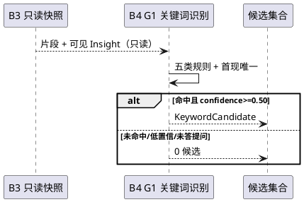

#### **10.3.1.3 异常场景**

1. **低置信候选**
   a. 触发条件：`confidence<0.50`。
   b. 系统行为：不产候选，计 `gate_l0_low_confidence`。
   c. 用户感知：无卡片；诊断可见计数。
2. **同一术语重复出现**
   a. 触发条件：同一会话内同一归一化术语再次出现。
   b. 系统行为：不产新候选；10 分钟窗口内由 G3 判定重复并计 `gate_l3_duplicate`。
   c. 用户感知：无重复卡片。
3. **候选夹带原文**
   a. 触发条件：把完整片段文本写入 `keyword_text`。
   b. 系统行为：结构校验失败。
   c. 用户感知：候选被拒绝；零转录扫描命中即阶段失败。

### **10.3.2 候选 → 关键词卡片契约**

#### **10.3.2.1 业务规则**

1. **13 项业务字段（REQ-B4K-03）**：`card_id`、`keyword_text`（≤40）、`normalized_term`、`keyword_kind`（5 类）、`trigger`、`triggered_at_ms`、`confidence`、`summary`（≤80，可空）、`references`、`citation_alignment`、`gate_decision_ref`、`card_status`、`click_state`；字段缺一或多一即结构违规。
   a. 验收条件：When 序列化卡片，the 业务字段集合 shall 恰为 13 项。
2. **引用只存 ID（REQ-B4K-03）**：`references` 元素只允许 `reference_id`、`trust_tier`（四档）、`access_status`（Ok/Unavailable）、`published_at_ms`、`alignment`；禁止 URL、页面标题、正文摘要与原文。
   a. 验收条件：When 扫描卡片契约，URL/标题/摘要字段命中 shall 为 0。
3. **无来源不出结论（REQ-B4K-03）**：`citation_alignment != Passed` 时 `summary` 必须为空或固定文案"未找到可靠来源"，不得给结论性表述。
   a. 验收条件：When 对齐失败，the `summary` shall 为空或固定文案；When 通过，the `summary` shall ≤80 字。
4. **一候选一卡（REQ-B4K-02）**：`card_id` 全局唯一；一个候选最多 1 张卡；重复候选不得重复出卡。
   a. 验收条件：When 同一候选重复触发，the `card_drafts` shall 仍为 1。
5. **零转录（REQ-B4K-06）**：卡片展示层可持有 `keyword_text`/`summary`，但不得进入 `GateRecord`/`GateAuditEvent`/`ReplayReport`/回放夹具/日志；记录只允许 `card_id`/`keyword_ref`/`trace_id`/引用 ID。
   a. 验收条件：When 扫描记录与夹具，禁止文本命中 shall 为 0。
6. **禁止项**：禁止卡片携带完整转写；禁止把卡片作为 `GateRecord` 的嵌套对象；禁止把引用正文复制进门控。
   a. 验收条件：When 检查 `GateRecord`，字段集合 shall 仍为 14 项且无关键词卡字段。

#### **10.3.2.2 交互流程**

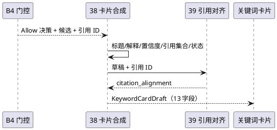

#### **10.3.2.3 异常场景**

1. **字段越界**
   a. 触发条件：卡片新增第 14 个业务字段或引用元素带 URL。
   b. 系统行为：结构违规，拒绝出卡。
   c. 用户感知：AC-B4-53 失败。
2. **引用缺失**
   a. 触发条件：`references=[]` 且 `summary` 非空。
   b. 系统行为：`citation_alignment=Unverified`，`summary` 置空。
   c. 用户感知：卡片显示"未找到可靠来源"。
3. **记录被污染**
   a. 触发条件：把 `keyword_text` 写入 `GateRecord`。
   b. 系统行为：`--rule=record` 或零转录扫描命中。
   c. 用户感知：阶段不放行。

### **10.3.3 五级门控前置（只有 Allow 可出卡/可点击）**

#### **10.3.3.1 业务规则**

1. **Allow 唯一前置（REQ-B4K-04）**：`gate_decision_ref` 必须指向一次 `Allow`；`Deny` 或无门控记录不得出卡。
   a. 验收条件：When G1~G5 逐级 `Deny`，the 卡片数 shall 均为 0；When 全部 `Allow`，shall 为 1。
2. **短路一致（REQ-B4K-04）**：任一级 `Deny` 后，后续级 `calls=0`，不得事后补出卡片；`card_drafts=0` 且 `click_state=Disabled{NotAllowed}`。
   a. 验收条件：When `stopped_at=G2/G3/G4/G5`，the `card_drafts` shall 为 0。
3. **跳过级不豁免（REQ-B4K-04）**：仅 G2 或 G3-dedupe 可跳过；跳过不改变 G1/G4/G5 的强制判定，也不改变"必须 `Allow` 才可出卡"。
   a. 验收条件：When `skipped_stages=[G2,G3]` 且 G1/G4/G5 `Allow`，the 卡片数 shall 为 1；When 任一强制级 `Deny`，shall 为 0。
4. **重复/抑制语义（REQ-B4K-04）**：G3 `Duplicate`/`Suppressed`/`QuotaExhausted`/`Stale` 一律不出卡；按需补全在 G3 `Suppressed` 时可 `Allow` 并带 `suppressed_notice=true`，但仍须 G5 `Allow` 后才可出卡。
   a. 验收条件：When 自动路径 G3 `Suppressed`，the 卡片数 shall 为 0；When 按需路径 `Allow` 且 G5 `Allow`，shall 为 1 且带抑制提示。
5. **禁止项**：禁止以"仅 G1 通过"或"G2/G3 跳过"为由提前出卡；禁止 `Deny` 卡片保留可点击态。
   a. 验收条件：When 扫描出卡调用点，未读取 `gate_decision_ref=Allow` 的路径命中 shall 为 0。

#### **10.3.3.2 交互流程**

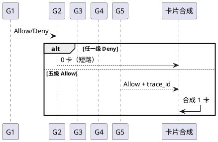

#### **10.3.3.3 异常场景**

1. **门控记录缺失**
   a. 触发条件：卡片无 `gate_decision_ref` 或引用非 `Allow`。
   b. 系统行为：不出卡；已出卡置 `Disabled{NotAllowed}`。
   c. 用户感知：卡片不可点击。
2. **事后补卡**
   a. 触发条件：`Deny` 后仍合成卡片。
   b. 系统行为：违反短路约束，AC-B4-52 失败。
   c. 用户感知：阶段不放行。
3. **跳过级误用**
   a. 触发条件：以 `skip_g1/g4/g5` 试图绕过。
   b. 系统行为：策略校验失败，`Deny{PolicyUnavailable}`。
   c. 用户感知：装配被拒。

### **10.3.4 点击查看与权限前置**

#### **10.3.4.1 业务规则**

1. **本地查看（REQ-B4K-05）**：点击 `Enabled` 卡片只打开本地详情（关键词释义、引用列表、触发片段定位），`outbound_attempts=0`、`llm_calls=0`、`network_calls=0`，不抢焦点、不离开当前会议。
   a. 验收条件：When 点击 1 次，the 三项计数 shall 均为 0 且详情可见。
2. **继续检索需重新过门（REQ-B4K-05）**：详情内"继续检索/更多信息"必须重新走 G1~G5；未取得新 `Allow` 前外发恒为 0。
   a. 验收条件：When 点击"继续检索"但新判定 `Deny`，the 外发 shall 为 0；When 新判定 `Allow`，shall 走正常 G5 审计。
3. **授权撤销（REQ-B4K-05）**：出卡后授权撤销/过期/范围变更，既有卡片 `click_state=Disabled{AuthorizationRevoked}`；重新授权不自动恢复旧卡，只允许新卡。
   a. 验收条件：When 撤销后点击旧卡，the 详情 shall 不打开；When 重新授权并新出卡，shall 可点击。
4. **投屏/紧急遮蔽（REQ-B4K-05）**：共享屏幕模式或紧急遮蔽期间，隐藏卡片正文与关键词文本，仅保留"有 N 条"角标；点击一律 `Disabled{ScreenShareProtection}`/`EmergencyMasked`。
   a. 验收条件：When 投屏保护开启，the 可见正文 shall 为 0 且点击被拒绝；When 紧急遮蔽，the 1 秒内清空。
5. **静默/暂停（REQ-B4K-05）**：静默期/暂停只阻止新的自动出卡；已展示卡片的本地查看允许（投屏/遮蔽除外）。
   a. 验收条件：When 暂停期间点击已展示卡，the 详情 shall 可见且 `outbound_attempts=0`；When 静默期，the 新自动卡 shall 为 0。
6. **跨会话/引用过期（REQ-B4K-05）**：卡片不属于当前会话或引用对象已删除/过期，`click_state=Disabled{StaleReference}`，不得读取已删除内容。
   a. 验收条件：When 跨会话点击，the 详情 shall 不打开且原因码为 `StaleReference`。
7. **禁止项**：禁止点击触发隐式外发；禁止在投屏保护下展示关键词文本；禁止用 UI 开关绕过 `click_state`。
   a. 验收条件：When 扫描点击路径，外发调用命中 shall 为 0。

#### **10.3.4.2 交互流程**

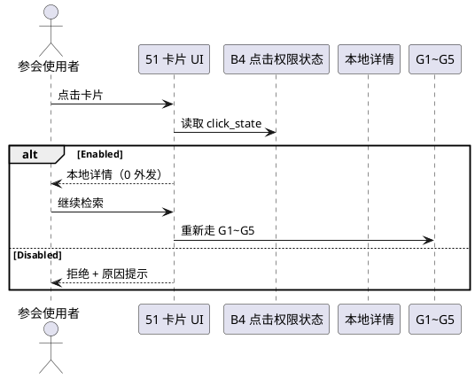

#### **10.3.4.3 异常场景**

1. **详情请求外发**
   a. 触发条件：点击直接调用检索。
   b. 系统行为：违反本地查看约束，AC-B4-54 失败。
   c. 用户感知：阶段不放行。
2. **投屏泄露**
   a. 触发条件：投屏保护下仍显示关键词文本。
   b. 系统行为：立即切换角标模式并隐藏正文。
   c. 用户感知："已进入投屏保护模式"。
3. **旧卡自动恢复**
   a. 触发条件：重新授权后旧卡自动变为可点击。
   b. 系统行为：违反"不自动恢复旧卡"，AC-B4-55 失败。
   c. 用户感知：旧卡保持"授权已撤销"。

### **10.3.5 归属拆分与禁止越界**

| 能力 | 归属 | 本轮判定 |
|---|---|---|
| 关键词候选契约、卡片 13 项字段、出卡前置、点击权限状态、零转录边界 | **B4** | AC-B4-51~57 |
| 卡片合成（标题/解释/置信度/引用集合/状态流转） | **38** | 只定义契约，不实现 |
| 引用对齐校验（存在性、支撑、冲突、敏感词终检） | **39** | 只读 `citation_alignment`，不实现 |
| 点击详情、三形态、投屏/紧急遮蔽、焦点 | **51** | 只定义 `click_state`，不实现 UI |
| 回放 200 例 | **13.3 / B4 测试面** | AC-B4-48 方案 A |

1. **B4 禁止符号（REQ-B4K-07）**：`crates/application/src/gate/**` 不得出现卡片合成器、引用校验器、展示器、卡片存储符号。
   a. 验收条件：When 扫描 `composer|validator|presenter|card_store`，命中 shall 为 0。
2. **不建目录（REQ-B4K-07）**：`crates/application/tests/replay/` 仍不存在。
   a. 验收条件：When `test ! -d crates/application/tests/replay`，退出 shall 为 0。
3. **不改 GateRecord（REQ-B4K-07）**：`GateRecord` 14 字段不变；关键词卡字段不得进入。
   a. 验收条件：When 执行 `--rule=record`，退出 shall 为 0 且字段集合 =14。

### **10.3.6 零转录边界（卡片场景）**

1. **记录层（REQ-B4K-06）**：`GateRecord`、`GateAuditEvent`、`ReplayReport`、回放夹具、计数与日志只允许 `card_id`/`keyword_ref`/`trace_id`/引用 ID/长度/毫值/原因码/时间戳。
2. **展示层（REQ-B4K-06）**：卡片展示层可持有 `keyword_text` 与 `summary`，但不得复制到记录层；引用正文按 ID 从上游读取。
3. **测试层（REQ-B4K-06）**：200 例回放在测试进程内本地构造文本，文本不得写入夹具、报告、日志或任何记录。
4. **验收**：`--rule=zero-transcript` 退 0；`keyword_text`/`summary`/URL/姓名在记录与夹具命中 0。

## **10.4 增量数据约束**

### **10.4.1 关键词候选（KeywordCandidate）**

1. **keyword_ref**：必填，稳定引用 ID；不得为原文、不得等于 `request_id`。
2. **keyword_text**：必填，≤40 字；只存在于展示层，不得写入记录/审计/回放夹具/日志。
3. **normalized_term**：必填，归一化术语；同会话唯一（沿用首现），重复由 G3 的 10 分钟窗口判定，不另设再生窗口。
4. **keyword_kind**：`proper_noun`/`acronym`/`institution_role`/`policy_standard`/`metric` 五类封闭；未答提问不在此列。
5. **trigger_span**：起点 < 终点，必须属于同一会话。
6. **confidence**：0..=1；产候选门槛 ≥0.50。
7. **dedupe_key**：32 位十六进制，与 G3 共用 10 分钟窗口。
8. **state**：∈ 既有 `GapState` 7 变体；候选阶段不得写 `Pushed`。
9. **session_id**：必填；跨会话候选必须被拒绝。

### **10.4.2 关键词卡片（KeywordCardDraft）**

1. **字段封闭 13 项**：`card_id`、`keyword_text`、`normalized_term`、`keyword_kind`、`trigger`、`triggered_at_ms`、`confidence`、`summary`、`references`、`citation_alignment`、`gate_decision_ref`、`card_status`、`click_state`。
2. **keyword_text**：≤40 字；不得含完整句子、说话人姓名、联系方式或完整 URL。
3. **summary**：≤80 字；`citation_alignment != Passed` 时必须为空或固定"未找到可靠来源"。
4. **references**：0..*，元素仅 `reference_id`/`trust_tier`/`access_status`/`published_at_ms`/`alignment`；禁止 URL、标题、摘要与原文。
5. **citation_alignment**：`Passed`/`Failed`/`Unverified`。
6. **gate_decision_ref**：必填，必须指向一次 `Allow`。
7. **card_status**：`Displayed`/`Collapsed`/`Withdrawn`；由 38/51 维护，B4 不写。
8. **click_state**：`Enabled` 或 `Disabled{reason}`；`reason` ∈ `NotAllowed`/`ReferenceUnverified`/`AuthorizationRevoked`/`ScreenShareProtection`/`EmergencyMasked`/`StaleReference`。
9. **一致性**：`Enabled` 必须同时满足 `citation_alignment=Passed`、`gate_decision_ref=Allow`、`card_status != Withdrawn`、无投屏/遮蔽、授权未撤销。
10. **禁止字段**：完整转写、查询原文、完整 URL、`model`、`request_id`、`api_key`、姓名、联系方式。

### **10.4.3 引用视图（ReferenceView）**

1. **reference_id**：必填，稳定引用 ID；不得为 URL。
2. **trust_tier**：`Official`/`Authority`/`General`/`UserGenerated` 四档。
3. **access_status**：`Ok`/`Unavailable`；不可访问必须显式标注。
4. **published_at_ms**：可选；为空标注"发布时间未知"。
5. **alignment**：`Passed`/`Failed`/`Unverified`，与卡片同源。
6. **禁止内容**：URL、标题、正文摘要、抓取正文、原文与查询文本。

### **10.4.4 `GateRecord` 不扩展**

1. 既有 14 项业务字段保持不变；关键词卡通过 `gate_decision_ref` 关联，不得作为嵌套对象写入。
2. 新增字段若必须存在，只能进入独立契约视图，不进入 `GateRecord`；`--rule=record` 仍断言 14 项。

## **10.5 AC-B4-51~57（增量验收）**

| 编号 | EARS 陈述 | 可机器判定 |
|---|---|---|
| AC-B4-51 | When 监听会话并输入五类关键词正例，the 关键词候选 shall 各产出 1 个且 `keyword_kind` 匹配；同一会话同一归一化术语仅 1 个候选（沿用首现），重复由 G3 的 10 分钟窗口判定；跨会话不合并；未答提问不产关键词卡；候选不得直接展示或可点击。 | 用例 `keyword_candidates_cover_five_kinds`、`keyword_candidate_keeps_first_seen_only`、`unanswered_question_is_not_a_keyword_card`；字段 `keyword_kind`、`normalized_term`、`card_drafts=0` |
| AC-B4-52 | When 五级门控任一级 `Deny`，the 关键词卡数量 shall 为 0 且 `click_state=Disabled{NotAllowed}`；When 五级全部 `Allow`，shall 产出 1 张卡且 `click_state=Enabled`；跳过 G2/G3 不改变约束。 | 用例 `keyword_card_requires_gate_allow`、`deny_never_emits_clickable_card`；字段 `gate_decision_ref`、`click_state`、`card_drafts` |
| AC-B4-53 | The 关键词卡业务字段 shall 封闭 13 项；`keyword_text ≤40`、`summary ≤80`、`references` 只允许引用 ID 与四档可信度；`citation_alignment` 与 `click_state` 原因集封闭。 | 用例 `keyword_card_has_closed_fields`、`keyword_card_reference_is_id_only`；字段集合 =13；`Disabled` 原因 ⊆ 6 |
| AC-B4-54 | When 点击 `Enabled` 卡片，the 详情 shall 打开且 `outbound_attempts=0`、`llm_calls=0`，不抢焦点、不离开当前会议；When 点击"继续检索"，shall 重新走 G1~G5，未取得新 `Allow` 前外发为 0。 | 用例 `clicking_keyword_card_is_local_only`、`continue_search_reenters_gate`；字段 `outbound_attempts`、`llm_calls`、新 `gate_decision_ref` |
| AC-B4-55 | When 授权撤销/引用未对齐/投屏保护/紧急遮蔽/跨会话或引用过期，the `click_state` shall 分别为对应 `Disabled` 原因；共享屏幕时正文隐藏。 | 用例 `click_permission_is_fail_closed`、`keyword_card_hidden_under_screen_share`；字段 `click_state`、可见正文 =0 |
| AC-B4-56 | The `GateRecord`、`GateAuditEvent`、`ReplayReport`、回放夹具与日志 shall 不含 `keyword_text`、`summary`、引用摘要、查询原文、完整 URL、姓名与联系方式；只允许引用 ID 与原因码。 | 用例 `keyword_card_zero_transcript_boundary`；`--rule=zero-transcript` 退 0；禁止字段命中 0 |
| AC-B4-57 | While 扫描 B4 契约与 `gate/**`，the 卡片合成器、引用校验器、展示器、卡片存储符号 shall 为 0；38/39/51/13.3 的实体能力不得越界；`tests/replay/` 仍不存在。 | 用例 `keyword_card_ownership_is_outside_gate`；`--rule=outbound` 退 0；`grep -rnE "composer\|validator\|presenter\|card_store" crates/application/src/gate` 命中 0；`test ! -d crates/application/tests/replay` |

## **10.6 AC-B4-48 方案 A（固化口径）**

1. **不改夹具**：`GateInputFixture` 保持 23 字段，不新增 `text`/`keyword_text`/`summary`/URL 字段。
2. **测试内构造**：在 `crates/application/tests/gate_replay.rs` 内用本地构造的 `NormalizedFragment`/`Insight` 驱动 `detect_gaps` 与 `evaluate_gate`；不使用真实转写、不读取文件、不联网。
3. **200 例**：`case_id` 唯一；覆盖 G1~G5 全部可构造拒绝码（23 项逐一至少 1 例）与 `Allow`；`seed=7`。
4. **结果**：`total=200`、`mismatched=0`；同一 200 例连续两次运行 `ReplayReport` 序列化字节相等。
5. **零转录**：构造的文本只在测试进程内存中存在，不写入夹具、报告、日志、进度文档或任何记录；测试结束后不落盘。
6. **可构造性**：不可在回放输入中构造的分支（如脱敏失败替身）由 L1/L2 专项用例覆盖，不计入 200 例的 `mismatched`，并在报告中登记。

## **10.7 增量需求 → AC 映射**

| 需求 | 对位 AC | 关键判据 |
|---|---|---|
| REQ-B4K-01 关键词候选识别 | AC-B4-51 | 五类、首见唯一、未答提问排除、≤40 字 |
| REQ-B4K-02 候选不等于卡片 | AC-B4-51/52/53 | `card_drafts=0` 直到 Allow；一候选一卡 |
| REQ-B4K-03 卡片契约与引用 | AC-B4-53/56 | 13 字段、引用只存 ID、summary≤80 |
| REQ-B4K-04 只有 Allow 可出卡 | AC-B4-52 | 任一级 Deny → 0 卡；跳过级不豁免 |
| REQ-B4K-05 点击与权限前置 | AC-B4-54/55 | 本地查看、0 外发、撤销/投屏/遮蔽 fail-closed |
| REQ-B4K-06 零转录边界 | AC-B4-56 | 记录/审计/夹具/日志无关键词文本 |
| REQ-B4K-07 归属拆分 | AC-B4-57 | gate 内 0 合成/校验/展示/存储符号 |

## **10.8 未完成事项与阶段出口影响**

1. **AC-B4-51~57 当前为 pending**：本轮只更新需求规格，未实现契约类型、卡片前置、点击状态或 200 例回放；实现由后续编码任务承接。
2. **AC-B4-48 仍为 pending**：方案 A 已裁决，但 `replay_200_cases_is_byte_identical` 与覆盖面用例尚未创建；实现后必须复跑两次逐字节一致。
3. **38/39/51/13.3 仍为未实现**：本轮只定义边界，不创建卡片合成器、校验器、UI 或回放目录。**39 的增量需求已在 §11 补齐**（`Passed`/`Failed`/`Unknown`、`Unknown→Unverified`、引用只存 5 字段、零转录/离线边界；AC-B4-58~64 为 `pending`），但本轮仍不创建 39 实体文件。
4. **不宣称 G3/G4/真实端点/真机通过**：关键词卡片契约的离线通过不等于 38 合成质量、39 语义对齐质量或 51 交互质量通过。
5. **出口口径**：P0~P3 既有三条硬判据不变；新增 AC 不阻断既有 AC-01~50 的判定，但会作为"增量范围是否闭合"的附加判据登记在 `b4-status.md`。

---

# **11. 增量需求：39 引用对齐校验（AC-B4-58~64）**

> **定位**：39 是**独立能力**，消费 38 的卡片草稿与检索引用，产出 `citation_alignment` 与可点击前置。39 **只做校验与判定**：不生成卡片、不渲染 UI、不联网抓取正文、不写门控记录。既有 `KeywordCardDraft`（13）、`ReferenceView`（5）、`CitationAlignment`（3）保持不变；39 的 `Unknown` 以唯一投影落到既有 `Unverified`。
> **编号纪律**：既有 AC-B4-01~57 **不重排、不改语义**；新增 **AC-B4-58~64**。归属：B4 契约与门控/点击前置、38 合成、39 判定、51 UI/屏蔽态、52 审计存储、13.3 回放本体。
> **本轮性质**：只产出需求规格，**不实现**任何 39 实体文件、不改代码、不改既有封闭字段。

## **11.1 组件定位增量**

### **11.1.1 核心职责增量**

本组件负责对"关键词卡片的结论/解释是否被引用来源支撑"做**离线、只读、可判定**的校验，输出 `Passed`/`Failed`/`Unknown` 三态，并给出"是否满足可点击的引用前置"。实现"有来源才可点、无来源不出结论、失败仍可展示"。

### **11.1.2 核心输入增量**

1. **38 卡片只读视图**：`KeywordCardDraft` 的 13 项业务字段（只读）；39 不得改写其中任何字段。
2. **引用视图**：`ReferenceView` 的 5 项（`reference_id`、`trust_tier` 四档、`access_status` 两态、`published_at_ms` 可空、`alignment` 三态）。
3. **候选关键词上下文**：`keyword_ref`、`normalized_term`、`keyword_kind`（仅用于术语一致性比对；只存在于内存，不落任何记录）。
4. **判定能力位**：`Available`/`Unavailable`（由装配方注入；不可用时 fail-closed）。
5. **虚拟时间**：`now_ms`（不得读系统时间），用于 `checked_at_ms` 与超时判定。
6. **既有基线**：`cargo test --workspace` 721 passed / 0 failed / 9 ignored；`api.rs` 4 个 `pub fn`；`GateRecord` 14、`GateAuditEvent` 7、`GateInputFixture` 23、`ReplayReport` 5、`GateCounter` 32、`GateRejectReason` 23。

### **11.1.3 核心输出增量**

1. **对齐结果**：`CitationAlignmentResult`（封闭 6 项：`alignment`、`basis`、`reference_count`、`accessible_reference_count`、`checked_at_ms`、`contract_version`）。
2. **三态值**：`Passed`/`Failed`/`Unknown`；`Unknown` 对 B4 契约的唯一投影为 `Unverified`。
3. **可点击引用前置**：只输出"引用是否满足可点击条件"这一项；**不输出** `click_state` 整体（其余前置由 B4/51 判定）。
4. **诊断与计数**：校验次数、三态各自次数、`basis` 分布（只增不减；**不新增** `GateCounter` 的 32 项，39 使用独立诊断字段或测试内计数）。
5. **可机器判定的增量 AC**：AC-B4-58~64。

### **11.1.4 职责边界增量**

1. **不生成卡片**：不计算标题/解释/置信度、不组装引用集合、不维护 `card_status`（归 38）。
2. **不渲染 UI**：不打开详情、不抢焦点、不处理投屏/紧急遮蔽的界面行为（归 51）。
3. **不联网抓正文**：不调用真实检索源、不解析网页、不缓存正文、不读取页面标题与摘要。
4. **不写门控与审计**：不改 `GateDecision`/`GateRecord`（14）/`GateAuditEvent`（7）/`GateInputFixture`（23）/`ReplayReport`（5）；不新增 `GateCounter`（32）；不写卡片存储。
5. **不建回放本体**：不创建 `crates/application/tests/replay/`；回放输入不得含正文。
6. **不新增关键词规则**：五类关键词与 `GapKind` 6 变体不变。
7. **不改既有三态**：不重命名/不扩展 `CitationAlignment`；`Unknown` 在 39 自己的 API 面存在，落到 B4 契约面时投影为 `Unverified`。

## **11.2 增量领域术语**

**引用对齐（Citation Alignment）**
: 39 对"卡片结论/解释是否被引用来源支撑"的判定结果，封闭为 `Passed`/`Failed`/`Unknown`；只有 `Passed` 满足可点击的引用前置。

**未知判定（Unknown Verdict）**
: 证据缺失、引用不可访问、判定能力不可用或输入不完整时的保守结论；不得当作 `Passed`，在 B4 契约面唯一投影为 `Unverified`。

**判定依据（Alignment Basis）**
: 三态判定的唯一原因码，封闭为 `SupportedByOfficial`/`SupportedByAuthority`/`SupportedByGeneral`/`Contradicted`/`TermMismatch`/`ConflictingSources`/`NoReference`/`ReferenceUnavailable`/`InsufficientEvidence`/`JudgeUnavailable`/`InputContractViolation`；只允许原因码进入记录与诊断。

**引用前置（Citation Click Prerequisite）**
: 39 提供的"引用维度"可点击条件；`Passed` 只是必要条件，最终 `click_state` 仍由 B4/51 的六项其他前置共同决定。

## **11.3 核心能力**

### **11.3.1 三态判定（REQ-B4C-01）**

#### **11.3.1.1 业务规则**

1. **输入只读封闭**：只读 13 字段卡片与 5 字段引用；禁止 URL/标题/摘要/正文/查询/片段进入判定输入。
   a. 验收条件：When 输入含封闭字段之外的内容，the `alignment` shall 为 `Unknown` 且 `basis=InputContractViolation`；When 合法输入，the 读取字段集合 shall 恰为 13+5 项。
2. **`Passed` 门槛**：引用非空、至少 1 条 `Official`/`Authority` 且 `access_status=Ok`、无冲突、与术语/类型一致。
   a. 验收条件：When 仅 1 条 `Official+Ok` 且无冲突，the `alignment` shall 为 `Passed`；When 仅 `General`/`UserGenerated`，shall 为 `Unknown` 且 `basis=SupportedByGeneral`。
3. **`Failed` 条件**：明确反驳、引用互斥或术语不匹配。
   a. 验收条件：When 两条引用结论相反，the `alignment` shall 为 `Failed` 且 `basis=ConflictingSources`；When 单条引用明确反驳，shall 为 `Failed` 且 `basis=Contradicted`；When 主题与 `keyword_kind` 不匹配，shall 为 `Failed` 且 `basis=TermMismatch`。
4. **`Unknown` 条件与 fail-closed**：引用空/全不可访问/能力不可用/超时/输入违规。
   a. 验收条件：When `references=[]`，the `alignment` shall 为 `Unknown` 且 `basis=NoReference`；When 能力位 `Unavailable`，shall 为 `Unknown` 且 `basis=JudgeUnavailable`。
5. **禁止项**：禁止"无引用即通过"；禁止 `Unknown→Passed`；禁止以默认值或沉默放行。
   a. 验收条件：When 构造上述反例，the `alignment` shall 均不为 `Passed`。

#### **11.3.1.2 交互流程**

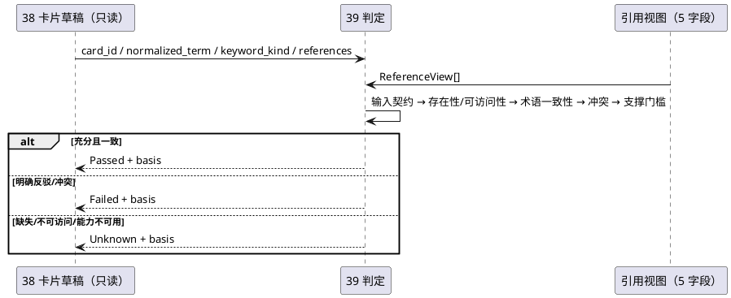

#### **11.3.1.3 异常场景**

1. **引用不可访问**
   a. 触发条件：全部 `access_status=Unavailable`。
   b. 系统行为：判 `Unknown`，不补检索、不抓正文。
   c. 用户感知：显示"未找到可靠来源"，不可点击。
2. **证据冲突**
   a. 触发条件：同一断言被引用互相反驳。
   b. 系统行为：判 `Failed`，`summary` 置空或固定文案。
   c. 用户感知：卡片可展示，点击被拒绝。
3. **判定能力不可用**
   a. 触发条件：能力位 `Unavailable` 或超时。
   b. 系统行为：fail-closed 判 `Unknown`，保留原因码，不重试。
   c. 用户感知：不可点击。

### **11.3.2 出卡与点击前置（REQ-B4C-02）**

#### **11.3.2.1 业务规则**

1. **只供一项前置**：39 只提供 `alignment`；`Enabled` 仍需 `allow_ref`、`card_status`、会话一致、授权、非投屏、非遮蔽六项。
   a. 验收条件：When `Passed` 但授权撤销，the `click_state` shall 为 `Disabled{AuthorizationRevoked}`；When 其余六项全真且 `Passed`，shall 为 `Enabled`。
2. **Failed/Unknown 仍可展示不可点**：`Failed`/`Unknown` 不撤回卡片，但必须 `Disabled{ReferenceUnverified}`；`summary` 为空或 `"未找到可靠来源"`。
   a. 验收条件：When `Failed`/`Unknown`，the `card_drafts` shall 不受影响（展示面保留），`click_state` shall 为 `Disabled{ReferenceUnverified}`。
3. **投影唯一**：`Unknown→Unverified`，其余同名；不得出现同一结果两种契约值。
   a. 验收条件：When 39 返回 `Unknown`，the `KeywordCardDraft.citation_alignment` shall 为 `Unverified`；`CitationAlignment` 变体数 shall 为 3。
4. **禁止项**：禁止 39 直接写 `click_state`；禁止把 `Passed` 作为 `Enabled` 的充分条件。
   a. 验收条件：When 扫描 39 实现，写 `ClickState`/`card_status` 的符号命中 shall 为 0。

#### **11.3.2.2 交互流程**

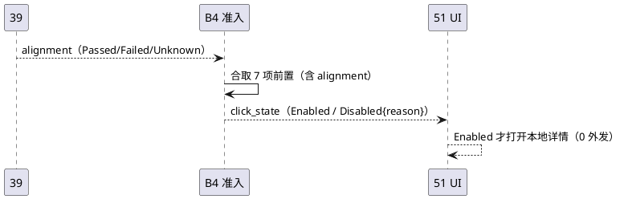

#### **11.3.2.3 异常场景**

1. **把 Passed 当 Enabled**
   a. 触发条件：跳过其余六项前置。
   b. 系统行为：违反 7 项合取，AC-B4-60 失败。
   c. 用户感知：阶段不放行。
2. **Failed 被撤回**
   a. 触发条件：`Failed` 时把 `card_drafts` 置 0。
   b. 系统行为：违反"可展示不可点"，AC-B4-60 失败。
   c. 用户感知：卡片消失，与规格不符。

### **11.3.3 零转录、离线与一致性（REQ-B4C-03）**

#### **11.3.3.1 业务规则**

1. **记录面只允 ID 与原因码**：`reference_id`/`trust_tier`/`access_status`/`published_at_ms`/`alignment`/`basis`/长度/计数/毫值/版本号。
2. **引用只存 5 字段**：禁止 URL/标题/摘要/正文/查询/片段；展示说明按 ID 从上游读取。
3. **离线**：不联网、不抓正文、不读系统时间/环境变量、不写存储。
4. **确定性**：同输入 100 次逐字节一致；引用顺序无关。
   a. 验收条件：When 打乱引用顺序，the 结果与 `basis` shall 一致；When 重复 100 次，the 序列化字节 shall 相等。

#### **11.3.3.2 交互流程**

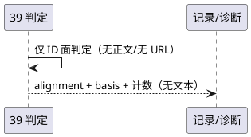

#### **11.3.3.3 异常场景**

1. **结果夹带文本**
   a. 触发条件：`basis` 或结果对象携带标题/摘要/URL。
   b. 系统行为：零转录扫描命中，阶段不放行。
   c. 用户感知：`--rule=zero-transcript` 退 1。

### **11.3.4 归属与接口（REQ-B4C-04）**

#### **11.3.4.1 业务规则**

1. **39 交付形态**：domain 契约（`crates/domain/src/model/citation.rs`）+ application 只读校验（`crates/application/src/citation/align.rs`）；不建 UI/合成/存储/回放目录。
2. **与 B4**：只读卡片与引用；不写 14/7/23/5/32；`api.rs` 4 个 `pub fn` 零 diff；不新增 `GateCounter`。
3. **与 38**：38 提供卡片草稿与引用 ID 集合；39 回填 `citation_alignment` 一项，不改其余 12 字段。
4. **与 51**：51 只读 `alignment`/`click_state`，不得用 UI 开关绕过；投屏/遮蔽仍由 51 执行。
5. **与 13.3**：39 结果不进入 `GateReplayCase`/`ReplayReport`；回放夹具不含正文。
   a. 验收条件：When 扫描 39 边界，`composer|presenter|card_store|outbox|on_demand|feedback_weights` 命中 shall 为 0；`test ! -d crates/application/tests/replay` 退 0。

#### **11.3.4.2 交互流程**

```plantuml
@startuml
participant "38 合成" as C
participant "39 判定" as V
participant "B4 契约/门控" as B4
participant "51 UI" as UI
participant "52 审计存储" as A52

C -> V : 卡片只读 + 引用 ID
V --> C : alignment（唯一回填字段）
C -> B4 : 13 字段卡片（仍封闭）
B4 --> UI : click_state（只读）
UI -.-> A52 : 展示/点击审计（39 不参与）
@enduml
```

#### **11.3.4.3 异常场景**

1. **39 越界写记录**
   a. 触发条件：把结果写入 `GateRecord`/审计/夹具。
   b. 系统行为：`--rule=record` 或 `--rule=zero-transcript` 命中。
   c. 用户感知：阶段不放行。
2. **39 自行抓正文**
   a. 触发条件：出现 `reqwest`/`TcpStream`/`std::net`。
   b. 系统行为：`--rule=source` 命中。
   c. 用户感知：阶段不放行。

## **11.4 增量数据约束**

### **11.4.1 39 输入（CitationCheckInput，封闭 8 项）**

1. **card_id**：必填，只读引用；不得为空。
2. **keyword_ref**：必填，只读；用于一卡一候选关联。
3. **normalized_term**：必填，只读，仅用于术语一致性比对；**禁止**写入任何记录/日志/夹具。
4. **keyword_kind**：必填，五类封闭；用于主题一致性。
5. **references**：必填，0..*；元素只允许 `reference_id`/`trust_tier`/`access_status`/`published_at_ms`/`alignment`。
6. **now_ms**：必填，注入虚拟毫秒；禁止真实时间。
7. **judge_capability**：必填，`Available`/`Unavailable`。
8. **claim_ref**：可选，结论/解释的引用 ID 或摘要哈希；不得承载正文。

> 禁止字段：URL、页面标题、正文摘要、抓取正文、查询原文、转写片段、参会人姓名与联系方式、`model`、`request_id`、`api_key`。

### **11.4.2 39 输出（CitationAlignmentResult，封闭 6 项）**

1. **alignment**：`Passed`/`Failed`/`Unknown` 封闭。
2. **basis**：11 项封闭原因码（见 11.2）；只允许原因码进入记录与诊断。
3. **reference_count**：0..*；与输入引用数一致。
4. **accessible_reference_count**：0..=reference_count；统计 `access_status=Ok`。
5. **checked_at_ms**：等于输入 `now_ms`；不得取系统时间。
6. **contract_version**：契约版本号（整数或语义版本），不得为模型名。

### **11.4.3 投影与不变量**

1. **三态投影**：`Unknown→Unverified`，`Passed→Passed`，`Failed→Failed`；映射表唯一。
2. **`Passed` 必要条件**：`reference_count ≥1` 且 `accessible_reference_count ≥1` 且存在 `Official`/`Authority` 支撑。
3. **`Failed` 与 `Unknown` 不得为 `Enabled`**：`click_state=Enabled ⇒ alignment==Passed`。
4. **一结果一 basis**：多因并存时按固定顺序取唯一原因（输入违规 → 无引用/不可访问 → 能力不可用 → 术语不匹配 → 明确反驳 → 引用互斥 → 仅有 General 支撑 → 证据不足 → Official/Authority 支撑通过）。
5. **幂等**：同输入重复执行结果不变；引用排序不改变结果。

### **11.4.4 既有封闭字段不变**

1. `KeywordCardDraft` 13 项、`ReferenceView` 5 项、`CitationAlignment` 3 变体不变。
2. `GateRecord` 14、`GateAuditEvent` 7、`GateInputFixture` 23、`ReplayReport` 5、`GateCounter` 32、`GateRejectReason` 23 不变。
3. `crates/application/src/gate/api.rs` 的 `pub fn` 数保持 4，且零 diff。

## **11.5 AC-B4-58~64（增量验收）**

| 编号 | EARS 陈述 | 可机器判定 |
|---|---|---|
| AC-B4-58 | When 39 消费 38 卡片与引用，the 输入 shall 仅读取 `KeywordCardDraft` 13 字段与 `ReferenceView` 5 字段且只读；卡片除 `citation_alignment` 外不被改写；`api.rs` 4 个 `pub fn`、`GateRecord` 14、`GateAuditEvent` 7、`GateInputFixture` 23、`ReplayReport` 5、`GateCounter` 32、`GateRejectReason` 23 均不变。 | 用例 `citation_input_is_readonly_and_closed`；`grep -c '^pub fn ' crates/application/src/gate/api.rs` = 4；`bash scripts/check-b4-gates.sh --rule=record` 退 0；`kw_fields KeywordCardDraft`=13、`kw_fields ReferenceView`=5 |
| AC-B4-59 | When 引用非空、至少 1 条 `Official`/`Authority` 且 `Ok`、无冲突且与术语一致，the `alignment` shall 为 `Passed`；When 明确反驳/互斥/术语不匹配，shall 为 `Failed`；When 引用缺失/全不可访问/能力不可用/输入违规，shall 为 `Unknown`；`Unknown` 对 B4 契约的唯一投影 shall 为 `Unverified`。 | 用例 `citation_alignment_is_three_state_and_fail_closed`、`unknown_projects_to_unverified_only`；字段 `alignment`、`basis`；`CitationAlignment` 变体数 =3 |
| AC-B4-60 | When `Passed` 且其余六项前置全真，the `click_state` shall 为 `Enabled`；When `Failed`/`Unknown`，the 卡片 shall 仍可展示且 `click_state=Disabled{ReferenceUnverified}`、`summary` 为空或固定文案；`Passed` 不得单独等价于 `Enabled`。 | 用例 `citation_passed_enables_click_only_with_other_facts`、`citation_failed_still_displayed_but_disabled`、`citation_unknown_is_conservative`；字段 `click_state`、`summary`、`card_drafts` |
| AC-B4-61 | The 39 结果、日志、诊断、夹具与进度 shall 只含 `reference_id`/`trust_tier`/`access_status`/`published_at_ms`/`alignment`/`basis`/长度/计数/毫值/版本号；URL、标题、摘要、正文、查询、片段、姓名与联系方式命中 0；引用只存 5 字段。 | 用例 `citation_result_is_id_only`；`bash scripts/check-b4-gates.sh --rule=zero-transcript` 退 0；39 契约块 `grep -cEi 'url\|title\|excerpt\|content\|snippet\|query'` = 0 |
| AC-B4-62 | While 执行校验，39 shall 无 `reqwest`/`TcpStream`/`std::net`/`Instant::now`/`SystemTime::now`/`thread::sleep`/`std::env`，不抓正文；同输入 100 次逐字节一致；引用顺序不影响结果。 | 用例 `citation_check_is_offline_and_deterministic`、`citation_ignores_reference_order`；`bash scripts/check-b4-gates.sh --rule=source` 退 0（扫描面含 `crates/application/src/citation`、`crates/domain/src/model/citation.rs`）；扫描面缺失退 2 |
| AC-B4-63 | While 扫描 39 边界，the 卡片合成器、展示器、卡片存储、检索抓取、审计写入符号 shall 为 0；不建 `tests/replay/`；不写 `GateDecision`/`GateRecord`/`GateAuditEvent`/`GateInputFixture`/`ReplayReport`；不新增 `GateCounter`。 | 用例 `citation_ownership_is_outside_b4_and_ui`；`grep -rnE "composer\|presenter\|card_store\|outbox\|on_demand\|feedback_weights" crates/application/src/citation crates/domain/src/model/citation.rs` 命中 0；`test ! -d crates/application/tests/replay`；`snapshot()==32` |
| AC-B4-64 | When 执行 39 增量验收，the 新 target `citation_align` shall 在 `NEW_TARGETS` 中（20→21）且用例全绿；AC 汇总表合计 shall 为 64；`b4-status.md` 的 U-04 口径 shall 为"规格已定，待实现"并登记 D-B4-P34~P37；39 夹具不得含正文。 | `cargo test -p meeting-copilot-application --test citation_align` 退 0；`grep -m1 '^NEW_TARGETS=' scripts/test-name-inventory.sh \| sed -E "s/^NEW_TARGETS='//; s/'$//" \| wc -w` = 21 且含 `citation_align`；`grep -c '^| AC-B4-' .codeartsdoer/specs/b4_gate/spec.md` 汇总行合计 64；`grep -c 'U-04.*规格已定' docs/progress/b4-status.md` ≥1 |

> 增量 AC 只判定"39 契约、三态、前置、零转录、离线、归属"，**不判定**真实引用可访问性、真实语义对齐质量与 51 交互质量；这些由各自阶段验收并登记偏差。AC-B4-58~64 当前均为 `pending`（规格已定，待实现）。

## **11.6 增量需求 → AC 映射**

| 需求 | 对位 AC | 关键判据 |
|---|---|---|
| REQ-B4C-01 三态判定 | AC-B4-59 | `Passed`/`Failed`/`Unknown` 各条件、`basis` 唯一 |
| REQ-B4C-01 输入只读封闭 | AC-B4-58 | 13+5 字段只读、不改其他字段 |
| REQ-B4C-02 点击前置 | AC-B4-60 | 仅 `Passed` 且其余六项全真才 `Enabled`；`Failed/Unknown` 不可点 |
| REQ-B4C-03 零转录与离线 | AC-B4-61/62 | 引用只 5 字段、无网络/无系统时间、确定性 |
| REQ-B4C-04 归属与不越界 | AC-B4-63/64 | 禁词 0、封闭字段数不变、target/登记收口 |

## **11.7 未完成事项与阶段出口影响**

1. **U-04 口径更新**：39 引用对齐校验由"未做"改为"**规格已定，待实现**"；实现由后续 39 编码阶段承接，AC-B4-58~64 保持 `pending`。
2. **不影响既有出口**：AC-B4-58~64 是"39 增量范围"的附加判据，不阻断 AC-B4-01~57 的既有判定，也不改既有 AC 编号/语义。
3. **不改既有封闭面**：本轮仅文档增量；不改 `gate/api.rs`、`GateRecord`/`GateAuditEvent`/`GateInputFixture`/`ReplayReport`/`GateCounter`/`GateRejectReason`。
4. **不宣称**：离线通过不等于真实引用可访问、语义对齐质量或 51 交互质量通过；不宣称 G3/G4/真机。
5. **下一步入口**：实现前必须先确认 §11.4 的 8/6 字段封闭与 `Unknown→Unverified` 唯一投影；确认后由 39 阶段建 domain 契约 + application 只读校验 + `citation_align` target。

---

# **12. 增量需求：38 卡片合成（AC-B4-65~74）**

> **定位**：38 是**独立能力**，消费 B4 的 `KeywordCardDraft` 契约面（13 字段只读）、39 的 `CitationAlignmentResult` 与候选关键词，产出"可展示卡片数据"（标题 ≤40、解释/结论 ≤80、置信度、引用集合、卡片状态）。38 **不建 UI、不渲染、不存储、不联网、不读原文、不判定点击、不写门控记录**；`gate_decision_ref`/`click_state` 由 B4 准入在装配侧补齐，UI 归 51、存储与展示审计归 52、回放归 13.3。
> **编号纪律**：既有 AC-B4-01~64 **不重排、不改语义**；新增 **AC-B4-65~74**。归属：B4 契约与门控/点击前置、38 确定性组装、39 对齐判定、51 UI/三形态/屏蔽态、52 存储、13.3 回放本体。
> **本轮性质**：只产出需求规格，**不实现**任何 38 实体文件、不改代码、不改既有封闭字段。

## **12.1 组件定位增量**

### **12.1.1 核心职责增量**

本组件负责把"门控 `Allow` 之后的候选 + 39 对齐结果 + 引用视图"**确定性地组装**为可展示的卡片数据，实现"有据才出解释、无据仍可展示、点击不由合成器决定"。

### **12.1.2 核心输入增量**

1. **卡片 ID**：`card_id`（只读；由装配方按 B4 派生规则注入，38 不重算）。
2. **候选关键词**：`KeywordCandidate`（10 字段，只读；必须通过自身校验）。
3. **门控溯源**：`AllowTraceRef`（只读；必须来自一次 `GateDecision::Allow`）。
4. **对齐结果**：`CitationAlignmentResult`（6 字段，只读；38 只读 `alignment` 做唯一投影）。
5. **引用视图**：`ReferenceView[]`（0..*，元素 5 字段，只读；`reference_id` 唯一）。
6. **当前卡片状态**：`KeywordCardStatus`（只读；38 不写 `Collapsed`、不复活 `Withdrawn`）。
7. **抑制提示**：`suppressed_notice: bool`（只读；不进入卡片 11 项字段）。
8. **既有基线**：`cargo test --workspace` 721 passed / 0 failed / 9 ignored（P5 后）；`api.rs` 4 个 `pub fn`；`GateRecord` 14、`GateAuditEvent` 7、`GateInputFixture` 23、`ReplayReport` 5、`GateCounter` 32、`GateRejectReason` 23；`KeywordCardDraft` 13、`ReferenceView` 5、`CitationAlignment` 3；`NEW_TARGETS` 21。

### **12.1.3 核心输出增量**

1. **可展示卡片数据**：`ComposedCard`（封闭 11 项：`card_id`、`keyword_text`、`normalized_term`、`keyword_kind`、`trigger`、`triggered_at_ms`、`confidence`、`summary`、`references`、`citation_alignment`、`card_status`）。
2. **合成结果**：`CardComposeOutcome`（2 项：`card: Option<ComposedCard>`、`reason: Option<ComposeRejectReason>`；两者恰一为 `Some`）。
3. **拒绝原因码**：`ComposeRejectReason`（6 项封闭：`GateNotAllowed`/`CandidateInvalid`/`TitleTooLong`/`DuplicateCard`/`CardWithdrawn`/`InputContractViolation`）。
4. **状态流转**：`next_card_status(current, signal) -> KeywordCardStatus`（只允许 `Displayed`/`Withdrawn`；`Collapsed` 归 51）。
5. **可机器判定的增量 AC**：AC-B4-65~74。

### **12.1.4 职责边界增量**

1. **不做 UI/渲染**：不打开详情、不抢焦点、不处理三形态、投屏与紧急遮蔽（归 51）。
2. **不做存储**：不建卡片表、不写缓存、不写展示/点击审计（归 52）；不建 `crates/application/tests/replay/`（归 13.3）。
3. **不联网、不抓正文**：不调用 `reqwest`/`TcpStream`/`std::net`，不读页面标题/摘要/正文，不建正文缓存。
4. **不读原文与系统时间**：不消费完整转写、查询原文；不读 `SystemTime::now`/`Instant::now`/`std::env`/`std::fs`。
5. **不判定点击**：`ComposedCard` 不含 `gate_decision_ref`/`click_state`；不调用 `resolve_click_state`、不 `use crate::gate`。
6. **不调用 LLM/不语义生成**：解释文本只允许固定模板 + `normalized_term`；不重算置信度、不改触发类型。
7. **不改既有封闭面**：`KeywordCardDraft` 13、`ReferenceView` 5、`CitationAlignment` 3、`api.rs` 4、`GateRecord` 14、`GateAuditEvent` 7、`GateInputFixture` 23、`ReplayReport` 5、`GateCounter` 32、`GateRejectReason` 23 一律不变；不新增第 6 类关键词或第 7 类识别规则。

## **12.2 增量领域术语**

**卡片合成（Card Composition）**
: 38 把门控 `Allow` 之后的候选、39 对齐结果与引用视图，确定性组装为 11 项可展示卡片数据的能力；不渲染、不存储、不判定点击。

**可展示卡片数据（Composed Card）**
: 38 输出的 11 项字段集合；补齐 `gate_decision_ref` 与 `click_state` 后即为既有 13 字段 `KeywordCardDraft`，字段名与类型逐项复用，不做重命名或包装。

**确定性模板（Deterministic Template）**
: 38 生成解释/结论时唯一允许的文本来源，由固定模板常量与 `normalized_term` 拼接；不含引用标题/摘要/正文与 URL，不调用模型。

**合成拒绝原因（Compose Reject Reason）**
: 38 私有的 6 项封闭原因码，用于表达"0 卡"的唯一原因；不并入 `GateRejectReason`、不新增 `GateCounter`。

## **12.3 核心能力**

### **12.3.1 确定性组装与字段约束（REQ-B4S-01）**

#### **12.3.1.1 业务规则**

1. **7 项输入封闭**：只读 `card_id`/`candidate`/`allow_ref`/`alignment_result`/`references`/`current_card_status`/`suppressed_notice`；不得读取第 8 项。
   a. 验收条件：When 调用合成，the 读取字段集合 shall 恰为 7 项；When 输入出现封闭字段之外的文本载体，the 结果 shall 为 `InputContractViolation`。
2. **11 项输出封闭**：`ComposedCard` 业务字段恰 11 项；`keyword_text ≤40`、`summary ≤80`；超限不截断。
   a. 验收条件：When 序列化输出，the 键集合 shall 恰为 11 项；`keyword_text=41` 字 → `TitleTooLong`；`summary=81` 字 → `None`。
3. **透传不漂移**：`card_id`/`normalized_term`/`keyword_kind`/`trigger`/`triggered_at_ms`（=候选区间终点）/`confidence` 与输入逐项恒等。
   a. 验收条件：When 逐项比对，the 差异 shall 为 0；`triggered_at_ms != candidate.trigger_span.end_ms` 时判结构违规。
4. **禁止项**：禁止 38 重新派生 `card_id`、禁止重算置信度、禁止改写术语、禁止截断标题或解释。
   a. 验收条件：When 扫描 `cards/**`，`derive_card_id`/`Confidence::new` 命中 shall 为 0。

#### **12.3.1.2 交互流程**

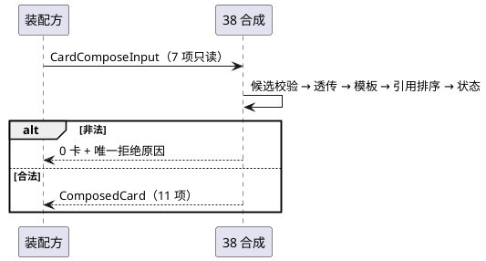

#### **12.3.1.3 异常场景**

1. **候选非法**
   a. 触发条件：低置信、区间反向/为零、`state=Pushed`、展示词为空。
   b. 系统行为：0 卡，返回 `CandidateInvalid`。
   c. 用户感知：该候选不出卡片。
2. **标题超长**
   a. 触发条件：展示词 >40 字。
   b. 系统行为：0 卡，返回 `TitleTooLong`；不截断。
   c. 用户感知：不出现半截标题。

### **12.3.2 对齐回填与结论降级（REQ-B4S-02）**

#### **12.3.2.1 业务规则**

1. **唯一投影回填**：`citation_alignment` 只来自 `project_alignment(&alignment_result)`；`Unknown→Unverified`，`Passed`/`Failed` 同名；不解释 `basis`。
   a. 验收条件：When 39 返回 `Unknown`，the 卡片字段 shall 为 `Unverified`；When 返回其余两态，shall 同名；`CitationAlignment` 变体数 =3。
2. **有据才出解释**：`summary` 仅当 `Passed` 且引用非空时由固定模板 + 术语生成；`Failed`/`Unverified` 时置 `None` 或固定文案"未找到可靠来源"。
   a. 验收条件：When `Passed` 且引用非空，the `summary` shall 为 `Some` 且 `summary_is_consistent()==true`；When `Failed`/`Unverified`，shall 为 `None` 或固定文案。
3. **失败仍展示**：`Failed`/`Unverified` 不撤回卡片，`card_status` 保持既有展示态；点击由 B4 落 `Disabled{ReferenceUnverified}`。
   a. 验收条件：When 对齐失败，the `card` shall 仍为 `Some`；`card_status != Withdrawn`（除非撤回信号）。
4. **禁止项**：禁止 `Unknown→Passed`、禁止把 `Passed` 当可点击、禁止写 `click_state`。
   a. 验收条件：When 构造反例，the `citation_alignment` shall 均不为 `Passed`；`cards/**` 中 `ClickState` 命中 0。

#### **12.3.2.2 交互流程**

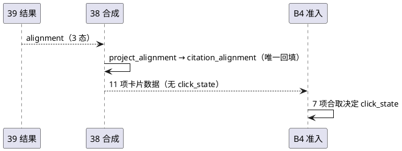

#### **12.3.2.3 异常场景**

1. **把 Unknown 当 Passed**
   a. 触发条件：合成器自行判定"无引用也通过"。
   b. 系统行为：违反唯一投影，AC-B4-68 失败。
   c. 用户感知：阶段不放行。
2. **Failed 被撤回**
   a. 触发条件：对齐失败时把卡片置 0。
   b. 系统行为：违反"可展示不可点"，AC-B4-69 失败。
   c. 用户感知：卡片消失，与规格不符。

### **12.3.3 引用集合与状态流转（REQ-B4S-03）**

#### **12.3.3.1 业务规则**

1. **引用只存 ID 面**：元素只允许 5 字段；禁止 URL/标题/摘要/正文。
   a. 验收条件：When 扫描输出，the 引用元素字段数 shall 为 5；禁止内容命中 0。
2. **稳定排序**：按 `reference_id` 升序；输入顺序不影响输出；重复 ID 判 `InputContractViolation`；空集合合法。
   a. 验收条件：When 3 种乱序输入，the 输出 shall 逐字节相同；When 重复 ID，shall 拒绝。
3. **状态最小流转**：只决定 `Displayed`/`Withdrawn`；不写 `Collapsed`；`Withdrawn` 不可复活。
   a. 验收条件：When 撤回信号，the `card_status` shall 为 `Withdrawn`；When 已撤回再展示，shall 保持 `Withdrawn`。
4. **禁止项**：禁止 38 复制引用正文、禁止补检索、禁止改写引用内容。
   a. 验收条件：When 扫描 `cards/**`，`reqwest`/`std::fs`/`outbox` 命中 0。

#### **12.3.3.2 交互流程**

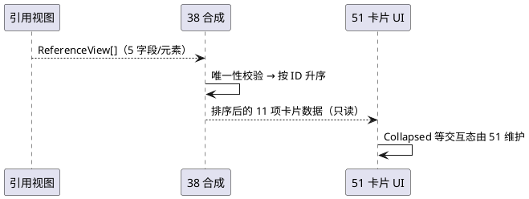

#### **12.3.3.3 异常场景**

1. **重复引用 ID**
   a. 触发条件：同一 `reference_id` 出现 2 次。
   b. 系统行为：拒绝合成，返回 `InputContractViolation`。
   c. 用户感知：该候选不出卡片。
2. **已撤回卡片被复活**
   a. 触发条件：`current_card_status=Withdrawn` 后再次合成展示态。
   b. 系统行为：拒绝，返回 `CardWithdrawn`。
   c. 用户感知：已撤回卡片不重新出现。

### **12.3.4 归属、零转录与离线（REQ-B4S-04）**

#### **12.3.4.1 业务规则**

1. **分层单向**：`application::cards` 只依赖 domain 契约与 39 结果；不得 `use crate::gate`；不定义 trait/端口。
2. **零转录**：类型/日志/诊断/测试/进度只允许 ID、枚举、长度、计数、毫值、版本号；展示词与解释只在输出卡片与测试进程内。
3. **Debug 白名单**：`CardComposeInput` 手写 `Debug`，不输出 `normalized_term`、展示词与解释。
4. **离线确定性**：无网络、无系统时间、无环境变量、无文件、无锁；同输入 100 次逐字节一致；引用排序后判定。
   a. 验收条件：When 打乱引用顺序，the 结果 shall 逐字节相等；When 执行 `--rule=source`（扫描面含 `cards/**`），shall 退 0。

#### **12.3.4.2 交互流程**

```plantuml
@startuml
participant "38 合成" as C
participant "B4 契约/门控" as B4
participant "39 对齐" as V
participant "51 UI" as UI
participant "52 存储/审计" as S
B4 --> C : 只读 allow_ref + 候选
V --> C : 只读 alignment 结果
C --> B4 : 11 项卡片数据（补 2 项成 13 字段）
B4 --> UI : click_state（只读）
C ..> S : 禁止直连（0 写入）
@enduml
```

#### **12.3.4.3 异常场景**

1. **38 越界写记录/审计**
   a. 触发条件：卡片数据写入 `GateRecord`/审计/夹具/报告。
   b. 系统行为：`--rule=record`/`--rule=zero-transcript` 命中。
   c. 用户感知：阶段不放行。
2. **38 联网或读盘**
   a. 触发条件：出现 `reqwest`/`std::fs`/`std::env`/系统时间。
   b. 系统行为：`--rule=source` 命中。
   c. 用户感知：阶段不放行。

## **12.4 增量数据约束**

### **12.4.1 38 输入（CardComposeInput，封闭 7 项）**

1. **card_id**：必填，只读；装配方注入；38 不重算；不得为空。
2. **candidate**：必填，只读 10 项；必须 `validate()==true`。
3. **allow_ref**：必填，只读；必须来自一次 `Allow`。
4. **alignment_result**：必填，只读 6 项；只读 `alignment`。
5. **references**：必填，0..*；元素 5 字段；`reference_id` 唯一。
6. **current_card_status**：必填，三态；只读；不写 `Collapsed`。
7. **suppressed_notice**：必填布尔；不进入 11 项输出。
8. **禁止字段**：URL、标题、正文摘要、抓取正文、查询原文、转写片段、姓名、联系方式、`model`、`request_id`、`api_key`。

### **12.4.2 38 输出（ComposedCard，封闭 11 项）**

1. **card_id**：与输入恒等；全局唯一；一候选最多一卡。
2. **keyword_text**：≤40；与候选恒等；不含完整句/姓名/联系方式/URL。
3. **normalized_term**：与候选恒等；禁止序列化进记录/日志/夹具。
4. **keyword_kind**：五类封闭。
5. **trigger**：`Auto`/`OnDemand`。
6. **triggered_at_ms**：=候选区间终点。
7. **confidence**：0..=1；与候选恒等。
8. **summary**：`Option`；≤80；`alignment != Passed` 时为 `None` 或固定文案；只允许固定模板 + 术语。
9. **references**：0..*；元素 5 字段；按 `reference_id` 升序；重复 ID 违规。
10. **citation_alignment**：三态；唯一投影回填。
11. **card_status**：`Displayed`/`Withdrawn`；不写 `Collapsed`。

12. **不变量**：`summary.is_some() ⇒ alignment==Passed`；输出不含 `gate_decision_ref`/`click_state`；同输入 100 次字节一致。

### **12.4.3 结果与拒绝原因（CardComposeOutcome / ComposeRejectReason）**

1. **outcome 2 项**：`card`/`reason` 恰一为 `Some`。
2. **reason 6 项封闭**：`GateNotAllowed`/`CandidateInvalid`/`TitleTooLong`/`DuplicateCard`/`CardWithdrawn`/`InputContractViolation`；单输入单原因。
3. **不进入 B4 封闭集**：不改 `GateRejectReason`（23）、不新增 `GateCounter`（32）。
4. **诊断只含 ID 面**：计数与原因码；不含展示词、解释、术语、引用文本与 URL。

### **12.4.4 既有封闭字段不变**

1. `KeywordCardDraft` 13、`ReferenceView` 5、`CitationAlignment` 3 不变。
2. `GateRecord` 14、`GateAuditEvent` 7、`GateInputFixture` 23、`ReplayReport` 5、`GateCounter` 32、`GateRejectReason` 23 不变。
3. `crates/application/src/gate/api.rs` 的 `pub fn` 数保持 4，且零 diff；`gate/**` 零 diff。
4. 38 不新增 domain 契约文件；`crates/domain/src/model/**` 零 diff。

## **12.5 AC-B4-65~74（增量验收）**

| 编号 | EARS 陈述 | 可机器判定 |
|---|---|---|
| AC-B4-65 | When 38 执行合成，the 输入 shall 恰为 7 项封闭字段且全部只读；38 不得改写 `KeywordCardDraft` 13 字段、`ReferenceView` 5 字段与 39 结果；`api.rs` 4 个 `pub fn`、`GateRecord` 14、`GateAuditEvent` 7、`GateInputFixture` 23、`ReplayReport` 5、`GateCounter` 32、`GateRejectReason` 23 均不变。 | 用例 `card_compose_input_is_readonly_and_closed`；`kw_fields CardComposeInput`=7；`grep -c '^pub fn ' crates/application/src/gate/api.rs`=4；`--rule=record` 退 0；domain 三契约文件零 diff |
| AC-B4-66 | The 合成卡片 shall 满足 `keyword_text ≤40`、`summary ≤80`、`confidence` 与 `triggered_at_ms` 与候选逐项恒等；`summary.is_some() ⇒ citation_alignment == Passed`；超限文本一律不截断。 | 用例 `card_compose_title_and_summary_limits`、`card_compose_preserves_confidence_and_trigger`；`TitleText::LIMIT`=40、`ConclusionText::LIMIT`=80；41 字 → `TitleTooLong`；81 字 → `summary=None` |
| AC-B4-67 | When `allow_ref` 缺失或来自 `Deny`，the 合成 shall 为 0 卡且 `reason=GateNotAllowed`；When `Allow` 且候选合法，shall 1 卡且 11 项齐备；同一 `card_id`/候选重复 100 次结果逐字节一致且 `card_drafts ≤1`；`Withdrawn` 不得复活。 | 用例 `card_compose_requires_gate_allow`、`card_compose_is_idempotent_per_candidate`、`card_compose_withdrawn_is_not_revived`；`ComposedCard` 字段数 =11 |
| AC-B4-68 | The `citation_alignment` shall 只来自 `project_alignment(&alignment_result)`（`Unknown→Unverified` 唯一投影）；38 不得解释 `basis`、不得写 `gate_decision_ref`/`click_state`。 | 用例 `card_compose_aligns_unknown_to_unverified`、`card_compose_leaves_click_state_to_b4`；`kw_fields ComposedCard`=11；`project_alignment` 定义 =1；`cards/**` 中 `ClickState` 命中 0 |
| AC-B4-69 | When `citation_alignment ∈ {Failed, Unverified}`，the 卡片 shall 仍产出且 `summary` 为 `None` 或固定文案，`summary_is_consistent()==true`；不得撤回卡片、不得给出结论性表述。 | 用例 `card_compose_failed_stays_displayed_without_conclusion`；`summary_is_consistent()`=true；`card_status != Withdrawn` |
| AC-B4-70 | The `references` shall 逐元素只含 5 字段并按 `reference_id` 升序稳定排序；重复 ID 判 `InputContractViolation`；空集合合法；不得复制 URL/标题/摘要/正文。 | 用例 `card_compose_references_are_id_only_and_sorted`；`kw_fields ReferenceView`=5；3 种乱序输出相同；重复 ID → 拒绝 |
| AC-B4-71 | While 执行合成，38 shall 无 `reqwest`/`TcpStream`/`std::net`/`Instant::now`/`SystemTime::now`/`thread::sleep`/`std::env`/`std::fs`，不调用 LLM；同输入 100 次逐字节一致；候选/引用顺序不影响结果。 | 用例 `card_compose_is_offline_and_deterministic`、`card_compose_ignores_reference_order`；`--rule=source` 退 0（扫描面含 `cards/**` 与 `tests/card_compose.rs`） |
| AC-B4-72 | The 38 类型、日志、诊断、测试与进度 shall 只含 ID/枚举/长度/计数/毫值/版本号；`keyword_text`/`summary` 不得进入 `GateRecord`/审计/报告/夹具/日志/进度；`CardComposeInput` 的 `Debug` 不输出术语与展示词。 | 用例 `card_compose_zero_transcript_boundary`；`--rule=zero-transcript` 退 0；`format!("{:?}", input)` 不含文本取值；输出键集合 =11 |
| AC-B4-73 | While 扫描 38 边界，`cards/**` shall 无渲染、卡片存储、网络、卡片表符号且不得 `use crate::gate`；不建 51 UI、52 存储与 `tests/replay/`；不改 B4 契约与 4 个 `pub fn`。 | 用例 `card_compose_ownership_is_outside_gate_and_ui`；`grep -rn 'use crate::gate' cards`=0；禁词命中 0；`test ! -d tests/replay` 退 0 |
| AC-B4-74 | When 执行 38 增量验收，the `card_compose` target shall 在 `NEW_TARGETS` 中（21→22）且用例全绿；AC 汇总合计 =74；`b4-status.md` 的 U-03 口径 shall 为"规格已定，待实现"并登记 D-B4-P45~P52；`--rule=targets` 循环口径沿用 X-05（脚本内不追加 `card_compose`）。 | `--test card_compose` 退 0；token 数 =22 且含 `card_compose`；`grep -c '^\| AC-B4-' spec.md` 合计 74；`grep -c 'U-03.*规格已定' b4-status.md` ≥1；`grep -c 'card_compose' check-b4-gates.sh` =0 |

> AC-B4-65~74 当前均为 `pending`（规格已定，待实现）；只作为"38 增量范围是否闭合"的附加判据，不阻断 AC-B4-01~64 的既有判定。

## **12.6 增量需求 → AC 映射**

| 需求 | 对位 AC | 关键判据 |
|---|---|---|
| REQ-B4S-01 确定性组装 | AC-B4-65/66/67 | 7 项输入、11 项输出、长度与透传、Allow 前置与幂等 |
| REQ-B4S-02 对齐回填与降级 | AC-B4-68/69 | 唯一投影、`Passed` 才出解释、失败仍展示 |
| REQ-B4S-03 引用与状态 | AC-B4-70/67 | 5 字段/排序/重复 ID、`Displayed`/`Withdrawn` 最小流转 |
| REQ-B4S-04 归属与红线 | AC-B4-71/72/73/74 | 离线确定性、零转录、分层不越界、target 与登记 |

## **12.7 未完成事项与阶段出口影响**

1. **U-03 口径更新**：38 卡片合成由"未做"改为"**规格已定，待实现**"；实现由后续 38 编码阶段承接，AC-B4-65~74 保持 `pending`。
2. **不影响既有出口**：AC-B4-65~74 是"38 增量范围"的附加判据，不阻断 AC-B4-01~64 的既有判定，也不改既有 AC 编号/语义。
3. **不改既有封闭面**：本轮仅文档增量；不改 `gate/api.rs`、`gate/**`、`domain/src/model/**`、`Cargo.toml`/`Cargo.lock`。
4. **不宣称**：离线通过不等于解释语义正确、真实引用可访问或 51 渲染质量通过；不宣称 G3/G4/真机，不宣称产品级"可点击关键词卡片"已交付。
5. **下一步入口**：实现前必须先确认 §12.4 的 7/11/2/6 字段封闭、`card_id` 注入口径与"38 不写 click_state"；确认后由 38 阶段建 `crates/application/src/cards/**` + `card_compose` target。

---

# **13. 增量需求：51 点击 UI（AC-B4-75~84）**

> **定位**：51 是**视图层能力**，消费 38 的 `ComposedCard`（11 项）与 B4 补齐后的 13 字段 `KeywordCardDraft`，产出可渲染的视图数据（标题、结论/无结论态、置信度、引用列表、卡片状态、可点击/禁用原因）与点击后的本地详情视图。51 **不渲染像素、不建平台窗口句柄、不联网、不存储、不读原文/系统时间**；点击只读展开本地详情，不触发检索/LLM/外发/审计事件。38 合成、39 对齐判定、B4 门控与点击权威、52 存储/展示审计、13.3 回放本体仍归各自所有者。
> **编号纪律**：既有 AC-B4-01~74 **不重排、不改语义**；新增 **AC-B4-75~84**。既有 `KeywordCardDraft` 13、`ReferenceView` 5、`CitationAlignment` 3、`ComposedCard` 11、`CardComposeInput` 7、`GateRecord` 14、`GateAuditEvent` 7、`GateInputFixture` 23、`ReplayReport` 5、`GateCounter` 32、`GateRejectReason` 23、`api.rs` 4 个 `pub fn` 一律不变。
> **本轮性质**：只产出需求规格，**不实现**任何 51 实体文件、不改代码、不改既有封闭字段、不创建 52 存储。

## **13.1 组件定位增量**

### **13.1.1 核心职责增量**

本组件负责把“B4 补齐后的 13 字段关键词卡”与“38 的 11 项只读预览”**确定性地投影**为可渲染视图模型，并给出“点击只展开本地详情、绝不外发”的交互契约；实现“有据可展示、无据有禁用原因、投屏/遮蔽不泄露正文、撤回不复活”。

### **13.1.2 核心输入增量**

1. **13 字段卡片**：`KeywordCardDraft`（只读；唯一权威输入；含 `gate_decision_ref`/`click_state`）。
2. **38 只读预览**：`ComposedCard`（11 项，只读；缺少 `gate_decision_ref`/`click_state`，只能预览，不可点击）。
3. **视图事实**：`ViewFacts`（6 项：会话一致、授权撤销、引用过期、投屏、紧急遮蔽、可见卡数）。
4. **既有基线**：`cargo test --workspace` failed=0 / ignored=9（P6 后）；`api.rs` 4 个 `pub fn`；`NEW_TARGETS`=22；`gate/**`/`cards/**`/`domain/src/model/**` 零 diff；`tests/replay/` 与 `ui-bridge/src/keyword_card/` 不存在。

### **13.1.3 核心输出增量**

1. **可渲染视图**：`KeywordCardView`（10 项：`card_id`/`keyword_kind`/`trigger`/`triggered_at_ms`/`card_status`/`body_visible`/`body`/`click_state`/`citation_alignment`/`badge_count`）。
2. **正文视图**：`CardBodyView`（4 项：`title`/`conclusion`/`confidence`/`references`）与 `ConclusionView`（3 态：`Available`/`NoReliableSource`/`Absent`）。
3. **本地详情**：`CardDetailView`（5 项：`card_id`/`title`/`conclusion`/`reference_ids`/`citation_alignment`）。
4. **结果与原因**：`CardViewOutcome`（2 项 XOR：`view`/`reason`）、`ViewRejectReason`（3 项封闭）、`ClickOutcome`（2 项 XOR：`detail`/`reason`）。
5. **可机器判定的增量 AC**：AC-B4-75~84。

### **13.1.4 职责边界增量**

1. **不合成卡片**：不计算标题/解释/置信度、不组装引用集合、不维护 `card_status`（归 38）。
2. **不判定引用对齐**：只读 `citation_alignment`，不解释 `basis`、不重算 39 结果（归 39）。
3. **不判定点击权威**：只读 B4 `click_state`，只做“只降不升”的 UI 安全收敛；不调用 `keyword_card_admission`、不写 `gate/**`（归 B4）。
4. **不渲染像素/不建平台句柄**：不依赖 `tauri`/`windows`/`objc2`，不建窗口/焦点 API；真实三形态、投屏 API 与像素表现不在离线范围。
5. **不联网/不存储/不读原文**：不调 `reqwest`/`TcpStream`/`std::net`，不写卡片表/缓存/审计，不读完整转写、查询原文、系统时间、环境变量、文件。
6. **不改既有封闭面**：`KeywordCardDraft` 13、`ReferenceView` 5、`CitationAlignment` 3、`ComposedCard` 11、`CardComposeInput` 7、`GateRecord` 14、审计 7、夹具 23、`ReplayReport` 5、`GateCounter` 32、`GateRejectReason` 23、`api.rs` 4 一律不变；不建 52 存储与 `tests/replay/`。

## **13.2 增量领域术语**

**视图模型（Keyword Card View）**
: 51 从 13 字段卡片或 11 项 `ComposedCard` 确定性投影出的、可渲染的只读数据结构；不含原文、URL、姓名与联系方式，不写入门控记录。

**本地展开（Local Detail Open）**
: 点击 `Enabled` 卡片后在本地内存中打开详情视图的行为；只返回标题、结论、引用 ID 列表与对齐状态，`outbound_attempts=0`、`llm_calls=0`、`audit_events=0`。

**只降不升（Downgrade Only）**
: 51 对 B4 `click_state` 的唯一允许变换：`Enabled` 可因授权撤销/跨会话/引用过期/对齐未通过/投屏/遮蔽/撤回降为 `Disabled{reason}`；`Disabled{reason}` 不得升为 `Enabled`，无更高优先级屏蔽态时保持原原因。

**屏蔽态（Masked State）**
: 投屏保护或紧急遮蔽期间，正文隐藏（`body_visible=false`、`body=None`），仅保留“有 N 条”角标的展示状态；点击一律拒绝。

**撤回不复活（No Revival）**
: `card_status=Withdrawn` 的卡片不再生成视图，且不得因重新授权、刷新、重放或再次投影而恢复为 `Displayed`/`Collapsed`。

## **13.3 核心能力**

### **13.3.1 视图投影与字段封闭（REQ-B4V-01）**

#### **13.3.1.1 业务规则**

1. **输入只读**：只读 13 字段 `KeywordCardDraft` 与 11 项 `ComposedCard`；不得改写输入，不得补 `gate_decision_ref`/`click_state`。
   a. 验收条件：When 投影后比对输入，the 差异 shall 为 0；When `ComposedCard` 预览，the `click_state` shall 恒为 `Disabled{NotAllowed}`。
2. **字段封闭**：`KeywordCardView` 10 项、`CardBodyView` 4 项、`CardDetailView` 5 项、`ViewFacts` 6 项、`CardViewOutcome` 2 项、`ClickOutcome` 2 项；缺一或多一即结构违规。
   a. 验收条件：When 序列化视图，the 键集合 shall 恰为对应字段数；`kw_fields` 断言 10/4/5/6/2/2。
3. **引用只存 ID 面**：`CardBodyView.references` 元素只允许 `reference_id`/`trust_tier`/`access_status`/`published_at_ms`/`alignment`；按 `reference_id` 升序；重复 ID 判输入违规。
   a. 验收条件：When 乱序输入 3 条引用，the 输出 shall 按 ID 升序；When 重复 ID，the 结果 shall 为 `ReferenceContractViolation`。
4. **禁止项**：禁止新增第 11/14 个业务字段；禁止把 `normalized_term`、`gate_decision_ref` 的 `trace_id`、原文、URL、姓名、联系方式写入视图。
   a. 验收条件：When 扫描视图类型，上述禁止字段命中 shall 为 0。

#### **13.3.1.2 交互流程**

```plantuml
@startuml
participant "B4 13 字段卡片" as B4
participant "38 11 项预览" as C38
participant "51 视图投影" as UI
B4 --> UI : 只读 13 字段
C38 --> UI : 只读 11 项
UI -> UI : 输入校验 → 屏蔽态 → 只降不升 → 视图组装
UI --> UI : KeywordCardView / CardViewOutcome
@enduml
```

#### **13.3.1.3 异常场景**

1. **输入契约违规**
   a. 触发条件：`summary_is_consistent()==false`、`Passed` 但引用为空、引用 ID 重复、`ComposedCard.card_status=Collapsed`。
   b. 系统行为：拒绝投影，返回 `view=None` + 唯一原因；不读取越界字段、不回显。
   c. 用户感知：该卡片不出现；诊断可见原因码。
2. **引用越界**
   a. 触发条件：引用元素出现 5 字段之外的文本载体。
   b. 系统行为：判 `ReferenceContractViolation`；不读取越界字段。
   c. 用户感知：该卡片不出现；零转录扫描命中即阶段不放行。

### **13.3.2 点击状态机与本地展开（REQ-B4V-02）**

#### **13.3.2.1 业务规则**

1. **只降不升**：输入 `Disabled{reason}` 在无更高优先级屏蔽态时保持原 reason；输入 `Enabled` 仅在 8 项前置事实全真时保持 `Enabled`，否则降为对应 `Disabled`。
   a. 验收条件：When 输入 `Disabled{ReferenceUnverified}` 且其余事实全真，the 输出 shall 仍为 `Disabled{ReferenceUnverified}`；When 输入 `Enabled` 且 `authorization_revoked=true`，shall 为 `Disabled{AuthorizationRevoked}`。
2. **固定优先级**：`Withdrawn`（短路）→ `screen_share` → `emergency_masked` → `authorization_revoked` → `!session_matches || reference_stale` → 输入 `Disabled{reason}` → `alignment != Passed` → `Enabled`；高优先级只允许覆盖为更严格原因，不得升为 `Enabled`。
   a. 验收条件：When `screen_share=true` 且输入 `Disabled{ReferenceUnverified}`，the 输出 shall 为 `Disabled{ScreenShareProtection}`；When `alignment=Failed` 且输入 `Enabled`，shall 为 `Disabled{ReferenceUnverified}`。
3. **本地详情**：点击 `Enabled` 且正文可见只返回 `CardDetailView`；不得检索、LLM、外发、审计、存储、抢焦点、离开会议。
   a. 验收条件：When 点击 1 次，the `outbound_attempts`/`llm_calls`/`audit_events` shall 均为 0 且 `detail=Some`；When 点击 `Disabled`，the `detail` shall 为 `None` 且 `reason` 等于禁用原因。
4. **禁止项**：禁止点击触发隐式外发；禁止用 UI 开关绕过 `click_state`；禁止把 `Disabled` 升为 `Enabled`；禁止点击时重新读取原文。
   a. 验收条件：When 扫描 `keyword_card/**`，`reqwest`/`TcpStream`/`std::net`/`issue_query`/`AuditLog`/`card_store` 命中 shall 为 0。

#### **13.3.2.2 交互流程**

```plantuml
@startuml
actor "参会使用者" as U
participant "51 卡片视图" as UI
participant "本地详情" as D
U -> UI : 点击卡片
alt click_state=Enabled 且正文可见
  UI -> D : 本地展开（0 外发/0 LLM/0 审计）
  D --> U : 标题/结论/引用 ID/对齐状态
else Disabled 或正文隐藏
  UI --> U : 拒绝 + 禁用原因
end
@enduml
```

#### **13.3.2.3 异常场景**

1. **点击禁用卡片**
   a. 触发条件：`click_state=Disabled{reason}` 或 `body=None`。
   b. 系统行为：返回 `ClickOutcome{detail:None, reason:Some(reason)}`；不发起任何外发。
   c. 用户感知：详情不打开，显示禁用原因。
2. **点击时正文缺失**
   a. 触发条件：`click_state=Enabled` 但 `body=None`（内部不一致）。
   b. 系统行为：fail-closed 返回 `reason=NotAllowed`；不读取原卡。
   c. 用户感知：详情不打开。

### **13.3.3 隐藏/禁用规则（REQ-B4V-03）**

#### **13.3.3.1 业务规则**

1. **投屏/紧急遮蔽**：`body_visible=false`、`body=None`、`badge_count≥1`、点击一律拒绝；标题/结论/引用正文不得出现在序列化结果中。
   a. 验收条件：When `screen_share=true`，the `body_visible` shall 为 `false` 且 `click_state=Disabled{ScreenShareProtection}`；When `emergency_masked=true`，shall 为 `Disabled{EmergencyMasked}`。
2. **授权撤销**：正文可见（不追溯改写内容），`click_state=Disabled{AuthorizationRevoked}`；重新授权不自动恢复旧卡。
   a. 验收条件：When 撤销后投影旧卡，the `body_visible` shall 保持 `true`（非投屏/非撤回）且 `click_state=Disabled{AuthorizationRevoked}`。
3. **跨会话/引用过期**：`click_state=Disabled{StaleReference}`；不得读取已删除内容。
   a. 验收条件：When `session_matches=false` 或 `reference_stale=true`，the `click_state` shall 为 `Disabled{StaleReference}`。
4. **对齐未通过**：`Failed`/`Unverified`/`Unknown` 卡片仍可展示，但 `click_state=Disabled{ReferenceUnverified}`，结论为 `NoReliableSource` 或 `Absent`。
   a. 验收条件：When `alignment!=Passed`，the `body_visible` shall 为 `true`（非投屏/非撤回）且 `click_state=Disabled{ReferenceUnverified}`。
5. **撤回不复活**：`Withdrawn` 不生成视图，返回 `CardWithdrawn`；100 次投影结果一致。
   a. 验收条件：When `card_status=Withdrawn`，the `view` shall 恒为 `None` 且 `reason=CardWithdrawn`。
6. **静默/暂停**：不进入 `ViewFacts`，不阻断已展示卡片的本地查看。
   a. 验收条件：When `ViewFacts` 字段集合，`paused`/`silent` 命中 shall 为 0；When 暂停期间点击已展示卡片，the `detail` shall 可见且 `outbound_attempts=0`。
7. **禁止项**：禁止在投屏/遮蔽下展示正文；禁止把 `Passed` 单独当可点击；禁止复活撤回卡。
   a. 验收条件：When 构造上述反例，the `click_state` shall 均不为 `Enabled` 或视图 shall 不出现。

#### **13.3.3.2 交互流程**

```plantuml
@startuml
participant "B4 卡片/事实" as B4
participant "51 屏蔽态判定" as UI
participant "使用者" as U
B4 --> UI : card_status / click_state / ViewFacts
UI -> UI : 撤回短路 → 投屏/遮蔽 → 授权/过期 → 对齐
alt 撤回
  UI --> U : 不展示
else 投屏/遮蔽
  UI --> U : 仅“有 N 条”角标
else 可展示
  UI --> U : 正文 + 禁用原因（如有）
end
@enduml
```

#### **13.3.3.3 异常场景**

1. **投屏泄露**
   a. 触发条件：投屏保护下仍输出标题/结论。
   b. 系统行为：判屏蔽态违规，`body` 必须为 `None`。
   c. 用户感知：阶段不放行。
2. **旧卡自动恢复**
   a. 触发条件：重新授权后旧卡变为 `Enabled`。
   b. 系统行为：违反“只降不升/撤销不恢复”，AC-B4-77 失败。
   c. 用户感知：旧卡保持“授权已撤销”。

### **13.3.4 零转录与平台边界（REQ-B4V-04）**

#### **13.3.4.1 业务规则**

1. **展示层与记录层分离**：视图模型可持有 `title`/`conclusion`；禁止写入 `GateRecord`/`GateAuditEvent`/`ReplayReport`/夹具/日志/进度。
2. **Debug 白名单**：`KeywordCardView`/`CardBodyView`/`CardDetailView` 手写 `Debug`，不输出标题/结论取值；只输出 ID/枚举/长度/计数/毫值。
3. **离线与平台自由**：不依赖 `tauri`/`windows`/`objc2`；不用 `reqwest`/`TcpStream`/`std::net`/`Instant::now`/`SystemTime::now`/`thread::sleep`/`std::env`/`std::fs`；不建卡表/缓存/审计存储。
4. **确定性**：同输入 100 次序列化逐字节一致；引用顺序不影响结果。

#### **13.3.4.2 交互流程**

```plantuml
@startuml
participant "51 视图" as UI
participant "记录/诊断" as L
UI -> UI : 仅 ID/枚举/长度/计数（正文只留在视图）
UI --> L : 原因码/计数（无标题/结论）
@enduml
```

#### **13.3.4.3 异常场景**

1. **记录层夹带正文**
   a. 触发条件：`title`/`conclusion` 进入记录/审计/夹具/报告/进度。
   b. 系统行为：`--rule=zero-transcript` 命中。
   c. 用户感知：阶段不放行。
2. **平台 API 进入 51**
   a. 触发条件：出现 `tauri`/`windows`/`objc2`/网络/系统时间/文件。
   b. 系统行为：`--rule=source` 或 `cargo tree` 断言失败。
   c. 用户感知：阶段不放行。

### **13.3.5 归属与接口（REQ-B4V-05）**

#### **13.3.5.1 业务规则**

1. **51 交付形态**：`crates/ui-bridge/src/keyword_card/**`（`mod.rs` + `view.rs`）+ `ui-bridge/src/lib.rs` +1 行 + `tests/keyword_card_view.rs`；3 个纯函数；不建平台适配/52 存储/回放目录。
2. **与 B4**：只读 13 字段与 `click_state`；不调用 `keyword_card_admission`；不写 `gate/**`；`api.rs` 4 个 `pub fn` 零 diff。
3. **与 38**：只读 `ComposedCard` 11 项；不调用 `compose_keyword_card`；不写 `cards/**`；预览恒 `Disabled{NotAllowed}`。
4. **与 39**：只读 `citation_alignment`；不解释 `basis`；不重算对齐；`CitationAlignment` 保持 3 变体。
5. **与 52/13.3**：不写审计/存储；不建 `tests/replay/`。

#### **13.3.5.2 交互流程**

```plantuml
@startuml
participant "B4 门控/契约" as B4
participant "38 合成" as C38
participant "39 对齐" as V
participant "51 视图" as UI
participant "52 存储/审计" as S
B4 --> UI : 13 字段卡片（只读）
C38 --> UI : 11 项预览（只读）
V --> UI : citation_alignment（只读）
UI --> UI : 视图/详情（0 外发）
UI ..> S : 禁止直连（0 写入）
@enduml
```

#### **13.3.5.3 异常场景**

1. **51 越界写记录**
   a. 触发条件：视图/详情写入 `GateRecord`/审计/夹具/报告。
   b. 系统行为：`--rule=record`/`--rule=zero-transcript` 命中。
   c. 用户感知：阶段不放行。
2. **51 越界合成/判定**
   a. 触发条件：出现 `compose_keyword_card`/`project_alignment`/`keyword_card_admission`。
   b. 系统行为：归属断言命中。
   c. 用户感知：阶段不放行。

## **13.4 增量数据约束**

### **13.4.1 51 视图（KeywordCardView，封闭 10 项）**

1. **card_id**：必填，与输入恒等。
2. **keyword_kind**：五类封闭。
3. **trigger**：`Auto`/`OnDemand`。
4. **triggered_at_ms**：与输入恒等；不读系统时间。
5. **card_status**：`Displayed`/`Collapsed`/`Withdrawn`；只读；`Withdrawn` 不生成视图。
6. **body_visible**：`body.is_some()` 的等价布尔。
7. **body**：`Option<CardBodyView>`；屏蔽/撤回时 `None`。
8. **click_state**：`Enabled`/`Disabled{reason}`；只降不升。
9. **citation_alignment**：`Passed`/`Failed`/`Unverified`。
10. **badge_count**：≥1；屏蔽态角标。

### **13.4.2 正文/结论/详情**

1. **CardBodyView（4 项）**：`title`（≤40，与输入恒等）、`conclusion`（`ConclusionView`）、`confidence`（0..=1）、`references`（5 字段/元素、ID 升序、重复 ID 违规）。
2. **ConclusionView（3 态）**：`Available(ConclusionText)`/`NoReliableSource`/`Absent`；`Available` 仅当 `Passed` 且 `summary=Some`。
3. **CardDetailView（5 项）**：`card_id`/`title`/`conclusion`/`reference_ids`/`citation_alignment`。

### **13.4.3 视图事实（ViewFacts，封闭 6 项）**

1. **session_matches**：布尔。
2. **authorization_revoked**：布尔。
3. **reference_stale**：布尔。
4. **screen_share**：布尔。
5. **emergency_masked**：布尔。
6. **visible_card_count**：0..*；投影时 `max(1)`。

> 禁止字段：`paused`/`silent`/`now_ms`/URL/标题/摘要/正文/姓名/联系方式。

### **13.4.4 结果与原因**

1. **CardViewOutcome（2 项）**：`view`/`reason` 恰一为 `Some`。
2. **ViewRejectReason（3 项）**：`InputContractViolation`/`ReferenceContractViolation`/`CardWithdrawn`；单输入单原因。
3. **ClickOutcome（2 项）**：`detail`/`reason` 恰一为 `Some`；`reason` 复用 `ClickDisabledReason` 6 项。
4. **不进入 B4 封闭集**：不改 `GateRejectReason`（23）、不新增 `GateCounter`（32）；诊断只含 ID/枚举/计数/原因码。

### **13.4.5 既有封闭字段不变**

1. `KeywordCardDraft` 13、`ReferenceView` 5、`CitationAlignment` 3、`ComposedCard` 11、`CardComposeInput` 7 不变。
2. `GateRecord` 14、`GateAuditEvent` 7、`GateInputFixture` 23、`ReplayReport` 5、`GateCounter` 32、`GateRejectReason` 23 不变。
3. `crates/application/src/gate/api.rs` 的 `pub fn` 数保持 4，且零 diff；`gate/**`/`cards/**`/`domain/src/model/**` 零 diff。
4. 51 不新增 domain 契约；视图类型只落 `crates/ui-bridge/src/keyword_card/`。

## **13.5 AC-B4-75~84（增量验收）**

> target 名与扫描面：`keyword_card_view`（`crates/ui-bridge/tests/keyword_card_view.rs`）；`NEW_TARGETS` 22→23；`--rule=source`/`--rule=zero-transcript` 追加 `crates/ui-bridge/src/keyword_card/**` 与测试文件；`--rule=targets` 循环仍 7 项不追加；`tests/schema.rs` 不纳入 51 扫描面。

| 编号 | EARS 陈述 | 可机器判定 |
|---|---|---|
| AC-B4-75 | When 51 投影 13 字段 `KeywordCardDraft` 或 11 项 `ComposedCard`，the 视图模型 shall 封闭为 `KeywordCardView`（10 项）、`CardBodyView`（4 项）、`CardDetailView`（5 项）、`ViewFacts`（6 项）、`ConclusionView`（3 变体）、`ViewRejectReason`（3 项）、`CardViewOutcome`（2 项）、`ClickOutcome`（2 项）；输入只读、不得改写既有字段；`ComposedCard` 预览的 `click_state` shall 恒为 `Disabled{NotAllowed}`。 | 用例 `keyword_card_view_input_is_closed`、`keyword_card_view_from_composed_is_not_clickable`；`kw_fields` 10/4/5/6/2/2；`grep -cE '^pub (struct|enum) ' crates/ui-bridge/src/keyword_card/view.rs`=8；`grep -c '^pub fn ' crates/ui-bridge/src/keyword_card/view.rs`=3；`api.rs` `pub fn`=4；`--rule=record` 退 0 |
| AC-B4-76 | When 投屏保护或紧急遮蔽，the `body_visible` shall 为 `false`、`body` shall 为 `None`、`badge_count` shall ≥1，且 `click_state` shall 分别为 `Disabled{ScreenShareProtection}`/`Disabled{EmergencyMasked}`；标题/结论/引用正文不得出现在视图序列化结果中。 | 用例 `keyword_card_view_hides_body_under_screen_share`、`keyword_card_view_hides_body_under_emergency_mask`；序列化 `body=null`；正文不可检索 |
| AC-B4-77 | When 输入 `Enabled` 且 `authorization_revoked`/`reference_stale`/`session_matches=false`/`alignment!=Passed` 任一失败，the 最终 `click_state` shall 为对应 `Disabled{reason}`；When 输入 `Disabled{reason}` 且无更高优先级屏蔽态，shall 保持原 reason；禁止把 `Disabled` 升为 `Enabled`；`Enabled` 仅在 8 项前置事实全真时出现。 | 用例 `keyword_card_view_click_state_is_downgrade_only`、`keyword_card_view_never_upgrades_disabled`；`ClickDisabledReason::ALL.len()`=6；反例矩阵逐项断言 |
| AC-B4-78 | When 点击 `Enabled` 且正文可见的卡片，the `open_keyword_card_detail` shall 返回 `CardDetailView`（标题/结论/引用 ID 列表/对齐状态），且 `outbound_attempts=0`、`llm_calls=0`、`audit_events=0`；不得发起检索/LLM/外发/审计/存储；When 点击 `Disabled` 或正文隐藏，the `detail` shall 为 `None` 且 `reason` 为对应禁用原因。 | 用例 `keyword_card_view_detail_is_local_only`、`keyword_card_view_detail_has_no_outbound_side_effect`；禁词命中 0；`ClickOutcome` XOR |
| AC-B4-79 | When `card_status=Withdrawn`，the `view` shall 为 `None` 且 `reason=CardWithdrawn`，不得复活；When 跨会话或引用过期，the `click_state` shall 为 `Disabled{StaleReference}`；When 授权撤销，shall 为 `Disabled{AuthorizationRevoked}`；When `Failed`/`Unverified`，卡片 shall 仍可展示但 `click_state=Disabled{ReferenceUnverified}`。 | 用例 `keyword_card_view_withdrawn_is_not_revived`、`keyword_card_view_stale_or_cross_session_is_disabled`、`keyword_card_view_failed_alignment_stays_visible_but_disabled`；100 次投影一致 |
| AC-B4-80 | When `citation_alignment=Passed` 且 `summary=Some`，the `ConclusionView` shall 为 `Available`；When `Failed`/`Unverified`/`Unknown`，shall 为 `NoReliableSource` 或 `Absent`，不得 `Available`；When 非 `Passed` 且 `summary` 不是固定文案，the 投影 shall 为 `InputContractViolation`。 | 用例 `keyword_card_view_conclusion_is_none_without_passed`、`keyword_card_view_conclusion_preserved_for_passed`；`ConclusionView` 变体数=3；`summary_is_consistent()`=false → `view=None` |
| AC-B4-81 | The 51 视图模型、诊断、测试与进度 shall 只允许 `card_id`/`keyword_kind`/`reference_id`/枚举/长度/计数/毫值/版本号；`title`/`conclusion` 不得进入 `GateRecord`/审计/报告/夹具/日志/进度；`Debug` 不得输出标题/结论取值。 | 用例 `keyword_card_view_zero_transcript_boundary`、`keyword_card_view_debug_is_whitelisted`；`--rule=zero-transcript` 退 0；`format!("{:?}", view)` 不含标题/结论 |
| AC-B4-82 | While 执行投影/点击，51 shall 无 `reqwest`/`TcpStream`/`std::net`/`Instant::now`/`SystemTime::now`/`thread::sleep`/`std::env`/`std::fs`/`tauri`/`windows`/`objc2`；`cargo tree -p meeting-copilot-ui-bridge` 不含 `tauri`/`windows`/`objc2`/`reqwest`/`hyper`/`sqlx`；同输入 100 次序列化逐字节一致；引用顺序不影响结果。 | 用例 `keyword_card_view_is_offline_and_platform_free`、`keyword_card_view_ignores_reference_order`；`--rule=source` 退 0；`cargo tree` 禁词 0 |
| AC-B4-83 | While 扫描 51 边界，`crates/ui-bridge/src/keyword_card/**` shall 不 `use crate::gate`/`use meeting_copilot_application::gate`/`compose_keyword_card`/`project_alignment`/`keyword_card_admission`/`card_store`/`AuditLog`；不写 `gate/**`/`cards/**`/`domain/**`；不建 52 存储与 `tests/replay/`；`api.rs` 4、`ComposedCard` 11、`KeywordCardDraft` 13、`ReferenceView` 5、`CitationAlignment` 3、`GateRecord` 14、审计 7、夹具 23、`ReplayReport` 5、`GateCounter` 32、`GateRejectReason` 23 均不变。 | 用例 `keyword_card_view_ownership_is_outside_gate_and_cards`、`keyword_card_view_public_types_are_readonly`；禁词命中 0；`git diff --quiet HEAD -- gate cards domain` 退 0；`test ! -d tests/replay` 退 0 |
| AC-B4-84 | When 执行 51 增量验收，the `keyword_card_view` target shall 在 `NEW_TARGETS` 中（22→23）且用例全绿；AC 汇总合计 shall 为 84；`b4-status.md` 的 U-05 口径 shall 为“规格已定，待实现”并登记 D-B4-P65~P74；`--rule=targets` 循环沿用 X-05（脚本内不追加 `keyword_card_view`）。 | `cargo test -p meeting-copilot-ui-bridge --test keyword_card_view` 退 0；`NEW_TARGETS` token 数 =23 且含 `keyword_card_view`；`grep -c '^\| AC-B4-' spec.md` 合计 84；`grep -c 'U-05.*规格已定' b4-status.md` ≥1；`grep -c 'keyword_card_view' check-b4-gates.sh` =0 |

> AC-B4-75~84 当前均为 `pending`（规格已定，待实现）；只作为“51 增量范围是否闭合”的附加判据，不阻断 AC-B4-01~74 的既有判定；不判定真实像素/焦点/三形态/投屏 API 与产品级交互质量。

## **13.6 增量需求 → AC 映射**

| 需求 | 对位 AC | 关键判据 |
|---|---|---|
| REQ-B4V-01 视图投影与字段封闭 | AC-B4-75 | 10/4/5/6/2/2 字段、只读、`ComposedCard` 不可点 |
| REQ-B4V-02 点击状态机与本地展开 | AC-B4-77/78 | 只降不升、固定优先级、0 外发/0 LLM/0 审计 |
| REQ-B4V-03 隐藏/禁用 | AC-B4-76/77/79/80 | 投屏/遮蔽正文隐藏、撤销/过期/对齐禁用、撤回不复活、结论降级 |
| REQ-B4V-04 零转录与平台边界 | AC-B4-81/82 | 记录层无标题/结论、`Debug` 白名单、无平台/网络/时间/文件 |
| REQ-B4V-05 归属与接口 | AC-B4-83/84 | 不越界、封闭字段不变、target/登记收口 |

## **13.7 未完成事项与阶段出口影响**

1. **U-05 口径更新**：51 点击 UI 由“未做”改为“**规格已定，待实现**”；实现由后续 51 编码阶段承接，AC-B4-75~84 保持 `pending`。
2. **不影响既有出口**：AC-B4-75~84 是“51 增量范围”的附加判据，不阻断 AC-B4-01~74 的既有判定，也不改既有 AC 编号/语义。
3. **不改既有封闭面**：本轮仅文档增量；不改 `gate/**`、`cards/**`、`domain/src/model/**`、`gate/api.rs`、根 `Cargo.toml`/`Cargo.lock`、既有门禁脚本；51 实现阶段仅新增 `crates/ui-bridge/Cargo.toml` 的两条 path 依赖（见 13.3.5、D-B4-P73），不新增外部 crate。
4. **不宣称**：离线通过不等于真实像素渲染、真实焦点、真实三形态/投屏 API 或产品级交互质量通过；不宣称 G3/G4/真机，不宣称产品级“可点击关键词卡片”已交付。
5. **下一步入口**：实现前必须确认 §13.4 的 10/4/5/6/2/2 字段封闭、`ComposedCard` 预览恒不可点、只降不升优先级与“51 不写 `click_state`/不写 `card_status`”；确认后由 51 阶段建 `crates/ui-bridge/src/keyword_card/**` + `keyword_card_view` target + 2 处脚本扩展。

# **14. 增量需求：51 设置向导（AC-B4-85~94）**

> **定位**：51 设置向导是**视图层能力**，把"用户填写的 API Key、选择的模型、选择的服务地址"转成可渲染、可内联校验、可一键测试的设置视图与交互契约；目标是让**非技术用户只填一个 Key 就能用**。51 **不渲染像素、不读环境变量/文件、不建操作系统安全存储句柄、不发起网络请求、不写日志**；连通性测试只产出"测试意图"，由装配层调用**既有 LLM 网关端口**执行后回填只读结果。
> **编号纪律**：既有 AC-B4-01~84 **不重排、不改语义**；新增 **AC-B4-85~94**。既有 `KeywordCardDraft` 13、`ReferenceView` 5、`CitationAlignment` 3、`ComposedCard` 11、`CardComposeInput` 7、`GateRecord` 14、`GateAuditEvent` 7、`GateInputFixture` 23、`ReplayReport` 5、`GateCounter` 32、`GateRejectReason` 23、`gate/api.rs` 4 个 `pub fn` 一律不变；`crates/ui-bridge/Cargo.toml` 与 `Cargo.lock` **零 diff**。
> **本轮性质**：只产出需求规格，**不实现**任何 settings 实体文件、不改代码、不改既有封闭字段、不建 52 存储、不新增依赖。

## **14.1 组件定位增量**

### **14.1.1 核心职责增量**

本组件负责把"凭据 + 模型 + 端点"的用户输入**确定性地投影**为设置向导视图，并给出"只填一个 Key 即可完成、失败可恢复、明文不出内存"的交互契约；实现"一步可用、错误人话、凭据零回显、端点不可越界"。

### **14.1.2 核心输入增量**

1. **注入事实**：`SettingsFacts`（6 项：`has_stored_key`、`model_count`、`endpoint_count`、`now_ms`、`cooldown_until_ms`、`probe_in_flight`）。
2. **注入清单**：预设模型清单（`display_name` + 推荐标记）与允许端点清单（`display_name` + 顺序）；51 **只读**，不维护、不扩展。
3. **用户草稿**：`SettingsInput`（5 项：`api_key_draft`、`model_draft`、`endpoint_draft`、`submitted`、`clear_confirmed`）。
4. **网关回执**：`ProbeOutcome`（2 项 XOR：`succeeded{elapsed_ms}`/`failed{failure}`），由装配层调用既有网关后回填。
5. **既有基线**：`cargo test --workspace` failed=0 / ignored=9；`NEW_TARGETS`=23；`api.rs` 4 个 `pub fn`；`gate/**`/`cards/**`/`domain/src/model/**` 零 diff；`crates/ui-bridge/src/settings/` 不存在。

### **14.1.3 核心输出增量**

1. **设置视图**：`SettingsView`（8 项：`form_state`、`has_key`、`key_display`、`model_choice`、`endpoint_choice`、`inline_errors`、`can_test`、`can_save`）。
2. **掩码**：`MaskedKey`（2 态 `Masked`/`None`；`Masked` **无载荷**）。
3. **状态机**：`SettingsFormState`（6 态）、`ProbeEvent`（5 项）、`next_probe_state` 纯函数。
4. **失败与人话**：`ProbeFailureKind`（8 项）、`humanize_probe_failure`（8 条固定中文文案）、`FieldIssue`（6 项）。
5. **保存/清除意图**：`SettingsIntent`（3 变体：`Persist{Memory|OsSecureStore}`/`Clear`/`Probe`）。
6. **一步式默认**：`SettingsDefaults`（4 项：`model_index`/`endpoint_index`/`timeout_ms`/`auto_save_on_verified`）+ `apply_defaults` 纯函数。
7. **可机器判定的增量 AC**：AC-B4-85~94。

### **14.1.4 职责边界增量**

1. **不读凭据来源**：不读环境变量、不读文件、不读操作系统安全存储；只接收 `has_stored_key`。
2. **不执行持久化**：只产出 `Persist`/`Clear` 意图；真实落盘与平台 API 由装配层执行，UI 契约不绑定平台 API。
3. **不直连网络**：不调 `reqwest`/`TcpStream`/`std::net`；连通性请求由装配层调用既有端口。
4. **不判白名单**：不解析地址、不比对 host、不内联域名/白名单常量；端点只允许注入清单下标。
5. **不内联模型名**：预设模型名只来自注入清单；源码/测试/进度零模型名字面量。
6. **不写日志**：不 `println!`/`eprintln!`/`dbg!`/`tracing`/`log::`；避免凭据经日志泄露。
7. **不改既有封闭面**：13 项既有封闭字段不变；不新增 `GateCounter`/`GateRejectReason`；不建 52 存储与 `tests/replay/`；与 `keyword_card` 视图互不依赖。

## **14.2 增量领域术语**

**设置向导（Settings Wizard）**
: 面向非技术用户的凭据与模型配置流程；只需粘贴 API Key 即可完成，其余项自带默认值。

**内存凭据（Secret Input）**
: 仅存在于进程内存的 API Key 输入态；不实现序列化与显示，`Debug` 恒为 `***`，无长度/前后缀访问器。

**固定掩码（Fixed Mask）**
: 唯一且无载荷的回显形态；与输入长度、字符集、前后缀**完全无关**，因此不泄露任何 Key 元数据。

**一步式默认（Single-Step Default）**
: 预设模型取清单首项、端点取清单首项、超时 6 000 ms、测试通过后自动保存；用户无需展开高级项。

**单飞测试（Single-Flight Probe）**
: 任意时刻最多一个在途连通性测试；重复点击被忽略，取消可回退到"未验证"，无隐式重试。

**失败人话化（Humanized Failure）**
: 把网关失败类别映射为一句中文说明与一个可执行动作（重试/换 Key/等一会儿/检查余额）；不暴露内部错误码与请求体。

**保存意图（Persist Intent）**
: 51 产出的"请把凭据保存到内存或操作系统安全存储"的纯数据；实际落盘由装配层执行，UI 不做 IO。

## **14.3 核心能力**

### **14.3.1 界面分区与一步式默认（REQ-B4W-01）**

#### **14.3.1.1 业务规则**

1. **固定 4 分区**：①"粘贴 Key" ②"选择模型" ③"服务地址（高级，默认折叠）" ④"测试并保存"；顺序固定、高级项不前置、首屏不要求填端点。
   a. 验收条件：When 检查模块常量 `SECTION_ORDER`，shall 恰为 4 项且顺序逐字固定（`SettingsView` 字段仍恰 8 项，**不新增** `sections` 字段）；When 首屏，the 高级分区 `expanded` shall 为 `false`。
2. **一步式默认值**：模型下标 0、端点下标 0、超时 6 000 ms、`auto_save_on_verified=true`；**只填 Key 即可 `can_test=true`**。
   a. 验收条件：When 仅提供 Key 草稿且清单非空，the `can_test` shall 为 `true`；When 投影默认草稿，the 下标 shall 均为 0、`timeout_ms` shall 为 6 000。
3. **清单为空不死路**：模型清单为空仍保留"自定义模型"入口；端点清单为空显示"暂不可用，请联系管理员"并禁用测试与保存。
   a. 验收条件：When `endpoint_count=0`，the `endpoint_choice` shall 为 `Unavailable` 且 `inline_errors` 含 `EndpointUnavailable`；When `model_count=0`，shall 含 `ModelMissing` 但保留自定义入口。
4. **最少步骤**：从 `NotConfigured` 到 `Verified` 的用户动作数 ≤3。
   a. 验收条件：When 走默认路径（粘贴 → 测试 → 自动保存），the 计步 shall ≤3。

#### **14.3.1.2 交互流程**

```plantuml
@startuml
actor "非技术用户" as U
participant "51 设置向导" as W
participant "装配层" as A
A --> W : 清单 + 事实（含默认下标与超时）
W --> U : 首屏：只突出“粘贴 Key”，其余已预填
U -> W : 粘贴 Key
W -> W : 裁剪 → 校验 → 掩码
W --> U : “可以测试了”（测试按钮点亮）
@enduml
```

#### **14.3.1.3 异常场景**

1. **首屏信息过载**
   a. 触发条件：高级分区默认展开。
   b. 系统行为：判定为违反"最少步骤"，AC-B4-85 失败。
   c. 用户感知：用户被迫填写端点，配置失败率上升。
2. **清单为空**
   a. 触发条件：注入清单为空。
   b. 系统行为：禁用测试/保存并给出联系管理员的固定文案。
   c. 用户感知：知道该找谁，而不是卡在空下拉。

### **14.3.2 API Key 输入、内联校验与固定掩码（REQ-B4W-02）**

#### **14.3.2.1 业务规则**

1. **宽松即时校验**：去首尾空白后非空；长度 <16 → `ApiKeyTooShort`；内部含空白/换行 → `ApiKeyHasWhitespace`；不校验前缀、不判真伪、不联网预检。
   a. 验收条件：When 空/15 字符/内部空格，the `inline_errors` shall 分别含对应码；16 字符时 shall 不含。
2. **不在输入过程中标红**：仅在 `submitted=true` 或字段失焦后展示错误。
   a. 验收条件：When `submitted=false`，the `inline_errors` shall 为空。
3. **固定掩码无载荷**：`MaskedKey::Masked` 不携带任何字段；回显不含首尾字符、长度、字符类别。
   a. 验收条件：When 输入 1~256 长度任意样本，the 掩码输出 shall 逐字节相同；序列化 JSON shall 不含输入字符与长度。
4. **更换不查看**：只提供"重新输入"入口，不提供"查看明文"入口。
   a. 验收条件：When 扫描设置面 API，`reveal`/`show_plain`/`expose_key` 类导出 shall 为 0。
5. **禁止项**：禁止把明文放进 URL、标题、工具提示、无障碍标签、剪贴板回读与错误文案。
   a. 验收条件：When `format!("{:?}", input)`，shall 不含 `test-key`。

#### **14.3.2.2 交互流程**

```plantuml
@startuml
actor "非技术用户" as U
participant "51 设置向导" as W
U -> W : 粘贴（可能带换行/首尾空格）
W -> W : 裁剪 → 长度/空白校验 → 固定掩码
alt 校验不通过
  W --> U : 中文提示（0 字符回显、不清空输入）
else 校验通过
  W --> U : 掩码 + “可以测试了”
end
@enduml
```

#### **14.3.2.3 异常场景**

1. **Key 未填却点测试** → 测试按钮禁用，显示 `ApiKeyMissing`；不产生请求意图。
2. **粘贴带入换行** → 自动裁剪，不报错；用户无感。
3. **Key 过短** → 提示"看起来没复制完整"，保留输入、允许继续编辑。
4. **掩码泄露元数据** → 判 AC-B4-87 失败（掩码长度随输入变化即违规）。

### **14.3.3 模型与端点配置（REQ-B4W-03）**

#### **14.3.3.1 业务规则**

1. **模型两态**：`Preset{display_name}`/`Custom{name}`；预设优先，允许自定义。
   a. 验收条件：When 选择预设第 0 项，the `display_name` shall 逐字节等于注入清单第 0 项。
2. **自定义名约束**：非空、≤128 字符、字符集限 `[A-Za-z0-9._:-]`。
   a. 验收条件：When 129 字符，shall 含 `ModelTooLong`；When 含空格/中文/URL 标点，shall 含 `ModelMissing`。
3. **端点两态**：`Option{display_name}`/`Unavailable`；**只允许注入清单下标**，不允许自由输入地址。
   a. 验收条件：When `endpoint_count=n`，the 可选下标 shall 恒为 `0..n`；When 清单为空，shall 为 `Unavailable`。
4. **不判白名单**：不解析地址、不比对 host、不内联域名/白名单常量；白名单与路径常量零 diff。
   a. 验收条件：When 扫描 settings 源码，地址前缀/域名/白名单常量名 命中 shall 为 0。
5. **禁止项**：禁止新增域名、禁止"高级模式手填端点"、禁止把模型名写入记录层。
   a. 验收条件：When `git diff --quiet HEAD -- crates/infrastructure/src/llm`，shall 退 0；模型名字面量在源码/测试/进度命中 0。

#### **14.3.3.2 交互流程**

```plantuml
@startuml
participant "装配层" as A
participant "51 设置向导" as W
participant "既有网关" as G
A --> W : 模型清单（显示名 + 推荐位）
A --> W : 端点清单（显示名 + 顺序，无原始地址）
W -> W : 默认取首项；用户可改选或自定义模型名
W --> G : 仅传下标与模型选择（由装配层转交）
G --> W : 可达性判定结果（只读）
@enduml
```

#### **14.3.3.3 异常场景**

1. **端点清单为空** → `Unavailable` + 固定文案，禁用测试；不提供手填兜底（防止越界）。
2. **模型清单为空** → 保留自定义入口，提示"可手动填写模型名"。
3. **自定义名含空格** → `ModelMissing`，提示"模型名不能含空格"。
4. **用户尝试手填地址** → 视图无该输入口；结构上不可达。

### **14.3.4 连通性测试状态机（REQ-B4W-04）**

#### **14.3.4.1 业务规则**

1. **状态封闭 6 态**：`NotConfigured`/`ConfiguredUnverified`/`Testing`/`Verified`/`Failed{failure}`/`Cooling{remaining_ms}`。
   a. 验收条件：When 遍历状态集，the 变体数 shall 为 6。
2. **事件封闭 5 项**：`UserTest`/`UserCancel`/`ProbeSucceeded`/`ProbeFailed{failure}`/`ClockTick{now_ms}`。
   a. 验收条件：When 遍历事件集，the 变体数 shall 为 5；同输入 100 次转移逐字节一致。
3. **单飞**：`probe_in_flight=true` 时 `UserTest` 被忽略（不改变状态、不产出意图）。
   a. 验收条件：When 在途再点测试，the `intent` shall 为 `None` 且状态不变。
4. **可取消**：`Testing` + `UserCancel` → `ConfiguredUnverified`；不产生"半保存"。
   a. 验收条件：When 取消，the `has_key` shall 不变且无 `Persist` 意图。
5. **冷却只读**：连续失败后按注入的 `cooldown_until_ms` 进入 `Cooling`；51 不建熔断器与计时器。
   a. 验收条件：When `cooldown_until_ms > now_ms`，the `form_state` shall 为 `Cooling` 且 `can_test=false`。
6. **禁止项**：禁止隐式重试、禁止自动轮询、禁止 UI 自行计时。
   a. 验收条件：When 扫描 settings 源码，`thread::sleep`/`Instant::now`/`SystemTime::now` 命中 0。

#### **14.3.4.2 交互流程**

```plantuml
@startuml
actor "非技术用户" as U
participant "51 状态机" as S
participant "装配层" as A
U -> S : 点“测试连接”
S -> S : 校验通过 → Testing（置在途）
S -> A : SettingsIntent::Probe
A --> S : ProbeSucceeded / ProbeFailed{kind}
alt 成功
  S -> S : Verified → 自动 Persist
  S --> U : “已可用”
else 失败
  S -> S : Failed{kind}
  S --> U : 人话原因 + 重试
end
U -> S : （可选）取消
S -> S : 回 ConfiguredUnverified
@enduml
```

#### **14.3.4.3 异常场景**

1. **重复点击** → 被忽略，不叠加请求。
2. **在途关闭向导** → 取消语义，回到未验证。
3. **冷却中点击** → 按钮禁用并显示剩余秒数。
4. **回执与本地状态不一致** → 以回执为准（`ProbeFailed`/`ProbeSucceeded`），不猜测。

### **14.3.5 失败降级与恢复（REQ-B4W-05）**

#### **14.3.5.1 业务规则**

1. **8 类失败一一对应文案**：见 spec §6.27-3；每条文案唯一、互不相同、不含 Key 子串/请求体/端点串/内部码。
   a. 验收条件：When 遍历 8 类，the 文案表长度 shall 为 8 且无重复。
2. **保留输入**：失败后保留 Key 草稿、模型与端点选择；不清空、不回首屏、不要求重填。
   a. 验收条件：When 失败后再投影，the `has_key`/`model_choice`/`endpoint_choice` shall 不变。
3. **可一键重试**：非冷却期恢复 `can_test=true`。
   a. 验收条件：When `Failed{kind}`，the `can_test` shall 为 `true`。
4. **保存目标不可用降级**：`OsSecureStore` 写入失败时降级 `Memory` 并显式提示"仅本次运行有效"；禁止静默失败、禁止回退明文落盘。
   a. 验收条件：When 注入"安全存储拒绝"回执，the 提示 shall 含"仅本次运行有效"且 `target` shall 为 `Memory`。
5. **禁止项**：禁止把失败当作"凭据无效"的唯一解释；禁止在文案中提示"请把 Key 发给我们"等要求外发凭据的话术。
   a. 验收条件：When 扫描文案常量，含"发送/上传/邮箱/截图"指令的字符串命中 0。

#### **14.3.5.2 交互流程**

```plantuml
@startuml
participant "51 设置向导" as W
participant "装配层" as A
A --> W : ProbeFailed{kind}
W -> W : 映射人话文案 + 保留输入 + 恢复可测
W --> W : 若反复失败 → Cooling（只读冷却位）
A --> W : （可选）安全存储拒绝回执
W -> W : 降级 Memory + 显式提示
@enduml
```

#### **14.3.5.3 异常场景**

1. **文案含疑敏感信息** → `--rule=zero-transcript`/文案断言命中，阶段不放行。
2. **失败后清空输入** → 违反"可恢复"，AC-B4-92 失败。
3. **静默降级为明文落盘** → 违反凭据红线，AC-B4-88 失败。

### **14.3.6 零转录、凭据边界与保存/清除（REQ-B4W-06）**

#### **14.3.6.1 业务规则**

1. **明文不落盘**：不写文件/仓库/日志/审计/回放/截图；保存只产出意图。
   a. 验收条件：When 扫描 settings 源码，`std::fs`/`println!`/`dbg!`/`tracing`/`log::`/`keyring` 命中 0。
2. **清除需二次确认**：未确认不产出 `Clear` 且状态不变。
   a. 验收条件：When `clear_confirmed=false` 且请求清除，the `intent` shall 为 `None`。
3. **记录面白名单**：视图/诊断/测试/进度只允许枚举/布尔/计数/毫值/固定文案/掩码态。
   a. 验收条件：When `--rule=zero-transcript`，退 0；`format!("{:?}", view)` 不含 Key 片段/端点串/模型名取值。
4. **平台与离线**：不依赖 `tauri`/`windows`/`objc2`；`cargo tree` 禁词 0；100 次投影一致。
   a. 验收条件：When `cargo tree -p meeting-copilot-ui-bridge --edges normal --prefix none`，禁词命中 0。
5. **禁止项**：禁止 `SettingsInput`/`SettingsIntent`/`ProbeRequest` 实现 `Serialize`；禁止把意图当 IPC DTO 直传。
   a. 验收条件：When 扫描类型定义，`Serialize` 派生在三个类型上命中 0。

#### **14.3.6.2 交互流程**

```plantuml
@startuml
actor "非技术用户" as U
participant "51 设置向导" as W
participant "装配层/平台" as A
U -> W : 保存
W -> A : Persist{Memory | OsSecureStore}
A --> W : 保存结果（成功 / 降级 / 拒绝）
W --> U : 状态徽标（已保存 / 仅本次有效）
U -> W : 清除（首次）
W --> U : 二次确认
U -> W : 确认
W -> A : Clear
W --> U : 回到“未配置”
@enduml
```

#### **14.3.6.3 异常场景**

1. **意图被序列化进 IPC** → 编译期即不成立；若强行加派生则 AC-B4-88 失败。
2. **清除未确认** → 意图为空、状态不变。
3. **日志夹带 Key** → 静态扫描命中，阶段不放行。

### **14.3.7 归属与其他模块接口（REQ-B4W-07）**

#### **14.3.7.1 业务规则**

1. **51 交付形态**：`crates/ui-bridge/src/settings/**`（4 文件）+ `ui-bridge/src/lib.rs` +1 行 + 一个 settings 测试 target；7 个纯函数；不建平台适配/52 存储/回放目录。
   a. 验收条件：When 列出新增路径，shall 恰为上述；`Cargo.toml` 零 diff。
2. **与 B4 门控**：不读 `GateBudget`、不写 `GateCounter`、不并入 `GateRejectReason`；测试失败计数不进门控预算。
   a. 验收条件：When 扫描 settings，`gate`/`GateCounter`/`GateRejectReason` 命中 0。
3. **与既有 LLM 网关**：只读白名单清单的显示名、只读冷却镜像；不调用网关、不发请求。
   a. 验收条件：When 扫描 settings，网关符号/网络符号命中 0。
4. **与 51 点击 UI**：`settings/**` 与 `keyword_card/**` **互不依赖**。
   a. 验收条件：When 扫描 `settings`，`keyword_card` 命中 0；反向亦为 0。
5. **与 52/13.3**：不建卡片表/展示审计/回放目录。
   a. 验收条件：When `test ! -d crates/application/tests/replay`，退 0。

#### **14.3.7.2 交互流程**

```plantuml
@startuml
participant "app 装配层" as A
participant "51 设置向导" as W
participant "infrastructure 网关" as G
participant "B4 门控" as B4
A --> W : 清单/事实/回执（只读）
W --> A : SettingsIntent（Persist/Clear/Probe）
A -> G : 既有端口调用（白名单/超时/凭据）
W ..> B4 : 禁止直连（0 读写）
@enduml
```

#### **14.3.7.3 异常场景**

1. **settings 引用 keyword_card** → 归属断言命中，阶段不放行。
2. **settings 直接发请求** → `--rule=source` 命中，阶段不放行。
3. **settings 新增依赖** → `Cargo.toml` 零 diff 断言失败。

## **14.4 增量数据约束**

### **14.4.1 设置视图（SettingsView，封闭 8 项）**

1. **form_state**：`SettingsFormState` 6 态封闭。
2. **has_key**：布尔；`false ⇒ NotConfigured`。
3. **key_display**：`MaskedKey` 2 态；`Masked` 无载荷。
4. **model_choice**：`ModelSelectionView` 2 态。
5. **endpoint_choice**：`EndpointSelectionView` 2 态。
6. **inline_errors**：`FieldIssue` 6 项，稳定排序去重。
7. **can_test**：`has_key ∧ ∉{Testing,Cooling} ∧ 模型有效 ∧ 端点可用`。
8. **can_save**：`has_key ∧ 模型有效 ∧ 端点可用`（不要求测试通过）。

### **14.4.2 设置事实（SettingsFacts，封闭 6 项）**

1. **has_stored_key**：布尔，装配层注入。
2. **model_count**：0..*。
3. **endpoint_count**：0..*。
4. **now_ms**：注入毫值，不取系统时间。
5. **cooldown_until_ms**：`Option<u64>`，只读冷却镜像。
6. **probe_in_flight**：布尔，保证单飞。

> 禁止字段：`current_key`/`api_key`/`host`/`url`/`endpoint` 原始串/`model_name`。

### **14.4.3 输入草稿与意图**

1. **SettingsInput（5 项）**：`api_key_draft: SecretInput`、`model_draft: ModelDraft`（3 态）、`endpoint_draft: EndpointDraft`（2 态）、`submitted`、`clear_confirmed`。
2. **SecretInput**：不 `Serialize`/`Deserialize`/`Display`；`Debug` 恒 `***`；无长度/前后缀访问器。
3. **SettingsIntent（3 变体）**：`Persist{Memory|OsSecureStore}`、`Clear`、`Probe{ProbeRequest}`。
4. **ProbeRequest**：`credential: SecretInput`、`model: ModelDraft`、`endpoint_index: Option<usize>`、`timeout_ms: u64`。
5. **禁止**：三者均不实现 `Serialize`；不得作为 IPC DTO 直传。

### **14.4.4 状态、事件、失败与字段问题**

1. **SettingsFormState（6）**、**ProbeEvent（5）**、**ProbeFailureKind（8）**、**FieldIssue（6）**、**ProbeOutcome（2 XOR）**、**SettingsDefaults（4：`model_index`/`endpoint_index`/`timeout_ms`/`auto_save_on_verified`）**。
2. **文案表**：8 条固定中文文案与 `ProbeFailureKind` 一一对应。
3. **不进入 B4 封闭集**：不并入 `GateRejectReason`（23）、不新增 `GateCounter`（32）。

### **14.4.5 不变量**

1. `has_key=false ⇒ NotConfigured ∧ key_display=None ∧ can_test=false ∧ can_save=false`。
2. `probe_in_flight=true ⇔ form_state=Testing`。
3. `Cooling{remaining_ms>0} ⇒ can_test=false`。
4. `can_test=true ⇒ has_key ∧ 有模型选择 ∧ endpoint_count>0`。
5. 掩码输出恒为唯一常量，与输入无关。
6. 文案表 8 项一一对应，缺一/重复/含 Key 子串即违规。

### **14.4.6 既有封闭字段不变**

1. 13 项既有封闭面（`KeywordCardDraft` 13、`ReferenceView` 5、`CitationAlignment` 3、`ComposedCard` 11、`CardComposeInput` 7、`CardComposeOutcome` 2、`ComposeRejectReason` 6、`GateRecord` 14、审计 7、夹具 23、`ReplayReport` 5、`GateCounter` 32、`GateRejectReason` 23）与 `api.rs` 4 个 `pub fn` 不变。
2. 设置类型只落 `crates/ui-bridge/src/settings/`；不新增 domain 契约；不新增依赖。

## **14.5 AC-B4-85~94（增量验收）**

> target 名与扫描面：`llm_settings_view`（`NEW_TARGETS` 23→24）；`--rule=source` 扫描面含 settings 源码；`--rule=zero-transcript` 扫描面含 settings 源码与测试；`--rule=targets` 循环仍 7 项不追加；`tests/schema.rs` 不纳入；假凭据样本统一 `test-key-` 前缀。

| 编号 | EARS 陈述 | 可机器判定 |
|---|---|---|
| AC-B4-85 | When 51 投影设置向导，the 视图模型 shall 封闭为 `SettingsView`（8 项）、`SettingsFacts`（6 项）、`SettingsInput`（5 项）、`SettingsIntent`（3 变体）、`SettingsFormState`（6 态）、`ProbeEvent`（5 项）、`ProbeFailureKind`（8 项）、`FieldIssue`（6 项）、`ProbeOutcome`（2 项）、`SettingsDefaults`（4 项）；`SECTION_ORDER` 恰 4 段且顺序固定；默认值模型/端点下标 0、超时 6 000 ms、测试通过自动保存；只填 Key 即可测试。 | 用例 `settings_view_is_closed_and_single_step`、`settings_defaults_need_only_api_key`；`kw_fields` 8/6/5/4；顶层 `pub` 类型=18；`pub fn`=7；`SECTION_ORDER.len()`=4 |
| AC-B4-86 | When Key 去空白后为空/15 字符/含内部空白，the 校验 shall 产出 `ApiKeyMissing`/`ApiKeyTooShort`/`ApiKeyHasWhitespace`；16 字符不含该错误；未提交时不展示错误；禁止前缀校验与联网预检。 | 用例 `settings_api_key_inline_errors_are_lenient`、`settings_errors_only_after_submit`；15/16 边界断言 |
| AC-B4-87 | When 输入任意长度 Key，the 掩码 shall 为唯一固定无载荷形态，序列化不含输入字符、长度与前后缀；`SecretInput` 的 `Debug`/`Display` 恒 `***`；错误文案与 `Debug` 不含 Key 子串。 | 用例 `settings_api_key_is_masked_without_payload`、`settings_debug_and_errors_never_leak_key`；1/16/64/256 掩码逐字节相同 |
| AC-B4-88 | While 保存/清除，51 shall 只产出 `Persist{Memory\|OsSecureStore}`/`Clear` 意图；不写文件/仓库/日志/审计；清除未确认时无意图且状态不变；全仓无真实 Key 形态明文。 | 用例 `settings_persists_intent_only_and_clears_with_confirmation`、`settings_repo_has_no_plaintext_key`；`std::fs`/`keyring`/`card_store`/`Sqlite` 命中 0 |
| AC-B4-89 | The 模型选择 shall 封闭 2 态；预设名逐字节等于注入清单；自定义 ≤128 字符且字符集受限；129 → `ModelTooLong`，非法字符 → `ModelMissing`；源码/测试/进度零模型名字面量。 | 用例 `settings_model_preset_or_custom_is_closed`、`settings_model_name_is_not_inlined`；模型名正则命中 0 |
| AC-B4-90 | The 端点选择 shall 封闭 2 态，可选下标恒为 `0..endpoint_count`；清单空 → `Unavailable` + `EndpointUnavailable`；不解析地址、不比对 host、不内联域名/前缀/白名单常量；白名单零 diff。 | 用例 `settings_endpoint_is_allowlist_index_only`、`settings_endpoint_never_expands_allowlist`；地址前缀/域名/白名单常量名命中 0；`git diff --quiet HEAD -- crates/infrastructure/src/llm` 退 0 |
| AC-B4-91 | The 状态机 shall 封闭 6 态/5 事件；在途重复点击不改变状态且不产出意图；取消回到未验证；冷却期 `can_test=false`；无网络符号、无系统时钟、无隐式重试。 | 用例 `settings_probe_state_machine_is_single_flight`、`settings_probe_cancel_and_cooldown`；100 次转移一致；`--rule=source` 退 0 |
| AC-B4-92 | The 人话化 shall 对 8 类失败各产出唯一固定中文文案，互不相同且不含 Key/请求体/端点串/内部码；失败后保留输入并恢复可测；冷却显示剩余秒数并禁用。 | 用例 `settings_failure_messages_are_humanized`、`settings_failure_keeps_user_input`；文案表=8 且一一对应 |
| AC-B4-93 | The 记录面 shall 只允许枚举/布尔/计数/毫值/固定文案/掩码态；Key 明文与片段、端点串、模型名取值、请求体、请求标识不进记录层；`Debug` 白名单；依赖树无平台/网络/数据库包。 | 用例 `settings_boundary_is_offline_and_credential_safe`、`settings_debug_is_whitelisted`；`--rule=zero-transcript` 退 0；`cargo tree` 禁词 0 |
| AC-B4-94 | When 执行增量验收，the `llm_settings_view` target shall 在 `NEW_TARGETS` 中（23→24）且全绿；AC 汇总=94；U-05 含“设置向导/规格已定”并登记 D-B4-P75~P84；`--rule=targets` 不追加；13 项封闭面与 `api.rs` 4 不变；`Cargo.toml`/`Cargo.lock` 零 diff。 | `cargo test -p meeting-copilot-ui-bridge --test llm_settings_view` 退 0；`NEW_TARGETS` 词数=24；`grep -c '^\| AC-B4-' spec.md`=94；`rule_targets` 函数体内命中 0 |

> AC-B4-85~94 当前均为 `pending`（规格已定，待实现）；只作为"51 设置向导增量范围是否闭合"的附加判据，不阻断 AC-B4-01~84 的既有判定；不判定真实像素/焦点、真实操作系统安全存储与真实网关连通性（D-B4-09）。

## **14.6 增量需求 → AC 映射**

| 需求 | 对位 AC | 关键判据 |
|---|---|---|
| REQ-B4W-01 界面分区与一步式默认 | AC-B4-85 | 4 分区、默认下标 0、超时 6 000、只填 Key 可测、动作数 ≤3 |
| REQ-B4W-02 Key 校验与固定掩码 | AC-B4-86/87 | 空/短/空白码、未提交不报错、掩码无载荷、Debug/文案不泄露 |
| REQ-B4W-03 模型与端点配置 | AC-B4-89/90 | 2 态封闭、≤128 字符、仅下标、白名单零 diff |
| REQ-B4W-04 连通性测试状态机 | AC-B4-91 | 6 态/5 事件、单飞、可取消、冷却只读、无网络/时钟 |
| REQ-B4W-05 失败降级与恢复 | AC-B4-92 | 8 条人话文案、保留输入、恢复可测、降级 Memory 显式提示 |
| REQ-B4W-06 零转录/凭据边界/保存清除 | AC-B4-87/88/93 | 明文不落盘、无日志、意图不序列化、依赖树清白 |
| REQ-B4W-07 归属与接口 | AC-B4-94 | 不越界、封闭面不变、target/登记收口 |

## **14.7 未完成事项与阶段出口影响**

1. **U-05 口径更新**：51 由"点击 UI 未做"变为"**点击 UI 与设置向导：规格已定，待实现**"；实现由后续 51 编码阶段承接，AC-B4-75~94 保持 `pending`。
2. **不影响既有出口**：AC-B4-85~94 是"51 设置向导"的附加判据，不阻断 AC-B4-01~84 的既有判定，也不改既有 AC 编号/语义。
3. **不改既有封闭面**：本轮仅文档增量；不改 `gate/**`、`cards/**`、`domain/src/model/**`、`gate/api.rs`、`crates/ui-bridge/Cargo.toml`、根 `Cargo.toml`/`Cargo.lock`、既有门禁脚本。
4. **不宣称**：离线通过不等于真实 UI 渲染、真实焦点、真实操作系统安全存储写入或真实网关连通性通过；不宣称"设置向导已可用"、不宣称 G3/G4/真机。
5. **下一步入口**：实现前必须确认 §14.4 的 8/6/5 字段封闭、固定无载荷掩码、一步式默认、单飞状态机与"51 只产出意图不执行 IO"；确认后由 51 阶段建 `crates/ui-bridge/src/settings/**` + `llm_settings_view` target + 2 处脚本扩展（与文件同批提交）。

---

# **15. 增量需求：13.3 回放本体（AC-B4-95~104）**

> **定位**：13.3 是**回放本体能力**，消费 B4 已冻结的 4 个纯函数（`detect_gaps`/`evaluate_gate`/`score_relevance`/`record_from`）与 `GateRecord`/`GateReplayCase`/`ReplayReport`，交付“可复用的驱动/夹具契约 + 用例装载 + 确定性比对 + 失败报告”。13.3 **不重算门控、不改判定语义、不写生产计数、不建 `tests/replay/`、不做分组统计报表、不联网、不读系统时间/文件/随机源**。
> **编号纪律**：既有 AC-B4-01~94 **不重排、不改语义**；新增 **AC-B4-95~104**。既有 `api.rs` 4 个 `pub fn`、`GateRecord` 14、`GateAuditEvent` 7、`GateInputFixture` 23、`ReplayReport` 5、`GateCounter` 32、`GateRejectReason` 23、`ComposedCard` 11、`KeywordCardView` 10、`SettingsView` 8 一律不变。
> **本轮性质**：只产出需求规格，**不实现**任何 13.3 实体文件、不改代码、不改既有封闭字段、不解禁 `tests/replay/`。

## **15.1 组件定位增量**

### **15.1.1 核心职责增量**

本组件负责把“测试进程内已构造的门控输入 + 策略 + 期望”**确定性地驱动**一遍五级门控，产出“可复核的回放报告 + 逐例记录 + 结构化失败项”，实现“同输入同结果、失败只暴露 case_id 与原因码、文本不离开进程”。

### **15.1.2 核心输入增量**

1. **执行层用例**：`ReplayCase`（4 项：`case_id`/`input: GateInput`/`policy`/`expected`），由 `ReplayCaseSource` 在测试进程 arena 内构造。
2. **用例源**：`ReplayCaseSource`（1 trait / 2 方法：`seed()`、`cases()`）；同步、只读、无 IO。
3. **既有判定面**：4 个纯函数 + `FixedClock` + `GateRecord`/`GateReplayCase`/`ReplayReport`。
4. **既有基线**：`cargo test --workspace` failed=0 / ignored=9（P8 后）；`api.rs` 4 个 `pub fn`；`NEW_TARGETS`=24；`gate/**`/`domain/**`/`cards/**`/`ui-bridge/**` 零 diff；`tests/replay/` 不存在；`tests/gate_replay.rs` 200 例已 closed。

### **15.1.3 核心输出增量**

1. **运行结果**：`ReplayRun`（3 项：`report`/`failures`/`records`）。
2. **失败报告**：`ReplayFailure`（2 项：`case_id`/`code`）与 `ReplayMismatchCode`（5 变体）。
3. **装载错误**：`ReplayLoadError`（3 变体：`EmptyCaseSet`/`DuplicateCaseId`/`InvalidCaseId`）。
4. **记录证据**：每例 1 条 `GateRecord`（14 字段），用于核验 `record_from` 的零转录与契约。
5. **可机器判定的增量 AC**：AC-B4-95~104。

### **15.1.4 职责边界增量**

1. **不重算门控**：不复制五级顺序、短路、阈值、预算、冷却与抑制逻辑；只调用 4 个纯函数。
2. **不做报表**：不做分组统计、覆盖矩阵报表、HTML/JSON 报表；不新增报表字段到 `ReplayReport`。
3. **不解禁目录**：不创建 `crates/application/tests/replay/`；用例落单文件 `tests/gate_replay_driver.rs`。
4. **不复刻 200 例**：不修改、不迁移、不复用 `tests/gate_replay.rs` 的私有构造器；200 例继续作为 AC-B4-48 证据。
5. **不写生产面**：不写 `GateCounter`（32）、不写审计、不写存储、不写文件/日志/进度中的文本。
6. **不联网/不读系统时间/随机源**：无 `reqwest`/`TcpStream`/`std::net`/`std::fs`/`std::env`/`Instant::now`/`SystemTime::now`/`thread::sleep`/`rand`。
7. **不改既有封闭面**：`api.rs` 4、`GateRecord` 14、审计 7、夹具 23、`ReplayReport` 5、`GateCounter` 32、`GateRejectReason` 23、`ComposedCard` 11、`KeywordCardView` 10、`SettingsView` 8 不变；`domain/**` 零 diff。

## **15.2 增量领域术语**

**回放本体（Replay Body）**
: 13.3 对“用例装载 → 驱动 4 函数 → 决策/记录比对 → 失败报告”的完整实现；不含用例生成器、分组报表与真实端点判定。

**执行层用例（Replay Case）**
: 13.3 在测试进程内构造的、借用 `GateInput` 的用例；`case_id` + `input` + `policy` + `expected` 四项封闭，文本只在 arena 内借用。

**装载契约（Case Source）**
: `ReplayCaseSource` 提供的同步、只读、无 IO 的用例来源；返回 `seed` 与按 `case_id` 排序的用例列表。

**确定性回放（Deterministic Replay）**
: 同一 source 连续运行两次、不同装载顺序、连续 100 次运行，`ReplayReport` 5 字段、`failures` 与 `records` 逐项相等；种子只作报告字段，不读随机源。

**失败项（Replay Failure）**
: 只含 `case_id` 与 `ReplayMismatchCode` 的结构化失败记录；不携带期望/实际决策全文、文本、URL、姓名或请求标识。

**并存（Coexistence）**
: 13.3 驱动与 `tests/gate_replay.rs` 的 200 例同时存在、互不修改；200 例保持“方案 A”证据，13.3 自检集独立。

## **15.3 核心能力**

### **15.3.1 驱动契约与交付形态（REQ-B4R-01）**

1. **交付形态**：13.3 必须把契约落 `crates/application/src/gate/replay.rs`，顶层封闭 7 项：`ReplayCase`（4 项）、`ReplayCaseSource`（1 trait）、`ReplayDriver`（1 方法）、`ReplayRun`（3 项）、`ReplayFailure`（2 项）、`ReplayMismatchCode`（5 变体）、`ReplayLoadError`（3 变体）。`gate/mod.rs` 只允许 +1 行 `pub use replay::{...}`。
   a. 验收条件：When 扫描 `gate/replay.rs`，顶层 `pub struct`/`pub enum`/`pub trait` shall 恰 7 项；When 执行 `--rule=source`，退 0。
2. **不改判定面**：`gate/api.rs` 4 个 `pub fn` 与 `prefilter/relevance/dedupe/budget/lease/outbound/record/diagnostics/input/clock/keyword` 全部零 diff；不新增 domain 契约、不改 `GateReplayCase`/`GateInputFixture`/`ReplayReport`。
   a. 验收条件：`grep -c 'pub fn \(detect_gaps\|evaluate_gate\|score_relevance\|record_from\)' gate/api.rs` =4；`git diff --quiet HEAD -- gate/{上述文件}` 退 0。
3. **禁止项**：禁止复制级序/阈值/预算/冷却；禁止 `panic!`/`unwrap` 表达装载失败；禁止新增 `GateCounter`/`GateRejectReason`/门禁规则。
   a. 验收条件：扫描 `gate/replay.rs`，`GateStage::G[1-5]` 条件分支 ≤2（仅 `stopped_at` 比对）；`snapshot()` 仍 32。

### **15.3.2 用例装载与双层模型（REQ-B4R-02）**

1. **双层分离**：报告层 `GateReplayCase`（零文本）与执行层 `ReplayCase`（借用 `GateInput`）必须分离；**禁止**从 `GateInputFixture` 反构 `GateInput`，禁止给夹具新增文本字段。
   a. 验收条件：`GateInputFixture` 仍 23 字段；`gate/replay.rs` 中 `from_fixture`/`InsightDraft` 命中 0。
2. **校验与排序**：`run` 必须先校验 `case_id` 非空、≤64、唯一，再按 `case_id` 升序稳定排序；空集/重复/非法分别返回 3 类 `ReplayLoadError`，不执行判定、不 panic。
   a. 验收条件：3 类错误各 1 例；乱序装载后 `report.mismatch_cases` 顺序与升序一致。
3. **用例源约束**：`ReplayCaseSource` 必须同步、只读、无 IO；不得读文件/网络/环境变量/系统时间；不得返回空 ID、重复 ID 或 >64 的 ID。
   a. 验收条件：`gate/replay.rs` 中 `std::fs`/`File::`/`std::env`/`SystemTime::now` 命中 0。

### **15.3.3 确定性驱动与 4 函数关系（REQ-B4R-03）**

1. **固定流程**：每例依次 `detect_gaps(&input.scan)` → `evaluate_gate(&input, &policy, &clock)` → `record_from(&input, &decision, &input.budget)` → 与 `expected` 比对；时钟为 `FixedClock{anchor_ms: input.now_ms, tick_ms: 0}` 或等价常量时钟。
   a. 验收条件：1 例 Allow → `records.len()=1`、`report.total=1`；20 例 → `records.len()=report.total` 且失败 `case_id` 集合一致。
2. **只调用不重算**：13.3 只能通过 4 个公有函数取得判定与记录；`score_relevance` 可独立比对但不得改写 `evaluate_gate` 结果。
   a. 验收条件：`gate/replay.rs` 不出现级序/阈值/预算/冷却判定分支；替换任一非 4 函数逻辑时结果随 `evaluate_gate` 变化（非自证）。
3. **确定性**：同源两次、乱序、100 次运行，`ReplayReport` 5 字段 + `failures` + `records` 逐项相等；`seed` 只写 `report.seed`。
   a. 验收条件：用例 `replay_driver_is_deterministic_twice`/`replay_driver_is_order_insensitive`/`replay_driver_seed_is_report_only`；`rand`/`getrandom` 命中 0。

### **15.3.4 记录核验与失败报告（REQ-B4R-04）**

1. **记录核验**：每例必须产出 1 条 `GateRecord`，断言 14 字段、`skipped_stages` 仅 G2/G3、`Deny ⇒ stopped_at.is_some()`、`refs_are_valid()`；违规记 `RecordViolation`，不丢弃案例。
   a. 验收条件：`records.len()=report.total`；`kw_fields GateRecord`=14（`kw_fields`=15，含 `unknown`；剔除 `unknown` 后=14，D-B4-P122）；违规记录产生 `RecordViolation`。
2. **失败报告封闭**：`ReplayFailure` 封闭 2 项、`ReplayMismatchCode` 封闭 5 变体；`report.mismatch_cases` 与 `failures` 的 `case_id` 序列逐项一致；`report.mismatched=failures.len()`。
   a. 验收条件：5 类不匹配各 1 例，码集合覆盖 5 变体；`Debug` 只含 `case_id` 与码名。
3. **禁止项**：禁止把期望/实际决策全文、文本、URL、姓名、联系方式、模型名、`request_id` 写入失败项；禁止扩 `ReplayReport` 字段或 `GateRejectReason` 变体。
   a. 验收条件：`kw_fields ReplayReport`=5、`GateRejectReason` 变体 23。

### **15.3.5 零转录、目录与门禁（REQ-B4R-05）**

1. **零转录**：源码、测试与进度不得出现 Key/URL/模型名/`request_id`/原文/姓名；断言消息只含 `case_id`/序号/原因码；`ReplayCase`/`ReplayRun`/`ReplayFailure` 的 `Debug` 白名单。
   a. 验收条件：`--rule=zero-transcript` 退 0；`format!("{:?}", run)` 不含文本取值。
2. **目录不解禁**：`tests/replay/` 必须仍不存在；用例落 `tests/gate_replay_driver.rs`（target `gate_replay_driver`）。
   a. 验收条件：`test ! -d crates/application/tests/replay` 退 0；target 可执行。
3. **target 与脚本**：`NEW_TARGETS` 24→25，追加 `gate_replay_driver`；`check-b4-gates.sh` 零改动、规则仍 7 条；`--rule=targets` 循环不追加（X-05）。
   a. 验收条件：`NEW_TARGETS` 词数 =25；`git diff --quiet HEAD -- scripts/check-b4-gates.sh` 退 0；`rule_targets` 函数体内 `gate_replay_driver` 命中 0。
4. **与 200 例并存**：`tests/gate_replay.rs` 零 diff、6 用例全绿、`total=200`/`mismatched=0`/`seed=7`；13.3 不复刻其构造器，自检集 ≥20 例。
   a. 验收条件：`git diff --quiet HEAD -- tests/gate_replay.rs` 退 0；`grep -cE 'fn build_cases|enum Kind' gate/replay.rs tests/gate_replay_driver.rs` =0。

## **15.4 增量数据约束**

### **15.4.1 回放执行用例（ReplayCase，封闭 4 项）**

1. **case_id**：`&str`，非空、≤64、ASCII 字母/数字/`-`/`_`；同一运行唯一。
2. **input**：`GateInput<'a>` 只读借用；`scan` 供 `detect_gaps`，其余字段供 `evaluate_gate`/`record_from`。
3. **policy**：`GatePolicy` 值；来自策略夹具；不由 driver 重新解析阈值档位。
4. **expected**：`ExpectedDecision`（既有 2 变体），不扩展。

### **15.4.2 用例源（ReplayCaseSource，1 trait / 2 方法）**

1. **seed**：`fn seed(&self) -> u64`；只写 `ReplayReport.seed`，不参与随机化。
2. **cases**：`fn cases(&self) -> Vec<ReplayCase<'_>>`；同步、只读、无 IO、无全局可变状态。
3. **禁止**：读文件/网络/环境变量/系统时间；返回空/重复/>64 的 ID。

### **15.4.3 驱动（ReplayDriver，1 方法）**

1. **run**：`fn run(&self, source: &dyn ReplayCaseSource) -> Result<ReplayRun, ReplayLoadError>`；先校验排序，再逐例执行。
2. **clock**：`FixedClock{anchor_ms: input.now_ms, tick_ms: 0}` 或等价常量时钟。
3. **禁止**：复制门控逻辑、写文件、打印、写生产计数。

### **15.4.4 运行结果（ReplayRun，封闭 3 项）**

1. **report**：既有 `ReplayReport`（5 字段），不增不减。
2. **failures**：`Vec<ReplayFailure>`，顺序与 `case_id` 升序一致。
3. **records**：`Vec<GateRecord>`，每例 1 条，顺序同源；14 字段封闭。
4. **不变量**：`report.total == records.len()`；`report.mismatched == failures.len()`；`matched + mismatched == total`。

### **15.4.5 失败项与原因码（ReplayFailure 2 项 / ReplayMismatchCode 5 变体）**

1. **ReplayFailure**：`case_id`、`code`；不含期望/实际决策全文。
2. **ReplayMismatchCode**：`ExpectedAllowGotDeny`/`ExpectedDenyGotAllow`/`ReasonMismatch`/`StageMismatch`/`RecordViolation`；不并入 `GateRejectReason`，不新增第 6 码。

### **15.4.6 装载错误（ReplayLoadError，3 变体）**

`EmptyCaseSet`/`DuplicateCaseId`/`InvalidCaseId`；不得用 `panic!`/`unwrap`；不得回显文本。

### **15.4.7 既有封闭字段不变**

`api.rs` 4、`GateRecord` 14、`GateAuditEvent` 7、`GateInputFixture` 23、`ReplayReport` 5、`GateCounter` 32、`GateRejectReason` 23、`ComposedCard` 11、`KeywordCardView` 10、`SettingsView` 8 **全部不变**；`domain/**` 零 diff；`Cargo.toml`/`Cargo.lock` 零 diff。

## **15.5 AC-B4-95~104（增量验收）**

> target 名与扫描面：`gate_replay_driver`（`NEW_TARGETS` 24→25）；单文件 `crates/application/tests/gate_replay_driver.rs`；`check-b4-gates.sh` 零改动、规则 7 条；`--rule=targets` 循环不追加；`tests/replay/` 仍不存在；`tests/gate_replay.rs` 零 diff。

| 编号 | EARS 陈述 | 可机器判定 |
|---|---|---|
| AC-B4-95 | The 13.3 契约 shall 落 `gate/replay.rs` 且顶层 7 项封闭（4/1/1/3/2/5/3）；`gate/mod.rs` 仅 +1 行；`api.rs` 4 个 `pub fn`；其余 `gate/**` 零 diff。 | 用例 `replay_driver_types_are_closed`；顶层 `pub` 类型=7；`api.rs` 4；零 diff 命令退 0 |
| AC-B4-96 | The 回放 shall 区分报告层/执行层；`ReplayCase`=4；`GateInputFixture`=23 且文本新增 0；禁止 `from_fixture`/`InsightDraft`。 | 用例 `replay_case_layers_are_separated`；`kw_fields` 4/23；`domain` 夹具零 diff |
| AC-B4-97 | When 装载，the `run` shall 校验 ID 非空/≤64/唯一并升序排序；3 类错误分别返回，不执行判定、不 panic。 | 用例 `replay_case_source_rejects_empty_set`/`replay_case_source_rejects_invalid_case_id`/`replay_case_source_rejects_duplicate_ids`/`replay_case_set_is_sorted_by_case_id`；`panic!`/`unwrap` 命中 0 |
| AC-B4-98 | The 驱动 shall 只调 `detect_gaps`→`evaluate_gate`→`record_from` 并用常量 `FixedClock`；禁止复制级序/阈值/预算/冷却。 | 用例 `replay_driver_uses_only_four_functions`/`..._injects_constant_clock`；`GateStage::G[1-5]` ≤2；`--rule=source` 退 0 |
| AC-B4-99 | The 每例 shall 产 1 条 14 字段 `GateRecord` 并校验跳级/`stopped_at`/`refs`；违规记 `RecordViolation`；记录零文本。 | 用例 `replay_driver_records_are_closed`/`..._record_violation_is_reported`；`records.len()=total`；`Debug` 禁词 0 |
| AC-B4-100 | The 失败报告 shall 封闭 `ReplayFailure` 2 项 + 5 码；`mismatch_cases` 与 `failures.case_id` 一致；`ReplayRun` 3 项。 | 用例 `replay_failure_reports_case_id_and_code_only`/`..._codes_cover_all_mismatch_kinds`；`kw_fields` 2/3 |
| AC-B4-101 | The 回放 shall 用 source 的 `seed`；两次/乱序/100 次运行 `report`+`failures`+`records` 逐项相等；不读随机源。 | 用例 `replay_driver_is_deterministic_twice`/`..._order_insensitive`/`..._seed_is_report_only`；`rand` 命中 0 |
| AC-B4-102 | The 源码/测试/进度 shall 零转录；断言消息只含 `case_id`/序号/码名；`Debug` 白名单。 | 用例 `replay_driver_zero_transcript_boundary`/`..._debug_is_whitelisted`；`--rule=zero-transcript` 退 0 |
| AC-B4-103 | The 200 例 shall 并存：`tests/gate_replay.rs` 零 diff、6 用例全绿、200/0/7 不变；13.3 不复刻构造器，自检 ≥20 例。 | 用例 `replay_driver_coexists_with_gate_replay_fixture`/`..._does_not_touch_200_cases`；零 diff；`--list` ≥20 |
| AC-B4-104 | When 增量验收，the `gate_replay_driver` target shall 在 `NEW_TARGETS`（24→25）且全绿；`tests/replay/` 不存在；脚本零 diff、规则 7 条、`--rule=targets` 不追加；AC 汇总=104；U-06 含“回放本体/规格已定”并登记 D-B4-P108~P117；封闭面与依赖零 diff。 | `cargo test --test gate_replay_driver` 退 0；`test ! -d tests/replay` 退 0；词数=25；`git diff --quiet` 退 0；`rule_targets` 命中 0；`grep -c '^\| AC-B4-'`=104 |

> AC-B4-95~104 当前均为 `pending`（规格已定，待实现）；只作为“13.3 回放本体是否闭合”的附加判据，不阻断 AC-B4-01~94 的既有判定；不判定分组报表、真实端点时延、6s/10s p95 与真机。

## **15.6 增量需求 → AC 映射**

| 需求 | 对位 AC | 关键判据 |
|---|---|---|
| REQ-B4R-01 驱动契约与交付形态 | AC-B4-95 | 7 项封闭、`mod.rs` +1 行、`api.rs` 4、其余 `gate/**` 零 diff |
| REQ-B4R-02 用例装载与双层模型 | AC-B4-96/97 | 执行层 4 项、夹具 23 零文本、3 类装载错误、升序排序 |
| REQ-B4R-03 确定性驱动与 4 函数 | AC-B4-98/101 | 只调用 4 函数、常量时钟、两次/乱序/100 次一致 |
| REQ-B4R-04 记录核验与失败报告 | AC-B4-99/100 | 14 字段记录、2 项失败、5 码、`mismatch_cases` 一致 |
| REQ-B4R-05 零转录/目录/门禁/并存 | AC-B4-102/103/104 | 零转录、`tests/replay/` 不存在、24→25、200 例零 diff |

## **15.7 未完成事项与阶段出口影响**

1. **U-06 口径更新**：13.3 回放本体由“未做；`tests/replay/` 仍不得创建”改为“**回放本体：规格已定，待实现**”；`tests/replay/` **仍保持不存在**；实现由后续 13.3 编码阶段承接，AC-B4-95~104 保持 `pending`。
2. **不影响既有出口**：AC-B4-95~104 是“13.3 增量范围”的附加判据，不阻断 AC-B4-01~94；AC-B4-50/64/74/84/94 的汇总/清单等值断言按“阶段时点口径”处理（U-06 起以 104/25 为准）。
3. **不改既有封闭面**：本轮仅文档增量；不改 `gate/**`、`domain/**`、`cards/**`、`ui-bridge/**`、`gate/api.rs`、根 `Cargo.toml`/`Cargo.lock`、既有门禁脚本。
4. **不宣称**：离线通过不等于真实端点时延、6s/10s p95、误触发率或产品级回放平台通过；不宣称 G3/G4/真机。
5. **下一步入口**：实现前必须先确认 §15.4 的 7 项封闭、执行层 4 项、失败报告 2 项/5 码、`tests/replay/` 不解禁、200 例并存与 `NEW_TARGETS` 24→25；确认后由 13.3 阶段建 `gate/replay.rs` + `tests/gate_replay_driver.rs` + `NEW_TARGETS` 1 行（与文件同批提交）。

---

> **本文件结束**。执行阶段请以 §7.1 三条硬判据为既有出口；§10 的增量 AC 作为关键词卡片契约的附加出口；§11 的增量 AC（58~64）作为 39 引用对齐校验的附加出口；§12 的增量 AC（65~74）作为 38 卡片合成的附加出口；§13 的增量 AC（75~84）作为 51 点击 UI 的附加出口；§14 的增量 AC（85~94）作为 51 设置向导的附加出口；§15 的增量 AC（95~104）作为 13.3 回放本体的附加出口。若需调整任何一条验收口径，必须先更新本文件与 `tasks.md` 对应行，再改代码。