# b4_gate · 增量需求规格（B4 五级门控）

> 阶段：第一阶段（需求规格设计）。本文件只产出需求，**不修改任何代码**；`docs/sdd/**` 与 `docs/progress/**` 保持只读，变更由后续阶段落地（见第 8 章）。
> 本轮范围：B4 五级门控（G1 预筛 → G2 相关性 → G3 时效/去重 → G4 预算与冷却 → G5 外发授权与审计），以及 13.3 回放框架**只依赖的接口边界**。**不碰 B5**，不实现 13.3 本体。
> 编号口径（2026-11-22 快照）：用户所指"32~37 章"在 `docs/sdd/tasks.md`（1523 行）中对位为 **32（L0 缺口识别）**、**37（脱敏器与统一出口网关）**、**40（全自动提示管线与五级门控）**、**41（去噪与限流）**，并引用 **13.3/13.4（回放框架与基线）**、**51/52（授权模型与审计接入）的契约部分**。本轮**不实现** 38/39/41.5/42/43/51/52 的实体能力。章节回写一律以"章节号 + 条目号"为准，不依赖行号。
> 增量修订（2026-11-22）：新增 **§5.6 关键词卡片契约与出卡前置**、**§6.11~6.13**、**AC-B4-51~57**，并修订 **AC-B4-48** 的 200 例回放判定方法为"方案 A：测试内本地构造输入"。既有 **AC-B4-01~50 编号不重排、语义不变**；关键词卡片的合成、引用校验与 UI 仍归 38/39/51，本轮只定义 B4 契约扩展。
> 增量修订（2026-11-22 · 39）：新增 **§5.7 39 引用对齐校验**、**§6.14~6.15**、**§7.12 / AC-B4-58~64**。39 为独立能力，只做"引用对齐判定 + 可点击引用前置"；**不生成卡片、不渲染 UI、不联网抓正文、不写门控记录**。既有 **AC-B4-01~57 编号与语义全部不变**；`api.rs` 仍 4 个 `pub fn`，`GateRecord` 14 / `GateAuditEvent` 7 / `GateInputFixture` 23 / `ReplayReport` 5 / `GateCounter` 32 / `GateRejectReason` 23 不变。
> 增量修订（2026-11-22 · 51 设置向导）：新增 **§5.10 51 设置向导**、**§6.24~6.28**、**§7.15 / AC-B4-85~94**，并在 §1.11、§4.3、§7.10、§8、§9.1、§9.3 追加增量行。51 设置向导只做"设置视图 + 输入校验 + 固定掩码 + 连通性测试状态机 + 失败人话化"，**不渲染像素、不读环境变量/文件、不建 OS 安全存储句柄、不直连网络**；真实请求由装配层调用既有 LLM 网关端口执行。既有 **AC-B4-01~84 编号与语义全部不变**；`gate/api.rs` 仍 4 个 `pub fn`，13 项既有封闭面不变，`crates/ui-bridge/Cargo.toml` 与 `Cargo.lock` 零 diff。
> 增量修订（2026-11-22 · 13.3 回放本体 / U-06）：新增 **§5.11 13.3 回放本体**、**§6.29**、**§7.16 / AC-B4-95~104**，并在 §1.4、§1.9、§1.11、§7.10、§8、§9.1、§9.3 追加增量行。13.3 只交付"驱动 + 用例装载 + 比对 + 失败报告"，**不重算门控、不做分组报表、不写生产计数、不建 `tests/replay/`、不联网/不读系统时间/随机源**；与既有 200 例**并存且零 diff**；`NEW_TARGETS` 24→25、门禁脚本零改动。既有 **AC-B4-01~94 编号与语义全部不变**；`gate/api.rs` 仍 4 个 `pub fn`，13 项既有封闭面与依赖零 diff。
> 既有基线（本轮实测，不得回归）：`cargo test --workspace -- --list` 共 **593** 个用例，其中 **584 passed / 9 ignored**；macOS 一律"不适用（无设备）"；G4 未通过、不宣称。
> 依赖文档：`docs/sdd/tasks.md`、`docs/sdd/spec.md`（947 行）、`docs/sdd/design.md`（1700 行）、`docs/progress/b3-status.md`（173 行，其中 §3 已过时、§7 为最新）、`docs/progress/ci-readiness.md` §13~14、`.codeartsdoer/specs/b3_understanding/spec.md`（AC-B3-01~48）。
> 基线校准说明：`docs/progress/b3-status.md` §7.1 记 "560 passed" 为当时快照；此后 `insight_corpus`/`merge_corpus` 等补齐后，当前实测为 **584 passed / 9 ignored**。本规格以实测值为准，不修改该历史文档。

# **1. 组件定位**

## **1.1 核心职责**

本组件负责对"已去重要点与缺口候选"执行**五级漏斗式判定**，在每一次自动外发前产出唯一可解释的放行/拒绝结论，实现"零操作主动提示"又不失控。

## **1.2 核心输入**

1. **已去重要点（只读）**：B3 `InsightStore` 的可见投影（`Insight`，经 `visible_for_relevance`/`visible_for_stream` 过滤），含 `kind`、`text`（≤60 字）、`confidence`、`sources`、`manual_locked`、`created_at`。
2. **片段与稳定前缀**：B3 `NormalizedFragment` 的只读字段（`text`、`span`、`speaker`、`confidence`、`session`、`dual_channel`），用于 L0 缺口识别；**不含**原始音频与 `MergedUnit` 的写权限。
3. **会话状态**：`SessionState`（`Listening/Paused/Silent/...`）、静默期标记、投屏保护标记、暂停标记。
4. **生效策略**：`EffectivePolicy`（`auto_suggestion`、`mandatory_sanitize`、`outbound_grant`、`screen_share_protection_default`）与组织/个人解析结果。
5. **外发授权记录**：`GateAuthorization`（授权状态、授权时间、内容类型、长度上限、启用源清单、通知版本、撤销时间）。
6. **检索源视图**：启用源数量与 ID 列表（只读；不读端点、不读密钥）。
7. **网关能力位**：`LlmCapability.cooling`（布尔）与 `cooling_until`（相对毫秒）；**不读**任何 `LLM_*` 环境变量。
8. **网络状态**：由装配方注入的 `NetworkState`（`Online/Offline/Unknown`），门控**不做真实探测**。
9. **时钟与时序**：`GateClock`（虚拟毫秒），门控**不读** `Instant::now`/`SystemTime::now`。
10. **L0 候选**：本组件自身产出的 `GapCandidate`（`kind`、`trigger_span`、`confidence`、`dedupe_key`、`state`）。
11. **既有基线**：584 passed / 9 ignored；既有常量 `Utterance::MIN_INSIGHT_CONFIDENCE=0.35`、`ShortText::LIMIT=60`、`UtteranceText::LIMIT=2000`、`SanitizedQuery::URL_LIMIT=200`、`DenyCode::ALL` 11 项。

## **1.3 核心输出**

1. **门控决策**：`GateDecision::{Allow, Deny { reason: GateRejectReason }}`，附 `stopped_at: GateStage` 与逐级结果。
2. **门控记录**：`GateRecord`（可序列化、零转录），含 `trace_id`、`candidate_ref`、`insight_ref`、逐级得分/拒绝码、`budget_remaining`、`cooldown_until_ms`、`authorization_status`、`decided_at_ms`。
3. **外发意图**：`OutboundIntent`（`sanitized_query_len`、`content_type=TextQuery`、`provider_ids`、`authorization_snapshot`）；**不含查询原文**。
4. **审计事件**：`GateAuditEvent`（授权状态/时间、内容类型、长度、检索源 ID、结果、原因码），写审计端口；摘要不含原文与完整 URL。
5. **门控计数**：固定集合 **32 项**（见 4.4）的单调累加快照，供诊断与 AC 判定。
6. **可回放契约**：4 个纯函数签名 + `GateReplayCase`/`GateRecord`/`ReplayReport`（见 1.9、6.8、7.6）。
7. **回放运行结果（U-06 增量）**：`ReplayRun`（`report`/`failures`/`records`）与 3 类装载错误；只落测试进程与驱动契约，不进入生产面（见 5.11、6.29）。
7. **可机器判定的验收集合**：AC-B4-01~64（既有 01~50 + 增量关键词卡片 51~57 + 39 引用对齐 58~64）。

## **1.4 职责边界**

1. **B4 判定面与 13.3 回放本体分工**：B4 只暴露"可被 13.3 调用的纯函数与记录结构"；13.3 回放本体（驱动、用例装载、比对、失败报告）归 U-06 增量交付（见 §5.11、§7.16）。`crates/application/tests/replay/` **仍不创建**；U-06 的实体落点为单文件 target，不改 B4 判定逻辑。
2. **不做真实联网判定**：不调用 `reqwest`/`TcpStream`/DNS，不探测网络，不请求真实检索源或真实 LLM；网络与网关能力均由外部注入。
3. **不改 B3 存储**：`crates/application/src/understand/{store,deduplicator,service,insight_ops}.rs` 零 diff；门控**只读** `Insight` 快照，不得 `insert/update/delete`。
4. **不生成可展示提示卡**：卡片合成（38）、引用对齐校验（39）、冲突并列、时效标注（38.4）与卡片 UI（51）不在本轮；**但本轮新增"关键词卡片契约"**——门控只定义"关键词候选→卡片"的业务字段、出卡前置与点击权限状态，不渲染、不存储、不合成。门控放行后仍只输出"放行意图 + 卡片契约引用"。
5. **不做负反馈、缓存、outbox、按需补全实体**：41.5、42、43 不在本轮；G3 只判定"是否重复/超龄"，不实现缓存存储。
6. **不实现授权 UI 与审计存储**：51 的向导页、52 的哈希链存储不在本轮；G5 只定义记录契约与 fail-closed 判定。
7. **不读环境变量、不读密钥**：门控源码 0 命中 `std::env`、`LLM_*`、`API_KEY`；`LLM_LIVE_CALL_CAP` 与门控预算无关（见 1.7）。
8. **不引入新依赖**：不得为评分、哈希、聚类、JSON 引入任何 crate；复用 `domain/merge/{equivalence,hash}` 的整数余弦与 FNV-1a。
9. **不改既有枚举契约**：`DenyCode::ALL` 保持 11 项；`GapKind` 保持 6 个变体；新增能力放入新类型 `GateRejectReason`/`GateStage`/`GapRule`。
10. **不新增 `#[ignore]`**：真实端点用例仍为 9 个，数量与名称不变。
11. **不宣称 G4/G3/G2**：离线通过只证明"约束 100% 合规"的可离线部分；6s/10s p95、误触发率 ≤30% 需真机回放，本轮不判定。

## **1.5 与 B3 的衔接口径（本轮强制裁决）**

| 问题 | 裁决 |
|---|---|
| `InsightDraft` 还是 `Insight` 是门控输入？ | **`Insight`（已去重、已可见）是唯一要点输入**。`InsightDraft` 是 B3 的抽取中间态，未去重、未锁定、无稳定 `InsightRef`，**不得**进入门控；门控输入类型中不得出现 `InsightDraft` 字段。 |
| 门控是否回写 B3 存储？ | **禁止**。门控只持有 `&[Insight]` 只读快照；`InsightStore` 的写方法（`insert/update`）在门控模块不可见。 |
| 锁定/删除要点如何处理？ | 继承 B3 裁决：`manual_locked=true` 正常参与门控但**只读**；`status=Deleted` 的要点经 `visible_for_relevance` 过滤后**不进入**门控。 |
| L0 候选归属 | `GapCandidate` 由 B4 的 L0（tasks 32.x）产出，属 B4 内部产物；B3 不产出、不存储、不消费。 |
| 传递方向 | B3 →（只读 `Insight`/`NormalizedFragment`）→ B4 门控 →（`GateDecision`/`OutboundIntent`）→ 下游合成与调度。**单向**。 |

## **1.6 五级门控顺序、短路与可跳过矩阵（本轮强制裁决）**

**执行顺序固定**：G1 → G2 → G3 → G4 → G5。任一级 `Deny` 立即短路，后续级 `calls=0`，`GateRecord.stopped_at` 记录该级。

| 级 | 名称 | 输入 | 输出 | 是否可配置跳过 | 跳过后必留痕 |
|---|---|---|---|---|---|
| **G1** | 预筛（L0 六类规则 + 硬闸门） | 片段、会话状态、策略、源数量、授权状态、候选 | `candidates[]` 或 `Deny` | **否（强制级）** | — |
| **G2** | 相关性 | 候选 + 滚动摘要主题/实体 + 源权重 | `RelevanceScore`（6 分项）或 `Deny{LowRelevance}` | 是（`GatePolicy.relevance_enabled`，默认 true） | `skipped_stage=G2` +1，`score=null` |
| **G3** | 时效/去重 | 候选 + 去重键 + 主题/实体窗口 + 抑制列表 + 缓存年龄 | `Allow` 或 `Deny{Duplicate/Suppressed/Stale/QuotaExhausted}` | 部分：`dedupe_enabled` 可关，**抑制列表不可关** | `skipped_stage=G3` +1 |
| **G4** | 预算与冷却 | 令牌桶余量、会话外发余量、并发占用、`LlmCapability.cooling` | `Allow` 或 `Deny{BudgetExhausted/GatewayCooling}` | **否（强制级）** | — |
| **G5** | 外发授权与审计 | 授权记录、`SanitizedQuery` 长度、审计可用性、脱敏结果 | `Allow` + `OutboundIntent` + 审计，或 `Deny` | **否（强制级）** | — |

**强制级不可跳过**：G1、G4、G5 的 `skippable` 恒为 false；配置中出现 `skip_g1/g4/g5=true` 必须被 `GatePolicy::validate` 拒绝（字段级错误），不得静默忽略。
**允许关闭的级**：仅 G2（相关性）与 G3 的 `dedupe` 子项；关闭必须写 `GateRecord.skipped_stages` 并使 `gate_stage_skipped_total` 递增。
**与 design L0~L4 的关系**：design 2.6.1 的 L0~L4 是"质量层级"划分；本轮 G1~G5 是"执行漏斗"划分，两者正交。映射见 9.1 J-01，不得把 L3（生成校验）/L4（反馈）塞进 G5。

## **1.7 预算与冷却：与 LLM 网关的关系（本轮强制裁决）**

| 项 | 裁决 |
|---|---|
| `LLM_LIVE_CALL_CAP` | 是**真实端点采样预算**（`crates/infrastructure/src/llm/live/gate.rs`，仅 `#[ignore]` 用例使用），**不是**运行时门控预算。门控**禁止读取**该变量；其缺失/为 0 不得改变任何门控判定。 |
| 门控是否需要独立预算 | **需要**。`GateBudget` 独立计量，单位与上限固定：①每会话自动外发 **≤120 次**（可配 0..=600）；②每 10 分钟全局候选放行 **≤3 次**（频率档位 低=1/中=3/高=5）；③单主题每 10 分钟 **≤2 次**；④同实体冷却 **5 分钟**；⑤单会话并发自动检索 **≤3**。 |
| `gateway_cooling` | 是 `StructuredLlmGateway::capability().cooling` 的只读能力位。冷却期 G4 返回 `Deny{GatewayCooling}`，**0 次调用、0 次重试、不阻塞采集**；冷却结束由时间推进自动放行，不引入独立熔断器。 |
| 预算与采集隔离 | 预算耗尽只影响自动外发，**不得**影响片段准入、要点捕捉、滚动摘要（SPEC 4.2-8）。 |
| 计数口径 | 预算拒绝同时使 `gate_l4_budget_exhausted` 与 `GateRejectReason::BudgetExhausted` 各 +1；冷却拒绝使 `gate_l4_gateway_cooling` +1。 |

## **1.8 外发授权与离线判定（本轮强制裁决）**

1. **授权记录必含 7 字段**：`status`（`Granted/Revoked/Expired/Missing`）、`granted_at`、`content_types`（仅 `TextQuery`；音频永远不在范围内）、`max_query_chars`（`Auto=80`/`OnDemand=200`）、`provider_ids`、`notice_version`、`revoked_at`。
2. **未授权一律禁止**：`status != Granted` → G5 `Deny{OutboundNotGranted}`；自动与按需外发尝试数均为 0。
3. **撤销不可自恢复**：`revoked_at` 非空后，启动、升级、会话开始、策略重载四个入口均不得重置为 `Granted`；恢复必须走新的授权动作（新 `granted_at` + `notice_version`）。
4. **变更即失效**：新增检索源或提高长度上限，旧授权自动失效（`status=Expired`），回落到"未授权"。
5. **离线判定**：`NetworkState` 由外部注入；`Offline` 时 G4 拒绝 `Deny{Offline}`，**不发起任何外发**，但仍允许本地要点与缓存只读。门控**不探测**网络，`Unknown` 按 `Online` 的"可尝试"处理但必须由下游真实失败兜底。
6. **审计 fail-closed**：审计不可用 → G5 `Deny{AuditUnavailable}`，外发 0 次，事件进缓冲；与既有 `AuditGuard` 语义一致（SPEC 5.6.3-4）。
7. **脱敏 fail-closed**：`Sanitizer` 失败 → `Deny{SanitizeFailed}`，用户感知 `E-PRIV-004`，外发 0 次，审计 1 条。

## **1.9 可回放接口边界（只定义，不实现 13.3）**

B4 必须暴露以下**纯函数/结构**，使 13.3 能在不联网、不读系统时间、不碰存储的条件下重放门控决策：

```rust
// 1) L0 缺口识别（纯函数）
pub fn detect_gaps(input: &GapScanInput<'_>) -> Vec<GapCandidate>;
// 2) 五级门控主编排（纯函数，唯一入口）
pub fn evaluate_gate(input: &GateInput<'_>, policy: &GatePolicy, clock: &dyn GateClock) -> GateDecision;
// 3) 相关性评分（纯函数，可单独回放）
pub fn score_relevance(input: &RelevanceInput<'_>, policy: &GatePolicy) -> RelevanceScore;
// 4) 记录构造（纯函数，零转录）
pub fn record_from(input: &GateInput<'_>, decision: &GateDecision, budget: &GateBudget) -> GateRecord;
```

- `GateReplayCase { case_id, input_fixture, expected: ExpectedDecision, policy_fixture }`，其中 `input_fixture` 只含脱敏后的结构字段（无原文、无 URL）。
- 13.3 只允许依赖上述 4 个符号 + `GateRecord`/`GateReplayCase`/`ReplayReport`；**不得**依赖 `GateStore`、`reqwest`、`tokio`、真实时钟。
- 本轮**不创建** `crates/application/tests/replay/`；该目录由 13.3 落地（见 AC-B4-49）。

**U-06 修订（2026-11-22，13.3 回放本体）**

1. 上述 4 个纯函数与 3 个结构**签名与语义不变**；13.3 回放驱动只**封装调用**，不复制判定逻辑。
2. 13.3 本体的契约落 `crates/application/src/gate/replay.rs`（原 1 行 P0 骨架），**只新增**回放驱动类型与 `ReplayDriver::run`；`gate/api.rs` 4 个 `pub fn`、`gate/{prefilter,relevance,dedupe,budget,lease,outbound,record,diagnostics,input,clock,keyword}.rs` 全部零 diff。
3. **目录口径不变**：`crates/application/tests/replay/` 仍不存在（AC-B4-49/57/63/73/83 的该子句继续有效）；回放用例落单文件 `crates/application/tests/gate_replay_driver.rs`（target `gate_replay_driver`）。
4. **不新增门控计数**：`GateCounter` 仍 32；驱动自带 `ReplayRun` 统计，不写 `gate_replay_runs`/`gate_replay_mismatch` 生产计数。

## **1.10 平台口径**

1. B4 门控为**纯逻辑、平台无关**；验收平台为 **Windows 单平台**。
2. macOS 一律"**不适用（无设备）**"；规格、脚本、夹具中不得新增任何 macOS 依赖、路径或分支。
3. 不得出现"三平台真机稳定运行"类宣称；G2 未通过、G3 未通过、G4 未通过，均不宣称。

## **1.11 本轮"不做"清单（显式）**

| 编号 | 不做的事项 | 判定方式 |
|---|---|---|
| N-01 | B4 不实现 13.3 的**用例生成器、分组统计报表与 `tests/replay/` 目录**；U-06 只交付"驱动 + 用例装载 + 比对 + 失败报告"（见 §5.11） | `test ! -d crates/application/tests/replay` 退 0（AC-B4-49）；`gate/replay.rs` 无 `rand`/`std::fs`/报表符号（AC-B4-102/103） |
| N-02 | 不做真实联网判定、不调用真实检索源/真实 LLM、不读 `LLM_*` | 静态扫描 0 命中（AC-B4-43） |
| N-03 | 不改 B3 存储与去重实现（`understand/{store,deduplicator,service,insight_ops}.rs`） | `git diff --quiet`（AC-B4-37） |
| N-04 | 不做 38 卡片合成、39 校验、38.4 时效标注、41.5 负反馈、42 缓存/outbox、43 按需补全实体 | 符号/目录 0 命中（AC-B4-49） |
| N-05 | 不做 51 授权向导 UI、52 审计哈希链存储 | 只定义契约，不新增存储（AC-B4-49） |
| N-06 | 不新增 `#[ignore]`、不改既有用例名、不新增依赖 | 9 ignored 不变、`removed=0`、依赖 0 新增（AC-B4-41/44） |
| N-07 | 不做 macOS 任何实现或验证 | 一律"不适用（无设备）"（AC-B4-45） |
| N-08 | 不实现端侧向量模型/嵌入推理 | G2 只消费注入相似度快照（AC-B4-14） |
| N-09 | 不实现关键词卡片的合成、引用对齐校验、卡片存储与点击 UI | 只定义契约；`gate/` 中合成器/校验器/展示器/卡片存储符号 0 命中（AC-B4-57）；39 的判定契约与只读校验由 **39 阶段**实现（见 §5.7、AC-B4-58~64），本轮仅文档 |
| N-10 | 不实现 39 的联网抓取/正文解析/卡片生成/UI/门控记录写入 | 39 只做离线只读判定；`crates/application/src/citation/**` 与 `crates/domain/src/model/citation.rs` 中网络/合成/展示/存储符号命中 0（AC-B4-62/63）；`api.rs` 仍 4 个 `pub fn` |
| N-11 | 不实现 51 设置向导的实体 UI 渲染、操作系统安全存储句柄、平台密钥链 API 与真实连通性请求 | settings 源码 `tauri`/`windows`/`objc2`/`reqwest`/`TcpStream`/`std::net`/`std::env`/`std::fs` 命中 0（AC-B4-91/93）；UI 契约只产出意图，不绑定平台 API |
| N-12 | 不扩展 LLM 端点白名单、不新增模型清单来源、不新增 `LLM_*` 环境变量名 | 既有白名单常量与路径常量零 diff；端点只允许注入清单下标（AC-B4-90）；settings 源码不出现环境变量前缀字面量 |

# **2. 领域术语**

**门控（Gate）**
: 对"是否允许一次自动外发/主动提示"做多层判定的组件；只判定，不生成卡片、不执行检索。

**五级门控（Five-Stage Gate）**
: 固定顺序 G1 预筛 → G2 相关性 → G3 时效/去重 → G4 预算与冷却 → G5 外发授权与审计；任一级拒绝即短路。

**预筛（G1 Prefilter）**
: 由 L0 六类缺口规则与硬闸门共同构成的入口级；未命中或缺前置条件时不产生候选。

**缺口候选（Gap Candidate）**
: L0 产出的"值得进一步判定"的结构化对象，含 `kind`、`trigger_span`、`confidence`、`dedupe_key`、`state`；一个候选最多产出一张卡。

**缺口规则（Gap Rule）**
: 六类识别规则：首次专名（0.70）、缩写（0.65）、机构/职务（0.60）、政策法规/标准（0.80）、数据指标（0.75）、未答提问（0.85）。

**相关性分（Relevance Score）**
: `0.40×semantic + 0.25×entity + 0.20×gain + 0.15×sourceTrust`，再乘时间衰减 `exp(-Δt/180s)`；结果以毫值整数表达，保证同输入同输出。

**时效/去重级（G3 Freshness & Dedupe）**
: 判定候选是否重复、被抑制、缓存超龄或超出窗口配额的一级；**不负责**"引用发布时间 >12 个月"的 UI 标注（那是 38.4）。

**去重键（Dedupe Key）**
: `SHA-256(topic_cluster ‖ normalized_entities ‖ primary_domain)[:16]` 的 32 位十六进制；10 分钟窗口内同键不得重复放行。

**预算（Gate Budget）**
: 门控自有的放行配额，与 LLM 采样预算无关；含会话外发上限、10 分钟全局/主题配额、实体冷却与并发上限。

**网关冷却（Gateway Cooling）**
: LLM 网关因连续失败进入的只读能力状态；门控在冷却期拒绝自动外发，但不重试、不阻塞采集。

**外发授权（Outbound Authorization）**
: 使用者对"自动外发文本查询"的一次性授权记录；未授权时任何自动外发均被拒绝。

**外发意图（Outbound Intent）**
: 门控放行后交给下游的意图对象，含查询长度、内容类型、源 ID 列表与授权快照；**不含查询原文**。

**门控记录（Gate Record）**
: 一次判定的可回放记录，含逐级结果、拒绝码、预算余量与授权状态；**零转录**，不含原文、完整 URL、模型名与 `request_id`。

**门控计数（Gate Counters）**
: 固定 32 项的只增不减计数器，供诊断面板与 AC 判定读取。

**关键词候选（Keyword Candidate）**
: 从会中对话片段中识别出的、可能值得解释或补充的结构化术语对象；只含引用 ID、归一化术语、类型、触发区间与置信度，**不是**可展示卡片，也**不含**完整转写。

**关键词卡片（Keyword Card）**
: 关键词候选通过五级门控全部放行后，由 38 合成、39 校验、51 展示的卡片；B4 只定义其业务字段、出卡前置、引用对齐状态与点击权限状态，不负责合成与渲染。

**可点击态（Click State）**
: 关键词卡片是否允许打开详情的封闭状态：`Enabled`，或 `Disabled` 并携带唯一原因（未获放行/引用未对齐/授权撤销/投屏保护/紧急遮蔽/引用过期）。点击只查看本地卡片详情，不发起外发。

**引用对齐状态（Citation Alignment）**
: 39 对"卡片结论/解释是否被引用来源支撑"的校验结果，封闭为 `Passed`/`Failed`/`Unverified`；只有 `Passed` 允许卡片进入可点击态。

# **3. 角色与边界**

## **3.1 核心角色**

1. 参会使用者：授权/撤销自动外发、标记"无用/错误"、加入抑制列表；本轮只定义"授权与撤销的语义"，不定义 UI。
2. 质量观测者（开发者/运维）：读取门控计数、拒绝原因分布与回放报告；不得看到原文与端点。
3. 装配方（集成工程师）：注入 `GatePolicy`、`GateClock`、`NetworkState`、网关能力位与检索源视图。

## **3.2 外部系统**

1. B3 理解层：上游，提供只读 `Insight` 快照与 `NormalizedFragment`；门控不回写。
2. 策略与授权存储：上游，提供 `EffectivePolicy` 与 `GateAuthorization`；只读。
3. 检索源注册表：上游，提供启用源数量与 ID；不提供端点与密钥。
4. LLM 网关：上游，仅提供 `cooling` 能力位；门控不发起调用。
5. 脱敏器（`Sanitizer`）：下游/依赖，产出 `SanitizedQuery`；失败即阻断。
6. 审计端口（`AuditLog`）：下游，接收 `GateAuditEvent`；不可用即阻断外发。
7. 诊断面板与 13.3 回放：下游，读取计数与 `GateRecord`。

## **3.3 交互上下文**

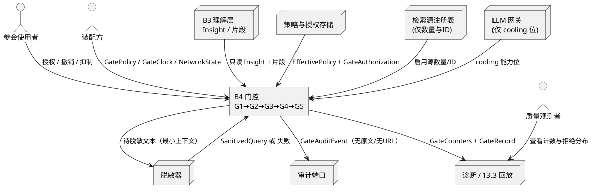

> 图只展示组件边界与外流方向；不出现内部模块、数据库表、接口参数。

# **4. DFX 约束**

## **4.1 性能**

1. 门控纯函数单次判定（五级全走）**离线基准 ≤5 ms（p95）**，仅用于防退化；**不得**替代 SPEC 4.1-3 的 6s/10s 端到端时延（需真机回放，本轮不判定）。
2. 短路有效：任一 `Deny` 后，后续级调用次数必须为 0（以 `GateRecord.per_stage.calls` 判定，而非计时）。
3. G1 预筛单条候选的规则判定 ≤2 ms（p95，离线基准）；不得引入向量模型推理。
4. 门控不得持有锁跨级；单次判定内不得 `sleep`、不得等待 IO。
5. 门控内存增量 ≤8 MB（相对空载），不缓存全文、不缓存 URL。

## **4.2 可靠性**

1. 门控异常（`panic`/`Err`）不得阻断片段准入、要点捕捉与摘要；调用方必须得到 `Deny{PolicyUnavailable}` 或等价 fail-closed 结果，而不是无结论。
2. 同一输入 + 同一策略 + 同一时钟，判定结果必须**逐字节一致**（100 次重复）。
3. 计数只增不减；异常路径也必须留下原因码。
4. 预算与冷却状态在进程内单调推进；不得因重启把已用预算清零（会话级状态由外部快照注入，门控不改写存储）。
5. 授权状态判定必须 fail-closed：字段缺失、解析失败、版本未知 → `Missing`，不得默认 `Granted`。

## **4.3 安全性**

1. **零转录红线**：门控产出的任何对象、日志、诊断、夹具、规格与回放记录中，**禁止**出现 API Key、完整 URL、模型名、`request_id`、查询原文、参会人姓名与联系方式。
2. `GateRecord` 只允许出现：`trace_id`、`candidate_ref`、`insight_ref`（哈希/引用 ID）、`domain`（非完整 URL）、长度、计数、毫值、原因码、时间戳。
3. 授权记录不得含密钥、端点、明文查询；`provider_ids` 只存 ID。
4. 自适应阈值/频率变更必须走策略变更审计；门控自身不得静默改阈值。
5. 抑制列表变更必须可审计；门控只读抑制结果，不实现存储。
6. **设置向导凭据红线（增量，仅 51 设置向导适用）**：API Key 明文只允许存在于内存输入态；**禁止**写入仓库、文件、日志、审计、回放、夹具、诊断、进度、截图文本；**禁止**回显任何明文片段（含首尾字符与长度）；**禁止**出现在错误文案与 panic/测试输出中。任何回显只允许固定无载荷掩码。
7. **设置向导记录面红线（增量）**：设置视图、诊断、测试与进度只允许枚举、布尔、计数、毫值、固定文案与掩码态；端点原始串、模型名字面量、请求体与请求标识一律禁止进入记录层。

## **4.4 可维护性**

**固定计数集（32 项，字段名即诊断字段名）**：

1. `gate_l0_candidates`
2. `gate_l0_low_confidence`
3. `gate_l0_question_answered_skipped`
4. `gate_l0_sensitive_seed_blocked`
5. `gate_allow_total`
6. `gate_deny_total`
7. `gate_stage_skipped_total`
8. `gate_l1_auto_disabled`
9. `gate_l1_consent_missing`
10. `gate_l1_paused`
11. `gate_l1_silent_period`
12. `gate_l1_screen_share`
13. `gate_l1_low_confidence`
14. `gate_l1_duplicate`
15. `gate_l1_suppressed`
16. `gate_l1_quota_exhausted`
17. `gate_l1_no_provider`
18. `gate_l1_sensitive_term`
19. `gate_l2_low_relevance`
20. `gate_l3_duplicate`
21. `gate_l3_suppressed`
22. `gate_l3_stale`
23. `gate_l3_quota`
24. `gate_l4_budget_exhausted`
25. `gate_l4_gateway_cooling`
26. `gate_l4_offline`
27. `gate_l5_not_granted`
28. `gate_l5_sanitize_failed`
29. `gate_l5_audit_unavailable`
30. `gate_l5_provider_or_domain_blocked`
31. `gate_replay_runs`
32. `gate_replay_mismatch`

- 计数写入只经单一 `bump(GateCounter)` 入口，禁止字符串键。
- 日志只允许：`trace_id`、原因码、计数、耗时毫秒、`domain`；禁止原文与 URL。

## **4.5 兼容性**

1. **B3 零回归**：`cargo test --workspace` 结果 **passed ≥584 / failed=0 / ignored=9**（既有 593 用例；新增 target 只增不减）；`test-name-inventory --diff` 的 `removed=0`。
2. **既有常量不变**：`MIN_INSIGHT_CONFIDENCE=0.35`、`ShortText::LIMIT=60`、`UtteranceText::LIMIT=2000`、`SanitizedQuery::URL_LIMIT=200`、`DenyCode::ALL=11`、`GapKind` 6 变体。
3. **零新依赖**：`Cargo.toml`/`Cargo.lock` 依赖集合不变；`cargo deny` 四项通过。
4. **不改既有用例名**：B3 33 条 AC 对应的用例名、`llm_*`、`capture_*`、`merge_*` 一律不动。
5. **未知字段向后兼容**：`GateRecord`/`GateAuthorization` 的新增字段必须可被旧版本忽略；不得改既有字段语义。
6. **中英混合确定性**：预筛、相关性、去重的全部规则对中英混排输入必须同输入同输出。

# **5. 核心能力**

## **5.1 G1 预筛（L0 缺口识别 + 硬闸门）**

### **5.1.1 业务规则**

1. **六类规则与基础分**：首次专名 0.70、缩写 0.65、机构/职务 0.60、政策法规/标准 0.80、数据指标 0.75、未答提问 0.85；任一命中且 `confidence ≥0.50` 才产候选。
   a. 验收条件：When 六类各一条正例输入，the 预筛 shall 产出 6 个候选且 `kind`/基础分逐项匹配。
2. **`GapKind` 契约不变**：机构/职务以内部子标签 `GapRule::Institution` 区分，对外仍映射为既有 `GapKind::ProperNoun`；**禁止**新增 `GapKind` 变体或改序列化值。
   a. 验收条件：When 序列化 `GapCandidate`，the `kind` shall ∈ 既有 6 变体；`GapRule::Institution` 命中时 `kind="proper_noun"`。
3. **首现判定**：以"术语表差集 + 本会话已解释集合 + 本次会话首现"判定；同一实体二次出现时 G1 不产新候选，若 G3 的 10 分钟窗口命中则计 `gate_l3_duplicate`，G1 不重复计数。
4. **敏感术语不入种子**：术语表 `sensitive=true` 的条目不得成为候选种子、不得进入查询构造。
   a. 验收条件：When 输入仅含敏感术语，the 预筛 shall 0 候选并使 `gate_l0_sensitive_seed_blocked=1`。
5. **未答提问 10 秒判定**：问句后 10 000 ms 内无回应 → 产候选；9 999 ms 内出现回应 → 不产。
   a. 验收条件：When 虚拟时钟推进 9 999/10 000 ms，the 候选数 shall 分别为 0/1。
6. **低置信不产候选**：片段 `confidence <0.50` 或候选 `confidence <0.50` → 0 候选，`gate_l0_low_confidence += 1`。
   a. 验收条件：When `confidence=0.49`，the 候选数 shall 为 0；`0.50` 时 shall 为 1。
7. **2 秒内产出（结构口径）**：候选必须在片段稳定前缀后 2 000 ms 内可被读取；以虚拟时钟断言，不测真实 p95。
8. **硬闸门 11 项（会话级快照）**：自动模式关闭（`AutoDisabled`）、未确认采集告知（`ConsentMissing`）、暂停（`Paused`）、静默期（`SilentPeriod`）、投屏保护（`ScreenShareProtection`）、低置信（`PreFilterLowConfidence`）、会话级全局抑制（`Suppressed`）、全局配额已耗尽（`QuotaExhausted`）、同键重复（`Duplicate`）、无启用源（`NoProviderEnabled`）、敏感词（`SensitiveTerm`）→ 各自 `GateRejectReason`，一个输入只允许一个原因码（按上表优先级取首个）。**候选级的主题/来源/实体抑制、窗口配额、实体冷却与逐键去重一律由 G3 判定**，G1 只看会话级状态，避免同一原因在两级重复计数。
9. **纯函数**：`evaluate_gate` 与 `detect_gaps` 无 IO、无锁、无系统时间、无随机；同一输入必同输出。
10. **禁止项**：禁止在 G1 阶段发起任何外发、检索或卡片渲染；禁止读取 `LLM_*` 环境变量。
    a. 验收条件：When 调用 G1，the `outbound_attempts` shall 恒为 0。

### **5.1.2 交互流程**

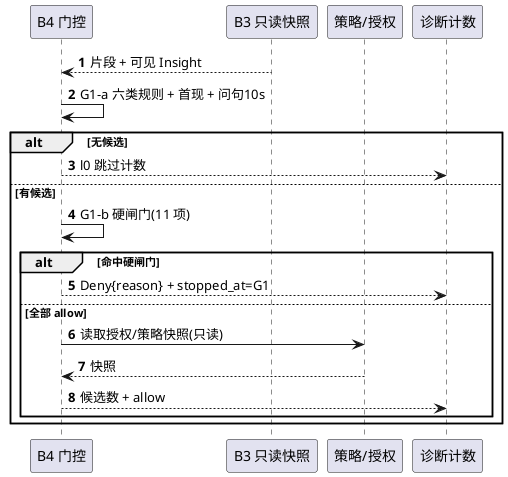

### **5.1.3 异常场景**

1. **策略不可用**
   a. 触发条件：`EffectivePolicy` 缺失或解析失败。
   b. 系统行为：按 `EffectivePolicy::fail_closed()` 判定，拒绝一切自动外发。
   c. 用户感知：`Deny{PolicyUnavailable}` + 最严格默认值提示。
2. **术语表为空**
   a. 触发条件：术语表未加载。
   b. 系统行为：首现判定退化为"本次会话首现"，仍产候选；不 panic。
   c. 用户感知：无额外提示；诊断计 `gate_l0_candidates` 正常。
3. **问句无法判定**
   a. 触发条件：中英混排且无问号、无疑问词。
   b. 系统行为：不产"未答提问"候选，其余五类照常。
   c. 用户感知：无提示。

## **5.2 G2 相关性**

### **5.2.1 业务规则**

1. **固定公式**：`score = 0.40×semantic + 0.25×entity + 0.20×gain + 0.15×sourceTrust`，再乘 `exp(-Δt/180s)`；全部分项以毫值整数（0..=1000）计算，最后按 4 舍 5 入到毫值。
   a. 验收条件：When 输入 `semantic=1,entity=1,gain=1,sourceTrust=1,Δt=0`，the `score_milli` shall 为 1000。
2. **时间衰减**：`Δt=180 000 ms` 时衰减因子为 `exp(-1)=0.3679`（±1 毫值）。
3. **阈值档位**：严格 0.72、平衡 0.62（默认）、宽松 0.52；`score ≥ threshold` 放行，`<` 拒绝。
   a. 验收条件：When `score_milli=619` 与 `620`（平衡档），the 结果 shall 分别为 `Deny`/`Allow`。
4. **分项可解释**：`RelevanceScore` 必须同时输出 `semantic/entity/gain/source_trust/decay/score_milli` 六项；任一缺失视为结构违规。
5. **低相关拒绝**：`Deny{LowRelevance}`，计 `gate_l2_low_relevance += 1`；不得出卡。
6. **空主题/空实体**：`semantic`/`entity` 按 0 处理，不 panic、不返回 `NaN`。
7. **禁止项**：G2 不得调用 LLM、不得联网、不得使用端侧嵌入模型（本轮无向量推理）；`semantic` 由外部注入的相似度快照提供。
   a. 验收条件：When 调用 G2，the `llm_calls` 与 `network_calls` shall 恒为 0。

### **5.2.2 交互流程**

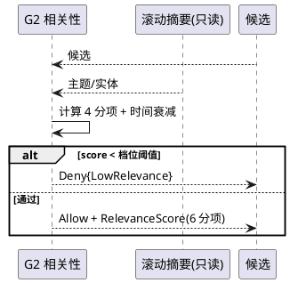

### **5.2.3 异常场景**

1. **分项越界**
   a. 触发条件：注入值 >1.0 或 <0.0。
   b. 系统行为：钳制到 [0,1] 并计 `gate_l2_low_relevance` 之外的 `clamp` 诊断（不新增计数项，仅记录 `score_milli`）。
   c. 用户感知：无提示。
2. **阈值档位非法**
   a. 触发条件：配置阈值不在 {0.52,0.62,0.72}。
   b. 系统行为：`GatePolicy::validate` 拒绝，回落平衡档 0.62。
   c. 用户感知：配置页字段级错误。

## **5.3 G3 时效/去重**

### **5.3.1 业务规则**

1. **语义聚类同主题**：余弦 `≥0.880` 归为同主题；`0.8799` 不归。
2. **去重键**：`DedupeKey` 必须为 32 位十六进制；10 分钟窗口内同键 0 重复放行。
   a. 验收条件：When 同键间隔 599 999/600 000 ms，the 结果 shall 分别为 `Deny{Duplicate}`/`Allow`。
3. **主题配额**：单主题 10 分钟 ≤2；全局（全部主题合计）10 分钟 ≤3；第 3/第 4 次同主题触发拒绝 `QuotaExhausted`。
4. **实体冷却**：同实体 5 分钟（300 000 ms）内不重复放行；299 999 ms 仍拒绝。
5. **抑制列表三类（仅在 G3 判定）**：主题/来源/实体；自动推送受限 `Deny{Suppressed}`；按需补全**允许执行**但必须带"已抑制"提示标记（不得静默拦截）。G1 仅处理"会话级全局抑制"开关。
6. **超龄缓存**：缓存结果年龄 >24 h 且无刷新来源 → `Deny{Stale}`；**不负责**"发布时间 >12 个月"的 UI 标注。
   a. 验收条件：When 缓存年龄 86 400 000/86 400 001 ms，the 结果 shall 分别为 `Allow`/`Deny{Stale}`。
7. **候选收敛**：候选 >10 时按 `score` 取前 3，其余丢弃并计 `gate_l3_quota += 1`；不得逐条提示。
8. **禁止项**：G3 不得写缓存、不得改写 B3 存储、不得修改抑制列表存储；只读抑制结果。
   a. 验收条件：When 调用 G3，the cache_writes 与 `insight_writes` shall 恒为 0。

### **5.3.2 交互流程**

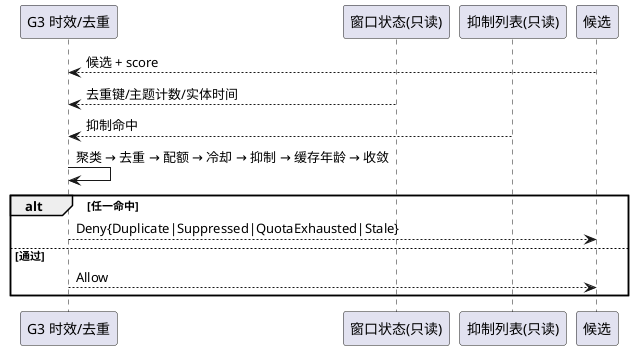

### **5.3.3 异常场景**

1. **窗口状态缺失**
   a. 触发条件：首次判定、无历史窗口。
   b. 系统行为：按空窗口处理，全部放行（除抑制与超龄缓存）。
   c. 用户感知：无提示。
2. **去重键非法**
   a. 触发条件：非 32 位十六进制。
   b. 系统行为：视为结构违规，`Deny{PolicyUnavailable}`，不 panic。
   c. 用户感知：诊断面板显示原因码。
3. **抑制列表读取失败**
   a. 触发条件：存储不可用。
   b. 系统行为：按"最严格"处理（命中视为抑制），`Deny{Suppressed}`。
   c. 用户感知：提示"抑制规则暂不可用，已暂停自动提示"。

## **5.4 G4 预算与冷却**

### **5.4.1 业务规则**

1. **独立预算**：`GateBudget` 与 `LLM_LIVE_CALL_CAP` **无耦合**；门控源码 0 命中 `std::env`/`LLM_`。
2. **会话外发上限**：每会话自动外发 ≤120 次（可配 0..=600）；第 121 次 → `Deny{BudgetExhausted}`。
3. **10 分钟全局配额**：放行 ≤3（频率档位 低=1/中=3/高=5）；第 4 次 → 拒绝。
4. **令牌桶**：容量 3，补充速率 3/10 min；档位切换不改变桶容量语义，只改补充速率。
5. **并发上限**：单会话并发自动检索 ≤3；第 4 个排队，排队不得导致提示延迟 >15 s（本轮只断言"排队计数 ≤1"）。
6. **冷却只读**：`capability().cooling==true` → `Deny{GatewayCooling}`，`llm_calls=0`、`retries=0`。
7. **冷却不阻塞**：冷却期间片段准入与要点产出继续；以"准入次数在冷却期间不减少"判定。
8. **恢复**：时间推进 600 001 ms 后预算恢复；冷却结束由能力位变 false 恢复。
9. **禁止项**：禁止门控自行触发熔断、重试、退避；禁止读取真实时间。
   a. 验收条件：When 注入冷却 10 次，the `retries` shall 恒为 0。

### **5.4.2 交互流程**

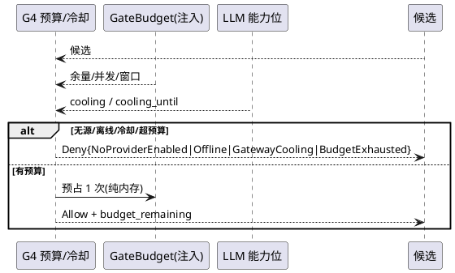

### **5.4.3 异常场景**

1. **预算快照缺失**
   a. 触发条件：装配方未注入 `GateBudget`。
   b. 系统行为：按 0 余量处理，全部拒绝 `BudgetExhausted`（fail-closed）。
   c. 用户感知：诊断提示"预算状态不可用"。
2. **冷却状态抖动**
   a. 触发条件：能力位在两次读取间反复变化。
   b. 系统行为：以单次判定内首次读取为准，不重复读取。
   c. 用户感知：无提示。
3. **并发超额**
   a. 触发条件：第 4 个并发请求。
   b. 系统行为：排队并返回 `Allow{queued=true}`，不拒绝、不丢候选。
   c. 用户感知：无阻塞提示。

## **5.5 G5 外发授权与审计**

### **5.5.1 业务规则**

1. **授权记录 7 字段**：`status`、`granted_at`、`content_types`、`max_query_chars`、`provider_ids`、`notice_version`、`revoked_at`；任一缺失 → `status=Missing`。
2. **未授权一律禁止**：`status != Granted` → `Deny{OutboundNotGranted}`，自动与按需外发次数均为 0。
3. **撤销不可自恢复**：`revoked_at` 非空后，启动/升级/会话开始/策略重载四入口均不得恢复；恢复需新授权（`granted_at` 更新且 `notice_version` 递增）。
4. **长度上限**：自动 ≤80 字、按需 ≤200 字；超长截断并标注"已按最小上下文外发"；`SanitizedQuery` 硬上限仍为 200。
   a. 验收条件：When 自动查询 81 字，the 外发长度 shall 为 80 且 `truncated=true`。
5. **变更即失效**：新增源或提高上限 → 旧授权 `Expired`，回落未授权。
6. **统一出口**：G5 是唯一 `SanitizedQuery` 构造与审计写入点；`gate/` 与 `proactive/` 内 0 处直接 `reqwest`/直接构造查询。
7. **审计记录必含**：授权状态、授权时间、内容类型、长度、检索源 ID、结果、原因码、发生时间；**禁止**查询原文与完整 URL。
8. **审计不可用**：`Deny{AuditUnavailable}`，0 外发，事件缓冲（复用 `AuditGuard` 语义）。
9. **脱敏失败**：`Deny{SanitizeFailed}`，0 外发，用户感知 `E-PRIV-004`，审计 1 条。
10. **离线**：`NetworkState::Offline` → `Deny{Offline}`；`Unknown` 按可尝试处理，真实失败由下游兜底。
11. **禁止项**：禁止在未写审计前放行；禁止把授权状态写成布尔而不记录时间与范围。
    a. 验收条件：When 审计写入失败 1 次，the 外发次数 shall 为 0 且 `gate_l5_audit_unavailable=1`。

### **5.5.2 交互流程**

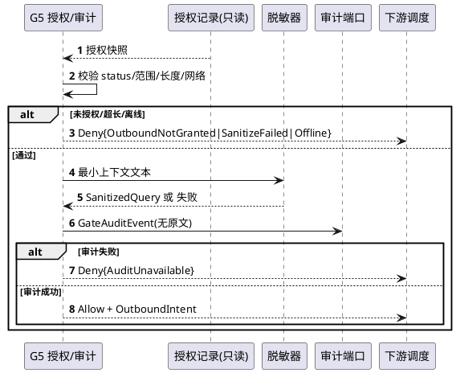

### **5.5.3 异常场景**

1. **授权字段缺失**
   a. 触发条件：旧版本授权记录缺 `content_types`。
   b. 系统行为：`status=Missing`，禁止外发。
   c. 用户感知："需重新授权自动外发"。
2. **审计写入失败**
   a. 触发条件：审计存储不可写。
   b. 系统行为：缓冲事件 + 禁止外发，直到恢复。
   c. 用户感知：提示"审计不可用，已暂停自动提示"（不得冒用 `E-PRIV-004`）。
3. **脱敏失败**
   a. 触发条件：`Sanitizer` 报错或返回空查询。
   b. 系统行为：阻断外发并写审计。
   c. 用户感知：`E-PRIV-004 脱敏失败，检索已取消`。

## **5.6 关键词卡片契约与出卡前置（本轮增量扩展）**

> 定位：B4 只把"候选→卡片"的业务契约与门控前置说清楚；卡片合成归 38，引用对齐校验归 39，点击 UI 归 51。B4 **不渲染、不存储、不合成、不校验引用**。

### **5.6.1 业务规则**

1. **关键词候选来源**：关键词候选必须从 G1 既有六类缺口规则中的五类产生：首次专名、缩写、机构/职务、政策法规/标准、数据指标；**未答提问不产关键词卡**。禁止新增第七类识别规则；`GapKind` 保持 6 变体，机构/职务仍映射 `ProperNoun`。
   a. 验收条件：When 五类各一条正例输入，the 关键词候选数 shall 为 5 且 `keyword_kind` 逐项匹配；When 仅输入未答提问，the 关键词候选数 shall 为 0。
2. **对话监听只读**：关键词捕捉只消费 B3 的只读 `NormalizedFragment` 与 `Insight`；不得回写要点、片段、去重或术语存储；**同一会话内同一归一化术语只产出 1 个候选（沿用 G1 首现判定）**；重复出现不产新候选，10 分钟窗口内的重复由 G3 判定并计 `gate_l3_duplicate`；跨会话不合并。
   a. 验收条件：When 同一归一化术语在同一会话第二次出现，the 候选增量 shall 为 0 且 599 999 ms 内 G3 计 `gate_l3_duplicate`；When 同一术语出现在两个会话，the 候选 shall 各 1 个；When 扫描门控源码，B3 写入口命中 shall 为 0。
3. **候选不等于卡片**：`KeywordCandidate` 只是"可进一步判定"的结构化候选，**不得直接展示或可点击**；必须经 G1→G2→G3→G4→G5 全部 `Allow` 后，才允许 38 合成 1 张关键词卡；一个候选最多产出 1 张卡。
   a. 验收条件：When 任一阶段 `Deny`，the `card_drafts` shall 为 0；When 五级全部 `Allow`，the `card_drafts` shall 为 1。
4. **卡片业务字段封闭 13 项**：`card_id`、`keyword_text`（≤40 字）、`normalized_term`、`keyword_kind`（5 类封闭）、`trigger`（`Auto`/`OnDemand`）、`triggered_at_ms`、`confidence`（0..=1）、`summary`（≤80 字，可空）、`references`（按引用 ID）、`citation_alignment`（`Passed`/`Failed`/`Unverified`）、`gate_decision_ref`（指向一次 `Allow` 的 trace/决策引用）、`card_status`（`Displayed`/`Collapsed`/`Withdrawn`）、`click_state`（`Enabled` 或 `Disabled{reason}`）。
   a. 验收条件：When 序列化关键词卡，the 业务字段集合 shall 恰为 13 项；字段缺一或多一即结构违规。
5. **只有 Allow 可出卡**：`gate_decision_ref` 必须指向一次 `Allow`；`Deny` 或无门控记录不得出卡。跳过 G2 或 G3-dedupe 不改变此约束，G1/G4/G5 仍必须为 `Allow`。
   a. 验收条件：When 依次注入 G1~G5 的 `Deny` 场景，the 卡片数 shall 均为 0 且 `click_state=Disabled{NotAllowed}`；When 仅 G2/G3 被跳过且 G1/G4/G5 为 `Allow`，the 卡片数 shall 为 1。
6. **引用对齐前置**：关键词卡必须经 39 引用对齐校验；`citation_alignment=Passed` 才允许 `click_state=Enabled`；`Failed/Unverified` 时卡片仍可展示，但 `summary` 必须为空或标注"未找到可靠来源"，且不可点击。
   a. 验收条件：When 引用对齐失败，the `click_state` shall 为 `Disabled{ReferenceUnverified}`；When 通过，shall 为 `Enabled`。
7. **点击行为**：点击可点击卡片必须打开详情（关键词释义、引用列表、触发片段定位），**不得发起外发、不得调用 LLM、不得新建检索、不得抢焦点、不得离开当前会议窗口**；详情内若提供"继续检索/更多信息"，必须重新走 G1~G5 并取得新的 `Allow`。
   a. 验收条件：When 点击 1 次，the `outbound_attempts` 与 `llm_calls` shall 均为 0，且详情可见；When 点击"继续检索"，the 外发次数 shall 仍为 0，直到新的 `Allow` 产生。
8. **权限与授权前置**：出卡与可点击必须同时满足：生成时 G5 `Granted` 且 `Allow`；当前会话不处于投屏保护或紧急遮蔽；授权未撤销；卡片未跨会话。授权撤销后，既有卡片 `click_state=Disabled{AuthorizationRevoked}`，重新授权**不自动恢复旧卡**，只有新产生的卡片可用。静默期/暂停只阻止新的自动出卡，不阻断已展示卡片的本地查看；投屏保护/紧急遮蔽同时阻断查看。
   a. 验收条件：When 授权撤销，the 旧卡 `click_state` shall 为 `Disabled{AuthorizationRevoked}`；When 共享屏幕模式开启，the 卡片正文 shall 隐藏且点击被拒绝。
9. **零转录边界**：`GateRecord`、`GateAuditEvent`、`ReplayReport`、回放夹具、计数与日志禁止出现 `keyword_text`、`summary`、引用摘要、查询原文、完整 URL、模型名、`request_id`、参会人姓名与联系方式；只允许 `card_id`、`keyword_ref`、`trace_id`、引用 ID、长度、毫值、原因码与时间戳。关键词卡**展示层**可持有 `keyword_text` 与 `summary`，但不得复制进 B4 记录或回放输入。
   a. 验收条件：When 扫描 `GateRecord`/审计事件/回放夹具/进度文档，上述禁止内容命中 shall 为 0；When 卡片详情展示引用，the 引用正文 shall 按 ID 从上游读取，不得落入门控记录。
10. **归属拆分**：B4 只定义关键词候选契约、卡片业务字段、出卡前置、点击权限状态与零转录边界；**38** 负责卡片合成（标题/解释/置信度/引用集合/状态流转）；**39** 负责引用对齐校验；**51** 负责 UI 渲染、点击交互、三形态与投屏/紧急遮蔽；**13.3** 负责回放。
    a. 验收条件：When 扫描 `crates/application/src/gate/**`，卡片合成器、引用校验器、展示器与卡片存储符号命中 shall 为 0。
11. **禁止项**：禁止 B4 直接渲染、存储或撤回卡片；禁止卡片携带完整转写；禁止 `Deny` 结果产生可点击卡片；禁止点击触发隐式外发；禁止把关键词文本写入审计或诊断。
    a. 验收条件：When 执行 `--rule=outbound` 与 `--rule=zero-transcript`，the 退出码 shall 均为 0 且关键词文本命中 0。

### **5.6.2 交互流程**

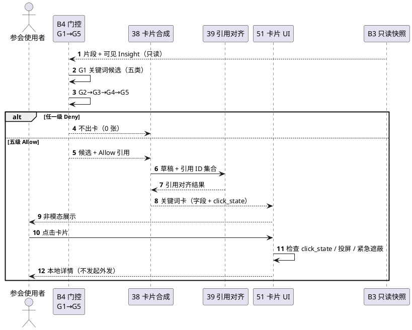

> 图只表达业务边界：B4 不出现内部合成、不出现卡片存储、不出现接口参数。

### **5.6.3 异常场景**

1. **门控拒绝**
   a. 触发条件：G1~G5 任一级 `Deny`。
   b. 系统行为：不生成卡片草稿，候选只保留拒绝原因与轨迹。
   c. 用户感知：无卡片、不可点击；诊断面板可见拒绝原因码。
2. **引用对齐失败**
   a. 触发条件：39 返回 `Failed` 或 `Unverified`。
   b. 系统行为：保留卡片但不给结论性解释，`summary` 置空或标注"未找到可靠来源"。
   c. 用户感知：卡片显示"未找到可靠来源"，点击被拒绝。
3. **授权撤销或变更**
   a. 触发条件：出卡后授权被撤销/过期/范围变更。
   b. 系统行为：既有卡片置 `Disabled{AuthorizationRevoked}`；不追溯改写卡片内容。
   c. 用户感知：卡片显示"授权已撤销，详情不可查看"，重新授权不恢复旧卡。
4. **投屏保护或紧急遮蔽**
   a. 触发条件：共享屏幕模式开启或触发紧急遮蔽。
   b. 系统行为：隐藏关键词卡正文，仅保留"有 N 条"角标；点击一律拒绝。
   c. 用户感知：提示"已进入投屏保护模式"。
5. **跨会话或引用过期**
   a. 触发条件：点击时发现卡片不属于当前会话，或引用对象已删除/过期。
   b. 系统行为：置 `Disabled{StaleReference}`，不读取已删除内容。
   c. 用户感知：提示"该引用已失效，请重新触发"。
6. **卡片契约夹带原文**
   a. 触发条件：`keyword_text`/`summary`/引用摘要被写入 `GateRecord`、审计或回放夹具。
   b. 系统行为：零转录扫描命中。
   c. 用户感知：`--rule=zero-transcript` 退 1，阶段不放行。

## **5.7 39 引用对齐校验（本轮增量扩展）**

> 定位：39 是**独立能力**，只回答"卡片结论/解释是否被引用来源支撑"，产出 `citation_alignment` 与可点击前置。39 **不生成卡片、不渲染 UI、不联网抓取正文**；38 负责合成，51 负责展示，B4 负责门控与点击权限契约。
> 与既有契约的关系：`KeywordCardDraft` 13 字段、`ReferenceView` 5 字段与 `CitationAlignment` 既有三态（`Passed`/`Failed`/`Unverified`）**保持不变**；39 的 `Unknown` 以唯一投影落到 `Unverified`（见 6.15、J-17、D-B4-05）。既有 AC-B4-51~57 的编号与语义不重排、不改写。

### **5.7.1 业务规则**

1. **输入只读且封闭**：39 必须只读取 38 的 `KeywordCardDraft`（13 字段，只读）、`ReferenceView`（5 字段，只读）、候选关键词的 `keyword_ref`/`normalized_term`/`keyword_kind` 与注入的判定能力位；禁止读取或要求页面 URL、页面标题、正文摘要、抓取正文、查询原文与转写片段。39 不得改写卡片的 `keyword_text`、`summary`、`card_id`、`gate_decision_ref`、`card_status`。
   a. 验收条件：When 以最小合法输入调用，the 读取的业务字段集合 shall 恰为 13 + 5 项；When 引用元素出现 URL/标题/摘要/正文/查询/片段字段，the 结果 shall 为 `Unknown` 且 `basis=InputContractViolation`。
2. **三态定义（fail-closed）**：`citation_alignment` 必须为 `Passed`/`Failed`/`Unknown` 三者之一。`Passed` 表示"证据充分且一致"；`Failed` 表示"证据明确反驳、互相冲突或与术语不匹配"；`Unknown` 表示"证据缺失、不可访问、判定能力不可用或输入不完整"。**禁止把 `Unknown` 当 `Passed`，禁止"无引用即通过"。**
   a. 验收条件：When 引用集合为空，the 结果 shall 为 `Unknown` 且 `basis=NoReference`；When 判定能力位为 `Unavailable`，the 结果 shall 为 `Unknown` 且 `basis=JudgeUnavailable`。
3. **`Passed` 门槛**：只有同时满足①引用集合非空；②至少 1 条 `trust_tier ∈ {Official, Authority}` 且 `access_status=Ok` 的引用支撑；③引用之间无冲突；④引用与 `normalized_term`/`keyword_kind` 语义一致；才允许判定 `Passed`（`basis=SupportedByOfficial` 或 `SupportedByAuthority`）。
   a. 验收条件：When 仅 1 条 `Official` + `Ok` 且无冲突，the 结果 shall 为 `Passed`；When 全部引用为 `General`/`UserGenerated` 且无冲突，the 结果 shall 为 `Unknown` 且 `basis=SupportedByGeneral`。
4. **`Failed` 条件**：单条引用明确反驳结论（`basis=Contradicted`）、引用之间互相矛盾（`basis=ConflictingSources`），或引用主题与归一化术语/关键词类型不匹配（`basis=TermMismatch`）时，必须判定 `Failed`；`Failed` 卡片仍可展示，但不可点击。
   a. 验收条件：When 两条引用对同一断言给出相反结论，the 结果 shall 为 `Failed` 且 `basis=ConflictingSources`；When 单条引用明确反驳结论，shall 为 `Failed` 且 `basis=Contradicted`；When 引用主题与 `keyword_kind` 不匹配，shall 为 `Failed` 且 `basis=TermMismatch`。
5. **`Unknown` 触发条件**：引用为空、引用全部 `Unavailable`、判定能力不可用、输入结构违规、超时或证据不足时，必须判定 `Unknown`；不得推断、不得以默认值放行。
   a. 验收条件：When 引用 `access_status=Unavailable`，the 结果 shall 为 `Unknown` 且 `basis=ReferenceUnavailable`；When 证据仅覆盖部分断言，the 结果 shall 为 `Unknown` 且 `basis=InsufficientEvidence`。
6. **与既有三态的唯一投影**：39 的 `Unknown` 在 B4 卡片契约面上必须投影为既有 `CitationAlignment::Unverified`，`Passed`/`Failed` 同名投影；投影必须 1:1 且唯一，不允许出现"同一结果两种契约值"。
   a. 验收条件：When 39 返回 `Unknown`，the `KeywordCardDraft.citation_alignment` shall 为 `Unverified`；When 返回 `Passed`/`Failed`，shall 同名；`CitationAlignment` 变体数 shall 保持 3。
7. **可点击前置（只消费、不越权）**：39 只提供 `citation_alignment` 这一项前置；`click_state=Enabled` 仍须由 B4/51 同时满足 `allow_ref` 存在、`card_status != Withdrawn`、会话一致、授权 `Granted` 且未撤销、非投屏、非紧急遮蔽。`Passed` 不等于自动可点击；`Failed`/`Unknown` 必须落 `Disabled{ReferenceUnverified}`。
   a. 验收条件：When `Passed` 但授权已撤销，the `click_state` shall 仍为 `Disabled{AuthorizationRevoked}`；When `Failed` 或 `Unknown`，the 卡片 shall 仍可展示且 `click_state=Disabled{ReferenceUnverified}`。
8. **零转录与隐私边界**：39 的结果、日志、诊断、夹具、进度记录只允许出现 `reference_id`、`trust_tier`、`access_status`、`published_at_ms`、`alignment`、`basis`、长度、计数、毫值与版本号；**禁止** URL、标题、摘要、正文、查询原文、转写片段、参会人姓名与联系方式。引用只存 ID 与四档信任、两态可访问性、发布时间；39 **不抓取正文**、不建立正文缓存。
   a. 验收条件：When 扫描 39 契约、实现与夹具，上述禁止内容命中 shall 为 0；When 展示层需要引用说明，shall 按 `reference_id` 从上游读取，不得由 39 复制。
9. **离线、只读与确定性**：39 的校验必须离线完成，不得调用 `reqwest`/`TcpStream`/`std::net`，不得读系统时间或环境变量，不得写存储；同一输入（同卡片、同引用集合、同 `now_ms`、同能力位）重复 100 次结果必须逐字节一致；引用顺序不得影响结果（判定前按 `reference_id` 稳定排序）。
   a. 验收条件：When 打乱引用顺序，the 结果与 `basis` shall 完全一致；When 同输入重复 100 次，the 序列化字节 shall 相等。
10. **归属拆分与禁止项**：39 只拥有"引用对齐判定"；B4 拥有契约与门控/点击前置，38 拥有卡片合成，51 拥有 UI 与屏蔽态，52 拥有审计存储，13.3 拥有回放本体。禁止 39 生成/撤回卡片、渲染或抢焦点、写卡片存储、写 `GateDecision`/`GateRecord`/`GateAuditEvent`/`GateInputFixture`/`ReplayReport`、新增 `GateCounter`、新增第 7 类关键词规则。
    a. 验收条件：When 扫描 `crates/application/src/citation/**` 与 `crates/domain/src/model/citation.rs`，卡片合成/展示/存储/网络符号命中 shall 为 0；`gate/api.rs` 的 `pub fn` 数 shall 仍为 4；`GateRecord` 14 字段、`GateAuditEvent` 7、`GateInputFixture` 23、`ReplayReport` 5、`GateCounter` 32、`GateRejectReason` 23 均不变。

### **5.7.2 交互流程**

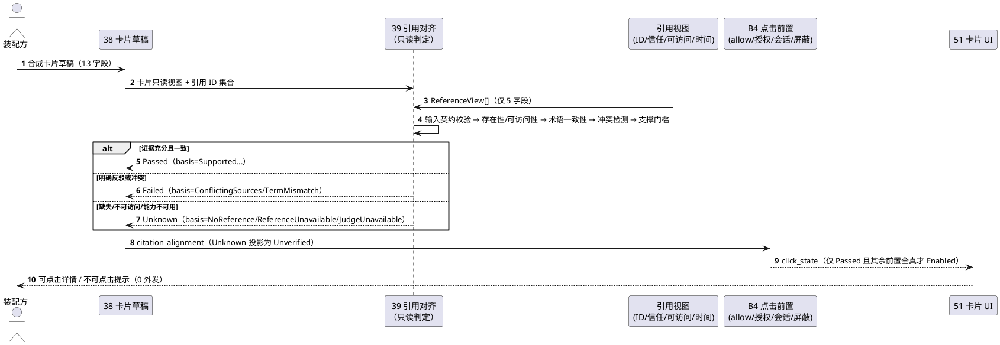

> 图只表达业务边界与判定顺序；不出现 URL、正文、抓取器、数据库与接口参数。

### **5.7.3 异常场景**

1. **引用缺失或全不可访问**
   a. 触发条件：`references=[]` 或全部 `access_status=Unavailable`。
   b. 系统行为：判 `Unknown`；不发起补检索、不抓正文、不推断结论。
   c. 用户感知：卡片可展示，显示"未找到可靠来源"，点击被拒绝（`ReferenceUnverified`）。
2. **证据冲突或术语不匹配**
   a. 触发条件：引用之间结论相反，或引用主题与 `normalized_term`/`keyword_kind` 不一致。
   b. 系统行为：判 `Failed`，`summary` 置空或固定文案"未找到可靠来源"。
   c. 用户感知：卡片可展示但不可点击，详情不打开。
3. **判定能力不可用或超时**
   a. 触发条件：注入能力位为 `Unavailable`，或校验超过注入的时间预算。
   b. 系统行为：fail-closed 判 `Unknown`，保留 `basis` 与计数，不重试、不联网补全。
   c. 用户感知：同"未找到可靠来源"，不可点击。
4. **输入契约违规（夹带 URL/正文/标题/摘要/片段）**
   a. 触发条件：卡片或引用元素出现封闭字段之外的文本载体。
   b. 系统行为：拒绝判定，返回 `Unknown` + `basis=InputContractViolation`；不读取该字段内容、不回显。
   c. 用户感知：卡片不可点击；零转录扫描命中即阶段不放行。
5. **跨会话或引用过期**
   a. 触发条件：卡片不属于当前会话，或引用对象已删除/过期。
   b. 系统行为：判 `Unknown`（不读取已删除内容）；最终 `click_state` 由 B4/51 固定为 `Disabled{StaleReference}`。
   c. 用户感知："该引用已失效，请重新触发"。
6. **结果被写入记录层**
   a. 触发条件：`citation_alignment`/`basis`/引用集合被写入 `GateRecord`、审计、回放夹具或报告。
   b. 系统行为：`--rule=record` 或 `--rule=zero-transcript` 命中。
   c. 用户感知：阶段不放行。

## **5.8 38 卡片合成（本轮增量扩展）**

> 定位：38 只把"B4 门控 `Allow` 之后的候选 + 39 对齐结果 + 引用视图"确定性地组装成**可展示卡片数据**（标题、解释/结论、置信度、引用集合、卡片状态）。38 **不建 UI、不渲染、不存储、不联网、不读原文、不判定点击、不写门控记录**；`gate_decision_ref` 与 `click_state` 由 B4 准入在装配侧补齐，UI 渲染归 51、存储归 52、回放归 13.3。
> 既有约束不变：`KeywordCardDraft` 13 字段、`ReferenceView` 5 字段、`CitationAlignment` 3 变体、`GateRecord` 14、`GateAuditEvent` 7、`GateInputFixture` 23、`ReplayReport` 5、`GateCounter` 32、`GateRejectReason` 23、`gate/api.rs` 4 个 `pub fn` **一律不改**；AC-B4-01~64 的编号与语义不重排、不改写。

**归属与接口（每个能力只有一个所有者）**

| 能力 | 所有者 | 38 交付什么 | 38 不交付什么 | 越界判定 |
|---|---|---|---|---|
| 卡片 11 项展示数据组装 | **38** | `compose_keyword_card` + `ComposedCard`（11 项） | 不渲染、不入队、不落库 | `cards/**` 无 `presenter`/`card_store` |
| 解释/结论文本 | **38** | 固定模板 + 归一化术语的确定性拼接（≤80） | 不调用 LLM、不语义生成、不复制引用标题/摘要/正文 | `cards/**` 无 `llm`/`reqwest` |
| 引用集合组装 | **38** | 5 字段引用的排序、去重校验、原样输出 | 不抓正文、不补检索、不改引用内容 | `cards/**` 无 `std::fs`/网络 |
| 卡片状态流转 | **38** | `Displayed`/`Withdrawn` 的最小流转 | 不写 `Collapsed`（交互态归 51）、不撤回他人卡片 | 38 只读 `current_card_status` |
| 门控前置与点击态 | **B4** | 只读 `allow_ref`；38 不判定 | 不写 `click_state`/`gate_decision_ref` | `cards/**` 无 `ClickState`/`resolve_click_state` |
| 对齐判定 | **39** | 只读 `CitationAlignmentResult`，唯一投影回填 | 不解释 `basis`、不改 39 结果 | `project_alignment` 唯一入口 |
| UI / 三形态 / 投屏遮蔽 | **51** | 只提供 11 项展示数据 | 不写渲染、焦点、窗口句柄 | 无前端依赖 |
| 存储与展示审计 | **52** | 无 | 不建表、不写审计 | 无仓储 |

**三条接口约定**：①38 只消费 `KeywordCandidate` + `card_id` + `AllowTraceRef` + `CitationAlignmentResult` + `ReferenceView[]` + `current_card_status` + `suppressed_notice`，全部只读；②38 的输出与 `KeywordCardDraft` 是"11 + 2"的无损关系——装配方补 `gate_decision_ref`/`click_state` 后即为 13 字段契约，38 不参与补齐；③`card_id` 由装配方按 B4 的派生规则生成并注入，38 不重算、不派生，避免双实现漂移。

### **5.8.1 业务规则**

1. **唯一前置：`Allow` + 候选合法**：仅当 `allow_ref` 存在（来自一次 `GateDecision::Allow`）且候选通过自身校验（`confidence ≥0.50`、`trigger_span.start_ms < end_ms`、`state != Pushed`、展示词非空）时，才允许合成 1 张卡；`Deny`、无 `allow_ref`、候选非法一律 0 卡。
   a. 验收条件：When `allow_ref` 缺失或来自 `Deny`，the 合成结果 shall 为 `card=None` 且 `reason=GateNotAllowed`；When `Allow` 且候选合法，shall `card=Some` 且 11 项业务字段齐备。
2. **一候选一卡且幂等**：同一 `card_id` 与同一候选重复调用必须返回逐字节相同的卡片；不得产生第 2 张卡、不得重新分配 ID、不得因重复触发改变内容。
   a. 验收条件：When 同输入重复 100 次，the 序列化字节 shall 相等；When 同一候选再次触发且已有非 `Withdrawn` 卡片，the 结果 shall 稳定返回 `reason=DuplicateCard` 或同一张卡（二者取其一且多次一致），`card_drafts` 恒 ≤1。
3. **标题与解释长度**：`keyword_text` 必须与候选展示词恒等且 ≤40 字（38 不截断、不改写）；`summary` 必须 ≤80 字；超限时标题判 `TitleTooLong` 拒绝，解释置 `None`（不截断、不加省略号、不换行拼接）。
   a. 验收条件：When 候选展示词 41 字，the 结果 shall 为 `Rejected{TitleTooLong}`；When 固定模板拼接的解释 81 字，the `summary` shall 为 `None`；When 恰好 40 字与 80 字，shall 通过。
4. **解释只在有据时生成**：`summary` 仅当 `citation_alignment=Passed` 且 `references` 非空时，允许由**固定模板常量 + 归一化术语**生成；`Failed`/`Unverified` 时必须为 `None` 或固定文案"未找到可靠来源"，禁止任何结论性表述。38 **不得调用 LLM、不得语义生成、不得复制引用标题/摘要/正文/URL**。
   a. 验收条件：When `alignment=Passed` 且引用非空，the `summary` shall 为 `Some` 且 `summary_is_consistent()==true`；When `Failed`/`Unverified`，the `summary` shall 为 `None` 或 `NO_RELIABLE_SOURCE`；When 扫描 38 源码，`llm`/`reqwest`/`TcpStream`/`std::net` 命中 shall 为 0。
5. **对齐唯一回填**：`citation_alignment` 必须等于 `project_alignment(&alignment_result)` 的结果（`Unknown→Unverified` 唯一投影，`Passed`/`Failed` 同名）；38 不得解释 `basis`、不得把 `Unknown` 写成 `Passed`、不得反向改写 39 结果。
   a. 验收条件：When 39 返回 `Unknown`，the 卡片 `citation_alignment` shall 为 `Unverified`；When 返回 `Passed`/`Failed`，shall 同名；`CitationAlignment` 变体数 shall 保持 3。
6. **透传字段不得漂移**：`card_id`、`normalized_term`、`keyword_kind`、`trigger`、`triggered_at_ms`（必须等于候选 `trigger_span.end_ms`）、`confidence` 与输入逐项恒等；38 不得重算置信度、不得改触发类型、不得归一化改写术语。
   a. 验收条件：When 候选 `confidence=0.87`、`trigger=Auto`，the 卡片 `confidence`/`trigger` shall 分别等于 0.87/`Auto`；When 比对 6 项透传字段，差异 shall 为 0。
7. **引用集合只存 ID 面**：`references` 逐元素只允许 `reference_id`/`trust_tier`/`access_status`/`published_at_ms`/`alignment`；必须按 `reference_id` 升序稳定排序后输出；同一 `reference_id` 重复属输入违规；空集合合法。
   a. 验收条件：When 乱序输入 3 条引用，the 输出 shall 按 `reference_id` 升序；When 重复 `reference_id`，the 结果 shall 为 `Rejected{InputContractViolation}`；When 空集合，shall 成功且 `references=[]`。
8. **卡片状态只做最小流转**：38 只决定 `Displayed`（新卡）与 `Withdrawn`（撤回信号），**不得写 `Collapsed`**（交互态归 51）；`current_card_status=Withdrawn` 时不得复活为 `Displayed`；跨会话/引用失效不改写卡片内容，只由 B4/51 落 `Disabled{StaleReference}`。
   a. 验收条件：When 收到撤回信号，the `card_status` shall 为 `Withdrawn`；When 当前已 `Withdrawn` 且收到展示信号，shall 仍为 `Withdrawn`；When 扫描 38 源码，除读取入参外 `Collapsed` 写入命中 shall 为 0。
9. **点击与门控引用不在 38**：`ComposedCard` **不得包含** `gate_decision_ref` 与 `click_state`；两者由装配方使用 B4 的 `keyword_card_admission` 在卡片落位时补齐为 13 字段 `KeywordCardDraft`；38 不得调用 `resolve_click_state`、不得 `use crate::gate`。
   a. 验收条件：When 序列化 `ComposedCard`，the 业务字段集合 shall 恰为 11 项；When 扫描 `cards/**`，`ClickState`/`resolve_click_state`/`use crate::gate` 命中 shall 为 0。
10. **零转录与隐私**：38 的类型、日志、诊断、测试与进度只允许 `card_id`/`keyword_ref`/`reference_id`/枚举/长度/计数/毫值/版本号；`keyword_text`/`summary` 只存在于输出卡片（展示层）与测试进程，禁止写入 `GateRecord`/`GateAuditEvent`/`ReplayReport`/夹具/日志/进度；`CardComposeInput` 的 `Debug` 不得输出 `normalized_term`、展示词与解释文本。
    a. 验收条件：When 扫描记录/审计/夹具/进度，上述文本命中 shall 为 0；When `format!("{:?}", input)`，shall 不含术语与展示词取值；When 执行 `--rule=zero-transcript`，shall 退 0。
11. **离线与确定性**：38 必须离线、无网络、无系统时间、无环境变量、无文件读写、无锁；同输入重复 100 次逐字节一致；候选与引用顺序不得影响结果（输出前按 `reference_id` 排序）。
    a. 验收条件：When 打乱引用顺序，the 结果 shall 逐字节相等；When 执行 `--rule=source`（扫描面含 `cards/**`），shall 退 0 且扫描面缺失退 2。
12. **归属与禁止项**：38 只拥有"确定性卡片数据组装"；B4 拥有契约/门控/点击前置，39 拥有对齐判定，51 拥有 UI/三形态/投屏与遮蔽，52 拥有存储与展示审计，13.3 拥有回放本体。禁止 38 渲染、聚焦、存储、建表、发起检索、写 `GateDecision`/`GateRecord`/审计/夹具/报告、新增 `GateCounter` 或 `GateRejectReason`、新增第 6 类关键词或第 7 类识别规则。
    a. 验收条件：When 扫描 `crates/application/src/cards/**`，`presenter`/`card_store`/`outbox`/`reqwest`/`std::fs`/`Sqlite` 命中 shall 为 0；`test ! -d crates/application/tests/replay` 退 0；`GateCounter` 快照仍 32、`GateRejectReason` 仍 23。

### **5.8.2 交互流程**

```plantuml
@startuml
autonumber
actor "装配方" as A
participant "B4 门控\n(Allow + 候选)" as G
participant "39 引用对齐" as V
participant "引用视图\n(ID/信任/可访问/时间)" as REF
participant "38 卡片合成\n(确定性组装)" as C38
participant "51 卡片 UI" as UI
participant "52 展示审计" as A52

G --> A : Allow 引用 + 候选 + 引用 ID 集合
A -> V : 卡片草稿视图 + 引用 ID + 关键词上下文
V --> A : CitationAlignmentResult（6 字段）
REF --> A : ReferenceView[]（仅 5 字段）
A -> C38 : CardComposeInput（7 项，只读）
C38 -> C38 : 候选校验 → 透传 → 模板 → 引用排序 → 状态流转
alt 无 Allow / 候选非法 / 标题超限 / 引用违规
  C38 --> A : 0 卡 + 唯一拒绝原因
else 可合成
  C38 --> A : ComposedCard（11 项展示数据）
  A -> G : 补 gate_decision_ref（Allow 溯源）
  G --> UI : KeywordCardDraft（13 字段）+ click_state
  UI --> A52 : 展示/点击审计（38 不参与）
end
C38 ..> A52 : 禁止直连（0 写入）
@enduml
```

> 图只表达业务边界与组装顺序：不出现渲染、卡片表、网络、正文抓取与接口参数；`click_state` 出现在 B4→UI 一侧，38 侧不出现。

### **5.8.3 异常场景**

1. **门控拒绝或缺少 Allow 溯源**
   a. 触发条件：`allow_ref` 缺失，或来自 `GateDecision::Deny`。
   b. 系统行为：0 卡；返回 `GateNotAllowed`；不改写任何既有卡片。
   c. 用户感知：无新卡片；既有卡片按 B4/51 的 `Disabled{NotAllowed}` 展示。
2. **候选非法**
   a. 触发条件：`confidence<0.50`、`trigger_span.start_ms >= end_ms`、`state=Pushed` 或展示词为空。
   b. 系统行为：0 卡；返回 `CandidateInvalid`；不自行修正候选。
   c. 用户感知：无卡片；诊断只可见原因码与计数。
3. **标题超长**
   a. 触发条件：候选展示词 >40 字。
   b. 系统行为：拒绝合成，返回 `TitleTooLong`；不截断、不换行。
   c. 用户感知：该候选不出现卡片；不显示半截标题。
4. **解释超长或无可靠来源**
   a. 触发条件：模板拼接结果 >80 字，或 `citation_alignment ∈ {Failed, Unverified}`。
   b. 系统行为：`summary` 置 `None` 或固定文案"未找到可靠来源"；卡片仍产出。
   c. 用户感知：卡片可见但无结论性解释；点击由 B4 判为 `Disabled{ReferenceUnverified}`。
5. **引用输入违规**
   a. 触发条件：`reference_id` 重复，或引用元素出现 5 字段之外的文本载体。
   b. 系统行为：拒绝合成，返回 `InputContractViolation`；不读取越界字段、不回显。
   c. 用户感知：该候选不出现卡片；零转录扫描命中即阶段不放行。
6. **重复触发或已撤回**
   a. 触发条件：同一候选再次触发；或 `current_card_status=Withdrawn`。
   b. 系统行为：重复触发返回同一卡或 `DuplicateCard`（稳定）；已撤回不得复活为 `Displayed`，返回 `CardWithdrawn`。
   c. 用户感知：卡片数量不增长；已撤回卡片不重新出现。
7. **合成器被误用为渲染或存储入口**
   a. 触发条件：`cards/**` 出现渲染、焦点、卡片表、网络或审计写入符号。
   b. 系统行为：`--rule=source`/`--rule=outbound`/归属断言命中。
   c. 用户感知：阶段不放行。

## **5.9 51 点击 UI：视图模型与本地展开（本轮增量扩展）**

> 定位：51 只做“展示视图模型 + 点击交互契约”。它消费 38 的 `ComposedCard`（11 项）与 B4 补齐后的 13 字段 `KeywordCardDraft`，产出**可渲染的视图数据**（标题、结论/无结论态、置信度、引用列表、卡片状态、可点击/禁用原因）与点击后的**本地详情视图**。51 **不渲染像素、不建平台窗口句柄、不联网、不存储、不读原文/系统时间**；点击只读展开本地详情，**不触发检索、LLM、外发、审计事件**。
> 既有约束不变：`KeywordCardDraft` 13、`ReferenceView` 5、`CitationAlignment` 3、`ComposedCard` 11、`CardComposeInput` 7、`CardComposeOutcome` 2、`ComposeRejectReason` 6、`GateRecord` 14、`GateAuditEvent` 7、`GateInputFixture` 23、`ReplayReport` 5、`GateCounter` 32、`GateRejectReason` 23、`gate/api.rs` 4 个 `pub fn` **一律不改**；AC-B4-01~74 的编号与语义不重排、不改写。

**归属与接口（每个能力只有一个所有者）**

| 能力 | 所有者 | 51 交付什么 | 51 不交付什么 | 越界判定 |
|---|---|---|---|---|
| 视图投影（13 字段 → 可渲染视图） | **51** | `project_keyword_card_view` + `KeywordCardView`（10 项）+ `CardBodyView`（4 项） | 不合成卡片、不判定引用对齐、不写门控记录 | `ui-bridge/src/keyword_card` 无 `compose_keyword_card`/`project_alignment` |
| 38 输出只读预览 | **51** | `project_composed_card_view`；`ComposedCard`（11 项）恒投影为不可点击 | 不补 `gate_decision_ref`/`click_state`、不改写 11 项 | 预览入口不含 `AllowTraceRef`/`ClickState` 写入 |
| 点击本地展开 | **51** | `open_keyword_card_detail` + `CardDetailView`（5 项） | 不发起检索、不调 LLM、不外发、不写审计、不抢焦点 | 无 `reqwest`/`TcpStream`/`AuditLog`/`issue_query` |
| 正文隐藏/角标 | **51** | `body_visible`/`body`/`badge_count` 的屏蔽态契约 | 不渲染像素、不建窗口/平台句柄、不处理真实投屏 API | 无 `tauri`/`windows`/`objc2` |
| 卡片合成 | **38** | 只读 `ComposedCard`（11 项） | 不调用 `compose_keyword_card`、不写 `cards/**` | `grep compose_keyword_card ui-bridge/src/keyword_card` = 0 |
| 引用对齐判定 | **39** | 只读 `citation_alignment` | 不解释 `basis`、不重算对齐、不改 39 结果 | 无 `AlignmentBasis`/`AlignmentVerdict` 计算 |
| 门控与点击权威 | **B4** | 只读 `click_state`/`card_status`，仅做“只降不升” | 不调用 `keyword_card_admission`、不写 `gate/**` | 无 `application::gate`/`crate::gate` |
| 存储/展示审计/回放 | **52 / 13.3** | 无 | 不建卡片表、不写审计、不建 `tests/replay/` | 无 `card_store`/`Sqlite`/`AuditLog` |

**三条接口约定**：①51 的唯一权威输入是 B4 补齐后的 `KeywordCardDraft`（13 字段）；`ComposedCard`（11 项）只作为“未补 2 项的只读预览”，**必须**投影为 `click_state=Disabled{NotAllowed}`，不得自行补 `gate_decision_ref`/`click_state`；②51 只读 39 的 `citation_alignment`，不解释 `basis`、不把 `Unknown` 当 `Passed`；③51 只读 B4 的 `click_state`，只做“**只降不升**”的 UI 安全收敛，不重新实现 7 项合取、不写 `card_status`、不复活 `Withdrawn`。

### **5.9.1 业务规则**

1. **视图投影只读且字段封闭**：51 必须只读 `KeywordCardDraft` 13 字段或 `ComposedCard` 11 项，产出 `KeywordCardView`（10 项）、`CardBodyView`（4 项）、`ConclusionView`（3 变体）、`CardDetailView`（5 项）、`ViewFacts`（6 项）、`CardViewOutcome`（2 项）、`ViewRejectReason`（3 项）、`ClickOutcome`（2 项）；不得改写输入，不得新增第 11/14 个业务字段。
   a. 验收条件：When 投影 13 字段卡片，the `KeywordCardView` 业务字段 shall 恰为 10 项、`CardBodyView` 4 项、`CardDetailView` 5 项；When 投影 `ComposedCard`，the `click_state` shall 恒为 `Disabled{NotAllowed}`。
2. **正文可见与屏蔽态**：投屏保护或紧急遮蔽期间，`body_visible` 必须为 `false`、`body` 必须为 `None`、`badge_count` 必须 ≥1，标题/结论/引用正文不得出现在视图序列化结果中；卡片仍需保留“有 N 条”角标。授权撤销不隐藏正文（不追溯改写内容），只禁用点击。
   a. 验收条件：When `screen_share=true`，the `body_visible` shall 为 `false` 且 `click_state=Disabled{ScreenShareProtection}`；When `emergency_masked=true`，shall 为 `Disabled{EmergencyMasked}`；When 两者均 false 且非撤回，the `body_visible` shall 为 `true`。
3. **点击状态只降不升**：51 必须以 B4 的 `click_state` 为权威输入，只允许把 `Enabled` 降为 `Disabled{reason}`，禁止把 `Disabled{reason}` 升为 `Enabled`，禁止改写为其他“可点击”状态。输入 `Disabled{reason}` 在无更高优先级屏蔽态时保持原原因。
   a. 验收条件：When 输入 `Disabled{ReferenceUnverified}` 且其余事实全真，the 输出 shall 仍为 `Disabled{ReferenceUnverified}`；When 输入 `Enabled` 且 `authorization_revoked=true`，shall 为 `Disabled{AuthorizationRevoked}`；`click_state=Enabled ⇒ gate_decision_ref 存在 ∧ citation_alignment=Passed ∧ card_status!=Withdrawn ∧ 会话一致 ∧ 授权未撤销 ∧ 引用未过期 ∧ 非投屏 ∧ 非遮蔽`（8 项前置全真）。
4. **点击只展开本地详情**：点击 `Enabled` 且正文可见的卡片必须只返回 `CardDetailView`（标题、结论/无结论态、引用 ID 列表、对齐状态）；**不得**发起检索、不得调用 LLM、不得外发、不得写审计、不得写卡片存储、不得抢焦点、不得离开当前会议窗口。点击 `Disabled` 或正文隐藏的卡片必须返回 `ClickOutcome{detail:None, reason:Some(...)}`。
   a. 验收条件：When 点击 1 次 `Enabled` 卡片，the `outbound_attempts`、`llm_calls`、`audit_events` shall 均为 0，且 `detail=Some`；When 点击 `Disabled` 卡片，the `detail` shall 为 `None` 且 `reason` 等于原禁用原因；When 扫描 51 源码，`reqwest`/`TcpStream`/`std::net`/`issue_query`/`AuditLog` 命中 shall 为 0。
5. **结论/无结论态**：`CardBodyView.conclusion` 必须封闭为 `Available(ConclusionText)`/`NoReliableSource`/`Absent`。只有 `citation_alignment=Passed` 且 `summary=Some` 才允许 `Available`；`Failed`/`Unverified`/`Unknown` 必须为 `NoReliableSource`（固定文案）或 `Absent`，不得给出结论性表述。
   a. 验收条件：When `alignment=Passed` 且 `summary=Some`，the `conclusion` shall 为 `Available`；When `alignment∈{Failed,Unverified,Unknown}`，shall 为 `NoReliableSource` 或 `Absent`；When `summary` 为非固定文案且非 `Passed`，the 投影 shall 为 `InputContractViolation`。
6. **撤回不可复活**：`card_status=Withdrawn` 时 51 必须不生成视图（`view=None` + `reason=CardWithdrawn`），不得把 `Withdrawn` 显示为 `Displayed`/`Collapsed`，不得因重新授权、刷新、重放或再次投影而复活。
   a. 验收条件：When 投影 `Withdrawn` 卡片 100 次，the `view` shall 恒为 `None` 且 `reason` 恒为 `CardWithdrawn`；When 扫描 51 源码，写 `KeywordCardStatus::Displayed` 到输入卡片的路径命中 shall 为 0。
7. **禁用规则（fail-closed）**：跨会话、引用过期、授权撤销、引用未对齐、投屏保护、紧急遮蔽、卡片撤回，一律不得出现 `click_state=Enabled`；`Failed`/`Unverified` 卡片仍可展示，但必须 `Disabled{ReferenceUnverified}`；`Passed` 不得单独等价于 `Enabled`。静默期/暂停只阻止新的自动出卡，**不进入** `ViewFacts`、不阻断已展示卡片的本地查看。
   a. 验收条件：When `session_matches=false` 或 `reference_stale=true`，the `click_state` shall 为 `Disabled{StaleReference}`；When `authorization_revoked=true`，shall 为 `Disabled{AuthorizationRevoked}`；When `alignment!=Passed`，shall 为 `Disabled{ReferenceUnverified}` 且 `body_visible=true`（非投屏/非撤回）。
8. **零转录与平台边界**：视图模型、诊断、测试与进度只允许 `card_id`/`keyword_kind`/`reference_id`/枚举/长度/计数/毫值/版本号；`title`/`conclusion` 只允许存在于视图模型（展示层）与测试进程，**禁止**写入 `GateRecord`/`GateAuditEvent`/`ReplayReport`/回放夹具/日志/进度；`Debug` 必须白名单，不输出标题/结论取值。51 不得依赖 `tauri`/`windows`/`objc2`，不得使用 `reqwest`/`TcpStream`/`std::net`/`Instant::now`/`SystemTime::now`/`thread::sleep`/`std::env`/`std::fs`，不得建卡表/缓存/审计存储。
   a. 验收条件：When 执行 `--rule=zero-transcript`，the 退出码 shall 为 0 且 `title`/`conclusion` 取值在记录层命中 0；When 执行 `cargo tree -p meeting-copilot-ui-bridge`，`tauri`/`windows`/`objc2`/`reqwest`/`hyper`/`sqlx` 命中 shall 为 0；When `format!("{:?}", view)`，shall 不含标题/结论取值。
9. **归属与禁止项**：51 只拥有“视图投影 + 本地点击展开 + 屏蔽态契约”；38 拥有合成，39 拥有对齐判定，B4 拥有门控与 `click_state` 权威，52 拥有存储/展示审计，13.3 拥有回放本体。禁止 51 合成卡片、判定引用对齐、调用 `keyword_card_admission`、写 `gate/**`/`cards/**`/`domain/**`、建 52 存储或 `tests/replay/`、实现 `CardSurface` trait 或平台窗口/焦点 API。
   a. 验收条件：When 扫描 `crates/ui-bridge/src/keyword_card`，`use crate::gate`/`use meeting_copilot_application::gate`/`compose_keyword_card`/`project_alignment`/`keyword_card_admission`/`card_store`/`AuditLog` 命中 shall 为 0；`crates/application/src/gate`、`crates/application/src/cards`、`crates/domain/src/model` 相对基线零 diff。

### **5.9.2 交互流程**

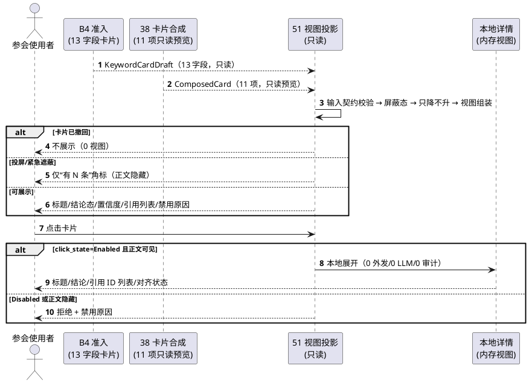

> 图只表达业务边界：不出现渲染引擎、窗口句柄、数据库、网络与接口参数；`ComposedCard` 只作为只读预览进入 51，不出现补 2 项。

### **5.9.3 异常场景**

1. **输入契约违规**
   a. 触发条件：`summary_is_consistent()==false`、`Passed` 但引用为空、引用 `reference_id` 重复、`ComposedCard.card_status=Collapsed`。
   b. 系统行为：拒绝投影，返回 `view=None` + `InputContractViolation`/`ReferenceContractViolation`；不读取越界字段、不回显文本。
   c. 用户感知：该卡片不出现；诊断可见原因码。
2. **卡片已撤回**
   a. 触发条件：`card_status=Withdrawn`。
   b. 系统行为：不生成视图，返回 `CardWithdrawn`；不因重新授权/刷新/重放而复活。
   c. 用户感知：卡片消失，不重新出现。
3. **投屏保护或紧急遮蔽**
   a. 触发条件：`screen_share=true` 或 `emergency_masked=true`。
   b. 系统行为：`body_visible=false`、`body=None`、仅 `badge_count`；点击一律拒绝。
   c. 用户感知：“已进入投屏保护模式”/“已紧急遮蔽”，仅见“有 N 条”。
4. **点击禁用卡片**
   a. 触发条件：`click_state=Disabled{reason}` 或正文隐藏。
   b. 系统行为：返回 `ClickOutcome{detail:None, reason:Some(reason)}`；不发起检索、不调 LLM、不写审计。
   c. 用户感知：详情不打开，显示禁用原因。
5. **结论性文本出现在非 Passed**
   a. 触发条件：`alignment!=Passed` 且 `summary` 不是固定文案“未找到可靠来源”。
   b. 系统行为：判输入违规，拒绝投影；不把文本降级为可展示结论。
   c. 用户感知：该卡片不出现；零转录扫描命中即阶段不放行。
6. **平台 API 或网络符号进入 51**
   a. 触发条件：`keyword_card/**` 出现 `tauri`/`windows`/`objc2`/`reqwest`/`TcpStream`/`std::net`/系统时间/文件符号。
   b. 系统行为：`--rule=source` 命中或 `cargo tree` 断言失败。
   c. 用户感知：阶段不放行。
7. **记录层夹带标题/结论**
   a. 触发条件：`title`/`conclusion` 被写入 `GateRecord`/审计/夹具/报告/进度。
   b. 系统行为：`--rule=zero-transcript` 命中。
   c. 用户感知：阶段不放行。

## **5.10 51 设置向导：凭据与模型配置（本轮增量扩展）**

> 定位：51 设置向导负责把"用户填写的 API Key、选择的模型、选择的服务地址"转成**可渲染、可内联校验、可一键测试**的设置视图与交互契约，目标是面向非技术用户做到"**只填一个 Key 就能用**"。51 **不渲染像素、不读环境变量、不读文件、不建操作系统安全存储句柄、不发起网络请求、不写日志**；连通性测试只产出"测试意图"，由装配层调用**既有 LLM 网关端口**执行后回填只读结果。真实凭据读取、网关装配、白名单判定仍归 app 装配层 / infrastructure，门控预算与冷却仍归 B4。
> 既有约束不变：`KeywordCardDraft` 13、`ReferenceView` 5、`CitationAlignment` 3、`ComposedCard` 11、`CardComposeInput` 7、`ComposeRejectReason` 6、`GateRecord` 14、`GateAuditEvent` 7、`GateInputFixture` 23、`ReplayReport` 5、`GateCounter` 32、`GateRejectReason` 23、`gate/api.rs` 4 个 `pub fn` **一律不改**；AC-B4-01~84 的编号与语义不重排、不改写；51 点击 UI 的 `keyword_card` 面与本节的 `settings` 面**互不依赖**。

**归属与接口（每个能力只有一个所有者）**

| 能力 | 所有者 | 51 交付什么 | 51 不交付什么 | 越界判定 |
|---|---|---|---|---|
| 设置视图投影 | **51** | `project_settings_view` + `SettingsView`（8 项） | 不读环境变量/文件/OS 存储 | 无 `std::env`/`std::fs`/`keyring` |
| Key 输入校验 | **51** | `validate_settings_input` + `FieldIssue`（6 项） | 不校验 Key 真伪、不做联网预检 | 无 `reqwest`/`TcpStream`/`std::net` |
| 掩码 | **51** | `mask_api_key` + `MaskedKey`（2 态、无载荷） | 不保留首尾字符、不暴露长度 | 掩码为唯一常量，与输入无关 |
| 模型选择 | **51** | `resolve_model_name`；源码内**零**模型名字面量 | 不维护模型清单、不调模型、不判模型质量 | 模型名只来自注入清单 |
| 端点选择 | **51** | 只消费注入清单**下标** | 不解析 URL、不比对 host、不扩展白名单 | 源码无 URL 前缀/域名/白名单常量名 |
| 连通性测试 | **51** | `next_probe_state` + `ProbeFailureKind`（8 项）+ `SettingsIntent::Probe` | 不发请求、不重试、不建熔断、不计时 | 无网络符号、无 `Instant::now` |
| 失败人话化 | **51** | `humanize_probe_failure`（8 条固定文案） | 不改写网关错误码语义、不回显请求体 | 文案表与枚举一一对应 |
| 保存/清除 | **51** | `SettingsIntent::Persist{Memory\|OsSecureStore}` / `Clear` + 二次确认 | 不写文件、不建 52 存储、不写明文 | 无 `std::fs`/`Sqlite`/`card_store` |
| 真实凭据读取与网关调用 | app 装配层 / infrastructure | 无 | 全部 | 51 侧 0 命中 |
| 端点白名单与路径常量 | infrastructure（既有） | 只读"允许清单"的显示名与下标 | 不新增、不改写 | 白名单常量零 diff |
| 门控预算与冷却 | B4（既有） | 只读冷却镜像 `cooldown_until_ms` | 不新建预算/熔断 | settings 失败计数不进 `GateCounter` |

**四条接口约定**：① 51 的唯一输入是**注入的只读事实**（`SettingsFacts` 6 项 + 模型清单 + 端点清单 + 冷却镜像）与**内存中的用户草稿**（`SettingsInput` 5 项）；51 **不得**自行读取任何环境变量、文件、系统时间、网络或操作系统存储。② 连通性测试是"**意图 + 结果**"两段式：51 产出 `SettingsIntent::Probe{ProbeRequest}`（内存凭据 + 模型 + 端点下标 + 超时），装配层调用既有 `StructuredLlmGateway`（沿用既有白名单、超时、thinking disabled、Bearer 注入，口径不变）后回填 `ProbeOutcome`；51 只做状态机转移与文案映射。③ 端点只允许来自注入清单的**下标**；51 不解析 URL、不比对 host、不内联域名，因此**在结构上不可能**扩展白名单。④ 预设模型名与端点显示名**只来自注入清单**；51 源码、测试与进度文档内**不得**内联模型名、域名或凭据形态样本（否则 `--rule=zero-transcript` 自身命中）。

**DFX 增量（本节适用，不重排既有 §4 编号）**

| 项 | 约束 |
|---|---|
| 性能 | 单次"校验 + 投影"纯函数 ≤1 ms（p95，离线基准，仅防退化）；不引入任何 IO |
| 可靠性 | 同输入 100 次投影与状态转移逐字节一致；在途测试并发恒为 1（`probe_in_flight`）；状态机无隐式重试、无隐式计时 |
| 安全性 | Key 明文只存在于 `SecretInput`（内存）；不实现 `Serialize`/`Deserialize`/`Display`，`Debug` 恒 `***`；视图只含固定无载荷掩码；错误文案、诊断与测试输出不含 Key 任何子串 |
| 可维护性 | 失败类别封闭 8 项、字段问题封闭 6 项、意图封闭 3 项、状态封闭 6 态、事件封闭 5 项；文案表与枚举一一对应（缺一即结构违规） |
| 兼容性 | `crates/ui-bridge/Cargo.toml` 与 `Cargo.lock` **零 diff**（不新增依赖，含不新增 path 依赖）；仅 `crates/ui-bridge/src/lib.rs` +1 行；平台只支持 Windows，macOS 一律"不适用（无设备）" |

### **5.10.1 业务规则**

1. **一步式默认值（傻瓜化）**：进入设置向导必须先给出一组可直接使用的默认值——预设模型取清单首项、端点取清单首项、超时 6 000 ms、`auto_save_on_verified=true`；用户**只需**粘贴 API Key 即可使 `can_test=true`，无需展开任何高级项。预设清单为空时必须显示"暂不可用"并禁用测试与保存，不得留空屏、不得给出不可恢复的死路。
   a. 验收条件：When 只提供 Key 草稿且清单非空，the `can_test` shall 为 `true`；When 模型清单或端点清单为空，the `can_test` shall 为 `false` 且 `inline_errors` 含 `ModelMissing`/`EndpointUnavailable`；When 投影默认草稿，the `model_index`/`endpoint_index` shall 均为 0、`timeout_ms` shall 为 6 000。
2. **分区顺序与最少步骤**：界面分区固定为 4 段并在视图中按固定下标暴露：①"粘贴 Key" ②"选择模型" ③"服务地址（高级，默认折叠）" ④"测试并保存"；**禁止**把高级项前置、禁止首屏要求填端点。从 `NotConfigured` 到 `Verified` 的用户动作数 ≤3（粘贴 → 测试 → 自动保存）。
   a. 验收条件：When 序列化 `SettingsView`，the 模块常量 `SECTION_ORDER` shall 恰为 4 项且顺序逐字固定（视图字段仍恰 8 项，**不新增** `sections` 字段）；When 走默认路径，the 计步 shall ≤3；When 首屏，the 高级分区 `expanded` shall 为 `false`。
3. **Key 内联校验（宽松、即时、不预检）**：Key 去首尾空白后必须非空；长度 <16 判 `ApiKeyTooShort`；内部含空白或换行判 `ApiKeyHasWhitespace`；**不得**校验前缀、**不得**判真伪、**不得**联网预检。校验只在 `submitted=true` 或字段失焦后展示，避免"边输边红"。
   a. 验收条件：When 草稿为空且 `submitted=true`，the `inline_errors` shall 含 `ApiKeyMissing`；When 长度 15，shall 含 `ApiKeyTooShort`；16 时 shall 不含；When 含内部空格，shall 含 `ApiKeyHasWhitespace`；When `submitted=false`，the `inline_errors` shall 为空。
4. **固定掩码、零回显**：任何回显位置只允许固定掩码（`MaskedKey::Masked`，**无载荷**）；**禁止**输出首尾字符、**禁止**输出长度、**禁止**输出字符类别或"已保存 N 位"；错误文案、诊断、进度与测试输出不得包含 Key 的任何子串。更换 Key 只提供"重新输入"入口，不提供"查看"入口。
   a. 验收条件：When 输入 1~256 长度任意 Key，the `key_display` shall 恒为 `Masked` 且序列化 JSON 不含输入的任何字符与长度信息；When 逐字节比对掩码输出，shall 与输入无关、恒等；When `format!("{:?}", input/intent/view)`，shall 不含明文。
5. **明文不落盘（保存与清除）**：51 **不得**写文件、写仓库、写日志/审计/回放/截图文本。保存只产出意图 `SettingsIntent::Persist{target}`，`target` 只能是 `Memory` 或 `OsSecureStore`（平台能力可调用，但 UI 契约不绑定具体平台 API）。清除产出 `SettingsIntent::Clear` 并要求二次确认。
   a. 验收条件：When 扫描 `crates/ui-bridge/src/settings`，`std::fs`/`std::env`/`println!`/`eprintln!`/`dbg!`/`tracing`/`log::`/`keyring` 命中 shall 为 0；When 全仓 `git grep`，真实 Key 形态明文命中 shall 为 0；When 清除未确认，the `form_state` shall 不变且 `intent` shall 为 `None`。
6. **模型：预设优先 + 允许自定义**：`ModelSelectionView` 封闭两态 `Preset{display_name}`/`Custom{name}`；自定义名必须非空、≤128 字符、字符集限 `[A-Za-z0-9._:-]`；预设清单由注入提供，51 源码/测试/进度**不得**内联模型名；模型名不得进入 `GateRecord`/审计/报告/夹具/日志。
   a. 验收条件：When 选择预设第 0 项，the `display_name` shall 恒等于注入清单第 0 项且逐字节一致；When 自定义 129 字符，shall 含 `ModelTooLong`；When 自定义含空格、中文或 URL 标点，shall 含 `ModelMissing`（字符集非法归一为同一码）；When 扫描源码，模型名字面量命中 shall 为 0。
7. **端点：只允许既有白名单（下拉封闭）**：`EndpointSelectionView` 封闭两态 `Option{display_name}`/`Unavailable`；用户**只能**在注入清单内选择，**不得**手输自由地址；51 **不得**解析地址、**不得**比对 host、**不得**扩展白名单（既有白名单与路径常量保持唯一）。可达性由网关决定，51 只显示注入的判定结果。
   a. 验收条件：When 注入清单 1 项，the 可选下标 shall 恒为 `0..1`；When 清单为空，the `endpoint_choice` shall 为 `Unavailable`；When 扫描源码，URL 前缀字面量、域名片段、白名单常量名 命中 shall 为 0。
8. **连通性测试状态机（单飞、可取消、无隐式重试）**：状态封闭 6 态 `NotConfigured`/`ConfiguredUnverified`/`Testing`/`Verified`/`Failed{failure}`/`Cooling{remaining_ms}`；转移只由 `ProbeEvent`（5 项）驱动；同时在途测试恒为 1（`probe_in_flight=true` 时 `UserTest` 被忽略）；`UserCancel` 可从 `Testing` 回到 `ConfiguredUnverified`；连续失败后进入 `Cooling`，剩余时间**只读**网关冷却镜像，51 **不建**独立熔断器与计时器。
   a. 验收条件：When `probe_in_flight=true` 再发 `UserTest`，the 状态 shall 不变且 `intent` shall 为 `None`；When `Testing` 收到 `UserCancel`，shall 为 `ConfiguredUnverified` 且 `has_key` shall 不变；When `cooldown_until_ms > now_ms`，the `form_state` shall 为 `Cooling` 且 `can_test=false`；When 同输入 100 次转移，shall 逐字节一致。
9. **失败人话化与可恢复**：`ProbeFailureKind` 封闭 8 项，每项映射唯一固定中文文案；文案**不得**包含 Key 片段、请求体、端点原始串或内部错误码编号；失败后必须保留已填的 Key 草稿、模型与端点选择，并恢复 `can_test=true`（冷却期除外），允许一键重试；不得清空输入、不得返回首屏、不得要求重新填写。
   a. 验收条件：When 逐一遍历 8 类失败，the 文案 shall 恰 8 条、互不相同、且不含 Key 子串与端点串；When 失败后仍在同一进程内，the Key 草稿 shall 仍存在且 `model_choice`/`endpoint_choice` shall 不变；When `Cooling`，shall 显示剩余秒数并禁用按钮。
10. **零转录与凭据边界**：视图模型、诊断、测试与进度只允许枚举、布尔、计数、毫值、固定文案与掩码态；Key 明文、Key 片段、Key 长度、端点原始串、模型名字面量、请求体、请求标识一律禁止进入记录层；`SettingsView` 手写 `Debug` 白名单。
    a. 验收条件：When 执行 `--rule=zero-transcript`，退出码 shall 为 0 且 settings 面命中 0；When `format!("{:?}", view)`，shall 不含 Key 片段、端点串与模型名取值。
11. **归属与禁止项**：51 只拥有"设置视图 + 输入校验 + 固定掩码 + 测试状态机 + 文案映射 + 保存/清除意图"；凭据读取、OS 安全存储写入、网关装配、真实请求、白名单判定、门控预算与冷却均归 app 装配层 / infrastructure / B4。禁止 51 直连网络、写文件、读环境变量、读系统时间、建 52 存储、扩白名单、改 `gate/**`/`cards/**`/`domain/**`、与 `keyword_card` 视图互相依赖。
    a. 验收条件：When 扫描 `crates/ui-bridge/src/settings`，`reqwest`/`hyper`/`TcpStream`/`std::net`/`issue_query`/`AuditLog`/`card_store`/`keyword_card` 命中 shall 为 0；When `git diff --quiet` 对 `gate`/`cards`/`domain`，退出码 shall 为 0。

### **5.10.2 交互流程**

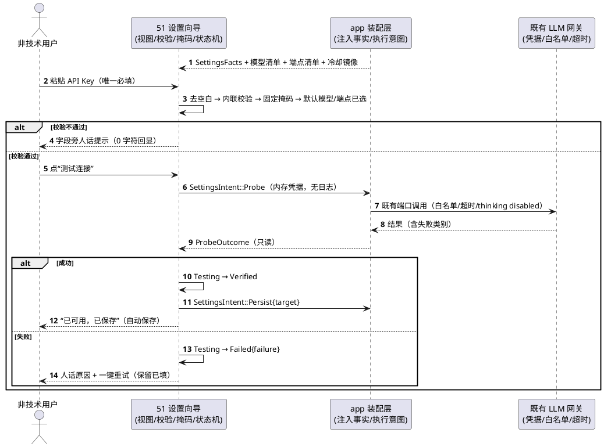

> 图只表达业务边界：不出现文件、注册表、密钥串、域名与接口参数；"既有 LLM 网关"是端口，51 不直连；用户可见文案不含任何 Key 片段。

### **5.10.3 异常场景**

1. **清单为空（无预设模型或无可用端点）**
   a. 触发条件：`model_count=0` 或 `endpoint_count=0`。
   b. 系统行为：置 `inline_errors` 为 `ModelMissing`/`EndpointUnavailable`，`can_test=false`、`can_save=false`；仍展示"自定义模型"入口。
   c. 用户感知："暂不可用，请联系管理员"，不出现死路。
2. **Key 未填 / 过短 / 含内部空白**
   a. 触发条件：去空白后空、长度 <16、含内部空白或换行。
   b. 系统行为：分别置 `ApiKeyMissing`/`ApiKeyTooShort`/`ApiKeyHasWhitespace`；**不清空**输入。
   c. 用户感知：字段旁中文提示，指明如何修正。
3. **粘贴带入换行或首尾空白**
   a. 触发条件：剪贴板内容含 `\n`/`\r`/首尾空格。
   b. 系统行为：自动裁剪后再判定；裁剪本身不产生用户可见错误。
   c. 用户感知：无感，直接进入可测试状态。
4. **Key 被服务端拒绝**
   a. 触发条件：网关返回鉴权类失败。
   b. 系统行为：`Failed{KeyRejected}`；**不回显** Key、不记录请求头。
   c. 用户感知："API Key 无效或已过期，请重新复制粘贴"。
5. **网络不可达或超时**
   a. 触发条件：连接失败或超时（沿用网关超时口径）。
   b. 系统行为：`Failed{EndpointUnreachable}`/`Failed{Timeout}`；保留已填内容。
   c. 用户感知："连不上服务器，请检查网络或代理" / "服务器响应太慢，已超时"。
6. **频率或额度类拒绝**
   a. 触发条件：网关返回限流或额度不足。
   b. 系统行为：`Failed{RateLimited}`/`Failed{QuotaExceeded}`；反复触发进入只读冷却。
   c. 用户感知："请求太频繁，请稍后再试" / "账户额度不足，请检查余额"。
7. **测试中途取消或关闭向导**
   a. 触发条件：`Testing` 期间收到 `UserCancel` 或视图卸载。
   b. 系统行为：回到 `ConfiguredUnverified`；不产生"半保存"状态、不写任何记录。
   c. 用户感知：状态回到"未验证"，可再次测试。
8. **保存目标不可用（操作系统安全存储拒绝）**
   a. 触发条件：`OsSecureStore` 写入失败（由装配层回执）。
   b. 系统行为：降级为 `Memory` 并显式提示"仅本次运行有效"；**禁止**静默失败、**禁止**回退为明文落盘。
   c. 用户感知："已保存，但仅本次运行有效"。
9. **设置面与卡片面串味**
   a. 触发条件：`settings/**` 出现 `keyword_card` 引用，或 `keyword_card/**` 出现 settings 引用。
   b. 系统行为：归属断言命中（`--rule=source` 或显式 grep）。
   c. 用户感知：阶段不放行。

## **5.11 13.3 回放本体：驱动、用例装载与失败报告（U-06 增量扩展）**

> 定位：13.3 只做“**可复用的回放驱动/夹具契约 + 用例装载 + 确定性比对 + 失败报告**”。它封装调用 B4 已冻结的 4 个纯函数（`detect_gaps`/`evaluate_gate`/`score_relevance`/`record_from`）与 `GateRecord`/`GateReplayCase`/`ReplayReport`，产出一次可复核的 `ReplayRun`。13.3 **不重算门控、不改判定语义、不写生产计数、不建 `tests/replay/`、不生成分组统计报表**。
> 既有约束不变：`gate/api.rs` 4 个 `pub fn`、`GateRecord` 14、`GateAuditEvent` 7、`GateInputFixture` 23、`ReplayReport` 5、`GateCounter` 32、`GateRejectReason` 23、`KeywordCardDraft` 13、`ReferenceView` 5、`CitationAlignment` 3、`ComposedCard` 11、`ComposeRejectReason` 6 **一律不改**；AC-B4-01~94 编号与语义不重排、不改写。
> 编号纪律：AC-B4-95~104 为 13.3 增量，只判定“回放本体是否闭合”，不阻断既有 AC 判定。

**归属与接口（每个能力只有一个所有者）**

| 能力 | 所有者 | 13.3 交付什么 | 13.3 不交付什么 | 越界判定 |
|---|---|---|---|---|
| 门控判定 | **B4** | 只读调用 4 个纯函数 | 不复制五级顺序、不改短路、不重算阈值 | `gate/replay.rs` 无 `ThresholdProfile::`/级别判定分支 |
| 回放驱动 | **13.3** | `ReplayDriver` + `ReplayCaseSource` + `ReplayCase` | 不做 UI、不做报表分组、不写文件 | 无 `std::fs`/`println!`/`rand` |
| 用例装载 | **13.3** | `ReplayCaseSource`（同步、只读、无 IO） | 不读 JSON/CSV 文件、不联网、不读系统时间 | 无 `File::`/`reqwest`/`SystemTime::now` |
| 用例比对 | **13.3** | `ReplayMismatchCode` 5 码 + `ReplayFailure` 2 项 | 不改 `ReplayReport` 5 字段、不扩 `GateRejectReason` | `ReplayReport` 字段数 =5；`GateRejectReason` 变体 =23 |
| 记录核验 | **13.3** | 逐例 `record_from` 产出 `GateRecord` 并断言 14 字段 | 不改 `GateRecord`、不写审计、不建存储 | `GateRecord` 字段数 =14；无 `AuditLog::append` |
| 用例生成/报表 | **B4 测试面 / 未来 13.3** | 只定义契约，不自带 200 例生成器 | 不复刻、不迁移 `gate_replay.rs` 的 200 例；不做分组报表 | `tests/gate_replay.rs` 零 diff |

**四条接口约定**：①13.3 的唯一执行输入是“**已构造的门控输入 + 策略 + 期望**”（执行层 `ReplayCase`），文本只在测试进程 arena 内借用，不落盘；②对外报告层仍用 domain 的 `GateReplayCase`（`GateInputFixture` 23 字段、零文本），**不从 fixture 反构 `GateInput`**（避免把文本塞回夹具）；③13.3 只调用 4 个纯函数与 `FixedClock`，**不依赖** `GateStore`/`GateAuditSink`/`GateCounters`/`OutboundLease`/`reqwest`/`tokio`；④`ReplayReport` 5 字段保持不变，更细的失败诊断放 13.3 自己的 `ReplayFailure`。

### **5.11.1 业务规则**

1. **交付形态与封闭面**：13.3 必须把驱动契约落 `crates/application/src/gate/replay.rs`，顶层封闭为 7 项：`ReplayCase`（4 项）、`ReplayCaseSource`（1 trait，2 方法）、`ReplayDriver`（1 方法）、`ReplayRun`（3 项）、`ReplayFailure`（2 项）、`ReplayMismatchCode`（5 变体）、`ReplayLoadError`（3 变体）。`gate/mod.rs` 只允许新增 1 行 `pub use replay::{...}`；`gate/api.rs` 仍 4 个 `pub fn`，其余 `gate/**` 文件零 diff。
   a. 验收条件：When 统计 `gate/replay.rs` 顶层 `pub struct`/`pub enum`/`pub trait`，shall 恰为 7 项且字段数为 4/2/3/2；When 执行 `grep -c 'pub fn \(detect_gaps\|evaluate_gate\|score_relevance\|record_from\)' crates/application/src/gate/api.rs`，shall 为 4；When 执行 `git diff --quiet HEAD -- crates/application/src/gate/api.rs crates/application/src/gate/prefilter.rs crates/application/src/gate/relevance.rs crates/application/src/gate/dedupe.rs crates/application/src/gate/budget.rs crates/application/src/gate/lease.rs crates/application/src/gate/outbound.rs crates/application/src/gate/record.rs crates/application/src/gate/diagnostics.rs crates/application/src/gate/input.rs crates/application/src/gate/clock.rs crates/application/src/gate/keyword.rs`，退出码 shall 为 0。

2. **双层用例模型（报告层零文本 / 执行层借用）**：13.3 必须区分两层——报告层 `GateReplayCase`（`case_id`/`input_fixture`/`policy_fixture`/`expected`，零文本，可交换）；执行层 `ReplayCase<'a>`（`case_id`/`input: GateInput<'a>`/`policy: GatePolicy`/`expected: ExpectedDecision`，由 `ReplayCaseSource` 在测试进程内构造）。**禁止**从 `GateInputFixture` 反构 `GateInput`，**禁止**为回放给 `GateInputFixture` 新增文本字段。
   a. 验收条件：When 检查 `crates/domain/src/model/gate_replay.rs`，`GateInputFixture` 字段数 shall 仍为 23 且文本字段新增数 =0；When 扫描 `gate/replay.rs`，`from_fixture`/`InsightDraft` 命中 shall 为 0；When 扫描 `ReplayCase` 字段，shall 恰为 4 项。

3. **用例装载与校验**：`ReplayCaseSource` 必须同步、只读、无 IO；`ReplayDriver::run` 必须在执行前校验 `case_id` 非空、长度 ≤64、全局唯一；装载后必须按 `case_id` 升序稳定排序。非法输入必须返回 `ReplayLoadError::{EmptyCaseSet, DuplicateCaseId, InvalidCaseId}`，不得执行任何判定、不得 panic。
   a. 验收条件：When 装载空集合，shall 返回 `EmptyCaseSet`；When 两个相同 `case_id`，shall 返回 `DuplicateCaseId`；When `case_id` 为空或 >64，shall 返回 `InvalidCaseId`；When 装载乱序集合，the `ReplayRun.report.mismatch_cases` 顺序 shall 与升序 `case_id` 一致。

4. **驱动流程（逐例顺序固定）**：`ReplayDriver::run` 必须对每个用例依次执行：`detect_gaps(&case.input.scan)` → `evaluate_gate(&case.input, &case.policy, &fixed_clock)` → `record_from(&case.input, &decision, &case.input.budget)` → 与 `case.expected` 比对。固定时钟必须为 `FixedClock{anchor_ms: case.input.now_ms, tick_ms: 0}` 或等价常量时钟；每一步不得提前短路到下一例之外的全局状态。
   a. 验收条件：When 执行 1 个 Allow 用例，the `ReplayRun.records.len()` shall 为 1 且 `report.total=1`；When 执行 20 个用例，the `records.len()`、`report.total`、`failures` 覆盖的 `case_id` 集合 shall 三者一致；When 扫描 `gate/replay.rs`，`Instant::now`/`SystemTime::now`/`thread::sleep`/`std::env` 命中 shall 为 0。

5. **与 4 个纯函数的关系**：13.3 只允许通过 4 个公有函数取得判定与记录；**禁止**在 `gate/replay.rs` 内复制 `evaluate_gate` 的级序、阈值、预算或冷却逻辑；`score_relevance` 可作为独立比对项被调用，但不得反向改写 `evaluate_gate` 的结果。
   a. 验收条件：When 扫描 `gate/replay.rs`，`GateStage::G[1-5]` 的条件分支命中 shall 为 0（只允许在 `ReplayFailure` 比对处引用 `stopped_at`）；When 替换 `evaluate_gate` 以外的任一判定逻辑，the 回放结果 shall 发生变化（证明 driver 未自证）；When `api.rs` 的 4 个签名逐字节不变。

6. **与 `record_from` 的关系（记录核验）**：每例必须产出 1 条 `GateRecord`，并断言：字段封闭 14 项、`skipped_stages` 仅含 G2/G3、`Deny ⇒ stopped_at.is_some()`、`refs_are_valid()` 为真；记录中禁止出现 `keyword_text`/`summary`/完整 URL/模型名/`request_id`/姓名与联系方式。记录核验失败必须记为 `ReplayMismatchCode::RecordViolation`，不得丢弃该案例。
   a. 验收条件：When 对任意用例执行 `record_from`，the `format!("{record:?}")` 与字段扫描 shall 不含禁词；When 构造 `skipped_stages=[G4]` 的违规记录，the driver shall 产出 `RecordViolation` 且 `report.mismatched ≥1`；When `record_from` 的签名与基线一致，`GateRecord` 字段数 =14。

7. **固定种子与确定性**：种子必须由 `ReplayCaseSource::seed()` 提供并写入 `ReplayReport.seed`；种子只作报告字段与排序/分布标记，**不得**读取随机源。同一 source 连续运行两次，`ReplayReport` 5 字段、`failures` 向量、`records` 向量必须逐项相等；同一用例集以不同装载顺序运行，结果必须一致（按 `case_id` 排序后比对）；同一 source 运行 100 次结果必须一致。
   a. 验收条件：用例 `replay_driver_is_deterministic_twice`、`replay_driver_is_order_insensitive`、`replay_driver_seed_is_report_only`；When 两次运行，`first.report == second.report` 且 `first.failures == second.failures` 且 `first.records == second.records`；When 扫描 `gate/replay.rs` 与 `tests/gate_replay_driver.rs`，`rand`/`rand::`/`getrandom` 命中 shall 为 0。

8. **失败报告封闭（只含 case_id/原因码）**：`ReplayFailure` 必须封闭为 `{case_id, code}` 2 项；`ReplayMismatchCode` 必须封闭为 5 变体：`ExpectedAllowGotDeny`/`ExpectedDenyGotAllow`/`ReasonMismatch`/`StageMismatch`/`RecordViolation`。`ReplayRun.report.mismatch_cases` 必须与 `failures` 的 `case_id` 序列逐项一致；失败报告**禁止**携带期望/实际决策的完整结构、文本、URL、模型名或 `request_id`。
   a. 验收条件：用例 `replay_failure_reports_case_id_and_code_only`、`replay_failure_codes_cover_all_mismatch_kinds`；When 触发 5 类不匹配各 1 例，the `failures` 的 `code` 集合 shall 覆盖 5 变体；When 序列化/`Debug` 任意 `ReplayFailure`，输出 shall 只含 `case_id` 与码名。

9. **零转录**：`gate/replay.rs`、`tests/gate_replay_driver.rs` 与 `b4-status.md` 的相关段落，**禁止**出现 API Key、完整 URL、模型名、`request_id`、查询原文、参会人姓名与联系方式；断言消息只允许 `case_id`/序号/原因码；`ReplayCase`/`ReplayRun`/`ReplayFailure` 的 `Debug` 必须白名单（不输出 `GateInput` 的文本字段）。
   a. 验收条件：用例 `replay_driver_zero_transcript_boundary`、`replay_driver_debug_is_whitelisted`；`bash scripts/check-b4-gates.sh --rule=zero-transcript` 退 0（`gate/replay.rs` 由 `gate/*.rs` 自动纳入，`tests/gate_replay_driver.rs` 由 `gate_*.rs` glob 自动纳入）；`format!("{:?}", run)` 不含文本取值。

10. **与现有 200 例的关系（并存，不复刻不迁移）**：`crates/application/tests/gate_replay.rs` 必须相对基线**零 diff**，其 6 个用例（含 200 例的两条）保持全绿，`total=200`/`mismatched=0`/`seed=7` 不变；13.3 **不得**复制其私有构造器（`build_cases`/`run`/`KINDS`）、**不得**修改其断言、**不得**把 200 例迁入 `gate/replay.rs`。13.3 的自检集必须独立、以本地构造的 `GateInput` 驱动，用例数 ≥20。
   a. 验收条件：When 执行 `git diff --quiet HEAD -- crates/application/tests/gate_replay.rs`，退出码 shall 为 0；When 执行 `cargo test -p meeting-copilot-application --test gate_replay`，shall 全绿且 `replay_200_cases_is_byte_identical` 退 0；When 扫描 `gate/replay.rs` 与 `tests/gate_replay_driver.rs`，`fn build_cases`/`enum Kind` 命中 shall 为 0。

11. **目录与门禁口径（不解禁 `tests/replay/`）**：`crates/application/tests/replay/` **必须仍不存在**；13.3 用例落单文件 `crates/application/tests/gate_replay_driver.rs`，target 名 `gate_replay_driver`；`NEW_TARGETS` 由 24 增至 25（尾部追加 1 项）；`scripts/check-b4-gates.sh` **零改动**（规则仍 7 条），因 `gate/*.rs` 与 `tests/gate_*.rs` 已被 `source`/`zero-transcript` 扫描面覆盖；`--rule=targets` 的循环列表仍为既有 7 项，**不追加** `gate_replay_driver`（沿用 X-05）。
   a. 验收条件：When 执行 `test ! -d crates/application/tests/replay`，退出码 shall 为 0；When 执行 `grep -m1 '^NEW_TARGETS=' scripts/test-name-inventory.sh | sed -E "s/^NEW_TARGETS='//; s/'$//" | wc -w`，shall 为 25 且含 `gate_replay_driver`；When 执行 `git diff --quiet HEAD -- scripts/check-b4-gates.sh`，退出码 shall 为 0；When 执行 `awk '/^rule_targets\(\)/{f=1} f&&/^\}/{exit} f' scripts/check-b4-gates.sh | grep -c 'gate_replay_driver'`，shall 为 0。

12. **平台、依赖与计数边界**：13.3 只支持 **Windows 单平台**；macOS 一律“不适用（无设备）”，不得新增 mac 分支。回放不得使用 `reqwest`/`TcpStream`/`std::net`/`std::fs`/`std::env`/`Instant::now`/`SystemTime::now`/`thread::sleep`/`rand`；不得新增 crate（`Cargo.toml`/`Cargo.lock` 零 diff）；不得新增 `GateCounter`（仍 32）、`GateRejectReason`（仍 23）或第 8 条门禁规则。
   a. 验收条件：When 执行 `cargo deny check licenses bans sources advisories`，退出码 shall 为 0；When 执行 `git diff --quiet HEAD -- Cargo.toml Cargo.lock crates/application/Cargo.toml crates/domain/Cargo.toml`，退出码 shall 为 0；When 扫描 `gate/replay.rs`，上述 IO/随机符号命中 shall 为 0；When 执行 `snapshot()`，`GateCounter` 变体数 shall 为 32。

### **5.11.2 交互流程**

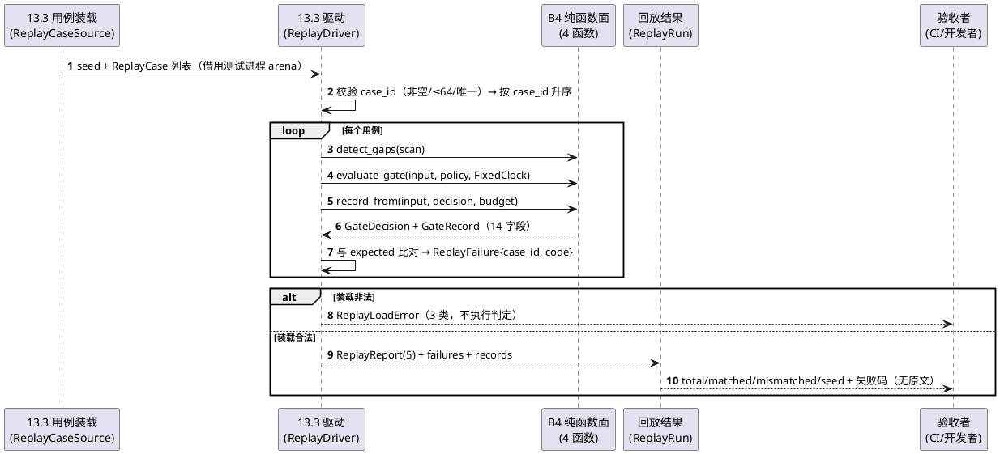

> 图只表达回放边界：不出现文件、网络、数据库、UI 与分组报表；`FixedClock` 与 `seed` 只作确定性输入，不读系统时间/随机源。

### **5.11.3 异常场景**

1. **用例集为空**
   a. 触发条件：`ReplayCaseSource::cases()` 返回空 `Vec`。
   b. 系统行为：不执行任何判定，返回 `ReplayLoadError::EmptyCaseSet`；不生成 `ReplayReport`。
   c. 用户感知：诊断显示“回放用例为空”，退出非 0。
2. **用例 ID 重复或非法**
   a. 触发条件：两个 `case_id` 相同、为空、或长度 >64。
   b. 系统行为：返回 `DuplicateCaseId`/`InvalidCaseId`；不执行判定、不 panic、不回显 `case_id` 之外的内容。
   c. 用户感知：诊断显示原因码与序号，不显示文本。
3. **期望与实际不匹配**
   a. 触发条件：`expected` 与 `GateDecision` 的 Allow/Deny、原因码或 `stopped_at` 不一致。
   b. 系统行为：记 1 条 `ReplayFailure`（对应 5 码之一），`mismatched` 加 1，`mismatch_cases` 追加 `case_id`；继续执行其余用例。
   c. 用户感知：报告可见 `case_id` 与原因码，`mismatched>0` 即阶段不放行。
4. **记录契约违规**
   a. 触发条件：`record_from` 产出的记录字段数 ≠14、`skipped_stages` 含 G2/G3 之外、`Deny` 无 `stopped_at`、`refs` 全空。
   b. 系统行为：记 `RecordViolation`；不修改记录、不把记录写入任何存储/日志。
   c. 用户感知：报告可见 `case_id` 与 `RecordViolation`。
5. **用例顺序漂移**
   a. 触发条件：同一集合以不同顺序装载，或两次运行间存在全局状态残留。
   b. 系统行为：按 `case_id` 升序稳定排序后再执行；每次运行重建 `FixedClock`；结果必须逐项一致。
   c. 用户感知：两次报告字段一致；顺序不一致即阶段不放行。
6. **文本进入报告或调试输出**
   a. 触发条件：`ReplayFailure`/`ReplayRun`/断言消息出现原文、摘要、URL、姓名、联系方式、模型名或 `request_id`。
   b. 系统行为：`--rule=zero-transcript` 命中或 `Debug` 白名单断言失败。
   c. 用户感知：阶段不放行。
7. **试图创建 `tests/replay/` 或新增报表/随机源**
   a. 触发条件：创建 `crates/application/tests/replay/`、引入 `rand`、新增第 8 条门禁规则或分组报表符号。
   b. 系统行为：目录断言、依赖零 diff 与 `--rule=targets` 口径失败。
   c. 用户感知：阶段不放行，回放范围回退为“仅驱动 + 单文件 target”。

# **6. 数据约束**

## **6.1 门控输入（GateInput）**

1. **session**：必填，会话标识；跨会话输入必须被拒绝（`cross_session=0`）。
2. **trigger**：必填，`Auto`/`OnDemand`；决定长度上限（80/200）。
3. **insights**：只读切片；元素必须为 `Insight`，且 `status != Deleted`；**不得**含 `InsightDraft`。
4. **fragments**：只读切片；含 `text`（≤2000 字）、`confidence`、`span`、`speaker`。
5. **policy**：必填，`EffectivePolicy` 快照。
6. **authorization**：必填（可为 `Missing`）。
7. **provider_view**：必填，仅 `enabled_count` 与 `provider_ids`。
8. **llm_capability**：必填，仅 `cooling` 与 `cooling_until_ms`。
9. **network**：必填，`Online/Offline/Unknown`。
10. **now_ms**：必填，虚拟毫秒；禁止真实时间。

## **6.2 缺口候选（GapCandidate，复用既有）**

1. **kind**：必须 ∈ `GapKind` 既有 6 变体。
2. **trigger_span**：必填，区间起点 < 终点。
3. **confidence**：0..=1；产候选门槛 ≥0.50。
4. **dedupe_key**：32 位十六进制。
5. **state**：必须 ∈ `GapState` 既有 7 变体；门控不得写 `Pushed`。

## **6.3 相关性分（RelevanceScore）**

1. **semantic/entity/gain/source_trust**：各 0..=1000 毫值。
2. **decay_milli**：0..=1000，`exp(-Δt/180s)` 的毫值化。
3. **score_milli**：0..=1000，四舍五入；`NaN`/越界一律视为结构违规。
4. **threshold_milli**：0..=1000，必须 ∈ {520, 620, 720}。

## **6.4 门控决策（GateDecision）**

1. **Allow**：必须携带 `per_stage` 五级结果与 `budget_remaining`。
2. **Deny**：必须携带**唯一** `GateRejectReason` 与 `stopped_at`。
3. **一致性**：`Deny.stopped_at` 之后各级 `calls=0`。
4. **封闭性**：`GateRejectReason` 必须为 23 项封闭枚举（见 6.5）；未知字符串反序列化必须失败。

## **6.5 拒绝原因码（GateRejectReason，23 项封闭集）**

`PreFilterLowConfidence`、`ConsentMissing`、`AutoDisabled`、`Paused`、`SilentPeriod`、`ScreenShareProtection`、`SensitiveTerm`、`Duplicate`、`Suppressed`、`QuotaExhausted`、`NoProviderEnabled`、`LowRelevance`、`Stale`、`BudgetExhausted`、`GatewayCooling`、`Offline`、`OutboundNotGranted`、`SanitizeFailed`、`AuditUnavailable`、`ProviderNotAllowed`、`DomainBlocked`、`PolicyUnavailable`、`RetentionExpired`。

1. **与既有 `DenyCode` 的映射**：`GateRejectReason::to_deny_code()` 必须覆盖 `DenyCode::ALL` 11 项且每项至少 1 个来源；`RateLimited` 由 `QuotaExhausted` 与 `BudgetExhausted` 共同映射。
2. **无映射的内部码（11 项）**：`PreFilterLowConfidence`、`AutoDisabled`、`Paused`、`Duplicate`、`Suppressed`、`NoProviderEnabled`、`LowRelevance`、`Stale`、`GatewayCooling`、`Offline`、`AuditUnavailable`；`to_deny_code()` 返回 `None`，UI 使用门控专用文案。
3. **禁止扩展 `DenyCode::ALL`**：保持 11 项，不得新增变体。

## **6.6 门控记录（GateRecord）**

1. **字段封闭 14 项**：`schema_version`、`trace_id`、`session_id`、`candidate_ref`、`insight_ref`、`trigger`、`per_stage`、`decision`、`stopped_at`、`budget_remaining`、`cooldown_until_ms`、`authorization_status`、`skipped_stages`、`decided_at_ms`。
2. **trace_id**：必填，可回溯；不得等于 `request_id`。
3. **candidate_ref/insight_ref**：可为空，但二者至少一个非空。
4. **per_stage**：G1~G5 各含 `calls`、`result`、`reason`、`elapsed_ms`；`elapsed_ms` 由注入时钟计算。
5. **budget_remaining**：0..=120；`cooldown_until_ms`：可选。
6. **authorization_status**：`Granted/Revoked/Expired/Missing`。
7. **skipped_stages**：仅允许 `G2`、`G3`；其他级出现即结构违规。
8. **禁止字段**：查询原文、`text`、完整 URL、`model`、`request_id`、`api_key`、说话人姓名。
9. **序列化**：JSON 往返逐字节一致；未知字段透传。

## **6.7 预算（GateBudget）**

1. **session_outbound_used**：0..=600；上限默认 120。
2. **global_window_used**：0..=5；窗口 600 000 ms。
3. **topic_window_used**：按主题分桶，每桶 0..=2。
4. **entity_last_seen_ms**：按实体记录，冷却 300 000 ms。
5. **concurrent_inflight**：0..=3。

## **6.8 可回放（GateReplayCase / ReplayReport）**

1. **case_id**：必填，唯一。
2. **input_fixture**：只含脱敏结构字段，禁止原文与 URL。
3. **expected**：`Allow` 或 `Deny{reason}` + `stopped_at`。
4. **policy_fixture**：阈值档位、预算上限、可跳过开关。
5. **ReplayReport**：`total`、`matched`、`mismatched`、`mismatch_cases[]`、`seed`；固定种子与虚拟时钟下两次运行逐字节一致。
6. **200 例构造方式（方案 A）**：`GateInputFixture` 保持既有 23 字段，不新增文本字段；200 个用例在 `crates/application/tests/gate_replay.rs` 内用本地构造的 `NormalizedFragment`/`Insight` 驱动 `detect_gaps`/`evaluate_gate`，本地构造的文本不得写入夹具、报告、日志或任何记录。
7. **覆盖面**：200 例必须覆盖 G1~G5 全部可构造拒绝码（23 项逐一至少 1 例）与 `Allow` 路径；不可构造的分支（如脱敏失败替身）由 L1/L2 专项用例覆盖并在报告中登记，不计入 200 例的 `mismatched`。

## **6.9 门控策略（GatePolicy）**

1. **relevance_enabled**：默认 true；仅此级可关。
2. **dedupe_enabled**：默认 true；抑制列表不受此开关影响。
3. **threshold_profile**：`Strict/Balanced/Loose`，默认 `Balanced`。
4. **frequency_profile**：`Low/Medium/High`，默认 `Medium`。
5. **session_outbound_cap**：默认 120，范围 0..=600。
6. **auto_query_limit**：固定 80；**on_demand_query_limit**：固定 200。
7. **max_cache_age_ms**：默认 86 400 000。
8. **禁止项**：`skip_g1/g4/g5=true` 必须 `validate` 失败；未知字段保留并透传。

## **6.10 授权（GateAuthorization）**

1. **status**：`Granted/Revoked/Expired/Missing`。
2. **granted_at**：`Granted` 时必填。
3. **content_types**：仅 `TextQuery`；含 `Audio` 即非法。
4. **max_query_chars**：`Auto=80`、`OnDemand=200`。
5. **provider_ids**：非空时必须是启用源子集；`Granted` 且为空表示"不限定"，但外发仍受注册表当前启用源约束。
6. **notice_version**：≥1；变更后必须递增。
7. **revoked_at**：撤销后必填；不可清空恢复。

## **6.11 关键词候选（KeywordCandidate）**

1. **keyword_ref**：必填，稳定引用 ID；不得为关键词原文、不得等于 `request_id`。
2. **keyword_text**：必填，展示用关键词，≤40 字；只允许存在于卡片展示层，不得写入 `GateRecord`/审计/回放夹具/日志。
3. **normalized_term**：必填，归一化术语；同一会话同值只保留 1 个候选（沿用首现判定），重复由 G3 的 10 分钟窗口判定，不另设再生窗口。
4. **keyword_kind**：必须 ∈ `proper_noun`/`acronym`/`institution_role`/`policy_standard`/`metric` 五类封闭集；未答提问不在此列。
5. **trigger_span**：必填，片段内区间，起点 < 终点，且必须属于同一会话。
6. **confidence**：0..=1；产候选门槛 ≥0.50。
7. **dedupe_key**：32 位十六进制，与 G3 共用窗口。
8. **state**：必须 ∈ 既有 `GapState` 7 变体；候选阶段不得写 `Pushed`。
9. **session_id**：必填；跨会话候选必须被拒绝。
10. **source_insight_ref**：可选；与 `trigger_span` 至少一个可定位到来源。

## **6.12 关键词卡片（KeywordCardDraft）**

1. **字段封闭 13 项**：`card_id`、`keyword_text`、`normalized_term`、`keyword_kind`、`trigger`、`triggered_at_ms`、`confidence`、`summary`、`references`、`citation_alignment`、`gate_decision_ref`、`card_status`、`click_state`。
2. **card_id**：全局唯一；一张卡只能绑定一个候选，一个候选最多一张卡。
3. **keyword_text**：≤40 字；不得含完整句子、说话人姓名、联系方式或完整 URL。
4. **summary**：≤80 字；`citation_alignment != Passed` 时必须为空或为"未找到可靠来源"固定文案，不得给出结论性表述。
5. **references**：0..*，每个元素只允许 `reference_id`、`trust_tier`、`access_status`、`published_at_ms`、`alignment`；**禁止**页面 URL、页面标题、正文摘要与原文。
6. **citation_alignment**：`Passed`/`Failed`/`Unverified` 封闭三态；由 39 产出，B4 只读。
7. **gate_decision_ref**：必填，必须指向一次 `Allow` 的门控记录；`Deny` 记录不得作为卡片依据。
8. **card_status**：`Displayed`/`Collapsed`/`Withdrawn` 封闭三态；由 38/51 维护，B4 不写。
9. **click_state**：`Enabled` 或 `Disabled{reason}`；`reason` 封闭为 `NotAllowed`/`ReferenceUnverified`/`AuthorizationRevoked`/`ScreenShareProtection`/`EmergencyMasked`/`StaleReference`。
10. **可点击一致性**：`click_state=Enabled` 必须同时满足 `citation_alignment=Passed`、`gate_decision_ref=Allow`、`card_status != Withdrawn`、当前无投屏/紧急遮蔽、授权未撤销。
11. **禁止字段**：完整转写、查询原文、完整 URL、`model`、`request_id`、`api_key`、说话人姓名、联系方式。

## **6.13 引用视图（ReferenceView）**

1. **reference_id**：必填，稳定引用 ID；不得为 URL。
2. **trust_tier**：`Official`/`Authority`/`General`/`UserGenerated` 四档封闭。
3. **access_status**：`Ok`/`Unavailable` 两态；不可访问时必须显式标注。
4. **published_at_ms**：可选；为空时必须标注"发布时间未知"。
5. **alignment**：`Passed`/`Failed`/`Unverified` 三态，与卡片 `citation_alignment` 同源。
6. **禁止内容**：页面 URL、标题、正文摘要、抓取正文、原文与查询文本。

## **6.14 39 输入（CitationCheckInput，封闭 8 项）**

1. **card_id**：必填，只读引用；不得为空；与 `KeywordCardDraft.card_id` 恒等。
2. **keyword_ref**：必填，只读；用于"一卡一候选"关联；不得为关键词原文。
3. **normalized_term**：必填，只读；仅用于术语一致性比对；**禁止**写入记录、日志、夹具与进度文档。
4. **keyword_kind**：必填，五类封闭（`ProperNoun`/`Acronym`/`InstitutionRole`/`PolicyStandard`/`Metric`）；用于主题一致性判定。
5. **references**：必填，0..*；元素只允许 `reference_id`、`trust_tier`、`access_status`、`published_at_ms`、`alignment`（与 6.13 同源）。
6. **now_ms**：必填，注入虚拟毫秒；禁止真实时间；输出 `checked_at_ms` 必须与其相等。
7. **judge_capability**：必填，`Available`/`Unavailable`；`Unavailable` 时一律 `Unknown`。
8. **claim_ref**：可选，结论/解释的引用 ID 或摘要哈希；不得承载正文、标题或片段。

9. **禁止字段**：URL、页面标题、正文摘要、抓取正文、查询原文、转写片段、参会人姓名与联系方式、`model`、`request_id`、`api_key`。

## **6.15 39 输出（CitationAlignmentResult，封闭 6 项）**

1. **alignment**：`Passed`/`Failed`/`Unknown` 封闭三态；`Unknown` 对 B4 契约的唯一投影为 `Unverified`。
2. **basis**：判定依据码封闭 11 项——`SupportedByOfficial`、`SupportedByAuthority`、`SupportedByGeneral`、`Contradicted`、`TermMismatch`、`ConflictingSources`、`NoReference`、`ReferenceUnavailable`、`InsufficientEvidence`、`JudgeUnavailable`、`InputContractViolation`；多因并存时按 6.15-7 的唯一顺序取值。
3. **reference_count**：0..*；必须等于输入 `references.len()`。
4. **accessible_reference_count**：0..=`reference_count`；只统计 `access_status=Ok`。
5. **checked_at_ms**：必须等于输入 `now_ms`；不得取系统时间。
6. **contract_version**：契约版本号；不得为模型名、`request_id` 或 URL。

7. **唯一原因顺序**：输入违规 → 引用缺失/全不可访问 → 判定能力不可用 → 术语不匹配 → 引用明确反驳 → 引用互斥 → 仅有 General/UserGenerated 支撑 → 证据不足 → Official/Authority 支撑通过；输出恒为唯一 `basis`，禁止多值并列。
8. **不变量**：`alignment=Passed ⇒ reference_count≥1 ∧ accessible_reference_count≥1 ∧ 存在 Official/Authority 支撑`；`alignment∈{Failed,Unknown} ⇒ 不得作为 click_state=Enabled 的依据`；同输入 100 次序列化逐字节一致；引用按 `reference_id` 稳定排序后判定，顺序不影响结果。
9. **禁止内容**：URL、标题、摘要、正文、查询原文、转写片段、姓名与联系方式、`model`、`request_id`、`api_key`；引用说明只能按 `reference_id` 从上游读取。

## **6.16 38 输入（CardComposeInput，封闭 7 项）**

1. **card_id**：必填，只读；由装配方按 B4 的派生规则注入，38 不重算、不派生；不得为空，不得等于候选原文。
2. **candidate**：必填，只读 `KeywordCandidate`（10 字段）；必须通过候选自身校验（`confidence ≥0.50`、区间合法、`state != Pushed`、展示词非空）。
3. **allow_ref**：必填，只读 `AllowTraceRef`；必须来自一次 `GateDecision::Allow`；38 只读不写。
4. **alignment_result**：必填，只读 `CitationAlignmentResult`（6 字段）；38 只读 `alignment` 并做唯一投影，`basis` 不进入输出、不进入日志。
5. **references**：必填，0..*；元素只允许 `reference_id`/`trust_tier`/`access_status`/`published_at_ms`/`alignment`；`reference_id` 必须唯一；输入顺序不具语义。
6. **current_card_status**：必填，`Displayed`/`Collapsed`/`Withdrawn`；只读；38 不得写 `Collapsed`，不得把 `Withdrawn` 复活。
7. **suppressed_notice**：必填布尔；只用于装配方提示，**不进入**卡片 11 项业务字段。

8. **只读性**：7 项全部以只读视图传入；38 不得改写 `KeywordCardDraft` 的任一字段、不得改写 39 结果、不得改写候选与引用视图。
9. **禁止字段**：URL、页面标题、正文摘要、抓取正文、查询原文、转写片段、参会人姓名与联系方式、`model`、`request_id`、`api_key`。

## **6.17 38 输出（ComposedCard，封闭 11 项）**

1. **card_id**：与输入恒等；全局唯一；一候选最多一卡。
2. **keyword_text**：与候选展示词恒等；≤40 字；不得含完整句子、说话人姓名、联系方式或完整 URL。
3. **normalized_term**：与候选恒等；仅展示层与内存比对使用，禁止序列化进日志/记录/夹具。
4. **keyword_kind**：与候选恒等；五类封闭（`ProperNoun`/`Acronym`/`InstitutionRole`/`PolicyStandard`/`Metric`）。
5. **trigger**：与候选恒等；`Auto`/`OnDemand`。
6. **triggered_at_ms**：必须等于 `candidate.trigger_span.end_ms`；不得取系统时间。
7. **confidence**：与候选恒等；0..=1；38 不重算、不四舍五入改写。
8. **summary**：`Option`；≤80 字；`citation_alignment != Passed` 时必须为 `None` 或固定文案"未找到可靠来源"；只允许"固定模板常量 + `normalized_term`"拼接，不得复制引用标题/摘要/正文。
9. **references**：0..*；元素只允许 5 字段；必须按 `reference_id` 升序稳定排序；重复 ID 即输入违规；不得含 URL/标题/摘要/正文。
10. **citation_alignment**：必须等于 `project_alignment(&alignment_result)`；`Passed`/`Failed`/`Unverified` 三态封闭；`Unknown→Unverified` 唯一投影。
11. **card_status**：`Displayed`/`Withdrawn` 二者之一；**38 不得写 `Collapsed`**；`Withdrawn` 不可复活。

12. **不变量**：`summary.is_some() ⇒ citation_alignment == Passed`；`card_status != Collapsed`；输出**不含** `gate_decision_ref` 与 `click_state`；同输入 100 次序列化逐字节一致；引用顺序不影响结果。
13. **禁止内容**：完整转写、查询原文、完整 URL、页面标题、正文摘要、抓取正文、姓名与联系方式、`model`、`request_id`、`api_key`。

## **6.18 38 合成结果与拒绝原因（CardComposeOutcome / ComposeRejectReason）**

1. **CardComposeOutcome 恰 2 项**：`card: Option<ComposedCard>` 与 `reason: Option<ComposeRejectReason>`；二者**恰有 1 项为 `Some`**（XOR），不得同时为空或同时非空。
2. **ComposeRejectReason 6 项封闭**：`GateNotAllowed`、`CandidateInvalid`、`TitleTooLong`、`DuplicateCard`、`CardWithdrawn`、`InputContractViolation`；同一输入只输出唯一原因。
3. **不进入 B4 封闭面**：`ComposeRejectReason` 是 38 私有码，**不得**并入 `GateRejectReason`（保持 23 项）、**不得**新增 `GateCounter`（保持 32 项）；只允许出现在 38 诊断与测试断言。
4. **诊断只含 ID 面**：合成次数、成功数、6 类拒绝原因计数，只允许整数计数与原因码；不得含展示词、解释文本、术语、引用标题/摘要/正文与 URL。

## **6.19 51 视图（KeywordCardView，封闭 10 项）**

1. **card_id**：必填，与输入 `KeywordCardDraft.card_id`/`ComposedCard.card_id` 恒等；只读。
2. **keyword_kind**：必填，五类封闭；与输入恒等。
3. **trigger**：必填，`Auto`/`OnDemand`；与输入恒等；`ComposedCard` 预览使用其自身 `trigger`。
4. **triggered_at_ms**：必填，与输入恒等；不得取系统时间。
5. **card_status**：必填，`Displayed`/`Collapsed`/`Withdrawn`；51 只读入参，不写回输入卡片；`Withdrawn` 时 51 不生成视图。
6. **body_visible**：必填布尔；必须等于 `body.is_some()`；投屏/紧急遮蔽/撤回时为 `false`。
7. **body**：`Option<CardBodyView>`；`body_visible=false` 时必须为 `None`；`Some` 时封闭 4 项（见 6.20）。
8. **click_state**：必填，`Enabled` 或 `Disabled{reason}`；`reason` 封闭 6 项；51 只降不升。
9. **citation_alignment**：必填，`Passed`/`Failed`/`Unverified` 三态；只读 39 结果或 38 的 `ComposedCard`；不解释 `basis`。
10. **badge_count**：必填，≥1；由 `ViewFacts.visible_card_count` 注入并在为 0 时置 1；仅屏蔽态展示“有 N 条”。

11. **禁止字段**：`normalized_term`、`gate_decision_ref` 的 `trace_id`、完整转写、查询原文、完整 URL、`model`、`request_id`、`api_key`、参会人姓名与联系方式、`paused`/`silent`。

## **6.20 卡片正文（CardBodyView，封闭 4 项）/ 结论态 / 详情**

**CardBodyView（4 项）**

1. **title**：必填，与 `KeywordCardDraft.keyword_text`/`ComposedCard.keyword_text` 恒等；`TitleText` 已保证 ≤40 字；不得含完整句子、姓名、联系方式或完整 URL。
2. **conclusion**：必填，`ConclusionView` 三态；`Available` 仅当 `citation_alignment=Passed` 且 `summary=Some`。
3. **confidence**：必填，0..=1；与输入恒等；不重算、不四舍五入改写。
4. **references**：0..*；元素只允许 `reference_id`/`trust_tier`/`access_status`/`published_at_ms`/`alignment`；必须按 `reference_id` 升序稳定排序；重复 ID 判输入违规；不得含 URL/标题/摘要/正文。

**ConclusionView（3 变体）**：`Available(ConclusionText)`、`NoReliableSource`、`Absent`。`Available` 仅当 `Passed` 且 `summary=Some`；`NoReliableSource` 对应固定文案“未找到可靠来源”；`Absent` 对应 `summary=None`。禁止 `Failed`/`Unverified`/`Unknown` 出现 `Available`。

**CardDetailView（5 项）**

1. **card_id**：与视图恒等。
2. **title**：来自 `CardBodyView.title`；不得重新读取原文。
3. **conclusion**：来自 `CardBodyView.conclusion`；无结论态原样保留。
4. **reference_ids**：来自 `CardBodyView.references` 的 `reference_id` 列表，按升序；不得携带引用正文。
5. **citation_alignment**：来自 `KeywordCardView.citation_alignment`；三态封闭。

## **6.21 视图事实（ViewFacts，封闭 6 项）**

1. **session_matches**：必填布尔；`false` 表示卡片不属于当前会话，点击必须 `Disabled{StaleReference}`。
2. **authorization_revoked**：必填布尔；`true` 表示授权已撤销/过期，点击必须 `Disabled{AuthorizationRevoked}`，旧卡不自动恢复。
3. **reference_stale**：必填布尔；`true` 表示引用已删除/过期，点击必须 `Disabled{StaleReference}`。
4. **screen_share**：必填布尔；`true` 表示投屏保护，正文隐藏且点击拒绝。
5. **emergency_masked**：必填布尔；`true` 表示紧急遮蔽，正文隐藏且点击拒绝。
6. **visible_card_count**：必填，0..*；用于“有 N 条”角标；投影时 `max(1)` 后写入 `badge_count`。

7. **禁止字段**：`paused`/`silent`/`now_ms`/`url`/`title`/`summary`/正文/姓名/联系方式；静默期/暂停不影响已展示卡片查看。

## **6.22 视图结果（CardViewOutcome / ViewRejectReason / ClickOutcome）**

1. **CardViewOutcome 恰 2 项**：`view: Option<KeywordCardView>` 与 `reason: Option<ViewRejectReason>`；二者恰有 1 项为 `Some`（XOR）。
2. **ViewRejectReason 3 项封闭**：`InputContractViolation`、`ReferenceContractViolation`、`CardWithdrawn`；同一输入只输出唯一原因。
3. **ClickOutcome 恰 2 项**：`detail: Option<CardDetailView>` 与 `reason: Option<ClickDisabledReason>`；二者恰有 1 项为 `Some`（XOR）。
4. **不进入 B4 封闭面**：`ViewRejectReason` 是 51 私有码，不得并入 `GateRejectReason`（23）、不得新增 `GateCounter`（32）；只允许出现在 51 诊断与测试断言。
5. **诊断只含 ID 面**：投影次数、成功数、3 类拒绝原因计数、点击次数、拒绝次数，只允许整数计数与原因码；不得含标题、结论、术语、引用正文与 URL。

## **6.23 视图不变量与既有封闭字段不变**

1. **可见性不变量**：`body_visible == body.is_some()`；`body.is_none() ⇒ click_state != Enabled`；`click_state=Enabled ⇒ body.is_some() ∧ citation_alignment=Passed ∧ card_status != Withdrawn ∧ !authorization_revoked ∧ session_matches ∧ !reference_stale ∧ !screen_share ∧ !emergency_masked`。
2. **撤回不变量**：`card_status=Withdrawn ⇒ view=None ∧ reason=CardWithdrawn`；同一输入重复 100 次结果逐字节一致。
3. **结论不变量**：`ConclusionView::Available ⇒ citation_alignment=Passed`；`Failed`/`Unverified`/`Unknown` 只能 `NoReliableSource` 或 `Absent`。
4. **既有封闭字段不变**：`KeywordCardDraft` 13、`ReferenceView` 5、`CitationAlignment` 3、`ComposedCard` 11、`CardComposeInput` 7、`CardComposeOutcome` 2、`ComposeRejectReason` 6、`GateRecord` 14、`GateAuditEvent` 7、`GateInputFixture` 23、`ReplayReport` 5、`GateCounter` 32、`GateRejectReason` 23、`gate/api.rs` 4 个 `pub fn` 均不变。
5. **禁止扩展**：51 不新增 domain 契约、不新增 `GateCounter`、不新增 `GateRejectReason`、不新增第 6 类关键词或第 7 类识别规则；视图类型只落 `crates/ui-bridge/src/keyword_card/`。

## **6.24 设置视图（SettingsView，封闭 8 项）**

1. **form_state**：必填，`SettingsFormState` 6 态封闭（见 6.27）；由注入事实与 `ProbeEvent` 纯函数推进，不读系统时间。
2. **has_key**：必填布尔；`false` 时 `key_display=None` 且 `form_state` 必为 `NotConfigured`。
3. **key_display**：必填，`MaskedKey` 2 态（`Masked`/`None`）；`Masked` **无载荷**，不与输入长度、字符集或前后缀相关。
4. **model_choice**：必填，`ModelSelectionView` 2 态（`Preset{display_name}`/`Custom{name}`）；`display_name` 与 `name` 均来自注入清单或用户自定义输入，**不内联**在源码中。
5. **endpoint_choice**：必填，`EndpointSelectionView` 2 态（`Option{display_name}`/`Unavailable`）；只允许注入清单下标，无原始地址。
6. **inline_errors**：0..*；元素封闭为 `FieldIssue`（6 项）；必须按枚举声明序稳定排序并去重（同输入同输出）。
7. **can_test**：必填布尔；不变量 = `has_key ∧ form_state ≠ Testing ∧ form_state ≠ Cooling ∧ 模型有效 ∧ 端点可用`。
8. **can_save**：必填布尔；不变量 = `has_key ∧ 模型有效 ∧ 端点可用`（**不要求**测试通过，允许"先保存后验证"）。

9. **禁止字段**：`api_key`、`key_plain`、`key_len`、`key_prefix`、`key_suffix`、`url`、`host`、`endpoint_raw`、`request_id`、`request_body`、`model_catalog_raw`。

## **6.25 设置事实（SettingsFacts，封闭 6 项）**

1. **has_stored_key**：必填布尔；由装配层读 OS 安全存储后注入，51 不自行读取。
2. **model_count**：必填，0..*；预设模型数量。
3. **endpoint_count**：必填，0..*；允许端点数量。
4. **now_ms**：必填，注入毫值；**不得**取系统时间。
5. **cooldown_until_ms**：`Option<u64>`；网关冷却只读镜像，51 不创建计时器。
6. **probe_in_flight**：必填布尔；装配层在途标记，用于保证测试单飞。

7. **禁止字段**：`current_key`、`api_key`、`host`、`url`、`endpoint`（原始串）、`model_name`。

## **6.26 设置草稿与意图（SettingsInput 5 项 / SettingsIntent 3 变体）**

**SettingsInput（5 项）**

1. **api_key_draft**：`SecretInput`（内存明文）；不实现 `Serialize`/`Deserialize`/`Display`；`Debug` 恒 `***`；**无**长度/前缀/后缀访问器。
2. **model_draft**：`ModelDraft` 3 态（`PresetIndex(usize)`/`CustomName(String)`/`None`）。
3. **endpoint_draft**：`EndpointDraft` 2 态（`Index(usize)`/`None`）。
4. **submitted**：布尔；控制内联错误是否展示。
5. **clear_confirmed**：布尔；控制清除是否已二次确认。

**SettingsIntent（3 变体）**

1. **Persist{target}**：`PersistTarget` 2 态（`Memory`/`OsSecureStore`）；只表达意图，实际落盘由装配层执行。
2. **Clear**：清除意图；仅在 `clear_confirmed=true` 时产出。
3. **Probe{request}**：`ProbeRequest` 含 `credential: SecretInput`、`model: ModelDraft`、`endpoint_index: Option<usize>`、`timeout_ms: u64`；**不含**端点原始串与请求体。

4. **不进入记录层**：`SettingsInput`/`SettingsIntent`/`ProbeRequest` 均不实现 `Serialize`/`Deserialize`；`SettingsIntent` 不得作为 IPC DTO 直接传输；如需跨进程，由装配层重新构造只读 DTO 且 DTO 不含 Key。

## **6.27 状态、事件、失败类别、字段问题与默认值（封闭集合）**

1. **SettingsFormState 6 态**：`NotConfigured`、`ConfiguredUnverified`、`Testing`、`Verified`、`Failed{failure}`、`Cooling{remaining_ms}`。
2. **ProbeEvent 5 项**：`UserTest`、`UserCancel`、`ProbeSucceeded`、`ProbeFailed{failure}`、`ClockTick{now_ms}`。
3. **ProbeFailureKind 8 项**：`MissingKey`、`KeyRejected`、`EndpointUnreachable`、`Timeout`、`RateLimited`、`QuotaExceeded`、`ServerError`、`Unknown`；每项对应唯一固定中文文案（见 6.28-6）。
4. **FieldIssue 6 项**：`ApiKeyMissing`、`ApiKeyTooShort`、`ApiKeyHasWhitespace`、`ModelMissing`、`ModelTooLong`、`EndpointUnavailable`。
5. **ProbeOutcome 2 项 XOR**：`succeeded{elapsed_ms}` 与 `failed{failure}` 恰有 1 项；不得同时为空或同时非空。
6. **SettingsDefaults 4 项**：`model_index: usize`（默认 0）、`endpoint_index: usize`（默认 0）、`timeout_ms: u64`（默认 6 000，与网关既有超时口径一致）、`auto_save_on_verified: bool`（默认 `true`）；由 `apply_defaults` 纯函数投影为 `SettingsInput` 初值。
7. **不进入 B4 封闭面**：`ProbeFailureKind`/`FieldIssue`/`SettingsIntent` 是 51 私有面，**不得**并入 `GateRejectReason`（23）、**不得**新增 `GateCounter`（32）；只允许出现在 settings 诊断与测试断言。

## **6.28 设置不变量与既有封闭字段不变**

1. **未配置不变量**：`has_key=false ⇒ form_state=NotConfigured ∧ key_display=None ∧ can_test=false ∧ can_save=false`。
2. **已验证不变量**：`form_state=Verified ⇒ has_key=true ∧ 端点可用 ∧ 模型有效`；`can_test` 仅在 `Testing`/`Cooling` 期为 `false`（其余状态只要 `has_key ∧ 模型有效 ∧ 端点可用` 即 `true`）。
3. **冷却不变量**：`form_state=Cooling{remaining_ms} ⇒ can_test=false ∧ remaining_ms>0 ∧ remaining_ms` 仅来自注入的 `cooldown_until_ms - now_ms`。
4. **单飞不变量**：`probe_in_flight=true ⇒ form_state=Testing`；`form_state=Testing ⇒ probe_in_flight=true`。
5. **可测不变量**：`can_test=true ⇒ has_key ∧ 存在 1 个模型选择 ∧ endpoint_count>0 ∧ form_state ∉ {Testing, Cooling}`。
6. **文案表不变量**：`ProbeFailureKind` 8 项与 `humanize_probe_failure` 的 8 条文案**一一对应**；任一条缺失、重复或含 Key 子串即结构违规。
7. **掩码不变量**：`mask_api_key` 输出恒等于唯一常量，与输入长度/内容无关；`MaskedKey` 无载荷字段。
8. **既有封闭字段不变**：`KeywordCardDraft` 13、`ReferenceView` 5、`CitationAlignment` 3、`ComposedCard` 11、`CardComposeInput` 7、`CardComposeOutcome` 2、`ComposeRejectReason` 6、`GateRecord` 14、`GateAuditEvent` 7、`GateInputFixture` 23、`ReplayReport` 5、`GateCounter` 32、`GateRejectReason` 23、`gate/api.rs` 4 个 `pub fn` 均不变。
9. **禁止扩展**：51 设置向导不新增 domain 契约、不新增 `GateCounter`/`GateRejectReason`、不改任何既有封闭类型、不新增依赖；设置类型只落 `crates/ui-bridge/src/settings/`，与 `keyword_card/` 互不依赖。

## **6.29 回放本体契约（ReplayCase / ReplayRun / ReplayFailure 等，封闭 7 项）**

> 本节的类型只落 `crates/application/src/gate/replay.rs`；**不新增 domain 契约**，不改 `GateReplayCase`/`GateInputFixture`/`ReplayReport` 的既有字段。

1. **ReplayCase（执行层用例，4 项）**
   1. **case_id**：必填，非空，长度 ≤64；同一运行内唯一；只允许 ASCII 字母/数字/`-`/`_`。
   2. **input**：`GateInput<'a>` 只读借用；其 `scan` 供 `detect_gaps`，其余字段供 `evaluate_gate` 与 `record_from`；不得回写。
   3. **policy**：`GatePolicy` 值；取自已裁决策略夹具；不得由 driver 重新解析三档阈值。
   4. **expected**：`ExpectedDecision`（既有 2 变体：`Allow` / `Deny{reason, stopped_at}`），不得扩展。

2. **ReplayCaseSource（用例装载契约，1 trait / 2 方法）**
   1. **seed**：返回 `u64`；只写入 `ReplayReport.seed`，不参与随机化。
   2. **cases**：返回 `Vec<ReplayCase<'_>>`；同步、只读、无 IO、无全局可变状态；借用测试进程 arena。
   3. **禁止项**：不得读文件/网络/环境变量/系统时间；不得返回空 ID、重复 ID 或 >64 的 ID。

3. **ReplayDriver（驱动契约，unit struct / 1 方法）**
   1. **run**：`fn run(&self, source: &dyn ReplayCaseSource) -> Result<ReplayRun, ReplayLoadError>`；先校验与排序，再逐例驱动。
   2. **时钟**：每例使用 `FixedClock{anchor_ms: input.now_ms, tick_ms: 0}` 或等价常量时钟；禁止真实时钟。
   3. **禁止项**：不复制级序/阈值/预算逻辑，不写文件，不打印，不写生产计数。

4. **ReplayRun（一次运行结果，3 项）**
   1. **report**：既有 `ReplayReport`（5 字段：`total`/`matched`/`mismatched`/`mismatch_cases`/`seed`），字段不增不减。
   2. **failures**：`Vec<ReplayFailure>`；顺序与 `case_id` 升序一致；`report.mismatch_cases` 必须与其 `case_id` 序列逐项一致。
   3. **records**：`Vec<GateRecord>`；每例恰 1 条，顺序与 `failures` 同源；`GateRecord` 14 字段封闭。
   4. **不变量**：`report.total == records.len()`；`report.mismatched == failures.len()`；`report.matched + report.mismatched == report.total`。

5. **ReplayFailure（失败项，2 项）**
   1. **case_id**：非法/失败用例标识；只允许引用 ID 形态，不得含文本。
   2. **code**：`ReplayMismatchCode`；不得携带实际/期望决策的完整结构。
   3. **禁止项**：不得含原文、摘要、URL、姓名、联系方式、模型名、`request_id`、请求体。

6. **ReplayMismatchCode（失败原因码，5 变体封闭）**
   1. **ExpectedAllowGotDeny**：期望 `Allow`，实得 `Deny`。
   2. **ExpectedDenyGotAllow**：期望 `Deny`，实得 `Allow`。
   3. **ReasonMismatch**：同为 `Deny` 但 `GateRejectReason` 不同。
   4. **StageMismatch**：原因码相同但 `stopped_at` 不同。
   5. **RecordViolation**：`GateRecord` 违反 14 字段/跳级/`refs`/`stopped_at` 契约。
   6. **禁止项**：不得并入 `GateRejectReason`（仍 23），不得新增第 6 码。

7. **ReplayLoadError（装载错误，3 变体封闭）**
   1. **EmptyCaseSet**：用例集为空。
   2. **DuplicateCaseId**：`case_id` 重复。
   3. **InvalidCaseId**：`case_id` 为空或 >64 或字符集非法。
   4. **禁止项**：不得用 `panic!`/`unwrap` 表达；不得回显文本。

8. **既有结构不变**：`GateReplayCase`（4 字段）、`GateInputFixture`（23 字段）、`ReplayReport`（5 字段）、`ExpectedDecision`（2 变体）、`GateRecord`（14 字段）均不改；`ReplayReport` 不新增“覆盖矩阵/分组统计”字段。

9. **禁止新增**：不新增 `GateCounter`（32）、`GateRejectReason`（23）、门禁规则（7）、crate 依赖；不建 `tests/replay/`；不建 JSON/CSV 用例文件格式。

# **7. 验收判定**

## **7.1 离线可判定与必须真实端点/真机判定的分界**

| 类别 | 判定方式 | 本轮覆盖 |
|---|---|---|
| **离线可判定（主体）** | `cargo test` 退出码、脚本退出码、静态 grep（扫描面缺失退 2）、`GateRecord` 字段、`GateCounters`、用例名差集 | AC-B4-01~104 全部（95~104 为 13.3 回放本体增量） |
| **必须真实端点** | 真实检索源连通、真实 LLM 冷却、真实模型质量 | **本轮不判定**；不新增 `#[ignore]`，仍为 9 个 |
| **必须真机（Windows）** | 6s/10s p95、误触发率 ≤30%、真实会议平台 | **本轮不执行、不得宣称 G4** |
| **必须真机（macOS）** | SCStream、授权、AX、DMG | 一律"**不适用（无设备）**" |

> 纪律：①离线通过 ≠ G4 通过；②替身通过 ≠ 真实端点已验证；③`LLM_LIVE_CALL_CAP` 不是门控预算；④不得新增 `#[ignore]`。

## **7.2 AC-B4-01~08：G1 预筛（8 条）**

| 编号 | EARS 陈述 | 可机器判定 |
|---|---|---|
| AC-B4-01 | When 六类规则各一条正例输入，the 预筛 shall 产出 6 个候选，基础分依次为 0.70/0.65/0.60/0.80/0.75/0.85，且缩写白名单可配置。 | 用例 `prefilter_scores_six_gap_rules`、`acronym_whitelist_is_configurable`；字段 `GapCandidate.kind`、`confidence` |
| AC-B4-02 | When 专名第二次出现，the 预筛 shall 不重复产出候选；When 输入仅含 `sensitive=true` 术语，the 候选数 shall 为 0 且 `gate_l0_sensitive_seed_blocked=1`。 | 用例 `first_seen_suppresses_second_candidate`、`sensitive_term_is_not_a_seed`；字段 `gate_l0_sensitive_seed_blocked` |
| AC-B4-03 | When 问句后 9 999 ms 无回应，the 候选数 shall 为 0；推进到 10 000 ms 时 shall 为 1；When 9 999 ms 内出现回应，the 候选数 shall 为 0 且 `gate_l0_question_answered_skipped=1`。 | 用例 `unanswered_question_yields_after_ten_seconds`、`answered_question_is_skipped`；虚拟时钟 |
| AC-B4-04 | When 片段/候选 `confidence=0.49`，the 候选数 shall 为 0 且 `gate_l0_low_confidence=1`；`0.50` 时 shall 为 1。 | 用例 `below_half_gap_confidence_yields_no_candidate`、`exactly_half_gap_confidence_passes`；字段 `gate_l0_low_confidence` |
| AC-B4-05 | When 时钟为片段稳定后 1 999 ms，the 候选数 shall 为 0；2 000 ms 时 shall 为 1（结构口径，不测真实 p95）。 | 用例 `candidate_is_ready_within_two_seconds_of_stable_prefix`；虚拟时钟 1 999/2 000 ms 的候选数 =0/1 |
| AC-B4-06 | The `GapCandidate.kind` shall 属于既有 6 变体且机构/职务映射为 `ProperNoun`；`dedupe_key` shall 为 32 位十六进制。 | 用例 `gap_kind_is_closed_enum_and_institution_maps_to_proper_noun`、`dedupe_key_is_32_hex`；`GapKind` 变体数 =6 |
| AC-B4-07 | While 执行 G1，the 判定 shall 无 IO、无锁、无系统时间、无随机；同一输入 100 次结果逐字段相等。 | 用例 `prefilter_is_pure_and_deterministic`；`check-b4-gates.sh --rule=source` 退出 0（`gate/` 中 `Instant::now/SystemTime::now/thread::sleep/std::env` 命中 0） |
| AC-B4-08 | When 依次注入 11 种硬闸门条件，the G1 shall 分别返回 11 个不同 `GateRejectReason`（`AutoDisabled`/`ConsentMissing`/`Paused`/`SilentPeriod`/`ScreenShareProtection`/`PreFilterLowConfidence`/`Suppressed`/`QuotaExhausted`/`Duplicate`/`NoProviderEnabled`/`SensitiveTerm`），且 `outbound_attempts=0`；`stopped_at=G1`。 | 用例 `prefilter_denies_eleven_hard_cases`；字段 `GateRejectReason`、`stopped_at`；11 个原因码各出现 1 次 |

## **7.3 AC-B4-09~14：G2 相关性（6 条）**

| 编号 | EARS 陈述 | 可机器判定 |
|---|---|---|
| AC-B4-09 | The 相关性分 shall 严格等于 `0.40×semantic+0.25×entity+0.20×gain+0.15×sourceTrust` 乘 `exp(-Δt/180s)`，全毫值整数；全分项=1、Δt=0 时 `score_milli=1000`。 | 用例 `relevance_weights_match_spec`、`relevance_full_score_is_thousand`；字段 `score_milli` |
| AC-B4-10 | When Δt=180 000 ms，the 衰减因子 shall 为 367.9‰（±1‰）；When Δt=0，shall 为 1000‰。 | 用例 `time_decay_at_180_seconds_is_367_milli`、`time_decay_at_zero_is_thousand`；字段 `decay_milli` |
| AC-B4-11 | The 阈值档位 shall 为严格 720‰、平衡 620‰、宽松 520‰；平衡档下 619‰ 拒绝、620‰ 放行。 | 用例 `threshold_profiles_are_072_062_052`、`balanced_threshold_boundary`；字段 `threshold_milli` |
| AC-B4-12 | The `RelevanceScore` shall 同时输出 6 个分项；任一缺失即结构违规。 | 用例 `relevance_parts_are_all_reported`；字段 `semantic/entity/gain/source_trust/decay_milli/score_milli` |
| AC-B4-13 | When 综合分低于档位阈值，the G2 shall 返回 `Deny{LowRelevance}` 并使 `gate_l2_low_relevance=1`；When 主题/实体为空，the 判定 shall 不 panic 且 `semantic=0`、`entity=0`。 | 用例 `low_relevance_is_denied`、`empty_topic_is_deterministic`；字段 `gate_l2_low_relevance` |
| AC-B4-14 | While 执行 G2，the `llm_calls` 与 `network_calls` shall 恒为 0；中英混排输入 100 次结果一致。 | 用例 `relevance_never_calls_llm_or_network`、`relevance_is_deterministic_for_mixed_text`；静态规则 `source` 退出 0 |

## **7.4 AC-B4-15~21：G3 时效/去重（7 条）**

| 编号 | EARS 陈述 | 可机器判定 |
|---|---|---|
| AC-B4-15 | The 语义聚类阈值 shall 为 0.880；0.8799 不归同主题、0.8800 归同主题。 | 用例 `semantic_cluster_threshold_is_088`、`cluster_boundary_08799_08800`；字段 `topic_cluster_id` |
| AC-B4-16 | When 同一去重键在 599 999 ms 内再次出现，the 结果 shall 为 `Deny{Duplicate}` 且 `gate_l3_duplicate=1`；间隔 600 000 ms 时 shall 为 `Allow`。 | 用例 `duplicate_key_blocks_within_ten_minutes`、`duplicate_key_expires_at_ten_minutes`；字段 `gate_l3_duplicate` |
| AC-B4-17 | When 单主题第 3 次触发，the 结果 shall 为 `Deny{QuotaExhausted}` 且 `gate_l3_quota=1`；全局第 4 次触发 shall 同样拒绝。 | 用例 `topic_quota_is_two_per_ten_minutes`、`global_quota_is_three_per_ten_minutes`；字段 `gate_l3_quota` |
| AC-B4-18 | When 同实体间隔 299 999 ms，the 结果 shall 为 `Deny{Duplicate}` 且 `cooldown_until_ms` 为最后触发 +300 000 ms；300 000 ms 时 shall 为 `Allow`。 | 用例 `entity_cooldown_is_five_minutes`、`entity_cooldown_expires_at_five_minutes`；字段 `cooldown_until_ms` |
| AC-B4-19 | When 主题/来源/实体任一类命中抑制，the 自动推送 shall `Deny{Suppressed}`；按需补全 shall `Allow` 且携带 `suppressed_notice=true`。 | 用例 `suppression_blocks_auto_allows_on_demand`；字段 `suppressed_notice`、`gate_l3_suppressed` |
| AC-B4-20 | When 缓存年龄 86 400 000 ms，the 结果 shall 为 `Allow`；86 400 001 ms 且无刷新来源时 shall 为 `Deny{Stale}`。 | 用例 `fresh_cache_is_allowed`、`stale_cache_is_denied`；字段 `gate_l3_stale` |
| AC-B4-21 | When 候选数 10，the 结果 shall 全部进入后续判定；11 个时 shall 只保留 `score` 前 3，其余 8 个丢弃并计 `gate_l3_quota`。 | 用例 `candidate_convergence_keeps_top_three`；字段 `kept=3`、`dropped=8` |

## **7.5 AC-B4-22~27：G4 预算与冷却（6 条）**

| 编号 | EARS 陈述 | 可机器判定 |
|---|---|---|
| AC-B4-22 | The 门控预算 shall 与 `LLM_LIVE_CALL_CAP` 无耦合；`gate/` 源码中 `LLM_LIVE_CALL_CAP`、`std::env` 命中 0；该变量缺失或为 0 时门控结果不变。 | 用例 `budget_is_independent_of_llm_live_cap`；`check-b4-gates.sh --rule=budget` 退出 0 |
| AC-B4-23 | The 会话自动外发上限 shall 为 120（可配 0..=600）；第 120 次 `Allow`、第 121 次 `Deny{BudgetExhausted}` 且 `gate_l4_budget_exhausted=1`。 | 用例 `session_outbound_cap_is_120`；字段 `budget_remaining` |
| AC-B4-24 | The 10 分钟全局配额 shall 默认 3（档位 低 1/中 3/高 5），令牌桶容量 3、补充 3/10 min；第 4 次 `Deny`。 | 用例 `token_bucket_capacity_and_refill`、`frequency_profiles_are_1_3_5`；字段 `global_window_used` |
| AC-B4-25 | When `capability().cooling=true`，the G4 shall 返回 `Deny{GatewayCooling}`，`llm_calls=0`、`retries=0`、`gate_l4_gateway_cooling=1`。 | 用例 `gateway_cooling_denies_without_retry`；字段三个 |
| AC-B4-26 | While 网关冷却，the 片段准入 shall 继续完成 ≥1 次（不阻塞主链）。 | 用例 `gateway_cooling_does_not_block_admission`；字段 `admitted_during_cooldown ≥1` |
| AC-B4-27 | When 推进 600 001 ms，the 预算/冷却 shall 恢复放行；When 并发第 4 个请求，the 结果 shall 为 `Allow{queued=true}` 而非拒绝。 | 用例 `budget_recovers_after_window`、`fourth_concurrent_request_is_queued`；字段 `queued` |

## **7.6 AC-B4-28~36：G5 外发授权与审计（9 条）**

| 编号 | EARS 陈述 | 可机器判定 |
|---|---|---|
| AC-B4-28 | The 授权记录 shall 含 `status/granted_at/content_types/max_query_chars/provider_ids/notice_version/revoked_at` 7 字段；`content_types` 仅 `TextQuery`。 | 用例 `authorization_records_seven_required_fields`；字段逐一断言 |
| AC-B4-29 | While 授权 `status!=Granted`，the 自动与按需外发次数 shall 均为 0，且返回 `Deny{OutboundNotGranted}`。 | 用例 `unauthorized_outbound_is_zero`；字段 `outbound_attempts=0` |
| AC-B4-30 | When 授权已撤销，the 启动/升级/会话开始/策略重载四入口 shall 均不恢复为 `Granted`；恢复需 `granted_at` 更新且 `notice_version` 递增。 | 用例 `revoked_authorization_is_not_auto_restored`、`reauthorization_bumps_notice_version`；字段 `status` |
| AC-B4-31 | When 自动查询 81 字，the 门控 shall 先截断到 80 字并使 `truncated=true`；按需 201 字 shall 截断到 200；`SanitizedQuery` 仍拒绝接收 >200 的输入（门控不得把超长串直接交给脱敏器）。 | 用例 `auto_query_is_capped_at_80`、`on_demand_query_is_capped_at_200`、`oversize_never_reaches_sanitizer`；字段 `sanitized_query_len`、`truncated` |
| AC-B4-32 | When 新增检索源或提高长度上限，the 旧授权 shall 变为 `Expired`，下一次外发 `Deny{OutboundNotGranted}`。 | 用例 `authorization_change_invalidates_old_grant`；字段 `status=Expired` |
| AC-B4-33 | While 扫描 `crates/application/src/gate/**` 与 `proactive/**`，the 直接 `reqwest::` 命中 shall 为 0；`Sanitizer::issue_query` 与 `AuditLog::append` 仅允许在 G5 单一模块出现，其他文件命中 shall 为 0。 | `check-b4-gates.sh --rule=outbound` 退出 0；`grep -rn "reqwest::" crates/application/src/gate crates/application/src/proactive` 命中 0；`grep -rln "issue_query\|AuditLog::append" crates/application/src/gate` 输出仅 1 个文件 |
| AC-B4-34 | When 自动外发放行 1 次，the 审计 shall 写入 1 条，含授权状态/时间/内容类型/长度/源 ID/结果/原因码；记录中查询原文与完整 URL 命中 0。 | 用例 `outbound_audit_has_required_fields_without_text`；`check-b4-gates.sh --rule=zero-transcript` 退出 0 |
| AC-B4-35 | When 审计不可用，the G5 shall 返回 `Deny{AuditUnavailable}`，外发 0 次并使 `gate_l5_audit_unavailable=1`；缓冲事件 ≥1。 | 用例 `audit_unavailable_blocks_outbound`；字段 `outbound_attempts=0`、缓冲长度 ≥1 |
| AC-B4-36 | When 脱敏失败，the G5 shall 返回 `Deny{SanitizeFailed}`、外发 0 次、审计 1 条，用户感知 `E-PRIV-004`。 | 用例 `sanitize_failure_blocks_outbound`；字段 `gate_l5_sanitize_failed=1`、`error_code="E-PRIV-004"` |

## **7.7 AC-B4-37~50：B3 兼容、红线、回放与"不做"（14 条）**

| 编号 | EARS 陈述 | 可机器判定 |
|---|---|---|
| AC-B4-37 | The 门控 shall 只读 `Insight` 快照，`insight_write_back` 恒 0；`understand/store.rs` 与 `deduplicator.rs` 相对 HEAD 零 diff。 | 用例 `gate_consumes_insights_readonly`；`git diff --quiet HEAD -- crates/application/src/understand/store.rs crates/application/src/understand/deduplicator.rs` 退出 0 |
| AC-B4-38 | The `GateInput` shall 不含 `InsightDraft`；`gate/` 中 `InsightDraft` 命中 0。 | `grep -rn "InsightDraft" crates/application/src/gate` 命中 0；用例 `gate_input_has_no_insight_draft`（编译期类型断言） |
| AC-B4-39 | When 执行全量回归，the 结果 shall 为 passed ≥584、failed=0、ignored=9（既有 593 用例全部保留），且用例名差集 `removed=0`。 | `cargo test --workspace` 退出 0；`cargo test --workspace -- --list \| grep -c ": test"` ≥593；`test-name-inventory.sh --diff` 退出 0 且含 `removed=0` |
| AC-B4-40 | The 既有常量与 B3 AC 用例名 shall 不变：0.35/0.50/60/2000/200、`DenyCode::ALL=11`、`GapKind` 6；B3 的 **48 条 AC（AC-B3-01~48；用户口径"33 条"为早期快照）** 对应用例仍全部通过。 | `grep -c` 常量 5 项各 1；`cargo test --workspace` 退出 0；`test-name-inventory.sh --diff` `removed=0`；`grep -c "AC-B3-" .codeartsdoer/specs/b3_understanding/spec.md` ≥48 |
| AC-B4-41 | The 依赖集合 shall 不新增任何 crate；domain/application 依赖闭包不含 `reqwest/hyper/sqlx/native-tls/tauri/platform-*`。 | `cargo deny check licenses bans sources advisories` 退出 0；`git diff --stat -- Cargo.toml Cargo.lock` 新增依赖行 =0 |
| AC-B4-42 | When 扫描门控源码、夹具与进度记录，the Key、完整 URL、模型名、`request_id` shall 均为 0 命中；规格本体另由文档扫描校验。 | `scan-secrets.sh` 退出 0；`check-b4-gates.sh --rule=zero-transcript` 退出 0（扫描面 `crates/application/src/gate`、`crates/application/tests`、`docs/progress/b4-status.md`）；`scan-secrets-docs.sh --all-md` 退出 0 |
| AC-B4-43 | While 执行离线回归，the 门控源码 shall 无网络、无真实计时、无环境变量读取（`reqwest/TcpStream/std::net/Instant::now/SystemTime::now/thread::sleep/std::env` 均 0）。 | `check-b4-gates.sh --rule=source` 退出 0；`instant` 扫描面缺失退 2 |
| AC-B4-44 | The `#[ignore]` 用例数 shall 保持 9（名称不变），且本轮不得新增；真实端点与真机项不判定、不宣称 G4。 | `cargo test --workspace -- --list --ignored \| grep -c ": test"` = 9；`check-g2-claims.sh` 退出 0 |
| AC-B4-45 | The 平台口径 shall 为"Windows 单平台"，macOS 一律"不适用（无设备）"；不得新增 mac 依赖/路径/分支。 | `check-mac-scope.sh --rule=claims` 退出 0；`grep -F "不适用（无设备）" .codeartsdoer/specs/b4_gate/spec.md` 命中 ≥1 |
| AC-B4-46 | The 可回放接口 shall 为 `detect_gaps/evaluate_gate/score_relevance/record_from` 4 个纯函数，签名固定且无 IO；13.3 只依赖这 4 个符号与 3 个结构。 | 用例 `replay_interface_is_io_free`；`grep -c "pub fn \(detect_gaps\|evaluate_gate\|score_relevance\|record_from\)" crates/application/src/gate/*.rs` =4 |
| AC-B4-47 | The `GateRecord` shall 可 JSON 往返且字段封闭 14 项；`skipped_stages` 仅允许 G2/G3；原文/URL/模型名/`request_id` 命中 0。 | 用例 `gate_record_roundtrips_with_closed_fields`、`skipped_stages_only_g2_g3`；`check-b4-gates.sh --rule=record` 退出 0 |
| AC-B4-48 | When 以固定种子与虚拟时钟回放 200 个**本地构造**用例（在 `crates/application/tests/gate_replay.rs` 内用本地构造的 `NormalizedFragment`/`Insight` 驱动；不修改 `GateInputFixture`、不把原文写入夹具或记录），覆盖 G1~G5 全部可构造拒绝码与 `Allow`，the 两次运行 `ReplayReport` shall 逐字节一致，`total=200`、`mismatched=0`、`seed=7`；文本不得离开测试进程。 | 用例 `replay_200_cases_is_byte_identical`、`replay_200_cases_cover_all_reject_reasons`；字段 `total/matched/mismatched/seed`；`GateInputFixture` 零新增文本字段 |
| AC-B4-49 | While 执行本轮，the 13.3 本体（`tests/replay/`）、38/39/41.5/42/43/51 UI/52 存储的实体文件 shall 均不存在；`gate/` 中相关符号命中 0。 | `test ! -d crates/application/tests/replay`；`grep -rn "composer\|validator\|outbox\|on_demand\|feedback_weights" crates/application/src/gate` 命中 0 |
| AC-B4-50 | When 执行文档变更清单自检，the 第 8 章每行"文件 + 章节 + 动作"shall 可定位（文件存在或标"新增"），行数 ≥1。 | `check-b4-gates.sh --rule=doc-plan` 退出 0；退出 1 表示清单缺项/路径不存在；AC 汇总表行数 = AC 总数（本轮 57） |

## **7.8 新增门禁脚本与规则集**

新增 `scripts/check-b4-gates.sh`，退出码 0/1/2（0=通过、1=命中违规、2=扫描面缺失），规则固定 7 条：

| 规则 | 断言内容 |
|---|---|
| `--rule=source` | `crates/application/src/gate`、`crates/domain/src/model/gate*.rs`、`crates/domain/src/gap` 中 `reqwest::`/`TcpStream`/`std::net`/`Instant::now`/`SystemTime::now`/`thread::sleep`/`std::env`/`todo!(`/`unimplemented!(`/`panic!(` 命中 0；任一扫描面缺失退 2 |
| `--rule=zero-transcript` | 协议前缀、API Key 前缀、鉴权头、模型名前缀、`request_id`（模式表内置于脚本，规格正文不列举）在门控源码、夹具与 `docs/progress/b4-status.md` 命中 0；扫描面缺失退 2；规格本体由 `scan-secrets-docs.sh --all-md` 单独校验 |
| `--rule=budget` | `gate/` 中 `LLM_LIVE_CALL_CAP`、`LLM_` 命中 0；`GateBudget` 字段 5 项存在 |
| `--rule=outbound` | `gate/`+`proactive/` 中 `reqwest::` 命中 0；`Sanitizer::issue_query` 与 `AuditLog::append` 仅出现在 G5 单一模块（`grep -rln` 输出文件数 =1） |
| `--rule=record` | `GateRecord` 字段集合 =14；`skipped_stages` 仅 G2/G3；`GateRejectReason` 变体 =23 |
| `--rule=targets` | `scripts/test-name-inventory.sh` 的 `NEW_TARGETS` 含 `gate_prefilter gate_relevance gate_dedupe gate_budget gate_outbound gate_replay` 六项 |
| `--rule=doc-plan` | 第 8 章表格行数 ≥1，每行文件列路径存在或标"新增" |

> 该脚本不得修改 `check-capture-offline.sh`/`check-b3-gates.sh`/`check-mac-scope.sh` 的既有规则语义；共享逻辑以局部复制为准。

## **7.9 新增测试 target 与用例名口径**

1. 允许新增 6 个 target（仅新增，不改既有）：`gate_prefilter`、`gate_relevance`、`gate_dedupe`、`gate_budget`、`gate_outbound`、`gate_replay`。
2. 6 项必须追加到 `scripts/test-name-inventory.sh` 的 `NEW_TARGETS`（当前 13 项 → 19 项）；缺少任一项时 `--rule=targets` 返回 1。
3. 领域侧纯单测放既有 lib 单测时，**不得修改**既有 `#[test]` 函数名；新增单测名必须可 grep 唯一。
4. 既有 9 个 `#[ignore]` 用例数量与名称**不变**；本轮不得新增 `#[ignore]`。
5. 增量 target 口径：P4 已新增第 7 个 `gate_keyword`（`NEW_TARGETS` 19→20）；**39 增量新增第 8 个 `citation_align`（20→21）**，用例落 `crates/application/tests/citation_align.rs`；**38 增量新增第 9 个 `card_compose`（21→22）**，用例落 `crates/application/tests/card_compose.rs`。`--rule=targets` 仍只断言既有 6 项存在（循环列表**不追加** `gate_keyword`/`citation_align`/`card_compose`，沿用 X-05 口径），多出的 target 不影响既有断言；`removed=0` 不变。**51 增量新增第 10 个 target `keyword_card_view`（`NEW_TARGETS` 22→23）**，用例落 `crates/ui-bridge/tests/keyword_card_view.rs`；`--rule=targets` 循环列表**仍不追加** `keyword_card_view`（沿用 X-05），`grep -c 'keyword_card_view' scripts/check-b4-gates.sh` 必须为 0。

## **7.10 AC 汇总与门控映射**

| 级/范围 | AC 编号 | 条数 | 主要 tasks 追溯 |
|---|---|---|---|
| G1 预筛 | AC-B4-01~08 | 8 | 32.1~32.5、40.1 |
| G2 相关性 | AC-B4-09~14 | 6 | 40.2 |
| G3 时效/去重 | AC-B4-15~21 | 7 | 41.1~41.4、38.4（仅标注边界） |
| G4 预算与冷却 | AC-B4-22~27 | 6 | 41.2、41.6、4.1-4、网关 capability |
| G5 外发授权与审计 | AC-B4-28~36 | 9 | 37.4、51.2、52.1、6.7-7 |
| B3 兼容 / 红线 / 回放 / 不做 | AC-B4-37~50 | 14 | 13.3 边界、B3 §7、CI §13~14 |
| 关键词卡片契约（增量） | AC-B4-51~57 | 7 | §5.6、§6.11~6.13；归属 38/39/51 |
| 39 引用对齐校验（增量） | AC-B4-58~64 | 7 | §5.7、§6.14~6.15；归属 39（只读判定） |
| 38 卡片合成（增量） | AC-B4-65~74 | 10 | §5.8、§6.16~6.18；归属 38（确定性组装） |
| 51 点击 UI（增量） | AC-B4-75~84 | 10 | §5.9、§6.19~6.23；归属 51（视图模型与本地展开） |
| 51 设置向导（增量） | AC-B4-85~94 | 10 | §5.10、§6.24~6.28；归属 51（设置视图、掩码与测试状态机） |
| 13.3 回放本体（增量） | AC-B4-95~104 | 10 | §5.11、§6.29；归属 13.3（驱动/装载/比对/失败报告） |
| **合计** | AC-B4-01~104 | **104** | — |

> **时点断言口径（U-06 登记）**：AC-B4-50/64/74/84/94 中的“AC 汇总=57/64/74/84/94”与“`NEW_TARGETS`=21/22/23/24”均为**该阶段结束时点**断言；U-06 起以 AC-B4-104 的“汇总=104、`NEW_TARGETS`=25”为准，既有编号与其余语义不重排、不改写。

## **7.11 AC-B4-51~57：关键词卡片契约（增量 7 条）**

| 编号 | EARS 陈述 | 可机器判定 |
|---|---|---|
| AC-B4-51 | When 监听会话并输入五类关键词正例，the 关键词候选 shall 各产出 1 个且 `keyword_kind` 匹配；同一会话同一归一化术语仅 1 个候选（沿用首现），重复由 G3 的 10 分钟窗口判定；跨会话不合并；未答提问不产关键词卡；候选不得直接展示或可点击。 | 用例 `keyword_candidates_cover_five_kinds`、`keyword_candidate_keeps_first_seen_only`、`unanswered_question_is_not_a_keyword_card`；字段 `keyword_kind`、`normalized_term`、`card_drafts=0` |
| AC-B4-52 | When 五级门控任一级 `Deny`，the 关键词卡数量 shall 为 0 且 `click_state=Disabled{NotAllowed}`；When 五级全部 `Allow`，shall 产出 1 张卡且 `click_state=Enabled`；跳过 G2/G3 不改变此约束。 | 用例 `keyword_card_requires_gate_allow`、`deny_never_emits_clickable_card`；字段 `gate_decision_ref`、`click_state`、`card_drafts` |
| AC-B4-53 | The 关键词卡业务字段 shall 封闭 13 项；`keyword_text ≤40`、`summary ≤80`、`references` 只允许引用 ID 与四档可信度；`citation_alignment` 与 `click_state` 原因集必须封闭。 | 用例 `keyword_card_has_closed_fields`、`keyword_card_reference_is_id_only`；字段集合 =13；`Disabled` 原因 ⊆ 6 项 |
| AC-B4-54 | When 点击 `Enabled` 卡片，the 详情 shall 打开且 `outbound_attempts=0`、`llm_calls=0`，不抢焦点、不离开当前会议；When 点击"继续检索"，shall 重新走 G1~G5，未取得新 `Allow` 前外发恒为 0。 | 用例 `clicking_keyword_card_is_local_only`、`continue_search_reenters_gate`；字段 `outbound_attempts`、`llm_calls`、新 `gate_decision_ref` |
| AC-B4-55 | When 授权撤销/引用未对齐/投屏保护/紧急遮蔽/跨会话或引用过期，the `click_state` shall 分别为 `Disabled{AuthorizationRevoked/ReferenceUnverified/ScreenShareProtection/EmergencyMasked/StaleReference}`；共享屏幕时正文隐藏。 | 用例 `click_permission_is_fail_closed`、`keyword_card_hidden_under_screen_share`；字段 `click_state`、可见正文 =0 |
| AC-B4-56 | The `GateRecord`、`GateAuditEvent`、`ReplayReport`、回放夹具与日志 shall 不含 `keyword_text`、`summary`、引用摘要、查询原文、完整 URL、姓名与联系方式；只允许引用 ID 与原因码。 | 用例 `keyword_card_zero_transcript_boundary`；`check-b4-gates.sh --rule=zero-transcript` 退 0；禁止字段命中 0 |
| AC-B4-57 | While 扫描 B4 契约与 `gate/**`，the 卡片合成器、引用校验器、展示器、卡片存储符号 shall 为 0；38/39/51/13.3 的实体能力不得越界；`tests/replay/` 仍不存在。 | 用例 `keyword_card_ownership_is_outside_gate`；`--rule=outbound` 退 0；`grep -rnE "composer\|validator\|presenter\|card_store" crates/application/src/gate` 命中 0；`test ! -d crates/application/tests/replay` |

> 增量 AC 只定义"契约与前置"，不判定 38 的合成质量、39 的语义对齐质量、51 的视觉与交互实现；三者仍按各自阶段验收。

## **7.12 AC-B4-58~64：39 引用对齐校验（增量 7 条）**

> 编号纪律：AC-B4-01~57 不重排、不改语义；本节只追加 58~64。判定口径：离线可判定（`cargo test` 退出码 + 静态扫描 + 字段集/枚举变体数），**不判定**真实引用可访问性、真实语义对齐质量与 51 交互质量。

| 编号 | EARS 陈述 | 可机器判定 |
|---|---|---|
| AC-B4-58 | When 39 消费 38 卡片与引用，the 输入 shall 仅读取 `KeywordCardDraft` 13 字段与 `ReferenceView` 5 字段且只读；卡片除 `citation_alignment` 外不被改写；`api.rs` 4 个 `pub fn`、`GateRecord` 14、`GateAuditEvent` 7、`GateInputFixture` 23、`ReplayReport` 5、`GateCounter` 32、`GateRejectReason` 23 均不变。 | 用例 `citation_input_is_readonly_and_closed`；`grep -c '^pub fn ' crates/application/src/gate/api.rs` = 4；`bash scripts/check-b4-gates.sh --rule=record` 退 0；`kw_fields KeywordCardDraft`=13、`kw_fields ReferenceView`=5 |
| AC-B4-59 | When 引用非空、至少 1 条 `Official`/`Authority` 且 `access_status=Ok`、无冲突且与术语一致，the `alignment` shall 为 `Passed`；When 明确反驳/引用互斥/术语不匹配，shall 为 `Failed`；When 引用缺失/全不可访问/能力不可用/输入违规，shall 为 `Unknown`；`Unknown` 对 B4 契约的唯一投影 shall 为 `Unverified`，`CitationAlignment` 保持 3 变体。 | 用例 `citation_alignment_is_three_state_and_fail_closed`、`unknown_projects_to_unverified_only`；字段 `alignment`、`basis`；`CitationAlignment::ALL.len()` = 3 |
| AC-B4-60 | When `Passed` 且其余六项前置（allow_ref、card_status、会话、授权、非投屏、非遮蔽）全真，the `click_state` shall 为 `Enabled`；When `Failed`/`Unknown`，the 卡片 shall 仍可展示且 `click_state=Disabled{ReferenceUnverified}`、`summary` 为空或固定文案；`Passed` 不得单独等价于 `Enabled`。 | 用例 `citation_passed_enables_click_only_with_other_facts`、`citation_failed_still_displayed_but_disabled`、`citation_unknown_is_conservative`；字段 `click_state`、`summary`、`card_drafts` |
| AC-B4-61 | The 39 结果、日志、诊断、夹具与进度 shall 只含 `reference_id`/`trust_tier`/`access_status`/`published_at_ms`/`alignment`/`basis`/长度/计数/毫值/版本号；URL、标题、摘要、正文、查询、片段、姓名与联系方式命中 0；引用只存 5 字段。 | 用例 `citation_result_is_id_only`；`bash scripts/check-b4-gates.sh --rule=zero-transcript` 退 0；39 契约块 `grep -cEi 'url\|title\|excerpt\|content\|snippet\|query'` = 0 |
| AC-B4-62 | While 执行校验，39 shall 无 `reqwest`/`TcpStream`/`std::net`/`Instant::now`/`SystemTime::now`/`thread::sleep`/`std::env`，不抓正文；同输入 100 次逐字节一致；引用顺序不影响结果。 | 用例 `citation_check_is_offline_and_deterministic`、`citation_ignores_reference_order`；`bash scripts/check-b4-gates.sh --rule=source` 退 0（扫描面含 `crates/application/src/citation`、`crates/domain/src/model/citation.rs`）；扫描面缺失退 2 |
| AC-B4-63 | While 扫描 39 边界，the 卡片合成器、展示器、卡片存储、检索抓取、审计写入符号 shall 为 0；不建 `tests/replay/`；不写 `GateDecision`/`GateRecord`/`GateAuditEvent`/`GateInputFixture`/`ReplayReport`；不新增 `GateCounter`。 | 用例 `citation_ownership_is_outside_b4_and_ui`；`grep -rnE "composer\|presenter\|card_store\|outbox\|on_demand\|feedback_weights" crates/application/src/citation crates/domain/src/model/citation.rs` 命中 0；`test ! -d crates/application/tests/replay`；`snapshot()==32` |
| AC-B4-64 | When 执行 39 增量验收，the 新 target `citation_align` shall 在 `NEW_TARGETS` 中（20→21）且用例全绿；AC 汇总表合计 shall 为 64；`b4-status.md` 的 U-04 口径 shall 为"规格已定，待实现"并登记 D-B4-P34~P37；39 夹具不得含正文。 | `cargo test -p meeting-copilot-application --test citation_align` 退 0；`NEW_TARGETS` token 数 =21 且含 `citation_align`；`grep -c '^| AC-B4-' .codeartsdoer/specs/b4_gate/spec.md` 汇总合计 64；`grep -c 'U-04.*规格已定' docs/progress/b4-status.md` ≥1 |

> AC-B4-58~64 当前均为 `pending`（规格已定，待实现）；只作为"39 增量范围是否闭合"的附加判据，不阻断 AC-B4-01~57 的既有判定。

## **7.13 AC-B4-65~74：38 卡片合成（增量 10 条）**

> 编号纪律：AC-B4-01~64 不重排、不改语义；本节只追加 65~74。判定口径：离线可判定（`cargo test` 退出码 + 静态扫描 + 字段集/枚举变体数），**不判定** 38 的真实解释语义质量、真实引用可读性与 51 的渲染/交互质量。AC-B4-65~74 当前均为 `pending`（规格已定，待实现）。

| 编号 | EARS 陈述 | 可机器判定 |
|---|---|---|
| AC-B4-65 | When 38 执行合成，the 输入 shall 恰为 7 项封闭字段（`card_id`/`candidate`/`allow_ref`/`alignment_result`/`references`/`current_card_status`/`suppressed_notice`）且全部只读；38 不得改写 `KeywordCardDraft` 13 字段、`ReferenceView` 5 字段与 39 结果；`api.rs` 4 个 `pub fn`、`GateRecord` 14、`GateAuditEvent` 7、`GateInputFixture` 23、`ReplayReport` 5、`GateCounter` 32、`GateRejectReason` 23 均不变。 | 用例 `card_compose_input_is_readonly_and_closed`；`kw_fields CardComposeInput`=7；`grep -c '^pub fn ' crates/application/src/gate/api.rs`=4；`bash scripts/check-b4-gates.sh --rule=record` 退 0；`git diff --quiet HEAD -- crates/domain/src/model/gate_keyword.rs crates/domain/src/model/gate.rs crates/domain/src/model/citation.rs` 退 0 |
| AC-B4-66 | The 合成卡片 shall 满足 `keyword_text ≤40`、`summary ≤80`、`confidence` 与 `triggered_at_ms` 与候选逐项恒等；`summary.is_some() ⇒ citation_alignment == Passed`；超限文本一律不截断。 | 用例 `card_compose_title_and_summary_limits`、`card_compose_preserves_confidence_and_trigger`；`TitleText::LIMIT`=40、`ConclusionText::LIMIT`=80；41 字展示词 → `Rejected{TitleTooLong}`；81 字解释 → `summary=None` |
| AC-B4-67 | When `allow_ref` 缺失或来自 `Deny`，the 合成 shall 为 0 卡且 `reason=GateNotAllowed`；When `Allow` 且候选合法，shall 1 卡且 11 项业务字段齐备；同一 `card_id`/候选重复 100 次结果逐字节一致且 `card_drafts ≤1`；`current_card_status=Withdrawn` 不得复活。 | 用例 `card_compose_requires_gate_allow`、`card_compose_is_idempotent_per_candidate`、`card_compose_withdrawn_is_not_revived`；字段 `card`/`reason`；`ComposedCard` 字段数 =11 |
| AC-B4-68 | The `citation_alignment` shall 只来自 `project_alignment(&alignment_result)`（`Unknown→Unverified` 唯一投影，`Passed`/`Failed` 同名）；38 不得解释 `basis`、不得写 `gate_decision_ref`/`click_state`；`ComposedCard` 业务字段封闭 11 项。 | 用例 `card_compose_aligns_unknown_to_unverified`、`card_compose_leaves_click_state_to_b4`；`kw_fields ComposedCard`=11；`grep -c 'pub fn project_alignment' crates/application/src`=1；`grep -rn 'ClickState' crates/application/src/cards` 命中 0 |
| AC-B4-69 | When `citation_alignment ∈ {Failed, Unverified}`，the 卡片 shall 仍产出且 `summary` 为 `None` 或固定文案"未找到可靠来源"，`summary_is_consistent()==true`；不得撤回卡片、不得给出结论性表述。 | 用例 `card_compose_failed_stays_displayed_without_conclusion`；`summary_is_consistent()`=true；`card_status=Displayed`（未撤回）；`card_drafts` 不受对齐结果影响 |
| AC-B4-70 | The `references` shall 逐元素只含 `reference_id`/`trust_tier`/`access_status`/`published_at_ms`/`alignment` 并按 `reference_id` 升序稳定排序；重复 `reference_id` 判 `InputContractViolation`；空集合合法；不得复制 URL/标题/摘要/正文。 | 用例 `card_compose_references_are_id_only_and_sorted`；`kw_fields ReferenceView`=5；3 种乱序输入输出列相同；重复 ID → `Rejected{InputContractViolation}`；`--rule=zero-transcript` 退 0 |
| AC-B4-71 | While 执行合成，38 shall 无 `reqwest`/`TcpStream`/`std::net`/`Instant::now`/`SystemTime::now`/`thread::sleep`/`std::env`/`std::fs`，不调用 LLM；同输入 100 次逐字节一致；候选/引用顺序不影响结果。 | 用例 `card_compose_is_offline_and_deterministic`、`card_compose_ignores_reference_order`；`bash scripts/check-b4-gates.sh --rule=source` 退 0（扫描面含 `crates/application/src/cards`、`crates/application/tests/card_compose.rs`）；扫描面缺失退 2 |
| AC-B4-72 | The 38 类型、日志、诊断、测试与进度 shall 只含 `card_id`/`keyword_ref`/`reference_id`/枚举/长度/计数/毫值/版本号；`keyword_text`/`summary` 不得进入 `GateRecord`/`GateAuditEvent`/`ReplayReport`/夹具/日志/进度；`CardComposeInput` 的 `Debug` 不输出术语与展示词。 | 用例 `card_compose_zero_transcript_boundary`；`bash scripts/check-b4-gates.sh --rule=zero-transcript` 退 0；`format!("{:?}", input)` 不含术语/展示词取值；输出 JSON 键集合 =11 |
| AC-B4-73 | While 扫描 38 边界，`cards/**` shall 无渲染、卡片存储、网络、卡片表符号且不得 `use crate::gate`；不建 51 UI、52 存储与 `tests/replay/`；不改 B4 契约与 4 个 `pub fn`。 | 用例 `card_compose_ownership_is_outside_gate_and_ui`；`grep -rn 'use crate::gate' crates/application/src/cards`=0；`grep -rnE 'presenter\|card_store\|outbox\|on_demand\|feedback_weights\|reqwest' crates/application/src/cards` 命中 0；`test ! -d crates/application/tests/replay` 退 0 |
| AC-B4-74 | When 执行 38 增量验收，the `card_compose` target shall 在 `NEW_TARGETS` 中（21→22）且用例全绿；AC 汇总合计 shall 为 74；`b4-status.md` 的 U-03 口径 shall 为"规格已定，待实现"并登记 D-B4-P45~P52；`--rule=targets` 循环口径沿用 X-05（脚本内不追加 `card_compose`）。 | `cargo test -p meeting-copilot-application --test card_compose` 退 0；`grep -m1 '^NEW_TARGETS=' scripts/test-name-inventory.sh \| sed -E "s/^NEW_TARGETS='//; s/'$//" \| wc -w` =22 且含 `card_compose`；`grep -c '^\| AC-B4-' .codeartsdoer/specs/b4_gate/spec.md` 汇总合计 74；`grep -c 'U-03.*规格已定' docs/progress/b4-status.md` ≥1；`grep -c 'card_compose' scripts/check-b4-gates.sh` =0 |

> AC-B4-65~74 只判定"输入封闭、字段长度/一致性、Allow 前置、对齐唯一回填、降级展示、引用 ID 面、离线确定性、零转录、归属、交付登记"，**不判定** 38 的解释语义正确性、真实引用可访问性与 51 渲染质量；这些由各自阶段验收并登记偏差（D-B4-06）。

## **7.14 AC-B4-75~84：51 点击 UI（增量 10 条）**

> 编号纪律：AC-B4-01~74 不重排、不改语义；本节只追加 75~84。判定口径：离线可判定（`cargo test` 退出码 + 静态扫描 + 字段集/枚举变体数 + 依赖树），**不判定**真实像素渲染、真实焦点行为、真实三形态/投屏 API 与产品级交互质量。AC-B4-75~84 当前均为 `pending`（规格已定，待实现）。
> **target 名与扫描面（本规格确认）**：新 target = `keyword_card_view`，用例落 `crates/ui-bridge/tests/keyword_card_view.rs`；`NEW_TARGETS` 22→23；`scripts/check-b4-gates.sh` 的 `--rule=source`/`--rule=zero-transcript` 扫描面追加 `crates/ui-bridge/src/keyword_card/**` 与 `crates/ui-bridge/tests/keyword_card_view.rs`；`require_core_faces()` 增加 `UI_KEYWORD_APP_DIR`（目录缺失退 2）；`--rule=targets` 循环仍为既有 7 项，**不追加** `keyword_card_view`；`tests/schema.rs` **不纳入** 51 扫描面。

| 编号 | EARS 陈述 | 可机器判定 |
|---|---|---|
| AC-B4-75 | When 51 投影 13 字段 `KeywordCardDraft` 或 11 项 `ComposedCard`，the 视图模型 shall 封闭为 `KeywordCardView`（10 项）、`CardBodyView`（4 项）、`CardDetailView`（5 项）、`ViewFacts`（6 项）、`ConclusionView`（3 变体）、`ViewRejectReason`（3 项）、`CardViewOutcome`（2 项）、`ClickOutcome`（2 项）；输入只读、不得改写既有字段；`ComposedCard` 预览的 `click_state` shall 恒为 `Disabled{NotAllowed}`。 | 用例 `keyword_card_view_input_is_closed`、`keyword_card_view_from_composed_is_not_clickable`；`kw_fields KeywordCardView`=10、`CardBodyView`=4、`CardDetailView`=5、`ViewFacts`=6、`CardViewOutcome`=2、`ClickOutcome`=2；`grep -cE '^pub (struct|enum) ' crates/ui-bridge/src/keyword_card/view.rs`=8；`grep -c '^pub fn ' crates/ui-bridge/src/keyword_card/view.rs`=3；`grep -c '^pub fn ' crates/application/src/gate/api.rs`=4；`bash scripts/check-b4-gates.sh --rule=record` 退 0 |
| AC-B4-76 | When 投屏保护或紧急遮蔽，the `body_visible` shall 为 `false`、`body` shall 为 `None`、`badge_count` shall ≥1，且 `click_state` shall 分别为 `Disabled{ScreenShareProtection}`/`Disabled{EmergencyMasked}`；标题/结论/引用正文不得出现在视图序列化结果中。 | 用例 `keyword_card_view_hides_body_under_screen_share`、`keyword_card_view_hides_body_under_emergency_mask`；`serde_json::to_value(view)["body"]` 为 `null`；`body_visible=false` 时 `title`/`conclusion` 不可检索 |
| AC-B4-77 | When 输入 `Enabled` 且 `authorization_revoked`/`reference_stale`/`session_matches=false`/`alignment!=Passed` 任一失败，the 最终 `click_state` shall 为对应 `Disabled{reason}`；When 输入 `Disabled{reason}` 且无更高优先级屏蔽态，shall 保持原 reason；禁止把 `Disabled` 升为 `Enabled`；`Enabled` 仅在 8 项前置事实全真时出现。 | 用例 `keyword_card_view_click_state_is_downgrade_only`、`keyword_card_view_never_upgrades_disabled`；`ClickDisabledReason::ALL.len()`=6；`Enabled` 反例矩阵逐项断言 |
| AC-B4-78 | When 点击 `Enabled` 且正文可见的卡片，the `open_keyword_card_detail` shall 返回 `CardDetailView`（标题/结论/引用 ID 列表/对齐状态），且 `outbound_attempts=0`、`llm_calls=0`、`audit_events=0`；不得发起检索/LLM/外发/审计/存储；When 点击 `Disabled` 或正文隐藏，the `detail` shall 为 `None` 且 `reason` 为对应禁用原因。 | 用例 `keyword_card_view_detail_is_local_only`、`keyword_card_view_detail_has_no_outbound_side_effect`；`grep -rnE 'reqwest\|TcpStream\|std::net\|issue_query\|AuditLog\|card_store' crates/ui-bridge/src/keyword_card` 命中 0；`ClickOutcome` XOR |
| AC-B4-79 | When `card_status=Withdrawn`，the `view` shall 为 `None` 且 `reason=CardWithdrawn`，不得复活；When 跨会话或引用过期，the `click_state` shall 为 `Disabled{StaleReference}`；When 授权撤销，shall 为 `Disabled{AuthorizationRevoked}`；When `Failed`/`Unverified`，卡片 shall 仍可展示但 `click_state=Disabled{ReferenceUnverified}`。 | 用例 `keyword_card_view_withdrawn_is_not_revived`、`keyword_card_view_stale_or_cross_session_is_disabled`、`keyword_card_view_failed_alignment_stays_visible_but_disabled`；100 次投影 `view=None`；`body_visible=true`（非投屏/非撤回） |
| AC-B4-80 | When `citation_alignment=Passed` 且 `summary=Some`，the `ConclusionView` shall 为 `Available`；When `Failed`/`Unverified`/`Unknown`，shall 为 `NoReliableSource` 或 `Absent`，不得 `Available`；When 非 `Passed` 且 `summary` 不是固定文案，the 投影 shall 为 `InputContractViolation`。 | 用例 `keyword_card_view_conclusion_is_none_without_passed`、`keyword_card_view_conclusion_preserved_for_passed`；`ConclusionView` 变体数=3；`summary_is_consistent()`=false → `view=None` |
| AC-B4-81 | The 51 视图模型、诊断、测试与进度 shall 只允许 `card_id`/`keyword_kind`/`reference_id`/枚举/长度/计数/毫值/版本号；`title`/`conclusion` 不得进入 `GateRecord`/`GateAuditEvent`/`ReplayReport`/回放夹具/日志/进度；`Debug` 不得输出标题/结论取值。 | 用例 `keyword_card_view_zero_transcript_boundary`、`keyword_card_view_debug_is_whitelisted`；`bash scripts/check-b4-gates.sh --rule=zero-transcript` 退 0；`format!("{:?}", view)` 不含标题/结论取值 |
| AC-B4-82 | While 执行投影/点击，51 shall 无 `reqwest`/`TcpStream`/`std::net`/`Instant::now`/`SystemTime::now`/`thread::sleep`/`std::env`/`std::fs`/`tauri`/`windows`/`objc2`；`cargo tree -p meeting-copilot-ui-bridge` 不含 `tauri`/`windows`/`objc2`/`reqwest`/`hyper`/`sqlx`；同输入 100 次序列化逐字节一致；引用顺序不影响结果。 | 用例 `keyword_card_view_is_offline_and_platform_free`、`keyword_card_view_ignores_reference_order`；`bash scripts/check-b4-gates.sh --rule=source` 退 0（扫描面含 51 两文件）；`cargo tree -p meeting-copilot-ui-bridge --edges normal --prefix none` 禁词命中 0 |
| AC-B4-83 | While 扫描 51 边界，`crates/ui-bridge/src/keyword_card/**` shall 不 `use crate::gate`/`use meeting_copilot_application::gate`/`compose_keyword_card`/`project_alignment`/`keyword_card_admission`/`card_store`/`AuditLog`；不写 `gate/**`/`cards/**`/`domain/**`；不建 52 存储与 `tests/replay/`；`api.rs` 4、`ComposedCard` 11、`KeywordCardDraft` 13、`ReferenceView` 5、`CitationAlignment` 3、`GateRecord` 14、审计 7、夹具 23、`ReplayReport` 5、`GateCounter` 32、`GateRejectReason` 23 均不变。 | 用例 `keyword_card_view_ownership_is_outside_gate_and_cards`、`keyword_card_view_public_types_are_readonly`；`grep -rnE 'use crate::gate\|use meeting_copilot_application::gate\|compose_keyword_card\|project_alignment\|keyword_card_admission\|card_store\|AuditLog' crates/ui-bridge/src/keyword_card` 命中 0；`git diff --quiet HEAD -- crates/application/src/gate crates/application/src/cards crates/domain/src/model` 退 0；`test ! -d crates/application/tests/replay` 退 0 |
| AC-B4-84 | When 执行 51 增量验收，the `keyword_card_view` target shall 在 `NEW_TARGETS` 中（22→23）且用例全绿；AC 汇总合计 shall 为 84；`b4-status.md` 的 U-05 口径 shall 为“规格已定，待实现”并登记 D-B4-P65~P74；`--rule=targets` 循环沿用 X-05（脚本内不追加 `keyword_card_view`）。 | `cargo test -p meeting-copilot-ui-bridge --test keyword_card_view` 退 0；`grep -m1 '^NEW_TARGETS=' scripts/test-name-inventory.sh \| sed -E "s/^NEW_TARGETS='//; s/'$//" \| wc -w` =23 且含 `keyword_card_view`；`grep -c '^\| AC-B4-' .codeartsdoer/specs/b4_gate/spec.md` 汇总合计 84；`grep -c 'U-05.*规格已定' docs/progress/b4-status.md` ≥1；`grep -c 'keyword_card_view' scripts/check-b4-gates.sh` =0 |

> AC-B4-75~84 只判定“视图模型字段封闭、只读输入、屏蔽态、点击只降不升、本地详情无外发、结论降级、撤回不复活、零转录、平台/离线边界、归属与交付登记”，**不判定** 真实像素渲染、真实焦点、真实三形态/投屏 API 与产品级交互质量；这些由 51 真机阶段验收并登记偏差。

## **7.15 AC-B4-85~94：51 设置向导（增量 10 条）**

> 编号纪律：AC-B4-01~84 不重排、不改语义；本节只追加 85~94。判定口径：离线可判定（`cargo test` 退出码 + 静态 grep + 字段数/变体数 + 依赖树 + 仓库明文扫描），**不判定**真实像素渲染、真实焦点行为、真实操作系统安全存储写入与真实网关连通性。AC-B4-85~94 当前均为 `pending`（规格已定，待实现）。
> **target 名与扫描面（本规格确认，命名待用户最终确认）**：新 target = `llm_settings_view`，用例落 `crates/ui-bridge/tests/` 下同名测试文件；`NEW_TARGETS` 23→24；`scripts/check-b4-gates.sh` 新增 `UI_SETTINGS_DIR="crates/ui-bridge/src/settings"` 与 `UI_SETTINGS_TEST`（**路径用字符串拼接写法**，与既有 `CARDS_TEST` 同风格，使脚本文件内不含完整 target 名）、`ui_settings_files()`；`require_core_faces()` 增加 `need_dir "${UI_SETTINGS_DIR}"`（目录缺失退 2，X-03 同口径：脚本改动与文件落盘同批）；`--rule=source` 扫描面含 settings 源码；`--rule=zero-transcript` 扫描面含 settings 源码与测试文件；`--rule=targets` 循环**仍为既有 7 项、不追加** `llm_settings_view`（沿用 X-05）；`tests/schema.rs` **不纳入** settings 扫描面。
> **样本纪律**：settings 测试内构造的假凭据统一为 `test-key-` 前缀形态，**不得**使用真实凭据形态（否则 `--rule=zero-transcript` 自身的凭据形态正则命中）；测试内不写模型名字面量与 URL 前缀字面量，模型与端点一律走注入清单夹具。

| 编号 | EARS 陈述 | 可机器判定 |
|---|---|---|
| AC-B4-85 | When 51 投影设置向导，the 视图模型 shall 封闭为 `SettingsView`（8 项）、`SettingsFacts`（6 项）、`SettingsInput`（5 项）、`SettingsIntent`（3 变体）、`SettingsFormState`（6 态）、`ProbeEvent`（5 项）、`ProbeFailureKind`（8 项）、`FieldIssue`（6 项）、`ProbeOutcome`（2 项）、`SettingsDefaults`（4 项）；界面分区 shall 为 `SECTION_ORDER` 恰 4 段且顺序固定（视图不新增 `sections` 字段）；默认值 shall 为模型下标 0、端点下标 0、超时 6 000 ms、`auto_save_on_verified=true`；只填 Key 即可 `can_test=true`（清单非空时）。 | 用例 `settings_view_is_closed_and_single_step`、`settings_defaults_need_only_api_key`；`kw_fields SettingsView`=8、`SettingsFacts`=6、`SettingsInput`=5、`SettingsDefaults`=4；`grep -rhE '^pub (struct\|enum) ' crates/ui-bridge/src/settings \| wc -l`=18；`grep -rhE '^pub fn ' crates/ui-bridge/src/settings \| wc -l`=7；`ProbeFailureKind` 变体数=8、`FieldIssue` 变体数=6、`SettingsFormState` 变体数=6；`SECTION_ORDER.len()`=4；`can_test` 在仅填 Key 时为 true |
| AC-B4-86 | When API Key 去首尾空白后为空 / 长度 15 / 含内部空白或换行，the `validate_settings_input` shall 分别产出 `ApiKeyMissing`/`ApiKeyTooShort`/`ApiKeyHasWhitespace`；长度 16 时 shall 不含该错误；`submitted=false` 时 the `inline_errors` shall 为空；禁止校验前缀与真伪、禁止联网预检。 | 用例 `settings_api_key_inline_errors_are_lenient`、`settings_errors_only_after_submit`；边界 15/16 逐项断言；`format!("{:?}", input)` 不含明文 |
| AC-B4-87 | When 输入任意长度的 API Key，the `mask_api_key` shall 输出**唯一固定无载荷掩码** `MaskedKey::Masked`，序列化结果不含输入的任何字符、长度或前后缀；`SecretInput` 的 `Debug`/`Display` shall 恒为 `***`；错误文案、`Debug` 与测试输出 shall 不含 Key 任何子串。 | 用例 `settings_api_key_is_masked_without_payload`、`settings_debug_and_errors_never_leak_key`；1/16/64/256 长度掩码输出逐字节相同；`MaskedKey` 无载荷字段；`format!("{:?}", draft)` 不含 `test-key` |
| AC-B4-88 | While 执行保存/清除，51 shall 只产出 `SettingsIntent::Persist{target}`（`Memory`/`OsSecureStore`）或 `SettingsIntent::Clear`；save/clear shall 不写文件、不写仓库、不写日志/审计/回放；清除未二次确认时 `intent` shall 为 `None` 且 `form_state` 不变；全仓 `git grep` 真实 Key 形态明文命中 shall 为 0。 | 用例 `settings_persists_intent_only_and_clears_with_confirmation`、`settings_repo_has_no_plaintext_key`；`grep -rnE 'std::fs\|keyring\|card_store\|Sqlite' crates/ui-bridge/src/settings` 命中 0；`PersistTarget` 变体数=2；`git grep -nE 'sk-[A-Za-z0-9]{8,}' -- crates` 命中 0 |
| AC-B4-89 | The 模型选择 shall 封闭为 `ModelSelectionView`（`Preset{display_name}`/`Custom{name}`）；预设 `display_name` shall 逐字节等于注入清单对应项；自定义名 shall 非空、≤128 字符、字符集限 `[A-Za-z0-9._:-]`；129 字符 → `ModelTooLong`，非法字符 → `ModelMissing`；51 源码/测试/进度 shall 零内联模型名字面量。 | 用例 `settings_model_preset_or_custom_is_closed`、`settings_model_name_is_not_inlined`；`ModelSelectionView` 变体数=2；`grep -rhE '(deepseek\|claude\|gpt)-[A-Za-z0-9]' crates/ui-bridge/src/settings crates/ui-bridge/tests docs/progress/b4-status.md` 命中 0 |
| AC-B4-90 | The 端点选择 shall 封闭为 `EndpointSelectionView`（`Option{display_name}`/`Unavailable`），可选下标 shall 恒为 `0..endpoint_count`；清单为空 → `Unavailable` + `EndpointUnavailable`；51 shall 不解析地址、不比对 host、不内联域名/URL 前缀/白名单常量名，既有白名单与路径常量零 diff。 | 用例 `settings_endpoint_is_allowlist_index_only`、`settings_endpoint_never_expands_allowlist`；`grep -rnE 'https?\|\.com\|DEEPSEEK\|PATH_CONSTANT' crates/ui-bridge/src/settings` 命中 0；`git diff --quiet HEAD -- crates/infrastructure/src/llm` 退 0；`EndpointSelectionView` 变体数=2 |
| AC-B4-91 | The 连通性测试状态机 shall 封闭 6 态、事件封闭 5 项；`probe_in_flight=true` 时再发 `UserTest` shall 不改变状态且不产出意图；`Testing` + `UserCancel` shall 回到 `ConfiguredUnverified`；`cooldown_until_ms > now_ms` shall 为 `Cooling` 且 `can_test=false`；51 shall 无网络符号、无系统时钟、无隐式重试/计时。 | 用例 `settings_probe_state_machine_is_single_flight`、`settings_probe_cancel_and_cooldown`；同输入 100 次转移逐字节一致；`bash scripts/check-b4-gates.sh --rule=source` 退 0（扫描面含 settings）；`grep -rnE 'reqwest\|TcpStream\|std::net\|Instant::now\|SystemTime::now\|thread::sleep' crates/ui-bridge/src/settings` 命中 0 |
| AC-B4-92 | The `humanize_probe_failure` shall 对 8 类失败各产出唯一固定中文文案，8 条互不相同且不含 Key 子串、请求体、端点串与内部错误码；失败后 shall 保留 Key 草稿、模型选择与端点选择，并在非冷却期恢复 `can_test=true`；`Cooling` 时 shall 显示剩余秒数并禁用测试。 | 用例 `settings_failure_messages_are_humanized`、`settings_failure_keeps_user_input`；文案表长度=8 且与枚举一一对应；失败后 `has_key`/`model_choice`/`endpoint_choice` 不变；文案断言不含 `test-key` |
| AC-B4-93 | The 设置向导视图模型、诊断、测试与进度 shall 只允许枚举/布尔/计数/毫值/固定文案/掩码态；Key 明文、Key 片段、Key 长度、端点原始串、模型名取值、请求体、请求标识 shall 不得进入记录层；`SettingsView` shall 手写 `Debug` 白名单；`cargo tree -p meeting-copilot-ui-bridge` shall 不含 `tauri`/`windows`/`objc2`/`reqwest`/`hyper`/`sqlx`。 | 用例 `settings_boundary_is_offline_and_credential_safe`、`settings_debug_is_whitelisted`；`bash scripts/check-b4-gates.sh --rule=zero-transcript` 退 0（扫描面含 settings 源码与测试）；`cargo tree -p meeting-copilot-ui-bridge --edges normal --prefix none` 禁词命中 0；`format!("{:?}", view)` 不含 Key 片段/端点串/模型名取值 |
| AC-B4-94 | When 执行设置向导增量验收，the `llm_settings_view` target shall 在 `NEW_TARGETS` 中（23→24）且用例全绿；AC 汇总合计 shall 为 94；`b4-status.md` 的 U-05 口径 shall 含"设置向导"与"规格已定"并登记 D-B4-P75~P84；`--rule=targets` 循环沿用 X-05（`rule_targets` 函数体内不出现 `llm_settings_view`）；既有 13 项封闭面与 `api.rs` 4 个 `pub fn` 不变；`Cargo.toml`/`Cargo.lock` 零 diff。 | `cargo test -p meeting-copilot-ui-bridge --test llm_settings_view` 退 0；`grep -m1 '^NEW_TARGETS=' scripts/test-name-inventory.sh \| sed -E "s/^NEW_TARGETS='//; s/'$//" \| wc -w`=24 且含 `llm_settings_view`；`grep -c '^\| AC-B4-' .codeartsdoer/specs/b4_gate/spec.md`=94；`grep -c 'U-05.*设置向导' docs/progress/b4-status.md` ≥1；`awk '/^rule_targets\(\)/{f=1} f&&/^\}/{exit} f' scripts/check-b4-gates.sh \| grep -c 'llm_settings_view'`=0；`git diff --quiet HEAD -- crates/ui-bridge/Cargo.toml Cargo.lock` 退 0 |

> AC-B4-85~94 只判定"视图字段封闭、一步式默认、Key 内联校验、固定掩码、明文不落盘、模型/端点封闭、单飞状态机、失败人话化与可恢复、零转录与平台边界、归属与交付登记"，**不判定**真实像素渲染、真实焦点、真实操作系统安全存储写入、真实网关连通性与真实错误码映射准确性；这些由 51 真机阶段与网关联调阶段验收并登记偏差（D-B4-09）。

## **7.16 AC-B4-95~104：13.3 回放本体（增量 10 条）**

> 编号纪律：AC-B4-01~94 不重排、不改语义；本节只追加 95~104。判定口径：离线可判定（`cargo test` 退出码 + 静态 grep + 字段数/变体数 + 零 diff + 目录断言），**不判定**真实端点/真机时延，不做分组统计报表。AC-B4-95~104 当前均为 `pending`（规格已定，待实现）。
> **target 名与扫描面（本规格确认）**：新 target = `gate_replay_driver`，用例落 `crates/application/tests/gate_replay_driver.rs`（**单文件，不建目录**）；`NEW_TARGETS` 24→25；`scripts/check-b4-gates.sh` **零改动**（`gate/replay.rs` 由 `gate/*.rs` 面覆盖，测试文件由 `gate_*.rs` glob 覆盖；规则仍 7 条）；`--rule=targets` 循环**仍为既有 7 项、不追加** `gate_replay_driver`（沿用 X-05）；`crates/application/tests/replay/` **仍不存在**。
> **并存纪律**：`crates/application/tests/gate_replay.rs` 零 diff，200 例证据保持；13.3 不复刻/不迁移其构造器；13.3 自检集 ≥20 例，文本只在测试进程 arena 内。

| 编号 | EARS 陈述 | 可机器判定 |
|---|---|---|
| AC-B4-95 | The 13.3 回放本体 shall 落 `crates/application/src/gate/replay.rs`，顶层封闭 7 项（`ReplayCase` 4 / `ReplayCaseSource` 1 trait 2 方法 / `ReplayDriver` 1 方法 / `ReplayRun` 3 / `ReplayFailure` 2 / `ReplayMismatchCode` 5 / `ReplayLoadError` 3）；`gate/mod.rs` 仅 +1 行 `pub use`，`gate/api.rs` 仍 4 个 `pub fn`，其余 `gate/**` 零 diff；不新增 domain 契约。 | 用例 `replay_driver_types_are_closed`；`grep -cE '^pub (struct\|enum\|trait) ' crates/application/src/gate/replay.rs`=7；`grep -c 'pub fn \(detect_gaps\|evaluate_gate\|score_relevance\|record_from\)' crates/application/src/gate/api.rs`=4；`git diff --quiet HEAD -- crates/application/src/gate/api.rs crates/application/src/gate/prefilter.rs crates/application/src/gate/relevance.rs crates/application/src/gate/dedupe.rs crates/application/src/gate/budget.rs crates/application/src/gate/lease.rs crates/application/src/gate/outbound.rs crates/application/src/gate/record.rs crates/application/src/gate/diagnostics.rs crates/application/src/gate/input.rs crates/application/src/gate/clock.rs crates/application/src/gate/keyword.rs` 退 0 |
| AC-B4-96 | The 回放 shall 区分报告层 `GateReplayCase`（零文本）与执行层 `ReplayCase`（借用 `GateInput`）；`ReplayCase` 字段恰 4 项；`GateInputFixture` 仍 23 字段且文本字段新增 0；禁止 `from_fixture` 反构与 `InsightDraft` 进入。 | 用例 `replay_case_layers_are_separated`；`kw_fields ReplayCase`=4；`kw_fields GateInputFixture`=23；`grep -c 'from_fixture\|InsightDraft' crates/application/src/gate/replay.rs`=0；`git diff --quiet HEAD -- crates/domain/src/model/gate_replay.rs` 退 0 |
| AC-B4-97 | When 装载用例，the `ReplayDriver::run` shall 校验 `case_id` 非空、≤64、唯一并按 `case_id` 升序稳定排序；空集/重复/非法分别返回 `EmptyCaseSet`/`DuplicateCaseId`/`InvalidCaseId`，不执行判定、不 panic。 | 用例 `replay_case_source_rejects_empty_set`、`replay_case_source_rejects_invalid_case_id`、`replay_case_source_rejects_duplicate_ids`、`replay_case_set_is_sorted_by_case_id`；3 类错误逐项断言；`grep -c 'panic!\|unwrap()' crates/application/src/gate/replay.rs`=0（`#[cfg(test)]` 之外） |
| AC-B4-98 | The 驱动 shall 逐例只调用 `detect_gaps`→`evaluate_gate`→`record_from` 三函数并使用 `FixedClock{anchor_ms: input.now_ms, tick_ms: 0}`；`score_relevance` 可独立比对但不得改写决策；禁止在 `gate/replay.rs` 内复制级序/阈值/预算/冷却最多逻辑。 | 用例 `replay_driver_uses_only_four_functions`、`replay_driver_injects_constant_clock`；`grep -c 'FixedClock::new\|FixedClock {' crates/application/src/gate/replay.rs`≥1；`grep -cE 'GateStage::G[1-5]' crates/application/src/gate/replay.rs`≤2（仅 `stopped_at` 比对）；`--rule=source` 退 0 |
| AC-B4-99 | The 每例 shall 产出 1 条 `GateRecord` 并断言 14 字段、`skipped_stages` 仅 G2/G3、`Deny` 有 `stopped_at`、`refs_are_valid()`；违规记 `RecordViolation` 且不丢弃案例；记录不得含文本/URL/姓名/`request_id`。 | 用例 `replay_driver_records_are_closed`、`replay_driver_record_violation_is_reported`；`kw_fields GateRecord`=14（`kw_fields`=15，含 `unknown`；剔除 `unknown` 后=14，D-B4-P122）；`records.len()==report.total`；`format!("{record:?}")` 禁词 0 |
| AC-B4-100 | The 失败报告 shall 封闭为 `ReplayFailure{case_id, code}` 2 项与 `ReplayMismatchCode` 5 变体；`report.mismatch_cases` 与 `failures` 的 `case_id` 序列逐项一致；`ReplayRun` 3 项且 `report.mismatched == failures.len()`；失败项不得携带期望/实际完整结构。 | 用例 `replay_failure_reports_case_id_and_code_only`、`replay_failure_codes_cover_all_mismatch_kinds`；5 类不匹配各 1 例；`kw_fields ReplayFailure`=2、`ReplayRun`=3；`report.mismatch_cases == failures.map(case_id)` |
| AC-B4-101 | The 回放 shall 以 `ReplayCaseSource::seed()` 写 `ReplayReport.seed`；同源两次运行 `ReplayReport` 5 字段、`failures`、`records` 逐项相等；不同装载顺序结果一致；100 次一致；不读随机源。 | 用例 `replay_driver_is_deterministic_twice`、`replay_driver_is_order_insensitive`、`replay_driver_seed_is_report_only`；两次 `report/failures/records` 相等；`grep -cE 'rand::\|getrandom' crates/application/src/gate/replay.rs crates/application/tests/gate_replay_driver.rs`=0 |
| AC-B4-102 | The 回放源码、测试与进度 shall 零转录：不得出现 API Key、完整 URL、模型名、`request_id`、查询原文、姓名与联系方式；断言消息只含 `case_id`/序号/原因码；`ReplayCase`/`ReplayRun`/`ReplayFailure` 的 `Debug` 为白名单。 | 用例 `replay_driver_zero_transcript_boundary`、`replay_driver_debug_is_whitelisted`；`bash scripts/check-b4-gates.sh --rule=zero-transcript` 退 0；`format!("{:?}", run)` 不含文本取值 |
| AC-B4-103 | The 现有 200 例 shall 与 13.3 并存：`tests/gate_replay.rs` 零 diff 且 6 用例全绿、`total=200`/`mismatched=0`/`seed=7` 不变；13.3 不复刻/不迁移其构造器，自检集 ≥20 例、独立本地构造。 | 用例 `replay_driver_coexists_with_gate_replay_fixture`、`replay_driver_does_not_touch_200_cases`；`git diff --quiet HEAD -- crates/application/tests/gate_replay.rs` 退 0；`cargo test -p meeting-copilot-application --test gate_replay` 退 0；`grep -cE 'fn build_cases\|enum Kind' crates/application/src/gate/replay.rs crates/application/tests/gate_replay_driver.rs`=0；`cargo test --test gate_replay_driver -- --list \| grep -c ': test'` ≥20 |
| AC-B4-104 | When 执行 13.3 增量验收，the `gate_replay_driver` target shall 在 `NEW_TARGETS` 中（24→25）且全绿；`crates/application/tests/replay/` 仍不存在；`check-b4-gates.sh` 零 diff、规则仍 7 条、`--rule=targets` 循环不追加；AC 汇总=104；`b4-status.md` 的 U-06 口径含“回放本体/规格已定”并登记 D-B4-P108~P117；13 项封闭面与 `api.rs` 4、`Cargo.toml`/`Cargo.lock` 零 diff。 | `cargo test -p meeting-copilot-application --test gate_replay_driver` 退 0；`test ! -d crates/application/tests/replay` 退 0；`grep -m1 '^NEW_TARGETS=' scripts/test-name-inventory.sh \| sed -E "s/^NEW_TARGETS='//; s/'$//" \| wc -w`=25 且含 `gate_replay_driver`；`git diff --quiet HEAD -- scripts/check-b4-gates.sh Cargo.toml Cargo.lock` 退 0；`awk '/^rule_targets\(\)/{f=1} f&&/^\}/{exit} f' scripts/check-b4-gates.sh \| grep -c 'gate_replay_driver'`=0；`grep -c '^\| AC-B4-' .codeartsdoer/specs/b4_gate/spec.md`=104；`grep -c 'U-06.*回放本体' docs/progress/b4-status.md` ≥1 |

> AC-B4-95~104 只判定“驱动契约封闭、双层用例、装载校验、只调用 4 函数、记录核验、失败报告封闭、确定性、零转录、与 200 例并存、目录/门禁/依赖边界”，**不判定**分组统计报表、真实端点时延、6s/10s p95、误触发率与产品级回放平台；这些由后续真机回放与 13.4 基线阶段验收并登记偏差。
> **与既有 AC 的关系**：AC-B4-46/48/49 继续有效（4 函数面、200 例、`tests/replay/` 不存在）；13.3 只新增驱动与自检集，**不改** 4 函数签名、**不复刻** 200 例、**不解禁**目录。AC-B4-50/64/74/84/94 的汇总/清单等值断言按 §7.10 的时点口径处理。

# **8. 文档变更清单（由后续阶段落地，本轮只读）**

| 文件 | 章节 | 动作 | 说明 |
|---|---|---|---|
| `docs/sdd/spec.md` | 5.3.1 | 增补 | 在规则 1~16 后补"五级门控 G1~G5 的固定顺序与短路"，明确抑制列表对按需补全放行 |
| `docs/sdd/spec.md` | 6.7 | 改写 | 第 7 条"自动外发授权"补 7 字段（含 `revoked_at`/`notice_version`）与"撤销不可自恢复" |
| `docs/sdd/spec.md` | 6.4 | 增补 | 补"未授权/审计不可用/脱敏失败时不出卡且外发 0 次" |
| `docs/sdd/design.md` | 2.6.1 | 改写 | 五级表补 G1~G5 执行漏斗与"强制级/可跳过级"矩阵，并注明与 L0~L4 正交 |
| `docs/sdd/design.md` | 2.2.2-F | 增补 | 新增 `GateRejectReason`（23 项）、`GateStage`、`GateInput`、`GateDecision`、`GateRecord` 契约；`DenyCode::ALL` 保持 11 项 |
| `docs/sdd/design.md` | 2.7.2 | 改写 | `OutboundGrant` 扩展为 7 字段的 `GateAuthorization`；补离线判定与审计 fail-closed |
| `docs/sdd/design.md` | 2.6.4 | 增补 | 去噪表补"门控独立预算 5 项上限"，明确与 `LLM_LIVE_CALL_CAP` 无关 |
| `docs/sdd/tasks.md` | 32.1~32.5 | 回写 | 补"机构/职务以 `GapRule::Institution` 映射 `ProperNoun`，不改 `GapKind`" |
| `docs/sdd/tasks.md` | 40.1 | 改写 | 11 个 `DenyCode` 改为"23 个 `GateRejectReason`，其中 11 个可映射既有 `DenyCode`" |
| `docs/sdd/tasks.md` | 41.2 / 41.3 | 增补 | 预算单位与上限（120/3/2/5min/并发 3）与冷却只读语义 |
| `docs/sdd/tasks.md` | 37.4 | 增补 | 统一出口补"授权 7 字段/长度 80-200/审计字段白名单" |
| `docs/sdd/tasks.md` | 51.2 / 52.1 | 标注 | 标注"B4 只定义契约，UI 与审计存储由 51/52 落地" |
| `docs/sdd/spec.md` | 6.4 | 增补 | 提示卡增补"关键词卡"子类型：13 项业务字段、可点击态、引用对齐前置；既有 9 项提示卡约束不变 |
| `docs/sdd/spec.md` | 5.4.1-6 | 增补 | 卡片结构补"可点击查看"与"关键词卡不得携带完整转写"两条验收 |
| `docs/sdd/design.md` | 2.3.2 | 增补 | 新增 `KeywordCandidate`/`KeywordCardDraft`/`ReferenceView` 三个契约视图；归属 B4 只定义、38/39/51 实现 |
| `docs/sdd/design.md` | 2.6.5 | 增补 | 引用对齐表补"关键词卡 `click_state` 六种 Disabled 原因"；不改既有 L3 校验规则 |
| `docs/sdd/tasks.md` | 38.1~38.4 | 标注 | 38 只消费 B4 卡片契约；标题/解释/引用集合/状态流转由 38 产出 |
| `docs/sdd/tasks.md` | 39.1 | 增补 | 39 输出 `citation_alignment` 三态；只有 `Passed` 允许 `click_state=Enabled` |
| `docs/sdd/tasks.md` | 51.1~51.3 | 增补 | 51 实现点击详情、三形态、投屏/紧急遮蔽；不得新增 B4 契约字段 |
| `docs/sdd/tasks.md` | 附录 D | 增补 | 增 B4 离线判定口径：`/gate` 静态扫描、`GateCounters`、`GateRecord` 字段 |
| `scripts/test-name-inventory.sh` | `NEW_TARGETS` | 改写 | 追加 `gate_prefilter gate_relevance gate_dedupe gate_budget gate_outbound gate_replay` 六项（13→19） |
| `scripts/check-b4-gates.sh` | 全文 | 新增 | 7 条规则（source/zero-transcript/budget/outbound/record/targets/doc-plan） |
| `docs/progress/b4-status.md` | 全文 | 新增 | 记录 57 条 AC 三态（既有 50 + 增量 7）、计数快照、偏差登记（含 D-B4-01 `GapKind` 映射）；**39 增量追加 §12（AC-B4-58~64 三态、D-B4-P34~P37）** |
| `.codeartsdoer/specs/b4_gate/spec.md` | 全文 | 新增 | 本文件 |
| `crates/domain/src/model/citation.rs` | 全文 | 新增 | **39 阶段**：`AlignmentVerdict`（3 态）、`AlignmentBasis`（11 项）、`CitationCheckInput`（8 项）、`CitationAlignmentResult`（6 项）、`Unknown→Unverified` 投影 |
| `crates/application/src/citation/align.rs` | 全文 | 新增 | **39 阶段**：离线只读校验与三态判定（不进入 `api.rs` 回放面） |
| `crates/application/tests/citation_align.rs` | 全文 | 新增 | **39 阶段**：第 8 个 target，承载 AC-B4-58~64 用例 |
| `scripts/check-b4-gates.sh` | `--rule=source`/`--rule=zero-transcript` 扫描面 | 扩展 | **39 阶段**：追加 `crates/application/src/citation` 与 `crates/domain/src/model/citation.rs`；规则仍 7 条 |
| `scripts/test-name-inventory.sh` | `NEW_TARGETS` | 改写 | **39 阶段**：20→21，追加 `citation_align` |
| `crates/application/src/cards/**` | 全文 | 新增 | **38 阶段**：`compose_keyword_card` + `next_card_status` + `CardComposeInput`/`ComposedCard`/`CardComposeOutcome`/`ComposeRejectReason`；不新增 domain 契约 |
| `crates/application/tests/card_compose.rs` | 全文 | 新增 | **38 阶段**：第 9 个 target，承载 AC-B4-65~74 的 14 个用例 |
| `scripts/check-b4-gates.sh` | `--rule=source`/`--rule=zero-transcript` 扫描面 | 扩展 | **38 阶段**：追加 `CARDS_APP_DIR`/`CARDS_TEST`；规则仍 7 条，`--rule=targets` 循环列表不追加 |
| `scripts/test-name-inventory.sh` | `NEW_TARGETS` | 改写 | **38 阶段**：21→22，追加 `card_compose` |
| `crates/ui-bridge/src/keyword_card/**` | 全文 | 新增 | **51 阶段**：`KeywordCardView`（10 项）/`CardBodyView`（4 项）/`ConclusionView`（3 变体）/`CardDetailView`（5 项）/`ViewFacts`（6 项）/`CardViewOutcome`（2 项）/`ViewRejectReason`（3 项）/`ClickOutcome`（2 项）+ 3 纯函数；不建平台适配/存储 |
| `crates/ui-bridge/tests/keyword_card_view.rs` | 全文 | 新增 | **51 阶段**：第 10 个 target，承载 AC-B4-75~84 的 19 个用例 |
| `crates/ui-bridge/src/lib.rs` | 模块声明 | 改写 | **51 阶段**：+1 行 `pub mod keyword_card;` |
| `crates/ui-bridge/Cargo.toml` | 依赖 | 改写 | **51 阶段**：新增 `meeting-copilot-application`/`meeting-copilot-domain` 两条 path 依赖；不新增外部 crate |
| `scripts/check-b4-gates.sh` | `--rule=source`/`--rule=zero-transcript` 扫描面 | 扩展 | **51 阶段**：追加 `UI_KEYWORD_APP_DIR`/`UI_KEYWORD_TEST` 与 `ui_keyword_files()`；规则仍 7 条，`--rule=targets` 循环列表不追加 |
| `scripts/test-name-inventory.sh` | `NEW_TARGETS` | 改写 | **51 阶段**：22→23，追加 `keyword_card_view` |
| `crates/ui-bridge/src/settings/**` | 全文 | 新增 | **51 设置向导阶段**：`mod.rs` + `view.rs` + `input.rs` + `probe.rs`；`SettingsView`（8 项）/`SettingsFacts`（6 项）/`SettingsInput`（5 项）/`SettingsIntent`（3 变体）/`SettingsFormState`（6 态）/`ProbeEvent`（5 项）/`ProbeFailureKind`（8 项）/`FieldIssue`（6 项）/`ProbeOutcome`（2 项）+ 7 纯函数；不建平台句柄/存储/网络/日志 |
| `crates/ui-bridge/tests/llm_settings_view.rs` | 全文 | 新增 | **51 设置向导阶段**：第 11 个 target，承载 AC-B4-85~94 的用例；假凭据统一 `test-key-` 前缀形态 |
| `crates/ui-bridge/src/lib.rs` | 模块声明 | 改写 | **51 设置向导阶段**：+1 行 `pub mod settings;`（与 51 点击 UI 的 `pub mod keyword_card;` 各自独立计 1 行） |
| `scripts/check-b4-gates.sh` | `--rule=source`/`--rule=zero-transcript` 扫描面 | 扩展 | **51 设置向导阶段**：新增 `UI_SETTINGS_DIR`/`UI_SETTINGS_TEST`（拼接写法）与 `ui_settings_files()`；`require_core_faces()` 增目录断言；规则仍 7 条，`--rule=targets` 循环列表不追加 |
| `scripts/test-name-inventory.sh` | `NEW_TARGETS` | 改写 | **51 设置向导阶段**：23→24，追加 `llm_settings_view` |
| `docs/progress/b4-status.md` | §10.1 / §17 | 扩展 | **51 设置向导阶段**：U-05 口径更新、AC-B4-85~94 三态、D-B4-P75~P84 决策登记 |
| `crates/application/src/gate/replay.rs` | 全文 | 改写 | **13.3 阶段**：把 1 行 P0 骨架扩展为回放驱动；新增 7 项顶层契约（`ReplayCase` 4 / `ReplayCaseSource` / `ReplayDriver` / `ReplayRun` 3 / `ReplayFailure` 2 / `ReplayMismatchCode` 5 / `ReplayLoadError` 3）；不复制门控逻辑、不写文件、不读系统时间/随机源 |
| `crates/application/src/gate/mod.rs` | 模块导出 | 改写 | **13.3 阶段**：仅 +1 行 `pub use replay::{...}`；`pub(crate) mod replay;` 保留；`api.rs` 4 个 `pub fn` 不变 |
| `crates/application/tests/gate_replay_driver.rs` | 全文 | 新增 | **13.3 阶段**：第 12 个 target `gate_replay_driver`，承载 AC-B4-95~104 的 ≥20 例自检集；**不建 `tests/replay/`**，不改 `gate_replay.rs` 的 200 例 |
| `scripts/test-name-inventory.sh` | `NEW_TARGETS` | 改写 | **13.3 阶段**：24→25，追加 `gate_replay_driver`；`check-b4-gates.sh` 零改动、`--rule=targets` 循环不追加 |
| `docs/progress/b4-status.md` | §10.1 / §20 | 扩展 | **13.3 阶段**：U-06 口径更新为“回放本体：规格已定，待实现”、AC-B4-95~104 三态、D-B4-P108~P117 决策登记 |

> 本轮**不修改**上述任何文件；清单只作为下一阶段（编码任务规划）的输入。

# **9. 裁决登记与待设计阶段确认**

## **9.1 已裁决项（本规格内有约束力）**

| 编号 | 冲突/歧义 | 本规格裁决 |
|---|---|---|
| J-01 | 用户五级（预筛/相关性/时效去重/预算冷却/授权审计）vs design L0~L4（缺口/硬门控/相关性/生成校验/反馈） | 采用 **G1~G5 执行漏斗**；design L0~L4 视为质量层级，两者正交；L3/L4 不并入 G5（见 1.6） |
| J-02 | `DenyCode` 既有 11 项 vs design 2.6.1 的 12 个码 vs 用户要求 `GateRejectReason` | 新增 23 项 `GateRejectReason`，`DenyCode::ALL` 保持 11 项；`to_deny_code()` 覆盖全部 11 项，其余 12 个为内部码（见 6.5） |
| J-03 | B3 的 `InsightDraft` vs `Insight` 谁是门控输入 | 只接受 `Insight`（已去重/可见）；`InsightDraft` 禁止进入；门控不回写 B3（见 1.5） |
| J-04 | `LLM_LIVE_CALL_CAP` 是否作为门控预算 | 否。门控独立预算（120/3/2/5min/并发 3），不读任何 `LLM_*`（见 1.7） |
| J-05 | `gateway_cooling` 由门控重试还是只读 | 只读能力位；冷却期拒绝 `GatewayCooling`，0 调用 0 重试，不阻塞采集（见 1.7、5.4） |
| J-06 | 授权记录字段不足（既有 `OutboundGrant` 仅 3 字段） | 扩展为 7 字段 `GateAuthorization`；撤销不可自恢复；变更即失效（见 1.8、6.10） |
| J-07 | 离线如何判定 | 由外部注入 `NetworkState`；门控不探测；`Offline` 拒绝、`Unknown` 可尝试（见 1.8） |
| J-08 | `GapKind` 缺"机构/职务" | 不改 `GapKind` 6 变体；新增内部 `GapRule::Institution`，映射 `ProperNoun`（见 5.1、AC-B4-06） |
| J-09 | G3 与 38.4 的"时效"重叠 | G3 只判"缓存 >24h 且无刷新来源"；"发布时间 >12 个月"标注归 38.4（见 5.3、AC-B4-20） |
| J-10 | 13.3 回放框架范围 | 本轮只暴露 4 纯函数 + 3 结构；不创建 `tests/replay/`（见 1.9、AC-B4-49） |
| J-11 | macOS 是否参与 B4 | 不参与；Windows 单平台；mac 一律"不适用（无设备）"（见 1.10） |
| J-12 | 可跳过级 | 仅 G2 与 G3-dedupe 可关；G1/G4/G5 强制的 `skip=true` 必须校验失败（见 1.6） |
| J-13 | 关键词卡片归属（B4 契约 vs 38/39/51） | B4 只定义候选契约、卡片 13 项业务字段、出卡前置、点击权限状态与零转录边界；38 合成、39 校验、51 UI、13.3 回放（见 5.6、6.11~6.13） |
| J-14 | "可点击"是否等于再次外发 | 否。点击只打开本地详情，`outbound_attempts=0`、`llm_calls=0`；详情内"继续检索"必须重新走 G1~G5（见 5.6-7） |
| J-15 | AC-B4-48 的 200 例如何满足零转录 | 采用方案 A：不改 `GateInputFixture`、不写原文；在 `crates/application/tests/gate_replay.rs` 内用本地构造的 `NormalizedFragment`/`Insight` 驱动；文本不离开测试进程（见 7.7、6.8） |
| J-16 | 39 归属与交付形态 | 39 为独立能力，先交付 **domain 契约 + application 只读校验函数**；不建 UI、不建卡片合成、不建卡片存储、不建回放目录。38 合成、51 UI、52 审计存储、13.3 回放本体不越界（见 5.7、11.3.4、D-B4-P34） |
| J-17 | 39 三态用 `Unknown`，既有契约是 `Unverified` | 39 API 面用 `Passed`/`Failed`/`Unknown`；落到 B4 `CitationAlignment` 时 `Unknown→Unverified` **唯一投影**，其余同名；**不重命名、不扩展**既有 3 变体，AC-B4-01~57 零改动（见 6.15、AC-B4-59、D-B4-P35） |
| J-18 | 39 三态判定门槛 | `Passed` 需引用非空 + 至少 1 条 `Official`/`Authority` 且 `Ok` + 无冲突 + 术语一致；明确反驳/互斥/术语不匹配为 `Failed`；引用缺失/全不可访问/能力不可用/输入违规/证据不足为 `Unknown`；禁止"无引用即通过"（见 5.7.1-2~5） |
| J-19 | 39 是否直接决定可点击 | 否。39 只提供 `alignment` 一项前置；`click_state=Enabled` 仍需 B4/51 的六项合取；`Failed`/`Unknown` 仍可展示但 `Disabled{ReferenceUnverified}`（见 5.7.1-7、AC-B4-60） |
| J-20 | 39 的零转录、离线与确定性 | 引用只存 5 字段；`normalized_term` 只内存比对、不落记录；不联网抓正文、不读系统时间/环境变量、不写存储；同输入 100 次逐字节一致、引用顺序无关（见 5.7.1-8~9、AC-B4-61/62、D-B4-P36） |
| J-21 | 38 归属与交付形态 | 38 为独立模块 `crates/application/src/cards/**`；**不新增 domain 契约**（复用既有 `KeywordCandidate`/`ReferenceView`/`CitationAlignment`/`AllowTraceRef` 与 39 结果）；交付 1 个合成纯函数 + 1 个状态流转纯函数 + 只读 `application` 类型；不建 UI/存储/回放目录（见 5.8、6.16~6.18、D-B4-P45） |
| J-22 | 38 输出是否含 `click_state`/`gate_decision_ref` | **不含**。38 产出 11 项"可展示卡片数据"，由装配方用 B4 `keyword_card_admission` 补 `gate_decision_ref`/`click_state` 形成 13 字段 `KeywordCardDraft`；38 不判定点击、不派生 Allow 溯源（见 5.8.1-9、AC-B4-68、D-B4-P46） |
| J-23 | `card_id` 是否由 38 派生 | **否**。`card_id` 由装配方按 B4 既有派生规则生成并以只读字段注入；38 不重算、不派生，避免双实现漂移与"一候选多卡"（见 5.8 三条接口约定、AC-B4-67、D-B4-P47） |
| J-24 | 38 的"解释/结论"从哪来 | 只允许"固定模板常量 + `normalized_term`"的确定性拼接；**不调用 LLM、不语义生成、不复制引用标题/摘要/正文**；超 80 字置 `None`（不截断）；无可靠来源时置空或固定文案（见 5.8.1-3/4、AC-B4-66/69、D-B4-P48） |
| J-25 | 38 的拒绝原因码是否扩展 B4 封闭集 | **不扩展**。新增 38 私有 `ComposeRejectReason` 6 项（`GateNotAllowed`/`CandidateInvalid`/`TitleTooLong`/`DuplicateCard`/`CardWithdrawn`/`InputContractViolation`）；`GateRejectReason` 保持 23、`GateCounter` 保持 32（见 6.18、AC-B4-74、D-B4-P49） |
| J-26 | 38 的 target 与脚本扫描面 | 新增第 9 个 target `card_compose`（`NEW_TARGETS` 21→22）；`cards/**` 与 `tests/card_compose.rs` 纳入 `source`/`zero-transcript` 扫描面，**规则仍 7 条**；`--rule=targets` 循环列表**沿用 X-05 不追加** `card_compose`（见 7.9-5、AC-B4-74、D-B4-P50） |
| J-27 | 51 归属与交付形态 | 51 为独立视图层 `crates/ui-bridge/src/keyword_card/**`（`mod.rs` + `view.rs`）+ `ui-bridge/src/lib.rs` +1 行 + `tests/keyword_card_view.rs`；交付 3 个纯函数（`project_keyword_card_view`/`project_composed_card_view`/`open_keyword_card_detail`）与 8 个视图类型；**不建**平台适配、52 存储、`tests/replay/`；**不实现** `CardSurface` trait（见 5.9、D-B4-P65） |
| J-28 | 51 的输入与只读边界 | 51 只读 13 字段 `KeywordCardDraft`（唯一权威）与 11 项 `ComposedCard`（只读预览）；`ComposedCard` 预览恒 `Disabled{NotAllowed}`，51 不补 `gate_decision_ref`/`click_state`；禁止 `use crate::gate`/`use meeting_copilot_application::gate`（见 5.9、AC-B4-75、D-B4-P66） |
| J-29 | 51 的点击状态机 | 点击 `Enabled` 仅本地展开详情（0 外发/0 LLM/0 审计）；`click_state` **只降不升**；投屏/紧急遮蔽正文隐藏；`Withdrawn` 不生成视图、不可复活；授权撤销/跨会话/引用过期/对齐未通过一律禁用；静默/暂停不影响已展示卡片（见 5.9.1-2~7、AC-B4-76~79、D-B4-P68~P70） |
| J-30 | 51 的 target 与扫描面 | 新增第 10 个 target `keyword_card_view`（`NEW_TARGETS` 22→23）；`check-b4-gates.sh` 的 `source`/`zero-transcript` 扫描面追加 `ui-bridge/src/keyword_card` 与 `tests/keyword_card_view.rs`；`--rule=targets` 循环仍 7 项不追加；AC 追加 75~84（见 7.9-5、7.14、AC-B4-84、D-B4-P72） |
| J-31 | 51 设置向导的归属与交付形态 | 落 `crates/ui-bridge/src/settings/**`（`mod.rs`/`view.rs`/`input.rs`/`probe.rs`）+ `ui-bridge/src/lib.rs` +1 行 + 一个 settings 测试 target；交付 7 个纯函数与 18 个封闭类型/枚举；**不建**平台句柄、操作系统安全存储适配、52 存储、`tests/replay/`；`crates/ui-bridge/Cargo.toml` 与 `Cargo.lock` **零 diff**（不新增依赖，也不复用 51 点击 UI 的 path 依赖）（见 5.10、D-B4-P75） |
| J-32 | API Key 明文的生命周期 | 明文只存在于内存输入态 `SecretInput`；不实现 `Serialize`/`Deserialize`/`Display`，`Debug` 恒 `***`，无长度/前后缀访问器；视图只含**无载荷**固定掩码；保存只产出 `SettingsIntent::Persist{Memory\|OsSecureStore}`，实际落盘由装配层执行；错误文案、诊断、测试输出与进度文档不含任何 Key 子串（见 5.10.1-4/5、AC-B4-87/88、D-B4-P77） |
| J-33 | 连通性测试的所有权 | 两段式：51 产出 `SettingsIntent::Probe{ProbeRequest}`（内存凭据 + 模型 + 端点下标 + 超时），装配层调用**既有** `StructuredLlmGateway`（白名单、超时、thinking disabled、Bearer 注入口径不变）后回填 `ProbeOutcome`；51 不直连、不重试、不建熔断、不建计时器，冷却只读注入镜像（见 5.10.1-8、AC-B4-91、D-B4-P80） |
| J-34 | 模型与端点清单的来源 | 预设模型名与端点显示名**只来自注入清单**；51 源码、测试与进度文档零内联模型名/域名/凭据形态样本（否则 `--rule=zero-transcript` 自身命中）；端点只允许清单下标，因此结构上不可能扩展白名单，既有白名单与路径常量零 diff（见 5.10.1-6/7、AC-B4-89/90、D-B4-P79） |

| J-35 | 13.3 回放本体的归属与交付形态 | 13.3 交付“驱动 + 用例装载 + 比对 + 失败报告”，契约落 `gate/replay.rs`（7 项顶层封闭类型 + `ReplayDriver::run`）；`gate/mod.rs` 仅 +1 行 `pub use`；不新增 domain 契约、不改 4 函数、不写生产计数（见 5.11、6.29、D-B4-P108） |
| J-36 | 回放用例是否从 `GateInputFixture` 反构 `GateInput` | **否**。`GateInputFixture` 23 字段零文本，无法还原 `Insight`/`NormalizedFragment`；执行层用 `ReplayCase` 借用测试进程 arena，报告层保留 `GateReplayCase` 用于交换（见 5.11.1-2、D-B4-P109） |
| J-37 | `crates/application/tests/replay/` 是否解禁 | **不解禁**。13.3 落单文件 `tests/gate_replay_driver.rs`（target `gate_replay_driver`），既有 AC-B4-49/57/63/73/83 的目录断言继续有效（见 5.11.1-11、D-B4-P111） |
| J-38 | 13.3 是否复用/迁移现有 200 例 | **并存，不复用、不迁移、不修改**。`tests/gate_replay.rs` 零 diff，继续作为 AC-B4-48 证据；13.3 自检集独立（≥20 例），不复刻 `build_cases`/`KINDS`/`run`（见 5.11.1-10、D-B4-P110） |
| J-39 | 驱动与 4 个纯函数的关系 | 驱动只**调用** `detect_gaps`/`evaluate_gate`/`record_from`（`score_relevance` 可独立比对），不复制五级顺序/阈值/预算/冷却；`FixedClock{anchor_ms: input.now_ms, tick_ms: 0}` 注入（见 5.11.1-4/5、D-B4-P112） |
| J-40 | 失败报告能否扩 `ReplayReport` | **否**。`ReplayReport` 5 字段不变；13.3 新增私有 `ReplayFailure{case_id, code}` 2 项与 `ReplayMismatchCode` 5 变体，`report.mismatch_cases` 与 `failures` 的 `case_id` 序列一致（见 6.29-4/5/6、D-B4-P113） |
| J-41 | “逐字节一致”如何离线判定 | application 无 `serde_json` 依赖；13.3 **不新增依赖**，以 `ReplayReport` 5 字段 + `failures` + `records` **逐项相等**判定，并在同一 AC 内断言两次/乱序/100 次一致（见 5.11.1-7、D-B4-P114） |
| J-42 | target 与门禁脚本是否调整 | 新增第 12 个 target `gate_replay_driver`（`NEW_TARGETS` 24→25）；`check-b4-gates.sh` **零改动**（`gate/*.rs` 与 `tests/gate_*.rs` 自动覆盖），规则仍 7 条；`--rule=targets` 循环不追加（X-05）（见 5.11.1-11、D-B4-P115） |
| J-43 | 记录核验与零转录 | 每例经 `record_from` 产出 1 条 `GateRecord`，断言 14 字段/`skipped_stages` 仅 G2/G3/`refs` 非空；失败记 `RecordViolation`；`Debug` 白名单，断言消息只含 `case_id`/码名（见 5.11.1-6/9、D-B4-P116） |
| J-44 | 既有 AC 的“汇总=94/清单=24”等值断言与 U-06 冲突 | 视为**阶段时点断言**：U-06 起以 AC-B4-104 的“汇总=104、`NEW_TARGETS`=25”为准；既有 AC 编号与其余语义不重排、不改写；偏差登记见 §7.10 时点口径与 D-B4-10（见 7.16、D-B4-P117） |

## **9.2 待设计阶段确认（1 项主冲突 + 2 项次冲突）**

1. **C-01（主）：三套拒绝码表并存，UI 文案与审计归因未统一。**
   既有 `DenyCode::ALL` 11 项、design 2.6.1 的 12 个 L1 码、本规格 23 项 `GateRejectReason` 三者语义重叠但不等价。设计阶段必须产出"23→11+内部码"的唯一映射表、UI 文案表与审计字段口径；**若不裁决，AC-B4-08/34 无法稳定判定**。
2. **C-02（次）：`OutboundGrant` 扩展方式。**
   既有结构 `{granted_at, notice_version, provider_scope}` 缺 `status/content_types/max_query_chars/revoked_at`。设计阶段需定：是扩展现有结构（影响既有序列化）还是新增 `GateAuthorization` 并做单向投影（更安全但需双写）。
3. **C-03（次）：`GapKind` 与六类规则的映射粒度。**
   若后续 UI 需要区分"机构/职务"独立标签，需设计阶段确认是否允许把 `GapRule` 暴露给诊断面板；本规格只保证内部子标签，不改 `GapKind`。
4. **C-04（次）：关键词卡与既有 `SuggestionCard` 的关系。**
   本规格新增 `KeywordCardDraft` 契约视图，未裁决它是 `SuggestionCard` 的子类型还是并列视图。设计阶段必须给出唯一映射（建议：`SuggestionCard` 增 `card_kind` 区分"关键词卡/补全卡"，但不得改动既有 9 项约束）；未裁决前 AC-B4-53 只断言字段封闭，不绑定具体继承结构。

## **9.3 已知偏差与不可判定项**

| 编号 | 内容 | 处置 |
|---|---|---|
| D-B4-01 | 相关性 `semantic` 由外部注入快照，本轮无端侧向量推理；真实语义质量不可判定 | 登记；质量留待 40.2 真实回放 |
| D-B4-02 | 6s/10s p95、误触发率 ≤30% 需真机回放 | 本轮不判定、不宣称 G4 |
| D-B4-03 | 真实检索源连通、真实 LLM 冷却 | 本轮不判定；仍为 9 个 `#[ignore]` |
| D-B4-04 | macOS 全部可执行项 | 一律"不适用（无设备）" |
| D-B4-05 | 39 的真实语义对齐质量、引用真实可访问性与抓取时效不可离线判定；离线只判定"契约、三态、前置、零转录、确定性、归属" | 登记；质量留待 39 接入真实检索与 51 真实交互阶段验证；AC-B4-58~64 不宣称真实引用已可访问，不宣称 G3/G4 |

| D-B4-05 | 预算窗口状态由外部注入，进程重启后不清零依赖外部快照 | 登记；不新增持久化依赖 |
| D-B4-06 | 关键词卡片的合成质量、引用语义对齐质量、点击 UI 与三形态 | 本轮只定义契约与前置；质量与 UI 由 38/39/51 各自阶段判定，B4 不宣称 |
| D-B4-07 | 38 的解释/结论文本只做确定性模板拼接，其"真实语义正确性、可读性、是否覆盖用户意图"不可离线判定；51 的渲染与交互质量同样不在本轮 | 登记；AC-B4-65~74 只判定"输入封闭、长度/一致性、Allow 前置、对齐唯一回填、降级展示、引用 ID 面、离线确定性、零转录、归属、交付登记"；不宣称产品级"可点击关键词卡片"已交付 |
| D-B4-08 | 51 的真实像素渲染、真实焦点行为、真实三形态/投屏/紧急遮蔽 API 与产品级交互质量不可离线判定；离线只判定"视图模型字段封闭、只读输入、屏蔽态、点击只降不升、本地详情无外发、结论降级、撤回不复活、零转录、平台/离线边界、归属与交付登记" | 登记；AC-B4-75~84 不宣称真实 UI 已渲染、不宣称 G3/G4/真机；真实 UI 行为由 51 真机阶段验收 |
| D-B4-09 | 51 设置向导的真实 UI 渲染、真实焦点与键盘可达性、真实操作系统安全存储写入（读写/权限/迁移）、真实网关连通性（首字节、错误码映射准确性、限流与额度真实表现）不可离线判定；离线只判定"设置视图字段封闭、一步式默认、Key 内联校验、固定掩码、明文不落盘、模型/端点封闭、单飞状态机、失败人话化与可恢复、零转录与平台边界、归属与交付登记" | 登记；AC-B4-85~94 不宣称"设置向导已可用"、不宣称真机通过、不宣称 G3/G4；真实表现由 51 真机阶段与网关联调阶段验收 |
| D-B4-10 | 13.3 回放的“逐字节一致”以封闭字段逐项相等落地（`ReplayReport` 5 + `failures` + `records`），因为 application 无 `serde_json` 且 13.3 不新增依赖；分组统计报表、真实端点时延与 6s/10s p95 不在离线范围 | 登记；AC-B4-95~104 不宣称报表/时延/真机通过；200 例证据保持 `tests/gate_replay.rs` 零 diff |