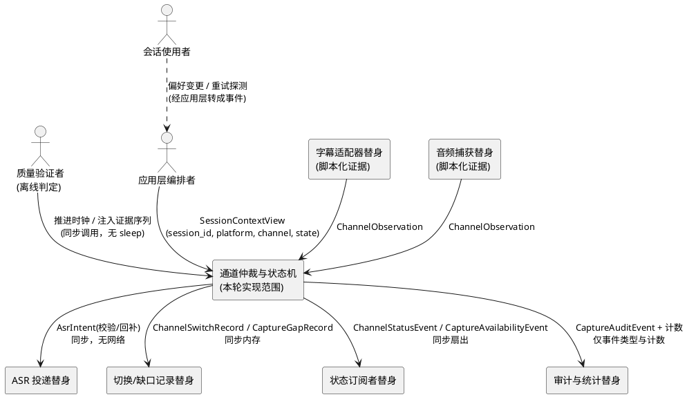
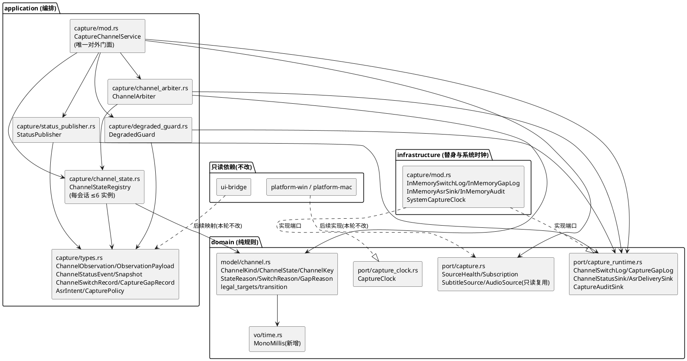
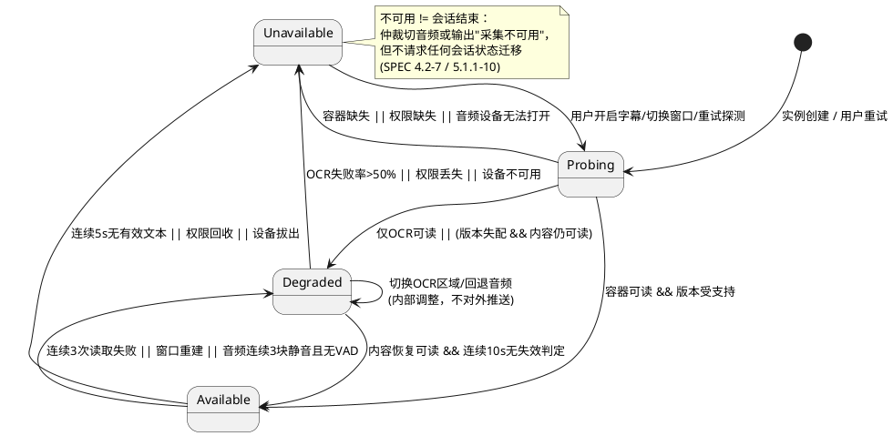
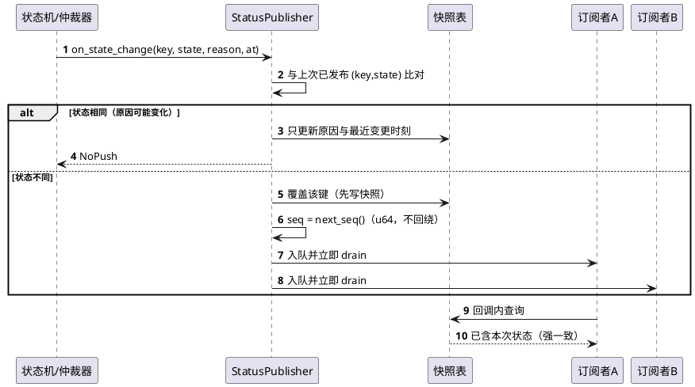
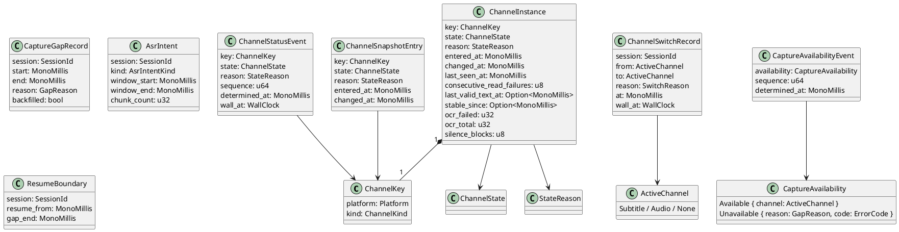

# 一、需求与存量功能关系分析

> **追溯与边界说明**
> 1. 本文是 `.codeartsdoer/specs/capture_channel_state/spec.md`（下称 SPEC，条目号写作 `SPEC 5.2.1-3`）的增量实现方案，对应 `docs/sdd/tasks.md` 任务 **23.1 / 23.2 / 23.3 / 23.4**；权威架构基线为 `docs/sdd/design.md`（下称 DESIGN，条目号写作 `DESIGN 2.1.3(2)`）。
> 2. 本轮范围严格限定"可离线判定"的部分：状态机、仲裁与回退/切回、双通道失效保护、状态推送与快照。**不写** WASAPI/SCStream、UIA/AX/OCR、平台 Hook 与任何 UI 渲染。
> 3. 本文只给类型、trait 签名、迁移/决策表与判定规则，**不含实现代码**；不修改 `docs/sdd/*.md`、不修改既有源码签名、不新增第三方依赖。
> 4. 模板结构到 2.3；为承载 AC 映射、文件清单与风险登记，第二章在 2.3 之后续写 2.4~2.8，不新增一级章节。

## 1.1 需求功能与存量功能对比

判定依据：**100%**＝接口与语义完全吻合、可直接复用；**75%**＝能力存在但需薄适配或只能复用其模式；**50%**＝仅部分字段/形态可复用；**25%**＝仅命名或分层位置可参考。

### 1.1.1 已实现功能

| 需求功能 | 存量功能 | 代码位置 | 匹配度 |
|---|---|---|---|
| 三平台标识（SPEC 5.8.1-1） | `Platform` 三值 + `Platform::ALL` + `display_name` | `crates/domain/src/model/enums.rs:162-180` | 100% |
| 四种通道偏好（SPEC 5.8.1-5、5.2.1-2） | `ChannelPreference`（SubtitleFirst/AudioFirst/SubtitleOnly/AudioOnly，`Default = SubtitleFirst`） | `crates/domain/src/model/enums.rs:152-160` | 100% |
| 基础设施健康证据上报（SPEC 4.5-1） | `SourceHealth::{Ready, Degraded(String), Unavailable(String)}` | `crates/domain/src/port/capture.rs:12-18` | 75%（缺"探测中"，且原因是自由文本） |
| 字幕/音频上游契约（SPEC 1.4-1/2） | `SubtitleSource`、`AudioSource`（probe/health/open/next_chunk） | `crates/domain/src/port/capture.rs:85-129` | 75%（只消费其结论，不依赖实现） |
| 订阅释放语义（SPEC 4.5-3） | `Subscription`（`Arc<AtomicBool>` + `wrap`，release 后静默） | `crates/domain/src/port/capture.rs:44-77` | 75%（`wrap` 只接受 `SubtitleEvent`，无法承载状态事件） |
| 会话绑定平台与偏好（SPEC 6.1-5） | `PlatformBinding{platform, version, preference, subtitle_enabled}`、`Session.channel` | `crates/domain/src/model/session.rs:8-29` | 100%（只读） |
| 会话状态只读守卫（SPEC 4.2-7、5.1.1-10） | `SessionState::allows_capture`、`Session::is_eligible_for_capture` | `crates/domain/src/model/enums.rs:26-29`、`model/session.rs:113-115` | 100%（只读，不发起迁移） |
| 墙钟与音频时间轴值对象（SPEC 6.2-5、6.1-6） | `WallClock`（Unix 毫秒）、`AudioClock`（毫秒、`saturating_sub`） | `crates/domain/src/vo/time.rs:6-64` | 75%（`WallClock::now()` 读系统时间，不可注入） |
| 置信度 `[0,1]`（SPEC 5.2.1-4） | `Confidence`（拒绝 NaN/Inf/越界） | `crates/domain/src/vo/confidence.rs:16-38` | 100% |
| 会话/片段/要点标识（SPEC 6.2-2） | `SessionId`、`UtteranceRef`、`InsightRef` | `crates/domain/src/vo/ids.rs:79-83` | 100% |
| "采集不可用"复用既有错误码（SPEC 1.4-9、K8） | `CopilotError::AudioCaptureFailed` → `ErrorCode::AudioCaptureFailed`（`E-AUDIO-002`） | `crates/domain/src/error.rs:113-114`、`error.rs:41-55` | 100% |
| 只追加审计（SPEC 4.3-7） | `AuditChain`（哈希链、锚点、篡改定位） | `crates/infrastructure/src/audit/mod.rs:37-129` | 75%（`AuditAction` 十值无通道语义） |
| 分位时延统计（SPEC 4.4-1、AC-24） | `MetricsStore::percentile` | `crates/infrastructure/src/metrics/mod.rs:57-102` | 75%（`Metric` 固定 10 项，不可扩） |
| 日志字段白名单（SPEC 4.4-2、AC-30） | `ALLOWED_FIELDS`（12 项）、`FORBIDDEN_FIELDS`（6 项）、`validate_field` | `crates/infrastructure/src/telemetry/mod.rs:4-38` | 100%（只读校验） |
| 会话仓储只读能力（SPEC 1.4-8） | `SessionRepository::get` | `crates/domain/src/port/repository.rs:10-19` | 100%（不扩签名，K7） |
| 分层依赖门禁（SPEC 1.4-10） | `check-layering.sh` 禁止 domain/application 依赖平台与网络实现 | `scripts/check-layering.sh:14-26` | 100% |
| 非法迁移拒绝的既有先例 | `Session::transition`（表驱动 + `Err`）、`RetentionError`（独立错误类型） | `crates/domain/src/model/session.rs:78-111`、`session.rs:48-50` | 75%（模式复用，规则不复用） |

### 1.1.2 需要扩展的功能

| 需求功能 | 存量功能 | 差异说明 | 扩展方向 |
|---|---|---|---|
| 每平台×每通道实例推进（23.1、AC-01） | 无（`SourceHealth` 是瞬时证据，不是状态） | **输入差异**：无平台×通道维度；**逻辑差异**：无迁移表与非法迁移判定；**边界差异**：无"探测中" | 迁移表下沉 `domain/src/model/channel.rs`；实例管理器落 `application/src/capture/channel_state.rs`（沿用 SPEC 9.1 裁决，不动任务路径） |
| 健康证据映射（AC-09） | `SourceHealth` 三变体 | **输入差异**：`Degraded/Unavailable` 携带自由文本 `String`，不能直接当原因码；**逻辑差异**：健康证据不得产生"探测中" | 只新增只读映射函数（`SourceHealth` → 迁移候选 + 原因码必须由证据显式携带）；**不修改**枚举变体与语义 |
| 状态订阅与取消（23.4、AC-29） | `Subscription` 的 release 语义 | **输入差异**：`wrap` 签名绑定 `SubtitleEvent`；**逻辑差异**：状态事件是另一类型；**边界差异**：既有泛型约束与既有测试不得改（SPEC 4.5-3） | 新增 `StatusSubscription`（同 `AtomicBool` 语义），与既有 `Subscription` 并存、互不调用 |
| 阈值计时 5s/10s（AC-12、AC-14） | `WallClock`、`AudioClock` | **输入差异**：两者都不可"注入推进"；`WallClock::now()` 直接读系统时间；**逻辑差异**：阈值禁用墙钟（SPEC 4.2-6）；**边界差异**：`AudioClock` 语义是音频时间轴，复用会混淆 | 新增 `CaptureClock` 端口 + 新增 `MonoMillis` 值对象（追加到 `vo/time.rs`，不改既有类型） |
| 通道切换/缺口落记录（AC-15、AC-21） | `SessionRepository` | **输入差异**：无切换记录/缺口记录载体；**逻辑差异**：记录追加语义不可变；**边界差异**：禁止改仓储签名（SPEC 4.5-4、K7） | 新增独立端口（追加 + 按会话列出），不改四个仓储 |
| 回退/抑制/拒绝/丢弃统计（SPEC 4.4-1） | `MetricsStore` + `Metric::ALL`（10 项断言） | **输入差异**：10 项无"回退次数/抑制次数/跨平台拒绝/未归属丢弃"；**逻辑差异**：扩 `Metric` 会破坏既有断言（AC-34）；**边界差异**：只允许按平台维度统计 | 新增 `CaptureStats`（内存计数，整数）与 `CaptureAuditSink` 端口；只以只读投影把"按平台失效率"计入既有 `Metric::SubtitleFailureRateByPlatform`，`Metric::ALL` 不变 |
| 通道状态展示 DTO（SPEC 5.8.1-4） | `ChannelStatusDto{name,state,detail}` | **输入差异**：无原因码、无单调/墙钟时刻、无序号；**逻辑差异**：`detail` 为自由文本；**边界差异**：本轮不做 UI | 本轮**只读引用**、不修改 `ui-bridge`；设计给出后续映射建议（2.2.1 表末行），实现属表现层任务 |
| 审计通道语义（AC-31/32） | `AuditAction` 十值 | **输入差异**：无"跨平台输入拒绝/未归属丢弃"动作；**逻辑差异**：新增变体会改变既有枚举值域与序列化契约 | 新增 `CaptureAuditSink`（事件类型 + 计数，不含载荷），`AuditAction` 一字不改 |

### 1.1.3 需要新增的功能或接口

#### A. 领域层（纯规则，无 IO，可穷举）

1. **通道种类 `ChannelKind`**：封闭两值（`PlatformSubtitle` / `SystemAudio`）；输入会话绑定平台；输出键维度之一；核心逻辑为取值封闭、禁止扩展；依赖 `Platform`。
2. **通道状态 `ChannelState`**：封闭四值（`Probing` / `Available` / `Degraded` / `Unavailable`），提供 `ALL: [Self; 4]`、`is_usable()`（可用或降级）、`participates_in_arbitration()`（探测中按不可用参与）。
3. **通道键 `ChannelKey`**：`{platform, kind}`，实现 `Ord + Hash`；快照、去重、序号、实例注册的唯一维度。
4. **原因码**：三个独立封闭枚举——`StateReason`（15 值，对应 SPEC 6.1-4）、`SwitchReason`（9 值，对应 SPEC 6.2-3）、`GapReason`（2 值）。**不合并为一个大枚举**，避免"状态值承担成因"（SPEC R3）。
5. **迁移判定**：`legal_targets(from) -> &'static [ChannelState]` + `transition(from, next) -> TransitionOutcome`；`TransitionOutcome::{Migrated{from,to}, NoOp, Rejected{from,to}}`；同状态为 `NoOp`（`Degraded → Degraded` 例外：返回 `InternalAdjustment`）。
6. **状态机错误 `ChannelStateError`**：仅承载"键冲突/重复实例/时钟回退/跨平台输入"等逻辑错误，独立 `thiserror` 类型，**不进入 `ErrorCode`**（参考 `RetentionError` 先例）。
7. **单调时刻 `MonoMillis`**：`u64` 毫秒，提供 `saturating_sub`、`checked_add`、`to_wall(WallClock)`；阈值判定只允许用它。

#### B. 应用层（编排，依赖端口）

8. **证据 DTO `ChannelObservation`**：`session: Option<SessionId>`、`platform`、`kind`、`at: MonoMillis`、`payload: ObservationPayload`（封闭枚举，含探测结论、有效文本、无效文本、读取失败、窗口重建、OCR 统计、静音块、设备事件、权限事件、用户重试、OCR 区域变更）。
9. **实例注册表 `ChannelStateRegistry`**：按 `ChannelKey` 持有实例（每会话最多 6 个）；重复注册沿用既有实例并计数。
10. **仲裁器 `ChannelArbiter`**：偏好 × 字幕可用性 × 音频可用性 → `ActiveChannel{subtitle|audio|none}` + 原因；计时、抖动抑制、切回校验。
11. **失效保护 `DegradedGuard`**：汇总 `CaptureAvailability`、缺口区间开启/关闭/合并、恢复边界 `ResumeBoundary`。
12. **推送器 `StatusPublisher`**：去重、序号、快照、订阅扇出、时延打点。
13. **阈值配置 `CapturePolicy`**：5s/10s/3 块/3 次/50%/60s/3 次/120s/1000ms/400ms/8000ms/10s 校验预算等，全部可注入、可下调。

#### C. 端口（domain 定义，application/infrastructure 实现或替身）

14. **`CaptureClock`**：`mono_now() -> Result<MonoMillis, ClockError>`、`wall_now() -> Result<WallClock, ClockError>`。
15. **`ChannelSwitchLog`**：`append(&ChannelSwitchRecord) -> Result<(), CopilotError>`、`list(&SessionId) -> Result<Vec<ChannelSwitchRecord>, CopilotError>`。
16. **`CaptureGapLog`**：`upsert(&CaptureGapRecord)`（合并语义）、`list(&SessionId)`。
17. **`ChannelStatusSink`**：`publish(&ChannelStatusEvent)` / `publish_availability(&CaptureAvailabilityEvent)` / `subscribe(Box<dyn Fn(&ChannelStatusEvent)>) -> StatusSubscription` / `snapshot()`。
18. **`AsrDeliverySink`**：`deliver(&AsrIntent) -> Result<(), CopilotError>`、`counts() -> AsrIntentCounts`。
19. **`CaptureAuditSink`**：`record(&CaptureAuditEvent)`、`counts() -> CaptureAuditCounts`。

> 端口纪律：每端口只承载单一能力（SPEC R8）；`ChannelStatusSink` 内部三个方法共享"同一有序流"这一单一职责，不承担记录落库。

#### D. 替身与测试支撑（本轮唯一"证据来源"）

20. **手动时钟 `ManualClock`**：测试专用，`advance_by(ms)` 可推进；**禁止**读墙钟、禁止 sleep。
21. **脚本化证据源**：按 `(at, payload)` 序列注入，不依赖线程与真实设备。
22. **仓储替身**：`SessionRepository` / `InsightRepository` 的计数替身（统计 `transition`、`delete_irrecoverable`、`save` 调用次数为 0）。
23. **订阅者替身**：记录 `(序号, 状态, 原因)` 与回调时刻；可配置"慢订阅者"与"抛错订阅者"。
24. **网络探针**：`NetworkProbe{connections: AtomicUsize}`，AC-33 断言为 0（与依赖闭包静态检查互补）。

## 1.2 存量功能详细分析

### 1.2.1 `SourceHealth` 的接口契约与约束

- **形态**：`Ready` / `Degraded(String)` / `Unavailable(String)`；三个变体都参与 `PartialEq`，可直接比较。
- **业务规则**：它表达"当前健康与否"，**不表达**"从未探测过"；因此 `Probing` 不能由它推出（SPEC 5.1.1-15、AC-09）。
- **扩展点**：无钩子；只能新增外部映射函数。
- **约束**：`String` 是自由文本，**禁止**把它转成原因码或写入日志（含平台私有信息风险）；原因码必须由 `ObservationPayload` 显式携带。
- **复用方式**：仅作为"迁移候选"的一个输入源，且只在实例已离开 `Probing` 之后使用。

### 1.2.2 `Subscription` 的接口契约与约束

- **契约**：`release()` 置位后 `wrap` 闭包静默；`is_active()` 可查询；`Arc<AtomicBool>` 保证跨线程可见。
- **约束**：`wrap` 的泛型被固定为 `Fn(SubtitleEvent)`；**不得**为复用而改动其签名或既有测试（SPEC 4.5-3）。
- **结论**：状态订阅另立 `StatusSubscription`，语义一比一（release 后 0 回调），实现上不复用 `wrap`，避免把状态事件塞进字幕回调。

### 1.2.3 时钟的接口契约与约束

- `WallClock`：Unix 毫秒，`now()` 读 `SystemTime`；`elapsed_since` 反向返回 `None`。**不可注入**，且系统时间跳变会破坏 5s/10s 判定（SPEC 4.2-6）。
- `AudioClock`：毫秒包装，语义是"音频时间轴"，用于片段对齐（DESIGN 2.5.5-1）；与通道阈值语义不同。
- **结论**：新增 `MonoMillis` 与 `CaptureClock`；`WallClock` 只用于记录展示与审计（K10 默认口径），任何阈值比较不得调用 `WallClock`。

### 1.2.4 审计、度量与日志白名单

- `AuditChain::append` 的 `summary` 参与哈希规范化（`canonical`），**因此不得写入任何载荷**；本轮只允许写"事件类型 + 计数 + 平台/通道/原因码"。
- `Metric::ALL` 固定 10 项且既有断言 `all_ten_metrics_present`；扩枚举会使 265 基线失败（AC-34）。因此通道计数走独立 `CaptureStats`（非 `Metric`）。
- `ALLOWED_FIELDS` 12 项中已含 `platform`、`channel`、`session_state`、`error_code`、`latency_ms`；本轮日志/诊断字段必须落入该白名单，**新增字段名一律不写日志**，只进结构化 DTO。

### 1.2.5 会话与偏好的既有形态

- `Session.binding.preference` 与 `Session.channel` 都承载通道偏好，存在**双字段**风险。
- **裁决**：仲裁唯一输入取 `Session.channel`（SPEC 6.1 的通道偏好字段）；`binding.preference` 仅在会话创建时作为初值，二者不一致时记一条 `PreferenceDivergence` 诊断计数，**不报错、不自动改写**（改写属 B2.26 唯一写入点）。

### 1.2.6 存量约束清单（硬约束，设计不得触碰）

1. 不修改 `SourceHealth`、`Platform`、`ChannelPreference`、`Subscription` 的定义与语义。
2. 不修改 `SessionRepository`、`UtteranceRepository`、`InsightRepository`、`CardRepository` 的方法签名。
3. 不修改 `ErrorCode`（12 变体）与 `Metric::ALL`（10 项）。
4. 不修改 `docs/sdd/*.md`、不修改 `.codeartsdoer/specs/capture_channel_state/spec.md`。
5. 不新增第三方依赖（仅 `std` + 既有 `serde`/`thiserror`）；不访问网络、不打开设备、不读凭据。
6. 既有 265 个测试必须全部通过且数量不减少。
# 二、增量设计方案

## 2.1 实现模型

### 2.1.1 上下文视图



| 交互方向 | 协议/形态 | 频率 | 是否引入 IO |
|---|---|---|---|
| 证据注入 | 同步方法调用（`observe`） | 字幕 ≤2 次/秒、音频 ≤5 次/秒（200ms 块） | 无 |
| 时间推进 | 同步方法调用（`advance_to`） | ≤4 次/秒（250ms 周期，满足 SPEC 4.1-2 的 500ms 上限） | 无 |
| 状态推送 | 同步扇出（同调用栈） | 每次真实状态变更 ≤1 次 | 无 |
| 记录追加 | 同步内存写入 | 每次切换/缺口 ≤1 次 | 无 |
| ASR 意图 | 同步内存投递 | 字幕生效期 ≤每 10 秒 1 次 | 无 |

### 2.1.2 服务/组件总体架构



| 组件 | 单一职责 | 依赖方向 | 调用频率 |
|---|---|---|---|
| `domain/model/channel.rs` | 四状态、9 条迁移边、原因码、非法迁移判定 | 仅依赖 `Platform` | 每次证据 1 次 |
| `application/capture/channel_state.rs` | 实例注册、证据 → 迁移候选、计时状态（连续失败/静默/OCR 窗口/最后有效文本） | 依赖 domain 规则与 `CaptureClock` | 每次证据 1 次 |
| `application/capture/channel_arbiter.rs` | 决策表、回退/切回、抖动抑制、ASR 投递预算 | 依赖实例快照与 `AsrDeliverySink` | 每次状态变化 + 每次推进 |
| `application/capture/degraded_guard.rs` | 汇总可用性、缺口区间、恢复边界、会话零迁移约束 | 依赖 `CaptureGapLog` 与时序 | 每次汇总变化 |
| `application/capture/status_publisher.rs` | 去重、序号、快照、订阅扇出、时延打点 | 依赖 `ChannelStatusSink` | 每次真实状态变化 |
| `infrastructure/capture/mod.rs` | 内存替身与系统时钟；**不含真实平台代码** | 实现 domain 端口 | 仅在装配与测试中使用 |

**依赖方向约束**：`application` 不依赖 `infrastructure` 与 `platform-*`（`scripts/check-layering.sh:22-26` 已断言）；本轮所有证据由测试替身或 `infrastructure/capture` 注入，**不新增 platform 代码路径**。

### 2.1.3 实现设计文档

#### （1）通道状态机：四状态与 9 条迁移边



**9 条合法迁移边（与 DESIGN 2.1.3(2) 逐条对应）**

| # | 边 | 触发证据（`ObservationPayload`） | 附加条件 | 原因码 |
|---|---|---|---|---|
| 1 | Probing → Available | `Probe{readable=true, version_supported=true}` | 无 | 探测完成 |
| 2 | Probing → Degraded | `Probe{ocr_only=true}` 或 `Probe{readable=true, version_supported=false}` | 内容仍可读 | 仅 OCR 可读 / 版本失配 |
| 3 | Probing → Unavailable | `Probe{readable=false}` / `Permission{Revoked}` / `AudioDevice{OpenFailed}` | — | 容器缺失 / 权限缺失 |
| 4 | Available → Degraded | `ReadFailure` 第 3 次连续 / `WindowRebuilt` / `Silence{blocks=3, vad=false}` | 计数以"连续"为准 | 连续读取失败 / 窗口重建 / 疑似无声 |
| 5 | Available → Unavailable | 5s 无有效文本（由 `advance_to` 判定）/ `Permission{Revoked}` / `AudioDevice{Unplugged}` | 有效文本阈值 0.5 | 无有效文本 / 权限回收 / 设备拔出 |
| 6 | Degraded → Available | 恢复可读 + `advance_to` 判定满 10s 无失效 | 期间无任何失效判定 | 探测完成（恢复） |
| 7 | Degraded → Unavailable | `OcrStats{failed>total/2}` / `Permission{Revoked}` / `AudioDevice{Lost}` | **严格**大于 50% | OCR 失败率超阈 |
| 8 | Unavailable → Probing | `UserRetry`（开启字幕 / 切换窗口 / 重试探测） | 仅显式操作 | 用户重试 |
| 9 | Degraded → Degraded | `OcrRoiChanged` / `AudioFallback` | 内部调整 | 仅 OCR 可读 / 设备回退 |

**16 组合穷举（AC-03 的判定基准）**

| 前态＼后态 | Probing | Available | Degraded | Unavailable |
|---|---|---|---|---|
| Probing | 同状态→`NoOp` | 合法（#1） | 合法（#2） | 合法（#3） |
| Available | 非法→`Rejected` | 同状态→`NoOp` | 合法（#4） | 合法（#5） |
| Degraded | 非法→`Rejected` | 合法（#6） | 合法（#9，`InternalAdjustment`） | 合法（#7） |
| Unavailable | 合法（#8） | 非法→`Rejected` | 非法→`Rejected` | 同状态→`NoOp` |

- 合法边 9 条（8 条状态变更 + 1 条自环）；同状态无操作 3 条（Probing/Available/Unavailable）；非法 4 条（`Available→Probing`、`Degraded→Probing`、`Unavailable→Available`、`Unavailable→Degraded`）。
- **不可同时部分迁移**：实现顺序固定为"校验合法性 → 更新实例字段 → 生成事件 → 交由仲裁/推送"；校验失败即返回，实例字段零写入（SPEC 4.2-2）。

**阈值计时的三个计数器（每实例独立）**

| 计数器 | 触发重置 | 阈值 | 用途 |
|---|---|---|---|
| `consecutive_read_failures` | 任一有效文本 / 探测成功 | ≥3 | Available→Degraded |
| `last_valid_text_at` | 有效文本（字符数>0 且 `Confidence ≥ 0.5`） | 5000ms | Available→Unavailable |
| `stable_since` | 任何失效判定（读失败/无文本/OCR 超阈/权限/设备） | 10000ms | Degraded→Available 与切回前置 |
| `ocr_window{failed,total}` | 每次 `OcrStats` 覆盖窗口 | `failed * 2 > total`（严格过半） | Degraded→Unavailable |

#### （2）字幕优先、回退与切回的仲裁流程

```plantuml
@startuml
autonumber
start
:取偏好(会话 channel) + 两通道状态;
:可用性 = 状态 ∈ {Available, Degraded};
if (偏好 == SubtitleOnly) then (是)
  :只允许字幕;
elseif (偏好 == AudioOnly) then (是)
  :只允许音频;
else
  :允许双通道;
endif
if (允许集合内存在可用通道) then (否)
  :active = None;
  :汇总 = 采集不可用(偏好限制/双通道不可用);
  :DegradedGuard 开缺口;
  stop
endif
if (偏好 ∈ {SubtitleFirst, SubtitleOnly} && 字幕可用) then (是)
  :active = Subtitle;
elseif (偏好 == AudioFirst && 音频可用) then (是)
  :active = Audio;
elseif (音频可用) then (是)
  :active = Audio;
else
  :active = Subtitle;
endif
:若 active 与上次不同 → 追加切换记录(≤1000ms);
if (active == Subtitle) then (是)
  :ASR 模式 = 仅校验与回补(预算每10s≤1次);
else
  :ASR 模式 = 主路径(逐块投递);
endif
:更新快照 → 分配序号 → 同步扇出;
stop
@enduml
```

**仲裁决策表（16 行，等价覆盖 64 组合）**

| 会话偏好 | 字幕可用 | 音频可用 | 生效通道 | 汇总/原因 |
|---|---|---|---|---|
| SubtitleFirst | 是 | 是 | 字幕 | 采集可用（字幕） |
| SubtitleFirst | 是 | 否 | 字幕 | 采集可用（字幕） |
| SubtitleFirst | 否 | 是 | 音频 | 采集可用（音频） |
| SubtitleFirst | 否 | 否 | 无 | 采集不可用／双通道不可用 |
| AudioFirst | 是 | 是 | 音频 | 采集可用（音频） |
| AudioFirst | 是 | 否 | 字幕 | 采集可用（字幕） |
| AudioFirst | 否 | 是 | 音频 | 采集可用（音频） |
| AudioFirst | 否 | 否 | 无 | 采集不可用／双通道不可用 |
| SubtitleOnly | 是 | 是 | 字幕 | 采集可用（字幕） |
| SubtitleOnly | 是 | 否 | 字幕 | 采集可用（字幕） |
| SubtitleOnly | 否 | 是 | 无 | 采集不可用／偏好限制 |
| SubtitleOnly | 否 | 否 | 无 | 采集不可用／偏好限制 |
| AudioOnly | 是 | 是 | 音频 | 采集可用（音频） |
| AudioOnly | 是 | 否 | 无 | 采集不可用／偏好限制 |
| AudioOnly | 否 | 是 | 音频 | 采集可用（音频） |
| AudioOnly | 否 | 否 | 无 | 采集不可用／偏好限制 |

- **"可用"口径**：`Available` 或 `Degraded`；`Probing` 与 `Unavailable` 一律按"不可用"参与（SPEC 第 2 章术语与 5.2.1-2）。
- **禁止跨偏好回退**：`SubtitleOnly` 不足时绝不落到音频，`AudioOnly` 不足时绝不落到字幕（SPEC 5.2.1-11）。
- **偏好变更**：`set_preference` 后**立即**用当前通道快照重算一次（不等新证据），变化则记录原因 `偏好变更`（SPEC 5.2.1-12）。

**回退/切回的四条时序规则**

| 规则 | 触发 | 动作 | 边界 |
|---|---|---|---|
| 回退 | `Available` 且 `now - last_valid_text_at ≥ 5000` | 字幕 `Available → Unavailable`（原因"无有效文本"）→ 重算 → `active = Audio` → 记录"字幕无有效文本" | 4999ms 保持可用（AC-12） |
| 有效文本重置 | 字符数>0 且置信度 ≥0.5 | `last_valid_text_at = at`，`consecutive_read_failures = 0` | 低置信/空文本/噪声行**不重置**（AC-13） |
| 切回前置 | 字幕 `Available` 且 `now - stable_since ≥ 10000` 且偏好允许字幕 且不在暂缓 | `active = Subtitle` → 记录"字幕恢复稳定" | 9999ms 不切回（AC-14）；`Degraded` 不得直接切回（SPEC 5.2.1-6） |
| 抖动抑制 | 60s 滑动窗口内第 3 次"字幕→音频" | 置 `cooldown_until = now + 120000`；暂缓期内禁止切回 | 到期后按切回前置重评；用户显式改偏好可立即解除并记录"用户指定"（AC-17） |

**切换记录必写语义（AC-15）**

- 追加点：`ChannelArbiter` 在**同一次仲裁调用内**把记录交给 `ChannelSwitchLog`，因此"1 秒内"由同步调用天然满足；写失败只累加 `record_missing` 计数，**不冻结**仲裁结果（SPEC 5.2.3-3）。
- 同一毫秒同一会话最多 1 条：若同一毫秒内发生两次变化，合并为一条（前值→最终后值，原因取首次）。
- **初选记录口径**：实例创建时两通道均为 `Probing`，决策结果为"无"，**不写记录**；首次由"无"变为字幕/音频时追加一条原因 `会话启动初选`（前值=无）。见 R12。

**字幕生效时的 ASR 投递预算（AC-16、K9）**

| 用途 | 触发 | 预算 | 载荷 |
|---|---|---|---|
| `Validation`（双通道校验） | 字幕生效期间每 10s 至多 1 次 | 与回补**共用**同一 10s 窗口预算 | 窗口起止单调时刻 + 分块数；**不含样本** |
| `GapBackfill`（字幕缺口回补） | 字幕短暂无有效文本但尚未回退，且环形缓冲可用 | 同上（共用预算） | 窗口 ≤8000ms；**不含样本** |
| `Primary`（主路径） | `active == Audio` | 不受预算限制，逐块投递 | 分块序号 + 时刻 |

- 60s 内最多 6 条意图（AC-16 的 ≤6），用途封闭为三值，**字幕生效期只可能出现前两值**。
- 共用预算的理由：若校验与回补各自"每 10s 1 次"，60s 最坏 12 条，直接违反 AC-16；共用后上界为 6（R10）。

#### （3）双通道失效保护与缺口

```plantuml
@startuml
autonumber
start
:仲裁得到 active = None;
:汇总由"可用"变为"采集不可用";
if (本缺口首次进入?) then (是)
  :推送 1 条 AvailabilityEvent(序号递增);
endif
:gap_open_at = now; (仅在首次)
:只读会话状态; 记录 session_state 快照;
:禁止任何 transition/delete 调用;
:不发出任何要点删除/清空/覆盖指令;
note right
  失效期间要点集合只读校验；
  零迁移请求由计数替身断言
end note
:任一允许通道恢复可用/降级;
:汇总 -> 采集可用(通道=X);
:close = now; 若 close-open >= 1000ms 则落缺口;
:与已有缺口重叠或间隔<1000ms 则合并;
:计算 ResumeBoundary = close - min(8000, 缺口时长);
:推送 1 条 AvailabilityEvent(仅首次退出);
stop
@enduml
```

| 规则 | 判定 | 数据落点 |
|---|---|---|
| 会话保留 | `SessionRepository::transition` 调用次数必须为 0 | 仓储替身计数（AC-18） |
| 要点不丢 | 失效前后 `InsightRepository::list` 的 ID 集合与数量一致 | 要点仓储替身（AC-19） |
| 汇总可见 | 汇总变化 → 独立事件入同一有序流，5000ms 内扇出 | `StatusPublisher` 快照（AC-20） |
| 缺口落盘 | 半开区间 `[open, close)`，时长 ≥1000ms 才落；容差 ±400ms | `CaptureGapLog`（AC-21） |
| 合并 | 相邻（间隔 <1000ms）或重叠 → 并集，保留最早开始与最晚结束 | `CaptureGapLog::upsert`（SPEC 5.3.1-5） |
| 恢复边界 | `resume_from = close - min(8000, duration)`；缺口更早部分**不补录** | `ResumeBoundary`（AC-22） |
| 重复失效 | 同一缺口内汇总只推首次进入与首次退出各 1 次 | 汇总状态机（SPEC 5.3.1-9） |

- **不重不漏的职责边界**：本组件只输出 `ResumeBoundary` 与缺口区间；片段区间由下游（B2.24/25）生成。AC-22 以合成片段验证"两两不交、与缺口不交、计数下限"，属**区间代数**判定，不是采集实现（R16）。

#### （4）状态推送与快照



| 机制 | 设计 | 依据 |
|---|---|---|
| 去重键 | `(ChannelKey, ChannelState)`；原因不参与去重 | AC-25、AC-26 |
| 序号作用域 | **每会话一条流**，通道事件与汇总事件共享递增序号 | AC-20（汇总序号大于此前通道事件）、AC-28 |
| 序号上限 | `u64` 递增，接近 `u64::MAX` 时拒绝发布并计数；**不回绕** | SPEC 5.4.3-4 |
| 快照结构 | `BTreeMap<ChannelKey, SnapshotEntry>`，每键 1 条，最多 6 条；查询 O(6) | AC-27、SPEC 4.1-4 |
| 强一致 | 先写快照 → 再分配序号 → 再扇出 | AC-27 |
| 订阅取消 | `StatusSubscription::release()` 后回调 0 次 | AC-29 |
| 扇出模型 | 每订阅者一个有界队列（容量 64）；`publish` 后立即 `drain`；单订阅者超预算（50ms）则留队返回，不阻塞其它订阅者 | SPEC 5.4.3-1 |
| 载荷白名单 | 事件 7 字段；快照 6 字段；**无文本/样本/姓名** | AC-30、SPEC 4.3-1 |
| 时延打点 | 事件携带 `determined_at`；回调返回后由测试读 `MonoMillis` 记样本，`StatusPublisher` 另存最多 256 个样本供 p99 | AC-24 |

- **p99 的离线含义**：同步扇出使逻辑时延≈0；该指标只证明"逻辑上限成立"，**不证明**真实 UI 线程 5s（R2/R11，AC-35 禁止据此宣称）。

#### （5）时间推进模型（回退能"无事件触发"的关键取舍）

- **问题**：5s 无有效文本、10s 稳定、120s 暂缓、缺口时长，都需要"没有新证据时也要推进"；纯事件驱动无法触发。
- **方案**：`CaptureChannelService::advance_to(now: MonoMillis)` 为唯一时间入口，语义是"把所有阈值判定推进到 now"，内部顺序固定：
  1. 字幕 5s 静默 → `Available → Unavailable`；
  2. 音频静默/恢复的 10s 判定；
  3. `Degraded → Available` 的 10s 稳定判定；
  4. 重算仲裁（含切回前置与暂缓到期）；
  5. 缺口关闭/合并（若汇总变化）；
  6. 推送 drain。
- **调用时机**：①每次 `observe` 处理后隐式调用一次（用证据时刻）；②外部调度 ≤250ms 调一次（SPEC 4.1-2 要求检测周期 ≤500ms）。
- **测试约束**：测试**只**调用 `advance_to`，不 sleep、不读墙钟；所有阈值断言以 `MonoMillis` 差值表达。

#### （6）拒绝与丢弃路径（AC-31、AC-32）

| 场景 | 判定顺序 | 结果 | 计数 |
|---|---|---|---|
| 缺少会话归属（`session: None`） | 最前置 | 丢弃，状态零变化，写 1 条审计（仅事件类型） | `unattributed_dropped` |
| 平台与会话绑定平台不一致 | 其后 | 拒绝，状态零变化，不产片段/不产切换记录 | `cross_platform_rejected` |
| 证据时刻 < 实例已见最大值 | 键级 | 拒绝，状态不变 | `clock_regression` |
| 未知证据类型 | 载荷解析期 | 忽略，状态不变 | `unrecognized_evidence` |
| 重复注册同一键 | 注册期 | 沿用既有实例，不新建 | `duplicate_instance` |
| 60s 内同实例非法迁移≥5 | 迁移期 | 保持状态 + 告警标志 `AdapterMismatch` | `illegal_transition` |

- 审计事件字段仅 `{event_kind, platform?, channel?, count}`；**禁止**携带证据载荷（SPEC 4.3-3/4）。

## 2.2 接口设计

### 2.2.1 总体设计

| 分类 | 接口 | 层 | 稳定性 | 变更策略 |
|---|---|---|---|---|
| 规则 | `ChannelState` / `ChannelKind` / `ChannelKey` | domain | 稳定 | 取值封闭；扩展需改 SPEC |
| 规则 | `StateReason` / `SwitchReason` / `GapReason` | domain | 稳定 | 封闭集合；新增需走版本变更 |
| 规则 | `transition` / `legal_targets` | domain | 稳定 | 纯函数；签名不变 |
| 时钟 | `CaptureClock` | domain | 稳定 | 测试与生产两种实现 |
| 端口 | `ChannelSwitchLog` / `CaptureGapLog` | domain | 稳定 | 只追加能力，不加万能方法 |
| 端口 | `ChannelStatusSink` | domain | 实验（本轮内存实现） | 后续替换为 UI 桥 |
| 端口 | `AsrDeliverySink` | domain | 实验 | 后续接 B2.24/25 |
| 端口 | `CaptureAuditSink` | domain | 稳定 | 只增事件类型 |
| DTO | `ChannelObservation` / `ChannelStatusEvent` / `ChannelSnapshot` | application | 稳定（进程内） | 字段只增；禁原文 |
| DTO | `ChannelSwitchRecord` / `CaptureGapRecord` / `AsrIntent` | application | 稳定 | 字段只增 |
| 门面 | `CaptureChannelService` | application | 稳定 | 方法只增 |
| 展示映射 | `ChannelStatusDto`（既有） | ui-bridge | **本轮不改** | 后续由表现层新增 `reasonCode/seq` 映射 |

**命名与类型纪律**

1. 所有时刻字段以 `_at: MonoMillis` 或 `_at: WallClock` 后缀区分，**禁止**混用。
2. 所有"原因"字段用封闭枚举，禁止 `String`（`SourceHealth` 的 `String` 只在入口处被丢弃）。
3. 所有计数用 `u64`/`u32`，禁止浮点；置信度用既有 `Confidence`。
4. 所有 DTO `#[serde(deny_unknown_fields)]`（进程内亦保持），防止未来 IPC 漂移。

### 2.2.2 接口清单

#### 2.2.2.1 领域类型（`crates/domain/src/model/channel.rs`）

```rust
pub enum ChannelKind { PlatformSubtitle, SystemAudio }

pub enum ChannelState { Probing, Available, Degraded, Unavailable }

impl ChannelState {
    pub const ALL: [Self; 4];
    pub const fn is_usable(self) -> bool;              // Available | Degraded
    pub const fn code(self) -> &'static str;           // 稳定字符串，用于 DTO
}

pub struct ChannelKey { pub platform: Platform, pub kind: ChannelKind }

pub enum StateReason { ProbeCompleted, ContainerMissing, PermissionMissing,
    VersionMismatch, OcrOnly, ConsecutiveReadFailures, WindowRebuilt,
    NoValidText, OcrFailureRateAboveThreshold, DeviceFallback, SuspectedSilence,
    DeviceUnplugged, PermissionRevoked, UserRetry }

pub enum SwitchReason { SessionInitial, SubtitleNoValidText, SubtitleReadFailure,
    SubtitleStableRecovered, AudioUnavailable, AudioRecovered, PreferenceChanged,
    UserSelected, CooldownExpired }

pub enum GapReason { BothChannelsUnavailable, PreferenceRestricted }

pub enum TransitionOutcome {
    Migrated { from: ChannelState, to: ChannelState, reason: StateReason },
    InternalAdjustment { state: ChannelState, reason: StateReason },
    NoOp,
    Rejected { from: ChannelState, to: ChannelState },
}

pub fn legal_targets(from: ChannelState) -> &'static [ChannelState];
pub fn transition(from: ChannelState, to: ChannelState, reason: StateReason)
    -> Result<TransitionOutcome, ChannelStateError>;

pub enum ChannelStateError { DuplicateInstance(ChannelKey),
    ClockRegression { seen_max: MonoMillis, at: MonoMillis },
    ForeignPlatform { bound: Platform, observed: Platform } }
```

- **前置条件**：`ChannelKey` 的 `platform` 必须来自会话绑定；`MonoMillis` 单调。
- **后置条件**：`Migrated` 时实例字段由调用方一次性写入；`Rejected` 时不返回值以外任何副作用。
- **异常映射**：`ChannelStateError` 属内部逻辑错误，**不映射** `ErrorCode`；对外"采集不可用"统一走 `CopilotError::AudioCaptureFailed`（K8）。
- **调用示例**（判定口径，不是实现）：

```rust
// 非法迁移：状态必须保持前态（AC-03）
let outcome = transition(ChannelState::Unavailable, ChannelState::Available, StateReason::ProbeCompleted)?;
assert!(matches!(outcome, TransitionOutcome::Rejected { .. }));
```

#### 2.2.2.2 时钟端口（`crates/domain/src/port/capture_clock.rs`）

```rust
pub trait CaptureClock: Send + Sync {
    fn mono_now(&self) -> Result<MonoMillis, ClockError>;
    fn wall_now(&self) -> Result<WallClock, ClockError>;
}
```

- **业务说明**：唯一可注入的单调/墙钟来源。
- **前置条件**：实现必须保证 `mono_now()` 在单进程内单调不减；失败返回 `ClockError`（复用 `vo/time.rs` 既有错误）。
- **后置条件**：调用不产生 IO 阻塞（生产实现只读 `Instant` 偏移）。
- **异常映射**：`ClockError` → 拒绝依赖阈值的证据并计数 `clock_unavailable`（SPEC 5.2.3-5），不 panic。
- **替身行为**：`ManualClock` 初始化为 0，`advance_by(ms)` 显式推进，`wall_now` 返回基准 + 偏移（仅记录用途）。

#### 2.2.2.3 记录端口（`crates/domain/src/port/capture_runtime.rs`）

```rust
pub trait ChannelSwitchLog: Send + Sync {
    fn append(&self, record: &ChannelSwitchRecord) -> Result<(), CopilotError>;
    fn list(&self, session: &SessionId) -> Result<Vec<ChannelSwitchRecord>, CopilotError>;
}

pub trait CaptureGapLog: Send + Sync {
    /// 打开、关闭与合并统一走 upsert：相邻/重叠区间必须并集。
    fn upsert(&self, record: &CaptureGapRecord) -> Result<(), CopilotError>;
    fn list(&self, session: &SessionId) -> Result<Vec<CaptureGapRecord>, CopilotError>;
}
```

- **前置条件**：`session` 必须指向未删除会话（由调用方保证；本端口不做二次查询，避免隐式 IO）。
- **后置条件**：`append` 成功后记录不可改（无 `update`/`delete` 方法）；`upsert` 后同一会话内无重叠区间。
- **异常映射**：写失败 → `CopilotError::StoreFailure`；仲裁**不因写失败回滚**，只计数。
- **调用示例**：

```rust
let log = InMemorySwitchLog::default();
log.append(&ChannelSwitchRecord { /* 前值/后值/原因/单调/墙钟 */ })?;
assert_eq!(log.list(&session)?.len(), 1);       // AC-15
```

#### 2.2.2.4 状态发布端口（`crates/domain/src/port/capture_runtime.rs`）

```rust
pub struct StatusSubscription { /* 与 Subscription 同语义的释放令牌 */ }
impl StatusSubscription {
    pub fn is_active(&self) -> bool;
    pub fn release(&self);
}

pub trait ChannelStatusSink: Send + Sync {
    fn publish_state(&self, event: &ChannelStatusEvent) -> Result<(), CopilotError>;
    fn publish_availability(&self, event: &CaptureAvailabilityEvent) -> Result<(), CopilotError>;
    fn subscribe(&self, sink: Box<dyn Fn(&ChannelStatusEvent) + Send + Sync>) -> StatusSubscription;
    fn snapshot(&self) -> ChannelSnapshot;
}
```

- **业务说明**：状态事件的唯一出口；快照唯一查询口。
- **前置条件**：`event.sequence` 必须由实现分配（调用方不提供）。
- **后置条件**：`publish_state` 返回时快照已含该状态；同状态返回 `Ok` 但不扇出。
- **异常映射**：扇出不返回错误（订阅者失败只计数）；快照只读不可失败；序号耗尽返回 `StoreFailure`。
- **调用示例**：

```rust
let snap = publisher.snapshot();
publisher.publish_state(&event)?;
assert_eq!(publisher.snapshot().entries.len(), 1);  // AC-27
```

#### 2.2.2.5 ASR 投递意图端口

```rust
pub enum AsrIntentKind { Validation, GapBackfill, Primary }

pub struct AsrIntent {
    pub session: SessionId,
    pub kind: AsrIntentKind,
    pub window_start: MonoMillis,
    pub window_end: MonoMillis,
    pub chunk_count: u32,
}

pub struct AsrIntentCounts { pub validation: u64, pub backfill: u64, pub primary: u64 }

pub trait AsrDeliverySink: Send + Sync {
    fn deliver(&self, intent: &AsrIntent) -> Result<(), CopilotError>;
    fn counts(&self) -> AsrIntentCounts;
}
```

- **前置条件**：`window_end > window_start`；`GapBackfill` 的窗口长度 ≤8000ms。
- **后置条件**：投递只记录意图与计数，**不传输样本**；失败计数但不影响仲裁。
- **调用示例**：

```rust
// 60s / 30 条字幕 / 300 块音频 → 意图 ≤6（AC-16）
assert!(asr.counts().validation + asr.counts().backfill <= 6);
```

#### 2.2.2.6 审计与统计端口

```rust
pub enum CaptureAuditEventKind { CrossPlatformRejected, UnattributedDropped,
    ClockRegression, IllegalTransition, DuplicateInstance, RecordMissing,
    SubscriberFailed, SnapshotStale }

pub struct CaptureAuditEvent { pub kind: CaptureAuditEventKind,
    pub platform: Option<Platform>, pub channel: Option<ChannelKind>, pub count: u64 }

pub struct CaptureStats { pub fallback_count: u64, pub switch_back_count: u64,
    pub cooldown_triggered: u64, pub cross_platform_rejected: u64,
    pub unattributed_dropped: u64, pub internal_adjustments: u64 }

pub trait CaptureAuditSink: Send + Sync {
    fn record(&self, event: &CaptureAuditEvent) -> Result<(), CopilotError>;
    fn counts(&self) -> CaptureStats;
}
```

- **前置条件**：事件必须来自封闭枚举；`platform/channel` 仅作维度。
- **后置条件**：无载荷、无原文；可被聚合为"按平台"维度（SPEC 4.4-1）。
- **异常映射**：审计失败不阻断采集（与 `AuditGuard` 的敏感操作不同），只计数 `record_missing`。

#### 2.2.2.7 应用层门面（`crates/application/src/capture/mod.rs`）

```rust
pub struct SessionContextView {
    pub session: SessionId,
    pub platform: Platform,
    pub channel_preference: ChannelPreference,
    pub session_state: SessionState,      // 只读
}

pub struct CaptureChannelService { /* clock, registry, arbiter, guard, publisher, sinks, policy */ }

impl CaptureChannelService {
    pub fn new(clock: Arc<dyn CaptureClock>, switch_log: Arc<dyn ChannelSwitchLog>,
        gap_log: Arc<dyn CaptureGapLog>, status: Arc<dyn ChannelStatusSink>,
        asr: Arc<dyn AsrDeliverySink>, audit: Arc<dyn CaptureAuditSink>,
        policy: CapturePolicy) -> Self;

    pub fn attach_session(&self, context: SessionContextView) -> Result<(), ChannelStateError>;
    pub fn detach_session(&self, session: &SessionId);

    pub fn observe(&self, observation: ChannelObservation) -> ObservationOutcome;
    pub fn advance_to(&self, now: MonoMillis) -> AdvanceOutcome;
    pub fn set_preference(&self, session: &SessionId, next: ChannelPreference) -> ObservationOutcome;
    pub fn retry_probe(&self, session: &SessionId, kind: ChannelKind) -> ObservationOutcome;

    pub fn active_channel(&self, session: &SessionId) -> ActiveChannel;
    pub fn availability(&self, session: &SessionId) -> CaptureAvailability;
    pub fn snapshot(&self) -> ChannelSnapshot;
    pub fn stats(&self) -> CaptureStats;
}

pub enum ObservationOutcome { Applied, NoOp, Rejected { reason: RejectReason }, Dropped { reason: DropReason } }
```

- **前置条件**：`attach_session` 前必须已从仓储读取会话；本服务**不**调用仓储读写（除 `snapshot` 外零 IO）。
- **后置条件**：`observe` 返回后，状态、快照、记录、意图均已一致（同步完成）；任何拒绝都不改变状态。
- **异常映射**：逻辑错误走 `ChannelStateError`/`RejectReason`；"采集不可用"输出 `CaptureAvailability::Unavailable{code: AudioCaptureFailed}`。
- **调用示例**：

```rust
service.attach_session(view)?;
let outcome = service.observe(ChannelObservation { /* Zoom, PlatformSubtitle, at=0, Probe{..} */ })?;
service.advance_to(MonoMillis::from(5_000));
assert_eq!(service.active_channel(&session), ActiveChannel::Audio);
```

#### 2.2.2.8 取消与重复调用语义

- `StatusSubscription::release()` 幂等；释放后订阅者**仍留在队列**但 drain 时丢弃并计数（保证 0 回调）。
- `detach_session` 后该会话的事件不再入队；已在队列中的事件允许被 drain（不丢最后一条）。
- `attach_session` 对同一会话重复调用：沿用注册表，不重建实例（`duplicate_instance` 计数 +1）。
## 2.3 数据模型

### 2.3.1 设计目标

1. **维度正确**：一切状态都以 `(session, platform, channel kind)` 为唯一定位；禁止"全局通道状态"。
2. **纯内存、无 IO**：本轮所有模型都是进程内值对象，唯一"持久化"是通过端口交给替身；不涉及表结构与索引。
3. **不可变记录**：切换记录与缺口记录一经产出即不可变；可变部分只存在于实例内部计数器。
4. **隐私安全**：模型中**不存在**文本、音频样本、说话人、参会人字段；证据载荷只保留数值与枚举。
5. **可穷举**：状态与原因均为封闭枚举，允许属性测试穷举全部组合。

### 2.3.2 模型实现



**对象关系与多重性**

| 关系 | 多重性 | 说明 |
|---|---|---|
| 会话 → 通道实例 | 1 : 0..6 | 每会话最多 3 平台 × 2 通道；本会话只绑定 1 平台，故实际 1 : 0..2 |
| 通道实例 → 当前原因 | 1 : 1 | 每次迁移必须带原因；原因变化可发生在状态不变时 |
| 状态事件 → 会话有序流 | n : 1 | 一条流共享序号；通道事件与汇总事件混排 |
| 切换记录 → 会话 | n : 1 | 只追加；同一毫秒最多 1 条 |
| 缺口记录 → 会话 | n : 1 | 合并后互不重叠 |
| ASR 意图 → 会话 | n : 1 | 只记窗口与分块数，不含样本 |

**生命周期**

| 对象 | 创建 | 变更 | 销毁 |
|---|---|---|---|
| `ChannelInstance` | `attach_session` 时为会话绑定平台创建 2 个（字幕/音频），初态 `Probing` | 仅由 `observe`/`advance_to` 通过迁移结果更新 | `detach_session` |
| `ActiveChannel` | 每次仲裁重算 | 变化时写切换记录并推事件 | 随会话 |
| `CaptureAvailability` | 每次仲裁重算 | 变化时推汇总事件；`Unavailable` 时开缺口 | 随会话 |
| `ChannelStatusEvent` | 真实状态变化时 | 不可变 | 随会话结束 |
| `CaptureGapRecord` | 汇总进入 `Unavailable` 且持续 ≥1000ms | 合并（并集） | 随会话 |
| `ResumeBoundary` | 缺口关闭时 | 不可变 | 恢复后消费一次 |
| `AsrIntent` | 预算窗口到期 / 回补 | 不可变 | 立即投递 |

**持久化策略（不含表结构）**

| 数据 | 本轮载体 | 后续归属 |
|---|---|---|
| 通道状态快照 | `ChannelStatusSink` 内存实现（`BTreeMap`） | 表现层状态卡（B2.28 及 UI 任务） |
| 切换记录 | `ChannelSwitchLog` 内存替身 | SPEC 6.1-7 会话记录（B2.26 落库） |
| 缺口记录 | `CaptureGapLog` 内存替身 | 会话通道记录（B2.25/26） |
| ASR 意图 | `AsrDeliverySink` 内存替身 | 转写链路（B2.24/25） |
| 统计与审计 | `CaptureAuditSink` 内存替身 | 度量库/审计链（后续任务） |

## 2.4 关键判定规则的形式化与边界口径

> 本节把 2.1.3 的叙述压成**测试可直接对照**的判定式；任何实现偏离本节即视为规格违规。

### 2.4.1 状态迁移判定

```text
transition(from, to, reason) =
  if from == to && to == Degraded && reason ∈ {OcrOnly, DeviceFallback} → InternalAdjustment
  else if from == to                                        → NoOp
  else if to ∈ legal_targets(from)                          → Migrated
  else                                                      → Rejected
```

- `legal_targets` 是**唯一**事实来源；`application` 不得另行硬编码目标状态集合。
- `InternalAdjustment` 的判定优先级高于 `NoOp`，因此 `Degraded → Degraded` 永不返回 `NoOp`（AC-05 的计数 +1 依赖此点）。

### 2.4.2 仲裁与回退的形式化

```text
usable(s)        = s ∈ {Available, Degraded}
allowed(pref)    = SubtitleOnly → {subtitle}
                   AudioOnly    → {audio}
                   _            → {subtitle, audio}
active(pref, s, a) =
  SubtitleFirst  → if usable(s) then Subtitle else if usable(a) then Audio else None
  AudioFirst     → if usable(a) then Audio    else if usable(s) then Subtitle else None
  SubtitleOnly   → if usable(s) then Subtitle else None
  AudioOnly      → if usable(a) then Audio    else None

gap_reason(pref, s, a) = if pref ∈ {SubtitleOnly, AudioOnly} then PreferenceRestricted
                         else BothChannelsUnavailable
```

- **64 组合的等价化简**：4 偏好 × 4 字幕态 × 4 音频态，因 `usable()` 只区分"是/否"，等价于 4 × 2 × 2 = 16 行；AC-11 仍按 64 行逐项驱动（每行映射到 16 行之一）。
- 回退只在 `active` 由 `Subtitle` 变 `Audio` 时成立；切回只在由 `Audio` 变 `Subtitle` 时成立；`None` 的出现不叫回退。

### 2.4.3 阈值边界总表（AC-06/07/12/14/17/21 的判定基准）

| 量 | 阈值 | 恰好边界 | 差 1 单位 | 依据 |
|---|---|---|---|---|
| 连续读取失败 | ≥3 | 第 3 次迁移 | 第 2 次不迁移 | SPEC 5.1.1-7 |
| 字幕无有效文本 | ≥5000ms | 5000ms 触发 | 4999ms 不触发 | SPEC 4.2-7 |
| 降级恢复稳定 | ≥10000ms | 10000ms 允许 | 9999ms 不允许 | SPEC 5.1.1-9 |
| OCR 失败率 | `failed*2 > total` | 51% 触发 | 50% 不触发 | SPEC 5.1.1-10 |
| 音频连续静音 | ≥3 块且无 VAD | 第 3 块降级 | 第 2 块不降级 | K3 默认口径 |
| 音频恢复 | 连续 10s 有活动 | 10000ms | 9999ms 不恢复 | K3 |
| 回退窗口 | 60s 内 3 次 | 第 3 次置暂缓 | 第 2 次不置 | SPEC 5.2.1-10 |
| 暂缓时长 | 120000ms | 到期重评 | 未到期禁止切回 | K5 |
| 缺口最小 | ≥1000ms | 1000ms 落记录 | 999ms 不落 | SPEC 5.3.1-4 |
| 缺口容差 | ±400ms | 29600..=30400 | 超出即失败 | K6 |
| 回补上限 | 8000ms | 缺口更长时只回补末 8s | 更早区间禁止 | SPEC 5.3.1-8 |
| 校验预算 | 每 10s ≤1 次 | 60s ≤6 条 | 与回补共用 | K9、AC-16 |
| 推送时限 | ≤5000ms | p99 与 max 均 ≤5000 | — | SPEC 5.8.1-4 |

### 2.4.4 幂等、去重与重复告警

| 对象 | 幂等规则 | 违反后果 |
|---|---|---|
| 同状态上报 | `(key,state)` 相同 → 无事件、无错误 | AC-04/AC-25 失败 |
| 原因变化 | 状态不变 → 快照更新、**零事件** | AC-26 失败 |
| 汇总变化 | 只在"可用↔不可用"翻转时推送 | AC-20 重复推送 |
| 缺口 | 同一缺口区间内只推首次进入/首次退出 | SPEC 5.3.1-9 |
| 切换记录 | 同一毫秒同会话最多 1 条；无变化不写 | AC-15 失败 |

### 2.4.5 载荷白名单矩阵（AC-30 的判定基准）

| 载体 | 允许字段 | 禁止字段 |
|---|---|---|
| `ChannelStatusEvent` | platform, channel_kind, state, reason, sequence, determined_at(mono), wall_at | 文本、样本、说话人、参会人、凭据 |
| `ChannelSnapshotEntry` | platform, channel_kind, state, reason, entered_at, changed_at | 同上；**无序号、无历史** |
| `CaptureAvailabilityEvent` | availability, gap_reason, sequence, determined_at | 同上 |
| `ChannelSwitchRecord` | session, from, to, switch_reason, mono_at, wall_at | 同上 |
| `CaptureGapRecord` | session, start, end, gap_reason, backfilled | 同上 |
| `AsrIntent` | session, kind, window_start, window_end, chunk_count | 样本、文本 |
| `CaptureAuditEvent` | event_kind, platform?, channel?, count | 载荷、原文 |
| 日志/诊断 | 仅 `ALLOWED_FIELDS` 已有 12 项 | `FORBIDDEN_FIELDS` 6 项 |

- 判定方式：对 DTO 的字段名集合做白名单比对；再以"曾经的输入文本/样本"作为子串扫描全部输出，命中必须为 0。

## 2.5 AC 映射（AC-B2-23-01 ~ AC-B2-23-35）

> 全部用例在**断网、无平台进程、无音频设备、无 UI**下执行；仅使用 `ManualClock`、替身与合成证据；**禁止 sleep / 墙钟等待**。

### 2.5.1 逐条映射

| AC 编号 | 判定模块 | 文件 / 符号 | 用例名（snake_case） |
|---|---|---|---|
| AC-B2-23-01（实例独立与初态） | `ChannelStateRegistry` | `application/src/capture/channel_state.rs` | `six_instances_are_independent` |
| AC-B2-23-02（合法迁移全覆盖） | `transition` + 实例 | `domain/tests/channel_state_table.rs` | `nine_legal_edges_covered` |
| AC-B2-23-03（非法迁移拒绝） | `transition` | `domain/tests/channel_state_table.rs` | `four_illegal_edges_rejected` |
| AC-B2-23-04（同状态无操作） | `transition` + `StatusPublisher` | `application/tests/capture_channel_state.rs` | `repeated_same_state_emits_nothing` |
| AC-B2-23-05（降级内调整） | 实例 + 计数 | `application/tests/capture_channel_state.rs` | `degrade_roi_change_keeps_state_and_counts` |
| AC-B2-23-06（连续 3 次失败） | 实例 | `application/tests/capture_channel_state.rs` | `third_consecutive_read_failure_degrades` |
| AC-B2-23-07（OCR 严格过半） | 实例 | `application/tests/capture_channel_state.rs` | `ocr_failure_rate_strictly_greater_than_half` |
| AC-B2-23-08（不可用只能经探测中） | 实例 | `application/tests/capture_channel_state.rs` | `unavailable_recovers_only_via_probing` |
| AC-B2-23-09（健康证据不产生探测中） | 映射函数 | `application/tests/capture_channel_state.rs` | `source_health_never_creates_probing` |
| AC-B2-23-10（默认字幕优先） | `ChannelArbiter` | `application/tests/capture_arbiter.rs` | `subtitle_first_wins_when_subtitle_usable` |
| AC-B2-23-11（64 组合决策表） | `ChannelArbiter` | `application/tests/capture_arbiter.rs` | `decision_table_all_sixty_four_combinations` |
| AC-B2-23-12（5s 回退） | `advance_to` + 仲裁 | `application/tests/capture_arbiter.rs` | `subtitle_silence_falls_back_within_five_seconds` |
| AC-B2-23-13（有效文本构成） | 实例 + 仲裁 | `application/tests/capture_arbiter.rs` | `invalid_text_does_not_reset_timer` |
| AC-B2-23-14（10s 切回） | 仲裁 | `application/tests/capture_arbiter.rs` | `switch_back_requires_ten_seconds` |
| AC-B2-23-15（切换记录必写且不重复） | `ChannelSwitchLog` | `application/tests/capture_arbiter.rs` | `switch_record_written_once` |
| AC-B2-23-16（校验与回补） | `AsrDeliverySink` | `application/tests/capture_arbiter.rs` | `subtitle_active_uses_validation_and_backfill_only` |
| AC-B2-23-17（抖动抑制） | 仲裁 | `application/tests/capture_arbiter.rs` | `cooldown_after_three_fallbacks_in_sixty_seconds` |
| AC-B2-23-18（会话状态不变） | `DegradedGuard` + 仓储替身 | `application/tests/capture_degraded_guard.rs` | `session_untouched_during_outage` |
| AC-B2-23-19（已产生要点不丢） | 同前 | `application/tests/capture_degraded_guard.rs` | `insights_unchanged_during_outage` |
| AC-B2-23-20（不可用必须可见） | `DegradedGuard` + 推送 | `application/tests/capture_degraded_guard.rs` | `capture_unavailable_published_and_snapshotted` |
| AC-B2-23-21（缺口记录与容差） | `CaptureGapLog` | `application/tests/capture_degraded_guard.rs` | `gap_recorded_within_tolerance` |
| AC-B2-23-22（恢复不重不漏） | `ResumeBoundary` | `application/tests/capture_degraded_guard.rs` | `resume_segments_do_not_overlap_gap` |
| AC-B2-23-23（单通道恢复退出不可用） | 仲裁 + 推送 | `application/tests/capture_degraded_guard.rs` | `audio_recovery_clears_unavailable` |
| AC-B2-23-24（推送 p99 ≤5000ms） | `StatusPublisher` | `application/tests/capture_status_push.rs` | `push_latency_p99_under_five_seconds` |
| AC-B2-23-25（同状态去重） | 同前 | `application/tests/capture_status_push.rs` | `same_state_pushed_once` |
| AC-B2-23-26（原因变化不推送） | 同前 | `application/tests/capture_status_push.rs` | `reason_change_updates_snapshot_without_push` |
| AC-B2-23-27（快照强一致与条数） | 同前 | `application/tests/capture_status_push.rs` | `snapshot_visible_inside_callback` |
| AC-B2-23-28（有序不丢） | 同前 | `application/tests/capture_status_push.rs` | `sequence_strictly_increasing_for_hundred_events` |
| AC-B2-23-29（取消后 0 回调） | `StatusSubscription` | `application/tests/capture_status_push.rs` | `released_subscriber_receives_nothing` |
| AC-B2-23-30（载荷白名单） | DTO + 文本扫描 | `application/tests/capture_status_push.rs` | `payload_fields_whitelisted` |
| AC-B2-23-31（跨平台输入拒绝） | 门面入口校验 | `application/tests/capture_channel_state.rs` | `foreign_platform_evidence_rejected` |
| AC-B2-23-32（未归属丢弃并审计） | 门面入口校验 | `application/tests/capture_channel_state.rs` | `unattributed_evidence_dropped_and_audited` |
| AC-B2-23-33（离线可判定性） | 依赖闭包 + 探针 | `application/tests/capture_offline_gate.rs` | `offline_suite_has_zero_network_connections` |
| AC-B2-23-34（既有契约零回归） | 签名冻结 + 全量测试 | `application/tests/capture_contract_freeze.rs` | `existing_contracts_unchanged` |
| AC-B2-23-35（不得宣称 G2 通过） | 文本扫描脚本 | `scripts/check-g2-claims.sh` | `scan_g2_claims`（脚本退出码） |

### 2.5.2 每条 AC 的 DoD（完成判据）

| AC 组 | DoD |
|---|---|
| 01~09 状态机 | 9 条边逐条通过；4 条非法组合返回 `Rejected` 且状态不变；3 条同状态返回 `NoOp`；`Degraded→Degraded` 返回 `InternalAdjustment` 且计数 +1、事件 0；`Probing` 只出现在 attach 与 `UserRetry` 之后 |
| 10~17 仲裁 | 64 行表驱动零偏差；5s 边界 4999/5000 与 10s 边界 9999/10000 均断言；切换记录条数与字段正确且不重复；60s/3 次/120s 三段时序完整；字幕生效 60s 内意图 ≤6 且用途封闭 |
| 18~23 失效保护 | 失效 300s 期间 `transition`/`delete_irrecoverable` 调用为 0；要点 ID 集合不变；汇总 5000ms 内可见且快照一致；缺口 30000ms 落在 [29600,30400]，500ms 不落；恢复段与缺口不交、相邻段不交、计数下限满足；音频恢复 5000ms 内汇总转"可用（音频）" |
| 24~30 推送 | 200 样本 p99 与 max ≤5000；同状态 10 次只推 1 次；原因变化事件数不变但快照原因更新；回调内查询可见本次状态；100 次序号严格递增且长度 100；取消后 0 回调、其它订阅者各 10 次；字段全部落白名单、文本/样本命中 0 |
| 31~32 拒绝路径 | 跨平台证据：状态不变、无片段、无切换记录、计数 +1；未归属证据：丢弃、状态不变、审计恰 1 条且不含载荷字段 |
| 33 离线 | 依赖闭包无网络 crate；`NetworkProbe.connections == 0`；全套用例在无设备环境通过 |
| 34 零回归 | `cargo test --workspace` 全绿且总数 ≥265；签名冻结测试断言 6 个既有契约（`SourceHealth`/`Platform`/`ChannelPreference`/`Subscription`/四仓储）关键签名子串与变体数量不变 |
| 35 不宣称 G2 | 扫描 `README.md`、`docs/progress/`、`.codeartsdoer/specs/capture_channel_state/`、本轮新增源码与 `git log -n 20` 的提交信息，命中禁用表述即失败；`docs/sdd/*.md` 与 spec 原文**排除**（它们本来就在描述门禁） |

### 2.5.3 测试命令与门禁顺序

```bash
# 1) 领域纯规则（最快，先跑）
cargo test -p meeting-copilot-domain --test channel_state_table

# 2) 应用层四组
cargo test -p meeting-copilot-application --test capture_channel_state
cargo test -p meeting-copilot-application --test capture_arbiter
cargo test -p meeting-copilot-application --test capture_degraded_guard
cargo test -p meeting-copilot-application --test capture_status_push

# 3) 合规与回归
cargo test -p meeting-copilot-application --test capture_offline_gate
cargo test -p meeting-copilot-application --test capture_contract_freeze
cargo test -p meeting-copilot-infrastructure --test capture_fakes
cargo test --workspace                 # 265 基线 + 新增，全绿
cargo fmt --all --check
cargo clippy --workspace --all-targets -- -D warnings
bash scripts/check-layering.sh
bash scripts/check-capture-offline.sh
bash scripts/check-g2-claims.sh
```

- **顺序理由**：先纯规则后编排，最后跑层禁与合规扫描；任一步失败即阻断后续，不允许"跳过某组"。
- **测试数量**：基线 265 不减；本子特性预计新增 40~55 个具名用例（按 35 条 AC + 边界/异常细分），实际数量以任务卡为准，但**不得**少于 35 条 AC 的一一对应。
## 2.6 最小文件清单

### 2.6.1 新增文件

| # | 路径 | 层 | 内容 | 对应任务/AC |
|---|---|---|---|---|
| 1 | `crates/domain/src/model/channel.rs` | domain | `ChannelKind`/`ChannelState`/`ChannelKey`/三类原因码/`TransitionOutcome`/`ChannelStateError`/`legal_targets`/`transition` | 23.1、AC-02/03/04/05 |
| 2 | `crates/domain/src/port/capture_clock.rs` | domain | `CaptureClock` 端口 | 23.2、AC-12/14 |
| 3 | `crates/domain/src/port/capture_runtime.rs` | domain | `ChannelSwitchLog`/`CaptureGapLog`/`ChannelStatusSink`/`StatusSubscription`/`AsrDeliverySink`/`CaptureAuditSink` | 23.2/23.3/23.4 |
| 4 | `crates/domain/tests/channel_state_table.rs` | domain 测试 | 9 条合法边 + 16 组合穷举 + 穷举式非法迁移 | AC-02/03 |
| 5 | `crates/application/src/capture/mod.rs` | application | 模块声明 + `CaptureChannelService` 门面 + `SessionContextView` | 23.1~23.4 |
| 6 | `crates/application/src/capture/types.rs` | application | `ChannelObservation`/`ObservationPayload`/`ChannelStatusEvent`/`ChannelSnapshot`/`CaptureAvailability`/`ChannelSwitchRecord`/`CaptureGapRecord`/`AsrIntent`/`ResumeBoundary`/`CapturePolicy` | 全部 |
| 7 | `crates/application/src/capture/channel_state.rs` | application | `ChannelStateRegistry`（每会话 ≤6 实例、计数器、重复注册、时钟回退） | 23.1、AC-01/04~09/31/32 |
| 8 | `crates/application/src/capture/channel_arbiter.rs` | application | 决策表、回退/切回、抖动抑制、ASR 预算 | 23.2、AC-10~17 |
| 9 | `crates/application/src/capture/degraded_guard.rs` | application | 汇总、缺口、合并、恢复边界 | 23.3、AC-18~23 |
| 10 | `crates/application/src/capture/status_publisher.rs` | application | 去重、序号、快照、扇出、时延样本 | 23.4、AC-20/24~30 |
| 11 | `crates/application/tests/support/mod.rs` | application 测试 | `ManualClock`、脚本化证据、仓储替身、订阅者替身、慢/抛错订阅者、`NetworkProbe` | 全部 |
| 12 | `crates/application/tests/capture_channel_state.rs` | application 测试 | AC-01/04/05/06/07/08/09/31/32 | 同上 |
| 13 | `crates/application/tests/capture_arbiter.rs` | application 测试 | AC-10~17 | 同上 |
| 14 | `crates/application/tests/capture_degraded_guard.rs` | application 测试 | AC-18~23 | 同上 |
| 15 | `crates/application/tests/capture_status_push.rs` | application 测试 | AC-24~30 | 同上 |
| 16 | `crates/application/tests/capture_offline_gate.rs` | application 测试 | AC-33（依赖闭包 + 探针为 0） | 同上 |
| 17 | `crates/application/tests/capture_contract_freeze.rs` | application 测试 | AC-34（6 个既有契约签名/变体数冻结） | 同上 |
| 18 | `crates/infrastructure/src/capture/mod.rs` | infrastructure | `InMemorySwitchLog`/`InMemoryGapLog`/`InMemoryAsrSink`/`InMemoryAudit`/`SystemCaptureClock`（**无平台代码**） | 装配与端口契约 |
| 19 | `crates/infrastructure/tests/capture_fakes.rs` | infrastructure 测试 | 内存替身的端口契约（追加不可变、合并、计数） | 端口契约 |
| 20 | `scripts/check-capture-offline.sh` | 脚本 | 断言 domain/application 依赖闭包无网络 crate；禁止在 `crates/application/src/capture/` 出现 `std::net`/`sleep`/`Instant::now` 直接调用 | AC-33 |
| 21 | `scripts/check-g2-claims.sh` | 脚本 | 扫描 README/progress/本 spec 目录/新增源码/近 20 条提交信息中的 G2 结论性表述 | AC-35 |

### 2.6.2 修改文件（仅追加，不改既有签名）

| # | 路径 | 改动 | 风险控制 |
|---|---|---|---|
| M1 | `crates/domain/src/model/mod.rs` | `pub mod channel;` + 按需 `pub use channel::{...}` | 纯追加，既有导出不变 |
| M2 | `crates/domain/src/vo/time.rs` | 追加 `MonoMillis`（`u64` 毫秒值对象） | 不改 `AudioClock`/`WallClock` 定义与测试 |
| M3 | `crates/domain/src/vo/mod.rs` | 追加导出 `MonoMillis` | 纯追加 |
| M4 | `crates/domain/src/port/mod.rs` | 追加导出 `CaptureClock` 与 5 个运行期端口 | 纯追加；既有 `capture` 导出不变 |
| M5 | `crates/application/src/lib.rs` | 追加 `pub mod capture;` | 纯追加 |
| M6 | `crates/infrastructure/src/lib.rs` | 追加 `pub mod capture;` | 纯追加 |

- **`crates/application/Cargo.toml` 无需改动**：集成测试只用 `meeting-copilot-domain`（已是 normal 依赖）与 `std`；不引入 dev-dependencies，避免 application 测试反向依赖 infrastructure。

### 2.6.3 明确不修改（本轮红线）

| 对象 | 原因 |
|---|---|
| `docs/sdd/spec.md`、`docs/sdd/design.md`、`docs/sdd/tasks.md` | 权威基线只读 |
| `.codeartsdoer/specs/capture_channel_state/spec.md` | 上一阶段产物只读 |
| `crates/domain/src/port/capture.rs`（`SourceHealth`/`Subscription`/`SubtitleSource`/`AudioSource`） | AC-34 契约冻结 |
| `crates/domain/src/model/enums.rs`（`Platform`/`ChannelPreference`/`SessionState`） | AC-34 契约冻结 |
| `crates/domain/src/error.rs`（`ErrorCode` 12 变体） | K8：复用 `E-AUDIO-002` |
| `crates/domain/src/model/session.rs`、`port/repository.rs` | 零签名变更（K7） |
| `crates/infrastructure/src/{metrics,telemetry,audit}/` | `Metric::ALL` 10 项与白名单不变 |
| `crates/platform-win`、`crates/platform-mac`、`crates/ui-bridge`、`app/src-tauri` | 本轮零平台/UI 代码 |
| 既有 265 个测试 | 不得删改放宽 |

## 2.7 风险、依赖与边界

### 2.7.1 技术风险（R9 起，续 SPEC 的 R1~R8）

| 编号 | 风险 | 影响 | 缓解 | 对应 AC |
|---|---|---|---|---|
| R9 | 5s/10s 阈值依赖外部周期调用 `advance_to`；若装配遗漏，回退永不触发 | 字幕失效无法回退（最严重） | 门面在每次 `observe` 内隐式推进一次；暴露 `last_advance` 诊断；测试以显式推进覆盖；调度周期 ≤250ms 写入装配文档 | AC-12/14 |
| R10 | 校验与回补共用 10s 预算，可能使回补滞后至多 10s | 真实缺口回补延迟 | 缺口优先：若同窗口已有回补需求，校验让位；间隔可加大（最小 5000ms）；离线只证明上界 6 条 | AC-16 |
| R11 | 同步扇出使离线 p99≈0，无法证明真实 UI 线程 5s | 指标虚高 | 明确"离线只证逻辑上限"；`SubscriberSlow` 计数与有界队列保留；不得据此宣称 G2 | AC-24/35 |
| R12 | 初选切换记录在"首次生效"而非"会话启动"写入，与 DESIGN 时序图示意不同 | 记录时点争议 | 以 SPEC 6.2 的"生效通道变更"为准；"无→字幕/音频"即为变更；写入 2.1.3(2) 口径 | AC-15 |
| R13 | AC-26 的"OCR 回退/版本失配"与封闭原因码用词不完全一致 | 断言写死字符串易漂移 | 以 `StateReason::OcrOnly`/`VersionMismatch` 为唯一真值；测试引用枚举而非字面量 | AC-26 |
| R14 | 音频侧阈值（3 块静音、10s 恢复、疑似无声）未经真实数据校准（承 SPEC R7） | 误判/漏判 | 全部进 `CapturePolicy` 可配置；标注"待实测校准" | AC-06/23 |
| R15 | 序号 u64 上限不可回绕 | 超长会话尾部事件被拒 | 饱和前拒绝并计数；新会话实例重新从 1 起（SPEC 5.4.3-4） | AC-28 |
| R16 | "恢复不重不漏"依赖下游片段生成配合 | 本组件单独不能证明 | 输出 `ResumeBoundary` 与缺口区间；AC-22 用区间代数与合成片段判定，边界属 B2.24/25 | AC-22 |
| R17 | 新增 5 个端口有过度拆分之虞（承 SPEC R8） | 接口腐化 | 一个端口一能力；`ChannelStatusSink` 三方法同属"一条有序流"；评审时按"单一职责"逐条核 | 全部 |
| R18 | `Session.binding.preference` 与 `Session.channel` 双字段可能不一致 | 仲裁输入歧义 | 明确以 `Session.channel` 为准；不一致只计数不自动改写（改写属 B2.26） | AC-10/11 |
| R19 | 缺口 ±400ms 内的片段归属歧义（承 SPEC R5） | 断言抖动 | 判定采用"允许接触不允许重叠"；边界片段计入缺口侧 | AC-22 |
| R20 | 新增测试若改动既有断言文件会破坏 265 基线 | 回归失败 | 只新增文件与追加导出；`capture_contract_freeze` 显式冻结 | AC-34 |

### 2.7.2 依赖

1. **前置（已存在）**：`Platform`、`ChannelPreference`、`SourceHealth`、`Subscription`、`Session`/`SessionState`、`WallClock`/`AudioClock`、`Confidence`、`SessionId`、`CopilotError`、四仓储端口、`AuditChain`/`MetricsStore`/`telemetry`。
2. **目录前置**：`crates/application/src/capture/` 当前不存在，本轮首次创建并在 `lib.rs` 注册（SPEC 10.2-4）。
3. **下游（本轮不实现）**：22.3（多平台互斥提示）、24（去重合并/`dualChannel`）、25（前处理/环形缓冲/峰值保护）、26（会话六状态机与唯一写入点）、27（告知与同意）、表现层状态卡。
4. **外部依赖**：**零新增**。仅 `std` + 既有 `serde`/`thiserror`；不引入异步运行时、网络库、设备库。
5. **时钟实现归属**：生产用 `SystemCaptureClock`（`Instant` 偏移 + `WallClock::now()`）放 infrastructure；测试用 `ManualClock` 放 application 测试支撑。

### 2.7.3 与相邻批次的责任边界

| 相邻任务 | 属于对方 | 属于本轮 | 交界契约 |
|---|---|---|---|
| B2.15/16（音频捕获） | 真实设备、回退链、设备插拔检测 | 只消费 `Observe{Silence/Device/Permission}` 证据 | 证据 DTO 与 `SourceHealth` 映射 |
| B2.17~22（字幕/OCR/探测） | 选择器、OCR、版本矩阵读取 | 只消费探测结论与文本观测（字符数/置信度） | 不读取任何文本原文 |
| **B2.24（去重合并）** | 同窗配对、SimHash/余弦、`dualChannel` 标记、只计一次 | 生效通道决策、音频"校验/回补"意图、`ResumeBoundary` | `AsrIntent.kind` 与窗口；本轮**不**判等价、不生成 `Utterance` |
| B2.25（前处理/缓冲） | 重采样、VAD、200–400ms 分块、8s 环形缓冲 | 只消费静音块计数与语音活动、8000ms 回补上限 | 分块时长 ≤400ms 与缺口容差一致 |
| **B2.26（会话六状态机）** | `Session::transition` 唯一写入点、结束/删除 | 只读会话状态；失效期间**零**迁移请求 | 通过仓储替身断言 0 次调用 |
| B2.27（告知与同意） | 是否允许开始采集 | 不判定同意 | 无 |
| 表现层/UI | 状态卡渲染、提示文案 | 状态事件、快照、汇总 | 白名单字段映射到 `ChannelStatusDto` |

- **与 B2.24 的关键取舍**：本轮把"字幕生效时音频只做校验与回补"落成**可计数的投递意图**，但**不**做文本等价判定；因此 AC-16 的"ASR 调用数下降"以意图计数判定，不代表真实 ASR 调用量（真实量属 24/25 联调）。
- **与 B2.26 的关键取舍**：采集不可用**绝不**触发会话迁移；测试用仓储替身计数证明为 0，而不是靠"没有调用代码"的口头保证。

### 2.7.4 本轮通过 ≠ B2 G2 通过

- G2 要求：三平台均可建立会话并稳定运行 30 分钟；通道状态 5s 内更新；字幕失效 5s 内回退；双通道不重复计入（`docs/sdd/tasks.md:332`）。
- 本轮只覆盖**可离线判定**的逻辑：迁移表、仲裁表、阈值边界、缺口区间代数、推送去重/有序/快照。
- **未验证**：真实平台 30 分钟稳定性、真实 5s 回退时延、真实 UI 线程推送时延、真实去重效果、真实设备与权限路径。
- 因此本轮产出物（代码注释、测试报告、提交信息、`docs/progress/`）**不得**出现"G2 已通过""三平台 30 分钟已验证""真实 5 秒回退已实测""真实去重已验证"等表述（AC-35，脚本强制）。

## 2.8 待确认项与关键取舍登记

### 2.8.1 沿用 SPEC 的默认口径（未确认即按此执行，fail-closed）

| 编号 | 待确认项 | 本文执行口径 |
|---|---|---|
| K1 | "探测中"是否对外展示 | 四态对外展示；若表现层只接受三态，映射为"不可用 + 原因=探测中" |
| K2 | 5s 无有效文本是否需音频语音活动交叉验证 | **不做**交叉验证，纯 5s 无有效文本即判失效，并启用抖动抑制 |
| K3 | 音频降级/恢复阈值 | 连续 3 块静音→降级；连续 10s 有活动→可用；权限丢失/设备拔出→不可用 |
| K4 | "仅麦克风"是否纳入通道键 | 不纳入（`Platform` 无该值）；由 B2.15/16 与 26 负责 |
| K5 | 抖动抑制参数 | 60s / 3 次 / 120s，三项可配置 |
| K6 | 缺口容差 | 400ms（等于分块上限），不放大 |
| K7 | 切换记录用新端口还是扩仓储 | **新增端口**，仓储签名零变更 |
| K8 | "采集不可用"错误码 | 复用 `E-AUDIO-002`，不扩 `ErrorCode` |
| K9 | 校验抽样率 | 默认每 10s 1 次；间隔只可加大，最小间隔 5000ms（频率不得超过每 5s 1 次） |
| K10 | 是否保留墙钟字段 | 保留（审计/展示）；**阈值判定只用 `MonoMillis`** |

### 2.8.2 本文新增的关键取舍（需产品/架构确认，未确认按本文执行）

| 编号 | 取舍 | 选择 | 理由 | 备选（未采用） |
|---|---|---|---|---|
| D1 | 迁移表放哪一层 | domain 纯函数 + application 实例管理器 | 可穷举验证；沿用 SPEC 9.1 裁决，不动任务路径 | 全部放 application（无法在 domain 穷举） |
| D2 | 无事件时如何触发阈值 | `advance_to` 显式推进 + 观察时隐式推进 | 纯事件驱动无法触发 5s/10s | 后台线程定时（引入线程与真实等待，违反"测试禁墙钟"） |
| D3 | 单调时刻用何类型 | 新增 `MonoMillis` | 与 `AudioClock`（音频轴）语义隔离，防误用 | 复用 `AudioClock`（语义混淆，承 R4） |
| D4 | 状态订阅如何复用 | 新增 `StatusSubscription` | 既有 `Subscription::wrap` 绑定 `SubtitleEvent` 且禁改 | 泛化既有 `Subscription`（违反 SPEC 4.5-3） |
| D5 | 校验与回补预算 | **共用**每 10s 1 次 | 否则 60s 最坏 12 条，违反 AC-16 | 各自独立预算（超 AC-16 上界） |
| D6 | 推送扇出模型 | 同步扇出 + 每订阅者有界队列 + 立即 drain | 满足"状态确定后同步发起"；慢订阅者留队不阻塞 | 纯同步无队列（慢订阅者阻塞状态机）；异步运行时（新增依赖） |
| D7 | 初选切换记录时点 | 首次"无→字幕/音频"时写 | 与 SPEC 6.2"生效通道变更"一致 | 会话启动即写（此时两通道均探测中，与决策表冲突） |
| D8 | 通道统计落点 | 独立 `CaptureStats` | 不动 `Metric::ALL` 10 项断言（AC-34） | 扩 `Metric`（破坏既有测试） |
| D9 | 审计动作 | 新增 `CaptureAuditSink` | 不动 `AuditAction` 值域与序列化契约 | 扩 `AuditAction`（改变既有枚举契约） |
| D10 | 偏好输入源 | `Session.channel` | SPEC 6.1 的通道偏好字段；双字段不一致只计数 | `binding.preference`（与 SPEC 6.1 冲突） |

### 2.8.3 仍需用户/架构确认的开放项

1. **O1**：D2 的外部调度周期（建议 250ms）由谁装配——本轮只提供 `advance_to`，装配点属 B2.26 或 Tauri 壳；若无人调用，回退不会自动发生（R9）。
2. **O2**：D5 的"缺口优先、校验让位"是否需要产品确认（影响"校验覆盖率"统计口径）。
3. **O3**：D7 的初选记录时点是否被 UI/审计接受（当前按 SPEC 6.2 判定）。
4. **O4**：R18 的双偏好字段是否在 B2.26 收敛为单字段（本轮不改）。
5. **O5**：AC-33 的"网络建连次数为 0"以"依赖闭包静态检查 + 探针计数"组合判定，是否需要在 CI 增加运行期抓包证据（当前不引入）。