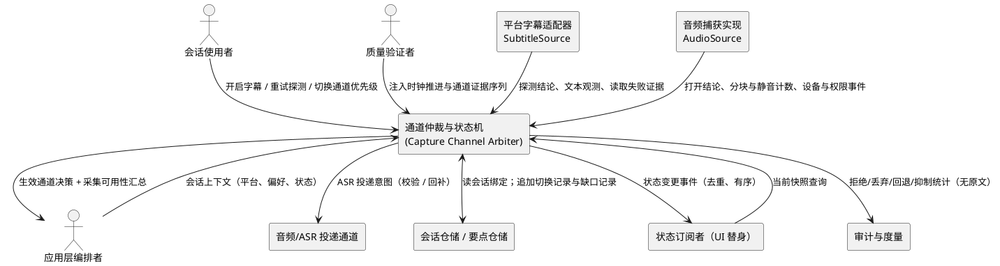
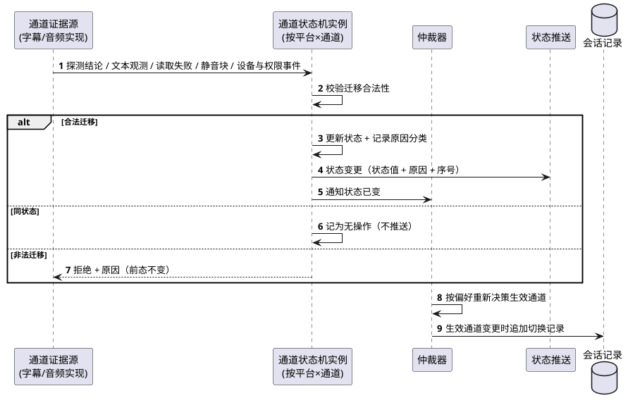
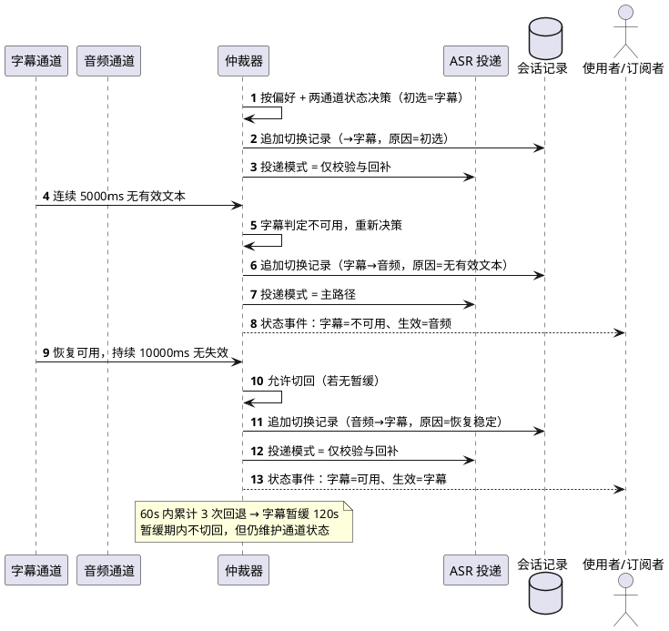
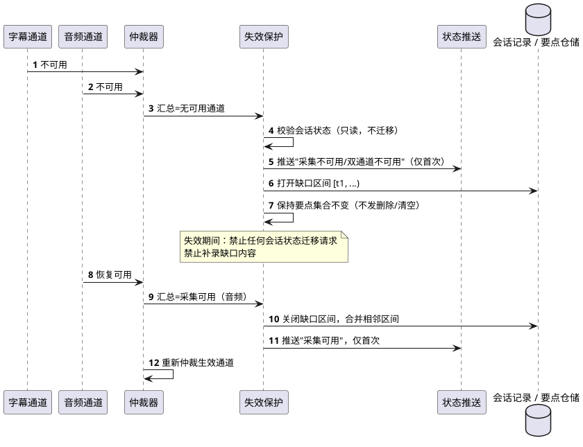
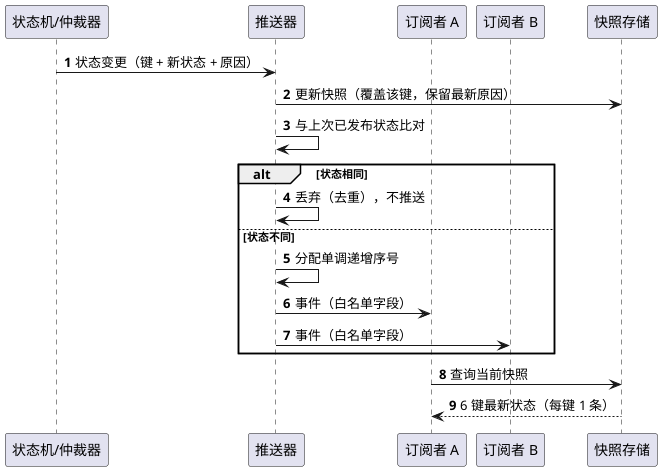

# **1. 组件定位**

> **追溯**：`docs/sdd/tasks.md` 任务 23.1、23.2、23.3、23.4（批次 B2 · 采集接入工程化中可离线判定的部分）。
> **权威依据**：`docs/sdd/spec.md` 5.8.1-4、5.8.1-5、4.2-7、5.1.1-11；`docs/sdd/design.md` 2.1.3(2)、2.1.3(4)、2.5.4（仲裁规则 1/2/3/5）、2.5.7-4。
> **本文边界**：只写"什么行为必须成立、如何离线判定"，不写实现代码，不修改 `docs/sdd/*.md`。

## **1.1 核心职责**

本组件负责在单个会话内维护字幕与音频两条采集通道的状态，并按会话偏好仲裁当前生效通道，实现"字幕优先、音频兜底、单通道失效可回退、双通道失效可保护、状态变更 5 秒内可见"。

## **1.2 核心输入**

1. **通道探测结果**：来自平台适配器与音频捕获实现的"字幕容器是否可读、版本是否在矩阵内、系统音频是否可打开、权限是否具备"四类结论，必须携带平台标识与通道标识。
2. **字幕有效性证据**：字幕适配器上报的增量文本观测事件，含观测时刻（单调毫秒）、文本长度、去抖后置信度；以及读取失败、窗口重建、OCR 失败统计三类负向证据。
3. **音频活性证据**：音频捕获上报的分块到达、连续静音块计数、设备切换/拔出、权限回收四类事件。
4. **用户显式操作**：开启字幕、切换字幕窗口、重试探测、切换通道优先级（字幕优先/音频优先/仅字幕/仅音频）。
5. **会话上下文**：会话标识、绑定平台、通道偏好、会话当前状态；由应用层注入，本组件不自行读取会话仓库以外的数据。
6. **可注入时钟**：单调时钟推进源，用于 5 秒/10 秒阈值计时；与墙钟分离，禁止用墙钟判定阈值。
7. **既有业务记录**：该会话已产生的要点集合摘要（仅用于"不丢失"断言，本组件不修改要点内容）。

## **1.3 核心输出**

1. **通道状态快照**：每个（平台, 通道）组合当前所处的四状态之一，附原因分类、进入时刻与最近一次状态变更时刻。
2. **生效通道决策**：字幕 / 音频 / 无（采集不可用）三值之一，附决策原因。
3. **采集可用性汇总**：对外单一结论——"采集可用（生效通道=X）"或"采集不可用（原因分类）"。
4. **通道切换记录**：生效通道发生变更时追加的不可变记录，含前值、后值、原因分类、单调时刻与墙钟时刻。
5. **采集缺口记录**：双通道失效（或偏好导致无通道可用）期间形成的时间区间，用于"不重不漏"判定与界面提示。
6. **状态变更事件序列**：供订阅者消费的有序事件流，含单调递增序号；同状态不重复推送。
7. **ASR 投递意图**：字幕生效时，音频数据只允许以"双通道校验"或"字幕缺口回补"两种用途投递，并输出投递意图与计数供统计。
8. **诊断与判定标识**：回退次数、抖动抑制触发次数、跨平台输入拒绝次数、未归属输入丢弃次数；均为统计值，不含任何会话原文。

## **1.4 职责边界**

1. 本组件**不负责**打开、捕获或解码任何真实音频设备；`AudioSource` 的实现属批次 B2.15/16。
2. 本组件**不负责**读取任何平台字幕控件、不实现 UIA/AX/OCR；字幕读取属 B2.17～B2.22。
3. 本组件**不负责**把字幕与音频片段做等价判定与合并（`dualChannel` 标记）；那属 B2.24。本组件只决定"哪条通道当前生效、哪些音频允许送转写"。
4. 本组件**不负责**音频重采样、降噪、VAD 与环形缓冲实现；那属 B2.25。本组件只消费其上报的活性与静音证据。
5. 本组件**不负责**会话六状态机（未开始/监听中/暂停/静默/已结束/已删除）的迁移；那属 B2.26。本组件只**读取**会话状态，并**禁止**在采集不可用时请求任何会话状态迁移。
6. 本组件**不负责**采集告知与同意流程（B2.27），也不判定是否允许开始采集。
7. 本组件**不负责**渲染任何 UI；只输出状态事件与快照，由表现层消费。
8. 本组件**不负责**多平台互斥的用户交互（选择平台弹窗）；那属任务 22.3。本组件只承担"拒绝处理非本会话绑定平台的通道输入"这一硬校验点。
9. 本组件**不新增对外错误码**；"采集不可用"复用既有 `E-AUDIO-002`（`AudioCaptureFailed`），不扩充 `ErrorCode` 枚举。
10. 本组件**不引入任何新的第三方依赖**，也不访问网络；全部判定必须在断网、无真实平台进程、无 UI 的条件下完成。
11. 本组件**不负责**证明"三平台 30 分钟稳定"这一 B2 G2 出口门禁；本规格的通过不等于 G2 通过。

# **2. 领域术语**

**采集通道（Capture Channel）**
: 指本组件建模的两种内容获取路径：平台字幕文本通道与系统音频通道；每条通道在单个会话内独立演进状态。

**通道标识（Channel Key）**
: 由"平台标识 + 通道种类"构成的最小标识单元；状态机、仲裁器、推送与快照均以该标识为唯一维度。

**通道状态（Channel State）**
: 通道对外可观测的四个取值：探测中（Probing）、可用（Available）、降级（Degraded）、不可用（Unavailable）；取值封闭，禁止扩展。

**探测中（Probing）**
: 通道尚未取得可用性证据的状态，仅能由实例创建或用户重试类操作进入；该状态对外可展示，但按"尚不可用"参与仲裁。

**降级（Degraded）**
: 通道仍能产出内容、但质量或手段低于主路径的状态；对字幕通道指"仅 OCR 可读"或"版本低于支持矩阵仍可读"，对音频通道指"设备级或麦克风回退生效"或"疑似无声"。

**有效文本（Valid Text）**
: 通过噪声行过滤后非空、且去抖后置信度不低于 0.5 的字幕观测；低置信、空文本、被过滤的噪声行均不构成有效文本。

**生效通道（Active Channel）**
: 当前被用于产出会话内容的通道，取值仅"字幕/音频/无"三值；由仲裁器按偏好与两通道状态唯一确定。

**回退（Fallback）**
: 生效通道由字幕变为音频的一次变更，且必须同步产生切换记录。

**切回（Switch-back）**
: 生效通道由音频恢复为字幕的一次变更，前提是字幕通道已恢复可用并持续稳定满 10 秒。

**采集不可用（Capture Unavailable）**
: 在当前会话偏好允许的通道集合内，没有任何通道处于可用或降级状态的汇总结论；该结论**不导致**会话结束。

**采集缺口（Capture Gap）**
: 从采集不可用结论生效时刻起、到任一允许通道恢复为可用/降级时刻止的半开时间区间。

**抖动抑制（Switch Cooldown）**
: 为防止回退与切回高频往复，在单位时间内回退次数超阈后，暂停切回一段时间的仲裁策略；它不改变通道状态，只改变仲裁结果。

**同状态事件（Same-State Event）**
: 目标状态与当前状态相同的汇报；它必须被记录为无操作，且不得产生对外状态变更推送。

# **3. 角色与边界**

## **3.1 核心角色**

- **会话使用者**：通过界面感知平台名、通道状态与"采集不可用"提示；可切换通道优先级或重试字幕。
- **应用层编排者**（`SessionOrchestrator` / `CaptureCoordinator`）：向本组件注入通道证据、读取生效通道决策与汇总状态，并据此驱动采集与要点链。
- **质量验证者**（开发与测试）：以注入式时钟与内存订阅者编排通道证据序列，验证状态迁移、仲裁决策、失效保护与推送时延。

## **3.2 外部系统**

- **平台字幕适配器（`SubtitleSource` 实现）**：上报探测结论、文本观测与读取失败证据；本组件不感知其内部实现。
- **音频捕获实现（`AudioSource` 实现）**：上报打开结论、分块到达、静音块计数、设备与权限事件。
- **音频/ASR 投递通道**：接收"校验"与"回补"两类投递意图；本组件只签发意图，不实现转写。
- **会话仓储与要点仓储**：提供会话绑定信息、承载通道切换记录与缺口记录、承载已产生要点（只读校验）。
- **状态订阅者**（未来 UI 与诊断面板的替身）：消费状态事件流、查询当前快照。
- **审计与度量**：接收跨平台输入拒绝、未归属输入丢弃、回退与抖动抑制的统计记录。

## **3.3 交互上下文**

# **4. DFX约束**

## **4.1 性能**

1. 从"通道状态机内部确定新状态"到"订阅者回调返回"的时延，99 分位不得**超过 5000 ms**，最大值不得超过 5000 ms（SPEC 5.8.1-4）；发布必须在状态确定后同步发起，不得进入长周期批量队列。
2. 字幕失效检测周期不得**超过 500 ms**；从"最后一次有效文本"到"回退动作完成（生效通道已变为音频且切换记录已追加）"的总时长不得超过 **5000 ms**（SPEC 4.2-7）。
3. 单次通道证据处理（推进状态机 + 重新仲裁 + 生成事件）的本地开销，95 分位不得超过 **2 ms**（本机单进程、无 IO 阻塞假设）。
4. 状态快照查询必须为 O(通道数) 量级；通道数上限为"3 平台 × 2 通道 = 6"，查询不得引入 IO。
5. 单会话内切换记录数不设上限，但同一毫秒内最多追加 1 条；缺口记录在同一会话内必须合并相邻区间，避免碎片化。

## **4.2 可靠性**

1. 任何通道证据序列下，本组件不得 panic、不得使进程以非零码退出；可恢复错误一律以"拒绝 + 原因分类"表达。
2. 非法状态迁移必须被拒绝并保持原状态不变，不得出现"部分迁移"（例如状态已改但事件未生成）。
3. 双通道均失效时，会话状态不得因本组件而发生任何迁移；已产生的要点集合在失效前后必须逐条一致。
4. 状态事件流必须保证：同一（平台, 通道）内序号严格递增、无乱序、无丢失；订阅者取消后对其回调次数必须为 0。
5. 同一状态在无变化时不得重复推送；原因变化不构成状态变化，不得触发推送。
6. 时钟源必须可注入且单调不回退；阈值计时禁止依赖墙钟（防止系统时间跳变导致 5 秒/10 秒判定失真）。

## **4.3 安全性**

1. 状态事件、快照、切换记录与缺口记录中**禁止**出现字幕文本、音频样本、说话人姓名、参会人清单与任何凭据。
2. 允许出现在上述载体中的字段仅限：平台标识、通道种类、状态值、原因分类码、单调时刻、墙钟时刻、序号、计数。
3. 对未归属会话的通道输入必须丢弃并记录一条审计事件，审计内容不得包含输入内容本身（SPEC 5.1.1-11a）。
4. 对非本会话绑定平台的通道输入必须拒绝并计数，不得写入本会话（SPEC 5.1.1-11b / 2.5.7-4）。
5. 本组件不得读取、记录或转发任何平台账号、令牌、Cookie 与私有数据目录内容（SPEC 5.8.1-3、4.3-10）。

## **4.4 可维护性**

1. 必须可查询的指标：按（平台, 通道）分类的状态停留时长、回退次数、切回次数、抖动抑制触发次数、跨平台拒绝次数、未归属丢弃次数。
2. 每次状态变更必须携带原因分类码，用于区分"读取失败""窗口重建""OCR 失败率超阈""无有效文本""权限丢失""用户重试""设备切换"等成因。
3. 日志与诊断必须能区分平台、通道、状态与原因四要素，以支撑平台升级后的快速定位（SPEC 4.4-5）。
4. 禁止把证据事件的原始载荷（文本、样本）写入日志或度量维度。

## **4.5 兼容性**

1. 必须复用既有 `SourceHealth`（`Ready` / `Degraded` / `Unavailable`）作为基础设施上报的健康证据，不得修改其变体与语义。
2. 必须复用既有 `Platform`（三平台）与 `ChannelPreference`（四偏好）枚举，不得修改其值域；通道种类需新增独立枚举，理由见 9.2。
3. 必须复用既有 `Subscription` 的释放语义（release 后回调必须为 0），不得修改其既有泛型约束与既有测试。
4. 新增能力必须通过"新增端口 + 新增类型"落地，不得修改 `SessionRepository`、`UtteranceRepository`、`InsightRepository`、`CardRepository` 的既有方法签名。
5. 既有 265 个测试必须全部继续通过，测试数量不得减少；不得通过删除或放宽既有断言来达成新功能。

# **5. 核心能力**

## **5.1 通道状态机**

### **5.1.1 业务规则**

1. **状态取值封闭**：通道状态必须仅为"探测中/可用/降级/不可用"四值之一，禁止新增第五值。
   a. 验收条件：When 枚举状态的全集，the 取值个数 shall 为 4 且与四方状态严格一致；If 出现第五值，shall 判定规格违规。
2. **实例独立**：状态机必须按"平台 × 通道"为键创建独立实例；一个实例的迁移不得改变任何其它实例的状态。
   a. 验收条件：When 同时存在 6 个（3 平台 × 2 通道）实例并各自注入证据，the 每个实例的最终状态 shall 与其自身证据序列一致，且与其它实例的证据无关。
3. **初始状态**：实例创建后必须处于"探测中"。
   a. 验收条件：When 创建任一（平台, 通道）实例，the 初始状态 shall 为"探测中"，且此时不得产生"可用"结论。
4. **探测中 → 可用**：仅当探测结论同时满足"内容容器可读"与"版本在支持矩阵内"时才允许。
   a. 验收条件：When 注入"可读且版本受支持"，the 迁移 shall 成功到"可用"；When 注入"可读但版本低于矩阵"，the 迁移 shall 不得进入"可用"。
5. **探测中 → 降级**：当探测结论为"仅 OCR 可读"或"版本低于矩阵但内容仍可读"时进入。
   a. 验收条件：When 注入"仅 OCR 可读"，the 迁移 shall 到"降级"；When 注入"版本低于矩阵且内容不可读"，the 迁移 shall 到"不可用"而非"降级"。
6. **探测中 → 不可用**：当内容容器不存在、或权限缺失、或音频设备无法打开时进入。
   a. 验收条件：When 注入"容器不存在"或"权限缺失"，the 迁移 shall 到"不可用"。
7. **可用 → 降级**：当连续 3 次读取失败、或窗口重建、或音频"连续 3 块静音且无语音活动"时进入。
   a. 验收条件：When 连续注入 2 次读取失败，the 状态 shall 保持"可用"；When 第 3 次失败到达，the 状态 shall 迁移到"降级"。
8. **可用 → 不可用**：当"连续 5 秒无有效文本"、或权限被回收、或设备拔出时进入。
   a. 验收条件：When 自最后一次有效文本起注入 5000 ms 无有效文本，the 状态 shall 迁移到"不可用"；When 注入 4999 ms，the 状态 shall 保持"可用"。
9. **降级 → 可用**：当内容恢复可读且连续 10 秒无失效判定时进入。
   a. 验收条件：When 降级状态下连续 10000 ms 无失效判定，the 状态 shall 迁移到"可用"；When 9999 ms 时刻仍无失效判定，the 状态 shall 保持"降级"。
10. **降级 → 不可用**：当 OCR 失败率严格大于 50%、或权限丢失、或设备不可用时进入。
    a. 验收条件：When 注入 OCR 失败率 51%，the 迁移 shall 发生；When 注入 50%，the 迁移 shall 不发生。
11. **不可用 → 探测中**：仅允许由"用户开启字幕/切换窗口/重试探测"三类显式操作进入。
    a. 验收条件：When 不可用状态下注入普通文本观测，the 状态 shall 保持"不可用"；When 注入"用户重试"，the 状态 shall 迁移到"探测中"。
12. **同状态事件为无操作**：目标状态与当前状态相同的事件必须不产生状态变更。
    a. 验收条件：When 对"可用"注入"迁移到可用"，the 结果 shall 为无操作、状态不变、不产生对外状态变更事件，且不返回错误。
13. **降级内调整**：字幕"降级"状态下发生"切换 OCR 区域"或"回退音频"证据时，状态必须保持"降级"，并产生一条"降级内调整"内部事件（仅进诊断，不对外推送）。
    a. 验收条件：When 降级状态下注入"切换 OCR 区域"，the 状态 shall 保持"降级"，且诊断计数 shall +1。
14. **非法迁移必须拒绝**：迁移表中不存在的（前态, 后态）组合必须被拒绝，且前态保持不变。
    a. 验收条件：When 对每个不在迁移表内的组合发起迁移，the 结果 shall 为错误且状态等于前态；If 任一组合被接受，shall 判定规格违规。
15. **禁止项：由健康证据直接跃迁**
    a. 验收条件：When 基础设施仅上报既有 `SourceHealth`，the 状态机 shall 不得据此直接产生"探测中"；"探测中"只能由实例创建或用户重试进入。

### **5.1.2 交互流程**

### **5.1.3 异常场景**

1. **未知证据类型**
   a. 触发条件：收到无法归类的证据事件。
   b. 系统行为：忽略该证据，状态不变，记录一条诊断计数。
   c. 用户感知：无直接提示；原因分类计入"证据不可识别"。
2. **证据时间戳回退**
   a. 触发条件：证据携带的单调时刻小于该实例已见过的最大值。
   b. 系统行为：拒绝该证据，不改状态，记录一条"时钟回退"诊断。
   c. 用户感知：无直接提示；诊断面板可见"时钟异常"。
3. **重复实例**
   a. 触发条件：同一（平台, 通道）键被要求创建第二个实例。
   b. 系统行为：拒绝创建，沿用既有实例。
   c. 用户感知：无提示；诊断计数"重复实例" +1。
4. **非法迁移高频出现**
   a. 触发条件：同一实例 60 秒内非法迁移被拒绝达到 5 次。
   b. 系统行为：保持状态，输出"适配证据与状态机不匹配"诊断告警。
   c. 用户感知：通道状态照常展示；诊断页可见告警。
5. **跨平台证据注入**
   a. 触发条件：证据的平台标识与会话绑定平台不一致。
   b. 系统行为：拒绝处理，状态不变，计数"跨平台输入" +1。
   c. 用户感知：本组件不提示；由任务 22.3 负责"请新建会话"提示。

## **5.2 字幕优先与回退/切回**

### **5.2.1 业务规则**

1. **默认字幕优先**：会话偏好为"字幕优先"时，只要字幕通道处于可用或降级，生效通道就必须为字幕（DESIGN 2.5.4-1、SPEC 5.8.1-2c）。
   a. 验收条件：When 偏好为字幕优先且字幕为可用或降级，the 生效通道 shall 为字幕（无论音频处于何种状态）。
2. **仲裁决策表封闭**：生效通道必须由"会话偏好 × 字幕可用性 × 音频可用性"唯一确定，其中"可用性"取值仅"是（可用或降级）/否（探测中或不可用）"。
   a. 验收条件：When 逐一注入 4 种偏好 × 4 种字幕态 × 4 种音频态的 64 种组合，the 生效通道 shall 与 5.2 决策表逐项一致；If 任一组合与决策表不符，shall 判定规格违规。

   | 会话偏好 | 字幕可用（可用/降级） | 音频可用（可用/降级） | 生效通道 |
   |---|---|---|---|
   | 字幕优先 | 是 | 任意 | 字幕 |
   | 字幕优先 | 否 | 是 | 音频 |
   | 字幕优先 | 否 | 否 | 无（采集不可用） |
   | 音频优先 | 任意 | 是 | 音频 |
   | 音频优先 | 是 | 否 | 字幕 |
   | 音频优先 | 否 | 否 | 无（采集不可用） |
   | 仅字幕 | 是 | 任意 | 字幕 |
   | 仅字幕 | 否 | 任意 | 无（采集不可用，原因=偏好限制） |
   | 仅音频 | 任意 | 是 | 音频 |
   | 仅音频 | 任意 | 否 | 无（采集不可用，原因=偏好限制） |

3. **字幕失效回退时限**：字幕处于可用而"连续 5 秒无有效文本"时，必须判定字幕不可用，并在同一时限内把生效通道切为音频（SPEC 4.2-7、2.5.4-2）。
   a. 验收条件：When 自最后一次有效文本起 5000 ms 内无新的有效文本，the 生效通道 shall 在 5000 ms 内变为音频，且切换记录 shall 已追加。
4. **有效文本的构成**：只有"噪声行过滤后非空且去抖置信度 ≥ 0.5"的字幕观测才可重置 5 秒计时；低置信、空文本与被过滤项不得重置计时。
   a. 验收条件：When 5000 ms 内仅注入低置信或空文本观测，the 回退 shall 仍按时触发；When 注入 1 条有效文本，the 计时 shall 从该时刻重新开始。
5. **副标题（字幕）恢复切回**：字幕通道恢复到可用、且连续 10 秒无任何失效判定时，必须把生效通道切回字幕（2.5.4-3）。
   a. 验收条件：When 字幕恢复可用并持续 10000 ms 无失效判定，the 生效通道 shall 切回字幕；When 仅 9999 ms，the 生效通道 shall 仍为音频。
6. **切回前置校验**：切回必须同时满足"字幕状态为可用"与"偏好允许字幕"；降级状态下不得直接切回（必须先经 5.1 的降级→可用迁移）。
   a. 验收条件：When 字幕为降级且偏好为字幕优先，the 生效通道 shall 不得由音频切回字幕；When 字幕迁移到可用并稳定 10 秒，shall 切回。
7. **切换记录必写**：任一"生效通道变更"（含初选、回退、切回、偏好切换、恢复）必须在 1000 ms 内追加一条不可变记录，含前值、后值、原因分类、单调时刻与墙钟时刻。
   a. 验收条件：When 发生一次生效通道变更，the 会话记录 shall 在 1000 ms 内新增且仅新增 1 条记录，字段与前值/后值一致。
8. **字幕生效时音频仅校验与回补**：生效通道为字幕时，音频数据只允许以"双通道校验"与"字幕缺口回补"两类用途投递转写；禁止逐块全量投递（DESIGN 2.5.4-1）。
   a. 验收条件：When 生效通道为字幕并注入 60 秒连续数据（30 条字幕 + 300 块 200 ms 音频），the ASR 投递意图数 shall ≤ 6，且每条 shall 标注为"双通道校验"或"字幕缺口回补"。
9. **校验抽样率上限**：双通道校验的默认抽样上限为每 10 秒 1 次，可在配置中下调但不得上调超过每 5 秒 1 次。
   a. 验收条件：When 注入 100 秒字幕生效流，the "双通道校验"意图数 shall ≤ 10（按每 10 秒 1 次）。
10. **抖动抑制**：同一会话 60 秒内发生 3 次"字幕→音频"回退时，必须进入字幕暂缓：暂缓期内即使字幕恢复稳定也不得切回，暂缓期默认 120 秒。
    a. 验收条件：When 60 秒内第 3 次回退发生，the 仲裁 shall 标记暂缓并在 120000 ms 内不产生切回；When 暂缓到期，shall 重新评估并按 5.2.1-5 判定。
11. **偏好限制不跨偏好回退**：偏好为"仅字幕"且字幕不可用时，禁止擅自切到音频；偏好为"仅音频"且音频不可用时，禁止擅自切到字幕。此时必须输出"采集不可用（原因=偏好限制）"。
    a. 验收条件：When 偏好为仅字幕且字幕不可用而音频可用，the 生效通道 shall 为无，且汇总状态 shall 为"采集不可用/偏好限制"。
12. **偏好变更即时生效**：用户切换偏好必须在下一次仲裁时生效，不得要求重建会话。
    a. 验收条件：When 运行中把偏好由字幕优先改为音频优先，the 生效通道 shall 在下一次证据或偏好事件处理后变为音频，并追加切换记录。
13. **禁止项：字幕生效期间静默关闭音频通道**
    a. 验收条件：When 生效通道为字幕，the 音频通道状态 shall 继续被维护并可用于回补与校验；If 音频通道被关闭或状态被冻结，shall 判定规格违规。

### **5.2.2 交互流程**

### **5.2.3 异常场景**

1. **字幕与音频状态同时抖动**
   a. 触发条件：10 秒内两通道状态各变更 ≥ 3 次。
   b. 系统行为：按决策表持续仲裁，同时累加抖动计数；达到回退阈值后进入字幕暂缓。
   c. 用户感知：状态事件照常推送；界面可出现"通道不稳，已暂缓切回"。
2. **偏好与通道能力冲突**
   a. 触发条件：偏好为"仅字幕"但字幕不可用，或偏好为"仅音频"但音频不可用。
   b. 系统行为：输出"采集不可用/偏好限制"，不跨偏好回退，并输出"建议切换偏好"的建议码。
   c. 用户感知：显示"当前设置为仅字幕，字幕不可用即无法采集，可改为字幕优先"。
3. **切换记录写入失败**
   a. 触发条件：会话记录不可写。
   b. 系统行为：仲裁结果仍然生效（不得因记录失败而冻结采集），同时输出"记录缺失"告警并累计计数。
   c. 用户感知：无阻塞提示；诊断可见"通道切换记录缺失 N 条"。
4. **暂缓期内用户显式要求切回**
   a. 触发条件：暂缓生效期间用户手选字幕优先。
   b. 系统行为：立即解除暂缓并重新评估；若字幕可用则切回并记录原因=用户指定。
   c. 用户感知：生效通道按用户选择变化。
5. **时钟不可用**
   a. 触发条件：注入时钟读取失败。
   b. 系统行为：拒绝处理依赖阈值的证据，状态不变，输出诊断告警。
   c. 用户感知：无直接提示；界面状态停滞并在诊断中标注。

## **5.3 双通道均失效保护**

### **5.3.1 业务规则**

1. **会话必须保留**：在当前偏好允许的通道集合内无任何通道可用时，会话状态必须保持不变；本组件禁止请求任何会话状态迁移（SPEC 4.2-7、5.1.1-10）。
   a. 验收条件：When 两通道均不可用持续 300 秒，the 会话状态 shall 与失效前完全一致，且删除/结束类仓储调用 shall 为 0 次。
2. **已产生要点不丢**：双失效期间本组件必须不发出任何删除、清空、覆盖类指令；失效前后要点集合必须逐条一致。
   a. 验收条件：When 失效前已存在 N 条要点并持续失效 300 秒，the 恢复后要点集合 shall 数量为 N 且标识集合完全相同。
3. **汇总状态明确**：双失效必须产出单一汇总结论"采集不可用"，并携带原因分类（双通道不可用 / 偏好限制）。
   a. 验收条件：When 两通道均不可用，the 汇总状态 shall 为"采集不可用/双通道不可用"，且 shall 在 5000 ms 内推送并可从快照查询。
4. **缺口必须记录**：失效持续 ≥ 1000 ms 时必须形成 1 条缺口记录，区间为半开区间，时长误差不得超过 400 ms。
   a. 验收条件：When 失效持续 30000 ms，the 缺口记录 shall 为 1 条且时长在 [29600, 30400] ms 内；When 失效持续 500 ms，the 缺口记录 shall 为 0 条。
5. **缺口合并**：同一会话内相邻或重叠的缺口必须合并为一条，不得产生碎片。
   a. 验收条件：When 连续两次失效间隔 < 1000 ms，the 缺口记录 shall 合并为 1 条。
6. **单通道恢复即退出不可用**：任一偏好允许的通道恢复到可用或降级时，必须在 5000 ms 内清除"采集不可用"汇总并重新仲裁。
   a. 验收条件：When 音频由不可用恢复为可用且偏好为字幕优先，the 汇总状态 shall 在 5000 ms 内变为"采集可用（音频）"。
7. **恢复后不重不漏**：恢复后的新片段必须满足——时间区间与缺口区间不重叠（边界容差 ≤ 400 ms）、同一会话内相邻片段区间互不重叠、缺口区间必须被标记为"缺失"而非"静默"。
   a. 验收条件：When 缺口为 [t1, t2) 并在 t2+400 ms 后恢复注入，the 恢复后任一片段的区间 shall 不与 [t1, t2) 重叠（仅允许 ≤ 400 ms 的边界接触）；且恢复后 10 秒内的片段数 shall 不少于注入预期数减 1。
8. **不补录缺口**：缺口区间不得通过事后补录伪造为已采集内容（音频环形缓冲不足 8 秒，超出部分不可回补）。
   a. 验收条件：When 缺口时长超过 8000 ms，the 恢复后 shall 不产生任何时间区间落在 [t1, t2 - 8000) 内的片段。
9. **重复失效不重复告警**：同一缺口区间内不得重复推送"采集不可用"汇总；仅首次进入与首次退出各推送 1 次。
   a. 验收条件：When 失效持续 300 秒且通道状态在不可用与探测中之间反复，the "采集不可用"推送次数 shall 为 1。

### **5.3.2 交互流程**

### **5.3.3 异常场景**

1. **失效期间收到"结束会话"请求**
   a. 触发条件：应用层在采集不可用期间请求结束会话。
   b. 系统行为：本组件不参与该迁移决策，仅关闭缺口区间并按结束时刻截断。
   c. 用户感知：由会话编排负责提示；本组件只保证缺口记录时长正确。
2. **失效期间收到零散有效证据**
   a. 触发条件：通道状态为不可用，但仍收到 1 条文本观测。
   b. 系统行为：不据此把通道判为可用（必须仍由 5.1 的"不可用→探测中→可用"路径恢复），仅记录诊断。
   c. 用户感知：状态不变，界面仍显示"采集不可用"。
3. **缺口区间重叠**
   a. 触发条件：新缺口与既有缺口区间重叠。
   b. 系统行为：合并为并集区间，保留最早开始与最晚结束。
   c. 用户感知：界面显示单条缺口提示。
4. **恢复后立即再次失效**
   a. 触发条件：恢复后 1000 ms 内再次进入不可用。
   b. 系统行为：不新开缺口，合并入上一缺口；汇总状态不重复推送。
   c. 用户感知：界面不出现"恢复→失效"的高频闪烁。
5. **要点仓储不可读**
   a. 触发条件：失效保护需要读取要点集合但仓储报错。
   b. 系统行为：跳过"不丢失"校验，输出诊断告警；仍不发出任何删除指令。
   c. 用户感知：无提示；诊断可见"要点集合校验跳过"。

## **5.4 状态变更推送与快照**

### **5.4.1 业务规则**

1. **推送时限**：任一通道状态确定后，必须在 5000 ms 内向全部有效订阅者完成推送（SPEC 5.8.1-4）；99 分位不得超过 5000 ms。
   a. 验收条件：When 注入 200 次状态变更并以可注入时钟打点，the 发布时延的 99 分位 shall ≤ 5000 ms，且最大值 shall ≤ 5000 ms。
2. **同状态去重**：同一（平台, 通道）的目标状态与当前状态相同时，不得产生任何推送。
   a. 验收条件：When 对同一（平台, 通道, 状态）连续上报 10 次，the 推送次数 shall 为 1。
3. **原因变化不推送**：状态未变而原因分类变化时，不得推送新事件；但快照必须反映最新原因。
   a. 验收条件：When 状态保持"降级"而原因由"OCR 回退"变为"版本失配"，the 推送次数 shall 不变，the 快照中的原因 shall 为"版本失配"。
4. **有序与不丢**：同一（平台, 通道）的事件序号必须严格递增；订阅者收到的序列必须完整，不得乱序或丢失。
   a. 验收条件：When 连续注入 100 次变更，the 订阅者收到的序号序列 shall 严格递增且长度等于 100。
5. **快照可查且强一致**：订阅者必须能在任一推送回调返回后立即查询到当前快照；快照对每个（平台, 通道）恰含 1 条最新状态。
   a. 验收条件：When 任一回调返回后立即查询，the 快照 shall 已包含该次状态；When 查询 6 个键，the 条目数 shall 恰为 6。
6. **订阅取消语义**：订阅者取消后，其回调次数必须为 0；其它订阅者不受影响。
   a. 验收条件：When 取消某个订阅者后继续注入 10 次变更，the 该订阅者回调次数 shall 为 0，其余订阅者 shall 各收到 10 次。
7. **载荷字段白名单**：推送事件与快照字段仅限平台标识、通道种类、状态值、原因分类码、序号、单调时刻、墙钟时刻；禁止出现任何会话原文。
   a. 验收条件：When 检查推送载荷与快照的字段集合，the 字段 shall 全部落入白名单；对字幕文本与音频样本的匹配 shall 为 0 次命中。
8. **汇总状态同步推送**：采集可用性汇总发生变化时，必须作为独立事件推送，且与通道状态事件使用同一条有序流。
   a. 验收条件：When 汇总由"可用"变为"采集不可用"，the 订阅者 shall 在 5000 ms 内收到 1 条汇总事件，其序号大于此前所有通道事件。
9. **快照不得包含历史**：快照只承载当前值，不得承载历史序列；历史序列只能通过订阅获得。
   a. 验收条件：When 某通道已变更 5 次后查询快照，the 快照 shall 仅含 1 条该通道记录且为最新值。

### **5.4.2 交互流程**

### **5.4.3 异常场景**

1. **订阅者回调阻塞**
   a. 触发条件：某订阅者处理事件耗时超过 5000 ms。
   b. 系统行为：不得阻塞状态机与仲裁；该订阅者后续事件按序排队，超过容量则丢弃最旧并计数，且不得影响其它订阅者。
   c. 用户感知：该订阅者界面可能滞后；诊断可见"订阅者积压/丢弃"。
2. **订阅者回调抛错**
   a. 触发条件：订阅者回调返回错误。
   b. 系统行为：记录一次"订阅者失败"计数，继续向其它订阅者推送，不得中断流。
   c. 用户感知：无直接提示。
3. **快照更新失败**
   a. 触发条件：快照存储不可写。
   b. 系统行为：事件仍推送；查询快照时返回最近一次成功快照并标注"可能滞后"。
   c. 用户感知：状态可能滞后；诊断可见"快照滞后"。
4. **序号溢出**
   a. 触发条件：序号达到上限。
   b. 系统行为：不得回绕为 0；应在新会话实例内重新从 1 开始，并保证同一实例内不回绕。
   c. 用户感知：无提示。
5. **无订阅者**
   a. 触发条件：当前没有任何订阅者。
   b. 系统行为：仍更新快照；事件不推送但必须可被后续查询获取。
   c. 用户感知：后续订阅者可查询到完整当前状态。

# **6. 数据约束**

> 本章只约束逻辑字段与取值范围，不约束存储类型、索引与表结构。

## **6.1 通道状态快照（Channel Status Snapshot）**

1. **键**：必须为（平台标识, 通道种类）二元组，且平台仅限腾讯会议、飞书、Zoom 三值之一。
2. **通道种类**：取值必须仅"平台字幕/系统音频"两值之一。
3. **状态**：取值必须仅"探测中/可用/降级/不可用"四值之一。
4. **原因分类**：必填；取值必须来自封闭的原因码集合（探测完成、容器缺失、权限缺失、版本失配、仅 OCR 可读、连续读取失败、窗口重建、无有效文本、OCR 失败率超阈、设备回退、疑似无声、设备拔出、权限回收、用户重试），不得为空串。
5. **进入时刻**：必填，单调毫秒；不得早于实例创建时刻。
6. **最近变更时刻**：必填，单调毫秒；不得早于进入时刻。
7. **条数约束**：同一快照内每个键恰 1 条；快照总条数不得超过 6。

## **6.2 通道切换记录（Channel Switch Record）**

1. **会话标识**：必填，且必须指向未删除的会话。
2. **前值 / 后值**：取值必须仅"字幕/音频/无"三值之一；前值与后值不得相同。
3. **原因分类**：必填；取值来自封闭集合（会话启动初选、字幕无有效文本、字幕读取失败、字幕恢复稳定、音频失效、音频恢复、偏好变更、用户指定、暂缓到期）。
4. **单调时刻**：必填；同一会话内必须单调不减。
5. **墙钟时刻**：必填；仅用于展示与审计，不得用于阈值判定。
6. **不可变**：记录写入后禁止修改与删除；同一毫秒内同一会话最多 1 条。

## **6.3 采集缺口记录（Capture Gap）**

1. **会话标识**：必填。
2. **起止时刻**：必填，半开区间；结束必须晚于开始。
3. **时长**：必须 ≥ 1000 ms 才可落记录；小于该值不得落记录。
4. **原因分类**：必填；取值仅"双通道不可用/偏好限制"两值之一。
5. **合并**：同一会话内相邻或重叠区间必须合并；合并后禁止出现相互重叠的两条记录。
6. **不可补录标记**：必须标记"未回补/已回补"两值之一；默认"未回补"。

## **6.4 通道证据事件（Channel Observation）**

1. **键**：必须为（平台标识, 通道种类）二元组，且必须与会话绑定平台一致；不一致即拒绝。
2. **会话归属**：必填；缺失即丢弃并审计。
3. **单调时刻**：必填；同一键内不得小于已处理的最大值（回退即拒绝）。
4. **证据类型**：必须为封闭集合中的一类（探测结论、文本观测、读取失败、窗口重建、OCR 统计、静音块、设备事件、权限事件、用户重试）。
5. **文本观测附加字段**：字符数必填（≥ 0）；去抖后置信度必填且位于 [0, 1]；禁止携带文本原文。
6. **静音块附加字段**：连续静音块计数必填（≥ 0）；是否检出语音活动必填（是/否）。
7. **OCR 统计附加字段**：窗口内失败数与总数必填，且失败数不得超过总数。

# **7. 范围与非范围**

## **7.1 范围内（本轮可离线完成并判定）**

1. 四状态通道状态机：全部迁移边、非法迁移拒绝、同状态无操作、降级内调整、每平台每通道独立实例（任务 23.1）。
2. 字幕优先与回退/切回：5 秒失效回退、10 秒稳定切回、切换记录、字幕生效时音频仅校验与回补、抖动抑制（任务 23.2）。
3. 双通道失效保护：会话保留、要点不丢、采集不可用汇总、缺口记录、恢复后不重不漏不补录（任务 23.3）。
4. 状态变更推送：5000 ms 内推送、p99 判定、同状态去重、有序不丢、快照查询、订阅取消、载荷白名单（任务 23.4）。
5. 与既有端口/模型的复用关系与最小增量类型定义（第 9 章）。

## **7.2 非范围（本轮不做，也不得据此宣称完成）**

1. **不实现**任何真实平台音频捕获（WASAPI / SCStream / 进程级环回 / 设备回退），属任务 15、16。
2. **不实现**任何字幕读取（UIA / AX / 轮询 / OCR / ROI / 帧差），属任务 17～21。
3. **不实现**平台探测与版本矩阵的真实读取，属任务 22；本轮只消费其结论。
4. **不实现**双通道去重合并与 `dualChannel` 标记，属任务 24。
5. **不实现**音频前处理、分块、环形缓冲、有界队列与峰值保护，属任务 25。
6. **不实现**会话六状态机与唯一写入点，属任务 26；本轮只读取会话状态。
7. **不实现**采集告知与同意页，属任务 27。
8. **不实现**任何真实 UI 渲染、托盘、悬浮窗与系统通知；本轮只以内存订阅者验证推送。
9. **不实现**"仅麦克风"模式的通道建模（`Platform` 枚举无该值；该模式属 15/16 与 26 的交界）。
10. **不引入**任何新的第三方依赖，不访问网络，不读写真实设备。
11. **不得宣称**达到 B2 G2 出口门禁：G2 要求三平台均可建立会话并稳定运行 30 分钟、通道状态 5 秒内更新、字幕失效 5 秒内回退、双通道不重复计入；本轮只覆盖其中"可离线判定"的判定逻辑，真实平台 30 分钟稳定性、真实 5 秒回退时延与真实去重效果均**未验证**。
12. **不得**在规格、代码、测试夹具或报告中写入任何凭据、端点地址或模型值。

# **8. 可机器判定的验收标准（DoD）**

> **判定环境约束**：全部 AC 必须在断网、无真实平台进程、无音频设备、无 UI 的环境下判定；只允许使用可注入时钟、内存订阅者/仓储替身与合成证据序列。测试进程对网络连接的建连次数必须为 0。
> **编号纪律**：本节编号全为本子特性自有编号 `AC-B2-23-NN`，从 01 起连续；不使用其它子特性的编号空间。

## **8.1 状态机（AC-B2-23-01 ~ AC-B2-23-09）**

**AC-B2-23-01（实例独立与初态）**
When 为某会话的绑定平台创建字幕与音频两个通道实例，the 两个实例 shall 均处于"探测中"；When 分别向 6 个（3 平台 × 2 通道）实例注入互不相同的证据序列，the 6 个最终状态 shall 与各自序列一一对应，且任一实例的迁移不改变其它实例状态。
判定：构造 6 个实例与 6 条独立序列；逐实例断言初态与终态；再断言未注入实例的状态保持初态。

**AC-B2-23-02（合法迁移全覆盖）**
When 依次注入设计文档 2.1.3(2) 所示 9 条迁移边各自所需的证据，the 每次迁移 shall 成功，the 状态 shall 依次等于该边的目标状态。
判定：按边序构造证据脚本；逐边断言"迁移成功 + 目标状态正确"；9 条边全部覆盖，缺一即不通过。

**AC-B2-23-03（非法迁移拒绝）**
When 对（前态, 后态）全部 16 种组合中不属于 9 条合法边且不是同状态组合的每一组发起迁移，the 结果 shall 为错误，且状态 shall 等于前态。
判定：枚举组合，断言"返回错误 + 状态不变"；任一组合被接受即不通过。

**AC-B2-23-04（同状态为无操作且不推送）**
When 对当前状态重复上报同一目标状态 10 次，the 状态 shall 保持不变，the 对外状态变更事件数 shall 为 0，且 shall 不产生错误。
判定：重复上报后断言事件计数为 0 与错误计数为 0。

**AC-B2-23-05（降级内调整）**
When 字幕处于"降级"并注入"切换 OCR 区域"证据，the 状态 shall 保持"降级"，the 降级内调整计数 shall 由 0 变为 1，the 对外状态变更事件数 shall 为 0。
判定：断言状态、计数与事件数三者。

**AC-B2-23-06（可用→降级阈值为连续 3 次失败）**
When 连续注入 2 次读取失败，the 状态 shall 保持"可用"；When 注入第 3 次，the 状态 shall 为"降级"。
判定：分两次断言，2 次不迁移、3 次迁移。

**AC-B2-23-07（降级→不可用阈值为 OCR 失败率 > 50%）**
When 注入 OCR 失败率 51%，the 状态 shall 为"不可用"；When 注入 50%，the 状态 shall 保持"降级"。
判定：同一用例内先后注入两组统计，断言严格大于的边界行为。

**AC-B2-23-08（不可用只能经探测中恢复）**
When 状态为"不可用"并注入文本观测，the 状态 shall 保持"不可用"；When 注入"用户重试"后再注入"可读且版本受支持"，the 状态 shall 经"探测中"到达"可用"。
判定：断言中间态必须出现"探测中"（以状态序列记录为证）。

**AC-B2-23-09（健康证据不得直接产生探测中）**
When 只上报既有 `SourceHealth` 的三种取值，the 状态 shall 只会取"可用/降级/不可用"，shall 不出现"探测中"以外的额外状态，且"探测中"仅出现在实例创建或用户重试之后。
判定：扫描状态序列，断言"探测中"仅出现在两类触发点之后。

## **8.2 字幕优先与回退/切回（AC-B2-23-10 ~ AC-B2-23-17）**

**AC-B2-23-10（默认字幕优先）**
When 会话偏好为"字幕优先"且字幕为"可用"或"降级"，the 生效通道 shall 为"字幕"，与音频状态无关。
判定：固定字幕为可用，遍历音频四态，断言生效通道恒为字幕。

**AC-B2-23-11（64 组合决策表）**
When 逐一注入 4 种偏好 × 4 种字幕态 × 4 种音频态共 64 种组合，the 生效通道 shall 与 5.2.1-2 的决策表逐项一致。
判定：以 64 行表驱动，逐行断言；不一致行数必须为 0。

**AC-B2-23-12（5 秒失效回退 ≤5000 ms）**
When 字幕处于"可用"且自最后一次有效文本起注入 5000 ms 无有效文本，the 生效通道 shall 在 5000 ms 内变为"音频"，the 切换记录 shall 已追加 1 条且原因为"字幕无有效文本"。
判定：用可注入时钟推进；断言生效通道切换发生的单调时刻与该次最后有效文本之差不大于 5000 ms。

**AC-B2-23-13（有效文本构成与计时重置）**
When 5000 ms 内只注入低置信（<0.5）、空文本或被过滤的噪声行，the 回退 shall 仍按时触发；When 在 4999 ms 处注入 1 条有效文本，the 回退 shall 不在该 5000 ms 窗口内发生。
判定：两组用例分别断言"仍回退"与"不回退"。

**AC-B2-23-14（10 秒稳定切回）**
When 字幕迁移到"可用"并持续 10000 ms 无失效判定，the 生效通道 shall 切回"字幕"；When 仅持续 9999 ms，the 生效通道 shall 仍为"音频"。
判定：用时钟推进两个边界值，分别断言切回与不切回。

**AC-B2-23-15（切换记录必写且不重复）**
When 发生一次生效通道变更，the 会话记录 shall 在 1000 ms 内新增且仅新增 1 条记录，其前值/后值/原因与决策一致；When 随后无变更，the 记录数 shall 不再增加。
判定：断言记录条数与字段；再推进时钟 10 秒断言条数不变。

**AC-B2-23-16（字幕生效时音频仅校验与回补）**
When 生效通道为"字幕"并注入 60 秒数据（30 条有效字幕 + 300 块 200 ms 音频），the ASR 投递意图数 shall ≤ 6，且每条意图的用途 shall 为"双通道校验"或"字幕缺口回补"。
判定：累计投递意图计数并检查用途标签枚举；出现第三类用途即不通过。

**AC-B2-23-17（抖动抑制 60s/3 次/120s）**
When 60 秒内第 3 次"字幕→音频"回退发生，the 仲裁 shall 标记字幕暂缓；When 暂缓期内注入"字幕恢复且稳定 10 秒"，the 生效通道 shall 仍为"音频"；When 暂缓到期（120 秒）后再注入稳定 10 秒，the 生效通道 shall 切回"字幕"。
判定：三段时序断言，缺一段即不通过。

## **8.3 双通道失效保护（AC-B2-23-18 ~ AC-B2-23-23）**

**AC-B2-23-18（会话状态不变）**
When 偏好允许的两条通道同时为"不可用"并持续 300 秒，the 会话状态 shall 与失效前完全一致，the 会话结束/删除类仓储调用 shall 为 0 次。
判定：以仓储替身统计调用次数；断言为 0 且状态字段未变。

**AC-B2-23-19（已产生要点不丢）**
When 失效前已存在 N 条要点并持续失效 300 秒，the 失效结束后要点集合 shall 数量为 N，且标识集合与失效前完全相同。
判定：比对 ID 集合与数量；发生任一删除/覆盖调用即不通过。

**AC-B2-23-20（采集不可用必须可见）**
When 两通道均不可用，the 汇总状态 shall 为"采集不可用/双通道不可用"，且 shall 在 5000 ms 内被订阅者收到，并可从快照查询到同一结论。
判定：断言推送时刻差 ≤5000 ms，且快照字段一致。

**AC-B2-23-21（缺口记录与容差）**
When 失效持续 30000 ms 后恢复，the 缺口记录 shall 恰为 1 条且时长位于 [29600, 30400] ms；When 失效持续 500 ms，the 缺口记录 shall 为 0 条。
判定：两组用例分别断言记录条数与时长区间。

**AC-B2-23-22（恢复不重不漏）**
When 缺口为 [t1, t2) 并于 t2+400 ms 后恢复注入，the 恢复后任一片段的时间区间 shall 不与 [t1, t2) 重叠（仅允许 ≤400 ms 边界接触），the 相邻片段区间 shall 互不重叠，the 恢复后 10 秒内片段数 shall 不少于注入预期数减 1。
判定：对片段区间做区间代数断言（两两不交、与缺口不交、计数下限）。

**AC-B2-23-23（单通道恢复退出不可用）**
When 音频由"不可用"恢复为"可用"且偏好为"字幕优先"，the 汇总状态 shall 在 5000 ms 内变为"采集可用（音频）"，the 生效通道 shall 为"音频"。
判定：断言汇总状态切换时刻差与生效通道值。

## **8.4 状态变更推送与快照（AC-B2-23-24 ~ AC-B2-23-30）**

**AC-B2-23-24（推送时延 p99 ≤5000 ms）**
When 注入 200 次真实状态变更并以可注入时钟打点，the 从状态确定到订阅者回调返回的时延 shall 满足 99 分位 ≤5000 ms 且最大值 ≤5000 ms。
判定：采集 200 个时延样本，排序后取 99 分位与最大值。

**AC-B2-23-25（同状态去重）**
When 对同一（平台, 通道, 状态）连续上报 10 次，the 订阅者收到的该键事件数 shall 为 1。
判定：计数断言。

**AC-B2-23-26（原因变化不推送但快照更新）**
When 状态保持"降级"而原因由"OCR 回退"变为"版本失配"，the 该键事件数 shall 不变，the 快照原因 shall 为"版本失配"。
判定：事件计数 + 快照字段双断言。

**AC-B2-23-27（快照强一致与条数）**
When 任一推送回调返回后立即查询快照，the 快照 shall 已含该次状态；When 查询 6 个键，the 条目数 shall 恰为 6 且每键 1 条。
判定：在回调内查询并断言；再断言条数。

**AC-B2-23-28（有序不丢）**
When 对同一键连续注入 100 次变更，the 订阅者收到的序号序列 shall 严格递增且长度等于 100。
判定：序列长度与单调性双断言。

**AC-B2-23-29（订阅取消后 0 回调）**
When 取消某订阅者后继续注入 10 次变更，the 该订阅者回调次数 shall 为 0，the 其它订阅者 shall 各收到 10 次。
判定：分订阅者计数断言。

**AC-B2-23-30（载荷白名单）**
When 检查全部推送事件与快照的字段集合，the 字段 shall 全部落入白名单（平台、通道种类、状态、原因码、序号、单调时刻、墙钟时刻）；对曾经的输入字幕文本与音频样本做匹配，命中次数 shall 为 0。
判定：字段集合比对 + 文本/样本子串匹配计数为 0。

## **8.5 边界、回归与合规（AC-B2-23-31 ~ AC-B2-23-35）**

**AC-B2-23-31（跨平台输入拒绝）**
When 注入平台标识与会话绑定平台不一致的通道证据，the 仲裁 shall 不改变任何状态、不产生任何片段、不产生切换记录，the "跨平台输入"计数 shall +1。
判定：三处否定断言 + 计数断言。

**AC-B2-23-32（未归属输入丢弃并审计）**
When 注入缺少会话归属的通道证据，the 组件 shall 丢弃该证据、不改变状态，并产生 1 条不含输入内容的审计事件。
判定：断言审计条数为 1 且审计字段集合不包含证据载荷字段。

**AC-B2-23-33（离线可判定性）**
When 在断网、无平台进程、无音频设备、无 UI 的环境中执行 AC-01 至 AC-32，the 全部用例 shall 通过；the 测试进程的网络建连次数 shall 为 0。
判定：以网络拦截替身统计建连次数并断言为 0。

**AC-B2-23-34（既有契约零回归）**
When 执行工作区测试，the 既有 265 个测试 shall 全部通过且总数不得减少；When 检查既有端口与模型定义，the `SourceHealth`、`Platform`、`ChannelPreference`、`Subscription`、四个仓储接口的方法签名 shall 未被修改。
判定：测试计数比对 + 契约签名差异检查（不得出现删除或改签名）。

**AC-B2-23-35（不得宣称 G2 通过）**
When 检查本规格衍生的实现说明、测试报告与提交信息，the 文本 shall 不出现"G2 已通过""三平台 30 分钟已验证""真实 5 秒回退已实测""真实去重已验证"等结论性表述。
判定：对产出文本做关键词扫描，命中即不通过。

# **9. 模块与文件映射（任务映射，非设计决策）**

## **9.1 职责分层裁决**

| 关注点 | 归属层 | 理由 |
|---|---|---|
| 四状态定义、迁移表、非法迁移判定、同状态无操作 | **domain** | 纯规则、无 IO、需被 domain 的片段来源校验与 application 共同复用；可用属性测试穷举 16 组合 |
| 每平台每通道实例的持有与推进、阈值计时、仲裁决策、失效保护、去重与快照 | **application** | 需要时钟、仓储端口与推送端口协作；tasks.md 23.1~23.4 的指定路径位于 `crates/application/src/capture/` |
| 证据产生（探测、读取失败、静音、OCR 统计、设备与权限） | **infrastructure / platform-\*** | 属真实平台与设备能力，本轮不实现，仅以替身注入 |
| 状态事件的最终呈现 | **ui-bridge / 表现层** | 本轮不实现，只以内存订阅者验证 |

> 说明：tasks.md 将 23.1 指向 `crates/application/src/capture/channel_state.rs`，本轮维持该路径**作为实例管理器**的落地处；迁移表本身下沉到 domain，是为了让"非法迁移拒绝"与"同状态无操作"能在领域层被穷举验证，避免把纯规则复制到应用层。该裁决不影响任务编号与 DoD 归属。

## **9.2 与既有端口/模型的复用关系**

| 既有资产 | 位置 | 复用方式 | 是否修改 |
|---|---|---|---|
| `Platform`（三平台） | `crates/domain/src/model/enums.rs` | 作为通道键的平台维度 | 不修改 |
| `ChannelPreference`（四偏好） | 同上 | 作为仲裁决策表的偏好维度 | 不修改 |
| `SourceHealth`（Ready/Degraded/Unavailable） | `crates/domain/src/port/capture.rs` | 作为基础设施上报的健康证据；映射为迁移候选 | 不修改 |
| `Subscription`（release 后 0 回调） | 同上 | 复用其释放令牌语义用于状态订阅 | 不修改既有泛型约束与既有测试 |
| `SubtitleSource` / `AudioSource` | 同上 | 作为证据来源的上游契约 | 不修改 |
| `SessionState` / `Session` | `crates/domain/src/model/session.rs`、`enums.rs` | 只读会话状态与绑定平台；禁止写入迁移 | 不修改 |
| `SessionRepository` 等四个仓储 | `crates/domain/src/port/repository.rs` | 只读会话绑定；要点集合只读校验 | 不修改方法签名 |
| `WallClock` / `AudioClock` | `crates/domain/src/vo/time.rs` | 墙钟用于记录展示；`AudioClock` 用于片段区间 | 不修改 |
| `CopilotError::AudioCaptureFailed`（E-AUDIO-002） | `crates/domain/src/error.rs` | "采集不可用"复用该错误码 | 不新增 `ErrorCode` 变体 |
| `ReadingMode`（Subtitle/Audio） | `crates/domain/src/model/enums.rs` | **不复用**：其语义为"读取手段"，当前取值属历史遗留；不修改其值域以免破坏既有 `SubtitleEvent` 契约 | 不修改 |

## **9.3 需新增的最小增量（类型与端口，仅为契约语义）**

| 名称 | 层 | 形态 | 字段/语义 | 增量理由 |
|---|---|---|---|---|
| 通道种类 | domain | 封闭枚举 | 平台字幕 / 系统音频（2 值） | `SourceKind` 含麦克风与外部转写，粒度不符；`ReadingMode` 语义被占用 |
| 通道状态 | domain | 封闭枚举 | 探测中 / 可用 / 降级 / 不可用（4 值） | `SourceHealth` 缺"探测中"，且它是健康证据而非业务状态 |
| 通道键 | domain | 值对象 | 平台标识 + 通道种类 | 实例独立与去重的唯一维度 |
| 迁移结果 | domain | 枚举 | 已迁移（前态, 后态, 原因） / 无操作 / 非法（原因） | 让"无操作"与"拒绝"在类型上可区分，避免用错误表达无操作 |
| 通道状态错误 | domain | 独立错误类型 | 仅承载非法迁移与键冲突 | 属逻辑错误而非用户可见错误；参考 `RetentionError` 先例，不进入 `ErrorCode` |
| 时钟端口 | domain | 端口 trait | 提供单调毫秒与墙钟；测试替身可手动推进 | 既有 `WallClock::now()` 不可注入，无法离线判定 5s/10s |
| 通道证据事件 | application | 输入 DTO | 键 + 会话 + 单调时刻 + 证据类型 + 类型附加字段（见 6.4） | 统一 evidence 形态，便于替身注入 |
| 通道状态事件 / 快照 | application | 输出 DTO | 见 6.1；事件另含序号 | 推送与查询契约 |
| 采集可用性汇总 | application | 输出 DTO | 可用（生效通道） / 不可用（原因码） | 5.8.1-4 与 4.2-7 要求界面明确"采集不可用" |
| 通道切换记录 / 缺口记录 | application | 输出 DTO | 见 6.2、6.3 | SPEC 6.1-7 要求记录实际生效通道及切换时间点 |
| 切换记录端口 | domain | 新增端口 | 追加 + 按会话列出 | 不修改 `SessionRepository` 签名 |
| 状态推送端口（发布 + 订阅 + 快照查询） | domain | 新增端口 | publish / subscribe / snapshot | `Presenter` 只面向提示卡，语义不符；新增端口避免污染 |
| ASR 投递意图端口 | domain | 新增端口 | 投递（用途 = 校验/回补）+ 计数 | 让"字幕优先时 ASR 调用数下降"可被机器判定 |
| 审计与统计端口 | domain | 新增端口（或复用既有审计端口） | 事件类型 + 计数 | 跨平台拒绝、未归属丢弃、回退与抑制统计 |

# **10. 风险与依赖**

## **10.1 风险**

| 编号 | 风险 | 影响 | 缓解 | 对应 AC |
|---|---|---|---|---|
| R1 | 以"5 秒无有效文本"判字幕失效，在会议安静期可能误判为失效而反复回退 | 生效通道抖动、ASR 浪费 | 抖动抑制（60s/3 次/120s）+ 误判计数可观测；是否引入"音频语音活动交叉验证"列为待确认 K2 | AC-12、AC-17 |
| R2 | 离线判定以同步内存通道测量时延，与真实 UI 线程存在量级差异 | 5s 指标在真实环境可能不成立 | 明确标注"离线判定只证明逻辑时延上限成立"，不得据此宣称真实 5s 达标 | AC-24、AC-35 |
| R3 | "降级"一词被字幕（OCR 兜底/版本失配）与音频（设备回退/疑似无声）双重复用 | 语义混淆、判定歧义 | 在快照原因码中强制区分成因；状态值本身不承担成因 | AC-05、AC-07、AC-26 |
| R4 | 阈值计时若误用墙钟，系统时间跳变会破坏 5s/10s 判定 | 回退/切回在极端场景失效 | 强制单调时钟；证据时刻回退即拒绝 | AC-12、AC-14 |
| R5 | 缺口边界 ±400 ms 内的片段归属存在歧义 | "不重不漏"判定抖动 | 采用"允许边界接触但不允许区间重叠"的判定；边界片段必须计入缺口侧并计数 | AC-22 |
| R6 | `Platform` 无"仅麦克风"值，"仅麦克风"会话的通道键无法构造 | 无法覆盖麦克风模式 | 本轮明确不纳入；列为待确认 K4 | 7.2-9 |
| R7 | 无真实平台，9 条迁移边的触发阈值（3 帧、5s、10s、50%）未经真实数据校准 | 阈值可能过严或过松 | 阈值全部可配置；离线使用合成证据；标注"待实测校准" | AC-06、AC-07、AC-12 |
| R8 | 新增 3 个端口若被实现为"万能方法"，会破坏 DESIGN 2.2.1 的端口纪律 | 接口腐化 | 每端口只承载单一能力；不提供"通用事件通道" | 9.3 |

## **10.2 依赖**

1. **前置交付**：`crates/domain/src/port/capture.rs` 的既有端口（已存在）；`crates/domain/src/model/enums.rs` 的 `Platform` 与 `ChannelPreference`（已存在）；`crates/domain/src/vo/time.rs` 的时钟值对象（已存在）。
2. **下游消费者（本轮不实现）**：任务 22.3（多平台互斥的用户提示）、任务 24（去重合并）、任务 25（前处理与缓冲）、任务 26（会话状态机）、表现层状态卡片。
3. **外部依赖**：无新增。仅使用既有 `serde`、`thiserror` 与标准库；不引入异步运行时、网络库或设备库。
4. **目录前置**：`crates/application/src/capture/` 当前不存在，需在本轮首次落地时创建并注册到 `crates/application/src/lib.rs`。

# **11. 追溯矩阵**

| 权威条目 | 内容要点 | 本文落点 | 覆盖 AC |
|---|---|---|---|
| SPEC 5.8.1-4 | 通道状态（可用/降级/不可用）可见；状态变化 5 秒内更新 | 1.3-1/6、4.1-1、5.4.1-1/7/8 | AC-20、AC-24、AC-27、AC-30 |
| SPEC 5.8.1-5 | 默认字幕优先、音频兜底 | 5.2.1-1/2/8/9 | AC-10、AC-11、AC-16 |
| SPEC 4.2-7 | 字幕失效 5 秒内回退音频；双通道失效会话保留且要点不丢 | 4.1-2、5.1.1-8、5.2.1-3、5.3.1-1/2/3 | AC-12、AC-18、AC-19、AC-20 |
| SPEC 5.1.1-11a | 未归属会话的输入丢弃并记审计 | 4.3-3、6.4-2 | AC-32 |
| SPEC 5.1.1-11b | 同会话第二个平台输入不得混写 | 4.3-4、5.1.1-1（键含平台） | AC-31 |
| DESIGN 2.1.3(2) | 四状态与 9 条迁移边；每平台每通道独立；不可用时切音频并 5s 内推送 | 5.1.1-1~14 | AC-01~AC-09、AC-20 |
| DESIGN 2.1.3(4) | 会话启动时的通道探测与状态卡展示 | 5.1.2、5.4.2 | AC-01、AC-24、AC-27 |
| DESIGN 2.5.4-1 | 字幕优先；音频仅用于缺口回补与校验 | 5.2.1-8/9 | AC-16 |
| DESIGN 2.5.4-2 | 字幕 5s 无有效文本 → 切音频并提示 | 5.2.1-3/4 | AC-12、AC-13 |
| DESIGN 2.5.4-3 | 恢复可用且连续 10s 稳定 → 切回 | 5.2.1-5/6 | AC-14 |
| DESIGN 2.5.4-5 | 两通道均不可用 → 会话保留、要点不丢、界面明确不可用 | 5.3.1-1/2/3 | AC-18、AC-19、AC-20 |
| DESIGN 2.5.7-4 | 同一会话只绑定一个平台；第二平台要求新建会话 | 4.3-4 | AC-31 |
| SPEC 6.1-7 | 记录会话期间实际生效通道及切换时间点 | 6.2 | AC-15 |
| SPEC 4.2-2 | 要点 1 秒内落盘（本次只读校验不丢失） | 5.3.1-2 | AC-19 |
| SPEC 4.4-1/5 | 平台字幕通道失效率按平台统计；按平台定位故障 | 4.4-1/2/3 | AC-09、AC-26 |

# **12. 需确认项**

| 编号 | 待确认项 | 影响范围 | 未确认时的行为（fail-closed 默认） |
|---|---|---|---|
| K1 | "探测中"是否对外展示为独立状态；若表现层只接受三态，如何映射 | AC-20、AC-27 的字段取值 | 未确认按"对外展示四态；如需三态则映射为不可用并附原因=探测中" |
| K2 | 字幕"5 秒无有效文本"是否引入"音频同期有语音活动"作为必要条件，以降低安静期误判 | AC-12、AC-13、R1 | 未确认按**用户明确口径**执行：不做交叉验证，纯 5 秒无有效文本即判失效；同时启用抖动抑制 |
| K3 | 音频通道"降级/不可用"的触发阈值（连续 3 块静音、10 秒恢复、设备回退）是否为最终口径 | AC-06、AC-12 的音频侧对称判定 | 未确认按"连续 3 块静音→降级；连续 10 秒有活动音频→可用；权限丢失/设备拔出→不可用" |
| K4 | "仅麦克风"模式是否纳入本组件的通道键（当前 `Platform` 无该值） | 9.3 通道键定义、7.2-9 | 未确认不纳入；仅麦克风模式的通道状态由 B2.15/16 与 B2.26 负责 |
| K5 | 抖动抑制参数（60 秒窗口、3 次阈值、120 秒暂缓）是否可接受 | AC-17 | 未确认按 60s/3 次/120s 执行，且三项均可配置 |
| K6 | 缺口边界容差 400 ms 是否与音频分块上限（200–400 ms）一致 | AC-21、AC-22 | 未确认按 400 ms 执行（等于分块上限），不得放大到 1000 ms |
| K7 | 通道切换记录使用"新增端口"还是"扩展 `SessionRepository` 默认方法" | 4.5-4、9.3 | 未确认按**新增端口**执行（满足 4.5-4 的零签名变更） |
| K8 | "采集不可用"是否复用 `E-AUDIO-002`，还是新增错误码 | 1.4-9、5.3.1-3 | 未确认按**复用 `E-AUDIO-002`** 执行，不扩充 `ErrorCode` 枚举 |
| K9 | 双通道校验抽样率默认"每 10 秒 1 次"是否可接受（上限每 5 秒 1 次） | AC-16、5.2.1-9 | 未确认按每 10 秒 1 次执行，且仅允许下调 |
| K10 | 状态事件载荷中的"墙钟时刻"是否必须（离线判定只需单调时刻） | 6.1-6、6.2-5、AC-30 | 未确认保留墙钟字段（用于审计与展示），但阈值判定只允许使用单调时刻 |