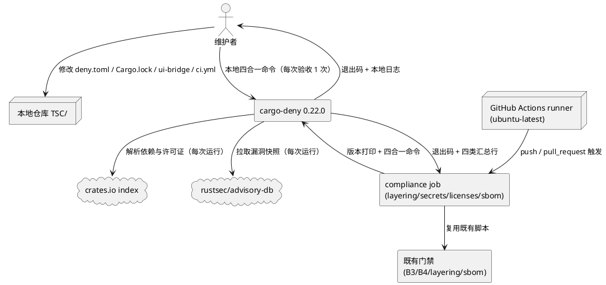
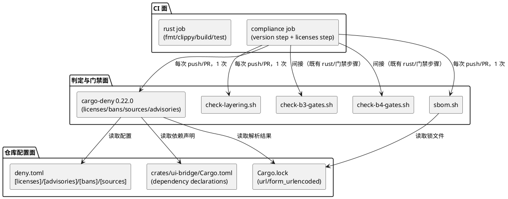
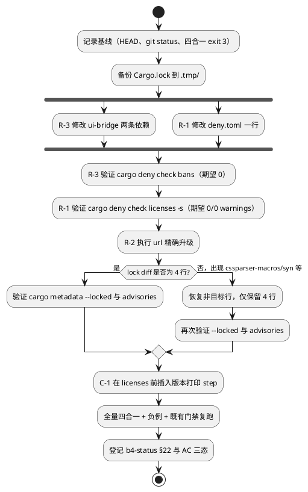
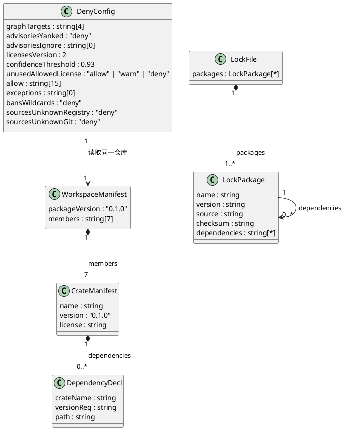

# 一、需求与存量功能关系分析

> 本章只回答“需求要什么、存量已有什么、差在哪、差多少”。结论全部来自 2026-11-22 在本机 `TSC/` 的实测与代码定位；实测证据编号沿用 `spec.md` 的 F-01~F-10，并补充本次设计阶段的 F-11~F-14（见 §1.2.7）。
>
> 本次不是业务功能开发，而是**CI 合规判定的配置与依赖修复**：不新增业务能力，不新增 Rust 接口，不新增测试 target。因此本章的“功能”指可判定的合规行为，而非领域能力。

## 1.1 需求功能与存量功能对比

### 1.1.1 已实现功能

| 需求功能 | 存量功能 | 代码位置 | 匹配度 |
|---|---|---|---|
| CI 在合并前执行 cargo-deny 四类检查 | `compliance` job，步骤含 `licenses` | `.github/workflows/ci.yml:209-247` | 100% |
| cargo-deny 版本固定，避免浮动 | `taiki-e/install-action@v2` + `tool: cargo-deny@0.22.0` | `.github/workflows/ci.yml:219-221` | 100% |
| 本地与 CI 使用同一命令串 | `run: cargo deny check licenses bans sources advisories` | `.github/workflows/ci.yml:240` | 100% |
| workspace 内 crate 版本统一 | `[workspace.package].version = "0.1.0"` | `Cargo.toml:11` | 100% |
| path 依赖“显式版本”的既有写法 | application→domain、desktop→ui-bridge 均带 `version = "0.1.0"` | `crates/application/Cargo.toml:11`、`app/src-tauri/Cargo.toml:12` | 100% |
| 许可证白名单 15 项与置信度阈值 | `[licenses]` 的 `version/confidence-threshold/allow/exceptions` | `deny.toml:15-38` | 100% |
| 漏洞不掩盖 | `[advisories].ignore = []`、`yanked = "deny"` | `deny.toml:10-13` | 100% |
| 通配依赖拒绝 | `[bans].wildcards = "deny"`、`deny = []` | `deny.toml:40-44` | 100% |
| 来源约束拒绝 | `[sources]` 双 `deny` + 单一 `allow-registry` | `deny.toml:46-49` | 100% |
| 分层依赖门禁 | `check-layering.sh` 用 `cargo tree` 断言依赖闭包 | `scripts/check-layering.sh:14-31` | 100% |
| B3/B4 既有门禁 | 7 条规则、`NEW_TARGETS=25`、target 清单 | `scripts/check-b3-gates.sh`、`scripts/check-b4-gates.sh`、`scripts/test-name-inventory.sh:18` | 100% |
| SBOM 从锁文件生成 | `sbom.sh` 调 `gen-sbom.mjs`，CI 上传 artifact | `scripts/sbom.sh:9-18`、`ci.yml:241-247` | 100% |

> 说明：上表是“可直接复用、本次不推翻”的存量能力。它们只保证**检查框架已存在**，不保证判定结果为绿——判定结果正是本次需求要修复的对象。

### 1.1.2 需要扩展的功能

| 需求功能 | 存量功能 | 差异说明 | 扩展方向 |
|---|---|---|---|
| 白名单项未被依赖图命中时不再产生诊断噪音 | `[licenses]` 只有 `version/confidence-threshold/allow/exceptions`；0.22.0 对未命中项默认按 `warn` 报 `license-not-encountered` | **输入差异**：缺“未命中诊断级别”这一输入；**业务差异**：默认 `warn` 会输出 3~4 条噪音（CI 截图 3 条、本地 4 条）；**边界差异**：噪音不贡献退出码（实测 `licenses` 单跑退 0） | `deny.toml` 的 `[licenses]` 增 1 行 `unused-allowed-license = "allow"`；`allow` 15 项与 `exceptions = []` 原样保留 |
| `url` 漏洞条目清零 | `Cargo.lock` 中 `url 2.5.8`，命中 `RUSTSEC-2026-0592`（`Url::origin()` 对嵌套 `blob:` 栈溢出） | **输入差异**：版本低于公告 `patched >=2.5.9`；**业务差异**：`advisories` 退 1，四合一退码含 bit1；**边界差异**：2.5.9 **硬依赖** `form_urlencoded = "1.2.3"`（解压 crate 元数据实证），因此 lock 不可能只有 url 一行变化 | 用 `cargo update -p url --precise 2.5.9` 生成锁文件补丁；最终只保留 `url` 与 `form_urlencoded` 的 `version/checksum` 4 行；禁止 `ignore` |
| 两个 path 依赖显式声明版本 | `crates/ui-bridge/Cargo.toml:11-12` 仅有 `path`，无 `version`；cargo metadata 中 req 为 `*` | **输入差异**：缺 `version` 字段；**业务差异**：被 `wildcards="deny"` 判 `error[wildcard]`，`bans` 退 2；**边界差异**：版本值必须与 crate 实际 `package.version` 一致，否则 metadata 解析失败 | 2 行改为 `{ version = "0.1.0", path = "..." }`；顺序沿用仓库既有“version 在前、path 在后”风格；不放宽 `wildcards` |
| CI 日志可追溯 cargo-deny 版本 | `compliance` job 只有安装 action，无版本打印步骤 | **输入差异**：日志缺版本证据；**业务差异**：事后无法区分“配置问题”与“版本行为差异”；**边界差异**：不能把版本打印塞进 `licenses` 的 run 串，否则违反“命令串逐字符一致” | 在 `- name: licenses` **之前**插入独立 step `cargo-deny-version`（+2 行）；不改 action、不改命令串 |
| 修复事实可审计 | `docs/progress/b4-status.md` §21 只有需求登记与 `pending` 三态 | **输入差异**：缺实现后的命令输出、run-id、lock 实际 diff；**业务差异**：AC 不能从 `pending` 转 `passed` | 文件末尾追加 §22；**不重写 §21**，保留需求时点证据 |

### 1.1.3 需要新增的功能或接口

**结论：本次新增的功能接口为 0。** 不新增 Rust 类型、不新增 crate、不新增依赖、不新增测试 target、不新增脚本、不新增配置文件。

本次唯一“新增物”是**验收用例（command-case）**与**证据产物**，它们不进入生产代码，也不改变 `NEW_TARGETS`：

| 分组 | 用例名（验收标签） | 输入 | 输出/判据 | 依赖 |
|---|---|---|---|---|
| 许可证正向 | `ac105_licenses_ok` | 修复后的 `deny.toml` | 退出码 0 | cargo-deny 0.22.0 |
| 许可证正向 | `ac105_no_not_encountered` | 同上 | `license-not-encountered` 计数 0 | 同上 |
| 许可证正向 | `ac105_allow_list_is_fifteen` | 同上 | `allow` 条目数 15，逐项与基线一致 | 基线 `deny.toml:18-34` |
| 许可证负例 | `ac106_negative_whitelist_rejected` | 临时副本（删 `MIT`） | 退出码 4，含 `error[rejected]` | `--config` 指向临时副本 |
| 许可证负例 | `ac106_negative_not_in_repo` | 仓库工作区 | `git status` 不含负例配置 | 临时目录隔离 |
| 许可证负例 | `ac106_high_risk_absent` | `deny.toml` | 6 类高危标识命中 0 | `grep` |
| 漏洞 | `ac107_advisories_ok` | 升级后的 `Cargo.lock` | 退出码 0 | advisory-db 当日快照 |
| 漏洞 | `ac107_url_at_least_2_5_9` | `Cargo.lock` | `url` 版本 ≥ 2.5.9 | `awk` 提取 |
| 漏洞 | `ac107_no_new_packages` | `Cargo.lock` | 新增 `name =` 计数 0 | `git diff` |
| 漏洞 | `ac107_lock_patch_is_scoped` | `Cargo.lock` | 仅 `url`/`form_urlencoded` 的 4 行 | `git diff --unified=0` |
| 通配 | `ac108_bans_ok` | 修复后的 ui-bridge manifest | 退出码 0 | cargo metadata |
| 通配 | `ac108_wildcards_still_deny` | `deny.toml` | `wildcards = "deny"` 计数 1 | `grep` |
| 通配 | `ac108_ui_bridge_versions_present` | ui-bridge manifest | 两处 `version = "0.1.0"` | `grep` |
| 通配 | `ac108_version_matches_workspace` | 根 `Cargo.toml` + ui-bridge | 两处版本字面量 = workspace 版本 | `awk` 比较 |
| 一致性 | `ac109_tool_version_is_0_22_0` | 本地/CI | 版本前缀 `cargo-deny 0.22.0` | `cargo deny --version` |
| 一致性 | `ac109_command_string_identical` | `ci.yml` | 命令串命中 1，且无 `--deny warnings`/`-A` | `grep` |
| 一致性 | `ac109_local_four_checks_green` | 本地仓库 | 四合一退出码 0 | 网络/advisory 缓存 |
| 一致性 | `ac109_ci_compliance_success` | 远端 run | `compliance` 结论 `success` | `gh` |
| 最小变更 | `ac110_minimal_diff` | `git diff` | deny.toml `1 0`、ui-bridge `2 2`、lock `4 4` | `numstat` |
| 最小变更 | `ac110_src_zero_diff` | `crates/**/src/**` | 输出为空 | `git diff --stat` |
| 最小变更 | `ac110_root_manifest_zero_diff` | 根 `Cargo.toml` | 输出为空 | `git diff` |
| 最小变更 | `ac110_status_registered` | `b4-status.md` | 含 AC-B4-105 与 D-B4-P131，§22 含 135+ | `grep` |

> 口径：这些名字是**证据脚本中的 case 标签**，不是 `#[test]` 函数名。本次不新增测试 target，`scripts/test-name-inventory.sh` 的 `NEW_TARGETS='...'` 保持 25 项不变。若验收方要求“用例名必须出现在 Rust 测试中”，则本需求应被驳回并改判为 `not-applicable`——因为配置修复无法用 Rust 单测表达。

## 1.2 存量功能详细分析

### 1.2.1 `compliance` job 契约

| 维度 | 现状 | 约束/扩展点 |
|---|---|---|
| 触发 | `push`（任意分支）与 `pull_request` | 不在本次范围 |
| Runner | `ubuntu-latest` | Linux 依赖图与本地 Windows 可能不同（解释 3 vs 4 条未命中），**验收不以条数为判据** |
| 超时 | 15 分钟 | 仅多一个版本打印 step，耗时增量可忽略（<1 s） |
| 步骤顺序 | `layering` → `secrets` → `capture-offline` → `g2-claims` → `secrets-docs` → `licenses` → `sbom` → upload | 版本打印必须紧邻 `licenses` 之前，不能插到 `layering` 前 |
| 工具安装 | `taiki-e/install-action@v2`，`cargo-deny@0.22.0` | 不得改为 `latest` 或省略版本（AC-B4-109） |
| 命令串 | `cargo deny check licenses bans sources advisories` | 逐字符冻结；不得追加 `--deny warnings`、`-A`、`-L off` |
| 证据 | 目前只有 `sbom` artifact；cargo-deny 结果只留在 Actions 日志 | 本次**不新增 artifact**，版本与四类汇总行从日志提取；证据契约见 §2.5 |
| 扩展点 | 可插入独立 step；可增加 `run:` | 只允许新增版本打印；不得改既有 step 的 `run` |

### 1.2.2 `deny.toml` 配置契约

| 段落 | 关键契约 | 本次是否触碰 |
|---|---|---|
| `[graph]` | 4 个 target：`x86_64-pc-windows-msvc`、`aarch64-pc-windows-msvc`、`aarch64-apple-darwin`、`x86_64-apple-darwin`；`all-features = true` | 否 |
| `[advisories]` | `version = 2`；`yanked = "deny"`；`ignore = []` | 否（禁止加 `ignore`） |
| `[licenses]` | `version = 2`；`confidence-threshold = 0.93`；`allow` 恰 15 项；`exceptions = []` | **只 +1 行** `unused-allowed-license = "allow"` |
| `[bans]` | `multiple-versions = "warn"`；`wildcards = "deny"`；`highlight = "all"`；`deny = []` | 否（禁止放宽） |
| `[sources]` | `unknown-registry/unknown-git = "deny"`；`allow-registry` 仅 crates.io index | 否（禁止放宽） |

**扩展点**：cargo-deny 0.22.0 的 `[licenses]` 支持 `unused-allowed-license` 标量，取值 `"allow"|"warn"|"deny"`；其语义只控制“白名单项未被依赖图命中”的诊断级别，**不改变**“命中但不在白名单”仍为 `error[rejected]`。该结论由本设计阶段实测 F-11/F-12 复核（见 §1.2.7）。

**约束**：
1. 不得删除 `allow` 任一 entry（15 项冻结）。
2. 不得新增 `deny` 键（0.22.0 已移除该键）。
3. 不得用 `exceptions` 做通配放行。
4. 不得拆分为多个配置文件（AC-B4-105 第 3 条）。

### 1.2.3 `Cargo.lock` 的 `url` / `form_urlencoded` 契约

| 维度 | 现状 | 约束 |
|---|---|---|
| `url` | `version = "2.5.8"`，`source = registry+https://github.com/rust-lang/crates.io-index`，有 checksum | 升级后 `version = "2.5.9"`，source 不变 |
| `form_urlencoded` | `version = "1.2.2"` | `url 2.5.9` 的 manifest 要求 `form_urlencoded = "1.2.3"`，必须同步 |
| 依赖方 | `url` 被 `schemars`、`tao`、`tauri`、`tauri-utils`、`urlpattern`、`wry` 等传递依赖 | 升级不得改变依赖方集合 |
| 包集合 | 锁文件包条目数固定 | 不得新增/删除 `name =` 条目 |
| 一致性 | `cargo build --locked` / `cargo metadata --locked` 必须通过 | 手工编辑 lock 后必须用 `--locked` 复验 |
| 禁止 | 不得用 `[advisories].ignore` 掩盖 | 公告明确 `Solution: Upgrade to >=2.5.9` |

> 关键实测：`cargo update -p url --precise 2.5.9` 还会把 `cssparser-macros` 的依赖从 `syn 3.0.10` 降到 `syn 2.0.119`。这属于 cargo 重新解析的副作用，**不是** `url` 升级的必要条件；设计规定最终 lock 不保留该行（见 §2.4.3）。

### 1.2.4 `crates/ui-bridge` manifest 契约

| 维度 | 现状 | 约束 |
|---|---|---|
| `package.version` | `version.workspace = true` → 实际 `0.1.0` | 不得改为字面量 |
| `license` | `license.workspace = true` | 不得变更 |
| 依赖 | `serde.workspace`、两条无 `version` 的 path 依赖 | 仅补 `version`，不新增/删除依赖 |
| dev 依赖 | `serde_json.workspace` | 不变 |
| wildcard 判定 | cargo-deny 读取 `cargo metadata` 的依赖 req；无 `version` 时 req=`*` | 补 `version = "0.1.0"` 后 req=`^0.1.0` |
| 既有范式 | `meeting-copilot-domain = { version = "0.1.0", path = "../domain" }`（application）；`meeting-copilot-ui-bridge = { version = "0.1.0", path = "../../crates/ui-bridge" }`（src-tauri） | **顺序必须 version 在前、path 在后**，不引入第三种风格 |

### 1.2.5 既有门禁的依赖面

| 门禁 | 读取对象 | 本次变更是否影响 | 依据 |
|---|---|---|---|
| `check-layering.sh` | `cargo tree -p ... --edges normal` | **否**：只补 `version` 属性，不改变依赖边 | `scripts/check-layering.sh:18-31` |
| `check-b3-gates.sh` | `crates/**` 源码与规则 | **否**：`crates/**/src/**` 零 diff | 脚本不读 Cargo/deny |
| `check-b4-gates.sh` | 7 条规则：source/budget/record/outbound/zero-transcript/doc-plan/targets | **否**：无新增 target、无源码改动、`NEW_TARGETS` 25 不变 | `scripts/check-b4-gates.sh:305` |
| `test-name-inventory.sh` | crate target 清单与 `NEW_TARGETS` | **否**：lock 版本变化不产生新 target | `scripts/test-name-inventory.sh:18` |
| `scan-secrets.sh` / `scan-secrets-docs.sh` | 文本密钥模式 | **否**：本次不写密钥、不改文档敏感串 | CI 既有步骤 |
| `sbom.sh` | `Cargo.lock` | **是（预期）**：`url`/`form_urlencoded` 版本会反映在 SBOM | `scripts/sbom.sh:9-18`；不得据此判失败 |
| `cargo fmt` / `clippy` / `test` | 源码 | **否**：无 `.rs` 改动；仍复跑作旁证 | CI rust job |

> 结论：本次变更与既有门禁**正交**，不会破坏任何门禁；但“未破坏”必须由复跑证据证明，不能由“没改源码”推断。

### 1.2.6 冻结面清单

| 冻结项 | 本次要求 | 取证方式 |
|---|---|---|
| `crates/**/src/**` | 零 diff | `git diff --stat HEAD -- 'crates/*/src/**'` 输出为空 |
| 根 `Cargo.toml` | 零 diff | `git diff HEAD -- Cargo.toml` 为空 |
| `scripts/**` | 零 diff | `git diff --stat HEAD -- scripts` 为空 |
| 依赖声明 | 零新增依赖 | `git diff HEAD -- '**/Cargo.toml'` 只含 ui-bridge 两行 |
| `NEW_TARGETS` | 25 项不变 | `grep -m1 '^NEW_TARGETS=' scripts/test-name-inventory.sh` |
| `deny.toml` 非 `[licenses]` 段 | 零 diff | `git diff HEAD -- deny.toml` 只有 1 行新增 |
| `ci.yml` | 只 +2 行版本打印 | `git diff HEAD -- .github/workflows/ci.yml` |
| B4 领域契约 | 全部不变（`GateRecord` 14 等） | 不改 `crates/**`，按定义成立 |

### 1.2.7 设计阶段补充实测（F-11 ~ F-15）

| 编号 | 命令/操作 | 结果 | 用途 |
|---|---|---|---|
| **F-11** | 临时副本 `[licenses]` 增 `unused-allowed-license = "allow"` 后 `cargo deny --config <tmp> check licenses -s` | 退出码 **0**；`license-not-encountered` 计数 **0**；汇总 `licenses ok: 0 errors, 0 warnings, 300 notes` | 复核 spec F-08，确认键位置正确 |
| **F-12** | `grep -v '^  "MIT",$' deny.toml > <tmp>` 后 `cargo deny --config <tmp> check licenses` | 退出码 **4**；`error[rejected]` 计数 **60** | 负例可执行；同时证明白名单外仍被拒 |
| **F-13** | 临时 worktree 中修改 ui-bridge 两条 path 依赖后 `cargo deny check bans` | 退出码 **0**；`error[wildcard]` 计数 **0**；`bans ok` | 证明 `version` 前置写法有效 |
| **F-14** | 临时 worktree 中 `cargo update -p url --precise 2.5.9` 后仅保留 `url`/`form_urlencoded` 4 行，再 `cargo metadata --locked`、`cargo deny check advisories` | metadata 退 **0**；advisories 退 **0**；`RUSTSEC-2026-0592` 计数 **0** | 证明“4 行补丁”合法且可消除漏洞 |
| **F-15** | 临时 worktree 中同时应用 R-1/R-2/R-3 后四合一 | 退出码 **0**；`license-not-encountered`=0、`error[wildcard]`=0、`RUSTSEC-2026-0592`=0；末尾 `advisories ok, bans ok, licenses ok, sources ok` | 达成“compliance 退 0”的直接证据 |

> 环境：`cargo 1.100.0 (3acc79c0c 2026-11-05)`、`cargo-deny 0.22.0`；Windows git-bash；`PATH` 前置 `~/.rustup/toolchains/stable-x86_64-pc-windows-msvc/bin`。worktree 验证后已删除，主工作区未改动 `deny.toml`/`Cargo.lock`/ui-bridge/Cargo.toml。
>
> 补充事实：`url 2.5.9` 解压后的 `Cargo.toml` 明确写 `form_urlencoded = "1.2.3"`，因此 **“lock 仅 url 一行变化”在物理上不可达**；这一点必须在 §2.4.3 与决策登记中显式处理，不能作为“实现偏差”隐去。
# 二、增量设计方案

## 2.0 设计结论速览

| 编号 | 改动 | 文件与位置 | diff 规模 | 目的 | 对应 AC |
|---|---|---|---|---|---|
| **R-1** | `[licenses]` 增 `unused-allowed-license = "allow"` | `deny.toml`，`confidence-threshold` 之后、`allow` 之前 | `+1 0` | 消除 `license-not-encountered` 噪音，不改白名单 | AC-B4-105 |
| **R-2** | `url` 升 `2.5.9`（连带 `form_urlencoded 1.2.3`） | `Cargo.lock` 的 `url` 与 `form_urlencoded` 条目 | `4 4` | 真实消除 `RUSTSEC-2026-0592`，不用 `ignore` | AC-B4-107 |
| **R-3** | 两条 path 依赖补 `version = "0.1.0"` | `crates/ui-bridge/Cargo.toml:11-12` | `2 2` | 消除 `error[wildcard]`，不放宽 `wildcards` | AC-B4-108 |
| **C-1** | `licenses` 前打印 `cargo deny --version` | `.github/workflows/ci.yml`，`- name: licenses` 之前 | `+2 0` | 版本证据进入日志，便于定位 | AC-B4-109 |
| **D-1** | 追加实现登记 §22 | `docs/progress/b4-status.md` 末尾 | 追加一节 | AC 三态、证据、run-id、偏差 | AC-B4-110 |

**一句话结论**：R-1 + R-2 + R-3 **必须同批**。缺 R-1 只保留 4 条 warning（退出码仍为 0，属噪音复现）；缺 R-2 退 `1`；缺 R-3 退 `2`。三处同时修复后，实测四合一退 **0**（F-15）。

**与冻结口径的差异（必须提请注意）**：
1. `Cargo.lock` **不可能只变 `url` 一行**：`url 2.5.9` 硬依赖 `form_urlencoded 1.2.3`，最终为 **4 行**（两个包的 `version` + `checksum`）。判定口径调整为“包集合不变 + 变更仅限 `url`/`form_urlencoded` 补丁行”，见 D-B4-P138。
2. `ui-bridge` 的“+2 行”指**新增 2 个属性**；`git diff --numstat` 实际为 **`2 2`**（两行替换），与 AC-B4-110 ② 允许的 `2 2` 一致。
3. `spec.md §8.3` 的负例 `awk` 会连同 `]` 一起删除 `allow` 数组（实测配置解析失败，不是 `error[rejected]`）；设计改用 `grep -v '^  "MIT",$'`，见 D-B4-P140。

## 2.1 实现模型

### 2.1.1 上下文视图



图中只显示交互接口与调用频率，不展示 `deny.toml` 内部键结构，也不展示 cargo-deny 的解析算法。CI 侧与本地侧使用**同一份** `deny.toml`、同一 `Cargo.lock`、同一命令串。

### 2.1.2 服务/组件总体架构



组件职责：
1. `CFG`：唯一许可证/漏洞/通配/来源判定配置；本次只在 `[licenses]` 增 1 行。
2. `UIB`：本次只改 2 条依赖声明的 `version` 属性；不改包名、license、依赖集合。
3. `LOCK`：本次只改 `url`/`form_urlencoded` 的补丁版本；包集合不变。
4. `CI`：本次只增版本打印 step；四合一命令串逐字符不变。
5. `LAYER`/`B3`/`B4`/`SBOM`：本次**零改动**，只复跑取证。

### 2.1.3 实现设计文档

**修复顺序（串行，避免交叉污染）**：



**为什么先 R-3/R-1、后 R-2**：
1. R-3 与 R-1 不依赖网络，可先消除两个确定的失败位，缩小后续排查面。
2. R-2 需要 crates.io 索引与 advisory-db，且会触发 cargo 重新解析，放在最后可避免其副作用干扰前两项的判定。
3. 若 R-2 失败，前两项仍可独立验证并保留，便于分条回滚。

**退出码判定（0.22.0 位掩码）**：

| 检查 | 失败位 | 本次修复前 | 本次修复后 |
|---|---|---|---|
| `advisories` | `1` | 1（RUSTSEC-2026-0592） | 0 |
| `bans` | `2` | 2（2 个 wildcard） | 0 |
| `licenses` | `4` | 0（4 warnings 不贡献退出码） | 0 |
| `sources` | `8` | 0 | 0 |
| **四合一** | 按位或 | **3 = 1\|2** | **0** |

**关键分支与处理策略**：

| 分支 | 触发条件 | 处理策略 | 判据 |
|---|---|---|---|
| B-1 | `bans` 仍有 `error[wildcard]` | 检查 `version` 是否写进正确依赖、是否被 rustfmt 改行 | 退出码非 0 → 不继续 |
| B-2 | `licenses` 仍有 `license-not-encountered` | 检查键名/所在表（必须是 `[licenses]`、下划线写法、值 `"allow"`） | 计数非 0 → AC-105 失败 |
| B-3 | `advisories` 仍报 `RUSTSEC-2026-0592` | 检查 lock 是否真为 2.5.9；禁止改 `ignore` | 命中非 0 → AC-107 失败 |
| B-4 | lock diff 多于 4 行 | 只保留 `url`/`form_urlencoded` 的 4 行；其余行 `git checkout` 恢复 | `numstat` 非 `4 4` → 暂停 |
| B-5 | `cargo metadata --locked` 失败 | 说明 lock 与 manifest 不一致，回退 lock 重做 | 退出码非 0 → 不提交 |
| B-6 | 负例退出码不是 4 | 检查 `--config` 是否指向临时副本、是否误用 `-A` | 退出码 ≠4 → AC-106 失败 |

**事务/一致性设计**：本次没有数据库事务。一致性边界是“同一提交内 `deny.toml` + `Cargo.lock` + ui-bridge manifest + `ci.yml` 必须同时生效”；禁止只提交其中一部分，否则会出现“本地绿、CI 红”或反之。

## 2.2 接口设计

### 2.2.1 总体设计

| 接口 | 形态 | 稳定性 | 变更策略 | 消费方 |
|---|---|---|---|---|
| `[licenses].unused-allowed-license` | TOML 配置键 | 稳定（0.22.0 支持） | 只增不改；未来版本若不支持则显式登记 | cargo-deny |
| ui-bridge 依赖版本声明 | TOML inline table | 稳定 | 与 `[workspace.package].version` 同步 | cargo metadata / cargo-deny |
| `Cargo.lock` 的 `url`/`form_urlencoded` | 锁文件条目 | 稳定 | 仅补丁升级；source 不变 | cargo / cargo-deny / sbom |
| `cargo-deny-version` CI step | YAML step | 稳定 | 只增不删；位于 `licenses` 前 | GitHub Actions 日志 |
| 四合一命令 | 命令行契约 | **冻结** | 逐字符不变 | 本地/CI |
| 证据文件命名 | 文件路径契约 | 实验 | 可按日期调整，不进入仓库 | 验收者 |

### 2.2.2 接口清单

#### 接口 A：`[licenses].unused-allowed-license`

- **签名（配置形态）**：

```toml
[licenses]
version = 2
confidence-threshold = 0.93
unused-allowed-license = "allow"
allow = [ ... 15 项原样 ... ]
exceptions = []
```

- **业务说明**：控制“`allow` 中列出、但依赖图未命中”的诊断级别。取 `"allow"` 时该情形不产生诊断、不贡献退出码；取默认 `"warn"` 时产生 `warning[license-not-encountered]`。
- **前置条件**：`[licenses].version = 2`；cargo-deny ≥ 0.22.0；`allow` 列表非空。
- **后置条件**：`cargo deny check licenses -s` 汇总行 `licenses ok: 0 errors, 0 warnings`；退出码 0。
- **异常映射**：

| 异常 | 表现 | 处置 |
|---|---|---|
| 键名写成 `unused_allowed_license` | 配置未知字段/不生效；仍有 4 条 warning | 改为连字符写法 |
| 放进 `[bans]` | 该键不生效；licenses 仍 warn | 移到 `[licenses]` |
| 值写成 `"warn"` | 仍有 warning（退出码 0） | 按需求只能取 `"allow"` |
| cargo-deny < 0.22.0 不识别 | 配置校验阶段报错，命令终止 | 对齐 0.22.0，禁止静默降级 |

- **调用示例**：

```bash
cargo deny check licenses
cargo deny check licenses -s
```

#### 接口 B：ui-bridge 依赖版本声明

- **签名（配置形态）**：

```toml
meeting-copilot-application = { version = "0.1.0", path = "../application" }
meeting-copilot-domain = { version = "0.1.0", path = "../domain" }
```

- **业务说明**：为 workspace 内 path 依赖提供显式版本要求，使 `cargo metadata` 的 req 从 `*` 变为 `^0.1.0`，从而不被 `[bans].wildcards = "deny"` 判为通配。
- **前置条件**：`[workspace.package].version = "0.1.0"`；被依赖 crate 的 `package.version` 为 `0.1.0`；path 指向真实目录。
- **后置条件**：`cargo metadata --locked` 成功；`cargo deny check bans` 退出码 0；依赖图边不变。
- **异常映射**：

| 异常 | 表现 | 处置 |
|---|---|---|
| 写成 `version = "0.1"` | 与 crate 实际版本不匹配，metadata 解析失败 | 写完整 `0.1.0` |
| 写成 `version.workspace = true` | 依赖表会去 `[workspace.dependencies]` 找同名条目，本仓库未定义 | 使用字面量 `0.1.0` |
| 版本与 workspace 漂移 | 未来升版后 metadata 失败或 wildcard 复现 | 用 `ac108_version_matches_workspace` 守卫 |
| 只补一条 | `bans` 仍有 1 个 wildcard，退 2 | 两条同批补 |

- **调用示例**：

```bash
cargo metadata --locked --format-version 1 > /dev/null
cargo deny check bans
```

#### 接口 C：`Cargo.lock` 的 `url` / `form_urlencoded`

- **签名（锁文件形态）**：

```toml
[[package]]
name = "form_urlencoded"
version = "1.2.3"
source = "registry+https://github.com/rust-lang/crates.io-index"
checksum = "<由 cargo update 生成>"

[[package]]
name = "url"
version = "2.5.9"
source = "registry+https://github.com/rust-lang/crates.io-index"
checksum = "<由 cargo update 生成>"
```

- **业务说明**：把 `url` 升到公告 `patched >=2.5.9`，真实消除 `RUSTSEC-2026-0592`；`form_urlencoded` 是 2.5.9 的硬依赖下限，必须同步。
- **前置条件**：可访问 crates.io 索引（或本地已有 `url-2.5.9.crate` / `form_urlencoded-1.2.3.crate`）；`Cargo.toml` 中无 `<2.5.9` 的上游约束。
- **后置条件**：`cargo metadata --locked` 退 0；`cargo deny check advisories` 退 0；`RUSTSEC-2026-0592` 命中 0；包集合不变。
- **异常映射**：

| 异常 | 表现 | 处置 |
|---|---|---|
| 2.5.9 与上游约束冲突 | `cargo update` 失败或仍解析 2.5.8 | 回到规格层裁决；禁止 `ignore` |
| 连带更新其他包（如 `cssparser-macros` 的 `syn`） | lock diff >4 行 | 恢复非目标行，仅保留 4 行；见 §2.4.3 |
| 手动伪造 checksum | `cargo build --locked` 校验失败 | checksum 必须由 cargo 生成 |
| 离线且无缓存 | 更新失败 | 先联网取证；离线时 AC-107 记 `not-applicable` |

- **调用示例**：

```bash
cargo update -p url --precise 2.5.9
cargo metadata --locked --format-version 1 > /dev/null
cargo deny check advisories
```

#### 接口 D：`cargo-deny-version` CI step

- **签名（YAML 形态）**：

```yaml
      - name: cargo-deny-version
        run: cargo deny --version
      - name: licenses
        run: cargo deny check licenses bans sources advisories
```

- **业务说明**：在 `licenses` 之前把工具版本写入 Actions 日志，作为“本地/CI 同版”的机器证据。
- **前置条件**：`taiki-e/install-action` 已安装 `cargo-deny@0.22.0`；step 位于同一 job。
- **后置条件**：日志出现 `cargo-deny 0.22.0`；`licenses` 的 run 串不变。
- **异常映射**：

| 异常 | 表现 | 处置 |
|---|---|---|
| 版本打印塞进 `licenses.run` | 命令串不再“恰为”四合一，AC-109 ③ 失败 | 拆为独立 step |
| step 放到 `layering` 前 | 仍在 `licenses` 前，但证据位置不紧邻 | 必须紧邻 `licenses` |
| action 版本被改为 `latest` | 版本可能漂移 | 保持 `cargo-deny@0.22.0` |

- **调用示例**：

```bash
gh run view <run-id> --log | grep 'cargo-deny 0.22.0'
```

#### 接口 E：四合一命令

- **签名（命令行）**：

```bash
cargo deny check licenses bans sources advisories
```

- **业务说明**：本地与 CI 的唯一判定入口；退出码按位掩码。
- **前置条件**：cargo-deny 0.22.0；`PATH` 中 `cargo` 可被 cargo-deny 调用（Windows 需前置 toolchain 目录）。
- **后置条件**：退出码 0 表示四类全绿；汇总行包含四条 `ok`。
- **异常映射**：

| 异常 | 表现 | 处置 |
|---|---|---|
| `cargo metadata exited with an error` | 退 1/127，无判定输出 | 环境问题，调 `PATH` 后重跑 |
| 只跑单项就宣称全绿 | 可能漏掉其他位 | 必须跑四合一 |
| 加 `--deny warnings` | 把 warning 变成失败，口径分叉 | 禁止 |

- **调用示例**：

```bash
cargo deny check licenses bans sources advisories; echo "all=$?"
```

## 2.3 数据模型

### 2.3.1 设计目标

1. **配置对象必须与依赖图一致**：`allow` 15 项、`wildcards` 级别、`ignore` 空数组是判定输入，不允许“文档说一套、文件写一套”。
2. **锁文件包集合稳定**：只允许 `url`/`form_urlencoded` 的补丁版本变化，不允许新增/删除包。
3. **证据可机器判定**：每个 AC 至少有一条 `grep`/`awk`/`numstat` 命令，不依赖人工目测。
4. **与存量数据兼容**：`Cargo.lock` 仍为 lockfile v3/v4（当前格式），`deny.toml` 仍为 version 2；不引入新配置文件。
5. **无领域对象变更**：本次不触碰 `GateRecord`、`GateCounter`、`GateRejectReason` 等任何 B4 契约。

### 2.3.2 模型实现



说明：
1. `unusedAllowedLicense` 是本次唯一新增的配置字段；默认值为 `"warn"`，本次显式取 `"allow"`。
2. `DependencyDecl.versionReq` 在修复前为空（`*`），修复后为 `^0.1.0`；`path` 不变。
3. `LockPackage` 的 `version`/`checksum` 是**必需业务字段**（非模板所指的 `id`/`create_time` 类技术字段），因为 cargo 用它们校验完整性。
4. 生命周期：配置与 manifest 由 cargo/cargo-deny 在每次命令执行时读取，进程结束即释放；锁文件由 cargo 写入，仓库持久化。
5. 持久化策略：文件系统（TOML/YAML），无数据库、无缓存层。

## 2.4 变更清单与 diff 形态

### 2.4.1 `deny.toml`（R-1，`+1 0`）

**确切位置**：`[licenses]` 段内，`confidence-threshold = 0.93`（当前第 17 行）之后、`allow = [`（当前第 18 行）之前。

```diff
 [licenses]
 version = 2
 confidence-threshold = 0.93
+unused-allowed-license = "allow"
 allow = [
   "MIT",
```

**为什么放这里**：
1. 与 `version`/`confidence-threshold` 同属标量配置，语义上先声明“诊断级别”，再列白名单。
2. 放在 `allow` 之前，不打断 15 项数组的连续缩进，diff 只有 1 行。
3. 不放在文件末尾，避免被误认为 `[bans]` 的键。

**验证命令**：

```bash
grep -c 'unused-allowed-license = "allow"' deny.toml          # 1
git diff --numstat HEAD -- deny.toml                          # 1	0
awk '/^allow = \[/{f=1;next} f&&/^\]/{f=0} f&&/^  "/{c++} END{print c+0}' deny.toml  # 15
```

> `deny.toml` 原文件**末尾无换行**。插入 1 行时必须保持该状态，否则 `git diff --numstat` 会把整文件记为变更（行数不再是 `1 0`），AC-110 ① 失败。若出现整文件 diff，用 `printf`/编辑器设置恢复“无末尾换行”后重做。

**异常**：
- 若 `awk` 计数不是 15，说明 `allow` 被动过，立即回退。
- 若 `cargo deny check licenses` 仍出现 `license-not-encountered`，检查键名与所在表。

### 2.4.2 `crates/ui-bridge/Cargo.toml`（R-3，`2 2`）

**确切位置**：第 11、12 行（`[dependencies]` 内）。

```diff
-meeting-copilot-application = { path = "../application" }
-meeting-copilot-domain = { path = "../domain" }
+meeting-copilot-application = { version = "0.1.0", path = "../application" }
+meeting-copilot-domain = { version = "0.1.0", path = "../domain" }
```

**为什么 `version` 在前、`path` 在后**：
1. 与 `crates/application/Cargo.toml:11` 的 `meeting-copilot-domain = { version = "0.1.0", path = "../domain" }` 逐字同形。
2. 与 `app/src-tauri/Cargo.toml:12` 的 `meeting-copilot-ui-bridge = { version = "0.1.0", path = "../../crates/ui-bridge" }` 同形。
3. 不引入第三种排序，降低未来 rustfmt/人工编辑的漂移概率。

**为什么不用 `version.workspace = true`**：
- 依赖表中的 `version.workspace = true` 会到 `[workspace.dependencies]` 查找**同名依赖条目**；本仓库的 `[workspace.dependencies]` 只有 `serde`/`serde_json`/`thiserror`/`tracing`，没有 `meeting-copilot-application`/`meeting-copilot-domain`。
- 若强行添加 `[workspace.dependencies]` 条目，会扩大根 `Cargo.toml` 变更面，违反 AC-B4-110 ④（根 manifest 零 diff）。
- 因此写死 `0.1.0`，并用验收用例守卫与 `[workspace.package].version` 一致。

**一致性守卫**：

```bash
ws="$(awk -F'"' '/^\[workspace.package\]/{f=1;next} f&&/^version *=/{print $2;exit}' Cargo.toml)"
test "$(grep -c "version = \"${ws}\", path = \"../application\"" crates/ui-bridge/Cargo.toml)" -eq 1
test "$(grep -c "version = \"${ws}\", path = \"../domain\"" crates/ui-bridge/Cargo.toml)" -eq 1
cargo metadata --locked --format-version 1 > /dev/null
```

**验证命令**：

```bash
git diff --numstat HEAD -- crates/ui-bridge/Cargo.toml        # 2	2
grep -c 'version = "0.1.0"' crates/ui-bridge/Cargo.toml       # 2
cargo deny check bans                                        # 0；error[wildcard] 计数 0
```

**异常**：
- 若 `cargo metadata` 报版本不匹配，检查被依赖 crate 的 `package.version` 是否仍为 `0.1.0`。
- 若 `bans` 仍有 wildcard，检查是否只改了一条，或 `version` 被写进 `[dev-dependencies]`。

### 2.4.3 `Cargo.lock`（R-2，`4 4`，非字面“仅 url 行”）

**确切位置**：
- `form_urlencoded`：当前第 1013-1016 行（`version`/`checksum`）。
- `url`：当前第 4432-4435 行（`version`/`checksum`）。

**目标 diff 形态**（checksum 由 cargo 生成，设计中不写死）：

```diff
 [[package]]
 name = "form_urlencoded"
-version = "1.2.2"
+version = "1.2.3"
 source = "registry+https://github.com/rust-lang/crates.io-index"
-checksum = "cb4cb245038516f5f85277875cdaa4f7d2c9a0fa0468de06ed190163b1581fcf"
+checksum = "<cargo 生成>"
 dependencies = [
  "percent-encoding",
 ]
@@
 [[package]]
 name = "url"
-version = "2.5.8"
+version = "2.5.9"
 source = "registry+https://github.com/rust-lang/crates.io-index"
-checksum = "ff67a8a4397373c3ef660812acab3268222035010ab8680ec4215f38ba3d0eed"
+checksum = "<cargo 生成>"
 dependencies = [
  "form_urlencoded",
  "idna",
```

**执行策略（关键，避免 `syn` 被误降）**：

1. 备份：`cp Cargo.lock .tmp/ci-deny-repair/Cargo.lock.before`。
2. 执行：`cargo update -p url --precise 2.5.9`。
3. **立即检查**：`git diff --numstat HEAD -- Cargo.lock`。
   - 若为 `4 4`：直接进入第 4 步。
   - 若大于 `4 4`：查看 `git diff --unified=0`；实测会多出 `cssparser-macros` 的 `- "syn 3.0.10"` / `+ "syn 2.0.119"`。该行不是 url 升级的必要条件，恢复为原值（或从 `Cargo.lock.before` 摘回该行）。
4. **再次检查**：`git diff --numstat` 必须回到 `4 4`；`git diff --unified=0` 只含 `url`/`form_urlencoded` 的 `version`/`checksum`。
5. 验证：`cargo metadata --locked --format-version 1` 退 0；`cargo deny check advisories` 退 0。

**为什么不能直接接受 `cargo update` 的全部结果**：
- `cssparser-macros` 的 `syn` 降级会改变 proc-macro 解析链，属于非必要变更，且会让 AC-B4-110 的“最小变更”判定失败。
- 恢复 `syn 3.0.10` 后 `cargo metadata --locked` 仍退 0（F-14），说明锁文件合法；这比“接受 cargo 的次优解”更符合最小变更要求。

**验证命令**：

```bash
git diff --numstat HEAD -- Cargo.lock                                    # 4	4
git diff --unified=0 HEAD -- Cargo.lock | grep -E '^[+-](version|checksum)'  # 仅 4 行
git diff HEAD -- Cargo.lock | grep -c '^+name = '                        # 0
git diff HEAD -- Cargo.lock | grep -c '^-name = '                        # 0
awk '/^name = "url"/{f=1} f&&/^version/{print;exit}' Cargo.lock           # version = "2.5.9"
cargo metadata --locked --format-version 1 > /dev/null                    # 0
cargo deny check advisories                                              # 0；RUSTSEC 命中 0
```

**异常**：
- `cargo update` 报“找不到 2.5.9”：检查索引/网络；离线记为 `not-applicable`，不得改 `ignore`。
- `cargo metadata --locked` 失败：说明 lock 被手工改坏；从 `Cargo.lock.before` 重做。
- 包集合变化：立即回退并上报，不得用“只是补丁升级”解释新增包。

### 2.4.4 `.github/workflows/ci.yml`（C-1，`+2 0`）

**确切位置**：`compliance` job 内，`- name: licenses` 之前；当前 `licenses` 在第 239-240 行。

```diff
       - name: secrets-docs (C1)
         timeout-minutes: 5
         run: bash scripts/scan-secrets-docs.sh --all-md
+      - name: cargo-deny-version
+        run: cargo deny --version
       - name: licenses
         run: cargo deny check licenses bans sources advisories
```

**为什么不把版本打印塞进 `licenses.run`**：
1. `spec.md §7.5-1` 要求 `licenses` 的 run 命令“必须恰为”四合一命令串；多行 run 会破坏“恰为”。
2. AC-B4-109 ③ 要求命令串 `grep -c` = 1；独立 step 不改变该计数。
3. AC-B4-109 ④ 要求版本出现在 `licenses` 前 3 行内；独立 step 的 `run` 行正好在 `licenses` 前 2 行。

**验证命令**：

```bash
git diff --numstat HEAD -- .github/workflows/ci.yml                       # 2	0
grep -c 'cargo deny check licenses bans sources advisories' .github/workflows/ci.yml  # 1
awk '/- name: licenses/{print NR}' .github/workflows/ci.yml               # 行号 N
sed -n "$(( $(awk '/- name: licenses/{print NR;exit}' .github/workflows/ci.yml) - 3 )),$(( $(awk '/- name: licenses/{print NR;exit}' .github/workflows/ci.yml) - 1 ))p" .github/workflows/ci.yml | grep -c 'cargo deny --version'  # ≥1
grep -c 'cargo-deny@0.22.0' .github/workflows/ci.yml                      # 1
grep -cE 'unused-allowed-license|--deny warnings' .github/workflows/ci.yml # 0
```

**异常**：
- 若 `grep -c 'cargo deny check licenses bans sources advisories'` 为 0 或 2，说明命令串被改动/重复，立即回退。
- 若版本 step 被放到 `licenses` 后，AC-109 的“前 3 行”断言失败。

### 2.4.5 `docs/progress/b4-status.md`（D-1，追加 §22）

**位置**：文件末尾，紧接 §21 之后追加 `## §22 实现登记（CI cargo-deny 修复）`；**不重写 §21**。

**必须包含**：

| 项 | 内容 |
|---|---|
| 基线 | `HEAD`、修复前四合一退出码 3、F-11~F-15 实测摘要 |
| 变更集 | R-1/R-2/R-3/C-1/D-1 的文件与 numstat（含 `4 4` 的 lock 实际形态） |
| 偏差 | `form_urlencoded` 1.2.3 的必要性、`cssparser-macros/syn` 副作用的恢复、负例命令对 spec §8.3 的修正 |
| AC 三态 | AC-B4-105~110 逐条 `passed`/`pending`/`not-applicable` + 证据 |
| CI 证据 | run-id、`compliance` 结论、版本行、四条汇总行 |
| 复跑纪律 | `advisories` 取证日期；跨日重跑 |
| 决策 | D-B4-P135~P143 |
| 边界 | 不改源码、不新增依赖/target、`NEW_TARGETS=25`、B3/B4/layering 复跑结果 |

**验证命令**：

```bash
grep -c 'AC-B4-105' docs/progress/b4-status.md      # ≥1（§21 已有）
grep -c 'D-B4-P131' docs/progress/b4-status.md      # ≥1（§21 已有）
grep -c 'D-B4-P135' docs/progress/b4-status.md      # ≥1（§22 新增）
grep -c '^## §22' docs/progress/b4-status.md        # 1
```
## 2.5 验证方案与证据产物

### 2.5.1 环境前置

每个 shell 会话执行一次（Windows git-bash，与 `b4-status.md` §6 同口径）：

```bash
export PATH="$HOME/.rustup/toolchains/stable-x86_64-pc-windows-msvc/bin:$HOME/.cargo/bin:$PATH"
export TEMP="$PWD/.tmp/test-temp"
export TMP="$TEMP"
mkdir -p "$TEMP"
```

硬性环境要求：
1. `cargo 1.100.0`；`cargo-deny 0.22.0`。
2. `cargo` 必须可被 cargo-deny 内部调用；Windows 下未前置 toolchain 目录会报 `cargo metadata exited with an error`，该失败属环境问题，不计入 AC 判定。
3. `advisories` 需要网络或本地 advisory 缓存；离线时 AC-B4-107 记 `not-applicable`，不得宣称 `passed`。
4. 证据目录：`export EVID="$PWD/.tmp/ci-deny-repair/$(date +%Y%m%d)"`；`mkdir -p "$EVID"`。`.tmp/` 已在 `.gitignore`，证据不进入仓库。

### 2.5.2 本地正向命令（AC-B4-105/107/108/109）

```bash
cargo deny --version                                          >  "$EVID/00-version.log" 2>&1
cargo deny check licenses                                     >  "$EVID/10-licenses.log" 2>&1; echo "lic=$?"
cargo deny check bans                                         >  "$EVID/20-bans.log" 2>&1;     echo "bans=$?"
cargo deny check advisories                                   >  "$EVID/30-advisories.log" 2>&1; echo "adv=$?"
cargo deny check sources                                      >  "$EVID/40-sources.log" 2>&1;  echo "src=$?"
cargo deny check licenses bans sources advisories             >  "$EVID/50-all.log" 2>&1;      echo "all=$?"
cargo deny check licenses -s                                  >  "$EVID/51-licenses-summary.log" 2>&1
```

期望：

| 命令 | 期望 | 说明 |
|---|---|---|
| `lic` | 0 | 许可证通过；warning 计数不参与退出码 |
| `bans` | 0 | `bans ok`；`multiple-versions` 仍为 warn，允许 15 条 duplicate |
| `adv` | 0 | `advisories ok`；不得出现 `RUSTSEC-2026-0592` |
| `src` | 0 | `sources ok` |
| `all` | 0 | 四条汇总行均 `ok` |
| `-s` 汇总 | `licenses ok: 0 errors, 0 warnings` | 机器可 grep |

### 2.5.3 负例验证（AC-B4-106）

**关键修正**：`spec.md §8.3` 给出的 `awk` 命令会把整个 `allow` 数组（含 `]`）删掉，生成非法配置，cargo-deny 在解析阶段失败，**不会**产生 `error[rejected]`。设计改用 `grep -v` 精确删除 `"MIT"` 一行：

```bash
NEG="$TEMP/deny_negative.toml"
grep -v '^  "MIT",$' deny.toml > "$NEG"

# 前置断言：allow 条目从 15 减到 14，且仅删 MIT
allow_count() { awk '/^allow = \[/{f=1;next} f&&/^\]/{f=0} f&&/^  "/{c++} END{print c+0}' "$1"; }
test "$(allow_count deny.toml)" -eq 15
test "$(allow_count "$NEG")" -eq 14
test "$(grep -c '^  "MIT",$' "$NEG")" -eq 0

cargo deny --config "$NEG" check licenses > "$EVID/60-negative.log" 2>&1
echo "neg=$?"                                                  # 期望 4
grep -c 'error\[rejected\]' "$EVID/60-negative.log"           # 期望 ≥1（实测 60）
grep -c 'license-not-allowed\|failed to satisfy license requirements' "$EVID/60-negative.log"  # ≥1

# 负例不得入库
git status --short | grep -c 'deny_negative'                  # 期望 0
```

> **不要用 `diff` 行数判定负例副本**：原 `deny.toml` 末尾无换行，`grep -v` 输出会补换行，`diff` 会显示整文件差异（实测 `1,49c1,48`）。只用 `allow_count` 与 `MIT` 计数判定“只删 1 项”。

**负例为什么必须用临时副本**：
1. 若直接改仓库 `deny.toml`，会把“白名单外仍拒绝”的证明变成“仓库配置已收紧”，破坏 AC-B4-110 的最小变更。
2. `--config` 指向 `$TEMP` 下的副本，cargo-deny 只读取该副本，不改仓库文件。
3. 负例不进入 CI：CI 每次跑负例会增加耗时与临时文件风险；CI 侧用“白名单 15 项 + 高危标识零命中”的静态断言守卫（见 `ac106_high_risk_absent`）。

### 2.5.4 CI 侧证据（AC-B4-109）

```bash
gh run view <run-id> --log | grep -E 'cargo-deny 0\.22\.0|licenses ok|bans ok|advisories ok|sources ok'
gh run view <run-id> --json jobs --jq '.jobs[] | select(.name|startswith("compliance")) | .conclusion'
gh run view <run-id> --json jobs --jq '.jobs[] | select(.name|startswith("compliance")) | .steps[] | select(.name=="cargo-deny-version") | .conclusion'
```

期望：
1. 版本行 `cargo-deny 0.22.0` 存在。
2. 四条汇总行均 `ok`。
3. `compliance` 结论为 `success`。
4. `cargo-deny-version` step 结论为 `success`。

**证据产物**：CI 不新增 artifact；证据以 Actions 日志为准（`gh run view --log` 可导出）。`sbom` artifact 中 `url`/`form_urlencoded` 版本变化属预期，不作为失败判据。

### 2.5.5 AC-B4-105~110 验收用例表

| AC | 用例名 | 命令（摘要） | 期望 | 证据 |
|---|---|---|---|---|
| **105** | `ac105_licenses_ok` | `cargo deny check licenses; echo $?` | 0 | `10-licenses.log` |
| 105 | `ac105_no_not_encountered` | `cargo deny check licenses 2>&1 \| grep -c 'license-not-encountered'` | 0 | 同上 |
| 105 | `ac105_summary_zero_two` | `cargo deny check licenses -s 2>&1 \| grep -cE 'licenses ok: 0 errors, 0 warnings'` | ≥1 | `51-licenses-summary.log` |
| 105 | `ac105_allow_list_is_fifteen` | `awk` 提取 `allow = [` 到 `]` 之间条目数；与基线逐项 `diff` | 15；diff 为空 | `deny.toml` 基线 |
| **106** | `ac106_negative_whitelist_rejected` | `cargo deny --config "$NEG" check licenses; echo $?` | 4 | `60-negative.log` |
| 106 | `ac106_negative_has_rejected` | `grep -c 'error\[rejected\]'` | ≥1 | 同上 |
| 106 | `ac106_negative_not_in_repo` | `git status --short \| grep -c 'deny_negative'` | 0 | `git status` |
| 106 | `ac106_high_risk_absent` | `grep -cE 'AGPL\|GPL-\|SSPL\|OSL-\|EUPL' deny.toml` | 0 | `deny.toml` |
| **107** | `ac107_advisories_ok` | `cargo deny check advisories; echo $?` | 0 | `30-advisories.log` |
| 107 | `ac107_no_rustsec_0592` | `grep -c 'RUSTSEC-2026-0592'` | 0 | 同上 |
| 107 | `ac107_url_at_least_2_5_9` | `awk '/^name = "url"/{f=1} f&&/^version/{print;exit}' Cargo.lock` | `version = "2.5.9"` 或更高 `2.5.x` | `Cargo.lock` |
| 107 | `ac107_no_new_packages` | `git diff HEAD -- Cargo.lock \| grep -c '^+name = '` | 0 | `lock.diff` |
| 107 | `ac107_lock_patch_is_scoped` | `git diff --numstat HEAD -- Cargo.lock` | `4 4`；仅 `url`/`form_urlencoded` 的 version/checksum | `lock.diff` |
| **108** | `ac108_bans_ok` | `cargo deny check bans; echo $?` | 0 | `20-bans.log` |
| 108 | `ac108_no_wildcard` | `grep -c 'error\[wildcard\]'` | 0 | 同上 |
| 108 | `ac108_wildcards_still_deny` | `grep -c 'wildcards = "deny"' deny.toml` | 1 | `deny.toml` |
| 108 | `ac108_ui_bridge_versions_present` | `grep -c 'version = "0.1.0"' crates/ui-bridge/Cargo.toml` | 2 | manifest |
| 108 | `ac108_version_matches_workspace` | `awk` 取 `[workspace.package].version`，与两处字面量比较 | 相等 | 命令 |
| **109** | `ac109_tool_version_is_0_22_0` | `cargo deny --version` | 前缀 `cargo-deny 0.22.0` | `00-version.log` |
| 109 | `ac109_command_string_identical` | `grep -c 'cargo deny check licenses bans sources advisories' ci.yml` | 1 | `ci.yml` |
| 109 | `ac109_local_four_checks_green` | `cargo deny check licenses bans sources advisories; echo $?` | 0 | `50-all.log` |
| 109 | `ac109_version_line_before_licenses` | `awk` 取 `- name: licenses` 前 3 行，`grep -c 'cargo deny --version'` | ≥1 | `ci.yml` |
| 109 | `ac109_ci_compliance_success` | `gh run view <run-id> --json jobs --jq ...` | `success` | `ci-run-id.txt` |
| **110** | `ac110_minimal_diff` | `git diff --numstat HEAD -- deny.toml crates/ui-bridge/Cargo.toml Cargo.lock` | `1 0`、`2 2`、`4 4` | `numstat.txt` |
| 110 | `ac110_src_zero_diff` | `git diff --stat HEAD -- 'crates/*/src/**'` | 输出为空 | 命令 |
| 110 | `ac110_root_manifest_zero_diff` | `git diff HEAD -- Cargo.toml` | 输出为空 | 命令 |
| 110 | `ac110_no_new_dependencies` | `test "$(git diff --name-only HEAD -- '*Cargo.toml' \| grep -v '^crates/ui-bridge/Cargo.toml$' \| wc -l)" -eq 0` | 0（除 ui-bridge 外无 manifest 变更；ui-bridge 只改既有两行） | `numstat.txt` |
| 110 | `ac110_status_registered` | `grep -c 'D-B4-P135' b4-status.md` | ≥1 | `b4-status.md` |

### 2.5.6 用例命名与“无 Rust 测试”的口径

1. **本次不新增 `#[test]`**：AC-B4-105~110 的对象是 TOML/YAML/lockfile 与命令退出码，不是 Rust 行为；写 Rust 单测只能重复断言配置字符串，价值低且会新增 target。
2. **用例名的作用**：仅作为证据文件名/验收记录标签，便于 `b4-status.md §22` 逐条引用；不进入 `scripts/test-name-inventory.sh`，不改变 `NEW_TARGETS=25`。
3. **与 AC-B4-104 同口径**：既有 AC-B4-104 也是“target 实跑，无独立用例”的元判据；本次沿用“命令组即用例”的登记方式。
4. **可机器判定**：每条用例必须有一条命令与一个明确期望值（退出码/计数/字符串匹配），不接受“人工确认”。

### 2.5.7 证据产物清单

| 产物 | 路径/来源 | 是否入库 | 说明 |
|---|---|---|---|
| 基线日志 | `.tmp/ci-deny-repair/<date>/00-baseline.log` | 否 | 修复前四合一 `exit 3` |
| 单项日志 | `<date>/10-licenses.log`、`20-bans.log`、`30-advisories.log`、`40-sources.log` | 否 | 四条单项退出码与汇总行 |
| 四合一日志 | `<date>/50-all.log` | 否 | 最终 `exit 0` + 四条 `ok` |
| 许可证汇总 | `<date>/51-licenses-summary.log` | 否 | `0 errors, 0 warnings` |
| 负例日志 | `<date>/60-negative.log` | 否 | `exit 4` + `error[rejected]` |
| lock 备份 | `<date>/lock.before` | 否 | 回滚用 |
| lock diff | `<date>/lock.diff`、`numstat.txt` | 否 | 4 行范围证据 |
| CI run-id | `<date>/ci-run-id.txt` | 否 | 远端取证入口 |
| 状态登记 | `docs/progress/b4-status.md §22` | **是** | AC 三态与决策 |
| CI 日志 | GitHub Actions `compliance` job | 否 | 版本行 + 四条汇总行 + 结论 |
| SBOM | `docs/compliance/sbom/*.json` artifact | 否（被 ignore） | 版本变化属预期 |

## 2.6 回滚与降级路径

### 2.6.1 分条回滚矩阵

| 改动 | 回滚操作 | 回滚后判定 | 可接受性 |
|---|---|---|---|
| **R-1** | 删除 `unused-allowed-license` 行，或 `git checkout -- deny.toml` | `licenses` 回 4 条 warning、退出码仍 0 | 可单独回滚；CI 仍因 R-2/R-3 红 |
| **R-3** | `git checkout -- crates/ui-bridge/Cargo.toml` | `bans` 回 `exit 2`、`error[wildcard]` 复现 | 可单独回滚；CI 红 |
| **R-2** | `git checkout -- Cargo.lock` | `advisories` 回 `exit 1`、`RUSTSEC-2026-0592` 复现 | **仅紧急回滚**；不得长期停留（漏洞真实存在） |
| **C-1** | 删除 `cargo-deny-version` 两行 | `cargo-deny` 判定结果不变；AC-109 版本证据缺失 | 可回滚；不影响合规结果 |
| **D-1** | 删除 §22 或回退该节 | AC 三态回 `pending` | 可回滚；不影响代码 |
| **全量** | `git revert <commit>`，或对四文件 `git checkout HEAD~1 -- ...` | 回到修复前 `exit 3`；AC-105~110 全部回 `pending` | 仅当需求撤销时 |

**回滚纪律**：
1. 回滚必须以“四文件同批”为单位，禁止只回滚 `deny.toml` 而保留 `Cargo.lock` 升级——那会造成“许可证噪音已消除、漏洞已修、通配仍红”的半成品状态，难以归因。
2. 回滚后必须重跑四合一，并记录退出码；不得用“之前是绿的”替代实测。
3. 回滚 `Cargo.lock` 等同于重新引入已知漏洞，必须在 `b4-status.md §22` 显式登记原因与期限。

### 2.6.2 降级路径

| 场景 | 触发条件 | 降级动作 | 禁止动作 | 判定 |
|---|---|---|---|---|
| D-1 `url 2.5.9` 不可解析 | 索引不可达/上游约束 `<2.5.9` | 暂停实现，上报规格层 | 改 `[advisories].ignore`、降 `url` 回 2.5.8 后宣称通过 | AC-107 `pending`/`not-applicable` |
| D-2 lock 连带变更超界 | `cargo update` 改动 `cssparser-macros` 等非目标包 | 恢复非目标行，仅保留 4 行；仍不行则暂停 | 接受全部 diff、手工伪造 checksum | AC-110 失败则暂停 |
| D-3 cargo-deny 版本不识别新键 | 本地/CI < 0.22.0，配置校验失败 | 对齐到 0.22.0 后重跑 | 降级 cargo-deny、删掉该键、改命令行 `-A` | AC-105 失败 |
| D-4 advisory-db 离线 | 无网络且无本地缓存 | 记 `not-applicable`，待联网重跑 | 引用旧日期证据宣称 `passed` | AC-107 `not-applicable` |
| D-5 CI 网络/registry 抖动 | runner 拉取索引失败 | 重跑 job | 改命令串、加 `--offline` 除外 | 重跑后判定 |
| D-6 负例退出码非 4 | `--config` 指向错误/配置被误改 | 重做临时副本，确认 `grep -v` 只删 1 行 | 用 `-A license-not-allowed` 制造假绿 | AC-106 失败 |

**降级顺序原则**：先降“可观测性”（C-1），再降“噪音消除”（R-1），最后才考虑“漏洞/通配”（R-2/R-3）；**R-2 与 R-3 不可降级为“忽略/放宽”**，只能整体暂停并上报。

### 2.6.3 禁止降级项（硬红线）

1. 禁止 `[advisories].ignore` 加入 `RUSTSEC-2026-0592` 或任何漏洞。
2. 禁止把 `[bans].wildcards` 改为 `"warn"`/`"allow"`，或新增 `exceptions` 豁免。
3. 禁止把 `[sources].unknown-registry`/`unknown-git` 改为非 `"deny"`。
4. 禁止删除/替换 `[licenses].allow` 的 15 项，禁止加 `"*"`/`UNLICENSED`。
5. 禁止在 CI 命令加 `--deny warnings`、`-A`、`-W`、`-L off`。
6. 禁止降级/浮动 cargo-deny 版本（`cargo-deny@0.22.0` 不得改为 `latest`）。
7. 禁止手工伪造 `Cargo.lock` 的 checksum，或手改 `deny.toml` 使配置不可解析。
8. 禁止把负例配置写入仓库根目录或提交。
## 2.7 与既有门禁的关系

### 2.7.1 门禁影响矩阵

| 门禁 | 命令 | 本次是否改动 | 预期结果 | 证据 |
|---|---|---|---|---|
| **deny（修复对象）** | `cargo deny check licenses bans sources advisories` | 是（R-1/R-2/R-3） | 退出码 0；四条 `ok` | `50-all.log` |
| **B3** | `bash scripts/check-b3-gates.sh` | 否 | 退 0 | 复跑日志 |
| **B4 七规则** | `source/budget/record/outbound/zero-transcript/doc-plan` 各一次 | 否 | 6 × 0 | 复跑日志 |
| **B4 targets** | `bash scripts/check-b4-gates.sh --rule=targets` | 否 | 退 0；19 项；`NEW_TARGETS=25` 不变 | 复跑日志 |
| **layering** | `bash scripts/check-layering.sh` | 否 | `PASS`；依赖图边不变 | 复跑日志 |
| **test-name-inventory** | `bash scripts/test-name-inventory.sh --diff docs/progress/test-names-before.txt` | 否 | 无新增/缺失 target | 复跑日志 |
| **secrets** | `bash scripts/scan-secrets.sh` | 否 | 通过 | CI 既有步骤 |
| **secrets-docs** | `bash scripts/scan-secrets-docs.sh --all-md` | 否 | 通过 | CI 既有步骤 |
| **SBOM** | `bash scripts/sbom.sh ci` | 否 | 成功；`url`/`form_urlencoded` 版本变化属预期 | SBOM artifact |
| **rust 静态** | `cargo fmt --all --check`、`cargo clippy --workspace --all-targets -- -D warnings` | 否 | 0（无 `.rs` 改动，仍复跑） | CI rust job |
| **rust 测试** | `cargo test --workspace` | 否 | `failed=0`；`ignored=9` 不变 | CI rust job |

### 2.7.2 为什么本次不会破坏既有门禁

1. **B3/B4 的扫描面是 `crates/**/src/**` 与测试 target**：本次 `crates/**/src/**` 零 diff、不新增 target，规则输入未变。
2. **layering 用 `cargo tree` 而非解析 manifest 文本**：给 path 依赖补 `version` 不增加/删除依赖边，`FORBIDDEN` 正则的输入不变。
3. **`NEW_TARGETS=25` 不依赖 lock 版本**：`url`/`form_urlencoded` 升级不会产生新 target。
4. **SBOM 是 lock 的下游**：版本变化会如实反映，这是 SBOM 的正确行为，不是门禁失败。
5. **CI 的 `licenses` 命令串未变**：只在其前面增加一个独立 step，cargo-deny 的输入与参数完全一致。

### 2.7.3 AC 编号时点口径

1. AC-B4-105~110 **承接** `.codeartsdoer/specs/b4_gate/spec.md` §7.16 的 AC-B4-104，不重排、不改写 AC-B4-01~104。
2. `b4_gate/spec.md` 中的“AC 汇总=104”是 **U-06 时点断言**；本次**不改写**该文件。本目录口径为 `104 + 6 = 110`，登记在 `b4-status.md §21/§22`。
3. 冲突处理沿用 **D-B4-P117**：时点断言 + 增量优先；既有 AC 编号与其余语义不重排。
4. 本次新增决策从 **D-B4-P135** 起（§21 已用 P131~P134），不覆盖、不改写 P131~P134。

### 2.7.4 门禁复跑串联命令

```bash
cargo deny check licenses bans sources advisories; echo "deny=$?"
bash scripts/check-layering.sh; echo "layer=$?"
bash scripts/check-b3-gates.sh; echo "b3=$?"
for r in source budget record outbound zero-transcript doc-plan targets; do
  bash scripts/check-b4-gates.sh --rule=$r; echo "$r=$?";
done
bash scripts/test-name-inventory.sh --diff docs/progress/test-names-before.txt; echo "inventory=$?"
```

期望：`deny=0`、`layer=0`、`b3=0`、7 个 `--rule` 全 `0`、`inventory=0`。若任一非 0，先判断是否与本次变更相关；相关则回滚对应改动，不相关则单独登记。

## 2.8 决策登记

### 2.8.1 采用既有裁决（不重复裁决）

| 编号 | 采用内容 | 本次落点 |
|---|---|---|
| **D-B4-P131** | “未命中即允许”：`[licenses]` 增 `unused-allowed-license = "allow"`；`allow` 15 项原样保留 | R-1；§2.4.1 |
| **D-B4-P132** | 漏洞不用 `ignore`，`url` 升至 `>=2.5.9`；不新增依赖 | R-2；§2.4.3 |
| **D-B4-P133** | 通配依赖不放宽 `wildcards`，ui-bridge 两条 path 依赖补 `version = "0.1.0"` | R-3；§2.4.2 |
| **D-B4-P134** | 本地/CI 一致性以“同版 + 同命令串 + 打印版本”保障；cargo-deny 固定 0.22.0 | C-1；§2.4.4 |

### 2.8.2 新增决策（D-B4-P135 ~ D-B4-P143）

| 编号 | 决策 | 理由 | 影响面 |
|---|---|---|---|
| **D-B4-P135** | R-1 的键放在 `[licenses]` 的 `confidence-threshold` 之后、`allow` 之前；键名逐字为 `unused-allowed-license`，值逐字为 `"allow"`；`allow` 15 项与 `exceptions = []` 不动 | 标量配置集中、diff 最小；键名/表位置错误是 0.22.0 下最常见的失效原因；白名单冻结是“不放松真实约束”的证据 | `deny.toml` `+1 0`；AC-105 |
| **D-B4-P136** | R-3 写成 `{ version = "0.1.0", path = "..." }`，**version 在前**；不使用 `version.workspace = true`；两条同批 | 与 `application`/`src-tauri` 既有写法同形；`[workspace.dependencies]` 没有这两个 crate，继承写法不可用；只补一条仍会留 1 个 wildcard | `crates/ui-bridge/Cargo.toml` `2 2`；AC-108 |
| **D-B4-P137** | R-2 用 `cargo update -p url --precise 2.5.9`；版本依据是公告 `Solution: Upgrade to >=2.5.9`；checksum 必须由 cargo 生成 | 精确版本避免解析到未来不兼容版本；公告已明确修复版本；手写 checksum 会被 `--locked` 校验拒绝 | `Cargo.lock`；AC-107 |
| **D-B4-P138** | **接受 `form_urlencoded 1.2.2 → 1.2.3` 为必要条件**；AC-110 的 lock 判据调整为“包集合不变 + 仅 `url`/`form_urlencoded` 的 4 行补丁”，不再宣称“仅 url 一行” | `url 2.5.9` 的 manifest 硬写 `form_urlencoded = "1.2.3"`；不改则 2.5.9 无法解析；这不是新增依赖，而是同一包的补丁升级 | `Cargo.lock` `4 4`；**需用户确认 1 项**（见 §2.8.3） |
| **D-B4-P139** | `cargo update` 若连带改 `cssparser-macros` 的 `syn` 行，**恢复原值**，只保留 4 行目标补丁；恢复后必须 `cargo metadata --locked` 退 0 | 实测 `cargo update -p url` 会把 `syn 3.0.10` 降为 `syn 2.0.119`，属非必要副作用；恢复后 lock 仍合法（F-14） | `Cargo.lock` 最小化；AC-110 |
| **D-B4-P140** | 负例用 `grep -v '^  "MIT",$' deny.toml > "$NEG"`，**不入 CI**；CI 侧以 `allow` 15 项 + 高危标识零命中做静态守卫 | `spec.md §8.3` 的 `awk` 会删掉 `]` 导致配置非法；`grep -v` 精确删 1 行且实测退 4；负例入 CI 会增加耗时与临时文件风险 | AC-106；无脚本变更 |
| **D-B4-P141** | C-1 采用**独立 step** `cargo-deny-version`，紧邻 `licenses` 之前，`+2` 行；不改 `licenses.run`、不改 `cargo-deny@0.22.0` | `licenses.run` 必须“恰为”四合一命令串；独立 step 同时满足“命令串计数 1”与“版本在 licenses 前 3 行内” | `ci.yml` `+2 0`；AC-109 |
| **D-B4-P142** | 证据落 `.tmp/ci-deny-repair/<date>/`（gitignored），CI 证据用 Actions 日志 + `gh run view`；**不新增 artifact**、不把日志入库 | 最小化 CI 变更；`.tmp/` 已被 ignore；Actions 日志本身可导出，新增 artifact 会扩大变更面 | AC-105~110 证据 |
| **D-B4-P143** | 回滚以“四文件同批”为单位；降级只在可观测性/噪音层，`ignore`/`wildcards`/`sources`/白名单/版本固定**不可降级**；AC 口径 `104+6=110` 不改 `b4_gate/spec.md` | 单条回滚会造成半成品状态；硬红线是“不放松真实约束”；既有时点断言沿用 D-B4-P117 | §2.6、§2.7 |

### 2.8.3 与冻结口径的冲突与处置（需用户确认项：1）

| 冲突点 | 冻结口径 | 实测/设计结论 | 处置 | 状态 |
|---|---|---|---|---|
| `Cargo.lock` 变化范围 | “仅 `url` 行变化” | `url 2.5.9` 硬依赖 `form_urlencoded 1.2.3`，最终必为 **4 行**（两个包的 version+checksum）；包集合不变 | 接受 `form_urlencoded` 补丁升级；AC-110 判据改为“无新增包 + 仅这两个包的 4 行”；登记 D-B4-P138 | **需用户确认** |
| `cargo update` 的副作用 | 未提及 | 实测会多改 `cssparser-macros` 的 `syn` 行 | 恢复该行，仅保留 4 行；`--locked` 复验 | 已按最严处理，不需裁决 |
| `ui-bridge` “+2 行” | “ui-bridge +2 行” | 新增 2 个属性，但 diff 为 `2 2`（两行替换） | 验收按 `numstat=2 2`；与 AC-110 ② 的“`2 0` 或 `2 2`”一致 | 口径澄清，不冲突 |
| 负例命令 | `spec.md §8.3` 的 `awk` | `awk` 会删除 `allow` 的 `]`，导致配置解析失败而非 `error[rejected]` | 改用 `grep -v`；实测退 4、60 条 rejected | 已修正，登记 D-B4-P140 |
| CI 版本打印位置 | “licenses 步骤前” | 独立 step 的 `run` 行位于 `licenses` 前 2 行 | 满足 AC-109 的“前 3 行内” | 不冲突 |
| AC 汇总 | `b4_gate` 的 104 | 本目录 110（104+6） | 不改 `b4_gate/spec.md`；沿用 D-B4-P117 时点口径 | 不冲突 |

> **唯一需要用户裁决的是 D-B4-P138**：是否接受 `form_urlencoded 1.2.3` 这 2 行锁定变化。若用户坚持“仅 url 一行”，则本需求**无法在物理上达成**，必须在“保留漏洞/改 `ignore`（禁止）/暂停”之间选择；设计推荐接受 4 行。

### 2.8.4 风险登记

| 编号 | 风险 | 影响 | 处置 |
|---|---|---|---|
| R-14-01 | `form_urlencoded` 连带升级被视为“超范围” | AC-110 判定争议 | D-B4-P138 显式登记；以“包集合不变”替代“仅 url 行” |
| R-14-02 | `cargo update` 改 `cssparser-macros/syn` | 非必要变更、编译链变化 | 恢复该行；`--locked` 复验；diff 必须 `4 4` |
| R-14-03 | advisory-db 跨日新增条目 | AC-107 由绿转红 | 取证标注日期；跨日重跑；不得引用旧证据 |
| R-14-04 | Windows 本地 4 条未命中 vs Linux CI 3 条 | 误判“配置未生效” | 不以条数为判据；以 `grep -c` 归零为判据（AC-105） |
| R-14-05 | CI 缓存/镜像索引滞后 | `cargo deny` 读到旧 lock 或旧索引 | CI checkout 后以仓库 lock 为准；必要时清理 cache 重跑 |
| R-14-06 | 负例临时文件误入仓库 | 工作区污染、AC-106 失败 | 负例只写 `$TEMP`；提交前 `git status` 复核 |
| R-14-07 | 版本打印 step 被后续编辑移除 | 版本证据缺失、AC-109 失败 | 用 `grep -c 'cargo-deny@0.22.0'` 与 step 断言双守卫 |
| R-14-08 | 手工恢复 `syn` 行后 `--locked` 失败 | lock 不可用、无法构建 | 恢复后立即 `cargo metadata --locked`；失败则重做 |
| R-14-09 | 未来白名单未命中项增加 | 若有人误删 `unused-allowed-license`，噪音复现 | `allow` 15 项与键值纳入 AC-105 双断言 |
| R-14-10 | `multiple-versions` 的 15 条 warning 被误读为失败 | 误判 `bans` 未修复 | 以退出码与 `error[wildcard]` 计数为准；warn 不计入失败 |

## 2.9 交付自检

> 下表是**实现完成后**的自检；设计阶段只应通过第 1、2、17、18、20 项。第 3~16、19 项在未实施前必然失败，属预期，不能据此判定设计有误。

| # | 检查 | 命令/依据 | 期望 |
|---|---|---|---|
| 1 | 设计文档存在 | `test -f .codeartsdoer/specs/ci_deny_repair/design.md` | 存在 |
| 2 | 三处改动位置明确 | §2.4.1~§2.4.4 含文件:行与 diff | 4 处全覆盖（含 CI） |
| 3 | R-1 规模 | `git diff --numstat -- deny.toml` | `1 0` |
| 4 | R-3 规模 | `git diff --numstat -- crates/ui-bridge/Cargo.toml` | `2 2` |
| 5 | R-2 规模 | `git diff --numstat -- Cargo.lock` | `4 4` |
| 6 | C-1 规模 | `git diff --numstat -- .github/workflows/ci.yml` | `2 0` |
| 7 | 白名单未变 | `awk '/^allow = \[/{f=1;next} f&&/^\]/{f=0} f&&/^  "/{c++} END{print c+0}' deny.toml` | 15 |
| 8 | 高危许可证零命中 | `grep -cE 'AGPL\|GPL-\|SSPL\|OSL-\|EUPL' deny.toml` | 0 |
| 9 | `wildcards` 未放宽 | `grep -c 'wildcards = "deny"' deny.toml` | 1 |
| 10 | 源码零 diff | `git diff --stat HEAD -- 'crates/*/src/**'` | 空 |
| 11 | 根 manifest 零 diff | `git diff HEAD -- Cargo.toml` | 空 |
| 12 | 无新增依赖 | `test "$(git diff --name-only HEAD -- '*Cargo.toml' \| grep -v '^crates/ui-bridge/Cargo.toml$' \| wc -l)" -eq 0` | 0 |
| 13 | `NEW_TARGETS` 不变 | `grep -m1 '^NEW_TARGETS=' scripts/test-name-inventory.sh` | 25 项，含 `llm_settings_view` |
| 14 | 本地四合一 | `cargo deny check licenses bans sources advisories` | 0；四条 `ok` |
| 15 | 负例 | `cargo deny --config "$NEG" check licenses` | 4；`error[rejected]` ≥1 |
| 16 | 既有门禁 | §2.7.4 串联命令 | 全 0 |
| 17 | AC 映射 | §2.5.5 覆盖 AC-105~110 | 6 条全覆盖 |
| 18 | 决策编号 | §2.8.2 使用 D-B4-P135~P143 | 9 条，不覆盖 P131~P134 |
| 19 | 状态登记 | `b4-status.md` 含 §22、AC-105、D-B4-P131、D-B4-P135 | 各 ≥1 |
| 20 | 需用户确认项 | §2.8.3 的 D-B4-P138 | 1 项，已显式标注 |

> 本阶段只产出设计与验证口径，**不修改** `deny.toml`、`Cargo.lock`、`crates/ui-bridge/Cargo.toml`、`.github/workflows/ci.yml`、`docs/progress/b4-status.md`。实现、取证与 AC 三态更新由下一阶段执行。