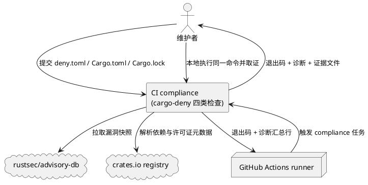
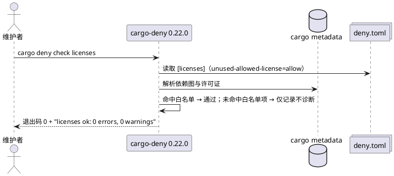
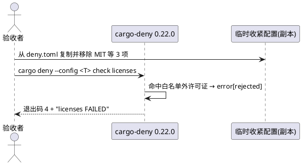
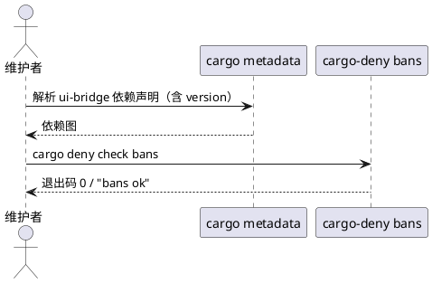
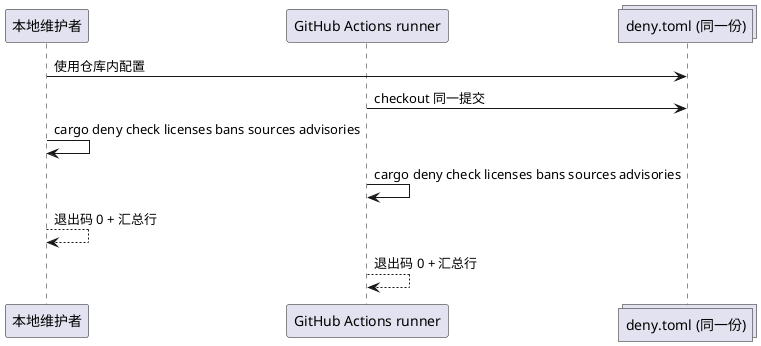

# **1. 组件定位**

## **1.1 核心职责**

本组件负责 **CI `compliance` 任务中 `cargo deny` 四类合规检查的判定口径与可复现性**，实现"许可证白名单未命中不误判失败、白名单之外仍然拒绝、本地与 CI 同版同命令同结果"。

## **1.2 核心输入**

1. 维护者提交的仓库配置：根 `deny.toml`、根 `Cargo.toml`、`Cargo.lock`、`crates/ui-bridge/Cargo.toml`。
2. CI 触发信号：`.github/workflows/ci.yml` 的 `push` / `pull_request` 事件，触发 `compliance (licenses + sbom + secrets + layering)` 任务。
3. 外部漏洞数据：`rustsec/advisory-db` 在每次运行时的最新快照（由 cargo-deny 拉取，非仓库内固定文件）。
4. 本地维护者执行的同一命令：`cargo deny check licenses bans sources advisories`。

## **1.3 核心输出**

1. `cargo deny` 四类检查的判定结果与退出码（供 CI 任务成功/失败判定）。
2. `compliance` 任务的控制台诊断（warning / error / `licenses ok` 等汇总行），作为证据归档。
3. `deny.toml`、`crates/ui-bridge/Cargo.toml`、`Cargo.lock` 的最小变更集（仅配置与依赖版本，不含业务代码）。
4. `docs/progress/b4-status.md` 的修复登记与 AC 三态（本文件不直接产出）。

## **1.4 职责边界**

1. **不负责** 依赖许可证的法律判断、SBOM 内容质量、密钥扫描、分层检查——这些分别由 `sbom`、`secrets`、`layering` 步骤承担。
2. **不负责** 新增/删除任何第三方依赖；不把 `url` 升级之外的依赖变更纳入本次范围。
3. **不负责** 修改任何 `crates/**/src/**` 业务代码、领域契约、封闭字段数（`GateRecord` 14、`GateCounter` 32 等一律不变）。
4. **不负责** 放宽 `[bans] wildcards = "deny"`、`[sources] unknown-* = "deny"` 的真实约束。
5. **不负责** 用 `--warn` / `--allow` 命令行参数制造"本地绿、CI 红"的口径分叉。
6. **不负责** 解除 `rustsec` 漏洞告警的方式（禁止用 `[advisories] ignore` 掩盖已修复的 `RUSTSEC-2026-0592`）。
7. **不做** 为 macOS 或未在 CI 矩阵中的 target 增加单独口径。

---

# **2. 事实基线与根因判定**

> 本节全部结论来自 2026-11-22 在本机项目根 `TSC/` 的实测，命令与输出摘要见 §2.1、§2.2。**结论与用户原始假设不同，需先在此对齐。**

## **2.1 实测事实表**

环境：`cargo 1.100.0`、`cargo-deny 0.22.0`（位于 `~/.cargo/bin/cargo-deny.exe`，须把 `~/.rustup/toolchains/stable-x86_64-pc-windows-msvc/bin` 置于 `PATH` 前部，否则 cargo-deny 调用 `cargo metadata` 会失败）。

| 编号 | 命令 | 实测退出码 | 实测摘要 |
|---|---|---|---|
| F-01 | `cargo deny --version` | 0 | `cargo-deny 0.22.0` |
| F-02 | `cargo deny check licenses` | **0** | `licenses ok`；4 条 `warning[license-not-encountered]`（第 23/25/27/31 行） |
| F-03 | `cargo deny check licenses -s` | **0** | `licenses ok: 0 errors, 4 warnings, 296 notes` |
| F-04 | `cargo deny check bans` | **2** | `error[wildcard]`：`crates/ui-bridge/Cargo.toml` 的 2 个 path 依赖；`bans FAILED: 1 errors, 15 warnings` |
| F-05 | `cargo deny check advisories` | **1** | `error[vulnerability]`：`RUSTSEC-2026-0592`，`url 2.5.8` |
| F-06 | `cargo deny check sources` | **0** | `sources ok` |
| F-07 | `cargo deny check licenses bans sources advisories` | **3** | `advisories FAILED, bans FAILED, licenses ok, sources ok` |
| F-08 | 临时配置加 `[licenses] unused-allowed-license = "allow"`（`--config` 指向副本） | **0** | `licenses ok: 0 errors, 0 warnings`；`license-not-encountered` 计数 **0** |
| F-09 | 临时配置把 `MIT`/`MIT-0`/`BSD-2-Clause`/`ISC` 等移出 `allow`（白名单收紧） | **4** | `error[rejected]: failed to satisfy license requirements`；`licenses FAILED` |
| F-10 | `git status --short` | 0 | 工作区干净（本次仅新增文档前） |

补充登记：CI 截图记录 3 条 `license-not-encountered`（`BSL-1.0`/`ISC`/`Unicode-DFS-2016`），本地实测为 **4 条**（多 `BSD-2-Clause:23:4`）。差异可能是截图截断或 Linux runner 依赖图差异；**验收不以条数为判据，以 `grep -c` 归零为判据**（见 AC-B4-105）。

## **2.2 cargo-deny 0.22.0 退出码语义（实测归纳）**

四类检查的退出码是**按检查项的位掩码累加**，而非"任意 warning 即失败"：

| 检查项 | 单跑失败时的退出码 | 位值 |
|---|---|---|
| `advisories` | 1（F-05） | 1 |
| `bans` | 2（F-04） | 2 |
| `licenses` | 4（F-09） | 4 |
| `sources` | 待触发（本次未出现） | 8 |

推论并已被 F-07 验证：`licenses ok`、`bans FAILED`、`advisories FAILED`、`sources ok` ⇒ `1 + 2 = 3`，与 CI 的 `exit code 3` **完全吻合**。因此 **exit 3 与许可证白名单未命中无关**。

## **2.3 根因定案**

本次 CI 失败由**三条独立故障**叠加，许可证噪音只是其中一条且**不贡献退出码**：

| 编号 | 根因 | 直接证据 | 是否导致 exit≠0 |
|---|---|---|---|
| **R-1** | `[licenses]` 未声明 `unused-allowed-license`，0.22.0 默认按 `warn` 报 `license-not-encountered`（白名单中有 4 项未被依赖图命中） | F-02/F-03：4 warnings，退出码 0 | **否**（仅噪音） |
| **R-2** | `advisory-db` 每日更新，新增 `RUSTSEC-2026-0592`（`url 2.5.8` 对嵌套 `blob:` URL 的 `Url::origin()` 栈溢出） | F-05：`error[vulnerability]`，退出码 1 | **是** |
| **R-3** | `[bans] wildcards = "deny"` 命中 `crates/ui-bridge/Cargo.toml` 的 2 个 path 依赖（无 `version` 字段，被 0.22.0 判为 wildcard） | F-04：`error[wildcard]`，退出码 2 | **是** |

因此：**只改 `deny.toml` 的许可证配置，CI 仍会以 `exit 3` 失败**；R-2、R-3 必须同批修复，才能达成"compliance 退 0"。

## **2.4 被否定的假设（登记以避免二次误判）**

| 假设 | 判定 | 依据 |
|---|---|---|
| "CI 与本地 cargo-deny 版本不同导致行为分叉" | **不成立** | F-01 本地 0.22.0；CI 由 `taiki-e/install-action@v2` 固定 `cargo-deny@0.22.0`，版本相同 |
| "新版把 `unused-allowed-license` 默认按 deny 处理" | **不成立** | F-02/F-03 在 0.22.0 下退 0；必须显式 `-D unused-allowed-license` 或 `--deny warnings` 才会失败，而 CI 未加此参数 |
| "`--deny warnings` 被隐式注入" | **不成立** | `ci.yml:240` 命令串无该参数；F-02 已排除 |
| "删除白名单中未使用项即可解决" | **不成立/不推荐** | 会让未来引入同许可证的依赖突然失败，且依赖图随 target/平台漂移；见 §2.5 方案 B |
| "CI 昨天是绿的、今天红了，一定是版本升级" | **不成立** | `advisory-db` 是运行时外部数据，R-2 可在版本不变时由绿转红 |

## **2.5 候选修复方案与取舍**

| 方案 | 做法 | 优点 | 缺点/风险 | 裁决 |
|---|---|---|---|---|
| **A（推荐）** | `[licenses]` 增 `unused-allowed-license = "allow"`，白名单 15 项原样保留 | 1 行；F-08 已验证退 0 且 0 warnings；F-09 证明白名单外仍被拒（退 4） | 失去"白名单项未使用"提示；需用 `cargo deny list` 人工核对 | **采纳** |
| B | 删除 4 项未使用许可证（`BSD-2-Clause`/`ISC`/`Unicode-DFS-2016`/`BSL-1.0`） | 无需新配置键 | 属"收紧白名单"：未来依赖引入即红；与"不放松真实约束"不同轴但维护成本更高；CI/Linux 与本地依赖图可能不同 | 不采纳 |
| C | 固定或降级 cargo-deny 版本 | 规避未来 lint 默认值变化 | 版本不是根因（§2.4）；降级会丢失新漏洞检测；CI 已固定 0.22.0 | 不采纳（仅保留"版本打印+固定"作为一致性保障） |
| D | CI 命令加 `-W unused-allowed-license` 或 `--warn` 覆盖 | 不动 `deny.toml` | 本地与 CI 命令串分叉，违反"本地与 CI 一致"目标；每次新增检查项都要同步参数 | 不采纳 |
| **E（推荐）** | `[advisories]` 不 `ignore`，升级 `url` 至 `>=2.5.9`（`cargo update -p url`） | 真正消除漏洞；不新增依赖 | `Cargo.lock` 有变更（仅版本行） | **采纳** |
| F | `[advisories] ignore = ["RUSTSEC-2026-0592"]` | 立即变绿 | 掩盖真实可利用漏洞，且 `url` 在 Tauri 依赖链上被 `Url::origin()` 触达 | **禁止** |
| **G（推荐）** | `crates/ui-bridge/Cargo.toml` 两个 path 依赖补 `version = "0.1.0"` | 消除 wildcard；`wildcards = "deny"` 保持不变 | 2 行配置变更 | **采纳** |
| H | `[bans] wildcards = "warn"` 或 `exceptions` 例外 | 1 行 | 放松供应链约束，与 AC-B4-108 冲突 | **禁止** |

> 结论：**A + E + G 同批执行**；C 仅取"固定版本 + 打印版本"部分。任何方案都不得触碰白名单的 15 项内容、不得 `ignore` 漏洞、不得放宽 `wildcards`/`sources`。

---

# **3. 领域术语**

**license-not-encountered（许可证未命中）**
: cargo-deny 对 `[licenses].allow` 中列出、但当前依赖图中没有任何 crate 实际声明的许可证条目所报出的诊断码；其 lint 名为 `unused-allowed-license`，级别由配置键 `unused-allowed-license` 决定（`allow`/`warn`/`deny`）。
: 备注：中文易误写为"未使用许可证"，本文统一用"许可证未命中"。

**unused-allowed-license**
: `[licenses]` 下的配置键，控制"白名单项未被命中"时的诊断级别；默认 `warn`。
: 备注：与 `license-not-allowed`（命中了许可证但不在白名单）是**反向**语义，禁止混用。

**license-not-allowed / rejected**
: 依赖实际声明的许可证不在 `[licenses].allow` 中时产生的 `error[rejected]`；这是真实约束被触发的标志，退出码为 4。

**exit code 位掩码**
: cargo-deny 0.22.0 将 `advisories=1`、`bans=2`、`licenses=4`、`sources=8` 按失败项累加后作为进程退出码；`0` 表示全部通过。
: 备注：`3 = 1|2`（漏洞 + 通配），`4` 专指许可证失败，`7 = 1|2|4`。

**advisory-db**
: RustSec 维护的漏洞数据库，cargo-deny 在运行时拉取最新快照；其内容变化可在依赖与配置完全不变时使 CI 由绿转红。

**wildcard dependency（通配依赖）**
: `Cargo.toml` 中未写 `version` 字段的依赖声明（含 `path` 依赖）；在 `[bans] wildcards = "deny"` 下被判为 `error[wildcard]`。

**白名单（allow list）**
: `[licenses].allow` 的 15 项许可证标识集合；本文的"不放松真实约束"即"这 15 项内容不变，白名单之外仍被拒"。

**同版同命令**
: 本地与 CI 使用同一 cargo-deny 版本（0.22.0）执行同一命令字符串 `cargo deny check licenses bans sources advisories`，且 `deny.toml` 为同一份文件。

---

# **4. 角色与边界**

## **4.1 核心角色**

维护者：在本地执行同一命令复跑、提交配置与依赖修复、登记 AC 三态；不得以命令行参数掩盖配置缺陷。

CI 审查者：依据 `compliance` 任务的退出码与 `--show-stats` 汇总行判定门禁是否通过，并要求诊断噪音归零。

安全审计者：确认 `url` 升级真实消除漏洞、未使用 `ignore` 掩盖、白名单未被删减、`wildcards` 与 `sources` 未被放宽。

## **4.2 外部系统**

GitHub Actions `compliance` 任务：承载 `layering`/`secrets`/`licenses`/`sbom` 步骤，本次只改 `licenses` 步骤的前置与判定结果。

crates.io（registry）：提供 `url` 2.5.9 及依赖元数据，用于消除 `RUSTSEC-2026-0592`。

rustsec/advisory-db：提供漏洞快照，是 R-2 的外部触发源。

## **4.3 交互上下文**



图中不展示 `deny.toml` 内部键结构、不展示 cargo-deny 的解析流程。

---

# **5. DFX 约束**

## **5.1 性能**

1. `compliance` 任务在 15 分钟超时内完成；`licenses` 步骤相对当前基线耗时增量必须 ≤ 10%（仅多一行配置读取，不得引入额外抓取）。
2. 本地四合一命令单次执行必须 ≤ 5 分钟（有 `target/` 缓存前提）。

## **5.2 可靠性**

1. 同一 `deny.toml` + 同一 `Cargo.lock` + 同一版本下，本地与 CI 的四类检查结论必须一致（均通过或均失败，不允许单边绿）。
2. 允许 `advisory-db` 更新导致结论变化，但变化必须由**真实漏洞条目**解释，不得由"未命中白名单"解释。

## **5.3 安全性**

1. 禁止以 `[advisories].ignore` 掩盖 `RUSTSEC-2026-0592`；必须通过升级 `url` 到 `>=2.5.9` 消除。
2. 禁止放宽 `[bans].wildcards`、`[sources].unknown-registry`、`[sources].unknown-git` 的 `deny` 级别。
3. 禁止把 `[licenses].allow` 中任何一项删除或替换为 `exceptions` 通配。
4. `AGPL-3.0`/`GPL-*`/`SSPL-1.0`/`OSL-*`/`EUPL-*` 仍必须被拒（白名单机制保证，见 AC-B4-106 负例）。

## **5.4 可维护性**

1. `compliance` 任务的 `licenses` 步骤之前必须打印 `cargo deny --version`，使版本证据进入日志。
2. `licenses` 步骤的汇总行（`licenses ok: N errors, M warnings`）必须可直接 `grep`，作为机器证据。
3. 修复必须在 `docs/progress/b4-status.md` 登记事实基线、决策编号与 AC 三态。

## **5.5 兼容性**

1. `deny.toml` 的 `[licenses] unused-allowed-license` 键必须与 cargo-deny 0.22.0 兼容；若未来版本不支持该键（配置校验失败），必须显式登记并给出等价方案，不得静默失效。
2. CI 的 `cargo-deny@0.22.0` 版本固定不得取消；如升级，必须在同一次提交内本地复跑四类检查并更新 AC 证据。
3. `Cargo.lock` 的 `url` 升级必须满足 `^2.5` 语义，不得让依赖 `url` 的上游 crate 需要改版本约束。

---

# **6. 核心能力**

## **6.1 许可证未命中噪音消除**

### **6.1.1 业务规则**

1. **未命中即允许**：`[licenses]` 必须声明 `unused-allowed-license = "allow"`，使"白名单项未被依赖图命中"不产生诊断、不影响退出码。
   a. 验收条件：执行 `cargo deny check licenses` → 退出码 0；`license-not-encountered` 出现次数 0；汇总行为 `licenses ok: 0 errors, 0 warnings, …`。
2. **白名单只增不减**：`allow` 列表必须保持评审通过的 15 项内容与顺序不变，禁止删除 `BSD-2-Clause`、`ISC`、`Unicode-DFS-2016`、`BSL-1.0` 等任一项。
   a. 验收条件：`awk` 提取 `allow = [` 到 `]` 之间的条目数 → 必须为 15；与基线逐项 `diff` → 必须为空。
3. **不新增配置文件**：修复必须落在既有根 `deny.toml` 内，禁止拆分为 `deny.licenses.toml` 或多配置叠加。
   a. 验收条件：`ls deny*.toml` → 必须恰为 `deny.toml`。
4. **禁止命令行补救**：CI 与本地命令串中禁止出现 `-W unused-allowed-license`、`-A unused-allowed-license`、`--deny warnings`。
   a. 验收条件：`grep -nE 'unused-allowed-license|--deny warnings' .github/workflows/ci.yml` → 命中 0。
5. **诊断级别语义**：`unused-allowed-license = "allow"` 仅关闭"未命中"提示，不得改变"命中但不在白名单"（`license-not-allowed`）仍为 error。
   a. 验收条件：§6.2 负例必须退 4 且出现 `error[rejected]`。

### **6.1.2 交互流程**



### **6.1.3 异常场景**

1. **配置键拼写错误**
   a. 触发条件：写成 `unused_allowed_license` 或放入 `[bans]`。
   b. 系统行为：cargo-deny 报配置未知字段或该键不生效；`licenses` 仍出现 4 条 warning。
   c. 用户感知：`licenses ok: 0 errors, 4 warnings`，AC-B4-105 判定失败并提示核对键名与所在表。
2. **cargo-deny 版本不识别该键**
   a. 触发条件：本地或 CI 使用 < 0.22.0 的版本。
   b. 系统行为：配置校验阶段报错，命令在解析前终止。
   c. 用户感知：启动即失败并打印版本；处置为对齐到 0.22.0，禁止静默降级。
3. **白名单被误删项**
   a. 触发条件：删除 `allow` 中某项。
   b. 系统行为：未来依赖命中该许可证时立即产生 `error[rejected]`。
   c. 用户感知：`licenses FAILED`；AC-B4-106 的"条目数=15"断言提前拦截。

## **6.2 真实许可证约束保持（负例可证）**

### **6.2.1 业务规则**

1. **白名单外必须拒绝**：依赖实际声明的许可证不在 `allow` 中时，检查必须以 error 失败，退出码不得为 0。
   a. 验收条件：以"临时收紧白名单"配置执行 → 退出码 4，输出含 `error[rejected]: failed to satisfy license requirements`。
2. **负例配置不得入库**：负例必须通过 `--config` 指向临时副本（`$RUNNER_TEMP` 或 `.tmp/`），仓库内只保留修复后的 `deny.toml`。
   a. 验收条件：`git status --short` → 不含任何负例配置文件；`deny.toml` 中不存在被移除的许可证。
3. **高危许可证零豁免**：`AGPL-3.0`、`GPL-2.0`、`GPL-3.0`、`SSPL-1.0`、`OSL-3.0`、`EUPL-1.2` 必须全部不在 `allow` 中，也不得出现在 `exceptions` 中。
   a. 验收条件：对上述 6 个标识执行 `grep -F` 于 `deny.toml` → 命中 0。
4. **禁止整表放行**：禁止加入 `"*"`、`"UNLICENSED"` 或空字符串到 `allow`。
   a. 验收条件：`grep -nE '"\*"|UNLICENSED' deny.toml` → 命中 0。

### **6.2.2 交互流程**



### **6.2.3 异常场景**

1. **负例也退 0**
   a. 触发条件：临时副本误指向仓库 `deny.toml`，或误用 `-A license-not-allowed`。
   b. 系统行为：不产生 `error[rejected]`。
   c. 用户感知：判定"负例失效"，AC-B4-106 失败；必须重做副本并确认 `--config` 路径。
2. **负例污染仓库**
   a. 触发条件：把临时副本写进仓库根目录并提交。
   b. 系统行为：CI 仍读 `deny.toml`，但审查面出现多余文件。
   c. 用户感知：`git status` 非空；AC-B4-106 第 2 条失败。

## **6.3 漏洞清零（advisories）**

### **6.3.1 业务规则**

1. **漏洞必须真实修复**：`RUSTSEC-2026-0592` 必须通过将 `url` 升级到 `>=2.5.9` 消除，禁止使用 `ignore`。
   a. 验收条件：`cargo deny check advisories` → 退出码 0；输出中 `RUSTSEC-2026-0592` 命中 0；`grep -A1 '^name = "url"' Cargo.lock` → `version = "2.5.9"` 或更高 `2.5.x`。
2. **零新增依赖**：`Cargo.lock` 不得新增 `name = ` 条目，`Cargo.toml` 不得新增依赖行。
   a. 验收条件：`git diff HEAD -- Cargo.lock | grep -c '^+name = '` = 0；`git diff HEAD -- Cargo.toml \| grep -c '^+[a-z0-9_-]* *='` = 0。
3. **不掩盖其他漏洞**：`[advisories].ignore` 必须保持空数组。
   a. 验收条件：`awk '/^\[advisories\]/,/^\[licenses\]/' deny.toml | grep -c 'ignore = \[\]'` ≥ 1。

### **6.3.2 交互流程**

```plantuml
@startuml
actor 维护者
participant "cargo-deny" as D
cloud "advisory-db" as ADB
cloud "crates.io" as REG

维护者 -> REG : cargo update -p url（解析 2.5.9）
维护者 -> D : cargo deny check advisories
D -> ADB : 拉取最新快照
D --> 维护者 : 退出码 0 / "advisories ok"
@enduml
```

### **6.3.3 异常场景**

1. **升级被上游约束阻塞**
   a. 触发条件：`url` 2.5.9 与某上游 crate 的 `<2.5.9` 约束冲突。
   b. 系统行为：`cargo update` 失败或解析到 2.5.8。
   c. 用户感知：ac 报"依赖约束冲突"，必须回到规格层裁决（禁止直接 `ignore`）。
2. **连带新增依赖包**
   a. 触发条件：补丁升级引入新传递依赖。
   b. 系统行为：`Cargo.lock` 出现新 `name = ` 条目。
   c. 用户感知：AC-B4-107 第 2 条失败，需重新评估升级路径。

## **6.4 通配依赖清零（bans）**

### **6.4.1 业务规则**

1. **path 依赖必须带版本**：`crates/ui-bridge/Cargo.toml` 的两个 workspace 内 path 依赖必须补齐 `version = "0.1.0"`，与 `[workspace.package].version` 一致。
   a. 验收条件：`cargo deny check bans` → 退出码 0；`error[wildcard]` 命中 0；`bans ok`。
2. **约束级别不得放宽**：`[bans].wildcards` 必须保持 `"deny"`，`deny` 列表保持空。
   a. 验收条件：`grep -c 'wildcards = "deny"' deny.toml` = 1；`[bans]` 段内 `exceptions`/`deny` 未新增豁免。
3. **版本值必须真实**：`version = "0.1.0"` 必须与对应 crate 的 `package.version` 一致，否则 `cargo metadata` 解析失败。
   a. 验收条件：`cargo metadata --format-version 1` 退出码 0；`cargo build --workspace --locked` 退出码 0（离线缓存允许）。

### **6.4.2 交互流程**



### **6.4.3 异常场景**

1. **版本号写错**
   a. 触发条件：`version = "0.1"` 或与 crate 实际版本不符。
   b. 系统行为：`cargo metadata` 报版本不匹配，cargo-deny 无法建图。
   c. 用户感知：命令退出码非 0 且报 `cargo metadata exited with an error`。
2. **用 exceptions 绕过**
   a. 触发条件：在 `[bans]` 新增豁免条目。
   b. 系统行为：wildcard 不再报错但约束被放松。
   c. 用户感知：AC-B4-108 第 2 条失败（脚本断言 `wildcards = "deny"` 且无豁免）。

## **6.5 本地与 CI 一致性**

### **6.5.1 业务规则**

1. **同版本**：本地与 CI 的 `cargo deny --version` 必须均为 `cargo-deny 0.22.0`。
   a. 验收条件：CI 日志出现 `cargo-deny 0.22.0`；本地同命令输出同串。
2. **同命令**：本地复跑必须使用与 `ci.yml` **逐字符一致**的命令串 `cargo deny check licenses bans sources advisories`。
   a. 验收条件：`grep -c 'cargo deny check licenses bans sources advisories' .github/workflows/ci.yml` = 1；本地执行同串。
3. **版本可观测**：`licenses` 步骤之前必须输出 `cargo deny --version`。
   a. 验收条件：`awk '/- name: licenses/{print NR}' ci.yml` 前 3 行内存在 `cargo deny --version`。
4. **汇总行可 grep**：CI 日志必须保留 `licenses ok` / `bans ok` / `advisories ok` / `sources ok` 汇总行（禁止加 `-L off` 吞掉）。
   a. 验收条件：`grep -cE '\-L (off|error)' ci.yml` = 0。
5. **四类全绿**：四合一命令的退出码在本地与 CI 必须均为 0。
   a. 验收条件：本地 `echo $?` = 0；CI `compliance` 任务结论为 success。

### **6.5.2 交互流程**



### **6.5.3 异常场景**

1. **本地 PATH 指向错误 cargo**
   a. 触发条件：`cargo.exe` 为 rustup shim 且缺少 `rustc_driver-*.dll`，或未前置 toolchain 目录。
   b. 系统行为：`cargo metadata exited with an error` 或无输出，cargo-deny 退 1/127。
   c. 用户感知：命令失败且与 CI 不一致；处置为按 §8.4 设置 `PATH`。
2. **CI 版本被浮动**
   a. 触发条件：把 `cargo-deny@0.22.0` 改为 `latest` 或省略版本。
   b. 系统行为：未来默认 lint 级别变化可再次造成"本地绿、CI 红"。
   c. 用户感知：AC-B4-109 失败；必须在同提交内复跑并更新版本证据。

---

# **7. 数据约束**

## **7.1 `deny.toml` · `[licenses]`**

1. **version**：必须为 `2`（cargo-deny 配置版本），不得改为其他值。
2. **unused-allowed-license**：必须为字符串 `"allow"`；取值范围语义为 `"allow"|"warn"|"deny"`，本次只能取 `"allow"`。
3. **confidence-threshold**：保持 `0.93` 不变。
4. **allow**：必须恰为 15 项，顺序与基线一致，逐项为合法 SPDX 标识（含 `"Apache-2.0 WITH LLVM-exception"` 这一复合表达式）。
5. **exceptions**：必须为空数组。
6. **禁止项**：不得出现 `deny` 键（cargo-deny 已移除该键）；不得出现 `"*"`/`UNLICENSED`。

## **7.2 `deny.toml` · `[advisories]` / `[bans]` / `[sources]`**

1. **advisories.version**：保持 `2`；`yanked` 保持 `"deny"`；`ignore` 必须为空数组。
2. **bans.multiple-versions**：保持 `"warn"`（本次不收紧、不放宽）。
3. **bans.wildcards**：必须为 `"deny"`。
4. **bans.highlight**：保持 `"all"`；`deny` 保持空数组。
5. **sources.unknown-registry / unknown-git**：均必须为 `"deny"`。
6. **sources.allow-registry**：必须仅含 `https://github.com/rust-lang/crates.io-index`。

## **7.3 `crates/ui-bridge/Cargo.toml`**

1. **meeting-copilot-application**：声明必须为 `{ path = "../application", version = "0.1.0" }`。
2. **meeting-copilot-domain**：声明必须为 `{ path = "../domain", version = "0.1.0" }`。
3. **crate 名与 license**：不得变更 `name`、`license.workspace = true` 等既有字段。

## **7.4 `Cargo.lock` · `url` 条目**

1. **version**：必须为 `2.5.9` 或更高 `2.5.x`。
2. **来源**：必须仍为 `registry+https://github.com/rust-lang/crates.io-index`。
3. **包集合**：`name = ` 条目数不得增加；不得删除既有包。

## **7.5 `.github/workflows/ci.yml` · `compliance.licenses` 步骤**

1. **run 命令**：必须恰为 `cargo deny check licenses bans sources advisories`。
2. **版本证据**：该步骤前必须存在 `cargo deny --version` 的打印步骤或同步骤首行。
3. **工具固定**：`taiki-e/install-action` 的 `tool` 必须保持 `cargo-deny@0.22.0`。

---

# **8. 验收标准（增量 AC-B4-105 ~ AC-B4-110）**

## **8.1 编号与口径**

1. 本章 AC 编号自 **AC-B4-105** 起，承接 `.codeartsdoer/specs/b4_gate/spec.md` §7.16 的 AC-B4-104，**不重排、不改写 AC-B4-01~104**。
2. `b4_gate/spec.md` 中"AC 汇总=104"属 **U-06 时点断言**（见 D-B4-P117 口径），本次**不改写**该文件；本文件新增 6 条 AC，汇总口径为 "104 + 6 = 110（本目录口径）"，并在 `b4-status.md` 登记。
3. 状态三态沿用 `passed` / `pending` / `not-applicable`；本次产出时全部为 **`pending`（规格已定、待实现）**。

## **8.2 逐条 AC**

| AC | EARS 陈述 | 机器判定 |
|---|---|---|
| **AC-B4-105** | The `[licenses]` 配置 shall 含 `unused-allowed-license = "allow"`，且 `allow` 列表须保持 15 项原样；When 执行 `cargo deny check licenses`，the 退出码 shall 为 0 且 `license-not-encountered` 计数 shall 为 0。 | ① `cargo deny check licenses; echo $?` → `0`；② `cargo deny check licenses 2>&1 \| grep -c 'license-not-encountered'` → `0`；③ `cargo deny check licenses -s 2>&1 \| tail -1` 匹配 `licenses ok: 0 errors, 0 warnings`；④ `allow` 条目数 = 15 且与基线逐项相等 |
| **AC-B4-106** | When 以白名单收紧的临时配置执行 `cargo deny check licenses`，the 检查 shall 以 `error[rejected]` 失败且退出码 shall 为 4；该临时配置禁止进入仓库。 | ① `cargo deny --config <TMP>/deny_negative.toml check licenses; echo $?` → `4`；② 输出含 `error[rejected]`；③ `git status --short` 不含负例配置；④ `grep -cE 'AGPL\|GPL-\|SSPL\|OSL-\|EUPL' deny.toml` → `0` |
| **AC-B4-107** | When 执行 `cargo deny check advisories`，the 退出码 shall 为 0 且 `RUSTSEC-2026-0592` 命中 shall 为 0；`url` 版本 shall ≥ 2.5.9，且 `Cargo.lock` 不得新增包。 | ① `cargo deny check advisories; echo $?` → `0`；② `cargo deny check advisories 2>&1 \| grep -c 'RUSTSEC-2026-0592'` → `0`；③ `awk '/^name = "url"/{f=1} f&&/^version/{print;exit}' Cargo.lock \| grep -qE '2\\.5\\.(9\|1[0-9])'` → 真；④ `git diff HEAD -- Cargo.lock \| grep -c '^+name = '` → `0` |
| **AC-B4-108** | The `[bans].wildcards` shall 保持 `"deny"`；When 执行 `cargo deny check bans`，the 退出码 shall 为 0 且 `error[wildcard]` 计数 shall 为 0；ui-bridge 两个 path 依赖须含 `version = "0.1.0"`。 | ① `cargo deny check bans; echo $?` → `0`；② `cargo deny check bans 2>&1 \| grep -c 'error\\[wildcard\\]'` → `0`；③ `grep -c 'wildcards = "deny"' deny.toml` → `1`；④ `grep -c 'version = "0.1.0"' crates/ui-bridge/Cargo.toml` → `2` |
| **AC-B4-109** | The 本地与 CI shall 使用 cargo-deny `0.22.0` 与同一命令串；When 执行四合一命令，the 本地退出码 shall 为 0 且 CI `compliance` 任务 shall 为 success；CI 须在 licenses 步骤前打印版本。 | ① `cargo deny --version` 前缀 = `cargo-deny 0.22.0`；② `cargo deny check licenses bans sources advisories; echo $?` → `0`；③ `grep -c 'cargo deny check licenses bans sources advisories' .github/workflows/ci.yml` → `1`；④ CI 运行后 `compliance` 结论 = success（远端判定） |
| **AC-B4-110** | The 变更集 shall 最小：`deny.toml` 仅新增 `unused-allowed-license` 行、ui-bridge 仅 2 行补 `version`、`Cargo.lock` 仅 `url` 版本行；`crates/**/src/**` shall 零 diff；不得新增依赖。 | ① `git diff --numstat HEAD -- deny.toml` 新增 ≤ 3 且删除 = 0；② `git diff --numstat HEAD -- crates/ui-bridge/Cargo.toml` → `2 0`（或 `2 2` 视格式化）；③ `git diff --stat HEAD -- 'crates/*/src/**'` 输出为空；④ `git diff HEAD -- Cargo.toml` 为空；⑤ `b4-status.md` 含 `AC-B4-105` 与 `D-B4-P131` |

## **8.3 可执行命令清单**

环境前置（每个 shell 会话一次，Windows + git-bash；与 `b4-status.md` §6 同口径）：

```bash
export PATH="$HOME/.rustup/toolchains/stable-x86_64-pc-windows-msvc/bin:$HOME/.cargo/bin:$PATH"
export TEMP="$PWD/.tmp/test-temp"; export TMP="$TEMP"; mkdir -p "$TEMP"
```

正向（AC-B4-105/107/108/109）：

```bash
cargo deny --version
cargo deny check licenses;                                  echo "lic=$?"
cargo deny check advisories;                                echo "adv=$?"
cargo deny check bans;                                      echo "bans=$?"
cargo deny check sources;                                   echo "src=$?"
cargo deny check licenses bans sources advisories;          echo "all=$?"
cargo deny check licenses 2>&1 | grep -c 'license-not-encountered'
cargo deny check licenses -s 2>&1 | tail -1
```

期望：`lic/adv/bans/src/all` 全为 `0`；`grep -c` 为 `0`；汇总行匹配 `licenses ok: 0 errors, 0 warnings`。

负例（AC-B4-106，仅临时目录）：

```bash
NEG="$TEMP/deny_negative.toml"
awk 'BEGIN{skip=0} /^allow = \[/{print;skip=1;next} skip&&/^\]/{skip=0} skip{next} {print}' deny.toml \
  | sed -E 's/^  "MIT",$/  "Apache-2.0",/' > "$NEG"
cargo deny --config "$NEG" check licenses; echo "neg=$?"     # 期望 4
cargo deny --config "$NEG" check licenses 2>&1 | grep -c 'error\[rejected\]'   # 期望 ≥1
```

> 若 `awk` 口径在当前 shell 不稳，可用等价做法：复制 `deny.toml` 后手工删除 `"MIT"`、`"MIT-0"`、`"BSD-2-Clause"`、`"ISC"` 四行，再以 `--config` 执行；判定值不变。

远端（AC-B4-109 的 CI 侧）：

```bash
gh run view <run-id> --log | grep -E 'cargo-deny 0\.22\.0|licenses ok|bans ok|advisories ok|sources ok'
gh run view <run-id> --json jobs --jq '.jobs[] | select(.name|startswith("compliance")) | .conclusion'
```

期望：版本行存在、四条汇总行均 `ok`、结论为 `success`。

## **8.4 判定环境约束**

1. 必须使用 `cargo 1.100.0`（CI 与本地一致）；`cargo-deny` 必须为 `0.22.0`。
2. Windows 下必须把 `~/.rustup/toolchains/stable-x86_64-pc-windows-msvc/bin` 置于 `PATH` 前部，保证 cargo-deny 内部调用的 `cargo metadata` 可用；否则出现 `cargo metadata exited with an error`，该失败**不计入** AC 判定，属环境问题。
3. `advisories` 检查需要网络或本地 advisory 缓存；离线环境判定为 `not-applicable`，不得据此宣称 AC-B4-107 passed。
4. 本文件所有 AC 的 `pending` 状态只能由"实现 + 命令实测"转为 `passed`；不得因"配置已写"就置 passed。

---

# **9. 范围与非范围**

## **9.1 本轮范围内**

1. 根 `deny.toml` 的 `[licenses]` 增 `unused-allowed-license = "allow"`（白名单不动）。
2. `crates/ui-bridge/Cargo.toml` 两个 path 依赖补 `version = "0.1.0"`。
3. `Cargo.lock` 的 `url` 升至 `>=2.5.9`。
4. `ci.yml` 的 `compliance.licenses` 步骤前增加 `cargo deny --version` 打印（不改变命令串）。
5. `docs/progress/b4-status.md` 追加本节对应的 §21 登记。

## **9.2 本轮明确不做**

1. 不删除/替换 `[licenses].allow` 任何条目，不使用 `exceptions` 通配。
2. 不使用 `[advisories].ignore` 掩盖 `RUSTSEC-2026-0592` 或任何漏洞。
3. 不放宽 `[bans].wildcards`、`[sources].unknown-*`。
4. 不升级/降级 cargo-deny 主版本，不把 `cargo-deny@0.22.0` 改为浮动版本。
5. 不修改 `crates/**/src/**`、不修改 `scripts/**`、不新增测试 target、不改变 `NEW_TARGETS`。
6. 不引入任何新依赖、不新增 `Cargo.toml` 依赖行。
7. 不做 macOS target 专项处理，不新增平台分支。
8. 不宣称"许可证合规已全面达标"——只宣称"白名单未命中不再误判 + 白名单外仍拒绝"。

## **9.3 与既有规格的关系**

1. 本规格是 `b4_gate` 门禁口径的**运维侧增量**，不改 B4 任何领域契约与封闭字段数。
2. 本规格与 `ci_gate_hardening`（C1~C4）并列：后者新增静态门禁步骤，本规格修复既有 `licenses` 步骤的误判与真实失败。
3. `b4_gate/spec.md` 的 AC 汇总=104 时点断言不改写；本目录以 AC-B4-105~110 增量登记，冲突处理方式同 D-B4-P117（时点断言 + 增量优先）。

---

# **10. 出口影响与判定纪律**

1. **达成 `compliance` 退 0 的必要条件**：R-1、R-2、R-3 **三条同时修复**；缺任一条 CI 仍非 0（R-1 缺 ⇒ 4 warnings 噪音；R-2 缺 ⇒ 退 1；R-3 缺 ⇒ 退 2）。
2. **不得宣称**：`licenses ok` ≠ 许可证法律合规结论；`advisories ok` ≠ 全供应链无漏洞（仅对当日 advisory-db 快照成立）；`bans ok` ≠ 依赖治理完成（`multiple-versions` 仍为 warn，15 条 duplicate 保留）。
3. **复跑纪律**：`advisory-db` 每日更新，AC-B4-107 的 `passed` 需标注取证日期；跨日复跑必须重跑一次，不得引用旧日期证据。
4. **变更冻结**：实现完成后，`deny.toml` 的 `allow` 列表视为冻结基线；任何删减必须走新的需求增量并给出负例证据。