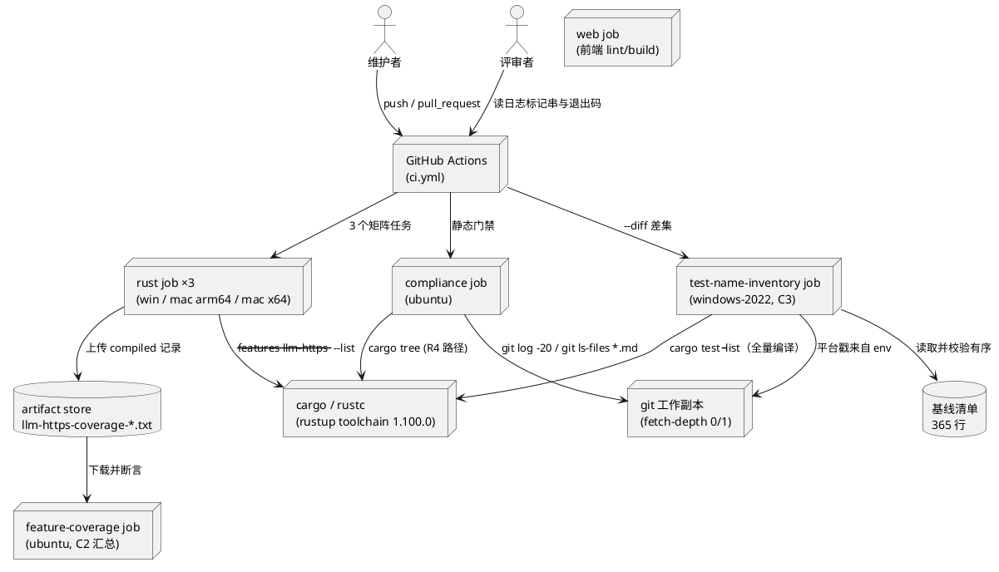
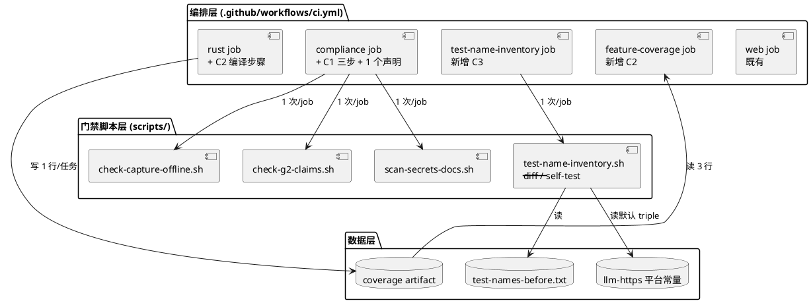
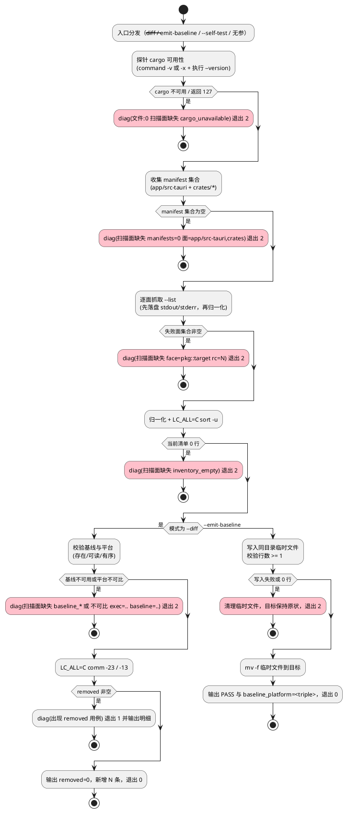
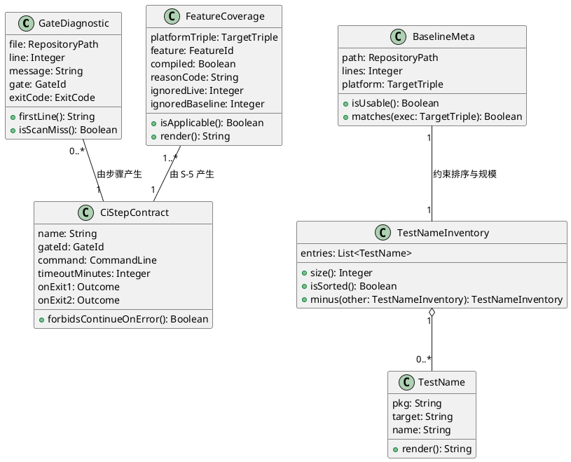

# 一、需求与存量功能关系分析

> 需求基线：`.codeartsdoer/specs/ci_gate_hardening/spec.md`（AC-CI-01~AC-CI-27，冲突 X1~X8，未裁决点 U1~U3）。本文件只回答"如何落地"，不重复定义需求语义，所有行为口径以 spec 为准。
>
> 本阶段不修改任何代码、脚本、`ci.yml` 与 `docs/sdd/**`；文中给出的 YAML 片段与命令是**实施阶段的契约原文**，不是本阶段的产物。

## 1.1 需求功能与存量功能对比

### 1.1.1 已实现功能

| 需求功能 | 存量功能 | 代码位置 | 匹配度 |
|---|---|---|---|
| 用例名归一化为 `pkg::target::name` | `list_target` 以 `sed` 加前缀、`inventory` 以 `sort -u` 收口 | `scripts/test-name-inventory.sh:18-27`、`:52` | 100% |
| 基线生成时排除新增目标 | `NEW_TARGETS` 白名单跳过 | `scripts/test-name-inventory.sh:11`、`:47-49` | 100% |
| 差集非空退出 1 | `comm -23` 后 `[[ -n "${REMOVED}" ]]` → `exit 1` | `scripts/test-name-inventory.sh:75`、`:78-82` | 100% |
| 正常态输出 `removed=0` 与新增条数 | `echo "PASS: removed=0，新增 N 条"` | `scripts/test-name-inventory.sh:83` | 100% |
| 基线文件不存在退出 2 | `[[ ! -f "${BEFORE}" ]]` → `exit 2` | `scripts/test-name-inventory.sh:69-72` | 50%（仅判存在，未判可读/有序） |
| 基线生成结果为空退出 2 | `lines < 1` → `exit 2` | `scripts/test-name-inventory.sh:60-64` | 50%（未覆盖写入前失败、未原子化） |
| 工具链入口可覆盖 | `CARGO="${CARGO:-cargo}"` | `scripts/test-name-inventory.sh:10` | 100% |
| `*.md` 扫描只输出 `文件:行号` | `scan_file` 用 `cut -d: -f1` 后只拼路径 | `scripts/scan-secrets-docs.sh:39-47`、`:130-146` | 100% |
| 文档扫描扫描面缺失退出 2 | `scan_md` 返回 2 → `final=2` → `exit 2` | `scripts/scan-secrets-docs.sh:49-54`、`:160-163` | 100% |
| 自检不依赖网络（文档扫描） | `--self-test` 用 `mktemp -d` 造样本并双向断言 | `scripts/scan-secrets-docs.sh:130-146` | 100% |
| 静态门禁自检（植入违规） | `--self-test` 植入样本后 `exit 1` | `scripts/check-g2-claims.sh:30-40`；`scripts/check-capture-offline.sh:86-96` | 50%（只证"能识别"，未证"不误判"） |
| 扫描面缺失诊断（C1） | `scan()` 检测目标不存在并输出 `扫描面缺失` | `scripts/check-capture-offline.sh:23-26`；`scripts/check-g2-claims.sh:16-20` | 50%（退出码仍为 1） |
| `cargo` 不可用降级 | `rule_deps` 输出 `SKIP` 后 `return` | `scripts/check-capture-offline.sh:33-36` | 25%（SKIP 被计为 PASS，见 R4） |
| rust 三平台矩阵与超时 | `matrix.include` 三 target + `timeout-minutes: 30` | `.github/workflows/ci.yml:56-69` | 100% |
| rust job 的前端产物前置 | `web-assets` 先 `npm ci` + `npm run build` | `.github/workflows/ci.yml:86-90` | 100% |
| compliance 静态门禁管线 | layering / secrets / licenses / sbom | `.github/workflows/ci.yml:115-127` | 75%（缺 3 条静态门禁） |
| 门禁脚本 LF 与相对路径基础 | `.gitattributes` 强制 `*.sh text eol=lf` | `.gitattributes:1-2` | 100% |
| 基线清单已入库 | `docs/progress/test-names-before.txt` 365 行，`git ls-files` 可定位 | `docs/progress/test-names-before.txt:1-365` | 100% |

### 1.1.2 需要扩展的功能

| 需求功能 | 存量功能 | 差异说明 | 扩展方向 |
|---|---|---|---|
| C4 · 逐面失败识别（AC-CI-02） | `list_target` 以管道接 `sed`，函数返回值取末命令；`2>/dev/null` 吞错 | ① `cargo` 的退出码被管道覆盖；② 失败面无标识；③ stderr 不可见 | 改为"先落盘再归一化"，逐面记录 `rc` 与 `pkg::target`；不改变函数签名 |
| C4 · 工具链可用性前置（AC-CI-01） | 无任何可用性探测 | 127 / `STATUS_DLL_NOT_FOUND` 被降级为空清单 | 在 `--diff` / `--emit-baseline` / 无参入口统一执行前置探测，失败即 2 |
| C4 · 空清单禁令（AC-CI-03） | 仅 `--emit-baseline` 判空 | `--diff` 不判当前清单为空 | 差集前校验当前清单行数 ≥1，否则 2 |
| C4 · 基线写入原子性（AC-CI-04） | `inventory yes > "${OUT}"` 直接截断目标文件 | 失败时留下半截/空文件 | 同目录临时文件 + 成功后 `mv -f`；失败清理临时文件 |
| C4 · 扫描面缺失（AC-CI-05） | 无 manifest 时生成空清单并可能 PASS | 无 `Cargo.toml` 时不报缺失 | manifest 集合为空即 2，诊断含 `app/src-tauri` 与 `crates` |
| C4 · 基线与排序校验（AC-CI-06） | 仅 `-f` 存在性判断 | 未判可读、未判 `LC_ALL=C` 有序；`comm` 前提不成立 | 增加可读性与去空行后的 `sort -c` 校验，未过即 2 |
| C4 · 首行诊断（AC-CI-08/06） | 失败信息部分写 stderr、部分写 stdout，行号恒为 `0` | 调用方只捕获单流时取不到首行 | 统一 `diag()`：首行同时写 stdout 与 stderr，格式 `文件:行号 标记` |
| C4 · 自检双向（AC-CI-08） | 无自检入口 | 无法证明"缺面→2"与"正常→0" | 新增 `--self-test`，用桩 CARGO 与隔离根目录构造 6 个断言 |
| C4 · 平台可比性（AC-CI-23） | 无平台概念 | macOS 上对 Windows 基线做差集会系统性误报 | `--diff` 前置平台解析与比对，不一致即 2 并输出 `不可比` |
| C1 · 扫描面缺失退出 2（AC-CI-12） | `check-capture-offline.sh` / `check-g2-claims.sh` 缺失时置 `FAIL=1` | "面缺失"与"命中违规"同码 | 新增 `MISSING` 标志，缺失优先返回 2；命中仍 1 |
| C1 · 提交扫描面不静默收窄（AC-CI-10） | compliance 用默认 `fetch-depth: 1` | `git log -20` 实际只扫 1 条 | compliance 的 checkout 改 `fetch-depth: 0` |
| C2 · feature 编译覆盖（AC-CI-15/19） | rust job 四步均无 `--features llm-https` | feature 代码从不参与编译 | rust job 追加"编译 + 列举"步骤，定向 feature |
| C3 · 差集纳入 CI（AC-CI-20/21/24） | 仅在本地执行 | 删除用例无远端拦截；compliance 15 分钟装不下 | 新增独立 job，Windows runner，超时 ≥30 |

### 1.1.3 需要新增的功能或接口

**A. 编排层（`.github/workflows/ci.yml`）**

1. `compliance` 新增三个必过步骤：`capture-offline (C1)`、`g2-claims (C1)`、`secrets-docs (C1)`；输入为仓库根相对路径，输出为脚本自身的 0/1/2，失败即 step 失败。
2. `rust` 新增 `llm-https-compile (C2)` 步骤：输入 `matrix.target`，输出 `llm-https: compiled=1 platform=<triple>` 与 artifact `llm-https-coverage-<triple>.txt`；依赖 `native-tls` 在该平台的可用性。
3. 新增 `feature-coverage (C2)` job：输入为各矩阵上传的 coverage artifact，输出为"至少一条 `compiled=1`"与 Linux `不适用` 声明；缺失即失败。
4. 新增 `test-name-inventory (C3)` job：输入 `docs/progress/test-names-before.txt` 与 Windows 工具链，输出 0/1/2 与 removed 明细；与既有 4 个 job 无 `needs` 耦合。

**B. 脚本层（仅 C4 脚本与 C1 两个脚本的退出码分支）**

1. `scripts/test-name-inventory.sh` 新增子命令 `--self-test`（AC-CI-08 / U3 裁决为子命令形态）。
2. 新增环境变量契约 `INVENTORY_PLATFORM`、`INVENTORY_BASELINE_PLATFORM`、`INVENTORY_ROOT`（均为可选，缺省行为向后兼容）。
3. `scripts/check-capture-offline.sh`、`scripts/check-g2-claims.sh` 新增 `MISSING` 分支，使"扫描面缺失"退出 2（AC-CI-12/25）。

**C. 数据契约**

1. `llm-https-coverage-<triple>.txt`：单行记录 `platform_triple` / `feature` / `compiled` / `reason_code`（spec 6.4）。
2. 基线平台常量：`DEFAULT_BASELINE_PLATFORM=x86_64-pc-windows-msvc`（不新增基线文件，满足 U2"不引入跨平台基线元数据"）。

**D. 显式新增的"不适用"声明**

1. `x86_64-unknown-linux-gnu` 的 `llm-https: compiled=0 ... 不适用` 行，由 `feature-coverage (C2)` job 输出，理由码 `no_linux_runner_in_matrix`（U1 裁决的落点）。

## 1.2 存量功能详细分析

#### 1.2.1 `scripts/test-name-inventory.sh`（C4 改造对象）

- **接口契约**：`--emit-baseline [path]` / `--diff <before>` / 无参（仅打印清单）；退出码 0/1/2（`:4` 声明，但实现只产生 0/1）。
- **业务规则**：`inventory` 遍历 `app/src-tauri/Cargo.toml` 与 `crates/*/Cargo.toml`（`:32-35`），按 `tests/*.rs` 文件名派生 target（`:44-51`），`sort -u` 去重。
- **扩展点**：`CARGO` 变量（`:10`）是唯一既有注入点；`NEW_TARGETS`（`:11`）仅影响基线生成。
- **关键缺陷**：
  1. `list_target` 的 `"${CARGO}" ... 2>/dev/null | sed ...`（`:22-26`）使函数返回值为 `sed` 的状态，`cargo` 的 127/非 0 被完全丢弃；`set -uo pipefail` 的 `pipefail` 只作用于 pipeline 自身的整体状态，调用处未读取 `$?`，因此无效。
  2. `inventory` 以 `done | sort -u`（`:52`）在子 shell 中收口，函数内无法把失败面提升到调用方，必须改为"文件落盘 + 全局数组"。
  3. `--emit-baseline` 直接重定向覆盖目标文件（`:59`），失败时破坏可用基线。
  4. `--diff` 只判基线存在（`:69-72`），不判可读/有序，直接 `comm`（`:75-76`），对未排序输入给出未定义结果。
  5. 无平台概念，无法满足 `AC-CI-23`。
  6. 失败诊断行号恒为 `0`，且 stdout/stderr 混用（`:62`、`:70`、`:79`）。
- **约束**：必须兼容 bash 3.2（macOS runner）；文本 LF；`LC_ALL=C` 排序；路径必须相对且正斜杠（spec 4.5-4）；`CARGO` 可能含空格（Windows 路径），必须始终加引号。

#### 1.2.2 `check-capture-offline.sh` / `check-g2-claims.sh` / `scan-secrets-docs.sh`

| 脚本 | 退出码现状 | 扫描面缺失路径 | 对 C1 的影响 |
|---|---|---|---|
| `check-capture-offline.sh` | 0 / 1 / 2（仅未知参数为 2） | `scan()` 置 `FAIL=1`（`:23-26`） | 面缺失与命中同码 1 |
| `check-g2-claims.sh` | 0 / 1（2 未使用） | `scan()` 置 `FAIL=1`（`:16-20`） | 面缺失与命中同码 1 |
| `scan-secrets-docs.sh` | 0 / 1 / 2 | `scan_md` 返回 2（`:49-54`） | 已满足三分 |

- `check-capture-offline.sh --self-test` 与 `check-g2-claims.sh --self-test` 的契约是"植入违规 → 退出 1"，这是 `docs/progress/b2-offline-closure.md:103` 已登记的既有证据，**不得改为 0**。
- `rule_deps` 在 `command -v cargo` 失败时输出 `SKIP` 并返回（`:33-36`），最终仍走 `exit 0`，构成 R4 感受性失败；本设计不扩大其检测规则，只依赖"compliance job 先安装 Rust 工具链"降低触发概率，并在残余风险登记。

#### 1.2.3 `.github/workflows/ci.yml` 四个 job

- `web`（`:17-54`）：ubuntu，15 分钟，纯前端；与本次改动无交集。
- `rust`（`:56-98`）：三 target 矩阵，30 分钟，`fail-fast: false`；已有 `web-assets` 前置，说明 `app/src-tauri` 的 `tauri_build` 需要 `app/dist`（`app/src-tauri/tauri.conf.json:9-10`）。
- `compliance`（`:100-127`）：ubuntu，15 分钟，checkout 无 `fetch-depth`（默认 1）；已有 Rust 工具链与 node，可直接承载 C1 与 Linux 不适用声明。
- `sqlcipher`（`:129-143`）：ubuntu，30 分钟，定向 feature；不得混入 `llm-https`（X6）。

#### 1.2.4 C2 的编译面与事实校正

- `llm-https = ["dep:native-tls"]`（`crates/infrastructure/Cargo.toml:16`）。
- `native-tls` 声明位置：`[target."cfg(windows)".dependencies]`（`:29-30`）与 `[target."cfg(target_os = \"macos\")".dependencies]`（`:31-32`）。
- **事实偏差 F1（对 spec 的校正，不改变裁决）**：spec 7.3 与 X2 记载"`native-tls` 仅声明在 `cfg(windows)`"。现状已同时覆盖 macOS。因此 U1 的"win/mac 两个 rust job 均编译 `--features llm-https`"在依赖层面成立，无需补齐依赖声明；spec 中"非 Windows 缺少依赖"的假设仅在 Linux 上成立，而 Linux 无 rust job，按 U1 记为"不适用"。
- `crates/infrastructure/src/llm/transport_tls.rs:10` 无 `cfg` 分支，直接 `use native_tls::...`，说明该文件在 macOS 亦可编译。
- `llm_live_baseline.rs:7` 的 `#![cfg(feature = "llm-https")]`：未启用 feature 时整个测试二进制被 cfg 掉，`--list` 输出 0 行且退出 0，这正是 AC-CI-15 的失败场景，必须用"列举内容断言"而非"命令退出码"判定。
- ignored 用例实测：`llm_live.rs` 8 个 `#[test]` 全部 `#[ignore]`（第 166~213 行，另有一处 `#[ignore]` 仅出现在文件头注释中，不计入）；`llm_live_baseline.rs` 1 个（`:30`）。与 AC-CI-17 的 8/1 基线一致。

#### 1.2.5 其他约束

- `docs/progress/test-names-before.txt` 365 行且已入库；`git ls-files` 可判定（AC-CI-22）。
- `.tmp/` 已被 `.gitignore` 忽略，脚本自检可安全使用该目录。
- 本机 `PATH` 中的 rustup shim 损坏，`CARGO` 覆盖是唯一可行的本地验证口径（`docs/progress/ci-readiness.md:251-261`）。
# 二、增量设计方案

## 2.0 设计裁决（承接 spec 9.3 未裁决点）

| 编号 | 裁决 | 落地位置 | 理由与代价 |
|---|---|---|---|
| U1 | `rust` job 的 Windows 与 macOS 两个矩阵任务均执行 `--features llm-https` 的"编译 + 列举"；Linux 不新增 rust job，由 `feature-coverage (C2)` 输出 `compiled=0 ... 不适用` | 2.1.3-D、2.2.2 的 S-5/S-6/S-7 | 现状 `native-tls` 已同时覆盖 windows 与 macos（事实 F1），改动最小且不需要变更依赖图；代价是 Linux 的 feature 组合仍无编译证据，以显式"不适用"登记（AC-CI-18 允许） |
| U2 | C3 采用"独立 job + 平台绑定基线"：`runs-on: windows-2022`，基线平台戳由 `INVENTORY_PLATFORM` / `INVENTORY_BASELINE_PLATFORM` 两个环境变量提供，**不新增基线文件、不新增元数据文件** | 2.1.3-E、2.2.2 的 I-2/S-8 | 复用现有 365 行基线，无新数据契约；代价是 C3 只能在 Windows 判定，其它平台必须判"不可比"（AC-CI-23 的本意） |
| U3 | C4 自检采用脚本子命令 `--self-test`（不新建独立测试脚本） | 2.2.2 的 I-1 | 调用入口唯一，CI 与本地口径一致；自检内部用 6 个断言覆盖 AC-CI-01~09 的关键分支 |
| X9（新增冲突） | AC-CI-16 的"禁止 `--ignored`"与 AC-CI-17 的"`--list --ignored` 计数"存在字面冲突 | 2.2.2 的 I-5、4.2 表 | 裁决：**唯一允许形态是 `-- --list --ignored`（列举）**；禁止形态是 `-- --ignored`（执行）、`--nocapture`、`--test-threads`、`run-llm-live.sh`。静态审计用 `grep -nE -- '--(ignored|nocapture|test-threads)' ci.yml \| grep -v -- '--list --ignored'` 必须 0 命中。理由：AC-CI-16 的立法目的是"不运行真实用例"，列举不执行测试 body |
| F1（事实校正） | spec 7.3/X2 所述"`native-tls` 仅 `cfg(windows)`"与现状不符，现状同时声明 windows 与 macos | 1.2.4 | 不改变任何 AC 口径；C2 在 macOS 上要求编译成功，若实际编译失败按 R2 回滚预案处理（3.3） |

## 2.1 实现模型

### 2.1.1 上下文视图



通信约定：`ci.yml` 与脚本之间只通过"命令 + 退出码 + 固定标记串 + 环境变量"耦合；`rust` → `feature-coverage` 只通过 artifact 单行文本耦合（跨 job 唯一通道）。

### 2.1.2 服务/组件总体架构



| 组件 | 职责 | 不做什么 | 失败传播 |
|---|---|---|---|
| `rust` job 的 C2 步骤 | 编译 `llm-https`、列举用例、记录 ignored 数量、写 coverage 文件 | 不执行任何用例（含 ignored）、不读任何 `LLM_*` | 任一步失败 → 该矩阵任务红；`fail-fast: false` 保证其它平台继续 |
| `feature-coverage` job | 汇总 3 条 coverage、断言 `compiled=1≥1`、输出 Linux 不适用 | 不编译、不访问网络 | artifact 缺失、平台行缺失、无 `compiled=1` → 红 |
| `compliance` job 的 C1 三步 | 调三个脚本并让 1/2 直接失败 | 不改脚本检测规则 | 步骤非 0 即 job 红，后续 `sbom` 上传不执行 |
| `test-name-inventory` job | 平台绑定校验 + 全量清单抓取 + 差集 | 不在 CI 中生成基线、不接受"扫描面缺失"降级 | 2 → 红（扫描面缺失）；1 → 红（removed 明细）；0 → 绿 |

配置项与取值策略：

| 配置 | 取值 | 作用域 | 默认与回退 |
|---|---|---|---|
| `timeout-minutes`（job） | `compliance 15` / `rust 30` / `feature-coverage 5` / `test-name-inventory 45` | job | 沿用既有 job 值，仅新增 job 显式声明 |
| `timeout-minutes`（step） | C1 三步 `5`；C2 `15`；C3 前置 `2`、差集 `40` | step | 全部显式，不依赖继承 |
| `continue-on-error` | 全部不设置 | step/job | 违反即 `AC-CI-24` |
| `fail-fast` | `false`（沿用） | rust 矩阵 | 三平台独立暴露 |
| `fetch-depth` | `0`（compliance）/ 默认 1（其余） | checkout | 0 保证 `git log -20` 完整 |
| `INVENTORY_PLATFORM` | `x86_64-pc-windows-msvc` | C3 step | 缺省由 `cargo -vV` 的 host 解析 |
| `INVENTORY_BASELINE_PLATFORM` | `x86_64-pc-windows-msvc` | C3 step | 缺省由脚本常量提供（向后兼容） |

### 2.1.3 实现设计文档

#### A. C4：抓取失败语义改造（最高优先级）



改造要点（不改变 CLI 接口，不改变 0/1 语义，只新增 2 的三种成因）：

1. **探针实现口径**：若 `CARGO` 含 `/`（含 Windows 盘符路径），用 `[[ -x "${CARGO}" ]]` 判存在性，再无条件执行 `"${CARGO}" --version` 并取返回码；若不含 `/`，先 `command -v "${CARGO}"`。任何一步非 0（含 127、`STATUS_DLL_NOT_FOUND` 映射的 127）→ 2。**不**用 `cargo --list` 之类的重命令，避免探针自身耗时。
2. **逐面抓取**：`list_target` 改为把 stdout 写入 `mktemp` 文件、stderr 写入另一 `mktemp` 文件，取 `rc=$?`；`rc != 0` 时把 `pkg::target::rc` 追加到全局失败面数组并把 stderr 前 5 行以缩进形式输出（供排障，不含 removed 字样）。**仅当全部面 rc=0 时**才把归一化结果拼接进当前清单。这样"失败面"永远不会进入 `comm`，满足 AC-CI-02 的"不把该面计入 removed"。
3. **失败面优先级**：`失败面 != 0` → 2；`失败面 == 0 但清单 0 行` → 2；两者都不得输出 `removed=`（AC 的失败路径禁令）。诊断行**逐面**输出，首行为第一个失败面，保证 `head -1` 可解析。
4. **首行诊断格式**：新增 `diag <file>:<line> <message>`，其中 `file` 为 `scripts/test-name-inventory.sh`（相对、正斜杠），`line` 用脚本内真实调用行；首行同时写 stdout 与 stderr（`printf '%s\n' "$msg"; printf '%s\n' "$msg" >&2`），使"只捕获 stdout"与"只捕获 stderr"的调用方都能取到首行。明细仍写 stderr。
5. **原子写**：`--emit-baseline` 先 `mkdir -p "$(dirname "${OUT}")"`，再 `TMP="$(mktemp "${OUT}.tmp.XXXXXX")"`（同目录，保证 rename 同文件系统），`trap 'rm -f "${TMP}"' EXIT`；写入并校验 `wc -l ≥ 1` 后 `mv -f "${TMP}" "${OUT}"`。目标不存在时失败不创建；目标存在时失败内容哈希不变（AC-CI-04）。
6. **基线校验**：`[[ -f && -r ]]`；`grep -v '^[[:space:]]*$' "${BEFORE}" | LC_ALL=C sort -c 2>/dev/null` 判有序；比较前两边都做 `grep -v '^$' | LC_ALL=C sort -u` 落到临时文件再 `comm`，避免空行/重复导致的伪 removed。
7. **平台可比性**：`--diff` 在抓取前解析 `exec_platform`：`INVENTORY_PLATFORM` > `"${CARGO}" -vV` 的 `host:` 行 > `uname -m` 映射；`baseline_platform` 取 `INVENTORY_BASELINE_PLATFORM` > 脚本常量 `x86_64-pc-windows-msvc`。两者不等 → 首行 `不可比 exec=<...> baseline=<...>` 退出 2；两者都解析失败 → 视为扫描面缺失退出 2（不允许在未知平台上给 0/1 结论）。
8. **自检（`--self-test`）**：用 `mktemp -d` 建桩目录，构造 6 个断言：

| 断言 | 构造 | 期望 |
|---|---|---|
| T1 工具链不可用 | 桩 cargo `exit 127`，指向真实仓库 | rc=2，首行匹配 `^.+:[0-9]+(:| )` 且含 `扫描面缺失`，输出无 `removed=` |
| T2 单面失败 | 桩对 `--lib` 返回 0、对 `--test` 返回 1 | rc=2，输出含 `pkg::target`，无 `removed=` |
| T3 空清单 | 桩 `exit 0` 且不输出 | rc=2，含 `扫描面缺失` |
| T4 扫描面缺失 | `INVENTORY_ROOT` 指向空目录 | rc=2，诊断含 `app/src-tauri` 与 `crates` |
| T5 原子写 | 失败桩对"已存在文件"与"不存在路径"各执行一次 | 已存在文件哈希不变；不存在路径仍不存在 |
| T6 正常态 | 正常桩（固定输出 `fake_case: test`）先生成基线，再对同桩做 `--diff` | 两次 rc 均为 0，第二次输出 `removed=0` |

自检全部通过输出 `SELF-TEST: 6/6 ok` 并退出 0；任一不符输出 `SELF-TEST: failed case=T<n>` 并退出 1。自检不得联网、不得调用真实 cargo。

9. **退出码决策表（C4）**：

| 情形 | 退出码 | 首行标记串 |
|---|---|---|
| 工具链不可用 / 127 | 2 | `扫描面缺失 cargo_unavailable` |
| 单面 `--list` 非 0 | 2 | `扫描面缺失 face=<pkg::target> rc=<n>` |
| 当前清单 0 行 | 2 | `扫描面缺失 inventory_empty` |
| 仓库扫描面缺失 | 2 | `扫描面缺失 manifests=0` |
| 基线缺失 / 不可读 / 未排序 | 2 | `扫描面缺失 baseline_missing|baseline_unreadable|baseline_unsorted` |
| 平台不可比 | 2 | `不可比 exec=<triple> baseline=<triple>` |
| 真 removed | 1 | `出现 removed 用例` |
| 正常 | 0 | `removed=0，新增 N 条` |

#### B. C1：三条静态门禁的接入位置

插入位置：`compliance` job 的 `secrets` 步骤之后、`licenses` 之前（与既有的 secrets 同族，先失败先返回，避免为必然失败的 job 继续跑 `cargo deny` 与 sbom）。

| 顺序 | step 名称 | 命令原文 | timeout-minutes |
|---|---|---|---|
| 1 | `capture-offline (C1)` | `bash scripts/check-capture-offline.sh --all` | 5 |
| 2 | `g2-claims (C1)` | `bash scripts/check-g2-claims.sh` | 5 |
| 3 | `secrets-docs (C1)` | `bash scripts/scan-secrets-docs.sh --all-md` | 5 |

落地形态（插入在 `- name: secrets` 之后、`- name: licenses` 之前）：

```yaml
      - name: capture-offline (C1)
        timeout-minutes: 5
        run: bash scripts/check-capture-offline.sh --all
      - name: g2-claims (C1)
        timeout-minutes: 5
        run: bash scripts/check-g2-claims.sh
      - name: secrets-docs (C1)
        timeout-minutes: 5
        run: bash scripts/scan-secrets-docs.sh --all-md
```

同 job 的 checkout 改为：

```yaml
      - uses: actions/checkout@v4
        with:
          fetch-depth: 0
```

失败传播：GitHub Actions 对 `shell: bash`（默认）使用 `-e`，脚本非 0 立即使 step 失败；不设置 `continue-on-error`，不使用 `|| true`，不使用 `if: false`（AC-CI-10/11/12/13）。

脚本侧最小补丁（仅退出码分支，不改检测规则）：

- `check-capture-offline.sh`：`scan()` 的"目标不存在"分支由 `fail()` 改为 `missing()`（置 `MISSING=1`）；末尾判定顺序为 `MISSING != 0 → exit 2` 优先于 `FAIL != 0 → exit 1`。`rule_harness` 的"复用文件数 < 4"仍属内容违规，保持 `FAIL=1`。
- `check-g2-claims.sh`：`scan()` 的缺失分支置 `MISSING=1`；末尾同样"缺失优先 2"。`git log` 不可用不作为缺失（由 fetch-depth 保证）。
- 两个脚本的 `--self-test` 路径完全不动（退出 1 的既有契约保持，`AC-CI-11` 依赖它）。

#### C. C1 的浅克隆收窄处理（X7）

`fetch-depth: 0` 使 `git log -20` 在远端可扫满 20 条；不引入新的收窄标记输出，理由：`fetch-depth: 0` 成本可控（仓库 117 个源文件），且 `fetch-depth: 20` 在 PR 事件下可能不足。若后续仓库规模导致 clone 成本不可接受，再降级为 `fetch-depth: 20` + `commit-scan=<N>` 标记（预留）。

#### D. C2：`llm-https` 编译覆盖（只编译不执行）

**为什么不用 `cargo --no-run`**：`--no-run` 只编译并生成测试二进制，**不**打印用例清单；从产物无法证明 `baseline_30_samples_per_task` 被收集，无法满足 AC-CI-15 的"直接证据"要求。

**为什么不用 `cargo check --all-targets`**：`check` 只做类型检查，不生成、不链接测试二进制，且 `--list` 不可用；`#![cfg(feature = "llm-https")]` 下"用例是否进入测试二进制"完全不可见。

**选型结论**：`cargo test -p meeting-copilot-infrastructure --features llm-https --test <target> -- --list`。理由：
1. 它必须先完成该测试目标的编译与链接（编译覆盖成立）；
2. 它由 libtest 枚举测试元数据并打印 `name: test`（收集成立）；
3. 列举阶段不调用任何测试 body（不执行、不建连、不读凭据，满足 AC-CI-16/19 与 X1）。

`rust` job 在 `test` 步骤之后插入：

```yaml
      - name: llm-https-compile (C2)
        timeout-minutes: 15
        shell: bash
        env:
          LLM_HTTPS_TARGET: ${{ matrix.target }}
        run: |
          set -euo pipefail
          base_list="$(cargo test -p meeting-copilot-infrastructure --features llm-https \
            --test llm_live_baseline --target "${LLM_HTTPS_TARGET}" -- --list)"
          printf '%s\n' "${base_list}" | grep -qE '^baseline_30_samples_per_task: test$'
          collected="$(printf '%s\n' "${base_list}" | grep -cE ': test$' || true)"
          live_ignored="$(cargo test -p meeting-copilot-infrastructure --features llm-https \
            --test llm_live --target "${LLM_HTTPS_TARGET}" -- --list --ignored)"
          live_count="$(printf '%s\n' "${live_ignored}" | grep -cE ': test$' || true)"
          test "${live_count}" -ge 8
          base_ignored="$(cargo test -p meeting-copilot-infrastructure --features llm-https \
            --test llm_live_baseline --target "${LLM_HTTPS_TARGET}" -- --list --ignored)"
          base_count="$(printf '%s\n' "${base_ignored}" | grep -cE ': test$' || true)"
          test "${base_count}" -ge 1
          echo "llm-https: compiled=1 platform=${LLM_HTTPS_TARGET} collected=${collected} ignored_live=${live_count} ignored_baseline=${base_count}"
          {
            printf 'llm-https: compiled=1 platform=%s feature=llm-https collected=%s ignored_live=%s ignored_baseline=%s\n' \
              "${LLM_HTTPS_TARGET}" "${collected}" "${live_count}" "${base_count}"
            printf 'collect: meeting-copilot-infrastructure::llm_live_baseline::baseline_30_samples_per_task: test\n'
          } > "${RUNNER_TEMP}/llm-https-coverage-${LLM_HTTPS_TARGET}.txt"

      - name: llm-https-coverage-upload (C2)
        if: always()
        uses: actions/upload-artifact@v4
        with:
          name: llm-https-coverage-${{ matrix.target }}
          path: ${{ runner.temp }}/llm-https-coverage-*.txt
          if-no-files-found: warn
```

`feature-coverage` job（新增，承接 AC-CI-18 的"缺一即失败"与 Linux 不适用）：

```yaml
  feature-coverage:
    name: feature-coverage (C2)
    needs: rust
    if: always()
    runs-on: ubuntu-latest
    timeout-minutes: 5
    steps:
      - uses: actions/download-artifact@v4
        with:
          pattern: llm-https-coverage-*
          path: coverage
          merge-multiple: true
      - name: assert-feature-coverage (C2)
        timeout-minutes: 3
        shell: bash
        run: |
          set -euo pipefail
          shopt -s nullglob
          files=(coverage/llm-https-coverage-*.txt)
          test "${#files[@]}" -ge 1
          for triple in x86_64-pc-windows-msvc aarch64-apple-darwin x86_64-apple-darwin; do
            grep -hq "platform=${triple} " "${files[@]}" || {
              echo "llm-https: missing platform=${triple}"; exit 1; }
          done
          test "$(grep -h 'compiled=1' "${files[@]}" | wc -l | tr -d ' ')" -ge 1
          grep -hq '^collect: .*::baseline_30_samples_per_task: test$' "${files[@]}"
          cat "${files[@]}"
      - name: llm-https-linux-not-applicable (C2)
        timeout-minutes: 1
        run: echo "llm-https: compiled=0 platform=x86_64-unknown-linux-gnu 不适用 reason=no_linux_runner_in_matrix"
```

关键性质：
- `needs: rust` + `if: always()`：rust 失败时本 job 仍执行；artifact 缺失会让 `download-artifact` 失败，从而显式失败，而不是被 skip 成"未判定"（spec 8.6-5）。
- 编译失败时**不**输出 `compiled=0`（避免把失败伪装成"不适用"）；步骤直接红，诊断由 cargo 输出 + `llm-https:` 前缀缺失共同定位。
- macOS 若编译失败：rust job 红，流水线红；`compiled=0` 只出现在 Linux 的静态声明行。

#### E. C3：差集门禁独立 job 与平台绑定

新增 job（与既有 4 job 无 `needs`，避免被其它 job 失败掩盖，AC 4.2-3）：

```yaml
  test-name-inventory:
    name: test-name-inventory (C3)
    runs-on: windows-2022
    timeout-minutes: 45
    steps:
      - uses: actions/checkout@v4
      - uses: dtolnay/rust-toolchain@1.100.0
        with:
          targets: x86_64-pc-windows-msvc
      - uses: Swatinem/rust-cache@v2
        with:
          key: inventory-x86_64-pc-windows-msvc
          workspaces: ". -> target"
      - uses: actions/setup-node@v4
        with:
          node-version: 22
          cache: npm
          cache-dependency-path: app/package-lock.json
      - name: web-assets
        shell: bash
        working-directory: app
        run: |
          set -euo pipefail
          npm ci --no-audit --no-fund
          npm run build
      - name: baseline-presence (C3)
        timeout-minutes: 2
        shell: bash
        run: |
          set -euo pipefail
          test -s docs/progress/test-names-before.txt
          echo "baseline: path=docs/progress/test-names-before.txt lines=$(wc -l < docs/progress/test-names-before.txt | tr -d ' ')"
      - name: test-name-inventory-diff (C3)
        timeout-minutes: 40
        shell: bash
        env:
          INVENTORY_PLATFORM: x86_64-pc-windows-msvc
          INVENTORY_BASELINE_PLATFORM: x86_64-pc-windows-msvc
        run: bash scripts/test-name-inventory.sh --diff docs/progress/test-names-before.txt
```

设计要点：

1. **平台绑定（U2）**：只跑 `windows-2022`，与基线生成平台一致；`INVENTORY_PLATFORM` 显式注入，避免 `cargo -vV` 解析在 runner 上的不确定性。若有人把该 job 改到 macOS，脚本会在抓取前判"不可比"并退出 2（AC-CI-23），而非给出 365 条误报。
2. **基线入库**：基线已在版本控制内（`git ls-files` 可定位，365 行），job 不需要任何生成步骤；`baseline-presence (C3)` 只做 `test -s` 与行数回显，防止 checkout 异常把空文件当可用基线。
3. **超时**：job 45 / 差集步骤 40，覆盖 workspace 全量 `cargo test -- --list` 的编译（spec 4.1-2 要求 ≥30）。
4. **基线过期的失败信息格式**（三种语义必须区分）：

| 场景 | 退出码 | 输出格式 | 是否失败 |
|---|---|---|---|
| 基线与当前一致 | 0 | `PASS: removed=0，新增 0 条` | 否 |
| 基线过期但只有新增（用例新增） | 0 | `PASS: removed=0，新增 N 条` + `baseline_drift=N` | 否（spec 5.4.3-4） |
| 用例被删除/重命名 | 1 | 首行 `docs/progress/test-names-before.txt:0 出现 removed 用例` + 逐行明细 | 是 |
| 基线文件缺失/为空 | 2 | 首行 `...:0 扫描面缺失 baseline_missing` | 是 |
| 平台不一致 | 2 | 首行 `...:0 不可比 exec=<triple> baseline=<triple>` | 是 |

`baseline_drift=N` 为可 grep 的漂移提示（不改变退出码），供评审者发现"基线长期不更新"（R6）；刷新基线必须由人工提交，CI 永不生成基线。

5. **禁项**：C3 job 的任何 step 名称、注释、命令中不得出现基线生成子命令的字样（AC-CI-20 对 `ci.yml` 做全文 grep 计数必须为 0）。

#### F. 编排纪律（AC-CI-24/25/26）

- 所有新增 step 均显式声明 `timeout-minutes`；所有新增 job 声明 job 级 `timeout-minutes`。
- 全文件禁止 `continue-on-error: true`、`|| true`、`set +e`、`if: false`。
- 既有 4 个 job 的既有步骤命令**零改动**（唯一改动是 compliance 的 checkout `fetch-depth` 参数）。
- 新增 job 与既有 job 之间不建立 `needs`（除 `feature-coverage` 需要汇总 `rust` 的 artifact），避免失败被 `needs` 掩盖。

## 2.2 接口设计

### 2.2.1 总体设计

| 编号 | 接口 | 类型 | 稳定性 | 变更策略 |
|---|---|---|---|---|
| I-1 | `test-name-inventory.sh` CLI | 进程契约 | 稳定 | 只增子命令，不改既有参数语义；退出码 1 语义冻结 |
| I-2 | 门禁脚本环境变量 | 进程契约 | 稳定 | 全部可选，缺省走向后兼容取值 |
| I-3 | `ci.yml` step 契约 | 编排契约 | 稳定 | step 名称含缺口编号，命令不改写脚本 |
| I-4 | coverage artifact | 跨 job 数据契约 | 实验 | 单行、空格分隔、字段可 grep；字段只增不减 |
| I-5 | 诊断行 `GateDiagnostic` | 日志契约 | 稳定 | 首行格式冻结，明细可扩展 |
| I-6 | 基线文件 `TestNameInventory` | 数据契约 | 稳定 | 365 行冻结；新增只能人工提交 |

### 2.2.2 接口清单

**I-1 `scripts/test-name-inventory.sh`**

```text
用法：
  bash scripts/test-name-inventory.sh                          # 打印清单（stdout）
  bash scripts/test-name-inventory.sh --diff <baseline>        # 差集，默认 docs/progress/test-names-before.txt
  bash scripts/test-name-inventory.sh --emit-baseline [path]   # 生成基线（CI 禁用）
  bash scripts/test-name-inventory.sh --self-test              # 离线双向自检

退出码：0 = 通过 / 1 = 出现 removed / 2 = 扫描面缺失（含不可比）
```

- 业务说明：`--diff` 用于 CI 与本地删除守护；`--self-test` 用于 AC-CI-08 的离线证据。
- 前置条件：工作副本存在 `app/src-tauri/Cargo.toml` 或 `crates/*/Cargo.toml`；`CARGO` 可执行。
- 后置条件：`--emit-baseline` 成功时目标文件为完整清单；失败时目标文件字节不变。
- 异常映射：工具链/面/清单/基线/平台 → 2；removed → 1；未知参数 → 2。
- 调用示例：

```bash
export PATH="$HOME/.rustup/toolchains/stable-x86_64-pc-windows-msvc/bin:$PATH"
CARGO="$HOME/.rustup/toolchains/stable-x86_64-pc-windows-msvc/bin/cargo.exe" \
  bash scripts/test-name-inventory.sh --diff docs/progress/test-names-before.txt; echo "exit=$?"
```

**I-2 环境变量契约**

```text
CARGO                          cargo 可执行（可含路径与空格）；默认 cargo
INVENTORY_PLATFORM             执行平台三元组（仅 --diff）；默认由 cargo -vV 的 host 解析
INVENTORY_BASELINE_PLATFORM    基线平台三元组；默认脚本常量 x86_64-pc-windows-msvc
INVENTORY_ROOT                 仓库根覆盖（仅 --self-test 与 AC-CI-05 复现）；默认脚本上级目录
```

- 业务说明：`INVENTORY_ROOT` 是测试注入点，不进入 CI 正常路径；`INVENTORY_*` 是 U2"平台绑定基线"的唯一载体，不引入新文件。
- 前置条件：取值不得含空格以外的 shell 元字符；平台值必须是 Cargo 目标三元组。
- 后置条件：未设置时行为与改造前完全一致（除新增的平台比对以常量兜底）。
- 异常映射：平台无法解析 → 2；平台不一致 → 2（`不可比`）。

**I-3 `ci.yml` step 契约**

| 编号 | job | step 名称 | 命令 | timeout | 退出码映射 |
|---|---|---|---|---|---|
| S-1 | compliance | `capture-offline (C1)` | `bash scripts/check-capture-offline.sh --all` | 5 | 1/2 → fail |
| S-2 | compliance | `g2-claims (C1)` | `bash scripts/check-g2-claims.sh` | 5 | 1/2 → fail |
| S-3 | compliance | `secrets-docs (C1)` | `bash scripts/scan-secrets-docs.sh --all-md` | 5 | 1/2 → fail |
| S-4 | feature-coverage | `llm-https-linux-not-applicable (C2)` | `echo "llm-https: compiled=0 platform=x86_64-unknown-linux-gnu 不适用 reason=no_linux_runner_in_matrix"` | 1 | 0 |
| S-5 | rust | `llm-https-compile (C2)` | 见 2.1.3-D | 15 | 任意非 0 → fail |
| S-6 | rust | `llm-https-coverage-upload (C2)` | `actions/upload-artifact@v4` | 继承 | 缺失仅 warn（断言在 S-7） |
| S-7 | feature-coverage | `assert-feature-coverage (C2)` | 见 2.1.3-D | 3 | 缺失任一平台/无 `compiled=1` → fail |
| S-8 | test-name-inventory | `test-name-inventory-diff (C3)` | `bash scripts/test-name-inventory.sh --diff docs/progress/test-names-before.txt` | 40 | 1/2 → fail |
| S-9 | test-name-inventory | `baseline-presence (C3)` | `test -s` + `wc -l` | 2 | 空/缺 → fail |

接口签名约束：`S-5` 的命令必须**同时**满足"含 `--features llm-https`"、"含 `--test llm_live_baseline`"、"含 `-- --list`"、**不含** `--all-features`；`S-8` 的命令必须逐字包含 `test-name-inventory.sh --diff`，且 `ci.yml` 全文不含基线生成子命令字样。

**I-4 coverage artifact**

```text
文件名：llm-https-coverage-<platform_triple>.txt
内容（两行，空格分隔，值不含空格）：
  llm-https: compiled=<0|1> platform=<triple> feature=llm-https collected=<n> ignored_live=<n> ignored_baseline=<n>
  collect: meeting-copilot-infrastructure::llm_live_baseline::baseline_30_samples_per_task: test
```

- 前置条件：仅由 `rust` job 在 C2 成功后写入；失败时不写入。
- 后置条件：`feature-coverage` 读到 3 个平台各 1 组记录，至少 1 行 `compiled=1`，且至少 1 行 `collect:` 命中 `baseline_30_samples_per_task: test`（AC-CI-15 的"产物证据"，不依赖日志是否被截断）。
- 异常映射：文件缺失 → `download-artifact` 失败 → job 失败；行缺失或 `collect:` 缺失 → `assert-feature-coverage` 失败。

**I-5 诊断行（`GateDiagnostic`）**

```text
<file>:<line> <message>
约束：file 为仓库相对路径且正斜杠；line 为整数（0 表示整面）；
      message 非空；扫描面缺失必须含 "扫描面缺失"；平台不可比必须含 "不可比"。
```

- 首行之外允许明细行（removed 明细、face 列表、stderr 摘要）。
- `0` 退出不得伴随失败语义的首行（AC 6.1-5）。

**I-6 基线文件**

```text
路径：docs/progress/test-names-before.txt
格式：每行 pkg::target::name；LC_ALL=C 升序；去重；365 行
```

- 前置条件：已入库且非空；平台为 `x86_64-pc-windows-msvc`。
- 后置条件：CI 只读，不写入（AC-CI-20）。
- 异常映射：缺失/空/未排序 → 2。

## 2.3 数据模型

### 2.3.1 设计目标

1. 支持"扫描面缺失"与"命中违规"在数据层可区分（`exit_code ∈ {1,2}` + `message` 标记串）。
2. 支持同一门禁在本地与 CI 的结论可逐字段比对（`platform`、`size`、`lines`）。
3. 与 spec 术语一致：`GateDiagnostic`、`TestNameInventory`、`BaselineMeta`、`FeatureCoverage`（spec 6.1~6.4）。
4. 与存量数据兼容：基线格式与行数不变，不新增必需文件；`FeatureCoverage` 仅存在于 artifact 与日志。

### 2.3.2 模型实现



| 模型 | 生命周期 | 持久化 | 不做 |
|---|---|---|---|
| `GateDiagnostic` | 脚本运行期产生，随日志消失 | 仅日志 | 不落盘、不做结构化上报 |
| `TestNameInventory` | 单次抓取的临时值 | 临时文件（差分前删除） | 不写仓库 |
| `BaselineMeta` | 由基线文件 + 环境变量推导 | 基线文件本身 | 不引入元数据文件（U2） |
| `FeatureCoverage` | 每平台每次 CI 一行 | artifact + job 日志 | 不写入仓库 |
| `CiStepContract` | 设计与审计期 | `ci.yml` | 不做运行时注册 |

对象创建/销毁策略：
- `TestNameInventory` 由 `inventory` 在内存/临时文件中构造，差集完成后立即删除（`mktemp` + `trap`）。
- `BaselineMeta` 在 `--diff` 入口构造一次，校验失败即终止，不进入抓取。
- `FeatureCoverage` 在 C2 步骤末尾写 artifact，由 `feature-coverage` job 读取后不做二次持久化。
# 三、回滚与兼容

## 3.1 对既有 4 个 job 的影响面

| job | 改动 | 对既有步骤命令的影响 | 隔离手段 | 回滚粒度 |
|---|---|---|---|---|
| `web` | 无 | 无 | — | 无需回滚 |
| `rust` | 追加 `llm-https-compile (C2)` 与 `llm-https-coverage-upload (C2)` 两个 step | 既有 `fmt`/`clippy`/`build`/`test` 命令逐字不变 | 新增步骤置于 `test` 之后；`fail-fast: false` 保留 | 删除两个 step 块 |
| `compliance` | checkout 加 `fetch-depth: 0`；追加三个 C1 step 与一个 Linux 声明 step | 既有 `layering`/`secrets`/`licenses`/`sbom`/artifact 上传不变；`fetch-depth` 改变 clone 深度 | 新增步骤插在 `secrets` 与 `licenses` 之间 | 删除 4 个 step 块；`fetch-depth` 回 1（需登记 G2 收窄） |
| `sqlcipher` | 无 | 无 | C2 只允许定向 `llm-https`，不触碰 `--all-features`（X6） | 无需回滚 |
| 新增 `feature-coverage` | 新 job | 不涉及 | `needs: rust` + `if: always()` | 删除整个 job（同时失去 AC-CI-18 汇总证据） |
| 新增 `test-name-inventory` | 新 job | 不涉及 | 无 `needs`，与既有 job 完全解耦 | 删除整个 job（同时使 C3 回到"仅本地"状态） |

统一原则：**任何回滚都以"删除新增 YAML 块"为最小操作，不触碰既有命令**。C1 的三条脚本调用与 C2 的编译步骤均为新增 step，不改写既有 step 的 `run`。

## 3.2 脚本退出码变更的兼容性

| 脚本 | 变更 | 既有调用方 | 兼容处理 |
|---|---|---|---|
| `test-name-inventory.sh` | 新增退出 2 的成因（工具链、面、空清单、扫描面、基线、平台）；退出 1 语义不变 | `.tmp/verify.sh:12`、`docs/progress/b2-offline-closure.md:102`、`docs/progress/ci-readiness.md:246`、本地手工 | 既有调用方均"非 0 即失败"或只记录退出码，新增 2 不会把失败变通过；改为 2 反而让"环境故障"与"业务回归"可区分（X5）。文档侧需在 `docs/progress/ci-readiness.md` 13.3 更新退出码表（非 `docs/sdd`，允许） |
| `check-capture-offline.sh` | "目标不存在"由 1 改为 2；命中仍 1 | `.tmp/verify.sh:36`、`.tmp/verify2.sh:31`、`docs/progress/*` 记录 | 调用方只看非 0；`--self-test` 仍退出 1；`--rule=*` 子命令的命中断言不变。若评审认为超出 spec 1.4-3 范围，可回退为"仅日志含扫描面缺失"，但需登记 AC-CI-12 的证据降级 |
| `check-g2-claims.sh` | 同上 | `.tmp/verify.sh:38`、`.tmp/verify2.sh:32`、`docs/progress/b2-offline-closure.md:103` | 同上；`--self-test` 仍退出 1 |
| `scan-secrets-docs.sh` | 无变更 | `scripts/run-llm-live.sh:71`、`docs/progress/*` | 无影响（其 `2>&1` 调用方式只读取退出码） |

兼容结论：
1. **CI 侧**：三条脚本此前未接入 CI，退出码变更无既有 CI 语义需要兼容。
2. **本地侧**：所有既有调用点均为"非 0 即失败"或"仅打印退出码"，不存在"把 2 当通过"的调用方（已 grep 全仓确认）。
3. **接口侧**：CLI 参数、stdout 正常态文案（`removed=0，新增 N 条`）保持不变，`docs/progress` 的既有记录仍可复现（正常路径退出码仍为 0）。

## 3.3 回滚预案（按风险排序）

| 编号 | 触发条件 | 回滚动作 | 回滚后需登记的偏差 |
|---|---|---|---|
| RB-1 | C2 在 macOS 编译失败（R2，事实校正 F1 后仍可能因 runner 差异失败） | 将该平台 step 加 `if: runner.os == 'Windows'`；`feature-coverage` 的断言改为"Windows 至少 1 条 `compiled=1`，macOS 行缺失时输出 `compiled=0 ... 不适用 reason=compile_failed`" | 登记 R2 偏差：macOS 无 feature 编译证据；不得使用 `continue-on-error` |
| RB-2 | C3 首次运行超时（R3） | 先保留 45 分钟并把差集步骤提到 40；仍超时则增加 `Swatinem/rust-cache` 的 `shared-key`，或将 `web-assets` 产物通过 artifact 复用 | 登记 CI 分钟数消耗 |
| RB-3 | C1 三条步骤在远端真实失败（既有代码问题） | 不回滚步骤；按失败脚本的 `文件:行号` 修业务代码或文档。只有当失败源于 `fetch-depth: 0` 引起的扫描面扩大时，才回退到 `fetch-depth: 20` | 若回退 fetch-depth，必须补 `commit-scan=<N>` 标记（X7） |
| RB-4 | 平台不比判导致本地 macOS 开发者 `--diff` 直接失败（AC-CI-23 的语义收紧） | 不回滚判定；由开发者显式设置 `INVENTORY_BASELINE_PLATFORM` / `INVENTORY_PLATFORM` 并在日志中保留平台行 | 登记"本地 macOS 不再能直接判定"这一行为变化 |
| RB-5 | `feature-coverage` 因 artifact 下载失败而红 | 不回滚该 job；检查 `upload-artifact` 是否被 C2 失败跳过（`if: always()` 已覆盖） | 无 |

## 3.4 兼容性约束

1. bash 3.2：C4 改造不得使用数组切片、`mapfile`、`declare -A`、`[[ -v ]]`、`&>>`；失败面集合用"空格分隔字符串 + `for` 遍历"或临时文件实现（`INVENTORY_*` 变量可与 bash 3.2 兼容）。
2. LF：`.gitattributes` 已强制 `*.sh` / `*.yml` 为 LF；改造后脚本中不得写入 CRLF（自检桩脚本同样必须 LF，否则 Windows 上 shebang 失效）。
3. locale：所有排序与比较固定 `LC_ALL=C`；`comm` 的两个输入都必须先经 `LC_ALL=C sort -u`（含 `--emit-baseline` 产物），否则 `comm` 在不同 locale 下给出未定义结果。
4. 路径：`diag` 的 `file` 固定为 `scripts/test-name-inventory.sh`（相对、正斜杠），禁止 `$(pwd)` 拼接；`INVENTORY_ROOT` 引入后 `cd "${ROOT}"` 仍使用绝对路径运算，但输出一律相对化。
5. Windows runner：C3 的所有 `run` 必须显式 `shell: bash`（GitHub Windows 默认 shell 为 pwsh，会改变 `set -e` 语义与 `test` 内建）；C2 步骤同样显式 `shell: bash`。
6. GitHub Actions 表达式：`${{ runner.temp }}` 在 Windows 上为 `D:\a\_temp`，bash 可直接使用（Git Bash 会做路径转换）；artifact 的 `path` 使用 `${{ runner.temp }}/llm-https-coverage-*.txt`。

# 四、验收映射与验证矩阵

## 4.1 验证层的定义与口径

| 层 | 含义 | 环境 | 是否需网络 |
|---|---|---|---|
| L1 | 脚本自检（`--self-test`），用桩与隔离目录 | 任意 bash 3.2+ | 否 |
| L2 | 本地复跑（真实工具链、真实仓库） | Windows + git-bash；`PATH` 前置工具链目录 | 否（C2 只编译，不建连） |
| L3 | 远端 CI（GitHub Actions 实际执行） | runner | 是（Actions 平台本身） |

**本机统一口径**（所有 L1/L2 命令均可直接执行）：

```bash
cd "$HOME/Desktop/xiangmu/TSC/TSC"
export PATH="$HOME/.rustup/toolchains/stable-x86_64-pc-windows-msvc/bin:$PATH"
CARGO="$(command -v cargo)"          # 绕开损坏的 rustup shim
echo "CARGO=${CARGO}"                # 期望：.../toolchains/stable-x86_64-pc-windows-msvc/bin/cargo
```

## 4.2 AC-CI-01~27 落地映射

> 表中命令里的 `$tmp` 表示按需创建的临时目录（`tmp="$(mktemp -d)"`），`$CARGO` 按 4.1 的口径导出；桩脚本必须为 LF 行尾并 `chmod +x`。

| AC | 落地位置（设计节 / 文件） | 验证层 | 命令或断言 | 期望 / 产物 |
|---|---|---|---|---|
| AC-CI-01 | 2.1.3-A-1、退出码表 | L1+L2 | 桩 `exit 127`：`CARGO="$tmp/cargo" bash scripts/test-name-inventory.sh --diff docs/progress/test-names-before.txt >"$tmp/o" 2>&1; echo $?`；`head -1 "$tmp/o" \| grep -qE '^.+:[0-9]+(:| )'`；`grep -c 'removed=' "$tmp/o"` | 退出 2；首行匹配；`removed=` 计数 0 |
| AC-CI-02 | 2.1.3-A-2、自检 T2 | L1+L2 | `bash scripts/test-name-inventory.sh --self-test` 的 T2；或桩对 `--test` 返回 1 | 退出 2；含 `face=<pkg::target>`；无 `removed=` |
| AC-CI-03 | 2.1.3-A-3、自检 T3 | L1 | 桩 `exit 0` 无输出 | 退出 2；含 `扫描面缺失`；无 `removed=` |
| AC-CI-04 | 2.1.3-A-5、自检 T5 | L1 | 失败桩对已存在文件 / 不存在路径各执行一次 | 已存在文件 `sha256` 不变；不存在路径仍不存在；退出 2 |
| AC-CI-05 | 2.1.3-A-3、自检 T4 | L1+L2 | `INVENTORY_ROOT="$tmp/empty" bash scripts/test-name-inventory.sh --emit-baseline "$tmp/b.txt"` | 退出 2；诊断含 `app/src-tauri` 与 `crates`；`$tmp/b.txt` 不存在 |
| AC-CI-06 | 2.1.3-A-6、自检 | L1+L2 | ① 不存在路径 `--diff`；② `sort -r docs/progress/test-names-before.txt > "$tmp/rev.txt"` 后 `--diff "$tmp/rev.txt"` | 两次退出 2；首行格式匹配；无 removed 明细 |
| AC-CI-07 | 2.1.3-A、退出码表 | L2 | `{ cat docs/progress/test-names-before.txt; echo 'meeting-copilot-nope::lib::ghost_case'; } \| LC_ALL=C sort > "$tmp/b.txt"`；`--diff "$tmp/b.txt"` | 退出 1；首行含 `出现 removed 用例`；明细 ≥1 行；输出无 `removed=` |
| AC-CI-08 | 2.1.3-A-8（6 个断言） | L1 | `bash scripts/test-name-inventory.sh --self-test; echo $?` | 退出 0；日志含 `SELF-TEST: 6/6 ok`；无网络访问 |
| AC-CI-09 | 2.1.3-A-7 | L2 | `bash scripts/test-name-inventory.sh --diff docs/progress/test-names-before.txt; echo $?` | 退出 0；含 `removed=0`；含新增条数 |
| AC-CI-10 | 2.1.3-B（S-1~S-3 + fetch-depth） | L2 静态 + L3 | `grep -c 'check-capture-offline.sh --all' .github/workflows/ci.yml` 等三条 ≥1；`grep -nE '\|\| true\|continue-on-error: true\|set \+e\|if: false' .github/workflows/ci.yml` 为 0；`grep -c 'fetch-depth: 0' .github/workflows/ci.yml` ≥1 | 三条命令各 ≥1；吞错修饰 0；fetch-depth 0 存在 |
| AC-CI-11 | 2.1.3-B 脚本补丁 | L1+L3 | `bash scripts/check-capture-offline.sh --self-test; echo $?`（预期 1）；`bash scripts/check-g2-claims.sh --self-test; echo $?`（预期 1）；`bash scripts/scan-secrets-docs.sh --self-test; echo $?`（预期 0） | 前两者 1（命中证据），第三者 0；CI 步骤无 `continue-on-error` |
| AC-CI-12 | 2.1.3-B 脚本补丁 | L1+L3 | 临时移出 `docs/progress` 后 `bash scripts/check-g2-claims.sh` | 退出 2；日志含 `扫描面缺失`；CI 步骤不设 `continue-on-error` |
| AC-CI-13 | 2.1.3-B | L2 静态 | 检查 step 直接引用 `scripts/<name>.sh`（无 `if [ -f ]` 短路）；本地 `mv scripts/check-g2-claims.sh "$tmp/"` 后执行原命令 | 原命令退出 127/1（非 0）；日志含缺失路径 |
| AC-CI-14 | 2.2.2 I-5、`scan-secrets-docs.sh:130-146` | L1 | `bash scripts/scan-secrets-docs.sh --self-test; echo $?` | 退出 0；输出只有 `文件:行号`，不含假凭据内容 |
| AC-CI-15 | 2.1.3-D（S-5/S-7）、I-4 | L2+L3 | `cargo test -p meeting-copilot-infrastructure --features llm-https --test llm_live_baseline -- --list \| grep -cE '^baseline_30_samples_per_task: test$'`；L3 另查 artifact 的 `collect:` 行 | ≥1；CI 日志含 `llm-https: compiled=1`；artifact 含 `collect: ...::baseline_30_samples_per_task: test` |
| AC-CI-16 | 2.1.3-D、X9 裁决 | L2 静态 | `grep -nE -- '--(ignored\|nocapture\|test-threads)' .github/workflows/ci.yml \| grep -v -- '--list --ignored'`；`grep -nE 'LLM_(LIVE\|API_KEY\|BASE_URL\|MODEL\|MODEL_CONFIRMED\|ALLOWLIST)' .github/workflows/ci.yml` | 两条均为 0 命中；`run-llm-live.sh` 0 命中 |
| AC-CI-17 | 2.1.3-D | L2+L3 | `cargo test ... --test llm_live -- --list --ignored \| grep -cE ': test$'`；`cargo test ... --test llm_live_baseline -- --list --ignored \| grep -cE ': test$'` | 分别 ≥8 与 ≥1；CI 日志含 `ignored_live=` 与 `ignored_baseline=` |
| AC-CI-18 | 2.1.3-D（S-4/S-7） | L3 主判 + L2 静态 | L3：grep CI 日志 `compiled=1` ≥1、每个矩阵 triple 有一行、Linux 行含 `不适用`；L2：静态检查 `feature-coverage` 的 triple 列表与 `rust` 矩阵一致 | 三者齐备；缺一 job 红 |
| AC-CI-19 | 2.1.3-D | L2 静态 | 检查 S-5 命令含 `-- --list` 且不含 `--all-features`；S-5 命令无 `--no-run` 以外的执行形态 | 命中 `--list`；`--all-features` 计数 0 |
| AC-CI-20 | 2.1.3-E（S-8） | L2 静态 + L3 | `grep -c 'test-name-inventory.sh --diff' .github/workflows/ci.yml` ≥1；对应 step 无吞错；`grep -cE 'emit-baseline' .github/workflows/ci.yml` 为 0 | 第一步 ≥1；末步 0 |
| AC-CI-21 | 2.1.3-E 表 | L2+L3 | 本地三场景：真 removed → 1；假 CARGO → 2；正常 → 0，并记录首行 | 三态互斥；CI 无吞错，1/2 均红 |
| AC-CI-22 | 2.1.3-E-2（S-9） | L2 静态 + L3 | `wc -l < docs/progress/test-names-before.txt`；`git ls-files --error-unmatch docs/progress/test-names-before.txt` | 365；命令退出 0；CI 输出 `baseline: ... lines=365` |
| AC-CI-23 | 2.1.3-A-7、2.1.3-E-1 | L2+L3 | `INVENTORY_PLATFORM=aarch64-apple-darwin bash scripts/test-name-inventory.sh --diff docs/progress/test-names-before.txt; echo $?` | 退出 2；首行含 `不可比`；含两个 triple；输出无 `removed=` |
| AC-CI-24 | 2.1.2 配置表、2.1.3-F | L2 静态 | 检查 6 个 job 均有 `timeout-minutes`；新增 step 均有 `timeout-minutes`；全文 `continue-on-error` 计数 0 | 全部满足；超时由 GitHub 判失败 |
| AC-CI-25 | 3.2 表、2.1.3-A-9 | L2 | 逐脚本构造三类场景（正常 / 命中 / 面缺失），记录退出码 | 仅出现 0/1/2；2 不被映射为 0 |
| AC-CI-26 | 4.3 分界表 | L2+L3 | 本地执行记录（退出码 + 首行）与 CI 日志逐项比对；差异写入 `docs/progress/ci-readiness.md` | 一致，或差异有根因登记 |
| AC-CI-27 | 本文件头部约束 | L2 | `git status --short docs/sdd`；`git diff --stat docs/sdd` | 两条均空；本阶段仅新增 `design.md` |

## 4.3 本地与远端的分界

| 判定对象 | L1 | L2 | L3 | 说明 |
|---|---|---|---|---|
| C4 全部 AC（01~09） | 可 | 可 | 可 | L1 覆盖失败面，L2 覆盖真实仓库 |
| C4 平台不可比（23） | 否 | 可（`INVENTORY_PLATFORM` 注入） | 可 | 注入值即可复现，无需真机 |
| C1 脚本自身 0/1/2 | 可 | 可 | 可 | `--self-test` + 构造缺失面 |
| C1 步骤真正接入 job | 不可 | 部分（静态读 `ci.yml`） | 可 | 只有远端能证明"确实执行" |
| C1 远端 clone 深度 | 不可 | 不可 | 可 | 取决于 Actions checkout 行为 |
| C2 feature 生效（15/19） | 不可 | 可（Windows + 工具链绝对路径） | 可 | macOS 只能在远端证明 |
| C2 平台不适用（18） | 不可 | 部分（静态检查 triple 列表） | 可 | runner 平台解析结果只能远端取得 |
| C2 ignored 数量（17） | 不可 | 可（Windows） | 可 | 8 / 1 与本地实测一致 |
| C3 差集结果（21/22） | 不可 | 可（removed=0，新增 42） | 可 | 本机已复跑 |
| C3 编译耗时与超时（24） | 不可 | 否 | 可 | 取决于 runner 性能与缓存命中 |
| CI 分钟数成本 | 不可 | 否 | 可 | 只能在 Actions 计费面板观察 |

## 4.4 本地可直接执行的最小验证清单（P0 完成后）

```bash
# 0. 环境
cd "$HOME/Desktop/xiangmu/TSC/TSC"
export PATH="$HOME/.rustup/toolchains/stable-x86_64-pc-windows-msvc/bin:$PATH"
CARGO="$(command -v cargo)"

# L1：C4 自检 6 断言
bash scripts/test-name-inventory.sh --self-test; echo "self_test_exit=$?"

# L2：C4 正常态（编译全量，耗时最长，建议放最后）
CARGO="$CARGO" bash scripts/test-name-inventory.sh --diff docs/progress/test-names-before.txt; echo "diff_exit=$?"

# L2：C4 平台不可比
INVENTORY_PLATFORM=aarch64-apple-darwin CARGO="$CARGO" \
  bash scripts/test-name-inventory.sh --diff docs/progress/test-names-before.txt; echo "incomparable_exit=$?"

# L1：C1 三脚本自检
bash scripts/check-capture-offline.sh --self-test; echo "capture_selftest_exit=$?"
bash scripts/check-g2-claims.sh --self-test; echo "g2_selftest_exit=$?"
bash scripts/scan-secrets-docs.sh --self-test; echo "docs_selftest_exit=$?"

# L2：C1 正常态
bash scripts/check-capture-offline.sh --all; echo "capture_exit=$?"
bash scripts/check-g2-claims.sh; echo "g2_exit=$?"
bash scripts/scan-secrets-docs.sh --all-md; echo "docs_exit=$?"

# L2：C2（Windows host）
cargo test -p meeting-copilot-infrastructure --features llm-https \
  --test llm_live_baseline -- --list | grep -cE '^baseline_30_samples_per_task: test$'
cargo test -p meeting-copilot-infrastructure --features llm-https \
  --test llm_live -- --list --ignored | grep -cE ': test$'
cargo test -p meeting-copilot-infrastructure --features llm-https \
  --test llm_live_baseline -- --list --ignored | grep -cE ': test$'

# L2：静态编排审计（ci.yml 落地后）
grep -c 'check-capture-offline.sh --all' .github/workflows/ci.yml
grep -c 'test-name-inventory.sh --diff' .github/workflows/ci.yml
grep -cE 'emit-baseline' .github/workflows/ci.yml            # 必须为 0
grep -c 'continue-on-error' .github/workflows/ci.yml         # 必须为 0
```

> 注意：本机 `CARGO` 必须指向工具链内真实可执行文件；若 `command -v cargo` 仍返回 shim（返回 127），改为 `CARGO="$HOME/.rustup/toolchains/stable-x86_64-pc-windows-msvc/bin/cargo.exe"`。

# 五、实施阶段划分

## 5.1 阶段与依赖

| 阶段 | 范围 | 覆盖 AC | 前置依赖 | 交付物 | 完成判据（门） |
|---|---|---|---|---|---|
| **P0** | C4 脚本改造：探针、逐面落盘、空清单、原子写、基线校验、平台比对、`--self-test` | AC-CI-01~09、23、25（C4 部分） | 无 | `scripts/test-name-inventory.sh` 增量 | `--self-test` 6/6；6 个失败场景退出码符合 2.1.3-A-9；真实 `--diff` 退出 0 且 `removed=0` |
| **P1** | C1 接入：`fetch-depth: 0`、三个 step、两个脚本的 `MISSING→2` 补丁、Linux 声明 step | AC-CI-10~14、25（C1 部分） | P0（脚本头注释与 `diag` 风格统一） | `ci.yml` compliance 段增量 | 三条脚本本地全绿；缺失面构造退出 2；静态审计 6 条 grep 通过 |
| **P2** | C2：`llm-https-compile`、artifact 上传、`feature-coverage` job | AC-CI-15~19 | P0（脚本无改动，但要求 `ci.yml` 一次只改一段） | `ci.yml` rust 段 + 新 job | Windows 本机三条断言通过；静态审计 X9 规则 0 命中；Linux 行含 `不适用` |
| **P3** | C3：独立 job、平台绑定、基线存在性步骤 | AC-CI-20~24、26 | **P0 必须先落地** | `ci.yml` 新 job | 本地 `--diff` 0；`INVENTORY_PLATFORM=aarch64-apple-darwin` 退出 2；静态审计 4 条 grep 通过 |
| **L3 验收** | 推送后首轮 CI 观测与差异登记 | AC-CI-10/11/12/15/18/21/26 | P0~P3 全部合并 | `docs/progress/ci-readiness.md` 新增一节 | 6 个 job 结论与本地记录一致，或差异有根因 |

## 5.2 关键依赖顺序与理由

1. **P0 → P3（强制）**：C3 的 CI 门禁本身依赖 C4 的失败语义。若先接入 C3，任何环境故障（工具链、编译超时、依赖缺失）都会被报成"365 条 removed"，门禁不可信且会训练维护者忽略红灯（R3）。因此 C4 必须先于 C3 合并。
2. **P0 → P1/P2**：P1/P2 不修改 C4 脚本，但两者都要在 `ci.yml` 同一文件中追加步骤；先完成 P0 可避免"脚本行为未定就写死命令与断言"。
3. **P1 → P2 → P3（建议串行）**：三处 `ci.yml` 改动分别落在 `compliance`、`rust`+新 job、新 job；串行合并使每次失败都能唯一归因到缺口编号。P2 与 P3 之间无技术依赖，若并行需保证不冲突（不同 job 段）。
4. **P2 内部顺序**：先 `llm-https-compile`，再 artifact 上传，最后 `feature-coverage`。若先建汇总 job，会因无 artifact 恒红。

## 5.3 每阶段的"最小可复现证据"

- P0：`--self-test` 日志 + 6 条场景退出码 + 一次真实 `--diff` 的 `removed=0`。
- P1：三条脚本 `--self-test` 退出码 + 缺失面构造的 `扫描面缺失` + 6 条静态 grep 输出。
- P2：三条 cargo 断言的计数（1 / ≥8 / ≥1）+ 静态 X9 审计 0 命中。
- P3：本地 `--diff` 退出 0 + 不可比场景退出 2 + 4 条静态 grep。
- L3：CI 日志中逐条 grep `扫描面缺失`、`出现 removed 用例`、`removed=0`、`llm-https: compiled=`、`不适用` 的出现位置与次数（AC-CI-26）。

## 5.4 实施期最易被忽略的风险（按隐蔽度排序）

| 编号 | 风险 | 为什么会忽略 | 后果 | 防御 |
|---|---|---|---|---|
| **I-1（最高）** | `inventory` 的 `done \| sort -u` 在子 shell 中收口，若只改 `list_target` 而不重构收口方式，失败面数组在主 shell 永远为空 | 改造后"看起来"已捕获 rc，测试失败场景也可能因真实仓库无失败面而通过 | AC-CI-02 静默失效，C3 仍会在环境故障时误报全量 removed | P0 门必须包含 T2（单面失败）断言；收口改为"临时文件 + 主 shell 排序"，并显式传递失败面 |
| I-2 | C3 的 `web-assets` 若未显式 `shell: bash`，在 Windows runner 上由 pwsh 执行，`npm ci` 失败不中断 | 复制 rust job 的既有写法（rust job 在 Windows 上也是 pwsh） | `tauri_build` 因缺 `app/dist` 失败 → 被 C4 判为"扫描面缺失"，诊断指向错误方向 | C3 的 `web-assets` 显式 `shell: bash` + `set -euo pipefail` |
| I-3 | AC-CI-16 的字面 grep 禁令与 AC-CI-17 的 `--list --ignored` 冲突（X9） | 实施者照抄 AC-CI-16 的 grep 命令，自审为"违规"后删掉 ignored 断言 | 丢失 AC-CI-17 的覆盖回退守护 | 使用 X9 裁决后的审计命令（过滤 `--list --ignored`） |
| I-4 | `ci.yml` 中出现基线生成子命令字样（注释、step 名） | 写注释解释"CI 不得生成基线"时自然带出该词 | AC-CI-20 的 `grep -c` 不为 0，静态审计误判 | 实施后执行 `grep -cE 'emit-baseline' .github/workflows/ci.yml` 必须为 0 |
| I-5 | `set -e` 下 `grep -c` 0 匹配退出 1，导致 C2 在"ignored 恰好为 0"时以误导性错误提前失败 | 本地手工执行时 `grep -c` 失败不会中断 shell | 诊断指向 grep 而非数量断言 | 计数命令统一 `|| true`，再用 `test "${n}" -ge N` 判定 |

## 5.5 残余风险登记（承接 spec 第 10 章）

| 编号 | 残余风险 | 本设计的处理 |
|---|---|---|
| R4 | `check-capture-offline.sh` 在 `cargo` 缺失时输出 `SKIP` 并退出 0 | compliance job 先装 Rust 工具链；不扩大 C1 检测规则；在 `docs/progress/ci-readiness.md` 登记该感受性失败 |
| R5 | GitHub 网络不可达，无法取得 L3 证据 | 全部 L1/L2 证据先行；L3 待 Actions 可达后按 4.2 表逐条补录 |
| R6 | 基线长期不更新 | C3 输出 `baseline_drift=N`；CI 禁止生成基线；基线更新必须人工提交并同步 `DEFAULT_BASELINE_PLATFORM` |
| R7 | CI 分钟数上升（新增 2 个 job） | `feature-coverage` 仅 5 分钟；C3 复用 `Swatinem/rust-cache`；不新增 Linux rust job（U1） |
| R8 | C1 两脚本的"缺失→2"补丁被评审视为超出 spec 1.4-3 范围 | 该补丁只改退出码分支，不改检测规则；若被拒，回退为"仅日志判定"并登记 AC-CI-12 证据降级 |
| R9 | 基线平台常量与基线实际生成平台漂移 | `--emit-baseline` 输出 `baseline_platform=<triple>`；变更记录要求"刷新基线必须同步常量" |