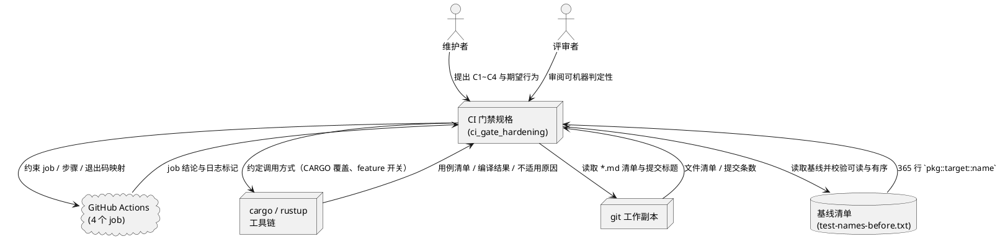
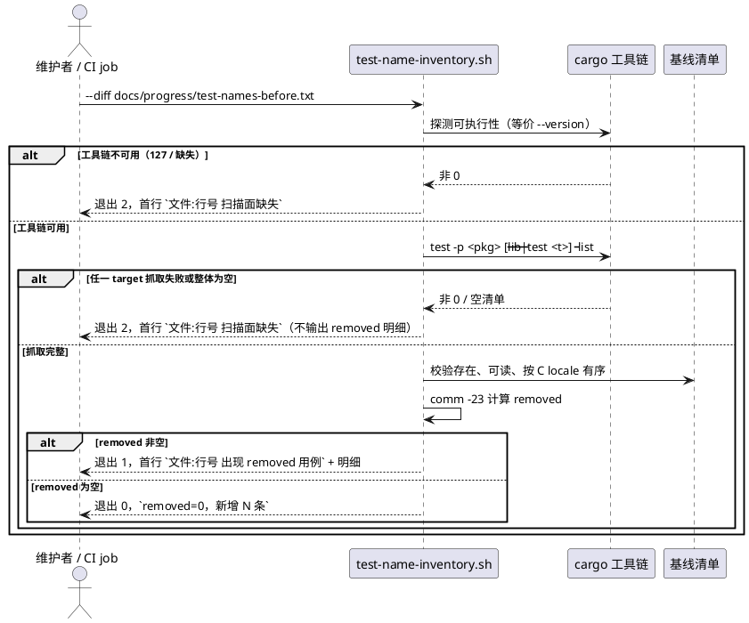
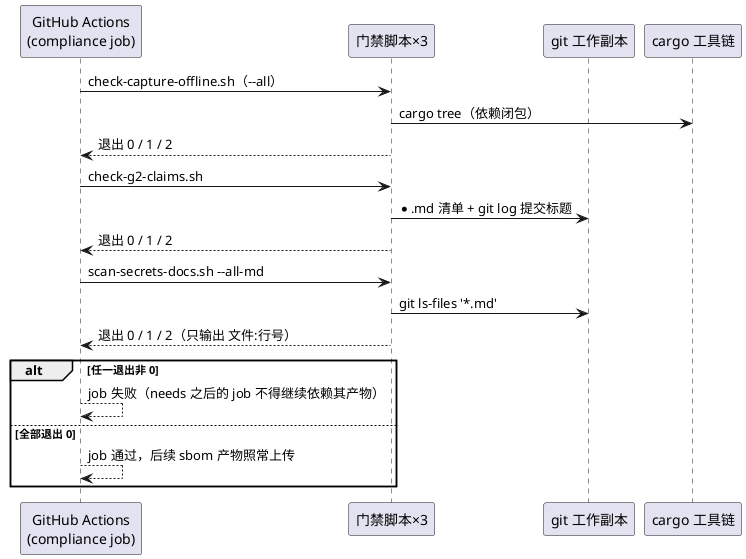
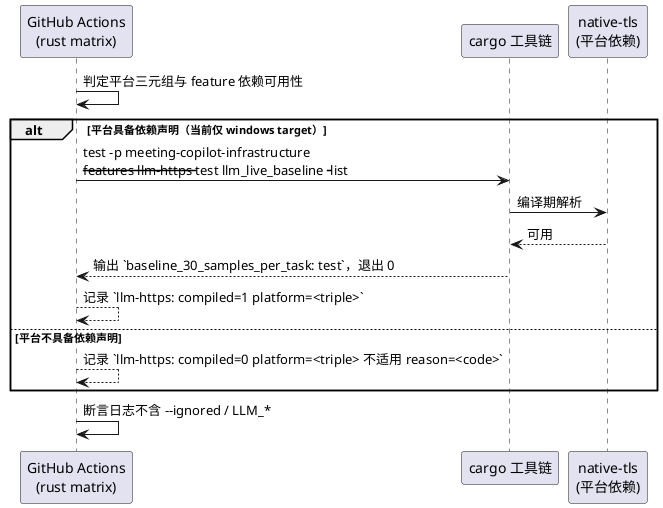
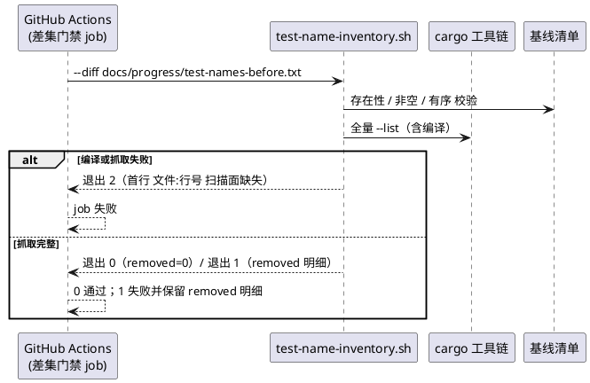

# **1. 组件定位**

## **1.1 核心职责**

本组件负责把已实测确认的 4 项 CI 门禁缺口（C1~C4）收敛为可机器判定的验收契约，实现"门禁在远端 CI 恒常生效、抓取失败不再伪装成用例删除"。

## **1.2 核心输入**

1. 现有 CI 定义：`.github/workflows/ci.yml`（4 个 job：`web` / `rust` / `compliance` / `sqlcipher`）。
2. 现有门禁脚本：`scripts/test-name-inventory.sh`、`scripts/check-capture-offline.sh`、`scripts/check-g2-claims.sh`、`scripts/scan-secrets-docs.sh`。
3. 现状依据：`docs/progress/ci-readiness.md` 第 13 节与 13.3（C1~C4 缺口登记）、`docs/progress/b2-offline-closure.md` 第 5 节（门禁结果）。
4. 既有权威规格：`docs/sdd/spec.md`（4.3 安全性第 7 条、4.4 可维护性第 1~2 条）、`docs/sdd/tasks.md` 第 1.4 条（三平台 CI 矩阵）、`docs/sdd/tasks-b2-offline-closure.md` 批次 W-E（E 组门禁定义）。
5. 既有特性规格：`.codeartsdoer/specs/b2_offline_closure/spec.md`（AC-B2-OC-E11/E12/F03、8.6 判定环境约束）。
6. 门禁输入数据：`docs/progress/test-names-before.txt`（基线清单，实测 365 行，格式 `pkg::target::name`）。
7. 触发信号：GitHub `push`（全部分支）与 `pull_request` 事件。

## **1.3 核心输出**

1. 四项缺口的"现状 / 期望行为 / 不做会怎样"对照，以及每项的验收编号映射。
2. CI 步骤契约：哪条命令、在哪个 job、退出码如何映射为 job 成败、超时与吞错禁令。
3. 门禁诊断输出契约：`文件:行号` 首行格式、固定标记串（`扫描面缺失`、`出现 removed 用例`、`llm-https: compiled=<0|1>` 等）、退出码三分（0/1/2）。
4. 离线可判定项与只能由远端 CI 判定项的显式分界表。
5. 与既有 SDD 的冲突清单，以及必须交由设计阶段裁决的 1~2 个未决点。

## **1.4 职责边界**

本组件**不负责**以下事项：

1. 不修改 `docs/sdd/spec.md`、`docs/sdd/design.md`、`docs/sdd/tasks.md`、`docs/sdd/tasks-b2-offline-closure.md` 等权威文档（只读引用）。
2. 不修改任何代码与脚本，不产出 `design.md` / `tasks.md`；实现与任务分解由后续阶段代理负责。
3. 不重新设计 4 个脚本的全部规则，只对 C4 涉及的"抓取失败语义"与"输出契约"提出增量要求。
4. 不解决 GitHub 不可达、无凭据导致的推送阻塞（`ci-readiness.md` 第 3 节的既有结论），也不实现任何网络代理方案。
5. 不新增第 5 项门禁内容，不把现有脚本重写为其它语言，不引入新的第三方扫描器。
6. 不裁决 C2 的跨平台依赖补全方案与 C3 的基线分平台方案（作为设计阶段未决点登记）。
7. 不执行任何真实 LLM 端点采样，不产生任何真实凭据或端点配置。

# **2. 领域术语与编号约定**

## **2.1 编号约定**

| 编号族 | 含义 | 使用规则 |
|---|---|---|
| `C1`~`C4` | 已确认的 CI 配置缺口编号，沿用 `docs/progress/ci-readiness.md` 13.3 原编号与语义 | 只用于"缺口"，不得用于验收项或任务项 |
| `AC-CI-01`~`AC-CI-27` | 本规格的验收标准编号 | 每条必须可机器判定；不得与 `AC-B2-OC-*`、`AC-B2-23-*`、`AC-LLM-*` 混用或简写 |
| `W-CI-*` | 下一阶段（任务分解）的工作项编号 | 本规格只保留编号空间，不定义具体工作项 |
| `X1`~`X8` | 本规格识别的冲突点编号 | 仅用于第 9 章冲突清单 |
| `R1`~`R7` | 本规格识别的风险编号 | 仅用于第 10 章 |

约定：同一编号在三族之间**不得复用**；交叉引用必须写全前缀（例如 `AC-CI-07` 不得写作 `AC-07`）。

## **2.2 术语**

**CI 门禁**
: 指在 GitHub Actions job 中以"命令退出码"决定流水线成败的自动化检查，其结论必须无需人工判读日志即可机器判定。

**门禁缺口**
: 指"门禁能力已存在于脚本或本地流程，但未纳入 CI 编排，或纳入后语义错误"的状态；本规格登记为 C1~C4。

**扫描面缺失**
: 指门禁所需的输入对象（`cargo` 可执行文件、包清单、测试目标、基线文件、`*.md` 文件集合、提交历史）不存在、不可读或抓取过程返回非 0；该状态必须与"检查通过"严格区分。

**感受性失败（silent pass）**
: 指抓取或扫描过程失败，但门禁因错误被吞掉（`2>/dev/null`、`|| true`、SKIP 分支）而输出 PASS 的现象。

**用例名清单**
: 指以 `cargo test -- --list` 收集、按 `pkg::target::name` 归一化并升序去重的用例名集合；清单用于判定"用例是否被删除"。

**基线清单**
: 指被冻结在仓库内、作为删除判定参照的用例名清单文件（当前为 `docs/progress/test-names-before.txt`）。

**差集门禁**
: 指比较基线清单与当前清单、当且仅当出现"基线有而当前无"的条目时判失败的检查。

**feature 编译覆盖**
: 指在 CI 中启用某个 Cargo feature（当前为 `llm-https`）并至少完成"编译 + 测试目标收集"的检查；不要求执行被忽略的真实联调用例。

**默认忽略用例**
: 指带 `#[ignore]` 标记、默认执行不运行的用例；其数量减少视为覆盖回退。

**回环 socket**
: 指绑定 `127.0.0.1`/`::1` 的本机连接，不构成对外部主机的网络访问。

**首行诊断**
: 指脚本以非 0 退出时输出的第一行，格式必须匹配 `^.+:[0-9]+(:| )`（`文件:行号`），用于 CI 日志的机器解析。

**退出码三分**
: 指门禁脚本只允许 `0`（通过）、`1`（命中违规）、`2`（扫描面缺失）三种退出码，且 `2` 不得被映射为 `0`。

**离线可判定**
: 指在无网络、无凭据、无远端 runner 的本机环境即可重复判定真假的验收性质。

**远端可判定**
: 指必须由 GitHub Actions 实际运行才能取得证据的验收性质（如 runner 平台差异、job 超时、跨平台编译）。

# **3. 角色与边界**

## **3.1 核心角色**

维护者：提交变更并期望 CI 对"删除用例""门禁失效""抓取失败"自动拦截，而非依赖本地自觉执行。

评审者：在不运行流水线的前提下，依据日志标记串与退出码判断门禁是否真正生效，并识别"扫描面缺失被当作通过"。

## **3.2 外部系统**

GitHub Actions：执行 `ci.yml` 中的 job，提供 runner 平台、超时与日志；其日志是本规格多数 AC 的唯一远端证据来源。

cargo / rustup 工具链：提供 `cargo test -- --list`、`cargo test --features llm-https`、`cargo tree` 等能力；其可执行性直接决定 C4 与 C2 的结论。

git 工作副本：提供 `git ls-files '*.md'`、`git log --format=%s` 的扫描面；浅克隆会收窄提交扫描面。

本机 shell（git-bash / bash）：提供脚本自检与离线复跑环境，其中 `CARGO` 环境变量用于覆盖工具链入口。

## **3.3 交互上下文**

# **4. DFX 约束**

## **4.1 性能**

1. `compliance` job 追加的 3 条静态门禁（C1）在 ubuntu-latest 上总耗时不得导致该 job 超过既有 `timeout-minutes: 15`；单条步骤本地实测基线：`check-capture-offline.sh` ≤ 30s（含两次 `cargo tree`）、`check-g2-claims.sh` ≤ 10s、`scan-secrets-docs.sh --all-md` ≤ 20s。
2. C3 的差集门禁需要 `cargo test -- --list` 完成 workspace 编译，因此其所在 job 的 `timeout-minutes` 必须 ≥ 30；若沿用 `compliance` 的 15 分钟上限，则不得在该 job 内启用 C3。
3. C2 的 feature 编译覆盖必须在单次 CI 运行内完成，不得因其追加使 `rust` job 超过既有 `timeout-minutes: 30`（缓存命中时增量编译应 ≤ 5 分钟）。
4. 所有新增步骤均必须声明 `timeout-minutes` 或继承 job 级超时；超时一律判为失败，不得视为跳过。

## **4.2 可靠性**

1. 同一条门禁命令在同一工作副本连续执行 3 次，退出码与首行诊断必须一致（沿用 `AC-B2-OC-08.6-4` 的重复执行要求）。
2. 门禁结论必须落在 `0` / `1` / `2` 三态；`2`（扫描面缺失）在 CI 中必须导致 job 失败，禁止被 `|| true`、`continue-on-error`、SKIP 分支吞掉。
3. 任一 job 失败不得被后续 job 的 `needs` 关系掩盖；新增步骤不得设置 `continue-on-error: true`。
4. 抓取类门禁在"当前清单为空"时必须判扫描面缺失，不得进入差集计算。

## **4.3 安全性**

1. `scan-secrets-docs.sh --all-md` 的输出只允许 `文件:行号`，禁止回显命中内容、端点、模型名或任何键值片段（沿用该脚本既有 `--self-test` 断言）。
2. CI 中不得注入 `LLM_LIVE`、`LLM_API_KEY`、`LLM_BASE_URL`、`LLM_MODEL`、`LLM_MODEL_CONFIRMED`、`LLM_ALLOWLIST` 等真实联调变量；C2 步骤必须不依赖任何凭据。
3. C2 步骤禁止以 `--ignored` 运行用例；默认忽略用例必须保持忽略，数量不得减少。
4. `--features llm-https` 的编译不得触发对外部主机的连接；允许的只有编译期行为，以及（若执行用例）本机回环 socket。

## **4.4 可维护性**

1. 所有门禁诊断必须包含可 grep 的固定标记串，至少包含：`扫描面缺失`、`出现 removed 用例`、`removed=0`、`llm-https: compiled=`、`不适用`。
2. 门禁脚本必须支持 `CARGO` 环境变量覆盖工具链入口（现状已支持），CI 与本机使用同一入口约定。
3. 新增 CI 步骤的 `name` 必须能唯一定位缺口编号（例如包含 `capture-offline`、`g2-claims`、`secrets-docs`、`test-name-inventory`、`llm-https`），便于静态审计与日志检索。
4. 每个门禁必须提供"失败可复现"的最小自检入口（至少 C4 必须提供），自检不得依赖真实端点与网络。

## **4.5 兼容性**

1. 脚本必须在 bash 3.2+（macOS runner 自带）与 git-bash（Windows 本机）下可执行；不得引入 bash 4 专有语法。
2. 文本行尾必须保持 LF（`.gitattributes` 已强制 `*.sh text eol=lf`）；在 Windows 检出后脚本不得因 CRLF 失效。
3. 差集比较必须固定 `LC_ALL=C` 排序口径，避免 Linux runner 与 Windows 本机 locale 差异导致同一清单被误判为不同。
4. 首行诊断中的文件路径必须使用仓库相对路径与正斜杠，禁止出现 `C:\` 形式的盘符路径（否则 `文件:行号` 无法机器解析）。
5. `--diff` 的判定必须在与基线清单生成时相同目标三元组的平台上执行；平台不一致时不得判定"用例被删除"（详见 `X4` 与 `AC-CI-23`）。

# **5. 核心能力**

## **5.1 C4：用例名清单抓取失败的可判定化（最高优先级）**

**现状**：`scripts/test-name-inventory.sh` 第 23、25 行以 `2>/dev/null` 吞掉 `cargo test ... -- --list` 的 stderr；第 75 行直接对"基线 vs 当前"做 `comm -23`，不校验当前清单是否可信。本机 rustup shim 损坏（直接执行返回 127 / 子进程 `STATUS_DLL_NOT_FOUND`）时，当前清单退化为空，基线 365 行全部被判为 removed，实测误报 365 条并退出 1（`ci-readiness.md` 第 270 行）。

**期望行为**：任何"抓取不到的用例面"都必须被识别为扫描面缺失并退出 2；只有在确证抓取完整时才允许进入差集判定并返回 0/1。

**不做会怎样**：门禁把环境故障报成"业务回归"，维护者被迫忽略该门禁，差集门禁实质失效；C3 一旦纳入 CI，将出现随机红色流水线并把真实删除淹没在噪声中。

### **5.1.1 业务规则**

1. **工具链可用性前置**：执行任何抓取前必须确证 `CARGO` 指向的可执行文件可运行；不可运行（含 127）时必须立即以退出码 2 终止，不得继续抓取或写入清单。
   a. 验收条件：`AC-CI-01`
2. **逐面失败即整体缺失**：任一 `pkg` / `target` 的抓取命令返回非 0（编译失败、目标不存在、依赖缺失）时，必须记录失败面标识并以退出码 2 终止。
   a. 验收条件：`AC-CI-02`
3. **空清单禁令**：当前清单为 0 行时禁止进入差集计算，必须判扫描面缺失。
   a. 验收条件：`AC-CI-03`
4. **基线写入原子性**：`--emit-baseline` 在抓取失败时不得创建或覆盖目标基线文件；成功时写入内容必须非空。
   a. 验收条件：`AC-CI-04`
5. **扫描面完整性**：仓库根既无 `app/src-tauri/Cargo.toml` 也无任何 `crates/*/Cargo.toml` 时，清单与差集均不得给出 PASS。
   a. 验收条件：`AC-CI-05`
6. **基线可读与有序**：基线缺失、不可读、含空行以外的乱序行时，必须以退出码 2 终止并在首行给出 `文件:行号` 诊断。
   a. 验收条件：`AC-CI-06`
7. **真 removed 的语义不变**：确证抓取完整且存在 removed 条目时，仍以退出码 1 终止并输出 removed 明细；退出码 1 与 2 必须互斥。
   a. 验收条件：`AC-CI-07`
8. **自检可复现**：脚本必须提供不出网、不依赖真实工具链的自检入口，能双向证明"失败面被识别"与"正常面不被误判"。
   a. 验收条件：`AC-CI-08`
9. **正常态零噪声**：抓取完整且无 removed 时，必须退出 0 并输出 `removed=0` 与新增条数。
   a. 验收条件：`AC-CI-09`
10. **禁止项**：禁止把抓取失败降级为"全部 removed"；禁止在失败路径输出 removed 明细行；禁止在扫描面缺失时返回 0。
    a. 验收条件：失败路径输出中不出现 `removed=`，且退出码为 2（`AC-CI-01`~`AC-CI-05`）。

### **5.1.2 交互流程**

### **5.1.3 异常场景**

1. **cargo 返回 127（shim 损坏 / PATH 无 cargo）**
   a. 触发条件：`CARGO` 指向的文件存在但执行失败，或 `command -v` 找不到。
   b. 系统行为：立即终止，不写入任何清单，不进入差集；首行输出 `文件:行号` + `扫描面缺失`；退出码 2。
   c. 用户感知：CI 日志首行为可解析诊断，job 失败原因被判为"扫描面缺失"而非"用例删除"。
2. **单个 target 编译失败（新增依赖缺失 / feature 未开）**
   a. 触发条件：某 `pkg::target` 的 `--list` 返回非 0，但其它 target 正常。
   b. 系统行为：记录该 `pkg::target` 为失败面，整体退出 2；不得把该 target 的基线条目计入 removed。
   c. 用户感知：诊断信息可定位到具体包与目标名。
3. **当前清单为空**
   a. 触发条件：所有抓取命令返回 0，但归一化后 0 行。
   b. 系统行为：判扫描面缺失，退出 2。
   c. 用户感知：日志含 `扫描面缺失`，不出现 `removed=365` 一类全量误报。
4. **基线文件缺失 / 不可读 / 未排序**
   a. 触发条件：基线路径不存在、无读权限，或行序不符合 C locale 升序。
   b. 系统行为：退出 2，首行 `文件:行号`；不得对未排序数据执行 `comm`。
   c. 用户感知：明确提示基线本身有问题，而非"用例被删"。
5. **仓库扫描面缺失**
   a. 触发条件：无 `app/src-tauri/Cargo.toml` 且无 `crates/*/Cargo.toml`。
   b. 系统行为：退出 2，诊断中给出缺失的两个扫描面。
   c. 用户感知：`--emit-baseline` 与 `--diff` 均不产出 PASS。
6. **基线写入中断**
   a. 触发条件：`--emit-baseline` 写入过程中断或结果为 0 行。
   b. 系统行为：目标基线文件保持原内容（不出现半截文件或空文件）。
   c. 用户感知：上一次可用基线不被破坏。
7. **locale 差异**
   a. 触发条件：CI runner 与本地 locale 不同，导致相同清单排序不同。
   b. 系统行为：固定 `LC_ALL=C` 口径后再比较。
   c. 用户感知：不出现"排序差异型 removed"误报。

## **5.2 C1：compliance job 纳入三个静态门禁**

**现状**：`compliance` job（`ci.yml` 第 100~127 行）只执行 `check-layering.sh`、`scan-secrets.sh`、`cargo deny`、`sbom.sh`；`check-capture-offline.sh`、`check-g2-claims.sh`、`scan-secrets-docs.sh --all-md` 仅在本地执行（`ci-readiness.md` 第 243、247、248 行）。

**期望行为**：三条门禁成为 `compliance` job 的必过步骤；任一脚本以 1 或 2 退出即判 job 失败；脚本缺失时步骤失败而非跳过。

**不做会怎样**：采集离线禁令、G2 宣称禁令、文档目录密钥泄漏在远端无任何守护，本地通过与否取决于个人自觉，远端可被静默破坏。

### **5.2.1 业务规则**

1. **三条必过步骤**：`compliance` job 必须存在对三个脚本的调用，且调用命令不得携带吞错修饰。
   a. 验收条件：`AC-CI-10`
2. **命中即失败**：任一脚本退出 1 时，该步骤必须失败，输出首行匹配 `文件:行号`，且 job 结论为失败。
   a. 验收条件：`AC-CI-11`
3. **扫描面缺失即失败**：任一脚本退出 2 时，该步骤必须失败，日志含 `扫描面缺失` 或 `不可读`；不得标记为通过或跳过。
   a. 验收条件：`AC-CI-12`
4. **脚本缺失不静默**：脚本路径在 checkout 中不存在时，该步骤必须失败。
   a. 验收条件：`AC-CI-13`
5. **文档扫描不回显**：`scan-secrets-docs.sh --all-md` 只允许输出 `文件:行号`，不得输出命中内容片段。
   a. 验收条件：`AC-CI-14`
6. **提交扫描面不静默收窄**：`check-g2-claims.sh` 的提交标题扫描依赖 `git log`；当 checkout 为浅克隆导致可扫描提交数不足 20 时，必须以可机器识别的方式暴露该收窄（或通过 `fetch-depth` 补齐），不得静默按"0 命中"通过。
   a. 验收条件：`AC-CI-10`（子条件）
7. **禁止项**：禁止在三条调用上使用 `|| true`、`continue-on-error: true`、`set +e`、`if: false`。

### **5.2.2 交互流程**

### **5.2.3 异常场景**

1. **脚本自身缺失**
   a. 触发条件：`scripts/` 下目标文件不存在或不可执行。
   b. 系统行为：步骤以非 0 退出；job 失败。
   c. 用户感知：日志首行含缺失路径。
2. **依赖闭包抓取失败（cargo tree 非 0）**
   a. 触发条件：`cargo tree` 失败被脚本内 `2>/dev/null` 吞掉。
   b. 系统行为：既有脚本可能输出 SKIP 并退出 0（见 `5.7` 残余风险 R4）；C1 不改变该脚本语义，但要求 CI 侧 rust 工具链步骤先于该门禁执行，使该路径仅在工具链故障时出现。
   c. 用户感知：若出现 SKIP，日志必须可见 `SKIP` 字样，评审者不得将其计为"依赖闭包已验证"。
3. **浅克隆导致提交扫描面不足**
   a. 触发条件：`actions/checkout` 默认 `fetch-depth: 1`。
   b. 系统行为：必须通过 `fetch-depth` 补齐到 ≥20 条，或输出可识别的收窄标记。
   c. 用户感知：G2 宣称扫描的覆盖范围可被审计。
4. **文档文件集合为空**
   a. 触发条件：`git ls-files '*.md'` 返回空。
   b. 系统行为：`scan-secrets-docs.sh` 判定扫描面缺失并退出 2；CI job 失败。
   c. 用户感知：不得把"没有可扫文件"当作"没有泄漏"。
5. **job 超时**
   a. 触发条件：三条步骤累计超过 15 分钟。
   b. 系统行为：job 判失败（超时不等于通过）。
   c. 用户感知：需由设计阶段调整步骤归属或超时（见 `X3`）。

## **5.3 C2：rust job 纳入 `llm-https` feature 编译覆盖**

**现状**：`rust` job（`ci.yml` 第 91~98 行）只执行 `fmt` / `clippy --workspace --all-targets` / `build` / `test`，均未启用 `llm-https`。该 feature 下的代码（`crates/infrastructure/src/llm/transport_tls.rs`、`crates/infrastructure/tests/llm_live_baseline.rs`（首行 `#![cfg(feature = "llm-https")]`）、`crates/infrastructure/tests/llm_live.rs` 的 feature 分支、`crates/infrastructure/tests/llm_transport_tls.rs`）在 CI 中从不参与编译。

**期望行为**：至少在一个 CI 平台上完成 `llm-https` 的编译与测试目标收集，并证明 `llm_live_baseline` 用例确实被收集；同时不得运行任何真实联调用例、不读凭据、不触发外部连接。

**不做会怎样**：特性组合长期未被编译，`llm-https` 一旦启用即可能出现编译错误或契约漂移，而默认构建恒为绿色，问题只能在用户本机暴露。

### **5.3.1 业务规则**

1. **覆盖证据**：CI 的 feature 步骤必须产生"用例被收集"的直接证据，而非仅"命令退出 0"。
   a. 验收条件：`AC-CI-15`
2. **不运行真实用例**：该步骤只允许编译与列举；禁止 `--ignored`、`--nocapture`、`run-llm-live.sh`；CI 中不得定义任何 `LLM_*` 联调变量。
   a. 验收条件：`AC-CI-16`
3. **忽略数量不减**：`llm_live` 的 8 个默认忽略用例与 `llm_live_baseline` 的 1 个默认忽略用例必须保持忽略状态。
   a. 验收条件：`AC-CI-17`
4. **平台能力显式化**：在不具备该 feature 依赖声明的平台上，必须输出"不适用"诊断（含平台三元组与原因码），不得静默跳过并计为通过；同时至少一个平台必须给出覆盖成功标记。
   a. 验收条件：`AC-CI-18`
5. **只编译不执行**：该步骤的命令必须使用 `--no-run` 或 `-- --list`，保证不进入用例执行阶段。
   a. 验收条件：`AC-CI-19`
6. **禁止项**：禁止以 `--all-features` 替代定向 feature（会同时启用 `sqlcipher`，其构建链在部分平台不可用）；禁止在 `llm-https` 步骤中注入真实端点或密钥。

### **5.3.2 交互流程**

### **5.3.3 异常场景**

1. **feature 下编译失败**
   a. 触发条件：`llm-https` 引入的代码无法在当前平台编译（未声明依赖、API 变更）。
   b. 系统行为：步骤失败，job 失败；诊断需包含 `llm-https:` 与平台三元组。
   c. 用户感知：特性组合问题在 CI 暴露，不再依赖用户本机。
2. **feature 未生效（用例未被收集）**
   a. 触发条件：命令返回 0，但输出中不含 `baseline_30_samples_per_task: test`。
   b. 系统行为：判该步骤失败（不得以退出码 0 视为覆盖成功）。
   c. 用户感知：日志明确"用例未收集"。
3. **非 Windows 平台缺少依赖**
   a. 触发条件：`native-tls` 仅声明在 `[target."cfg(windows)".dependencies]`，非 Windows 平台启用 `llm-https` 时可能无法解析该 crate。
   b. 系统行为：该平台必须输出不适用诊断并保留证据；不得把"未编译"标为成功。
   c. 用户感知：评审者可从日志判断覆盖来自哪个平台。
4. **误开启真实联调**
   a. 触发条件：步骤中出现 `--ignored` 或注入了 `LLM_*`。
   b. 系统行为：静态审计即判失败；若已执行，必须视为违规并登记。
   c. 用户感知：日志与配置审计均可定位。
5. **回环 socket 被误判为外网调用**
   a. 触发条件：`llm_transport_tls.rs` 的 7 个非忽略用例使用 `127.0.0.1` 回环连接。
   b. 系统行为：若步骤仅编译（`--no-run` / `--list`），不涉及该路径；若设计阶段选择执行用例，必须显式标注"回环"并与 `AC-B2-OC-08.6-1` 的冲突处理一并裁决（见 `X1`）。
   c. 用户感知：评审者需区分"回环 socket"与"外部端点连接"。
6. **job 超时/缓存未命中**
   a. 触发条件：首次编译 native-tls 使 rust job 超过 30 分钟。
   b. 系统行为：job 失败。
   c. 用户感知：需由设计阶段决定缓存键或步骤归属（见 `X2`）。

## **5.4 C3：`test-name-inventory.sh --diff` 纳入 CI**

**现状**：差集门禁只在本地执行（`ci-readiness.md` 第 246 行；`b2-offline-closure.md` 第 124 行），`ci.yml` 无任何调用。用例被删除时，远端没有任何自动拦截。

**期望行为**：CI 中存在差集门禁步骤；退出 1（真 removed）与退出 2（扫描面缺失）均导致 job 失败，日志首行可机器解析；基线与执行平台的可比性有明确结论。

**不做会怎样**：`AC-B2-OC-E11`（用例名集合不减）只在本地生效，删除用例可静默合入，历史缺陷的回归守护被削除而无人察觉。

### **5.4.1 业务规则**

1. **必过步骤**：CI 必须存在对 `scripts/test-name-inventory.sh --diff docs/progress/test-names-before.txt` 的调用，且不得带吞错修饰。
   a. 验收条件：`AC-CI-20`
2. **失败映射**：退出 1 与退出 2 均必须导致 job 失败；退出 0 才通过。
   a. 验收条件：`AC-CI-21`
3. **基线在 CI 中可用**：基线文件必须随 checkout 存在且非空（实测 365 行）；缺失时该步骤以 2 退出并判失败。
   a. 验收条件：`AC-CI-22`
4. **平台可比性**：差集判定必须与基线生成平台一致；不一致时必须判失败并输出"不可比"原因，不得输出 removed 结论。
   a. 验收条件：`AC-CI-23`
5. **执行成本受控**：该步骤所在 job 的超时必须足以覆盖 workspace 编译（≥30 分钟），否则不得启用。
   a. 验收条件：`AC-CI-24`（与 `4.1-2` 一致）
6. **禁止项**：禁止把退出 2 映射为成功；禁止使用 `--emit-baseline` 在 CI 中自动改写基线（会使删除永远无法被拦截）。

### **5.4.2 交互流程**

### **5.4.3 异常场景**

1. **编译超时**
   a. 触发条件：无缓存首次编译超过 job 超时。
   b. 系统行为：job 超时失败，不得视为通过。
   c. 用户感知：步骤日志在超时前应已输出正在抓取的包名。
2. **基线平台不匹配**
   a. 触发条件：在 macOS / Linux runner 上对 Windows 生成的基线做差集。
   b. 系统行为：判"不可比"并失败，输出平台三元组。
   c. 用户感知：不会出现大批量"removed"误报。
3. **基线被自动改写**
   a. 触发条件：CI 中误用 `--emit-baseline`。
   b. 系统行为：静态审计判违规（`AC-CI-20` 子条件）。
   c. 用户感知：删除守护不会因基线刷新而失效。
4. **用例新增**
   a. 触发条件：当前清单比基线多出条目。
   b. 系统行为：退出 0，输出新增条数。
   c. 用户感知：新增不需要刷新基线即可通过。
5. **脚本缺失**
   a. 触发条件：`scripts/test-name-inventory.sh` 不存在。
   b. 系统行为：步骤失败。
   c. 用户感知：日志含缺失路径。

## **5.5 判定分界：离线可判定 vs 远端 CI 可判定**

| 判定对象 | 离线可判定 | 只能远端 CI 判定 | 说明 |
|---|---|---|---|
| C4 全部验收（首行格式、退出码 2、空清单、原子写、自检） | 是 | 否 | 用 `CARGO` 桩与隔离临时副本即可复现 |
| C1 三条脚本自身行为（0/1/2） | 是 | 否 | 本地直接运行脚本 |
| C1 步骤是否真正接入 job | 部分（静态读 `ci.yml`） | 是（job 实际执行） | 静态可判定"是否写了调用"，远端才能证明"确实跑了" |
| C2 feature 生效证据（用例被收集） | 是（Windows 本机 + toolchain 绝对路径） | 是（其它平台） | 非 Windows 的依赖可用性只能远端证明 |
| C2 平台不适用判定 | 否 | 是 | 取决于 runner 平台的 `native-tls` 解析结果 |
| C3 差集本地结果（removed=0） | 是 | 否 | 基线 365 行已在本机复跑 |
| C3 CI 平台可比性 | 否 | 是 | 跨平台清单差异只能由 runner 暴露 |
| 超时与分钟数成本 | 否 | 是 | 取决于 runner 性能与缓存命中 |

# **6. 数据约束**

## **6.1 门禁诊断行（GateDiagnostic）**

1. **file**：仓库相对路径且使用正斜杠；不得为绝对路径或含盘符路径。
2. **line**：非负整数；`0` 表示"作用于整个文件/整个扫描面"。
3. **message**：非空；扫描面缺失必须包含 `扫描面缺失` 字样。
4. **gate**：取值为 `capture-offline`、`g2-claims`、`secrets-docs`、`test-name-inventory` 之一。
5. **exit_code**：只能是 `1` 或 `2`；`0` 不允许伴随诊断行输出为"失败"语义。
6. **可见性**：首行必须匹配 `^.+:[0-9]+(:| )`；后续行可为明细。

## **6.2 用例名清单（TestNameInventory）**

1. **格式**：每条为 `pkg::target::name`，三段均非空。
2. **唯一性**：去重后不得出现重复条目。
3. **有序性**：按 `LC_ALL=C` 升序排列。
4. **非空性**：用于差集判定的当前清单不得为 0 行。
5. **规模基线**：冻结基线为 365 行（`docs/progress/test-names-before.txt`）；规模变化只能通过显式提交更新，不得由 CI 自动改写。
6. **目标分布基线**（用于快速自检）：`lib` 246 条；`llm_normalize_strict` 21；`llm_degrade_inject` 14；`llm_live_gate` 10；`capture_channel_state` 10；`llm_live_offline` 9；`llm_live` 8；其余目标 ≤ 7。

## **6.3 CI 步骤契约（CiStep）**

1. **command**：必须为可直接执行的绝对或仓库相对命令；不得以 `|| true` 结尾。
2. **gate_id**：必须能唯一映射到 C1~C4 之一。
3. **on_exit_1**：必须为 `fail`。
4. **on_exit_2**：必须为 `fail`。
5. **continue_on_error**：必须为 `false`。
6. **timeout**：必须显式或继承 job 级超时，且超时判失败。

## **6.4 特性覆盖记录（FeatureCoverage）**

1. **platform_triple**：必须为 CI 矩阵中的目标三元组之一（`x86_64-pc-windows-msvc`、`aarch64-apple-darwin`、`x86_64-apple-darwin`）。
2. **feature**：固定为 `llm-https`。
3. **compiled**：只能为 `0` 或 `1`。
4. **reason_code**：`compiled=0` 时必填（如 `dependency_not_declared`）；`compiled=1` 时可选。
5. **可判定性**：日志中必须出现形如 `llm-https: compiled=<0|1> platform=<triple>` 的行；至少一行 `compiled=1`。

## **6.5 基线元信息（BaselineMeta）**

1. **path**：`docs/progress/test-names-before.txt`。
2. **lines**：非负整数，当前为 365；`0` 视为扫描面缺失。
3. **platform**：基线生成时的目标三元组；必须可被 CI 读取（以文件内约定、伴随元信息或 CI 变量任一形式）。
4. **platform_match**：CI 执行平台与 `platform` 一致时为 `1`；不一致时该次判定必须为"不可比"。

# **7. 范围与非范围**

## **7.1 本轮范围内（可离线完成并判定）**

1. C4 的抓取失败语义、首行诊断格式、退出码三分、基线原子写、自检入口。
2. C1 的三条门禁调用存在性、失败映射、不吞错、不回显、浅克隆扫描面暴露。
3. C2 的 feature 覆盖证据、不运行真实用例、忽略数量不减、平台不适用显式化、只编译不执行。
4. C3 的差集步骤存在性、退出码映射、基线可用性、平台可比性判定。
5. 4 项缺口共用的编排纪律：超时、无 `continue-on-error`、固定标记串。

## **7.2 本轮明确不做（附理由）**

1. 不修改 `docs/sdd/**` 任何权威文档（理由：只读约束，冲突以本规格第 9 章登记）。
2. 不修改代码与脚本（理由：本阶段只产出需求规格；实现属于 `W-CI-*`）。
3. 不补齐 `native-tls` 在 macOS/Linux 的依赖声明（理由：属实现决策，且会改变依赖图与许可证范围，须由设计阶段裁决，见 `X2`）。
4. 不设计跨平台分基线文件（理由：新增数据文件属设计决策，见 `X4`）。
5. 不解决 GitHub 网络不可达与推送阻塞（理由：`ci-readiness.md` 第 3 节已登记外部原因）。
6. 不启用 `sqlcipher` 与 `llm-https` 的组合编译（理由：SQLCipher 构建链在多个平台不可用，且与本 4 项缺口无关）。
7. 不执行任何真实端点采样，不宣称 G2 通过（沿用 `AC-B2-OC-E12` 的宣称禁令）。

## **7.3 进度基线（实测事实）**

| 事实 | 数值 / 证据 |
|---|---|
| 现有 job 数 | 4（`web` / `rust` / `compliance` / `sqlcipher`），`ci.yml` 共 143 行 |
| rust 矩阵 | 3 个 target（windows-msvc、macos aarch64、macos x86_64），`timeout-minutes: 30` |
| compliance 超时 | `timeout-minutes: 15` |
| 全量测试 | 399 passed / 0 failed / 8 ignored，38 targets（`ci-readiness.md` 13.1） |
| 基线清单 | 365 行，`pkg::target::name`，去除空行后无重复 |
| 本地差集结果 | removed=0，新增 42（`ci-readiness.md` 246 行） |
| C4 误报 | 365 条 removed，退出码 1（shim 返回 127 时） |
| `llm-https` 覆盖 | CI 中 0 次编译；`llm_live_baseline` 1 例、`llm_live` 8 例均 `#[ignore]` |
| `native-tls` 声明范围 | 仅 `[target."cfg(windows)".dependencies]`（`crates/infrastructure/Cargo.toml`） |

# **8. 可机器判定的验收标准**

## **8.1 C4 验收（AC-CI-01~AC-CI-09）**

**AC-CI-01（C4 · cargo 不可用）**
- EARS：WHERE `CARGO` 指向的可执行文件无法成功执行（含返回码 127）时，WHEN 执行 `--diff`，系统 shall 以退出码 `2` 终止，且输出首行匹配 `^.+:[0-9]+(:| )` 并包含 `扫描面缺失`。
- 判定：`CARGO=<返回 127 的桩> bash scripts/test-name-inventory.sh --diff docs/progress/test-names-before.txt; echo $?` → `2`；`... | head -1 | grep -qE '^.+:[0-9]+(:| )'` → 真；输出不含 `removed=`。
- 追溯：C4 · `ci-readiness.md:270` · `AC-B2-OC-E11`

**AC-CI-02（C4 · 单面抓取失败）**
- EARS：WHERE 某一个 `pkg` / `target` 的 `--list` 返回非 0 而其余成功时，WHEN 执行差集或基线生成，系统 shall 以退出码 `2` 终止，并在诊断中给出该 `pkg::target` 标识，且 shall 不把该面的基线条目计入 removed。
- 判定：以桩使指定 target 返回 1；断言退出码 2、输出含该 `pkg::target` 字样、输出不含 `removed=`。
- 追溯：C4

**AC-CI-03（C4 · 当前清单为空）**
- EARS：IF 抓取命令全部返回 0 但归一化后的当前清单为 `0` 行，THEN 系统 shall 判扫描面缺失并退出 `2`，且 shall 不执行差集计算。
- 判定：以桩输出空清单；退出码 2；输出不含 `removed=`。
- 追溯：C4

**AC-CI-04（C4 · 基线写入原子性）**
- EARS：WHEN 以 `--emit-baseline <新路径>` 生成基线且抓取失败，系统 shall 退出 `2` 且 shall 不创建该路径（若已存在则保持原内容不变）。
- 判定：对不存在的临时路径执行失败场景 → 路径仍不存在；对已有内容的临时路径执行 → 内容哈希不变；退出码 2。
- 追溯：C4

**AC-CI-05（C4 · 仓库扫描面缺失）**
- EARS：WHERE 工作副本既无 `app/src-tauri/Cargo.toml` 也无 `crates/*/Cargo.toml` 时，WHEN 执行清单生成或差集，系统 shall 退出 `2`，且诊断 shall 指出缺失的两个扫描面。
- 判定：在隔离临时副本中移除两条路径后执行；退出码 2；诊断含 `app/src-tauri` 与 `crates` 字样（或等价缺失说明）。
- 追溯：C4

**AC-CI-06（C4 · 基线不可用/未排序）**
- EARS：IF 基线文件缺失、不可读或行序不满足 `LC_ALL=C` 升序，THEN 系统 shall 退出 `2`，首行匹配 `文件:行号`，且 shall 不输出 removed 明细。
- 判定：分别用"不存在路径"与"人为倒序基线"执行；两次退出码均为 2；首行格式匹配；无 `removed=` 以外的明细行。
- 追溯：C4 · `X8`

**AC-CI-07（C4 · 真 removed 语义）**
- EARS：WHEN 抓取完整且存在 `基线有而当前无` 的条目，系统 shall 以退出码 `1` 终止，首行匹配 `文件:行号` 并包含 `出现 removed 用例`，随后输出 removed 明细；且退出码 `1` 与 `2` 不得同时出现。
- 判定：构造"基线 + 1 条不存在用例"，执行 → 退出码 1；`head -1` 匹配格式；明细行数 ≥1。
- 追溯：C4 · `AC-B2-OC-E11`

**AC-CI-08（C4 · 自检双向）**
- EARS：WHEN 以自检入口（`--self-test`）执行，系统 shall 在注入"返回 127 的 CARGO 桩"时判定为扫描面缺失（退出 `2`、首行格式正确），并在正常环境下判定通过（退出 `0`）；自检 shall 不依赖网络与真实端点。
- 判定：`bash scripts/test-name-inventory.sh --self-test; echo $?` → `0`；自检日志含两次断言结果（缺面 → 2，正常 → 0）。
- 追溯：C4 · `AC-B2-OC-E12` 的自检先例

**AC-CI-09（C4 · 正常态）**
- EARS：WHEN 抓取完整、基线可用且无 removed，系统 shall 退出 `0` 并输出 `removed=0` 与新增条数。
- 判定：`bash scripts/test-name-inventory.sh --diff docs/progress/test-names-before.txt; echo $?` → `0`；输出匹配 `removed=0`。
- 追溯：C4 · `ci-readiness.md:246`

## **8.2 C1 验收（AC-CI-10~AC-CI-14）**

**AC-CI-10（C1 · 三条调用存在且不吞错）**
- EARS：WHERE `compliance` job 定义存在的条件下，系统 shall 在该 job 内包含 `check-capture-offline.sh`、`check-g2-claims.sh`、`scan-secrets-docs.sh --all-md` 三条调用；WHEN 静态审计 `ci.yml`，这三条调用 shall 不伴随 `|| true`、`continue-on-error: true`、`set +e`、`if: false`；且 `actions/checkout` 的 `fetch-depth` shall 满足 `git log` 至少可扫描 20 条提交（或输出可识别的收窄标记）。
- 判定：`grep -c` 三条命令均 ≥1 且位于 compliance 段；`grep -nE '\|\| true|continue-on-error: true|set \+e|if: false'` 在对应步骤内 0 命中；`fetch-depth: 0`（或 ≥20）存在，或日志含收窄标记 `commit-scan=<N>`。
- 追溯：C1 · `ci-readiness.md:267` · `X7`

**AC-CI-11（C1 · 命中即失败）**
- EARS：WHEN 三条脚本中任一以退出码 `1` 终止，THEN 对应 CI 步骤 shall 失败并使 job 结论为失败，且该步骤输出首行 shall 匹配 `文件:行号`。
- 判定：本地对每个脚本执行 `--self-test`（既有正向/反向自检）取得退出 1 证据；CI 侧检查步骤未设 `continue-on-error`。
- 追溯：C1 · `AC-B2-OC-E12`、`AC-B2-OC-E09`

**AC-CI-12（C1 · 扫描面缺失即失败）**
- EARS：IF 三条脚本中任一以退出码 `2` 终止，THEN 对应 CI 步骤 shall 失败，日志 shall 包含 `扫描面缺失` 或 `不可读`，且该步骤 shall 不被标记为通过或跳过。
- 判定：构造缺失扫描面（如移除 `docs/progress`）执行脚本 → 退出码 2；静态检查 `ci.yml` 无 `continue-on-error`。
- 追溯：C1 · 退出码三分约定

**AC-CI-13（C1 · 脚本缺失不静默）**
- EARS：IF 目标脚本在 CI checkout 中不存在，THEN 该步骤 shall 以非 0 退出并使 job 失败，且日志 shall 指出缺失路径。
- 判定：静态检查步骤直接引用仓库相对路径（不存在时 shell 返回 127/1）；评审 `ci.yml` 无存在性短路分支。
- 追溯：C1

**AC-CI-14（C1 · 文档扫描不回显）**
- EARS：WHEN `scan-secrets-docs.sh --all-md` 命中候选泄漏，系统 shall 只输出 `文件:行号`，且 shall 不回显命中内容、端点或键值片段。
- 判定：`bash scripts/scan-secrets-docs.sh --self-test; echo $?` → `0`，其内部同时断言"未检出假凭据"与"未回显内容"。
- 追溯：C1 · `scan-secrets-docs.sh:130-146` · `docs/sdd/spec.md` 4.4-2

## **8.3 C2 验收（AC-CI-15~AC-CI-19）**

**AC-CI-15（C2 · feature 生效证据）**
- EARS：WHEN CI 执行 `llm-https` 覆盖步骤，且所在平台具备该 feature 依赖时，该步骤 shall 以 `--test llm_live_baseline -- --list`（或等价"只列举"形式）输出包含 `baseline_30_samples_per_task: test` 的行，并以退出码 `0` 结束。
- 判定：在 Windows 平台执行 `cargo test -p meeting-copilot-infrastructure --features llm-https --test llm_live_baseline -- --list`，`grep -c 'baseline_30_samples_per_task: test'` ≥1，退出码 0；CI 日志含该行。
- 追溯：C2 · `ci-readiness.md:268` · `llm_live_baseline.rs:7`

**AC-CI-16（C2 · 不运行真实用例/不注入凭据）**
- EARS：WHILE 执行该覆盖步骤，系统 shall 不包含 `--ignored`、`--nocapture`、`--test-threads`、`run-llm-live.sh`，且 `ci.yml` shall 不定义 `LLM_LIVE`、`LLM_API_KEY`、`LLM_BASE_URL`、`LLM_MODEL`、`LLM_MODEL_CONFIRMED`、`LLM_ALLOWLIST` 任一变量。
- 判定：`grep -nE '\-\-ignored|\-\-nocapture|\-\-test-threads|run-llm-live' .github/workflows/ci.yml` → 0 命中；`grep -nE 'LLM_(LIVE|API_KEY|BASE_URL|MODEL|MODEL_CONFIRMED|ALLOWLIST)'` → 0 命中。
- 追溯：C2 · `X1` · `docs/sdd/spec.md` 4.3-2

**AC-CI-17（C2 · 忽略数量不减）**
- EARS：WHEN 以 `--features llm-https --test llm_live -- --list --ignored` 查询，系统 shall 列出不少于 `8` 个被忽略用例；以 `--test llm_live_baseline -- --list --ignored` 查询 shall 列出不少于 `1` 个。
- 判定：两条命令的 `: test$` 计数分别 ≥8 与 ≥1；数量变化必须在变更记录中显式登记。
- 追溯：C2 · `b2-offline-closure.md:153`

**AC-CI-18（C2 · 平台能力显式化）**
- EARS：WHERE 某矩阵平台不具备 `llm-https` 的依赖声明（当前 `native-tls` 仅 `cfg(windows)`）时，该平台的该步骤 shall 输出形如 `llm-https: compiled=0 platform=<triple> ... 不适用` 的诊断行并判为"不适用"（不得计为通过或已覆盖）；WHILE 全部矩阵执行完毕，日志中 shall 至少存在一行 `llm-https: compiled=1 platform=<triple>`，否则该门禁 shall 判失败。
- 判定：CI 日志 grep `llm-https: compiled=1` ≥1；每个未执行平台存在 `compiled=0` + `不适用` 行；两者缺一即失败。
- 追溯：C2 · `X2` · `crates/infrastructure/Cargo.toml` 平台依赖

**AC-CI-19（C2 · 只编译不执行）**
- EARS：WHEN 执行该覆盖步骤，命令 shall 包含 `--no-run` 或 `-- --list` 之一，从而不进入用例执行阶段；且命令 shall 不使用 `--all-features`。
- 判定：静态检查 `ci.yml` 中 `llm-https` 步骤命令满足其一且不含 `--all-features`。
- 追溯：C2 · `X1` · `X6`

## **8.4 C3 验收（AC-CI-20~AC-CI-23）**

**AC-CI-20（C3 · 差集步骤存在）**
- EARS：系统 shall 在 CI 中包含 `bash scripts/test-name-inventory.sh --diff docs/progress/test-names-before.txt` 的调用；该调用 shall 不带 `|| true`、`continue-on-error: true`，且该 job 内 shall 不出现 `--emit-baseline`。
- 判定：`grep -c 'test-name-inventory.sh --diff'` ≥1；对应步骤无吞错修饰；`grep -c 'emit-baseline'` 在 `ci.yml` 中为 0。
- 追溯：C3 · `ci-readiness.md:269`

**AC-CI-21（C3 · 失败映射）**
- EARS：WHEN 该步骤退出 `1`，CI shall 失败并在日志中保留 `出现 removed 用例` 与 removed 明细；WHEN 退出 `2`，CI shall 失败并在日志中保留 `扫描面缺失`；WHEN 退出 `0`，CI shall 通过。
- 判定：三步分别构造（真 removed、假 CARGO、正常）在本地复跑记录退出码；CI 侧确认无吞错。
- 追溯：C3 · `AC-B2-OC-E11`

**AC-CI-22（C3 · 基线可用）**
- EARS：WHERE CI checkout 完成时，基线文件 `docs/progress/test-names-before.txt` shall 存在且非空；IF 缺失或为空，THEN 该步骤 shall 以 `2` 退出并判 job 失败。
- 判定：CI 中 `wc -l` ≥ 1（当前 365）；静态检查基线文件受版本控制（`git ls-files` 含该路径）。
- 追溯：C3

**AC-CI-23（C3 · 平台可比性）**
- EARS：WHERE 差集执行平台的目标三元组与基线生成平台不一致时，系统 shall 判"不可比"并使该门禁失败（输出含平台三元组与 `不可比`），且 shall 不输出 removed 结论；仅当平台一致时方允许判定 `0`/`1`。
- 判定：CI 日志中该步骤输出平台三元组；与基线元信息比对一致才可能出现 `removed=`；不一致时日志含 `不可比` 且 job 失败。
- 追溯：C3 · `X4` · `6.5`

## **8.5 编排与判定纪律（AC-CI-24~AC-CI-27）**

**AC-CI-24（编排纪律）**
- EARS：WHEN 审计 `ci.yml`，所有新增步骤 shall 继承或声明 `timeout-minutes`，且 shall 不设置 `continue-on-error: true`；IF 任一 job 超时，THEN 该 job shall 判失败。
- 判定：静态检查 4 个 job 均有 `timeout-minutes`；新增步骤无 `continue-on-error`。
- 追溯：C1~C4 公共

**AC-CI-25（退出码三分一致）**
- EARS：WHEN 任一纳入 CI 的门禁脚本终止，其退出码 shall 落在 `{0,1,2}`；IF 退出码为 `2`，THEN 不得被映射为 `0` 或"跳过"。
- 判定：逐个脚本构造三类场景并记录退出码；静态检查 CI 无吞错。
- 追溯：C1~C4 公共 · `check-capture-offline.sh:4`、`check-g2-claims.sh:4`、`scan-secrets-docs.sh:4`

**AC-CI-26（离线复跑一致）**
- EARS：WHEN 同一门禁命令在本地与远端各执行一次，其退出码 shall 一致；IF 不一致，THEN 必须登记为"环境差异"并给出根因（工具链、平台、缓存或扫描面）。
- 判定：本地执行记录（退出码 + 首行）与 CI 日志比对；差异项进入变更记录。
- 追溯：C1~C4 公共 · `AC-B2-OC-08.6-4`

**AC-CI-27（文档边界）**
- EARS：WHEN 本阶段完成，系统 shall 仅新增 `.codeartsdoer/specs/ci_gate_hardening/spec.md`，且 `docs/sdd/**` 的文件哈希 shall 保持不变。
- 判定：`git status --short docs/sdd` 为空；`git diff --stat docs/sdd` 为空。
- 追溯：本规格第 1.4 条

## **8.6 判定环境约束（对全部 AC 生效）**

1. 全部判定不得依赖外部网络；C2 的编译覆盖除外，但该覆盖仍不得访问外部端点。
2. 判定必须在与 CI 同构的 shell（bash）中执行；Windows 本机使用 git-bash。
3. 涉及 `cargo` 的判定必须允许 `CARGO` 环境变量覆盖；本机 shim 损坏时须使用工具链目录内的真实可执行文件（`ci-readiness.md` 13.2）。
4. 同一 AC 连续执行 3 次，结论必须一致。
5. 任何"未执行"（跳过、超时、扫描面缺失）不得记为"通过"。

# **9. 与既有 SDD 的关系及冲突处理**

## **9.1 与既有规格的关系**

1. 本规格**不重复定义** `AC-B2-OC-E08/E09/E11/E12/F03` 的行为口径；C1 与 C3 只回答"如何在 CI 中纳管"，不改变脚本的检测规则。
2. 本规格新增的 `AC-CI-*` 只覆盖三类内容：CI 编排缺失（C1/C3）、特性组合覆盖缺失（C2）、抓取失败语义缺陷（C4）。
3. 若本规格与既有 AC 冲突，以"更严格者"为准，并在 9.2 登记冲突编号。
4. 既有权威文档 `docs/sdd/**` 保持只读；本规格只做增量。

## **9.2 冲突清单与处理方式**

| 编号 | 冲突点 | 既有口径 | 本规格口径 | 处理方式 |
|---|---|---|---|---|
| X1 | C2 与"断网零建连" | `AC-B2-OC-08.6-1`：全部用例断网执行、进程建连次数为 0 | `llm_transport_tls.rs` 的 7 个非忽略用例使用 `127.0.0.1` 回环 socket | 本规格要求 C2 步骤**只编译不执行**（`AC-CI-19`）；若设计阶段决定执行用例，必须显式区分"回环 socket"并单独登记偏差 |
| X2 | C2 与三平台矩阵 | `tasks.md` 1.4 要求三平台 CI 矩阵；`rust` job 在三平台统一执行同一命令 | `native-tls` 仅声明在 `[target."cfg(windows)".dependencies]`，非 Windows 启用 `llm-https` 可能无法解析 | 平台条件化：不具备依赖的平台输出"不适用"（`AC-CI-18`）；是否补齐非 Windows 依赖由设计阶段裁决 |
| X3 | C3 与 compliance 超时 | `compliance` `timeout-minutes: 15` | 差集门禁需完整 `cargo test -- --list` 编译，通常 >15 分钟 | 差集门禁不得置于 15 分钟 job；须独立 job 或将超时提升至 ≥30（`4.1-2`、`AC-CI-24`） |
| X4 | C3 与单平台基线 | 基线 365 行由 Windows 本机生成 | CI 矩阵含 macOS，`--diff` 若在 macOS 执行可能产生系统性 removed 误报 | 平台必须一致方可判 0/1，否则判"不可比"失败（`AC-CI-23`）；分平台基线属设计决策 |
| X5 | C4 与既有差集判定 | `AC-B2-OC-E11` 仅约定"差集非空退出 1" | 新增"扫描面缺失退出 2"，且 2 与 1 互斥 | 更严格者优先；CI 中 1 与 2 均判失败，但语义必须区分（`AC-CI-01`、`AC-CI-07`） |
| X6 | C2 与 `sqlcipher` feature | `sqlcipher` job 使用定向 feature（`--features sqlcipher`） | `--all-features` 会同时启用 `sqlcipher`，部分平台构建链不可用 | C2 只允许定向 `llm-https`（`AC-CI-19`） |
| X7 | C1 与 G2 提交扫描面 | `check-g2-claims.sh` 扫描 `git log -20` 提交标题 | GitHub Actions 默认 `fetch-depth: 1`，远端实际只扫 1 条 | 要求 `fetch-depth` ≥20 或显式输出收窄标记（`AC-CI-10` 子条件） |
| X8 | C4 与路径/行尾 | 首行诊断要求 `文件:行号`，格式未限定路径形态 | Windows 绝对路径含盘符会使 `文件:行号` 解析歧义；CRLF 可能破坏脚本 | 路径必须相对且正斜杠；行尾 LF（`4.5-2`、`6.1-1`） |

## **9.3 未裁决点（交设计阶段）**

1. **U1（最高）**：C2 的落地形态——是"仅 Windows 平台做 feature 编译 + 其余平台显式不适用"，还是"先为 macOS/Linux 补齐 `native-tls` 依赖后三平台统一编译"。前者改动小但覆盖窄，后者覆盖全但改变依赖图与许可证范围。
2. **U2**：C3 的落地形态——"独立 job + 复用缓存 + 平台绑定基线"，还是"扩展为分平台基线（新增元数据/多文件）"。前者成本低但受平台限制，后者更稳但引入新数据契约。
3. **U3（次要）**：C4 自检入口的形态（`--self-test` 子命令 vs 独立测试脚本），只需满足 `AC-CI-08` 的双向断言即可。

## **9.4 文档落位**

1. 本规格路径：`.codeartsdoer/specs/ci_gate_hardening/spec.md`。
2. 后续阶段应产出 `.codeartsdoer/specs/ci_gate_hardening/design.md` 与 `tasks.md`，并先读取本规格第 8、9 章。
3. 本轮不修改 `docs/sdd/spec.md`、`docs/sdd/design.md`、`docs/sdd/tasks.md`、`docs/sdd/tasks-b2-offline-closure.md` 与既有特性规格。

# **10. 风险与依赖**

| 编号 | 风险 | 后果 | 应对 |
|---|---|---|---|
| R1 | 跨平台基线不可比 | macOS runner 上出现大批量 removed 误报 | `AC-CI-23` 强制平台一致或判不可比；U2 裁决 |
| R2 | 非 Windows 启用 `llm-https` 编译失败 | rust job 三个矩阵同时变红 | `AC-CI-18` 允许显式"不适用"；U1 裁决 |
| R3 | 差集门禁编译耗时导致 job 超时 | 流水线长期红色 | 独立 job + 缓存；超时 ≥30；`AC-CI-24` |
| R4 | `check-capture-offline.sh` 对 cargo 缺失输出 SKIP 并退出 0 | CI 显示通过但依赖闭包未验证（感受性失败） | 本规格不扩大 C1 范围；要求 CI 中先安装 Rust 工具链，并在变更记录中标注该残余风险 |
| R5 | GitHub 网络不可达 | 只能本地模拟，无法取得远端证据 | 沿用 `ci-readiness.md` 第 3 节解除条件；`AC-CI-26` 记录本地/远端差异 |
| R6 | 基线长期不更新 | 新增用例不受约束，规模漂移 | 基线更新必须显式提交；CI 禁止 `--emit-baseline`（`AC-CI-20`） |
| R7 | CI 分钟数成本上升 | 私有仓库额度消耗加快 | 差集门禁与 feature 覆盖尽量复用缓存；步骤归属由 U1/U2 裁决 |

依赖：B0 工程基座与现有 4 job 定义；B2 已交付的 4 个门禁脚本与 365 行基线；`docs/sdd/tasks.md` 1.4 的三平台矩阵承诺；GitHub Actions 可用性（当前外部阻塞，见 R5）。