# 一、需求与存量功能关系分析

> **追溯与结构说明**
> 1. 本文是 `.codeartsdoer/specs/llm_gateway_degrade/spec.md`（下称 SPEC，条目号写作 `SPEC 5.3.1-2`）的增量设计，对应 `docs/sdd/tasks.md` 任务 13.1、13.2；权威架构基线为 `docs/sdd/design.md`（下称 DESIGN，条目号写作 `DESIGN 2.2.2-E`）。
> 2. 本仓库已不是空项目：B0 交付 80 个 Rust 测试、五层 crate 与治理/存储/审计/度量基座齐备，B1 仅 12.2 完成。因此本章的"存量"指**本地已落地代码**，引用精确到文件与行号；无对应实现的能力才进入 1.1.3。
> 3. 模板结构只到 2.3；为承载用户要求的"测试方案与 AC 追溯""风险、依赖与待实测"，第二章在 2.3 之后续写 2.4、2.5，不新增章节层级。
> 4. 全文不写实现代码，只给类型、trait 签名与判定规则；所有"待实测"项在 2.5 集中登记。
> 5. **v1.1（2026-11-21）增量**：承接 SPEC 第 11 章"真实 OpenAI 兼容端点联调（可选验证路径）"与 8.3 的 AC-19 至 AC-27，在 2.5 之后追加 2.6、2.7、2.8、2.9 四个小节；1.x 只做追加（1.1.3-D、1.2.6），2.5 只做登记扩充（风险 R17~R24、依赖修订、文件 #14~#23、待实测 P9~P10），2.1~2.4 与 2.5.1 的 R1~R16 原文不改。
> 6. **判定口径不变声明**：AC-01 至 AC-18 的判定方式、载体文件与断言保持不变；AC-19 至 AC-27 属"可选验证项"，不计入 8.1 本轮完成判据，其跳过、未触发或未通过均不改变既有结论，且真实联调结果不得替代任何 mock 用例（SPEC 8.3、11.5.1-3）。
> 7. **v1.2（2026-11-21）增量**：承接 SPEC 8.4（AC-28 至 AC-32）与 11.9（服务商锁定：DeepSeek），在 2.9 之后追加 **2.10（运行门：服务商/模型/HTTPS/预算）、2.11（TLS 传输实现）、2.12（C1~C3 fail-closed 与单一执行入口）、2.13（AC-28~AC-32 测试映射与六载体泄漏扫描）**；2.5.1 只追加 R25~R30，2.5.2 只追加"v1.2 依赖修订"，2.5.3 只追加文件 #24~#30 与修改 #12~#22，2.5.4 只追加 P11~P13。**2.1~2.9 的既有结论、编号与 AC-01~AC-27 的判定口径一字不改**。
> 8. **v1.2 的边界声明**：AC-28 至 AC-32 属 SPEC 8.4 的"补充门槛项"，全部可在断网环境判定，**不计入** 8.1 本轮完成判据；任一项不通过只关闭真实联调路径（fail-closed），不影响 8.1 与 AC-19~AC-27 的既有结论，也不代表真实端点能力已实测。
>
> **修订记录**：v1.0（2026-11-20）任务 13.1/13.2 增量设计；v1.1（2026-11-21）补充第 11 章真实联调路径（新增 1.1.3-D、1.2.6、2.5.1 R17~R24、2.5.2 依赖修订、2.5.3 文件 #14~#23、2.5.4 P9~P10、2.6~2.9）；v1.2（2026-11-21）承接 SPEC 8.4 与 11.9，新增 2.10~2.13、R25~R30、文件 #24~#30、修改 #12~#22、待实测 P11~P13。

## 1.1 需求功能与存量功能对比

### 1.1.1 已实现功能

判定依据：该能力在本地代码中已存在且**无需为本需求修改**即可直接复用（含"直接调用"与"只读复用常量/校验函数"）。匹配度 100% 表示接口与语义完全吻合；75% 表示能力存在但需要新增调用方或增加薄适配。

| 需求功能（SPEC 追溯） | 存量功能 | 代码位置 | 匹配度 |
|---|---|---|---|
| 要点正文 ≤60 字、标题 ≤40 字、结论 ≤80 字、片段 ≤2000 字（SPEC 6.4-2、6.5-1、6.4-3） | `ShortText`/`TitleText`/`ConclusionText`/`UtteranceText` 构造期与反序列化双重校验 | `crates/domain/src/vo/text.rs:15-105` | 100% |
| 置信度必须落在 0 至 1（SPEC 6.4-4、6.5-4） | `Confidence` 拒绝 NaN/Inf/越界 | `crates/domain/src/vo/confidence.rs:16-38` | 100% |
| 请求编号必填、非空、≤128 字符、不含空白（SPEC 6.1-1） | `TaskId` 标识符类型 | `crates/domain/src/vo/ids.rs:21-49`、`ids.rs:85` | 100% |
| 外发载荷字符数上限可配置（SPEC 5.1.1-10） | 长度计数与上限判定模式（按 `chars()` 计数） | `crates/domain/src/vo/text.rs:25-44`（模式可复用，常量不复用） | 75% |
| 配置非法必须拒绝并提示（SPEC 5.1.1-9） | `ErrorCode::ProviderConfigInvalid`（`E-PROVIDER-009`）与 `CopilotError::ProviderConfigInvalid` | `crates/domain/src/error.rs:20`、`error.rs:52`、`error.rs:129-130` | 100% |
| 网络不可达分类（SPEC 5.3.1-1） | `ErrorCode::NetworkOffline` / `CopilotError::NetworkOffline` | `crates/domain/src/error.rs:22`、`error.rs:133-134` | 75% |
| 日志只允许白名单字段，故障信息只用 `failure_class`/`error_code`/`latency_ms`/`provider_id`（SPEC 4.3-4、5.5.1-4） | `ALLOWED_FIELDS`（12 项）与 `validate_field`，6 个禁止字段 | `crates/infrastructure/src/telemetry/mod.rs:4-33` | 100% |
| 审计只追加、可校验哈希链（SPEC 4.3-3、5.5.1-3） | `AuditChain`（追加 + 锚点 + 篡改定位） | `crates/infrastructure/src/audit/mod.rs:37-129` | 75% |
| 度量采集与 p95/维度聚合（SPEC 4.4-1、5.5.1-1） | `MetricsStore::{record, percentile, aggregate_by_dimension}` | `crates/infrastructure/src/metrics/mod.rs:57-102` | 75% |
| 分层依赖方向（domain 不得依赖网络/存储实现） | `check-layering.sh` 禁止 `reqwest`、`hyper`、`sqlx`、`rusqlite`、`windows`、`tauri` 等进入 domain 闭包 | `scripts/check-layering.sh:14-26` | 100% |
| 依赖许可证白名单（SPEC 8.1 AC-17） | `deny.toml` allow 列表（MIT/Apache-2.0/BSD/ISC 等）与默认拒绝 | `deny.toml:9-27` | 100% |

| 域内端口契约测试组织方式（SPEC 8.2-4） | `crates/domain/tests/contracts.rs` 的 mock 端口 + 同一套断言 | `crates/domain/tests/contracts.rs:244-332` | 75% |

### 1.1.2 需要扩展的功能

| 需求功能（SPEC 追溯） | 存量功能 | 差异说明 | 扩展方向 |
|---|---|---|---|
| 一次性 JSON 生成能力（SPEC 5.1.1-1、AC-02） | `LlmGateway::complete_json` + `LlmRequest`/`LlmResponse`（`port/understand.rs:50-65`、`95-97`） | **输入差异**：无任务类型、无截止时间（只有单次 `timeout_ms`）、`json_schema` 为自由字符串；**逻辑差异**：无 Schema 绑定、无分类、无重试；**边界差异**：返回值是未校验字符串 | 保留签名不动（AC-17），新增 `StructuredLlmGateway` 承载四类任务与结构化校验，二者并存 |
| 每次外部调用留审计记录，含任务类型/字符数/模型/耗时/结果分类（SPEC 4.3-3、5.5.1-3） | `AuditRecord{action, summary, ...}` 与 `AuditChain::append` | **输入差异**：`AuditAction` 十种取值无 LLM 外发语义（`enums.rs:277-288`），只能用 `OutboundQuery` 近似导致与检索审计混同；**逻辑差异**：`summary` 参与哈希规范化（`audit/mod.rs:24-33`），不得承载响应正文；**边界差异**：审计写失败要求阻断后续外发（SPEC 5.5.3-2） | 复用既有 `AuditAction::OutboundQuery`（不新增枚举变体，避免扩大 SPEC 9.2 的修改面），由 `LlmAuditRecord` 的 `phase/task/chars/model` 字段格式化为摘要前缀以区分检索审计；新增 `LlmObserver` 端口承载两阶段 append |
| 首 token 时延、整次耗时、重试次数、按故障分类失败率、降级次数（SPEC 4.4-1、5.5.1-1） | `Metric` 固定 10 项枚举与 `MetricsStore` | **输入差异**：现有 10 项无"首 token/重试/降级计数/按故障分类"维度；**逻辑差异**：失败率需按 `failure_class` 作为维度聚合；**边界差异**：直接扩 `Metric::ALL` 会改动 B0 断言（`metrics/mod.rs:110-114` 断言 10 项），与 AC-17"既有测试不减少"冲突 | 新增独立 `LlmMetric` 枚举与 `LlmObserver` 端口；基础设施内置 `LlmMetricsBuffer`（有界环形）承接五类指标，另以只读投影把 `TotalLatencyMs` 计入既有 `Metric::InsightLatency`，既有 `Metric` 枚举与 10 项断言不变 |
| 六类故障必须以结构化标签表达，不得自由文本（SPEC 5.3.1-1） | `CopilotError { detail: String }` 自由度大 | **输入差异**：`detail` 是自由文本，无法保证六类封闭；**逻辑差异**：需按"可重试/不可重试"驱动退避；**边界差异**：`is_retryable()`（`error.rs:172-187`）不含 LLM 分类，且 `NetworkOffline` 被标为可重试，与 SPEC 5.3.1-2"网络不可达不得重试"冲突 | 新增 `FailureClass` 封闭枚举 + `RetryPolicy`，不复用 `CopilotError::is_retryable`；`CopilotError` 只作为端口错误出口，分类由 `FailureClass` 承载 |
| 结构化结果必须先过 Schema 再交付（SPEC 5.1.1-2） | `LlmResponse{json: String}` 原样字符串 | **输入差异**：现端口返回未校验字符串；**逻辑差异**：需绑定任务类型 Schema 并拒绝未知字段；**边界差异**：校验失败要按任务类型降级而非返回空串 | 新增四类强类型结果 + `SchemaRegistry`（类型派生 schema + serde 严格解码）；`LlmResponse` 保持不变 |
| 端点/模型/超时/并发/冷却阈值可配置且热生效（SPEC 4.5-4） | `ProviderProfile`/`ProviderTimeout`（检索源专用） | **输入差异**：现配置是检索源结构，含 `kind/weight/blocked_domains` 等无关字段；**逻辑差异**：需按任务类型的默认输出上限与温度；**边界差异**：端点域名白名单与凭据分离 | 新增 `LlmConfig`（端点、模型、白名单、上限、默认值、冷却与并发），校验失败返回 `E-PROVIDER-009` |
| 同步端口不得阻塞采集主链（SPEC 4.1-7、AC-14） | 端口全部为同步 trait（`understand.rs:67-106`） | **输入差异**：同步调用若在采集线程执行会阻塞；**逻辑差异**：需独立执行资源与有界并发；**边界差异**：截止时间到期必须 ≤100 ms 返回 | 网关内部自建请求线程 + 信号量（`Condvar`）+ socket 级剩余超时；调用方线程只做提交与等待 |
| 审计与度量失败的不同处置（SPEC 5.5.3-1、5.5.3-2） | `AuditChain` 与 `MetricsStore` 均为内存实现，无失败语义 | **输入差异**：无写入失败路径；**逻辑差异**：度量失败可丢弃计数，审计失败必须 fail-closed；**边界差异**：审计前置写入与结果写入两阶段 | `LlmObserver` 返回 `Result`；网关区分"度量丢弃"与"审计阻断"两种策略 |

### 1.1.3 需要新增的功能或接口

#### A. 领域层：LLM 任务模型与端口

1. **任务类型与请求**
   - 输入：任务类型、已脱敏载荷、输出上限、温度（千分比）、截止时间、摘要用途标识、请求编号。
   - 输出：不可变的 `LlmGenerationRequest`。
   - 核心逻辑：构造期完成封闭枚举判定、载荷 1..=8000 字符、输出上限 1..=4096、温度 0..=1000、截止时间 1..=8000 ms、用途标识仅摘要可填；越界即 `Err`，不 panic。
   - 依赖：`TaskId`、`Confidence` 领域的构造期校验风格（`vo/*`）。

2. **四类结构化结果**
   - 输入：外部服务的 JSON 文本（一次性或流式拼接后）。
   - 输出：`InsightExtract` / `Summary` / `CardConclusion` / `MinutesDraft` 强类型结果。
   - 核心逻辑：严格反序列化（拒绝未知字段）→ 值对象校验 → 跨字段规则（引用必备、结论与引用同空、待确认条目分区、五区齐全）→ 产出带 `schema_version` 与截断/降级标识的结果。
   - 依赖：既有 `InsightKind`（`enums.rs:31-39`）、`Confidence`、`ShortText`、`TitleText`、`ConclusionText`、`UtteranceRef`。

3. **流式事件**
   - 输入：增量片段/流结束/流错误。
   - 输出：`StreamEvent{sequence, kind}`，序号从 1 单调递增，唯一终止事件。
   - 核心逻辑：序号由网关持有并自增；终止后残余增量丢弃并计数；失败终止携带 `FailureClass`。
   - 依赖：无外部依赖。

4. **故障分类与降级原因**
   - 输入：传输层错误、HTTP 状态码、Schema 校验结果、冷却/排队/载荷/审计状态。
   - 输出：`FailureClass`（严格六类）+ `DegradeCause`（六类之一或冷却/排队/载荷超限/审计不可用/配置非法）。
   - 核心逻辑：先分类再决策；`DegradeCause` 与 `FailureClass` 分离，解决 SPEC 5.3.1-5"冷却中"、5.3.1-6"排队超时"、5.1.1-10"载荷超限"均不属于六类故障的表述张力（详见 2.2.1 的类型决策）。
   - 依赖：无。

5. **端口 `StructuredLlmGateway`**
   - 输入：`&LlmGenerationRequest`、流式场景下的回调与 `CancelToken`。
   - 输出：`StructuredOutcome`（含 `StructuredBody`、`degraded`、`degrade_cause`、`truncated`、`model`、`schema_version`）或 `StreamOutcome`。
   - 核心逻辑：端口只声明能力，不含重试/冷却/兜底算法（这些在基础设施实现内）。
   - 依赖：与既有 `LlmGateway` 并存，不替换（SPEC 4.5-2）。

6. **观测端口 `LlmObserver`**
   - 输入：`LlmMetricPoint`（指标名 + 数值 + 端点/模型/任务/故障分类维度）、`LlmAuditRecord`（请求编号、任务、字符数、模型、耗时、结果分类、是否降级）。
   - 输出：`Result<(), CopilotError>`，用于区分"可丢弃"（度量）与"必须阻断"（审计）。
   - 依赖：无（领域不感知存储实现）。

#### B. 基础设施层：`crates/infrastructure/src/llm/`

7. **HTTP 传输边界（`transport.rs`）**
   - 输入：方法/URL/头/体、剩余截止时间、取消令牌。
   - 输出：状态码 + 头 + 体（一次性）或逐行流式读取器。
   - 核心逻辑：把 I/O 错误归一化为 `TransportError`（DNS、连接拒绝、TLS、连接超时、读取超时、对端关闭、响应过大）；域名白名单校验在发出前完成。
   - 依赖：`std::net::TcpStream`（回环 mock），生产 HTTPS 传输以 feature 挂起（见 2.5）。

8. **Schema 注册与校验（`schema.rs`）**
   - 输入：任务类型、JSON 文本。
   - 输出：JSON Schema 文档（供提示词与 CI 快照）、`SchemaError{path, rule}`。
   - 核心逻辑：由领域类型派生 Schema（`schemars`）+ serde 严格反序列化作为实际校验载体 + 跨字段规则；失败位置以字段路径表达，供修复重试提示使用。
   - 依赖：`schemars 1.2.3`（已在 `Cargo.lock`，许可证 MIT，登记见 2.5）。

9. **网关编排（`gateway.rs`）**
   - 输入：请求、配置、传输、schema、observer、fallback、clock。
   - 输出：`StructuredOutcome` / `StreamOutcome`。
   - 核心逻辑：校验 → 审计前置 → 冷却检查 → 并发获取 → 传输 → 分类 → 重试/退避 → 结果校验 → 降级/兜底 → 审计结果 → 度量；流式路径另含 SSE 解析、首 token 计时、拼接后校验、唯一终止。
   - 依赖：`degrade.rs`、`fallback.rs`、`schema.rs`、`transport.rs`。

10. **降级决策（`degrade.rs`）**
    - 输入：`FailureClass`、尝试次数、剩余截止时间、端点状态。
    - 输出：`RetryDecision`（Retry{delay} / Degrade{cause}）、冷却状态。
    - 核心逻辑：按类上限、429 退避读取服务端声明且 ≤2 s、截止时间优先、连续 3 次最终失败进入 60 s 冷却、成功清零。
    - 依赖：`Clock`（可注入单调时钟）。

11. **规则兜底（`fallback.rs`）**
    - 输入：四类任务、当前窗口片段、上一版摘要、提示卡引用。
    - 输出：与正常结果同类型的兜底结果 + 降级说明文案。
    - 核心逻辑：纯本地规则，无网络、无 IO，单次计算 ≤50 ms；要点置信度 ≤0.5；摘要沿用上一版或标"未生成"；结论恒为空；纪要五区骨架 + 未提炼计数。
    - 依赖：领域类型与既有值对象。

#### C. 测试载体

12. **mock HTTP 端点**：进程内 `TcpListener` 随机端口，脚本化"正常/限流/超时/非法结构/服务错误/连接中断"六类响应（SPEC 3.2、8.2-3）。

#### D. 真实联调载体（SPEC 第 11 章，AC-19 至 AC-27）

> 定位：本节新增的能力**只服务于"可选验证路径"**，与 A/B/C 三组（13.1/13.2 的 mock 交付物）物理隔离；不改变 C 组 mock 端点的任何行为。

13. **联调开关判定 `LiveGate`**
    - 输入：只读环境快照（`LLM_LIVE`、`LLM_BASE_URL`、`LLM_MODEL`、`LLM_API_KEY`）与"传输是否可用"标志。
    - 输出：`LiveDecision::{Run, Skip(SkipReason)}`；`SkipReason` 为六值封闭枚举（`LiveDisabled`/`CredentialMissing`/`EndpointMissing`/`ModelMissing`/`AllowlistMissing`/`TransportUnavailable`）。
    - 核心逻辑：`LLM_LIVE` **严格等于 `"1"`** 才算开启（其它取值、缺失、空白一律关闭）；判定发生在任何传输对象构造之前；Skip 路径不得产生数值、不得发起网络连接。
    - 依赖：无（环境以 `EnvView` 注入，测试传假快照，不修改进程环境）。

14. **联调配置 `LiveRunConfig`**
    - 输入：三个环境变量的值 + 可选覆盖（单次截止时间、每任务采样次数、并发上限）。
    - 输出：不可变配置：`endpoint_host`（只保留 host）、`model`、`SecretString` 凭据、`deadline_ms`、`samples_per_task`、`max_concurrency`。
    - 核心逻辑：URL 解析失败 / host 不在白名单 / 模型为空 / 覆盖值越界 → `Err(E-PROVIDER-009)` 并拒绝执行（不降级运行）；凭据只在装配时读取一次，`Debug`/`Display` 恒 `***`，不参与序列化。
    - 依赖：复用 `LlmConfig::validate` 与 `DomainPattern`（`model/provider.rs:90-127`）。

15. **实测记录器 `LiveRecorder`**
    - 输入：环境三元组（端点 host、模型名、日期含时区）、commit 短哈希、配置快照摘要、样本流、统计结果、逐子项三态标注。
    - 输出：`.tmp/llm-live/<run-id>/` 下 `run.json`、`samples.jsonl`、`summary.md`（由 json 派生）。
    - 核心逻辑：原子写（先写临时文件再改名）；正文不含完整 URL、查询参数、凭据、载荷与响应正文；`run-id` = UTC 时间戳 + commit 短哈希。
    - 依赖：`serde_json`（既有工作区依赖）。

16. **采样统计 `LiveStats`**
    - 输入：样本序列（每样本：任务、尝试次数、结果、`first_token_ms`、`total_ms`、失败分类、是否降级、排除原因）。
    - 输出：按任务的 p50/p95、原生通过率、六类失败分布 + "未归类"、降级/兜底次数、有效/排除计数。
    - 核心逻辑：纯函数、零 IO；`n<30` 只出 p50 并标"样本不足·不作分布结论"，`n<10` 不出成功率；降级样本不计入正常耗时分布（SPEC 11.5.3-3）。
    - 依赖：无。

17. **TLS 传输 `TlsTransport`（Phase B，feature `llm-https`）**
    - 输入：与既有 `HttpTransport` 契约完全一致（URL、固定头、体、绝对截止时刻、取消令牌）。
    - 输出：`HttpResponse` / `StreamReader`，错误仍归一化为既有 `TransportError` 变体。
    - 核心逻辑：`native-tls` 在底层 `TcpStream` 上握手（SNI=host、最低 TLS 1.2、系统信任根、禁止跳过校验），上层复用与回环传输相同的 HTTP/1.1 编解码。
    - 依赖：`native-tls`（**许可复核签字前不得声明**，见 2.8.4）。

18. **联调测试与脚本载体**
    - `tests/llm_live_offline.rs`：默认测试路径，验证开关矩阵、统计口径、记录脱敏与可复核性（零网络）。
    - `tests/llm_live.rs`：`#[ignore]`，仅显式执行时运行；三层门任一不满足即打印跳过并退出码 0。
    - `scripts/run-llm-live.sh`：前置门检查 + 串行调用；结束时抓取四个泄漏面并做独立断言。

19. **不改变的部分**：A/B/C 三组的端口、类型、网关编排、降级与兜底逻辑不变；D 组只新增"判定 + 采样 + 记录"三件外围能力，网关内部**不出现任何 `if live` 分支**（传输以 `Arc<dyn HttpTransport>` 注入，见 2.8.3）。

## 1.2 存量功能详细分析

### 1.2.1 既有 LLM 端口的契约与约束

1. **接口契约（`understand.rs:50-65`、`95-97`）**
   - 入参：`system`、`user`、`json_schema: String`、`max_tokens: u32`、`timeout_ms: u64`。
   - 出参：`json: String`、`model: String`、`tokens_used: u32`。
   - 副作用：无（纯能力声明）；异常：`CopilotError`。
   - 约束一：`json_schema` 是自由字符串，无法保证"与类型同源"；因此新设计**不扩写该字段语义**，而是新增独立能力，避免既有调用方受 Schema 强制影响。
   - 约束二：`timeout_ms` 是"单次超时"，不是"截止时间"；它不能表达"重试 + 退避 + 读取共享同一预算"。新请求必须使用绝对截止时间（`Instant` 基准），否则 SPEC 5.3.1-4 无法成立。
   - 约束三：`max_tokens: u32` 无下界校验；新请求在构造期限定 1..=4096（SPEC 6.1-4）。
   - 约束四：端口同步且 `Send + Sync`，实现若阻塞会直接阻塞调用线程。这决定了 AC-14 的实现路径：**网关必须在内部把等待放到独立执行资源**，不能指望调用方异步。

2. **不可破坏的兼容要求**
   - `LlmGateway::complete_json` 的签名、`LlmRequest`/`LlmResponse` 字段不得变更（AC-17、SPEC 4.5-2）。
   - 新端口命名不得复用 `LlmGateway`，否则会形成"同名不同签名"的迁移歧义。设计中采用 `StructuredLlmGateway`。
   - `crates/domain/tests/contracts.rs` 现有 5 个用例不涉及 LLM；新端口契约测试放在 infrastructure 集成测试中，不去改动该文件。

### 1.2.2 错误模型的边界

- `CopilotError` 的 `detail` 是自由文本，任何外部响应片段一旦拼入即违反 SPEC 4.4-4。因此：**`FailureClass` 永不携带 `detail`**；对调用方只暴露"分类 + 尝试次数 + 是否降级 + 非敏感说明"。
- `CopilotError::is_retryable()`（`error.rs:172-187`）把 `NetworkOffline` 判为可重试，而本需求要求网络不可达不重试。设计中**不复用**该方法做重试判定，并在 2.2.2 明示"LLM 重试只认 `FailureClass`"，避免两套语义混淆。
- 错误码复用：配置非法 → `E-PROVIDER-009`；网络不可达 → `E-NETWORK-011`；纪要类生成失败可映射 `E-MIN-006`。不新增错误码，避免破坏 `ErrorCode::ALL` 与既有 12 项断言（`error.rs:234-244`）。

### 1.2.3 审计链的约束

- `AuditChain::append` 是唯一写入口，删除/更新方法刻意不存在（`audit/mod.rs:35-41`）。这满足"审计不可篡改"，但意味着**一次外发无法用"先写待定、后更新结果"的方式记录**。
- `canonical()` 把 `summary` 纳入哈希（`audit/mod.rs:24-33`），因此 `summary` 必须只含元数据（编号、任务、字符数、模型、耗时、结果分类、是否降级），不得含载荷或响应正文。
- 哈希链是内存实现（B0 状态：`6.1 完成（内存实现）`）。因此"审计写入失败"在本轮需要由 `LlmObserver` 的 `Err` 显式模拟（测试替身），不能依赖磁盘故障。
- 结论：采用**两阶段审计**——外发前写"调用意图"（含编号/任务/字符数/模型），完成后再写"结果"（含分类/耗时/是否降级/尝试次数）。审计任一次失败即置"审计不可用"状态，阻断后续外发并返回降级结果（SPEC 5.5.3-2）。

### 1.2.4 度量与日志的约束

- `Metric` 是封闭枚举且 `ALL` 长度被测试断言为 10（`metrics/mod.rs:110-114`）。新增指标不能塞进该枚举，否则必须改既有测试常量，触碰 AC-17。设计新增 `LlmMetric`，通过适配器写入同一 `MetricsStore`（以 `MetricPoint.metric` 映射到最近的既有项或使用独立维度键——见 2.3.2 决策）。
- `MetricsStore::record` 无失败返回，容量无上限（`Vec`）。适配器需要自行限制保留窗口（例如仅保留最近 1024 点/指标），避免长会话内存增长；丢弃时计数（SPEC 5.5.3-1）。
- 日志白名单 12 字段（`telemetry/mod.rs:4-17`）已含 `failure_class`、`error_code`、`latency_ms`、`provider_id`，足以承载本需求的全部故障日志；`url`、`query`、`credential`、`transcript` 被显式禁止。设计中日志记录类型在构造期调用 `validate_field`，**非白名单字段无法构造记录**（而非"写完再校验"）。
- 白名单没有 `task`、`model`、`char_count` 字段。因此任务类型/模型/字符数只能进入**审计与度量**，不能进入日志；若测试要求日志可区分任务，只能用 `provider_id` 维度或扩白名单——本设计选择"不扩白名单"，以 `failure_class + provider_id + latency_ms + error_code` 满足 SPEC 4.4-3，并在 2.5 记为已知限制。

### 1.2.5 领域值对象的可复用边界

- `ShortText::truncated`（`text.rs:96-106`）会把空结果替换为"（空要点）"，语义上适合**降级兜底**，不适合正常生成路径（不得静默截断，SPEC 5.1.1-10 禁止截断后静默发送）。设计中：请求载荷超限 → 拒绝；模型输出超长 → 结构违规。
- `Confidence` 的 `is_speculative(threshold)`（`confidence.rs:34-37`）可直接用于"要点兜底置信度 ≤0.5"的断言与"低置信不提炼"的判定。
- `SanitizedQuery`（`sanitized.rs:14-59`）上限 200 字，是检索查询专用，**不可**用于 LLM 载荷（上限 8000 字且内容形态不同）；设计新增独立载荷类型，避免误用与语义混淆。
- `Insight`、`RollingSummary`、`SuggestionCard` 是**持久化聚合**，本组件产出的是**生成结果**（尚未分配 ID、尚未落库）。两者不能合并：网关结果到聚合的映射由应用层后续批次完成，本轮不落库（SPEC 1.4-7）。

### 1.2.6 真实联调相关的存量约束与空白

判定依据：本节只登记"落地 SPEC 第 11 章时，既有代码与治理设施给出的硬约束"。凡属"空白"的条目，即为新设计必须补的接口，而不是可复用的存量能力。

| # | 约束/空白 | 事实（文件:行号） | 对设计的强制含义 |
|---|---|---|---|
| 1 | 密钥扫描的覆盖边界 | `scripts/scan-secrets.sh:22` 排除 `*.md`（另排除 `*.lock`）；"常见令牌"模式为 `sk-[A-Za-z0-9]{20,}` 等且扫全仓库（`:32`）；"明文口令赋值"模式只扫 `app/src`、`crates`、`scripts`（`:33`） | 实测记录若以 `.md` 为唯一载体将不被扫描 → 记录主载体必须是 `run.json`/`samples.jsonl`（会被扫描），`summary.md` 只从 json 派生，并由独立断言检查（AC-26） |
| 2 | 未入库目录已具备 | `.gitignore:17` 忽略 `.tmp/`，另有 `target/`（`:3`）、`.env`/`.env.*`（`:6-7`） | 产物写 `.tmp/llm-live/<run-id>/` 即天然未入库，**无需修改 `.gitignore`**；且 SPEC 11.6-6 禁止写 `docs/`，故本特性在 `docs/` 零产出 |
| 3 | 锁文件无任何 TLS 后端 | `Cargo.lock` 有 `reqwest 0.13.5`（:3002）、`tokio 1.54.1`（:4041）、`hyper 1.12.0`（:1509），但 `rustls`/`native-tls`/`openssl`/`schannel` 命中 0 | 真实 HTTPS **必然新增下载包**；"零新增下载包"只对 mock 路径成立（与 2.5.2 结论一致），真实传输必须走 Phase B 许可门（2.8.4） |
| 4 | 许可复核未签字且无 TLS 条目 | `docs/compliance/license-review.md:4` 状态"待复核签字"；第 2 节十项中无 HTTP/TLS 客户端组件 | 传输启用前必须新增条目并完成安全 + 法务签字；未签字时 feature 与依赖**均不得写入** `Cargo.toml` |
| 5 | 无配置/环境变量读取抽象 | 仓库内 `std::env::` 仅用于测试临时目录（`crates/infrastructure/src/store/repo/mod.rs:712`、`:772`），无环境读取层 | 必须新增 `EnvView` 注入点；禁止在测试内 `set_var`（并发测试不安全，且会串扰 mock 用例的确定性，SPEC 8.2-4） |
| 6 | LLM 模块尚不存在 | `crates/infrastructure/src/` 现有 `audit/crypto/metrics/store/telemetry`；`crates/infrastructure/tests/` 尚未创建 | 联调载体全部为**新建文件**；`tests/` 目录与 `support/mod.rs` 脚手架一并规划，不改既有模块 |
| 7 | CI 未设任何 LLM 变量 | `.github/workflows/ci.yml` 中 `LLM_`/`llm` 命中 0 | 风险是"未来误注入"而非"已注入"；以"未设 `LLM_LIVE` 即不执行"的代码路径兜底（AC-19，R20） |
| 8 | 云端数据条款未确认 | `docs/sdd/tasks.md:1458` 记录"云端 LLM 的数据不训练条款需在采购/配置阶段确认" | 真实联调前由配置者确认；未确认即维持"未实测（合规未确认）"，不得先跑后补（R23） |

**约束汇总（三条硬边界）**

1. **产物边界**：只写 `.tmp/llm-live/`；`docs/`、`crates/`、仓库根一律不写（SPEC 11.6-6）。
2. **依赖边界**：真实传输的依赖增量必须过许可门；未签字前 Phase A 的联调能力只到"判定 + 记录模板"，真实数值一律"未实测（传输未启用）"。
3. **判定边界**：本节新增的全部内容不参与 AC-01 至 AC-18 的判定；`cargo test --workspace` 在无凭据、无公网下必须保持全绿且既有 80 个测试数量不减少（AC-17）。
# 二、增量设计方案

## 2.1 实现模型

### 2.1.1 上下文视图

网关是**单进程内的基础设施组件**，对外只暴露领域端口；跨进程交互只有两类：出站 HTTPS 生成服务（本轮以回环 mock 代替）与进程内观测/审计存储适配器。应用层不感知服务商、HTTP 或 SSE。

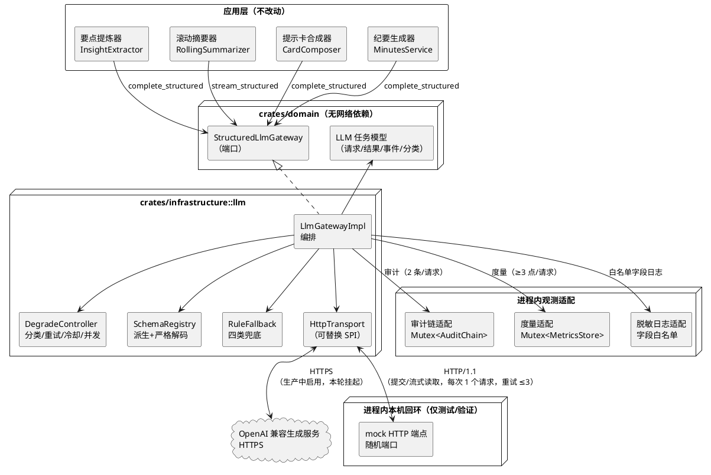

| 边界 | 协议 | 频率/规模 | 失败影响 |
|---|---|---|---|
| 应用层 → 端口 | 进程内同步调用 | 每片段 1 次精炼、每 30 s 1 次摘要、事件末 1 次纪要 | 网关内部分类并产出同类型降级结果，调用方无需分支（SPEC 5.4.1-2） |
| 网关 → 生成服务 | HTTP/1.1（HTTPS 生产） | 在途 ≤3，单请求 ≤8 s，重试最多 3 次尝试 | 分类 → 重试 → 兜底；不阻断采集主链（SPEC 4.2-3） |
| 网关 → 审计链 | 进程内调用 | 2 条/请求（意图 + 结果） | 审计不可用 → 阻断后续外发，本次走兜底（SPEC 5.5.3-2） |
| 网关 → 度量 | 进程内调用 | ≥3 点/请求 | 丢弃并计数，不影响结果（SPEC 5.5.3-1） |
| 网关 → 日志 | 进程内调用 | 每故障 1 条 | 字段非白名单则拒绝构造，不写日志（SPEC 4.3-4） |

### 2.1.2 服务/组件总体架构

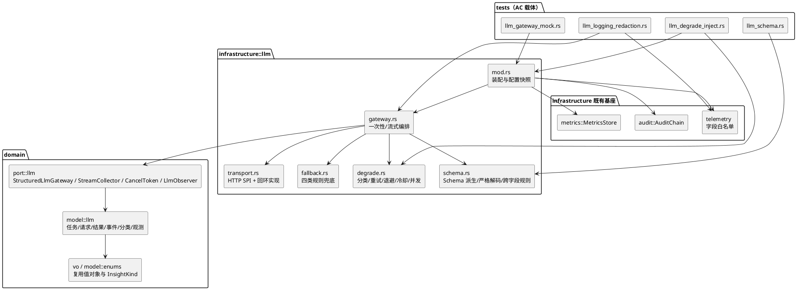

| 组件 | 职责 | 关键设计决策（理由） |
|---|---|---|
| `model::llm` | 封闭任务枚举、请求/结果/事件/分类/观测点的领域定义 | 全部为强类型；`FailureClass` 与 `DegradeCause` 分离，避免把"冷却/排队/载荷"塞进六类故障（SPEC 5.3.1-1 要求六类封闭，SPEC 5.3.1-5/6、5.1.1-10 要求额外原因码） |
| `port::llm` | 与既有 `LlmGateway` 并存的生成端口 | 不替换既有端口（AC-17）；不用泛型方法，保证 `dyn` 可用——返回封闭枚举 `StructuredBody` 而非 `serde_json::Value` |
| `mod.rs` | 装配、配置校验与热更新、端点标识 | 配置以 `Arc<RwLock<LlmConfig>>` 保存快照；进行中的请求使用开始时的快照，避免"改配置导致在途请求语义漂移" |
| `gateway.rs` | 校验→审计→冷却→并发→传输→分类→重试→校验→兜底→审计→度量 | 唯一编排点；所有失败路径都以 `StructuredOutcome` 返回，禁止 `panic!`/`expect`（SPEC 5.3.1-8） |
| `degrade.rs` | 分类映射、每类重试上限、429 退避、截止时间优先、冷却、并发闸门 | 纯决策逻辑 + 可注入 `Clock`，可用假时钟做确定性单测（AC-05/06/08 不依赖真实睡眠） |
| `schema.rs` | 由类型派生 Schema，serde 严格解码 + 跨字段规则 | 类型是唯一真源（SPEC 5.1.1-3）；不引入第三方 Schema 引擎（依赖许可红线，见 2.5） |
| `fallback.rs` | 四类规则兜底 | 纯函数、零 IO；单次 ≤50 ms 由"无阻塞调用 + 输入规模上限"保证（SPEC 5.4.1-7） |
| `transport.rs` | HTTP 抽象与回环实现 | 传输是唯一依赖 socket 的模块；生产 HTTPS 以 feature 挂起，保证"未复核依赖不进入构建"（R2） |

**依赖方向**（强制）：`domain` ← `infrastructure`；`infrastructure::llm` 内部单向 `mod → gateway → {degrade, schema, fallback, transport}`；`application` 不改动；`platform-*`、`ui-bridge`、`app/src-tauri`、TS 绑定不出现任何引用（SPEC 9.3）。分层脚本的禁依赖列表（`check-layering.sh:14`）对 `reqwest|hyper` 生效，故 `reqwest` 即便启用也只能出现在 infrastructure 的依赖声明中。

### 2.1.3 实现设计文档

#### （1）一次性生成的主流程（含审计与冷却）

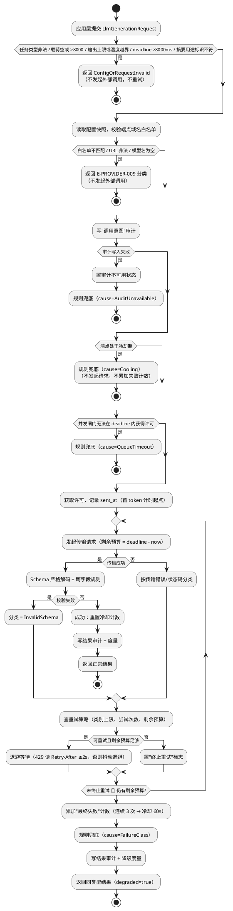

**关键判定规则**
1. **校验先于外发**：请求/配置校验失败一律不产生外部流量，也不进入冷却计数（避免配置错误把端点打成冷却）。
2. **审计前置**：意图审计是"外发许可"的一部分；不可用时不得发出任何外部请求（SPEC 5.5.3-2）。
3. **冷却检查先于排队**：冷却期内既不占并发许可，也不累加失败计数（SPEC 5.4.3-2）。
4. **成功即清零**：任一次成功（含修复重试后的成功）把"连续最终失败"归零（SPEC 4.2-2）。

#### （2）流式生成时序与唯一终止

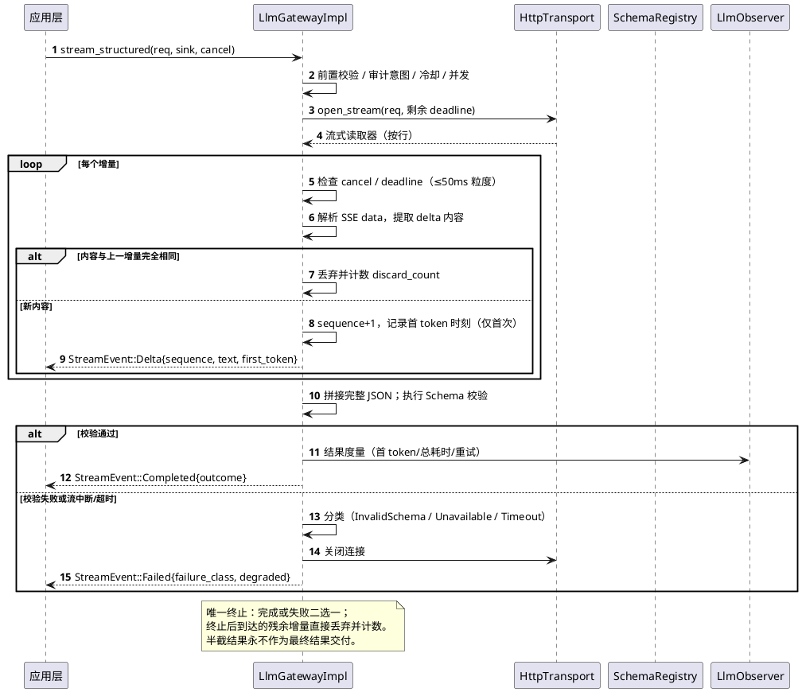

**流式解析规则**
1. **协议**：`text/event-stream`，只处理以 `data:` 开头的行；单个事件内多行 `data:` 以换行拼接；`data: [DONE]` 为结束标记。
2. **增量提取**：兼容 OpenAI Chat Completions 的 `choices[0].delta.content`；`finish_reason` 非空视为流结束（若因长度结束则置 `truncated=true`）。
3. **非流式回退**：若响应 `Content-Type: application/json`（服务不支持流式），把完整 JSON 作为**唯一一个增量**交付，再走完成事件；AC-03 要求"拼接结果与一次性结果等价"，该回退路径同样成立。
4. **序号语义**：序号由网关自持（从 1 递增），保证"不跳号、不回退"（SPEC 6.3-1）。服务端若不携带可比较的序号，则**无法判定服务端乱序**；本设计把 SPEC 5.2.3-2 的"序号回退 = 结构违规"限定为"服务端提供递增 index 字段时校验"，否则只做"重复内容丢弃 + 计数"，并登记为已知限制（2.5）。
5. **取消**：`CancelToken` 置位后，读取循环在 ≤50 ms 内停止、关闭连接、不再发起重试、不再交付新事件（SPEC 5.2.1-5）；已交付序号不回滚。
6. **终止唯一**：`StreamCollector` 内部持有 `terminated` 标志，第二次终止请求被丢弃并计数，保证"有且仅有一个终止事件"（SPEC 5.2.1-2）。
7. **首 token 与预算联动**：首个增量到达即记录首 token 时延并写入度量；若该时刻已越过 deadline，则不交付该增量，直接以 `Failed{Timeout}` 终止（SPEC 5.2.1-4）。
8. **空增量**：`delta.content` 为空字符串或仅心跳（注释行、`role` 帧）时不产生 `Delta` 事件、不占用序号，避免"空事件占号"破坏 6.3-3"增量内容必填非空"。
7. **首 token 定义**：从传输层"请求体写完"时刻（`sent_at`）到首个增量交付给 sink 的时刻；该定义在审计与度量中复用，避免口径漂移。

#### （3）六类故障分类映射（唯一判定点）

| 故障分类 | 判定依据（按优先级从上到下） | 重试上限 | 退避 | 说明 |
|---|---|---|---|---|
| `Timeout` | 连接超时、读取超时、空闲超过剩余截止时间；整次预算耗尽 | 2（共 3 次尝试） | 100 ms 起指数 + 抖动，且不得越过 deadline | AC-04 以延迟 3 s/截止 500 ms 验证 |
| `RateLimited` | HTTP 429（含 503 且带明确限流语义时按 429 处理需实测） | 1 | 读 `Retry-After`（秒），下限 0、上限 2 s；未声明则抖动退避 ≤2 s；不得立即重试 | AC-06 断言"不立即重试"与上限 |
| `InvalidSchema` | 非 JSON、未知字段、字段类型错、值对象越界、跨字段规则不满足；流式拼接后不通过校验；**HTTP 400 / 404 / 422（请求或端点契约不匹配）** | 1（仅 2xx 解码失败的修复重试）；**4xx 契约错误为 0 次**（2.24.7） | 零等待，修复提示携带字段路径 | AC-07 两次均非法则降级；4xx 细分见 2.24（AC-39） |
| `Unavailable` | HTTP 5xx（除限流语义）、**HTTP 401 / 402 / 403（鉴权失败 / 余额额度不足 / 权限不足）**、连接被拒绝、TLS 握手失败、连接被对端在流中关闭、重定向（3xx） | 2（共 3 次尝试） | 同 `Timeout` | 3xx 不跟随，防白名单绕过；402 口径见 J2/J3 |
| `ContentFiltered` | **仅** HTTP 400 且响应正文以**结构化错误字段**显式携带 `content_filter`（或服务商声明的内容策略错误码）；或 `finish_reason=content_filter` | 0 | — | 唯一入口见 2.24.3；不得用"非 429 的 4xx"兜底归入（SPEC 11.11.3-5、11.11.3-8） |
| `Offline` | 域名解析失败、网络不可达、无路由、本机网络栈离线 | 0 | — | 严格只由传输层错误类型映射，禁止按"错误文本"猜测（R10） |

**边界约定**
- "连接被拒绝"归 `Unavailable`，"域名解析失败/网络中断"归 `Offline`；两者在诊断原因上可区分（SPEC 5.3.3-5、R10）。
- 响应体过大（超过配置的 `max_response_bytes`，默认 1 MiB）归 `InvalidSchema`（结构不可用）并立即停止读取，避免无界内存（SPEC 4.1-5 的"禁止无界"）。
- 任何分类都不得携带响应正文、URL 全文、凭据（SPEC 5.3.1-7）。

#### （4）重试、退避与冷却

| 项 | 规则 | 追溯 |
|---|---|---|
| 尝试次数定义 | "尝试"=一次完整传输请求；重试上限不含首次 | SPEC 5.3.1-2 |
| 截止时间优先 | 每次重试前计算 `剩余预算 ≥ 退避等待 + 最小单次预算`，否则立即降级 | SPEC 5.3.1-4 |
| 最小单次预算 | 50 ms（低于此值必然超时，重试无意义） | 设计决策，保证"不空转" |
| 退避抖动 | 以请求编号哈希派生确定性抖动（±20%），避免同时重试风暴；同一请求可复现 | SPEC 8.2-4 可重复执行 |
| 冷却阈值 | 同一端点连续 3 次"最终失败"（重试耗尽或不可重试类）→ 冷却 60 s | SPEC 4.2-2、5.3.1-5 |
| 冷却粒度 | 进程内按 `endpoint_id`（配置声明，不含凭据）独立计数 | R9 已知限制：多进程不共享 |
| 冷却期行为 | 不发请求、不占并发、不累加计数；返回兜底且 `degrade_cause=Cooling` | SPEC 5.4.3-2 |
| 成功清零 | 任一次成功立即清零；`InvalidSchema` 修复成功同样清零 | SPEC 4.2-2 |
| 429 等待上限 | 声明值 >2 s 或 >剩余预算 → 不重试，立即降级并计入"限流导致降级" | SPEC 5.3.3-1 |

#### （5）截止时间、取消与执行模型

- **时钟**：只用 `std::time::Instant` 单调时钟；`Clock` trait 负责提供 `now()`/`sleep(d)`，测试注入假时钟（AC-05/06/08 不依赖真实等待）。墙钟只用于审计时间戳。
- **执行资源**：每次在途请求一个**专用工作线程**（在途 ≤3，故线程数 ≤3 + 1 个闸门），调用方线程只做"提交 + 条件变量等待"；因此采集线程即使调用端口也不会被 socket 阻塞（AC-14）。
- **超时落地**：传输层按"剩余预算"设置连接与读超时；读取循环每 ≤50 ms 复查 deadline 与取消标志；到期立即关闭 socket 并返回 `Timeout`。Windows 定时器粒度约 15.6 ms，故 100 ms 偏差要求可满足，测试容差 200 ms（SPEC 4.1-4、8.2-2）。
- **取消**：`CancelToken = Arc<AtomicBool>`；取消后不重试、不等退避（退避等待分段 sleep 并复查）。
- **不 panic**：网关内不使用 `unwrap`/`expect`/索引越界访问；所有 `Option` 走 `ok_or` 转分类错误；线程 panic 由闸门捕获并转为 `Unavailable`（SPEC 5.3.1-8）。

#### （6）并发闸门与排队

- **上限**：默认 3（配置可改）；FIFO 等待队列，公平。
- **排队准入**：入队前估算 `排队位置 / 并发上限 × p90 单次耗时`，若其超过剩余预算则**不入队**，直接兜底（`QueueTimeout`），避免"排到已超时"（SPEC 5.3.1-6）。
- **排队中到期**：等待条件变量使用剩余预算作为超时；到期立即出队并兜底，不再发起请求。
- **优先级**：不引入优先级，保持 FIFO，理由：四类任务均在端到端预算内，引入优先级会使"摘要挤占要点"成为新的不公平来源，且本轮无压测依据支持优先级策略。

#### （7）输出上限与截断

- 请求侧：`max_output_tokens` 1..=4096，按任务类型有默认值（见 2.2.2 配置表）；越界拒绝。
- 响应侧：流式在累计字符数达到配置的 `max_stream_chars`（默认 64 KiB）时停止读取、置 `truncated=true`、按"结构违规"处理（因为 JSON 不完整），不得把半截 JSON 当结果（SPEC 5.2.1-6、4.1-5）。
- 一次性响应超 `max_response_bytes` 同上。
- `finish_reason=length` 且 JSON 完整时，置 `truncated=true` 并照常交付（结果可解析）。

#### （8）降级与四类规则兜底语义

**顺序**：受控重试 → 降级决策 → 规则兜底；仅"冷却中、载荷超限、请求/配置非法、审计不可用"可跳过重试（SPEC 5.4.1-1）。

| 任务 | 兜底输入 | 兜底产出 | 硬约束 | 追溯 |
|---|---|---|---|---|
| `InsightExtract` | 当前窗口片段（已脱敏） | 1..n 条要点；每条 `kind` 由规则关键词映射（默认 `KeyInfo`）；`text` 取片段首句并 `ShortText` 校验/分段；`sources` 必含来源片段引用 | 至少 1 条、含来源引用、`confidence ≤ 0.5`（取 0.35/0.5 两档）；决策人/负责人保留"待确认"，禁止编造 | SPEC 5.4.1-3、5.1.1-5 |
| `Summary` | 上一版滚动摘要 | 有上一版：原样沿用并标"沿用上一版"（`version` 不变，`refreshed=false`）；无上一版：空摘要 + "未生成" | 必须带"仅供上下文"标识；记录一次"刷新失败" | SPEC 5.4.1-4、5.1.1-7 |
| `CardConclusion` | 提示卡标题与引用集合 | `conclusion=None`（恒空）；附说明文案"未找到可靠来源"或"生成暂不可用" | 禁止推测性结论；引用为空时结论必为空 | SPEC 5.4.1-5、5.1.1-6 |
| `MinutesDraft` | 片段全集（含未提炼队列） | 五区骨架（概要/四类要点/时间轴/未决问题/来源清单）+ 未提炼片段数与可补全入口标识 | 缺区即结构违规；"待确认"条目只进未决问题区 | SPEC 5.4.1-6、5.1.1-8、6.6 |

**兜底实现约束**：纯同步计算，不发起任何网络调用、不访问存储；输入规模上限（片段 ≤200 条，单条 ≤2000 字）；单次耗时 ≤50 ms（AC-09 通过"无 socket + 假时钟 + 上限输入"验证）。

**"以旧充新"禁止**：除 `Summary` 外，任何任务都不得复用历史生成结果；兜底结果必须来自本次请求的输入快照（SPEC 5.4.1-9）。

#### （9）可观测与审计埋点

| 观测项 | 载体 | 字段（全部非原文） | 失败处置 |
|---|---|---|---|
| 首 token 时延 | `LlmMetric::FirstTokenLatencyMs` | endpoint_id、model_id、task | 丢弃 + 计数（SPEC 5.5.3-1） |
| 整次耗时 | `LlmMetric::TotalLatencyMs` | 同上 | 同上 |
| 重试次数 | `LlmMetric::RetryCount` | 同上 | 同上 |
| 失败率 | `LlmMetric::FailureCount` | 维度含 `failure_class`（六类封闭） | 同上 |
| 降级次数 | `LlmMetric::DegradeCount` | 维度含 `degrade_cause` | 同上 |
| 外发审计 | `LlmAuditRecord`（意图） | request_id、task、char_count、model_id、endpoint_id、started_at | **阻断后续外发**（SPEC 5.5.3-2） |
| 结果审计 | `LlmAuditRecord`（结果） | request_id、task、elapsed_ms、failure_class 或 `none`、degraded、attempts | 置"审计不可用"，本次已产出结果仍返回（不丢用户结果），后续请求阻断 |
| 故障日志 | `LlmLogRecord` | 仅 `failure_class`、`error_code`、`latency_ms`、`provider_id` | 非白名单字段构造即 `Err`，不写 |

**审计保留 180 天**：本轮审计为内存链（B0 现状），保留期由既有治理策略字段承载；本轮只保证"每条外发必留痕 + 不含原文"，不实现归档（SPEC 4.3-3 的保留期由存储批次负责，登记为跨批次依赖）。

**可追溯编号**：`request_id`（`TaskId`）由调用方生成并贯穿"触发的提示卡/要点 → 请求 → 结果 → 降级状态"。本设计不把会话文本编入编号（SPEC 4.4-2）。

#### （10）配置、凭据与端点安全

| 配置项 | 默认值 | 校验规则 | 追溯 |
|---|---|---|---|
| `endpoint` | 无（必须显式配置） | 必须 `http(s)://`；host 必须命中 `domain_allowlist`（精确或 `*.suffix`）；否则 `E-PROVIDER-009` | SPEC 4.3-5 |
| `model` | 无 | 非空、≤128 字符；不得在代码中写死 | SPEC 4.5-1 |
| `domain_allowlist` | 空（空即拒绝一切外发） | 至少 1 项才允许外发；fail-closed | SPEC 4.3-5 |
| `request_timeout_ms` | 4000 | 100..=8000 | SPEC 6.1-6 |
| `max_retries` | 见分类表 | 0..=2，且不得超过分类上限 | SPEC 5.3.1-2 |
| `cooling_threshold` / `cooling_ms` | 3 / 60000 | 1..=10 / 1000..=600000 | SPEC 4.2-2 |
| `max_concurrency` | 3 | 1..=8 | SPEC 4.1-6 |
| `payload_char_limit` | 8000 | 1..=8000（超出即拒绝，不静默截断） | SPEC 5.1.1-10 |
| `defaults[task]` | `InsightExtract: max=512,temp=200`；`Summary: 400,150`；`CardConclusion: 256,100`；`MinutesDraft: 1024,200`（温度为千分比） | 输出 1..=4096、温度 0..=1000；越界拒绝 | SPEC 5.1.1-9 |
| `credential_ref` | 环境变量名 | 只存引用名；运行时读取；`Debug`/`Display` 输出固定 `***`；不参与序列化与哈希 | SPEC 4.3-1、AC-16 |

- **热生效**：配置校验通过后整体替换快照；在途请求用开始时的快照（避免半途改变模型/端点）。
- **重定向/代理**：不自动跟随 3xx；不读取系统代理（避免绕过白名单），如需代理必须显式配置并经白名单校验。
## 2.2 接口设计

### 2.2.1 总体设计

接口按稳定性分三类。稳定性决定兼容策略：稳定接口禁止破坏性变更；实验接口允许在 13.3/13.4 落地时调整；内部 SPI 只对 infrastructure 内部与测试可见。

| 类别 | 接口 | 角色 | 稳定性 | 变更策略 | 追溯 |
|---|---|---|---|---|---|
| 领域端口 | `StructuredLlmGateway` | 应用 → 生成 | 稳定 | 新增能力用新增方法；不改既有 `LlmGateway` | SPEC 4.5-2、DESIGN 2.2.2-E |
| 领域契约 | `LlmTask`、`LlmGenerationRequest`、`StructuredBody`、`StreamEvent`、`FailureClass`、`DegradeCause` | 端口入参/出参 | 稳定 | 枚举新增变体须同步 Schema 快照与测试；不重命名既有值 | SPEC 5.1.1-1、6.1 |
| 领域端口 | `LlmObserver` | 网关 → 审计/度量 | 稳定 | `Err` 语义（度量可丢、审计必阻断）不得改变 | SPEC 5.5.1-1/3 |
| 领域 SPI | `StreamCollector`、`CancelToken` | 网关 → 调用方回调 | 实验 | 13.3 回放可能扩展"丢弃计数"读取 | SPEC 5.2.1-2/5 |
| 基础设施 SPI | `HttpTransport`、`StreamReader` | 网关 → 网络 | 实验（内部） | 仅 infrastructure 与测试可见 | SPEC 4.3-5 |
| 配置契约 | `LlmConfig`、`CredentialRef` | 配置者 → 网关 | 实验→稳定 | 显式 `schema_version`；未知字段拒绝；旧版本必须可读 | SPEC 4.5-3/4 |

**类型安全原则（强制）**

1. **不使用 `serde_json::Value` 作为业务参数**：JSON 只出现在传输边界与 `schema.rs` 内部；进入领域前必须完成一次严格解码（`serde(deny_unknown_fields)` + 值对象 `TryFrom`）。
2. **封闭枚举 + 未知值拒绝**：`LlmTask`、`FailureClass`、`DegradeCause` 均为封闭枚举，反序列化遇未知值 → `InvalidSchema`（不是"得体降级"，因为生成结果是外部不可信输入，必须拒绝幻觉字段）。
3. **不用泛型方法**：端口以 trait object 注入（`Arc<dyn StructuredLlmGateway>`），泛型方法会使 trait 非 object-safe；因此返回封闭枚举 `StructuredBody`，而非 `Result<T, _>`。理由：封闭枚举同样强类型，且能在单一位置完成"任务类型 ↔ 结果变体"一致性校验（SPEC 6.2-1），应用层无需持有具体类型。
4. **`FailureClass` 与 `DegradeCause` 分离**：六类故障是"外部服务故障"的封闭集合（SPEC 5.3.1-1）；冷却、排队超时、载荷超限、审计不可用、配置非法不是外部故障，若塞进六类会破坏"失败率按六类统计"的语义。分离后：度量按 `FailureClass` 统计，审计按 `DegradeCause` 记录，调用方按 `degraded + degrade_cause` 呈现。
5. **零浮点**：温度用千分比 `u16`（0..=1000），置信度仍用既有 `Confidence`；不使用 `f32/f64` 传输温度，避免跨端舍入差异（DESIGN 2.2.2-E 的 `temperature_milli` 一致）。
6. **标识与凭据分离**：`TaskId` 表达请求编号；凭据只以 `CredentialRef`（环境变量名）存在，`Debug` 输出 `***`。

**错误出口规则**

| 场景 | 端口返回 | 调用方可见信息 |
|---|---|---|
| 请求/配置非法（不产生外发） | `Err(CopilotError::ProviderConfigInvalid)` | 错误码 + 字段名 + 规则（不含配置值） |
| 载荷超限 | `Ok(StructuredOutcome{degraded:true, cause:PayloadTooLarge})` | 同类型兜底结果 + 原因码（SPEC 5.1.1-10 要求"返回载荷超限分类"，不作硬失败） |
| 外部故障 | `Ok(StructuredOutcome{degraded:true, failure:Some(class)})` | 分类 + 尝试次数 + 是否降级 + 非敏感说明 |
| 审计不可用 | `Ok(StructuredOutcome{degraded:true, cause:AuditUnavailable})` | 说明"审计不可用，已暂停联网生成" |
| 调用方取消 | `Ok(StreamOutcome{cancelled:true, terminated:Termination::Failed{failure:Timeout, cause:Failed(Timeout), degraded:false}})` | 仅终止事件，不返回半截内容 |

> 说明：外部故障**不**以 `Err` 返回，是为了让调用方无需为降级分支（SPEC 5.4.1-2）。`Err` 只用于"配置/请求本身非法"这类调用方编程错误。

### 2.2.2 接口清单

#### A. 任务与请求模型（`crates/domain/src/model/llm.rs`）

```rust
/// 四类任务封闭枚举；Schema 与默认采样参数按任务绑定。
/// 派生 `Copy + Eq + Hash + PartialOrd + Ord`（供配置表 `BTreeMap` 与度量维度使用）。
pub enum LlmTask {
    InsightExtract,
    Summary,
    CardConclusion,
    MinutesDraft,
}

impl LlmTask {
    pub const ALL: [Self; 4];
    pub const fn as_str(self) -> &'static str;      // "insight_extract" 等
    pub const fn schema_version(self) -> &'static str; // 与结果结构对应，如 "v1"
    pub const fn default_budget(self) -> OutputBudget;
}

/// 已脱敏载荷：非空、≤ 配置上限（默认 8000 字符），附脱敏次数用于审计。
pub struct RedactedPayload { /* 私有字段 */ }

impl RedactedPayload {
    pub fn new(text: impl Into<String>, redactions: u16, limit: usize)
        -> Result<Self, LlmRequestError>;
    pub fn char_count(&self) -> usize;
    pub fn redaction_count(&self) -> u16;
    pub fn as_str(&self) -> &str;
}

pub struct OutputBudget(u16);       // 1..=4096
pub struct TemperatureMilli(u16);   // 0..=1000
pub struct DeadlineMs(u16);         // 1..=8000

pub struct LlmGenerationRequest {
    pub request_id: TaskId,
    pub task: LlmTask,
    pub payload: RedactedPayload,
    pub output: OutputBudget,
    pub temperature: TemperatureMilli,
    pub deadline: DeadlineMs,
    pub purpose: Option<ContextOnlyPurpose>, // 仅 Summary 可为 Some
}

pub enum LlmRequestError {
    UnknownTask,
    EmptyPayload,
    PayloadTooLong { actual: usize, limit: usize },
    BudgetOutOfRange { actual: u16 },
    TemperatureOutOfRange { actual: u16 },
    DeadlineOutOfRange { actual: u16 },
    PurposeMismatch,
}
```

- **业务说明**：把 SPEC 6.1 的七项数据约束全部前移到构造期；`request_id` 复用 `TaskId`（进程内唯一、不含会话文本），不新增 ID 类型。
- **前置条件**：调用方已完成脱敏（SPEC 1.4-1）；本类型只校验"非空 + 上限"，**不验证脱敏质量**（无可靠本地手段），命名与审计字段承担契约声明。
- **后置条件**：`purpose == Some` 当且仅当 `task == Summary`；否则构造失败（SPEC 6.1-7）。
- **异常映射**：全部映射 `CopilotError::ProviderConfigInvalid`，不产生外发。
- **调用示例**：

```rust
let request = LlmGenerationRequest {
    request_id: TaskId::new("task-2026-11-21-0001")?,
    task: LlmTask::InsightExtract,
    payload: RedactedPayload::new(redacted_window, 7, 8000)?,
    output: OutputBudget::new(512)?,
    temperature: TemperatureMilli::new(200)?,
    deadline: DeadlineMs::new(1200)?,
    purpose: None,
};
```

#### B. 四类结构化结果（`crates/domain/src/model/llm.rs`）

```rust
pub struct InsightExtract { pub schema_version: &'static str, pub insights: Vec<InsightItem> }

pub struct InsightItem {
    pub kind: InsightKind,          // 复用既有四类
    pub text: ShortText,            // ≤60 字（构造期校验）
    pub sources: Vec<UtteranceRef>, // 非空，且必须属于本次请求载荷
    pub confidence: Confidence,     // 0..=1
    pub decision: Option<DecisionFields>, // owner 可为 "待确认"
    pub todo: Option<TodoFields>,         // 负责人/期限可为 "待确认"
}

pub enum SummaryPurpose { ContextOnly }

pub struct Summary {
    pub schema_version: &'static str,
    pub purpose: SummaryPurpose,        // 恒存在，不可省略
    pub text: ShortText,
    pub covered: Option<crate::model::session::TextRange>,
    pub version: u32,
    pub carried_over: bool,             // 兜底"沿用上一版"为 true
    pub produced: bool,                 // 兜底"未生成"为 false
}

pub struct CardConclusion {
    pub schema_version: &'static str,
    pub title: TitleText,               // ≤40 字
    pub conclusion: Option<ConclusionText>, // ≤80 字；引用空时必须 None
    pub references: Vec<ReferenceRef>,
    pub confidence: Confidence,
    pub conflict: Option<ConflictView>, // 冲突并列，禁止择一
    pub notice: Option<ConclusionNotice>, // "未找到可靠来源" | "生成暂不可用"
}

pub struct MinutesDraft {
    pub schema_version: &'static str,
    pub summary: ShortText,
    pub insights: MinutesInsights,      // 四类要点分区
    pub timeline: Timeline,             // 起止 + 允许空区间，不压缩刻度
    pub open_questions: Vec<PendingItem>, // 唯一允许"待确认"的分区
    pub sources: Vec<UtteranceRef>,
    pub unrefined_count: u32,           // 降级时必须给出
    pub completion_hint: Option<CompletionHint>,
}

pub enum StructuredBody {
    Insight(InsightExtract),
    Summary(Summary),
    Card(CardConclusion),
    Minutes(MinutesDraft),
}
```

- **业务说明**：结果类型与既有聚合（`Insight`/`RollingSummary`/`SuggestionCard`）刻意分离：生成结果无 ID、未落库、由应用层后续映射（SPEC 1.4-7）。
- **前置条件**：由 `schema.rs` 在严格解码后产出；业务侧不得直接构造 `StructuredBody` 并当作"已校验"。
- **后置条件**：`StructuredBody` 的任务变体与请求任务一致，否则按 `InvalidSchema` 处理（SPEC 6.2-1）。网关**不得补全任何缺失字段**：决策人/负责人/期限缺失时保持 `None` 或"待确认"文案，禁止填充推测人名（SPEC 5.1.1-5、6.4-5/6）；`owner`/`assignee` 等字段出现空字符串视为结构违规（`RangeViolation`），因为空串既不是"待确认"也不是有效值。
- **模型标识**：响应体中的 `model` 为空时回退为配置的 `model`（配置期已保证非空），不编造、不留空（SPEC 6.2-3）。
- **异常映射**：`InsightItem.sources` 为空、正文超 60、结论非空但引用为空、纪要缺区、"待确认"进结论区 → `SchemaError{rule, path}` → `InvalidSchema`（SPEC 5.1.1-4/6/8）。
- **调用示例（校验 + 一致性强断言）**：

```rust
let outcome = gateway.complete_structured(&request)?;
let body = outcome.body.expect("正常路径必有结果体");
assert_eq!(body.task(), request.task);
```

**辅助类型（同文件，均为封闭枚举或不可变结构）**

| 类型 | 形态 | 约束/用途 |
|---|---|---|
| `MinutesInsights` | 四个 `Vec<ShortText>` 分区：`key_info/decision/todo/question` | 四类要点分区必须齐全；"待确认"条目**不得**进入此结构（只能进 `open_questions`） |
| `Timeline` | `start: Option<AudioClock>`、`end: Option<AudioClock>`、`entries: Vec<TimelineEntry>` | 覆盖会话起止；允许空区间；`entries` 按时间递增，禁止压缩刻度 |
| `PendingItem` | `text: ShortText` + `reason: PendingReason`（`AwaitingOwner/AwaitingDue/Unrefined`） | 仅出现在 `open_questions`；降级时承载"未提炼"条目 |
| `CompletionHint` | `unrefined_count: u32` + `entry_ref: ResourceRef` | 兜底时给出可补全入口标识（SPEC 5.4.1-6） |
| `ConclusionNotice` | `MissingSource` / `GenerationUnavailable` | 结论为空时的展示文案来源，不得由调用方自造措辞 |
| `AuditPhase` | `Intent` / `Result` | 两阶段审计的区分字段 |
| `CircuitState` | `Closed` / `Open { opened_at: Instant }` | 冷却状态查询结果；`Open` 不参与序列化 |

#### C. 结果载体与流式事件（`crates/domain/src/model/llm.rs`）

```rust
pub struct StructuredOutcome {
    pub request_id: TaskId,
    pub task: LlmTask,
    pub body: Option<StructuredBody>,
    pub model: String,
    pub tokens_used: Option<u32>,   // 不得为负；u32 天然满足
    pub degraded: bool,
    pub degrade_cause: Option<DegradeCause>,
    pub failure: Option<FailureClass>, // 仅发生外部故障时 Some
    pub attempts: u8,
    pub truncated: bool,
    pub schema_version: &'static str,
    pub http_status: Option<u16>, // v1.4（AC-40）：本次结果对应的最后一次 HTTP 响应状态；无响应为 None
}

pub enum FailureClass { Timeout, RateLimited, InvalidSchema, Unavailable, ContentFiltered, Offline }

pub enum DegradeCause {
    Failed(FailureClass),
    Cooling,          // 冷却中（SPEC 5.3.1-5）
    QueueTimeout,     // 排队将超截止（SPEC 5.3.1-6）
    PayloadTooLarge,  // 载荷超限（SPEC 5.1.1-10）
    AuditUnavailable, // 审计阻断（SPEC 5.5.3-2）
    ConfigInvalid,
}

pub struct StreamEvent {
    pub sequence: u32,                 // 从 1 递增
    pub kind: StreamEventKind,
}

pub enum StreamEventKind {
    Delta { text: String, first_token: bool },
    Completed { outcome: StructuredOutcome },
    Failed { failure: FailureClass, degraded: bool, cause: DegradeCause },
}

pub struct StreamOutcome {
    pub request_id: TaskId,
    pub terminated: Termination,   // 与最后一个终止事件类型一致
    pub discarded_deltas: u32,
    pub cancelled: bool,
    pub first_token_ms: Option<u32>,
}

pub enum Termination {
    Completed(StructuredOutcome),
    Failed { failure: FailureClass, cause: DegradeCause, degraded: bool },
}
```

- **业务说明**：`StreamEvent` 的序号由网关自持；`Completed`/`Failed` 二选一，由 `StreamCollector` 强制唯一。
- **后置条件**：流式结果必须"拼接后整体校验"才产生 `Completed`；`truncated=true` 时不得 `Completed`（除非 JSON 完整且因长度结束）。
- **异常映射**：流中关闭 → `Failed{Unavailable}`；空闲超预算 → `Failed{Timeout}`；拼接不通过 → `Failed{InvalidSchema}`（SPEC 5.2.1-6）。
- **调用示例**：

```rust
let mut sink = |event: StreamEvent| match event.kind {
    StreamEventKind::Delta { text, .. } => buffer.push_str(&text),
    StreamEventKind::Completed { outcome } => done = Some(outcome),
    StreamEventKind::Failed { failure, .. } => failed = Some(failure),
};
gateway.stream_structured(&req, &cancel, &mut sink)?;
```

#### D. 领域端口（`crates/domain/src/port/llm.rs`）

```rust
pub trait StructuredLlmGateway: Send + Sync {
    /// 一次性结构化生成。外部故障以同类型降级结果返回，不以 Err 表达。
    fn complete_structured(
        &self,
        request: &LlmGenerationRequest,
    ) -> Result<StructuredOutcome, CopilotError>;

    /// 流式结构化生成。sink 必须在返回前收到且仅收到一个终止事件。
    fn stream_structured(
        &self,
        request: &LlmGenerationRequest,
        cancel: &CancelToken,
        sink: &mut (dyn FnMut(StreamEvent) + Send),
    ) -> Result<StreamOutcome, CopilotError>;

    /// 能力与配置快照（供调用方展示端点/模型/是否具备联网条件）。
    fn capability(&self) -> LlmCapability;
}

pub struct LlmCapability {
    pub task: LlmTask,
    pub endpoint_configured: bool,
    pub model_configured: bool,
    pub cooling: bool,
}

pub struct CancelToken(/* Arc<AtomicBool> */);

impl CancelToken {
    pub fn new() -> Self;
    pub fn cancel(&self);
    pub fn is_cancelled(&self) -> bool;
}

/// 流式回调适配：由基础设施提供，保证"唯一终止 + 序号校验 + 终止后丢弃计数"。
pub struct StreamCollector<F: FnMut(StreamEvent) + Send> { /* 私有状态 */ }

impl<F: FnMut(StreamEvent) + Send> StreamCollector<F> {
    pub fn new(inner: F) -> Self;
    pub fn emit(&mut self, event: StreamEvent); // 终止后再 emit 只计数
    pub fn discarded(&self) -> u32;
    pub fn termination(&self) -> Option<&Termination>;
}

pub trait LlmObserver: Send + Sync {
    /// 度量写入失败可丢弃，不影响生成结果。
    fn record_metric(&self, point: &LlmMetricPoint) -> Result<(), CopilotError>;
    /// 审计写入失败必须阻断后续外发。
    fn append_audit(&self, record: &LlmAuditRecord) -> Result<(), CopilotError>;
    /// 白名单字段日志；构造期已校验字段名。
    fn log(&self, record: &LlmLogRecord);
}
```

- **业务说明**：`stream_structured` 的 sink 使用 `&mut dyn FnMut` 而非 `Box<dyn Fn>`，避免与既有 `SubtitleSource` 的回调风格冲突；终止唯一由适配器（`StreamCollector`）保证，而非信任调用方。
- **前置条件**：`request.deadline` 必须 ≤ 调用方剩余端到端预算；`cancel` 与 sink 生命周期由调用方持有。
- **后置条件**：`complete_structured` 返回时不得留有未释放的在途许可（RAII 闸门）；`stream_structured` 返回时 sink 已收到终止事件。
- **异常映射**：`Err` 仅用于请求/配置非法；其余全部 `Ok`。
- **调用示例（应用层，同步调用、不改 application 代码即可注入）**：

```rust
let gateway: Arc<dyn StructuredLlmGateway> = Arc::new(llm::assemble(config, transport, observer)?);
let outcome = gateway.complete_structured(&request)?;
if outcome.degraded { presenter.notify("已降级，内容为本地兜底")?; }
```

#### E. 传输 SPI（`crates/infrastructure/src/llm/transport.rs`，内部可见）

```rust
pub enum HttpMethod { Post }        // 本轮仅 POST；Get 留给后续连通性探测

pub struct HttpRequest {
    pub method: HttpMethod,         // 目前仅 Post
    pub url: String,                // 已通过白名单校验
    pub headers: Vec<(String, String)>, // 只允许 Content-Type/Authorization 等固定头
    pub body: Vec<u8>,              // 序列化后的请求体
    pub max_response_bytes: usize,
}

pub struct HttpResponse {
    pub status: u16,
    pub headers: Vec<(String, String)>,
    pub body: Vec<u8>,
}

pub trait HttpTransport: Send + Sync {
    fn send(&self, request: &HttpRequest, deadline: Instant, cancel: &CancelToken)
        -> Result<HttpResponse, TransportError>;

    fn open_stream(&self, request: &HttpRequest, deadline: Instant, cancel: &CancelToken)
        -> Result<Box<dyn StreamReader>, TransportError>;
}

pub trait StreamReader: Send {
    /// 逐块读取；EOF 返回 Ok(None)；期间必须复查 deadline 与 cancel。
    fn next_chunk(&mut self, deadline: Instant, cancel: &CancelToken)
        -> Result<Option<Vec<u8>>, TransportError>;
    fn status(&self) -> u16;
    fn headers(&self) -> &[(String, String)];
}

pub enum TransportError {
    DnsFailure,             // → Offline
    NetworkUnreachable,     // → Offline
    ConnectRefused,         // → Unavailable
    ConnectTimeout,         // → Timeout
    ReadTimeout,            // → Timeout
    TlsFailure,             // → Unavailable
    PeerClosed,             // → Unavailable
    TooLarge,               // → InvalidSchema
    Malformed,              // → InvalidSchema
    Cancelled,              // → 由调用方判定，不进入分类统计
}
```

- **业务说明**：传输是唯一知道 socket 的模块；错误枚举与 `FailureClass` **一一对应**，是分类的唯一来源（R10 的核心手段）。
- **前置条件**：URL host 已命中白名单；`deadline` 为绝对单调时刻。
- **后置条件**：`open_stream` 成功后 `StreamReader` 必须可被 `drop` 立即释放连接；`send` 不得跟随重定向。`HttpRequest` 的 `Debug` 实现必须遮蔽 `Authorization` 头与请求体，避免凭据/载荷进入日志（SPEC 4.3-1/2）。
- **异常映射**：见 `TransportError` 注释列；映射函数集中在 `degrade.rs::classify`，禁止在网关内散落判断。
- **调用示例（测试注入）**：

```rust
let transport: Arc<dyn HttpTransport> = Arc::new(FakeTransport::scripted(vec![
    Script::Status(429, vec![("retry-after", "1")]),
    Script::Json(200, ok_body),
]));
```

#### F. Schema SPI（`crates/infrastructure/src/llm/schema.rs`）

```rust
pub struct SchemaRegistry;

impl SchemaRegistry {
    /// 供提示词下发与 CI 快照；由领域类型派生，禁止手写。
    pub fn json_schema(task: LlmTask) -> &'static serde_json::Value;

    /// 严格解码 + 值对象校验 + 跨字段规则。
    pub fn decode(task: LlmTask, raw: &str) -> Result<StructuredBody, SchemaError>;
}

pub struct SchemaError {
    pub rule: SchemaRule,   // NotJson | UnknownField | TypeMismatch | RangeViolation | CrossField
    pub path: String,       // 如 "insights[0].sources"，用于修复重试提示
}
```

- **业务说明**：类型是唯一真源；`json_schema` 与 `decode` 使用同一组派生结构，杜绝"两份手写定义"（SPEC 5.1.1-3）。
- **前置条件**：`task` 必须在四类内（已在请求构造期保证）。
- **后置条件**：`decode` 成功即保证返回体通过全部 SPEC 5.1.1、6.4~6.6 的结构约束。
- **异常映射**：`SchemaError → FailureClass::InvalidSchema`；`rule/path` 只含字段名，不含载荷内容，可安全编入修复提示。
- **调用示例**：

```rust
let schema = SchemaRegistry::json_schema(LlmTask::MinutesDraft);
let body = SchemaRegistry::decode(LlmTask::MinutesDraft, &stitched_json)?;
```

#### G. 配置与观测契约

```rust
pub struct LlmConfig {
    pub schema_version: u16,
    pub endpoint_id: String,      // 审计/度量维度；不含凭据
    pub endpoint: String,
    pub model: String,
    pub domain_allowlist: Vec<DomainPattern>,
    pub request_timeout_ms: u16,
    pub max_retries: u8,
    pub cooling_threshold: u8,
    pub cooling_ms: u32,
    pub max_concurrency: u8,
    pub payload_char_limit: usize,
    pub max_response_bytes: usize,
    pub max_stream_chars: usize,
    pub defaults: BTreeMap<LlmTask, (OutputBudget, TemperatureMilli)>,
    pub credential_ref: CredentialRef,
}

impl LlmConfig {
    /// 越界/白名单为空/模型为空 → Err(ProviderConfigInvalid)，不产生任何外发。
    pub fn validate(self) -> Result<Self, CopilotError>;
}

pub struct CredentialRef(String);  // Debug/Display = "***"; 不实现 Serialize

pub enum LlmMetric { FirstTokenLatencyMs, TotalLatencyMs, RetryCount, FailureCount, DegradeCount, MetricsDropped }

pub struct LlmMetricPoint {
    pub metric: LlmMetric,
    pub value: f64,
    pub endpoint_id: String,
    pub model_id: String,
    pub task: LlmTask,
    pub failure_class: Option<FailureClass>,
    pub degrade_cause: Option<DegradeCause>,
}

pub struct LlmAuditRecord {
    pub phase: AuditPhase,        // Intent | Result
    pub request_id: TaskId,
    pub task: LlmTask,
    pub char_count: usize,
    pub model_id: String,
    pub endpoint_id: String,
    pub elapsed_ms: u64,
    pub outcome: Option<FailureClass>, // 结果阶段；成功为 None
    pub degraded: bool,
    pub attempts: u8,
}

pub struct LlmLogRecord { /* 仅允许白名单字段，构造期 validate_field */ }
```

- **业务说明**：`LlmConfig.schema_version` 用于配置兼容（SPEC 4.5-3/4）；`CredentialRef` 只存环境变量名。`domain_allowlist` 复用既有 `DomainPattern`（`model/provider.rs:90-117`）的通配匹配能力（`*.suffix` 与后缀匹配），但语义由本组件解释为**白名单**（命中才允许），与 `ProviderProfile.blocked_domains` 的黑名单语义互不复用。
- **前置条件**：`domain_allowlist` 非空；`endpoint` 的 host 命中白名单。
- **后置条件**：`validate` 成功后配置可整体替换快照并立即生效。
- **异常映射**：`ProviderConfigInvalid{detail}` 只含字段名与规则，不含配置值或凭据。
- **调用示例**：

```rust
let config = LlmConfig::try_from(config_json)?.validate()?;
let gateway = llm::assemble(Arc::new(RwLock::new(config)), transport, observer)?;
```
## 2.3 数据模型

### 2.3.1 设计目标

| 目标 | 取值/约束 | 依据 |
|---|---|---|
| 支撑场景 | 四类任务的一次性生成与流式生成；六类故障下的降级与规则兜底 | SPEC 5.1、5.2、5.3、5.4 |
| 输入规模 | 单请求脱敏载荷 ≤4 KB（DFX 性能基准）/ ≤8000 字符（配置上限） | SPEC 4.1-1、5.1.1-10 |
| 在途规模 | 同时在途 ≤3（默认），排队 FIFO | SPEC 4.1-6 |
| 内存预算 | 在途 3 ×（请求 4 KB + 流缓冲 64 KiB）≈ 200 KiB；度量环形缓冲 6 指标 × 1024 点 × 约 96 B ≈ 600 KiB；无结果缓存 | 设计决策（SPEC 4.1-7 内存红线下的最小占用） |
| 时间精度 | 全部时间差用 `Instant`；审计用 `WallClock`；截止时间偏差 ≤100 ms（测试容差 200 ms） | SPEC 4.1-4、8.2-2 |
| 与存量数据兼容 | 不新增表、不改既有表结构；既有 `Metric` 枚举与 10 项断言不变；既有 `LlmRequest/LlmResponse` 不变 | SPEC 9.2、AC-17 |
| 不持久化 | 生成结果、在途请求、冷却状态均不落盘；进程重启后不恢复在途（新请求可正常发起） | SPEC 4.2-5、1.4-7 |
| 版本化 | 结果带 `schema_version`；配置带 `schema_version`；未知字段一律拒绝 | SPEC 4.5-3 |
| 隐私 | 载荷、响应正文、URL 全文、凭据不进入任何模型对象之外的持久/观测结构；审计与度量只含计数、标识、分类 | SPEC 4.3-2/3、4.4-4 |

### 2.3.2 模型实现

```plantuml
@startuml
skinparam classAttributeIconSize 0

class LlmGenerationRequest {
  + request_id : TaskId
  + task : LlmTask
  + payload : RedactedPayload
  + output : OutputBudget
  + temperature : TemperatureMilli
  + deadline : DeadlineMs
  + purpose : ContextOnlyPurpose [0..1]
}

class RedactedPayload {
  + char_count() : usize
  + redaction_count() : u16
  + as_str() : &str
}

class StructuredOutcome {
  + request_id : TaskId
  + task : LlmTask
  + body : StructuredBody [0..1]
  + model : String
  + tokens_used : u32 [0..1]
  + degraded : bool
  + degrade_cause : DegradeCause [0..1]
  + failure : FailureClass [0..1]
  + attempts : u8
  + truncated : bool
  + schema_version : &'static str
}

abstract class StructuredBody {
  + task() : LlmTask
}

class InsightExtract { + insights : InsightItem[1..*] }
class Summary { + purpose : ContextOnly\n+ text : ShortText\n+ version : u32\n+ carried_over : bool\n+ produced : bool }
class CardConclusion { + title : TitleText\n+ conclusion : ConclusionText [0..1]\n+ references : ReferenceRef[0..*]\n+ confidence : Confidence\n+ conflict : ConflictView [0..1] }
class MinutesDraft { + summary : ShortText\n+ insights : MinutesInsights\n+ timeline : Timeline\n+ open_questions : PendingItem[0..*]\n+ sources : UtteranceRef[0..*]\n+ unrefined_count : u32 }

class StreamEvent {
  + sequence : u32
  + kind : StreamEventKind
}
class StreamEventKind {
  <<enumeration>>
  Delta
  Completed
  Failed
}

class FailureClass {
  <<enumeration>>
  Timeout
  RateLimited
  InvalidSchema
  Unavailable
  ContentFiltered
  Offline
}

class DegradeCause {
  <<enumeration>>
  Failed(FailureClass)
  Cooling
  QueueTimeout
  PayloadTooLarge
  AuditUnavailable
  ConfigInvalid
}

class LlmConfig {
  + endpoint_id : String
  + endpoint : String
  + model : String
  + domain_allowlist : DomainPattern[1..*]
  + request_timeout_ms : u16
  + max_retries : u8
  + cooling_threshold : u8
  + cooling_ms : u32
  + max_concurrency : u8
  + payload_char_limit : usize
  + credential_ref : CredentialRef
  + validate() : Result<Self, CopilotError>
}

class LlmAuditRecord {
  + phase : AuditPhase
  + request_id : TaskId
  + task : LlmTask
  + char_count : usize
  + model_id : String
  + endpoint_id : String
  + elapsed_ms : u64
  + outcome : FailureClass [0..1]
  + degraded : bool
  + attempts : u8
}

class LlmMetricPoint {
  + metric : LlmMetric
  + value : f64
  + endpoint_id : String
  + model_id : String
  + task : LlmTask
  + failure_class : FailureClass [0..1]
  + degrade_cause : DegradeCause [0..1]
}

class EndpointCircuit {
  + endpoint_id : String
  + consecutive_failures : u8
  + opened_at : Instant [0..1]
  + on_final_failure() : CircuitState
  + on_success() : CircuitState
  + state(now : Instant) : CircuitState
}

LlmGenerationRequest "1" *-- "1" RedactedPayload
StructuredOutcome "1" o-- "0..1" StructuredBody
StructuredBody <|-- InsightExtract
StructuredBody <|-- Summary
StructuredBody <|-- CardConclusion
StructuredBody <|-- MinutesDraft
StructuredOutcome "1" o-- "0..1" DegradeCause
StructuredOutcome "1" o-- "0..1" FailureClass
StreamEvent "1" *-- "1" StreamEventKind
StreamEventKind ..> StructuredOutcome : Completed 携带
StreamEventKind ..> FailureClass : Failed 携带
DegradeCause ..> FailureClass : Failed 组合
LlmMetricPoint "0..*" ..> LlmTask
LlmMetricPoint "0..*" ..> FailureClass
LlmMetricPoint "0..*" ..> DegradeCause
EndpointCircuit "1" --> "0..1" LlmConfig : 按 endpoint_id 绑定
@enduml
```

**关系与生命周期**

| 关系 | 多重性 | 生命周期规则 |
|---|---|---|
| `LlmGenerationRequest` → `RedactedPayload` | 1 : 1 | 请求构造即固定；载荷随请求作用域结束丢弃，不复制到结果/审计/度量 |
| `StructuredOutcome` → `StructuredBody` | 1 : 0..1 | 仅成功或"产生结果的兜底"有结果体；配置/请求非法时 `None` |
| `StructuredOutcome` → `DegradeCause` | 1 : 0..1 | `degraded=true` 时必填；`degraded=false` 时必须为 `None`（SPEC 6.2-5/6） |
| `StreamEvent` → `StreamEventKind` | 1 : 1 | 终止事件产生后，适配器拒绝后续事件并计数 |
| `EndpointCircuit` → `LlmConfig` | 1 : 0..1 | 按 `endpoint_id` 绑定；配置切换端点后旧冷却状态不再适用（不迁移、不清零其它端点） |
| `LlmAuditRecord` / `LlmMetricPoint` | 0..* : 1 | 独立于请求生命周期；请求结束即写入，不持有载荷 |

**端点冷却状态机**

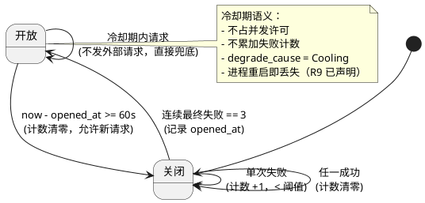

**持久化策略（不含表结构）**

1. **不新增本地表**：生成结果由应用层后续决定是否落库（本轮不落库）；网关只产出内存对象。
2. **审计**：复用既有只追加哈希链（`audit::AuditChain`），通过适配器以 `Mutex` 封装；每条记录两次 append（`Intent` → `Result`）。`AuditId` 由 `request_id + phase` 派生（≤128 字符、无空白，满足 `ids.rs` 约束）；`ResourceRef` 用 `request_id`；`summary` 采用 `phase=… task=… chars=… model=… endpoint=… elapsed=… outcome=… degraded=… attempts=…` 格式（不含原文，参与哈希是确定性的）。
3. **度量**：`LlmMetricsBuffer`（有界环形，按指标保留最近 1024 点，满则丢弃最旧并累加 `MetricsDropped`）；提供 `p95(metric)` 与 `failure_rate(failure_class)`；对既有 `MetricsStore` 做**只读单向投影**（`TotalLatencyMs` → `Metric::InsightLatency`），不扩展既有枚举。
4. **配置**：内存快照（`RwLock`），来源为配置或环境变量；`CredentialRef` 只保存环境变量名，运行时读取，不缓存明文。
5. **重启语义**：冷却计数、在途许可、度量环形缓冲、审计链内存副本均不跨进程恢复；重启后首个请求正常发起（SPEC 4.2-5）。
6. **兼容与演进**：`schema_version` 与 `LlmConfig.schema_version` 显式声明；新增可选字段时旧消费方按"未知字段拒绝"处理（SPEC 4.5-3），因此新增字段属于**破坏性变更**，必须升版本并同步快照用例。

## 2.4 测试方案与 AC 追溯

### 2.4.1 测试分层与文件组织

| 层 | 位置 | 覆盖内容 | 是否需要 socket |
|---|---|---|---|
| 领域单元测试 | `crates/domain`（新增类型内联 `mod tests`） | 请求构造边界、`FailureClass` 封闭性、`DegradeCause` 与 `degraded` 的一致性、流事件序号/唯一终止 | 否 |
| 组件测试 | `crates/infrastructure/src/llm/degrade.rs` 等内联 `mod tests` | 分类映射、重试上限、429 退避、冷却、并发排队、截止时间（假时钟） | 否（`FakeTransport`） |
| Schema 一致性 | `crates/infrastructure/tests/llm_schema.rs` | 四类 Schema 与类型同源、样例双向校验、跨字段规则、快照 | 否 |
| 网关集成 | `tests/llm_gateway_mock.rs` | 一次性、流式、等价性、不阻塞采集 | 是（本机回环 mock） |
| 故障注入 | `tests/llm_degrade_inject.rs` | 六类故障、重试、冷却、降级、兜底、日志/审计 | 部分（超时/429/5xx 用 mock；DNS/离线用 `FakeTransport`） |
| 脱敏审计 | `tests/llm_logging_redaction.rs` | 日志白名单、审计字段、凭据不入日志/审计 | 否 |

**mock 端点设计**（进程内、随机端口、无第三方服务依赖，SPEC 8.2-3）：

- 以 `std::net::TcpListener` 绑定 `127.0.0.1:0`，启动 1 个接受线程；按"脚本队列"依次响应，并记录"收到的请求数 / 请求时刻 / 请求体长度"。
- 脚本能力：`Json(状态码, 体)`、`Status(状态码, 头)`、`Delay(时长, 之后响应)`、`SseChunks(片段序列, 每片间隔)`、`AbortMidStream`（发部分数据后直接关闭）、`Malformed(非 JSON 正文)`、`SlowBody`（逐字节慢写以触发读取超时）。
- 所有响应写失败（客户端已断开）只忽略错误，不 panic；接受线程在测试结束时通过关闭 listener 退出。
- 超时类用例不依赖"服务端 sleep 3 s 真实拖慢套件"：`Deadline` 用例保留 1 个真实的 3 s 延迟用例（AC-04 要求验证真实 socket 上的立即返回），其余时间类断言用假时钟。

**测试脚手架**：`crates/infrastructure/tests/support/mod.rs`（mock 服务器 + 测试替身 + 断言工具）。这是 SPEC 9.1 之外的**第 13 个文件**，仅被测试编译，不进入产物；已在 2.5 文件映射中标注为"测试脚手架，不扩大功能范围"。

### 2.4.2 AC-01 至 AC-18 逐条追溯

| 编号 | 用例 | 判定手段（不接真实 API） | 设计落点 |
|---|---|---|---|
| AC-01 | `llm_schema::four_schemas_are_derived_from_types` | ①对四类样例做 `decode` 成功；②`json_schema(task)` 的根 `properties` 键集 == 类型字段集（含 `additionalProperties:false`）；③快照比对：任何类型改动未更新快照即失败 | `schema.rs`、`tests/llm_schema.rs` |
| AC-02 | `llm_gateway_mock::complete_ok` | mock 返回合法 JSON；断言 `StructuredBody` 变体、`degraded=false`、`schema_version` 正确 | `gateway.rs` |
| AC-03 | `llm_gateway_mock::stream_ok` | mock 发 ≥2 个 SSE 增量 + `[DONE]`；断言序号 1..n、唯一 `Completed`、拼接结果与 `complete_ok` 结果相等 | `gateway.rs` |
| AC-04 | `llm_degrade_inject::timeout_deadline` | mock 延迟 3 s；deadline 500 ms；断言 `elapsed ≤ 700 ms`、`failure=Timeout`、端点连接被关闭 | `degrade.rs`、`transport.rs` |
| AC-05 | `retry_cap` | mock 持续超时（或假时钟 + `FakeTransport`）；断言 `attempts == 3`、随后 `degraded=true`、mock 收到请求数 == 3 | `degrade.rs` |
| AC-06 | `rate_limit_backoff` | mock 返回 429 + `Retry-After: 1`；断言两次请求间隔 ≥900 ms 且 ≤2 s、总请求数 == 2、`attempts == 2`；另测"声明 5 s、剩余 2 s → 不重试" | `degrade.rs` |
| AC-07 | `invalid_schema_repair` | 脚本：首次非法 JSON → 第二次合法；断言成功且 `attempts == 2`；再测两次均非法 → `InvalidSchema` + 对应类型兜底 | `schema.rs`、`gateway.rs` |
| AC-08 | `circuit_open` | 假时钟 + 3 次最终失败；断言冷却期内 mock 收到请求数 == 0、`degrade_cause=Cooling`；推进 60 s 后请求恢复 | `degrade.rs` |
| AC-09 | `all_failures_no_panic` | 六类故障各注入 1 次（DNS/拒绝/TLS 用 `FakeTransport` 错误变体，超时/429/5xx/非法结构用 mock）；断言均返回分类结果、无 panic、测试进程退出码 0；兜底在无 socket 条件下 ≤50 ms | `degrade.rs`、`fallback.rs` |
| AC-10 | `degrade_same_shape` | 四类任务分别降级；断言 `body` 为对应变体、`degraded=true`、`degrade_cause=Some`、结构与正常结果同型 | `fallback.rs` |
| AC-11 | `fallback_insight` | 断言 ≥1 条要点、每条 `sources` 非空且属于输入片段、`confidence.value() ≤ 0.5` | `fallback.rs` |
| AC-12 | `fallback_summary` | 有上一版 → `carried_over=true` + "沿用上一版"；无上一版 → `produced=false` + "未生成" | `fallback.rs` |
| AC-13 | `fallback_conclusion` | 断言 `conclusion.is_none()`、`notice` 指定文案；引用为空时结论恒空 | `fallback.rs` |
| AC-14 | `non_blocking_capture` | mock 延迟 1 s；主线程以 5 ms 间隔注入 100 条片段并测量本地处理耗时；断言 p95 ≤200 ms、网关调用并行不阻塞 | `gateway.rs`、`tests/llm_gateway_mock.rs` |
| AC-15 | `logging_redaction` | 捕获 `LlmObserver::log` 与审计：断言只出现白名单字段；载荷/响应中含标记串（如 `SENSITIVE-TOKEN`）时日志与审计均不出现该串、不出现 URL 全文与凭据 | `telemetry`、`observer` |
| AC-16 | `scripts/scan-secrets.sh` + 仓库检索 | 脚本通过；测试夹具只用明显假值（如 `sk-test-0000`），不含真实凭据 | 仓库与夹具 |
| AC-17 | `clippy` / `check-layering.sh` / `cargo deny` / `cargo test --workspace` | 全部通过；既有 80 个测试全绿且数量不减少（新测试只增不减） | CI |
| AC-18 | 真实端点首 token 与整卡生成 | **本轮不判定**；报告中固定写"待实测（需外部端点与有效凭据）"，不得填写 mock 数值 | 2.5 待实测表 |

**AC-01 判定口径说明**：SPEC 原文的"改动类型后未同步 Schema 时用例失败"，在本设计中由"派生 Schema 快照比对"实现——类型是唯一真源，Schema 由同一类型派生，不存在两份手写定义；因此"漂移"表现为**快照过期**而非"Schema 与类型不一致"。用例同时做双向断言：Schema 能接受全部合法样例、拒绝全部非法样例，且 schema 的键集与类型字段集一致。该口径与 SPEC 的意图（禁止双份维护、变更必须同批反映）一致，差异在于不引入第三方 Schema 校验引擎（依赖红线，见 2.5.2），并以 serde 严格解码承担等价校验。

### 2.4.3 关键技术验证方法（说明"如何在没有真实 API 时判定"）

1. **deadline 验证**：不依赖服务端配合——mock 端点用 `Delay` 持有连接，网关读取循环按剩余预算设置 `set_read_timeout`；断言由客户端侧 `Instant` 计算，且用例结束前主动关闭连接（mock 侧的写失败被忽略）。这证明的是**网关侧截止时间能力**，与真实端点首 token 无关。
2. **429 验证**：mock 记录"请求到达时刻"序列，网关不暴露内部计时；断言由序列差得出，因此不受线程调度以外的因素影响；`Retry-After` 的解析（纯数字秒）由单元测试单独覆盖（含"HTTP-date / 非法值 → 视为未声明 → 抖动退避"）。
3. **Schema 违规验证**：`decode` 是纯函数，可直接用"未知字段 / 类型错误 / 60 字越界 / 结论无引用 / 纪要缺区 / 待确认进结论区"六组固定夹具；修复重试由 `FakeTransport` 脚本化两次响应，验证"提示中携带字段路径且不含载荷原文"。
4. **网络不可达验证**：`FakeTransport` 返回 `DnsFailure`/`NetworkUnreachable`，断言分类为 `Offline` 且 `attempts == 1`；另设 1 个可选冒烟用例：在断网环境向 `https://invalid.invalid`（保留 TLD）发起一次请求，仅用于人工确认，不作为 AC 判定项（避免环境耦合）。
5. **不阻塞采集验证**：采集"线程"在测试中以主线程循环模拟，网关调用在独立线程；断言指标只统计"主线程处理 100 条片段"的耗时，不把等待网关的时间计入。该用例只能证明"生成链不占用采集线程"，真实 ASR/字幕链的时延仍由任务 7–12 负责。
6. **确定性**：退避抖动由 `request_id` 哈希派生；所有时间断言用单调时钟并允许 200 ms 容差；mock 端口随机；连续 3 次运行结果一致（SPEC 8.2-4）。
7. **禁止的验证方式**：不得以"mock 下 50 ms"推断真实端点的 1.2 s 首 token；不得以"未实测"标注冒充通过。

## 2.5 风险、依赖与待实测项

### 2.5.1 风险与应对

| 编号 | 风险 | 影响 | 应对（设计内已落地的动作） |
|---|---|---|---|
| R1 | 无真实端点与凭据，13.1 的 DoD 无法完全判定 | 易出现"已通过"的虚报 | AC-18 固定"待实测"；2.4 明确"mock 只证明网关侧能力"；进度记录区分"网关侧已验证/真实端点待测" |
| R2 | 新增 HTTP/TLS 依赖引入混合许可证 | `cargo deny` 失败或法务红线 | **本轮零新增下载包**：回环传输用 `std::net`，生产 HTTPS 以 feature 挂起；`schemars` 仅为锁文件内既有版本提升为直接依赖，仍需登记复核 |
| R3 | 同步端口 + 长连接阻塞采集 | SPEC 4.1-7 指标劣化 | 独立请求线程 + 闸门 + 硬截止时间；AC-14 断言采集侧 p95 |
| R4 | Windows 定时精度与调度抖动 | 时间断言不稳定 | 分段 50 ms 复查 + 200 ms 容差 + 假时钟覆盖逻辑分支 + 连续 3 次一致性 |
| R5 | 429 等待与端到端预算冲突 | 提示超时 | 声明值 >2 s 或 >剩余预算即降级；用例覆盖该分支 |
| R6 | 破坏既有 `LlmGateway::complete_json` | B0 契约回退 | 并存新增端口；既有文件不改签名；AC-17 全量回归 |
| R7 | Schema 与类型漂移 | 幻觉字段被接受 | 类型派生 + 严格解码 + 快照用例；新增字段必须升 `schema_version` |
| R8 | 错误信息夹带响应体 | 日志/审计泄漏 | `FailureClass` 无自由文本；`SchemaError` 只含字段路径；AC-15 用标记串断言 |
| R9 | 冷却是进程内状态 | 多实例不共享 | 明确记录为已知限制，不宣称多实例防护 |
| R10 | "网络不可达"与"服务不可用"边界模糊 | 分类统计偏差 | 分类只由 `TransportError` 变体决定，禁止按文本猜测；用例固定两端样例 |
| R11（新增） | 服务端无增量序号，乱序不可判定 | SPEC 5.2.3-2 的"序号回退"部分不可验证 | 明确限定判定边界：仅有递增 index 时校验；否则只做"重复丢弃 + 计数"；登记为已知限制 |
| R12（新增） | `Retry-After` 的 HTTP-date 形式不解析 | 少数服务端的等待时长被当作"未声明" | 视为未声明 → 抖动退避（≤2 s），仍满足 SPEC 5.3.1-3 的上限；登记待实测 |
| R13（新增） | 审计链为内存实现，180 天保留未落地 | SPEC 4.3-3 的保留期无法在本轮证明 | 只承诺"必留痕 + 不含原文 + 两阶段写入"；保留期作为跨批次依赖显式登记 |
| R14（新增） | SSE 与非流式混用、个别服务端返回 `data:` 但非 JSON | 解析失败被判结构违规 | 以 `Content-Type` 与首行嗅探选择路径；解析失败计 `InvalidSchema` 并兜底；用例覆盖 |
| R15（新增） | `schemars` 在锁文件中存在 0.8/0.9/1.2 三个版本 | `[bans] multiple-versions = "warn"` 产生告警 | 选择 1.2.3（与 Tauri 依赖链一致），不新增版本条目；warn 不阻塞，记录在复核结论中 |
| R16（新增） | 日志白名单无 `task/model/char_count` 字段 | 日志无法直接按任务/模型定位 | 任务与模型只进审计/度量；失败日志用 `failure_class + provider_id + latency_ms + error_code` 定位；不扩白名单（避免破坏既有 12/6 字段断言） |
| R17（v1.1） | 真实采样产生实际调用费用与配额消耗（4 类 × ≥30 样本 + 重试） | 费用超预算、账号被限流或停服 | 采样前静态封顶：调用次数上限 = 每任务样本 × 最坏尝试数（3）× 任务数，超过配置上限即拒绝启动（不"先跑再说"）；先跑 `samples_per_task=1` 冒烟；只记录"调用次数/外发字符量"口径，不记录金额与服务商信息（SPEC R13） |
| R18（v1.1） | 实测期内不出现 429，或 429 形态与 mock 不同 | "限流真实表现"无法测得，或被错误地写成"通过" | 按 SPEC 11.7.1 三态标注：未出现 → "未触发·未实测"并附采样窗口与请求数；出现 → 如实记录 `Retry-After` 形式与实际等待；**禁止**把 mock 的 429 结果填入真实列（SPEC R11、AC-23） |
| R19（v1.1） | 环境变量在调试器、诊断面板、崩溃转储、IDE 运行配置中可见 | 凭据泄漏面扩大 | 三重收缩：装配时只读一次并落 `SecretString`（掩码）、不写入任何配置快照/文件、进程参数不传值；联调在独立 shell 内注入并在结束后清空（SPEC R12、AC-26） |
| R20（v1.1） | CI 或他人终端误注入凭据后触发真实调用 | 意外外发与费用、审计污染 | 运行门要求 `LLM_LIVE` 严格等于 `1`；CI 不设该变量；`#[ignore]` 使默认测试不进入；未开启时**不构造传输**且退出码 0（AC-19、SPEC 11.6-3） |
| R21（v1.1） | 凭据进入日志、审计、错误文本、命令行或记录产物 | 违反 SPEC 4.3-1/4.4-4，构成安全事故 | 类型层禁止（掩码 + 不实现序列化）+ 记录层字段白名单 + 运行期四泄漏面抓取 + 按"≥8 字符切片"反向检索（只输出命中次数、不回显命中内容）；联调后轮换（SPEC R14、AC-26） |
| R22（v1.1） | 配额或端点抖动导致有效样本不足 30/10 | p95 与成功率结论失真 | 如实计数：`n<30` 只报 p50 并标"样本不足·不作分布结论"；`n<10` 不出成功率；排除样本必须写排除原因，禁止删改原始样本（SPEC R13、11.5.2-1、11.5.4-4） |
| R23（v1.1） | 端点不兼容（非 Chat Completions 风格）或数据条款未确认 | 结果不可用且被误判为网关缺陷；合规风险 | 不兼容只记"端点不兼容（待评估）"，不计为 13.1/13.2 缺陷（SPEC 11.1.2-3）；合规未确认即维持"未实测（合规未确认）"（`docs/sdd/tasks.md:1458`） |
| R24（v1.1） | 实测记录被误提交入库，或记录不完整导致数值不可复核 | 泄漏与虚报双重风险 | 产物只落 `.tmp/llm-live/`（`.gitignore:17` 已忽略）；`run.json` 字段完备性由用例断言；`summary.md` 不作为唯一载体；提交前以 `git status --short` 断言零新增（AC-27、AC-26-3） |
| R25（v1.2） | 预算计数器缺陷或重试风暴导致实际调用数超过上限 | 费用超出确认额度；AC-31 不通过 | 上限在**唯一**计数点（`BudgetLedger`）生效，`send`/`open_stream` 每次实际 HTTP 请求前置获取许可；上限取 `min(samples×3×4, 用户确认上限)`；触顶即停发并记录"已用/上限"；离线用例把计数驱动到上限后继续提交，断言不再发出请求（2.10.5、2.13.2） |
| R26（v1.2） | DeepSeek 侧限流（429）频发，导致冷却被反复打开、采样窗口内有效样本不足 | 成功率与 p95 结论失真，甚至误判网关缺陷 | 联调期强制串行（`concurrency=1`）；429 退避 ≤2 s 且不越过截止时间；"限流导致降级"单列，不计入六类失败率的分母之外的任何推断；`n<30` 只报 p50、`n<10` 不出成功率（SPEC 11.5.4-4、R22 继续适用） |
| R27（v1.2） | `LLM_MODEL` 与用户确认值不一致，或端点实际返回的模型与配置不符 | 采样数据不可比；可能把"模型差异"误读为"网关差异" | 运行门要求 `LLM_MODEL` 与确认凭条**逐字节**相等，否则 `model_not_confirmed` 且 0 请求；不实现候选回退与 `/models` 探测（`HttpMethod` 仅 POST）；记录只写运行期实际值（2.10.4、AC-29） |
| R28（v1.2） | 系统信任根异常（企业代理 MITM、根证书缺失/过期、系统时间偏移）导致 TLS 握手失败 | 真实联调无法建立连接，或被误判为端点不兼容 | 失败统一归 `TlsFailure → Unavailable`，记录原因码 `tls_trust_root`；**禁止**关闭校验、禁止自定义 CA、禁止接受任意证书；不引入测试证书文件（其私钥块会触发 `scan-secrets.sh` 的私钥规则）；信任根问题归阶段 C 记录评估（2.11.6） |
| R29（v1.2） | 凭据已在对话/截图/工单中以明文或部分明文出现，视为已泄露 | 凭据被滥用、产生非本人费用 | 联调前由配置者在服务商侧轮换；未轮换则记录必须标注"凭据未轮换·存在既暴露风险"（SPEC 11.9.5-3）；离线判定与 AC-28~AC-31 不受该风险阻塞；文档与脚本不记录任何可辨识片段（AC-32） |
| R30（v1.2） | 个人项目口径（许可免双签、数据条款免签字）被误用于商业交付或对外分发 | 合规失效、许可结论不再成立 | 明确"自用口径"的失效触发条件：对外分发、收费、团队多人使用、作为对外服务提供；任一触发即回到 11.9.3-3 的双签路径与 R23 的条款确认路径，并同步修订 `docs/compliance/license-review.md` 与运行记录中的声明字段（2.10.7） |

> **编号对照（SPEC 10.1 → 本节）**：SPEC R11（真实端点可能不出现 429）→ R18；SPEC R12（环境变量可被读取）→ R19；SPEC R13（配额/费率导致采样不足）→ R17 + R22；SPEC R14（凭据在传递过程中暴露）→ R21。R20、R23、R24 为本节新增，SPEC 未编号。

### 2.5.2 依赖与许可证结论

| 依赖 | 版本 | 许可证 | 引入方式 | 本轮状态 | 复核要求 |
|---|---|---|---|---|---|
| `serde` / `serde_json` / `thiserror` | 既有 | MIT/Apache-2.0 | 既有 workspace 依赖 | 使用 | 已在白名单 |
| `schemars` | **1.2.3（Cargo.lock:3142-3145 已存在）** | MIT | domain 新增直接依赖（仅派生 Schema） | **需登记后使用** | 在 `docs/compliance/license-review.md` 登记"仅用于 Schema 派生，不引入运行时校验引擎"；确认无额外传递依赖计入产物 |
| `std::net` / `std::sync` / `std::time` | Rust 标准库 | MIT/Apache-2.0（标准库） | 直接使用 | 使用 | 无需复核 |
| `reqwest`（原候选，v1.1 修订） | 0.13.5（Cargo.lock:3002 已存在，Tauri 传递依赖） | MIT/Apache-2.0（ring 为 ISC） | **不采用**；真实传输改由 `native-tls` + 共用 HTTP/1.1 编解码承担 | 拒绝 | 理由见 2.8.4：会把 tokio/hyper 拉进同步网关，且锁文件**无任何 TLS 后端**，用 reqwest 同样要新增下载包与许可复核；其 `blocking` 特性还会额外引入运行时线程 |
| `native-tls`（真实传输首选，Phase B） | 待锁定（0.2.x） | MIT/Apache-2.0 | 仅在 `llm-https` feature 下作为 **optional** 依赖 | **挂起；未签字不声明** | 许可条目签字 + 依赖闭包登记（Windows 走 schannel、macOS 走 Security.framework，不打包 OpenSSL/ring）；签字前 feature 与依赖均不写入 `Cargo.toml`、不进锁文件 |
| `rustls` + `ring`（真实传输备选，Phase B） | 待锁定 | MIT/Apache-2.0 + ISC | 仅当目标平台系统 TLS 不可用时评估 | **挂起** | 需评估新增下载包数量与 `deny.toml` 白名单；ring 为 ISC 已在 allow 列表，但引入后必须重跑 `cargo deny` |
| `jsonschema`（第三方校验引擎） | — | — | **不引入** | 拒绝 | 会新增下载包且非必要：类型派生 + serde 严格解码已覆盖校验 |
| `tokio`/`hyper` 直接依赖 | — | — | **不引入** | 拒绝 | 同步端口 + 独立线程已满足需求，避免异步运行时与分层脚本冲突 |
| `deny.toml` | — | — | 不改 | 保持 | 现有 allow 白名单已覆盖上述许可证；若启用 `reqwest` 后出现新许可证，再单独评估 |

**结论**：本轮构建产物的依赖闭包与 B0 结束时相比，**只多出一个已在锁文件中的 `schemars 1.2.3`**（domain 直接依赖），无新增下载包、无 TLS 运行时、无网络客户端直接依赖；生产 HTTPS 传输的启用是独立的、需复核的后续动作。

**v1.1 修订补充（真实联调）**：mock 路径的依赖结论**不变**（仍只多 `schemars` 1.2.3）。真实传输路径的依赖增量被拆成 Phase A / Phase B 两段（2.8.4）：Phase A 只落地"判定 + 采样 + 记录"，**零新增依赖**；Phase B 需 `native-tls` 的许可条目签字后才写入 `Cargo.toml`。因此"`llm-https` 挂起待许可复核"这一策略**仍然适用**，只是实现载体由 `reqwest` 收敛为"系统 TLS + 共用 HTTP/1.1 编解码"，以减少依赖面并避免把异步运行时引入同步网关。

**v1.2 修订补充（服务商锁定与 TLS）**：上表的 `native-tls` 行由"S**挂起；未签字不声明**"修订为"**允许引入；个人项目口径下仅需登记，不需双签**"。修订依据是 SPEC 11.9.3-3（个人项目、非商业交付，`native-tls` 的安全/法务双签不作为阻塞），**但同时受 11.9.3-4 约束**：许可类别红线不豁免，`cargo deny check licenses bans sources advisories` 仍必须通过（AC-17）。具体落地边界见 2.11：

| 依赖 | 版本 | 许可证 | 引入方式 | v1.2 状态 | 平台与边界 |
|---|---|---|---|---|---|
| `native-tls` | 0.2.x（锁定到解析版本） | MIT / Apache-2.0 | `llm-https` feature 下的 **target 条件 optional 依赖**（仅 `cfg(windows)` / `cfg(target_os="macos")`） | **允许引入**（登记即可） | Windows → SChannel（`schannel`）；macOS → Security.framework（`security-framework`）；**不打包 OpenSSL、不打包 ring** |
| `native-tls` 的 Linux 默认后端 | — | — | **不启用** | 否决 | Linux 目标的 `native-tls` 默认走 OpenSSL，会引入随包 OpenSSL，与"系统 TLS"口径冲突；因此 Linux 上启用 `llm-https` **必须构建失败**（有意 fail-closed，2.11.2） |
| `rustls` + `ring` | — | MIT/Apache-2.0 + ISC | **不引入** | 否决（v1.2 明确） | 与"使用系统信任根"的基线冲突；新增下载包数量高于 `native-tls` 在 Windows/macOS 的增量；仅在 2.11.6 记录为"系统 TLS 不可用时的备选"，本轮不实施 |
| `schannel` / `security-framework`（传递） | 随 `native-tls` 解析 | MIT / Apache-2.0 | `native-tls` 的传递依赖 | 需登记 | 不直接调用其 API；仅出现在依赖闭包与 SBOM 中 |
| `rcgen` / 测试证书夹具 | — | — | **不引入** | 否决 | 会引入新的证书生成依赖；且预置证书文件中的私钥块会被 `scripts/scan-secrets.sh:31` 的"私钥块"规则命中，破坏 AC-16 |

**结论（v1.2）**：默认构建（不启用 `llm-https`）的依赖闭包**与 v1.1 完全一致**，仍只多 `schemars 1.2.3`；`cargo test --workspace` 在无 `llm-https` 时**不会**下载或编译任何 TLS 包，既有 80 个测试数量不变（AC-17）。仅在显式 `--features llm-https` 时才增加 `native-tls` 及其平台绑定，且该增量必须在 `docs/compliance/license-review.md` 登记三项内容（许可结论、系统 TLS 边界、个人自用说明）。

### 2.5.3 文件映射（对照 SPEC 9.1/9.2）

**新增（SPEC 9.1 的 12 个，全部落地）**

| # | 文件 | 承载职责 | 对应 AC |
|---|---|---|---|
| 1 | `crates/domain/src/model/llm.rs` | 任务/请求/结果/事件/分类/观测点领域类型 | AC-01/02/10 |
| 2 | `crates/domain/src/port/llm.rs` | `StructuredLlmGateway`、`CancelToken`、`LlmObserver`（与既有 `LlmGateway` 并存） | AC-02/03 |
| 3 | `crates/infrastructure/src/llm/mod.rs` | 模块注册、装配、配置快照、观测适配 | AC-02/15 |
| 4 | `crates/infrastructure/src/llm/gateway.rs` | 一次性/流式编排、SSE 解析、首 token、终止唯一 | AC-02/03/14 |
| 5 | `crates/infrastructure/src/llm/schema.rs` | 四类 Schema 派生、严格解码、跨字段规则 | AC-01/07/13 |
| 6 | `crates/infrastructure/src/llm/transport.rs` | HTTP SPI、回环实现、错误归一化、白名单 | AC-04/09 |
| 7 | `crates/infrastructure/src/llm/degrade.rs` | 分类、重试、退避、截止时间、冷却、并发 | AC-04/05/06/08/09 |
| 8 | `crates/infrastructure/src/llm/fallback.rs` | 四类规则兜底 | AC-09/10/11/12/13 |
| 9 | `crates/infrastructure/tests/llm_schema.rs` | Schema 一致性 | AC-01 |
| 10 | `crates/infrastructure/tests/llm_gateway_mock.rs` | 正常路径一次性/流式/不阻塞采集 | AC-02/03/14 |
| 11 | `crates/infrastructure/tests/llm_degrade_inject.rs` | 故障注入与降级 | AC-04~AC-13 |
| 12 | `crates/infrastructure/tests/llm_logging_redaction.rs` | 日志/审计/脱敏 | AC-15 |

**新增（测试脚手架，SPEC 9.1 之外的第 13 个文件）**

| # | 文件 | 理由 | 边界 |
|---|---|---|---|
| 13 | `crates/infrastructure/tests/support/mod.rs` | mock HTTP 端点与测试替身被 2 个集成测试共用，避免重复实现与漂移 | 仅测试编译；不进入产物；不扩大功能范围 |

**修改（SPEC 9.2 的 7 处）**

| # | 文件 | 改动内容 | 不改动内容 |
|---|---|---|---|
| 1 | `crates/domain/src/model/mod.rs` | `pub mod llm;` + 导出 | 不改既有 `pub use` |
| 2 | `crates/domain/src/port/mod.rs` | `pub mod llm;` + 导出新端口/类型 | 不删改既有 `LlmGateway` 导出 |
| 3 | `crates/infrastructure/src/lib.rs` | `pub mod llm;` | 不改既有模块顺序 |
| 4 | `crates/infrastructure/Cargo.toml` | 增加可选 feature `llm-https`（默认关闭；对应 `reqwest` optional 依赖，未启用时**不进入依赖闭包与产物**）；测试期 dev 依赖保持零新增 | 不改既有 feature `bundled-sqlite`/`sqlcipher` |
| 5 | `docs/compliance/license-review.md` | 登记 `schemars 1.2.3` 与"HTTPS 挂起"结论 | 不改既有条目 |
| 6 | `docs/progress/b1-status.md` | 更新 13.1/13.2 状态、证据、待实测 | 不动其它任务行 |
| 7 | `docs/sdd/tasks.md` | 仅勾选 13.1/13.2 并附 DoD 证据 | 不改其它任务 |

**修改（SPEC 9.2 之外的 1 处必要补充，需在执行时确认）**

| # | 文件 | 改动内容 | 必要性 | 合规检查 |
|---|---|---|---|---|
| 8 | `crates/domain/Cargo.toml` | 增加 `schemars = "1"`（精确解析到锁文件 1.2.3） | "Schema 与类型同源"要求领域类型实现 `JsonSchema`；放在 infrastructure 会迫使定义镜像类型，违反 SPEC 5.1.1-3 | `domain` 不在 SPEC 9.3 禁止清单；`check-layering.sh` 禁依赖列表不含 `schemars`；不新增下载包 |

**新增（v1.1 真实联调载体，SPEC 第 11 章；全部为新建文件，不改既有实现）**

| # | 文件 | 承载职责 | 阶段 | 对应 AC |
|---|---|---|---|---|
| 14 | `crates/infrastructure/src/llm/live/mod.rs` | 联调模块装配（无 TLS 依赖，默认编译） | A | AC-19 |
| 15 | `crates/infrastructure/src/llm/live/gate.rs` | 双重开关判定、`SkipReason` 封闭枚举、`EnvView` 注入点 | A | AC-19 |
| 16 | `crates/infrastructure/src/llm/live/config.rs` | `LiveRunConfig`：URL 收敛为 host、覆盖值校验、`SecretString` 掩码 | A | AC-19/26 |
| 17 | `crates/infrastructure/src/llm/live/stats.rs` | p50/p95（nearest-rank）、原生成功率、六类失败分布、"未归类" | A | AC-20/21/22 |
| 18 | `crates/infrastructure/src/llm/live/record.rs` | `run.json`/`samples.jsonl`/`summary.md` 原子写与三态标注 | A | AC-23/26/27 |
| 19 | `crates/infrastructure/tests/llm_live_offline.rs` | 默认测试路径：开关矩阵、统计口径、掩码、记录完备性 | A | AC-19/26/27 |
| 20 | `crates/infrastructure/tests/llm_live.rs` | `#[ignore]` 真实采样目标（四类任务、故障观测、超时与违规对照） | A（编） / B（跑） | AC-20~AC-25 |
| 21 | `scripts/run-llm-live.sh` | 前置门检查、串行执行、四泄漏面抓取与独立断言 | A | AC-19/26 |
| 22 | `scripts/llm-live-recompute.mjs` | 由 `samples.jsonl` 独立重算 p50/p95（零依赖，仅用于复核） | A | AC-27 |
| 23 | `crates/infrastructure/src/llm/transport_https.rs` | TLS 传输（`feature = "llm-https"`，复用 `Http1Codec`） | **B（需许可签字）** | AC-20~AC-25 |

**修改（v1.1 增量，共 3 处）**

| # | 文件 | 改动内容 | 不改动内容 |
|---|---|---|---|
| 9 | `docs/compliance/license-review.md` | 第 2 节新增"TLS 传输组件（`native-tls`）"条目与 Phase B 结论 | 既有十项条目与签字状态行不改 |
| 10 | `crates/infrastructure/Cargo.toml` | **Phase A**：声明空 feature `llm-https = []`（仅为 `cfg!` 声明，零依赖增量）；**Phase B（许可签字后）**：改为 `llm-https = ["dep:native-tls"]` | 既有 `bundled-sqlite`/`sqlcipher` feature 不改；Phase A 不新增任何依赖条目 |
| 11 | `docs/progress/b1-status.md` | 追加"真实联调"行与三态标注（实测/未触发/未实测） | 既有子任务行与阻塞记录不改 |

**运行期产物（非仓库文件，不入库）**：`.tmp/llm-live/<run-id>/{run.json,samples.jsonl,summary.md}`，由 `.gitignore:17` 覆盖；禁止放入 `docs/`（SPEC 11.6-6）。

**新增（v1.2 服务商锁定与 TLS，SPEC 8.4 / 11.9；全部为新建文件或新建测试目标）**

| # | 文件 | 承载职责 | 对应 AC |
|---|---|---|---|
| 24 | `crates/infrastructure/src/llm/live/policy.rs` | 服务商锁定判定：host 精确集合、scheme、模型确认值比对、精确匹配函数（**不复用** `DomainPattern::matches`） | AC-28/29/30 |
| 25 | `crates/infrastructure/src/llm/live/budget.rs` | 调用计数与预算闸门 `BudgetLedger`（原子计数、`Permit`、已用/上限快照） | AC-31 |
| 26 | `crates/infrastructure/src/llm/transport_tls.rs` | `TlsTransport`（`feature = "llm-https"`）：系统 TLS 握手、复用 `Http1Codec` 与既有超时/取消循环 | AC-20~AC-25（运行期）、AC-30（对称检查） |
| 27 | `crates/infrastructure/tests/llm_live_gate.rs` | AC-28~AC-31 的离线判定（零 socket、零真实凭据） | AC-28/29/30/31 |
| 28 | `crates/infrastructure/tests/llm_transport_tls.rs` | `#![cfg(feature = "llm-https")]`；TLS 传输的**离线**负向用例（明文 peer、垃圾字节、拒绝连接、握手超时、`secure=false`） | AC-30 的传输侧对称检查 |
| 29 | `scripts/scan-secrets-docs.sh` | 覆盖 `*.md` 与 `.tmp/llm-live/**` 的补充泄漏扫描；只输出 `文件:行号`，不回显内容；"扫描面缺失"返回专用退出码 | AC-32 |
| 30 | `scripts/check-model-candidates.sh` | 规格候选标注检查：spec 中每个模型候选行必须带"待确认"，且代码/夹具中不得出现候选字面量 | AC-29 |

**修改（v1.2 增量，共 11 处）**

| # | 文件 | 改动内容 | 不改动内容 |
|---|---|---|---|
| 12 | `crates/infrastructure/src/llm/live/gate.rs` | 新增 `admit` / `Admission` / `GateReject`（5 个固定标识）与调用顺序；**`SkipReason` 六值与 `evaluate` 判定顺序保持原样** | 既有 3 个内联用例与 6 个 `SkipReason` 文案不改 |
| 13 | `crates/infrastructure/src/llm/live/config.rs` | `call_budget` 改为 `min(samples×3×4, 用户确认上限)`；端点必须含已确认路径；把确认凭条接入模型/预算判定 | 凭据仍只在 `try_new` 内读取一次；`SecretString` 语义不变 |
| 14 | `crates/infrastructure/src/llm/transport.rs` | `TransportError` 新增 `BudgetExhausted` 变体；I/O 辅助（写/读/超时/逐行）泛化为可承载 `TlsStream`；新增 `json_post_secure` 构造器 | `HttpTransport` / `StreamReader` 的 trait 签名不变；`Http1Codec` 行为不变 |
| 15 | `crates/infrastructure/src/llm/degrade.rs` | `classify` 对 `BudgetExhausted` 返回 `None`（与 `Cancelled` 同类：非外部故障），不进入六类分布 | 既有 8 条 `TransportError → FailureClass` 映射与重试上限不变 |
| 16 | `crates/infrastructure/src/llm/gateway.rs` | `Err(error)` 分支最前增加"预算停止"判定（一次性与流式各 1 处），返回 `degraded=true` + `DegradeCause::BudgetExhausted` + `failure=None` | 不出现任何"是否联调"的分支；其余编排顺序不变 |
| 17 | `crates/infrastructure/Cargo.toml` | `llm-https = ["dep:native-tls"]`；`native-tls` 为 `cfg(windows)` / `cfg(target_os="macos")` 的 optional 依赖 | `bundled-sqlite` / `sqlcipher` 两个既有 feature 不改 |
| 18 | `docs/compliance/license-review.md` | 第 2 节 `native-tls` 行更新为 v1.2 状态，补齐三项登记内容；记录"不打包 OpenSSL/ring" | 既有十项条目与第 3、4 节检查项不改 |
| 19 | `scripts/run-llm-live.sh` | 门顺序改为与 `admit` 一致；补齐 C1/C2/C3 变量存在性检查；**修正 argv 泄漏**（不把凭据值作为 `grep` 参数，改用 stdin 传模式）；收尾调用文档补扫脚本 | 不接收位置参数、不写临时凭据文件的原则不变 |
| 20 | `crates/infrastructure/tests/llm_live_offline.rs`、`tests/llm_live.rs` | 追加 `RunRecord` v2 字段断言；`llm_live.rs` 入口改用 `admit`（仍 `#[ignore]`） | 既有 6 个离线用例与 8 个 `#[ignore]` 用例名不改 |
| 21 | `crates/infrastructure/src/llm/live/record.rs` | `RunRecord` 升 `schema_version = "llm.live.v2"`，追加预算/确认/声明字段（只增不删） | 既有 13 个字段与三态序列化语义不改 |
| 22 | `crates/infrastructure/src/llm/live/mod.rs` | 导出 `policy` / `budget` 模块与 `admit` | `transport_if_allowed` 与 `assemble_live` 签名不变 |
| 23 | `crates/domain/src/model/llm.rs` | `DegradeCause` 新增 `BudgetExhausted` 变体（与既有 `QueueTimeout` / `PayloadTooLarge` 同类：非六类故障） | 既有 6 个变体、`FailureClass` 六值、`StructuredOutcome` 字段均不改；新增变体只让"降级原因"更精确 |

> 未列入修改的：`crates/application/**`（零改动）、`platform-win/mac`、`ui-bridge`、`app/src-tauri`、TS 绑定、`docs/sdd/spec.md`、`docs/sdd/design.md`、`deny.toml`（现有白名单已覆盖，无需改）。审计动作复用既有 `AuditAction::OutboundQuery`，因此 `crates/domain/src/model/enums.rs` **不修改**。

### 2.5.4 待实测项（禁止以 mock 数值替代）

| 编号 | 待实测项 | 依赖 | 当前标注 | 归属 |
|---|---|---|---|---|
| P1 | 真实端点首 token p95 ≤1.2 s | 外部端点 + 有效凭据 | **待实测（未判定）** | 任务 13.4、`docs/baseline/llm-gate.md` |
| P2 | 真实端点整卡/整纪要生成耗时与 6 s 预算可行性 | 同上 | **待实测** | 13.4 |
| P3 | 真实服务对四类 Schema 的遵从率与未知字段行为 | 同上 | **待实测** | 13.4 |
| P4 | 真实 429 的 `Retry-After` 形式（秒/HTTP-date）与限流阈值 | 同上 | **待实测** | 13.4 |
| P5 | 真实 SSE 是否携带可比较的增量序号 | 同上 | **待实测**；无序号则按 R11 限制 | 13.4 |
| P6 | 真实端点上"连接拒绝/超时/网络中断"的传输层错误分布 | 同上 | **待实测** | 13.4 |
| P7 | 审计 180 天保留与归档 | 存储批次 | **跨批次待实现** | 后续批次 |
| P8 | 多进程/多实例冷却共享 | 产品形态 | **已知限制**（单进程有效） | R9 |
| P9（v1.1） | 真实传输通道可用性（`native-tls` 许可签字 + `llm-https` 启用） | 许可复核签字 | **未实测（传输未启用）**；Phase B 关闭 | 本特性 Phase B |
| P10（v1.1） | 实测记录可复核（字段完备 + 原始样本可回溯 + 重算一致） | 真实采样一次 | **未实测（无样本）**；记录模板与重算脚本可在 Phase A 先行验证 | 本特性 Phase A |
| P11（v1.2） | 真实 TLS 握手与系统信任根可用性（SChannel / Security.framework 路径） | `native-tls` + 系统信任根 + 阶段 C 传输启用 | **未实测（传输未启用）**；离线只能判定"失败被正确分类"，不能判定"真实握手成功" | 阶段 C（2.11.6） |
| P12（v1.2） | 真实端点实际调用总数、重试次数与费用事后核算 | C3 预算确认 + 真实采样 | **未实测（预算未确认）**；`BudgetLedger` 的计数口径可在离线用例中判定 | 阶段 C（AC-31 联动 AC-27） |
| P13（v1.2） | C1 端点路径、C2 模型名、C3 采样上限三项用户确认值 | 用户书面确认 | **未确认 → 全程 fail-closed**（`E-PROVIDER-009` / `model_not_confirmed` / `budget_not_confirmed`） | 用户输入（2.12） |

> **AC-19 至 AC-27 与待实测项的对应**：AC-20/AC-21 ↔ P1/P2；AC-22 ↔ P3；AC-23 ↔ P4；AC-24 ↔ P6；AC-25 ↔ P3；AC-19 ↔ P9（传输未启用时的跳过路径）；AC-26 ↔ P9（Phase A 可验证静态泄漏面，Phase B 才有运行期抓取样本）；AC-27 ↔ P10。P5（真实 SSE 是否带序号）与 P7/P8 不属 AC-19~AC-27 的判定范围，只作为已知限制登记。
>
> **AC-28 至 AC-32 与待实测项的对应（v1.2）**：AC-28/AC-29/AC-30/AC-31 全部 ↔ P13（C1/C2/C3 未确认时按各自标识 fail-closed，且这四项本身在断网下即可判定）；AC-31 的运行期计数 ↔ P12；AC-32 的静态面不依赖任何待实测项，运行期四面抓取 ↔ P11 + P12；P11 的"握手成功"不属于 AC-28~AC-32 的判定范围（AC-30 只判定"`https://` 是否放行为允许发起"，不判定连通）。

## 2.6 真实联调实现模型（SPEC 第 11 章）

> 本章只回答"如何安全、可复核地采集真实端点数据"，不重复 2.1 的网关编排，也不改变 2.2 的任何既有接口语义。三层门（编译门 / 许可门 / 运行门）的定义见 2.8.1。

### 2.6.1 上下文视图

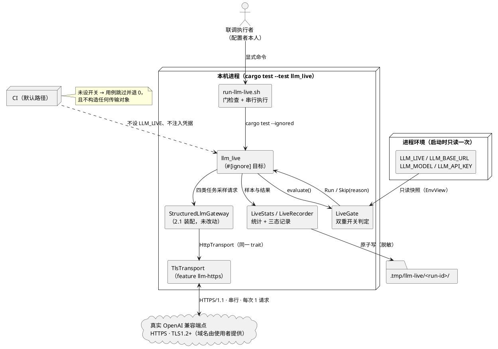

| 边界 | 协议/方式 | 频率/规模 | 失败影响 |
|---|---|---|---|
| 执行者 → 脚本 | 终端显式命令 | 每次联调 1 次 | 未过门即退出码 0，不产生任何外发 |
| 脚本 → 测试目标 | `cargo test -p meeting-copilot-infrastructure --features llm-https --test llm_live -- --ignored --test-threads=1` | 1 次/联调 | 构建失败 → 本次标"未实测（构建失败）"，不得以旧数据顶替 |
| 进程环境 → `LiveGate` | 只读环境变量 | 启动时 1 次 | 任一缺失 → `Skip(reason)`，退出码 0（AC-19） |
| 测试目标 → 网关 | 进程内同步调用（2.2.2-D 端口未改） | 每样本 1 次，四类 × ≥30 | 网关按 2.1 语义返回降级结果，采样继续（鉴权失败除外） |
| 网关 → 端点 | HTTPS/1.1 | 串行，并发上限 1 | 被分类并计入分布，不中断整体采样 |
| 测试目标 → 产物 | 文件原子写 | 每样本 1 行 + 结束 1 次汇总 | 写失败 → 中止采样并标"未实测（记录失败）" |

### 2.6.2 组件与总体架构

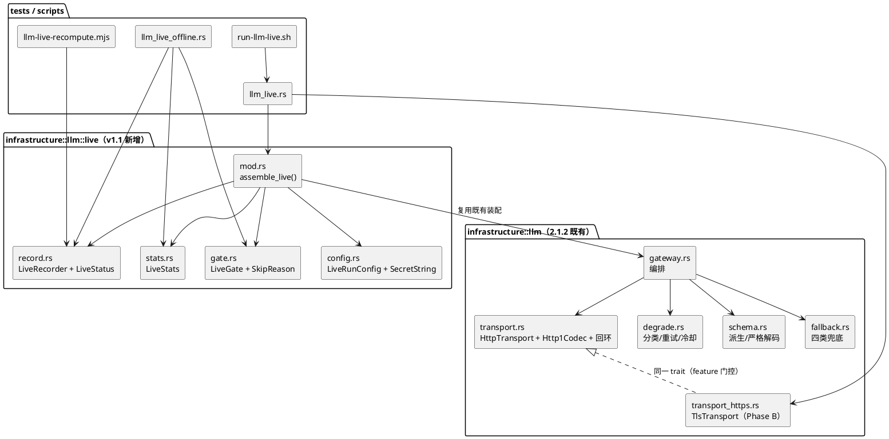

| 组件 | 职责 | 关键决策（理由） |
|---|---|---|
| `live/gate.rs` | 三层门中的"运行门"：双重开关与跳过原因码 | 纯函数 + `EnvView` 注入；离线可判定，且不改进程环境（避免测试并发竞态，1.2.6-5） |
| `live/config.rs` | 环境变量 → 不可变配置 | URL 立即收敛为 host；凭据一次性落 `SecretString` 且**不实现 `Serialize`**，把"凭据不进记录"提升为编译期不可表达（AC-26） |
| `live/stats.rs` | p50/p95、成功率、失败分布 | 纯函数、nearest-rank 口径固定并写入记录，供 AC-27 重算 |
| `live/record.rs` | 三态记录与原子写 | 主载体为 `run.json`/`samples.jsonl`（会被 `scan-secrets.sh` 覆盖），`summary.md` 只派生 |
| `live/mod.rs` | 联调装配 | 只在 Run 分支构造传输；网关不需知道联调存在 |
| `transport_https.rs` | 真实传输（Phase B） | 复用 `Http1Codec`，错误仍走既有 `TransportError`，网关零分支（2.8.2/2.8.3） |

**依赖方向（强制）**：`live → {gateway, transport}` 单向；`gateway.rs`、`degrade.rs`、`schema.rs`、`fallback.rs`、`transport.rs` **不引用** `live` 任何符号（网关对"联调"零感知）；`live` 不依赖 TLS（除 `transport_https.rs` 在 feature 下引用），保证 Phase A 可编译、可离线判定。

### 2.6.3 实现设计

#### （1）三态判定状态机

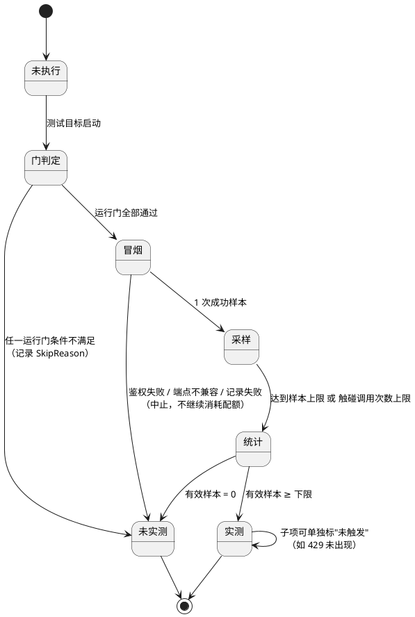

| 状态 | 判定条件 | 必须附带的配套信息 | 禁止 |
|---|---|---|---|
| 实测 | 已在真实端点取得有效样本且记录完整 | 环境三元组、样本量、p50/p95、失败分布、原始样本位置 | 只保留成功样本；用 mock 数值填入 |
| 未触发 | 已执行，但该故障在采样窗口内未自然出现（典型为 429） | 采样窗口、请求数、说明"未出现不等于通过" | 写成"通过"；填 mock 的 429 结果 |
| 未实测 | 未执行：未开开关、凭据/端点/模型缺失、传输未启用、预算/合规未确认 | 具体原因码（`SkipReason` 或 `Aborted` 子码）；**不得**任何数值 | 填任何数值；标为"失败" |

#### （2）采样主流程

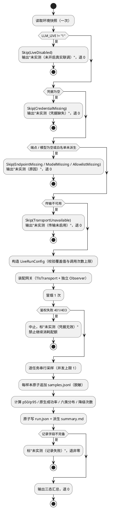

#### （3）关键判定规则

1. **门判定先于传输构造**：`TlsTransport` 只在 Run 分支创建；Skip 路径不存在可发请求的对象，因此"跳过且零公网连接"是结构保证而非运行期约束（AC-19）。
2. **严格开关语义**：`LLM_LIVE` 必须恰为 `"1"`；`true`/`yes`/大小写变体/前后空白一律视为关闭，缩窄误触发面（R20）。
3. **串行采样**：`--test-threads=1` 且 `max_concurrency=1`。理由：并发会自致 429，污染 AC-23 的"自然出现"观测，也会让"重试次数"口径不可解释。
4. **与 mock 状态隔离**：live 目标不复用 mock 用例的 `MetricsStore`、`AuditChain` 与冷却状态，每次运行独立装配（SPEC 11.6-4）；两侧证据由不同测试目标产生，互不引用。
5. **单样本隔离**：每样本独立 `request_id`；一次样本内的重试由网关按 5.3.1-2 执行，记录 `attempts`，**不把重试拆成新样本**（否则成功率被稀释）。
6. **鉴权失败即中止**：401/403 归为"凭据无效/未授权"，只记录分类，不回显前缀、长度、后四位或哈希（SPEC 11.4-7）——这是一处**主动放弃采样**的取舍，理由是避免在凭据无效时空烧配额（R17）。
7. **记录失败即中止**：写盘失败不得继续采样，否则样本与记录不一致，AC-27 不可复核。
8. **联调层不加码重试**：不额外包装重试，保证"尝试次数"就是被测网关的真实行为。
9. **端点不兼容单列**：Chat Completions 形状解析失败（缺 `choices`/`delta` 结构）记为"未归类：端点不兼容（待评估）"，**不计入** `InvalidSchema` 的失败分布（避免污染 AC-22），并单独标注（SPEC 11.5.4-2、11.1.2-3）。

#### （4）与既有网关的关系

| 维度 | 是否变化 | 说明 |
|---|---|---|
| 网关编排（2.1.3） | 不变 | 校验→审计→冷却→并发→传输→分类→重试→校验→兜底→审计→度量，一步不改 |
| 传输实现 | 仅替换注入实例 | 回环（mock）/ 脚本化（单元测试）/ TLS（真实）三者同为 `Arc<dyn HttpTransport>` |
| 观测适配 | 替换实例 | live 用独立 `LlmObserver`（不写 mock 的实例），字段口径与 2.1.3(9) 相同 |
| 失败语义 | 不变 | 外部故障仍以 `Ok(StructuredOutcome{degraded:true})` 返回，`Err` 只表达配置/请求非法 |
| AC-01~AC-18 判定 | 不变 | 载体文件与断言不改；新增测试只增不减（AC-17） |
## 2.7 联调接口与配置设计

### 2.7.1 总体设计

| 类别 | 接口/契约 | 使用方 | 稳定性 | 变更策略 |
|---|---|---|---|---|
| 运行门（纯函数） | `evaluate` / `LiveDecision` / `SkipReason` | 测试目标、脚本 | 稳定 | 新增 `SkipReason` 变体必须同步"未实测（原因）"文案与 AC-19 用例 |
| 配置契约 | `LiveRunConfig` / `SecretString` / `EnvView` | 测试目标 | 实验 | 字段新增须升 `record.schema_version`；凭据类字段永不新增"可序列化"形态 |
| 记录契约 | `run.json` / `samples.jsonl` | 记录器、复核脚本、13.4 | 实验→稳定 | 字段只增不删；删除/改名视为破坏性变更 |
| 传输 SPI | `HttpTransport`（复用 2.2.2-E） | 网关 | 稳定（不变） | 真实传输只新增实现，不改 trait 签名与 `TransportError` 变体 |

**类型安全原则（联调专属，补充 2.2.1）**

1. **凭据必须是不可打印/不可序列化的类型**：`SecretString` 不实现 `Serialize`/`Display`，`Debug` 输出固定 `***`；任何需要落盘的结构都**无法**接受该类型（编译期阻断，AC-26 的第一道防线）。
2. **记录只接受"已脱敏"的值**：`Recordable<T>`（或等价的新类型包装）只由 `LiveRunConfig` 与统计结果构造，且字段清单在构造期固定；不允许把 `LlmGenerationRequest`/`HttpRequest` 直接写盘。
3. **不存在 `serde_json::Value` 自由字段**：`run.json` 用显式结构体写出，避免"顺手塞一个 map"把 URL 或头写进去。

### 2.7.2 运行门契约（`live/gate.rs`）

```rust
/// 跳过原因：封闭枚举，禁止自由文本。
pub enum SkipReason {
    LiveDisabled,          // LLM_LIVE 缺失、空或 ≠ "1"
    CredentialMissing,     // LLM_API_KEY 缺失或仅空白
    EndpointMissing,       // LLM_BASE_URL 缺失 / 非 http(s) / 无法解析 host
    ModelMissing,          // LLM_MODEL 缺失或仅空白
    AllowlistMissing,      // 无法从端点派生白名单项
    TransportUnavailable,  // llm-https 未启用（Phase B 未完成）
}

pub enum LiveDecision { Run, Skip(SkipReason) }

/// 只读环境视图。生产实现为启动时快照；测试注入假视图（不改进程环境）。
pub trait EnvView {
    fn get(&self, name: &str) -> Option<String>;
}

/// 纯函数：无 I/O、无分配副作用、无 panic。
pub fn evaluate(env: &dyn EnvView, transport_available: bool) -> LiveDecision;

impl SkipReason {
    pub const fn label(self) -> &'static str; // "未开启真实联调"/"凭据缺失"/...
    pub const fn code(self) -> &'static str;  // "live_disabled"/"credential_missing"/...
}
```

**判定顺序（固定，保证输出可复现）**

| 序 | 条件 | 结果 | 输出文案 |
|---|---|---|---|
| 1 | `LLM_LIVE` 缺失、空或 ≠ `"1"` | `Skip(LiveDisabled)` | 未实测（未开启真实联调） |
| 2 | `LLM_API_KEY` 缺失或 trim 后为空 | `Skip(CredentialMissing)` | 未实测（凭据缺失） |
| 3 | `LLM_BASE_URL` 缺失 / 非 `http(s)://` / host 不可解析 | `Skip(EndpointMissing)` | 未实测（端点未配置） |
| 4 | `LLM_MODEL` 缺失或 trim 后为空 | `Skip(ModelMissing)` | 未实测（模型未配置） |
| 5 | 白名单派生失败 | `Skip(AllowlistMissing)` | 未实测（白名单未授权） |
| 6 | `transport_available == false` | `Skip(TransportUnavailable)` | 未实测（传输未启用） |
| 7 | 以上全部满足 | `Run` | — |

- **业务说明**：SP 11.4-2 要求"凭据或端点或模型任一缺失即跳过"，此处只固定顺序，不改变语义；顺序选择为"先判开关（最省事、最不易误触发）→ 再判凭据"。
- **前置条件**：`evaluate` 必须在任何传输对象构造前调用。
- **后置条件**：返回 `Skip` 时，调用方不得构造 `HttpTransport`、不得创建 socket、不得写任何数值。
- **异常映射**：不返回 `Result`——运行门判定本身不允许失败；配置非法（非跳过类）由 2.7.3 的 `LiveRunConfig::try_new` 返回 `E-PROVIDER-009`。
- **调用示例（测试目标入口）**：

```rust
let env = ProcessEnv::snapshot();
let decision = live::evaluate(&env, cfg!(feature = "llm-https"));
if let LiveDecision::Skip(reason) = decision {
    println!("未实测（{}） code={}", reason.label(), reason.code());
    return; // 测试体正常返回 → 退出码 0
}
```

### 2.7.3 配置契约（`live/config.rs`）

| 字段 | 来源 | 默认 | 校验 | 是否进入记录 |
|---|---|---|---|---|
| `endpoint_host` | `LLM_BASE_URL` | 无 | `http(s)://`、host 可解析、命中白名单；**立即收敛为 host**，丢弃 path/query/fragment 且不保留原文 | 是（仅 host） |
| `model` | `LLM_MODEL` | 无 | 非空、≤128 字符 | 是 |
| `credential` | `LLM_API_KEY` | 无 | 非空；类型为 `SecretString`（`Debug`/`Display` = `***`，不实现 `Serialize`） | **否**（任何形态都不写） |
| `deadline_ms` | 覆盖或 2.5 配置默认 | 4000 | 100..=8000，且 ≤ 该任务剩余端到端预算 | 是（数值） |
| `samples_per_task` | 覆盖 | 30 | 1..=200；同时通过调用次数上限校验 | 是 |
| `max_concurrency` | 覆盖 | **1** | 1..=3；默认 1 的理由见 2.6.3-3（避免自致 429） | 是 |
| `call_budget` | 派生 | `samples × 3 × 4` | 超过配置的调用次数上限 → 拒绝启动 | 是 |
| `tasks` | 固定 | 四类 | 封闭枚举 | 是 |

- **业务说明**：配置只从环境变量取值，**不接受文件、命令行参数、URL 查询参数**（SPEC 11.4-1）；这就是"凭据不落盘、不进进程参数"的实现路径（R19/R21）。
- **覆盖变量命名（仅三个）**：`LLM_LIVE_SAMPLES`、`LLM_LIVE_DEADLINE_MS`、`LLM_LIVE_CONCURRENCY`；其余 `LLM_*` 变量一律不读取（收窄隐性配置面，R19）。
- **前置条件**：三项环境变量齐备且运行门判定为 `Run`。
- **后置条件**：`endpoint_host` 是**唯一**被保留的端点信息，后续审计/度量/记录的 `endpoint_id` 也用它派生（不含路径）。
- **异常映射**：URL 解析失败、白名单为空、模型为空、覆盖值越界 → `CopilotError::ProviderConfigInvalid`（`E-PROVIDER-009`），不启动采样、不产生外发。
- **调用示例**：

```rust
let cfg = LiveRunConfig::try_new(&env, /* deadline 覆盖 */ Some(4000), /* 样本 */ Some(30))?;
assert_eq!(cfg.endpoint_host(), "example.invalid"); // 只有 host，不含路径与查询串
```

> **明确禁止**：不得在方案、代码、默认值或示例中填入任何服务商的 Base URL 或模型名（SPEC 11.3.1）；上例的 `example.invalid` 属保留 TLD 的假值，仅用于说明"只保留 host"。

### 2.7.4 记录契约（`live/record.rs`）

**文件布局**（全部位于未入库目录）

```
.tmp/llm-live/<run-id>/            # run-id = UTC 时间戳 + commit 短哈希
├── run.json                       # 环境三元组 + 配置摘要 + 逐子项三态 + 统计（主载体）
├── samples.jsonl                  # 一行一样本（原始样本，复核基准）
└── summary.md                     # 由 run.json 派生的人类可读摘要（非唯一载体）
```

**`run.json` 字段（对应 SPEC 11.7.2 的 11 项）**

| 字段 | 内容 | 脱敏要求 |
|---|---|---|
| `schema_version` | 记录格式版本 | — |
| `endpoint_host` | 仅 host | 禁完整 URL、禁查询参数与路径 |
| `model` | 端点声明或返回的模型标识 | — |
| `started_at` / `ended_at` / `tz_offset` | RFC3339 + 本地时区偏移 | — |
| `commit_short` | 7~12 位短哈希 | — |
| `config` | 截止时间、输出上限、温度、并发、样本数 | 不含凭据、不含端点路径 |
| `per_task` | **本次运行实际写入 `samples.jsonl` 的样本行数**（v1.4 语义收紧，见 2.27.3 / D-7）；配置的样本数保留在 `config` 字符串；逐任务的 p50/p95、成功率与失败分布由重算脚本派生 | 不含载荷、响应正文；键集不变（AC-42 要求 `per_task == samples.jsonl` 行数） |
| `sub_status` | 每个 AC 子项的三态（`measured`/`not_triggered`/`not_measured` + `reason_code`） | 未实测项**不得**带数值 |
| `samples_path` | 原始样本**相对**路径 | 不写绝对路径（避免泄漏用户名/主目录） |
| `stats_rule` | 统计口径（`nearest_rank`）与样本下限 | — |
| `build` | 是否启用 `llm-https`、`LLM_LIVE` 是否开启 | 不含凭据 |

**`samples.jsonl` 字段（一行一样本）**

| 字段 | 取值 | 说明 |
|---|---|---|
| `seq` | 整数 | 采样序号（替代请求编号，避免把会话/日期信息写进记录） |
| `task` | 四类之一 | — |
| `attempt` | 1..=3 | 本次样本内的尝试序号（重试不拆样本） |
| `first_token_ms` / `total_ms` / `tls_handshake_ms` | `total_ms` 为整数毫秒（AC-41 / J4）；`first_token_ms` 为整数毫秒 | 计时口径复用 2.1.3(2)-7；`total_ms` 为单调时钟实测差，**禁止**写死或 `max(1)` 补齐；亚毫秒记 0 并标 `precision_insufficient`（2.26.3）；握手耗时单独记录以解释"冷连接口径"（2.8.2） |
| `outcome` | `ok` / `error` | — |
| `failure_class` | 六类之一或空 | 严格封闭，禁止自由文本 |
| `http_status` | 可选整数 | 只记状态码，不记响应体与头 |
| `retry_after_form` / `wait_ms` | `none`/`seconds`/`http_date`/`missing`/`invalid` + 数值 | 仅 AC-23 使用 |
| `degraded` | 布尔 | 降级样本计入分母、不计入原生成功率分子 |
| `excluded` + `reason` | 可选 | `auth_failed`/`endpoint_incompatible`/`record_failed` 等，必须能定位排除原因 |

**统计口径（固定并写进记录，供 AC-27 重算）**

1. 分位数：`p(q) = 升序样本第 ceil(q × n) 个值`（nearest-rank），`q ∈ {0.50, 0.95}`；记录同时写 `n`。
2. 原生成功率 = 原生通过 Schema 的样本数 ÷ 有效请求数；兜底成功**计入分母不计入分子**，另列"兜底次数"（SPEC 11.5.4-1）。
3. 正常耗时分布**排除** `degraded=true` 与 `excluded` 非空的样本，被排除者单独计数（SPEC 11.5.3-3）。
4. 六类之外的失败单列"未归类"并附原因码，不得强行归入六类（SPEC 11.5.4-2）。
5. 样本不足：`n<30` 只输出 p50 并标"样本不足·不作分布结论"；`n<10` 不输出成功率；此时 `sub_status` 必须为 `not_measured`（SPEC 11.5.2-1、11.5.4-4）。

### 2.7.5 待补充配置（M1~M5）在方案中的处理

| 缺失项 | 方案中的处理（不臆测、不设默认） | 当前状态标注 | 补充后如何生效 |
|---|---|---|---|
| M1 Base URL | 无默认值；`LLM_BASE_URL` 缺失即 `Skip(EndpointMissing)`；方案中不出现任何具体域名 | AC-20~AC-25：未实测（端点未配置） | 设置该变量后由 `LiveRunConfig` 派生 host，无需改代码（2.9.4-2） |
| M2 模型名 | 无默认值、不使用示例模型名；缺失即 `Skip(ModelMissing)` | 未实测（模型未配置） | 设置 `LLM_MODEL` 后生效（2.9.4-2） |
| M3 白名单授权 | 白名单未派生 → fail-closed，不发起任何外发 | 未实测（白名单未授权） | 配置者确认域名可外发后，白名单由 host 派生（2.9.4-1） |
| M4 采样预算 | 未定 → 采用默认 30/任务；若调用次数上限未确认则只按"样本不足"口径表述 | AC-21/22 只报 p50 | 确认预算后调高样本（2.9.4-5） |
| M5 凭据授权与轮换责任人 | 未确认 → 不开启真实联调 | 全部子项未实测 | 授权确认后按 2.9.4-3 注入 |

> **方案侧的硬约束**：M1、M2 只以"待补充配置"的形态存在；本设计不写任何服务商域名、模型家族名、价格或区域信息（SPEC 11.1.4-1）。
## 2.8 真实传输的依赖与实现边界

### 2.8.1 三层门：缺一不执行

| 门 | 条件 | 不满足时的行为 | 只能由谁打开 |
|---|---|---|---|
| **编译门** | `feature = "llm-https"` 启用，`transport_https.rs` 参与编译 | `transport_available = false` → `Skip(TransportUnavailable)`；不存在可发请求的类型 | 构建命令（Phase B 之后） |
| **许可门** | `native-tls` 条目在 `docs/compliance/license-review.md` 完成安全 + 法务签字 | feature 仍是**空声明**、optional 依赖**不写入** `Cargo.toml`，锁文件与产物零变化 | 安全负责人 + 法务负责人 |
| **运行门** | `LLM_LIVE == "1"` 且 `LLM_API_KEY` 非空且端点/模型齐备 | `Skip(reason)`，输出"未实测（原因）"，退出码 0，零外发 | 联调执行者（本人） |

三层门是**逻辑与**关系，且**没有任何"跳过检查"的开关**：编译门与许可门在代码层面就无法绕过（类型不存在 / 依赖未声明），运行门不可通过其它变量绕开（只认 `LLM_LIVE == "1"`）。

**Phase A 的 feature 声明方式（重要）**：为避免 `cfg!(feature = "llm-https")` 触发 `unexpected_cfgs` 告警（会让 `clippy -D warnings` 失败，破坏 AC-17），Phase A 就在 `crates/infrastructure/Cargo.toml` 声明**空 feature**：

```toml
[features]
llm-https = []          # Phase A：仅作 cfg 声明，不引入任何依赖；Phase B 改为 ["dep:native-tls"]
```

空 feature 不改变依赖闭包与锁文件，因此"未复核依赖不进构建"的结论（2.5.2）仍然成立。

### 2.8.2 传输实现边界

| 层 | 组件 | 职责 | 是否依赖 socket/TLS |
|---|---|---|---|
| 协议编解码 | `Http1Codec` | 请求行/头/体序列化，状态行/头解析，`chunked` 与定长体解码，超长与不完整报文判定 | **否**（只处理 `&[u8]`，可在内存 buffer 上单测） |
| 回环传输 | `LoopbackTransport` | `std::net::TcpStream` 连接 `127.0.0.1:port`，设置读写超时，驱动 codec | socket（仅回环） |
| 真实传输 | `TlsTransport`（Phase B） | `TcpStream` → `native_tls::TlsConnector`（SNI=host、最低 TLS 1.2、系统信任根）→ `TlsStream<TcpStream>` → 同一 codec | socket + TLS |

**关键结论：mock 与真实走同一段协议代码。** 两者只在"字节从哪来"上不同：回环来自进程内 socket，真实来自 TLS 流；`Http1Codec` 一份实现、一组单测，避免"mock 能过、真实因分块/头差异失败"的协议分叉。

**错误映射（不新增变体，保持 AC-24 的分类口径）**

| 真实路径错误 | `TransportError` | `FailureClass` |
|---|---|---|
| DNS 解析失败 | `DnsFailure` | `Offline` |
| 连接超时 / TLS 握手超时 | `ConnectTimeout` | `Timeout` |
| 读超时 / 空闲超预算 | `ReadTimeout` | `Timeout` |
| 证书不受信 / 握手失败（含协议版本不符） | `TlsFailure` | `Unavailable` |
| 连接被拒绝 / 对端关闭 / 5xx | `ConnectRefused` / `PeerClosed` / 状态码 | `Unavailable` |
| 响应超 `max_response_bytes` | `TooLarge` | `InvalidSchema` |

**时延口径**：每样本新建连接（含 TLS 握手），`total_ms` 因此是"冷连接口径"；`samples.jsonl` 另记 `tls_handshake_ms` 便于解释。冒烟样本（第 1 次）记为预热、**不进入统计**。连接复用属 13.4 的测量口径扩展，本轮不做（避免改变 AC-20/21 的可比性）。

**明确不做**：不跟随重定向、不读取系统代理、不做 HTTP/2、不缓存 DNS、不自定义 CA、不复用连接池。

### 2.8.3 mock / 真实 / 假传输的替换关系

| 场景 | 注入实现 | 触发条件 | 是否外发 | 载体 |
|---|---|---|---|---|
| 组件单测与故障注入 | `FakeTransport`（脚本化响应/错误） | 默认测试 | 否 | `degrade.rs`、`gateway.rs` 内联 `mod tests` |
| 协议编解码 | `Http1Codec` + 内存 buffer | 默认测试 | 否 | `transport.rs` 内联单测（`codec_contract`） |
| mock 集成（AC-02/03/14） | `LoopbackTransport` + 进程内 mock 端点 | 默认测试 | 仅回环 | `tests/llm_gateway_mock.rs` |
| 离线联调判定（AC-19/26/27 的静态面） | **不构造传输** | 默认测试 | 否 | `tests/llm_live_offline.rs` |
| 真实采样（AC-20~AC-25） | `TlsTransport` | `--ignored` + 三层门 | 是（仅配置端点） | `tests/llm_live.rs` |

**零分支保证**：网关只依赖 `Arc<dyn HttpTransport>`，`gateway.rs`/`degrade.rs`/`fallback.rs` 中**不存在**任何"是否真实联调"的判断；`assemble()`（2.1.2）签名不变，新增 `assemble_live()` 只被测试目标调用。因此"测试替换"只有一个位置——装配参数。

**可验证的"同接口"证明**：
1. `codec_contract` 一组用例对同一份字节流断言解析结果，回环与 TLS 均复用该 codec，因此协议行为对两者恒等（离线可判定）。
2. 传输层契约用例（超时、取消、超长、对端关闭）在 `FakeTransport` 与 `LoopbackTransport` 上各跑一遍，断言**分类结果一致**；TLS 实例在 AC-20~AC-25 的真实采样中由同一批断言复核（记录型）。

### 2.8.4 依赖与许可结论（Phase A / Phase B）

| 阶段 | 交付内容 | 依赖增量 | 前置条件 |
|---|---|---|---|
| **Phase A（现在可做）** | `live/`（gate/config/stats/record）、空 feature `llm-https`、离线测试、脚本、记录模板与重算脚本 | **零**（只用既有 `serde_json`/`std`） | 无 |
| **Phase B（需签字）** | `transport_https.rs`、`llm-https = ["dep:native-tls"]`、真实采样能力 | `native-tls`（含平台绑定 schannel / Security.framework） | license-review 新增条目 + 双签 + `cargo deny` 复跑通过 |

**方案否决记录（"为什么不用更省事的做法"）**

| 候选方案 | 结论 | 理由 |
|---|---|---|
| `reqwest`（blocking） | **否决** | 把 tokio/hyper 拉进同步网关（与 2.1.3(5) 的"专用线程 + 条件变量"模型冲突）；锁文件本无 TLS 后端，同样要新增下载包与许可复核；`blocking` 自带运行时线程，另增线程与计时噪声 |
| `rustls` + `ring` | **备选（Phase B 兜底）** | 可行但新增包更多、需 `deny.toml` 复核；仅在目标平台系统 TLS 不可用或版本不满足时启用（ring 为 ISC，已在 allow 列表） |
| 自研 TLS / 手写密码学 | **否决** | 不属于"可复核依赖"，安全性不可接受 |
| 本机 TLS 转发代理（Node 等） | **否决** | 在测量路径插入第三方进程：AC-20/21 的时延含代理开销且口径不可解释；DNS/连接错误被代理吞成 5xx/502，破坏 AC-24"分类唯一来源 = 传输层错误类型"；凭据还要多经一跳 |
| 把密钥放入 URL 查询参数 | **否决** | 直接违反 SPEC 4.3-1 与 AC-26-2（URL 查询参数是明确禁写项） |
| 关闭证书校验（`danger_accept_invalid_certs` 等） | **否决** | 取消唯一可用的服务端身份校验，且对可复核数据毫无增益 |

### 2.8.5 禁止项清单（联调路径）

1. 不得把凭据写入 URL、命令行参数、文件、配置快照、日志、审计或实测记录（SPEC 11.4-1/5/9）。
2. 不得关闭证书校验、不得使用自定义 CA、不得读取系统代理、不得跟随重定向（SPEC 4.3-5）。
3. 不得在 CI 配置中设置 `LLM_LIVE` 或注入 `LLM_API_KEY`（SPEC 11.6-3）。
4. 不得把真实数值写入 AC-01~AC-18 的判定表，也不得把 mock 数值填入"实测"列（SPEC 11.7.1）。
5. 不得把 `run.json`/`samples.jsonl` 提交入库，也不得写入 `docs/`（SPEC 11.6-6）。
6. 不得删除、截断或"择优选样"原始样本（SPEC 11.5.2-2、11.6-7）。
7. 不得在方案、代码、默认值或示例中出现真实域名、模型名、区域与价格信息（SPEC 11.1.4-1）。
8. 不得在凭据无效时继续采样（避免空烧配额，2.6.3-6）。

## 2.9 测试方案与 AC-19 至 AC-27 追溯

### 2.9.1 判定类别定义

| 类别 | 含义 | 载体 | 何时执行 | 是否允许"无结论" |
|---|---|---|---|---|
| **O（离线可判定）** | 不接真实端点即可断言通过/失败 | 默认测试路径（`cargo test`） | 每次 CI | 否（必须绿） |
| **L（需真实端点）** | 需要端点 + 有效凭据 + Phase B 传输 | `--ignored` 目标 | 显式执行 | 是（环境未就绪即如实标注） |
| **R（记录型）** | 无数值阈值，通过条件为"记录完整 + 标注准确" | `run.json` + `samples.jsonl` + 重算脚本 | 显式执行 | 是（"未触发"/"未实测"均合法） |

> 与 8.1 的关系：O 类用例属于"新增测试"，只增不减（AC-17）；L/R 类用例**不进** `cargo test --workspace` 的默认执行，也不参与 8.1 的 DoD（SPEC 8.3 首段）。

### 2.9.2 AC-19 至 AC-27 逐条追溯

| 编号 | 载体（用例/脚本） | 断言要点 | 类别 |
|---|---|---|---|
| AC-19 | `llm_live_offline::gate_default_off_skips`、`gate_switch_on_credential_missing_skips`、`gate_precedence_is_deterministic`；`llm_live::run_gate_skips_without_live`；`scripts/run-llm-live.sh` 前置段 | ①未设 `LLM_LIVE` → `Skip(LiveDisabled)` 且输出"未实测（未开启真实联调）"；②`LLM_LIVE=1` 且凭据空 → `Skip(CredentialMissing)` 且输出"未实测（凭据缺失）"；③两种情况下注入的传输探针构造次数为 **0**、不产生 socket；④退出码 0、输出不含任何数值 | O（+L 的跳过面） |
| AC-20 | `llm_live::first_token_latency_p50_p95` | 每任务有效样本 ≥30（不足则 `not_measured`）；`run.json` 含 p50/p95、端点 host、模型、日期时区、样本量；与 1.2 s 目标的"达标/未达标"字段存在；数值可由 `samples.jsonl` 重算 | L + R |
| AC-21 | `llm_live::total_latency_four_tasks` | 四类任务各 ≥30；分别给出 p50/p95；降级样本已排除并单列；预算判定字段 ∈ {`可行`,`不可行`,`边界`}；"不可行"时必须写"摘要兜底出卡"的初判依据字段 | L + R |
| AC-22 | `llm_live::schema_conformance_rate`；`stats::degraded_counts_in_denominator_not_numerator` | 每类有效请求 ≥10（不足即"样本不足·未实测成功率"）；成功率分子不含兜底；失败按六类 + "未归类"计数；结构违规拆"非 JSON"/"字段不符"两类 | L（统计口径 O） |
| AC-23 | `llm_live::rate_limit_observation`；`retry_after::parse`（离线） | 出现 429 → `retry_after_form ∈ {seconds,http_date,missing,invalid}`、`wait_ms ≤2000`、是否越过截止、分类 `RateLimited`；未出现 → `sub_status = not_triggered` 且附采样窗口与请求数；`wait_ms = 0` 判"与规格不一致（待评估）" | L + R（解析 O） |
| AC-24 | `llm_live::deadline_forced_timeout` | 人为把截止压至 ≤300 ms；分类 `Timeout`；`abs(返回时刻 - 截止时刻) ≤ 100 ms`（测试容差 200 ms）；无结果体交付；记录含"人为压低截止时间，非端点自身超时率" | L + R |
| AC-25 | `llm_live::schema_violation_probe_once`；`schema::repair_hint_only_path_and_rule` | 1 次对照请求；若违规 → `attempts ≤ 2`，最终为同类型兜底 `degraded=true` + `Failed(InvalidSchema)`；记录含"人为构造的违规请求"；修复提示只含 `path`/`rule`，不含载荷片段 | L（提示 O） |
| AC-26 | `llm_live_offline::secret_masked_in_debug_display`、`record_structurally_cannot_hold_secret`、`error_text_has_no_secret_fragment`；`scripts/run-llm-live.sh` 的四泄漏面抓取段 | ①`SecretString` 的 `Debug`/`Display` 恒 `***`；②承载凭据的类型不实现 `Serialize`（编译期断言用 `trait` 排除法）；③错误文本不含凭据任意 ≥8 字符切片；④日志/审计/记录不含；⑤进程命令行不含（脚本以 `ps`/`wmic` 抓取后断言）；⑥`git status --short` 零新增；⑦`scan-secrets.sh` 通过 | O（静态）+ L（运行） |
| AC-27 | `llm_live::record_is_recomputable`；`scripts/llm-live-recompute.mjs` | 11 项字段齐备；`samples.jsonl` 行数与 `n` 一致；重算 p50/p95 与记录差 ≤0.1 ms；`samples_path` 为相对路径且位于 `.tmp/llm-live`；缺任一字段即 `not_measured` | R（重算 O） |

**AC-19 的关键实现约束**：`LiveGate` 不读进程环境本体，而读注入的 `EnvView`；因此"未设开关"与"凭据缺失"两种情况在测试中用**假视图**即可确定性复现，不需要 `set_var`、不依赖执行顺序、可连续 3 次一致（SPEC 8.2-4）。

**AC-26 与 AC-16 的分工**：AC-16 管"仓库与夹具不含真实凭据"；AC-26 管"运行期四个泄漏面不含凭据值与凭据编号"。两者同源不同面，互为补充，不互相替代。

**AC-20~AC-25 的诚实边界**：这些用例的"通过"指**记录完整且标注准确**；`p95` 是否 ≤1.2 s、429 是否出现、6 s 预算是否可行，均为**记录型结论**，由 13.4 消费。测试不会因"未达标"而失败，也不会因"未触发"而缺项。

### 2.9.3 与 AC-01 至 AC-18 的隔离与回归约束

1. **默认路径零网络**：`llm_live_offline.rs` 全部零 socket；`llm_live.rs` 全部 `#[ignore]`；`cargo test --workspace` 不执行真实采样。
2. **状态不共享**：live 目标独立装配 `LlmObserver`/冷却状态；mock 用例的端点脚本与断言不引用 live 模块（SPEC 11.6-4）。
3. **可编译性**：无 `llm-https` 时 `llm_live.rs` 仍必须编译通过（TLS 调用点用 `cfg` 门控，运行时走 `Skip(TransportUnavailable)`）。
4. **告警纪律**：Phase A 声明空 feature `llm-https = []`，避免 `unexpected_cfgs` 触发 `clippy -D warnings`（AC-17）。
5. **回归门槛**：`cargo clippy --workspace --all-targets -- -D warnings`、`bash scripts/check-layering.sh`、`cargo deny check licenses bans sources advisories`、`cargo test --workspace` 全绿，既有 80 个测试数量不减。
6. **文件名纪律**：新增测试目标文件名不得与既有 `llm_*.rs` 冲突；`tests/support/mod.rs` 只增不改。

### 2.9.4 用户补齐 M1~M5 后的执行步骤（不含实现代码）

1. **白名单/外发授权（M3）**：确认该端点域名允许从本机外发，写入 `domain_allowlist`；未确认则全程不执行（fail-closed）。
2. **端点与模型（M1、M2）**：在**当前 shell** 中以环境变量提供 `LLM_BASE_URL`（含 `http(s)://`）与 `LLM_MODEL`；不写入仓库文件、不写入任何配置样例。
3. **凭据（M5）**：在受限 shell 中交互式注入 `LLM_API_KEY`（不回显、不进命令行、不落临时文件）；同时确认使用授权与轮换责任人。
4. **传输启用（Phase B）**：先完成 `docs/compliance/license-review.md` 的 TLS 条目签字并复跑 `cargo deny`；再以 `--features llm-https` 构建并运行测试目标。
5. **冒烟 → 正式采样（M4）**：先以 `LLM_LIVE_SAMPLES=1` 跑一次，验证连通、凭据有效、端点兼容（不兼容即止）；确认调用次数上限后，再以默认 30 跑四类任务。
6. **记录复核（AC-27）**：检查 `.tmp/llm-live/<run-id>/run.json` 的 11 项字段与 `samples.jsonl` 行数；用 `scripts/llm-live-recompute.mjs` 重算 p50/p95；确认 `git status --short` 零新增。
7. **收尾**：清空该 shell 的三个变量；若凭据曾出现在聊天/工单/截图等非受控渠道，按凭据管理规范轮换；三态结论交由 13.4 引用（本特性不写 `docs/`、不改 `docs/sdd/*.md`）。

**覆盖类变量命名（仅三个）**：`LLM_LIVE_SAMPLES`、`LLM_LIVE_DEADLINE_MS`、`LLM_LIVE_CONCURRENCY`；其它 `LLM_*` 变量一律不读取，避免"同名不同义"的隐性配置面（R19）。
### 2.9.5 方案收口结论（v1.1）

| 结论项 | 内容 |
|---|---|
| 本版新增的能力 | 运行门（双重开关 + 六种跳过原因）、联调配置（env-only + 凭据掩码）、采样统计（p50/p95 + 成功率 + 六类分布）、三态记录（`run.json`/`samples.jsonl`）、离线判定用例、执行与复核脚本 |
| 本版**未**新增的依赖 | 零。真实传输的依赖增量被隔离在 Phase B，需许可签字后才写入 `Cargo.toml` |
| 现在就能判定的 AC | AC-19（跳过语义）、AC-26（静态泄漏面：掩码、不可序列化、错误文本）、AC-27（记录字段完备与重算机制，用合成样本验证） |
| 仍需真实端点 + Phase B 的 AC | AC-20、AC-21、AC-22、AC-23、AC-24、AC-25，以及 AC-26 的运行期抓取、AC-27 的真实样本重算 |
| 触发条件 | M1~M5 齐备（端点、模型、白名单、预算、凭据授权）+ 许可条目签字 + `LLM_LIVE=1` |
| 不得据此宣称 | 13.1/13.2 完成、13.4 完成、M0 的 LLM 基线达标（G1 门禁不受本特性影响） |
| 对既有结论的影响 | 无。AC-01~AC-18 的 mock 判定口径、载体与断言全部不变（SPEC 8.3 首段、11.1.2-1） |

**一句话边界**：本设计把"真实联调"做成了一条**默认关闭、凭据缺失即跳过、依赖需签字、产物不入库、记录可重算**的可选通道；它不会因为"跑通了"而抬高任何既有结论，也不会因为"没跑"而阻塞 13.1/13.2 的 mock 验收。

## 2.10 服务商锁定运行门（SPEC 8.4 / 11.9）

> 定位：2.7 的运行门回答"是否允许**尝试**真实联调"（开关 + 三要素齐备 + 传输可用）；2.10 在其上追加**服务商 / 模型 / 传输 / 预算**四道政策闸，回答"这次尝试是否被政策允许"。2.7 的 `evaluate` 与六个 `SkipReason` **原样保留**（AC-19 用例零改动）；2.10 新增 `admit`，作为阶段 C 唯一入场函数。
> 约束：本节不改变 2.1~2.9 的任何结论；AC-28~AC-32 的通过与否不影响 8.1 与 AC-01~AC-27（SPEC 8.4 首段）。

### 2.10.1 判定标识与错误出口

| 标识（判定结果） | 触发条件 | 追溯 | 拒绝路径的硬保证 |
|---|---|---|---|
| `endpoint_not_allowed` | `LLM_BASE_URL` 的 host 归一化后**不精确等于**封闭集合中的任一项 | SPEC 11.9.1-3、AC-28 | 不构造传输、不解析 DNS、不创建 socket、不读取凭据值 |
| `model_not_confirmed` | `LLM_MODEL` 为空/仅空白/与确认凭条不逐字节相等 | SPEC 11.9.2-1、AC-29 | 同上（真实请求数 = 0） |
| `insecure_transport_rejected` | `LLM_BASE_URL` 以 `http://` 开头 | SPEC 11.9.3-1、AC-30 | 不建 TCP；不"先连再看"；不自动升 HTTPS 重试 |
| `budget_not_confirmed` | 用户确认的单次运行调用上限缺失或不可解析 | SPEC 11.9.4-4、AC-31 | 真实调用数 = 0 |
| `budget_exhausted` | 累计实际 HTTP 请求数达到 `min(samples×3×4, 用户确认上限)` | SPEC 11.9.4-3、AC-31 | 停止发起新请求；已取得样本不删改 |

**错误出口规则（沿用 SPEC 8.4 判定符号说明）**

1. 上述五个标识**不是** `ErrorCode` 枚举的新变体（不触碰 `ErrorCode::ALL` 与既有 12 项断言，避免影响 AC-17）。
2. 需要返回 `Err` 时统一复用 `CopilotError::ProviderConfigInvalid`（`E-PROVIDER-009`），其 `detail` 只含"字段名 + 标识字符串"，不含任何配置值、URL 全文、凭据或载荷。
3. `endpoint_not_allowed` / `insecure_transport_rejected` / `model_not_confirmed` / `budget_not_confirmed` 属于**进入采样前的拒绝**，调用方拿到的是拒绝结果，不是降级结果（因为此时尚无任何外部调用可降级）。
4. `budget_exhausted` 发生在**采样进行中**，已发出的请求可能已有结果；因此它以 `StructuredOutcome{degraded:true, cause:BudgetExhausted, failure:None}` 返回，并在记录中同时写入 `used/limit`（见 2.10.8）。

### 2.10.2 上下文视图

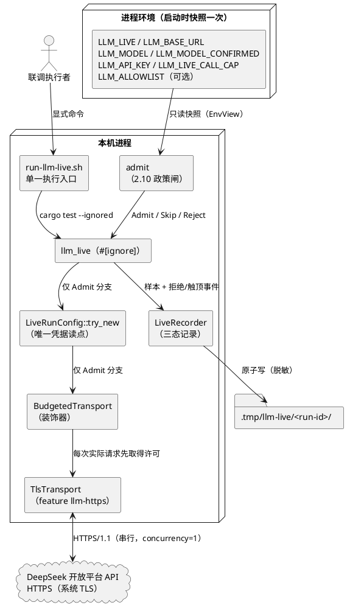

| 边界 | 协议/方式 | 频率/规模 | 失败影响 |
|---|---|---|---|
| 环境 → `admit` | 只读 `EnvView` 快照 | 每次运行 1 次 | 任一政策不满足即 `Reject`，零外发 |
| `admit` → `LiveRunConfig` | 进程内调用 | 仅 `Admit` 分支 1 次 | 凭据值在此读取一次并立即落 `SecretString` |
| 采样 → `BudgetedTransport` | 进程内装饰调用 | 每次实际 HTTP 请求 1 次（含重试） | 触顶即返回 `BudgetExhausted`，不发 socket |
| `BudgetedTransport` → `TlsTransport` | 同一 `HttpTransport` trait | 串行，单次 ≤8 s | 分类沿用 2.1.3(3) 的唯一判定点 |

### 2.10.3 组件与总体架构

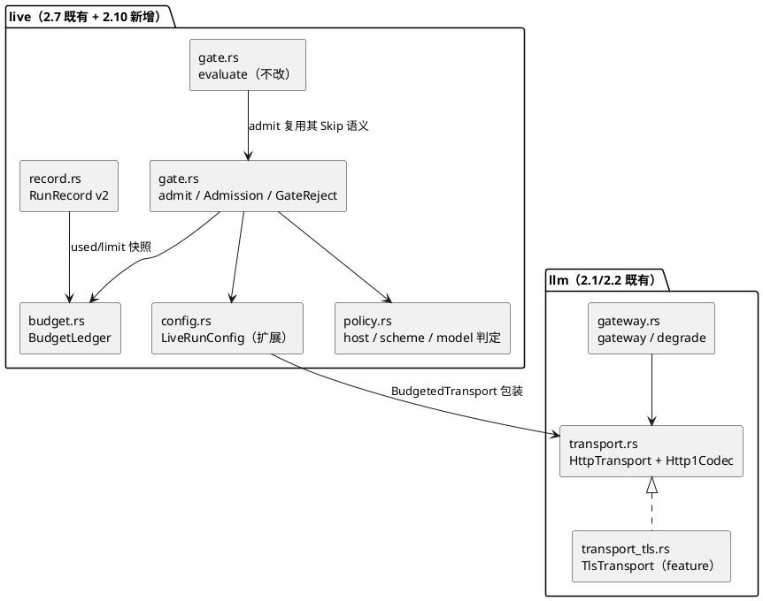

| 组件 | 职责 | 关键设计决策（理由） |
|---|---|---|
| `gate::admit` | 政策闸总入口：开关 → 端点/host → scheme → 凭据 → 模型 → 白名单 → 传输 → 预算 | 返回三值 `Admission`，使"跳过"与"拒绝"在类型层可分（2.10.4） |
| `live::policy` | 纯函数：host 精确集合判定、scheme 判定、模型逐字节比对 | 纯函数 + `EnvView` 注入，断网可判定、连续 3 次一致（SPEC 8.2-4） |
| `live::budget` | 原子调用计数与许可发放 | 计数点唯一（`send`/`open_stream` 前），把"含重试"的口径变成结构性保证（AC-31） |
| `config::LiveRunConfig` | 唯一的凭据读点；上限与路径校验 | 拒绝路径不进入此类型，故"拒绝 = 零凭据读取"由类型关系保证 |
| `transport_tls` | 系统 TLS 传输 | 复用 `Http1Codec`，协议只有一份实现（2.11.4） |

**依赖方向（强制）**：`gate → policy`、`gate → budget`、`gate → config`；`policy` 与 `budget` **不依赖** `transport` / `gateway` / `record`；`gateway.rs` 不引用 `live` 任何符号（2.6.2 的零分支约束继续有效）。

### 2.10.4 判定顺序（固定 11 步）

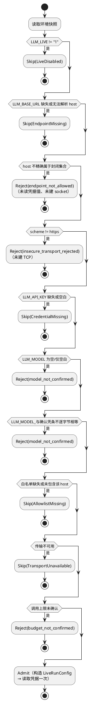

| 序 | 判定 | 结果 | 是否读取凭据值 | 是否可能建 socket |
|---|---|---|---|---|
| 1 | 开关严格 `"1"` | `Skip(LiveDisabled)` | 否 | 否 |
| 2 | 端点存在且可解析 host | `Skip(EndpointMissing)` | 否 | 否 |
| 3 | host 精确集合（AC-28） | `Reject(EndpointNotAllowed)` | **否** | 否 |
| 4 | scheme = https（AC-30） | `Reject(InsecureTransportRejected)` | **否** | 否 |
| 5 | 凭据非空 | `Skip(CredentialMissing)` | 否（仅判空） | 否 |
| 6 | 模型非空 | `Reject(ModelNotConfirmed)` | 否 | 否 |
| 7 | 模型 = 确认值（AC-29） | `Reject(ModelNotConfirmed)` | 否 | 否 |
| 8 | 白名单命中 | `Skip(AllowlistMissing)` | 否 | 否 |
| 9 | 传输可用 | `Skip(TransportUnavailable)` | 否 | 否 |
| 10 | 预算已确认（AC-31） | `Reject(BudgetNotConfirmed)` | 否 | 否 |
| 11 | 全部通过 | `Admit` | **是（唯一一次）** | 后续才可能 |

> **v1.3 口径补充（不改上表顺序）**：第 8 步"白名单命中"仍保留为 `Skip(AllowlistMissing)`，因为它承载 AC-19 的既有跳过语义；但该步**只判 `LLM_ALLOWLIST` 是否存在**，其取值不参与第 3 步的 host 集合，也不参与任何二次放行（AC-37，详见 2.18.2）。第 3 步的集合唯一来源是 `DEEPSEEK_HOSTS`。

**三条必须记录的设计决策**

1. **为什么 host 与 scheme 前置到凭据检查之前**
   AC-28/AC-30 要求"判定发生在 socket 创建与凭据读取之前"。若沿用 2.7.2 的顺序（凭据先于端点），则拒绝路径上必然已对 `LLM_API_KEY` 取值。
   本设计的顺序把"端点存在性 → host → scheme"整体前置到凭据之前，并**只在第 5 步判凭据是否存在（不读取值）**。因此拒绝路径上既无 socket、也无任何凭据值进入内存对象。

2. **为什么 `evaluate` 不改**
   2.7.2 的 `evaluate` 是 AC-19 的判定载体（既有 3 个内联用例 + 6 个 `SkipReason` 断言）。改动其顺序会让"凭据缺失优先于端点缺失"的既有断言失败，触碰 AC-17 的"测试数量不减少 + 全绿"。
   因此：`evaluate` **保留为 AC-19 的判定函数**；`admit` 是阶段 C 的入场函数，二者共存但职责分离（2.10.10 给出对照表）。

3. **"凭据读取"的可判定定义**
   本设计把"凭据读取"定义为**凭据值进入内存对象**：`SecretString::new(..)` 的构造次数 + `SecretString::expose()` 的调用次数。`EnvView::get("LLM_API_KEY")` 的**存在性判空不计入**，理由有二：
   (a) 判空只产生 `bool`，不产生可泄漏的凭据值，也不进入日志/审计/记录；
   (b) 若把判空也计入，则与 AC-19"凭据缺失即跳过"的判定要求直接冲突（必须先取到值才能判空）。
   该口径由 `tests/llm_live_gate.rs` 的 `CountingEnv` + `SecretString` 构造探针断言为 `0`（AC-28/AC-30 用例）。
   > **待用户确认（M6）**：若要求"连 `EnvView::get("LLM_API_KEY")` 调用次数也为 0"，则必须把 host/scheme 判定移到 `evaluate` 的第 2 步之前，会改变 AC-19 的既有顺序断言。本设计**不采用**该口径。

### 2.10.5 AC-28：host 精确锁定

**封闭集合**：只读常量表 `DEEPSEEK_HOSTS`（`live/policy.rs:6`），当前仅含单一官方 API host（具体值只在该常量中，本节不重复字面量）。**`LLM_ALLOWLIST` 不参与集合构造**（v1.3 按 C4 / AC-37 修正，详见 2.18）：该变量只用于 `admit` 第 8 步的"是否存在"检查，取值内容不进入允许集合，也不进入任何 `host_is_locked(..)` 调用的第二个参数。

**判定算法（纯函数，无 I/O）**

1. 从 `LLM_BASE_URL` 中解析出 authority 部分（`scheme://` 之后、第一个 `/`/`?`/`#` 之前）。
2. 若 authority 含 `@`（userinfo）→ 直接 `Reject(EndpointNotAllowed)`（防止凭据入 URL，SPEC 11.4-1）。
3. 若 authority 的端口存在且 `!= 443` → `Reject(EndpointNotAllowed)`（fail-closed：不允许明文端口或代理端口；此为本设计的保守决策）。
4. 取 host 后做**唯一**的归一化：`to_ascii_lowercase()`（DNS 名大小写不敏感）。
5. 与集合逐项比较：`host == allowed`（**逐字节相等**，不做前缀/后缀/子域/通配/正则）。
6. 不做尾随点（`example.com.`）去除、不做 punycode/IDN 转换、不做 IP 字面量放行 → 上述形态一律 `Reject`。

**必须拒绝的形态（AC-28 用例矩阵）**

| 形态 | 示例（占位，非真实可用端点） | 判定 | 原因 |
|---|---|---|---|
| 同域，无路径 | `https://<host>` | 允许（若 host 在集合内） | host 精确相等 |
| 同域，含路径 | `https://<host>/<path>` | 允许 | 路径不属于 AC-28 判定面（由 C1 决定） |
| 同域作子域 | `https://x.<host>` | 拒绝 | 前缀不是 host 的一部分，但 DNS 上是不同主机 |
| 同域作后缀拼接 | `https://<host>.<other>` | 拒绝 | 后缀拼接 |
| 同域作前缀拼接 | `https://<prefix><host>` | 拒绝 | 前缀拼接 |
| 国别域变体 | 形如 `<host>.cc` / `<host>.cn` | 拒绝 | 不同注册域 |
| 相似拼写 | 单字符增删/替换 | 拒绝 | 不是同一字符串 |
| 其它域名 | 任意非 DeepSeek 域名 | 拒绝 | 不在封闭集合 |
| userinfo | `https://user:pass@<host>` | 拒绝 | 凭据入 URL |
| 非 443 端口 | `https://<host>:8443` | 拒绝 | 保守决策（需用户确认，见 M7） |
| 尾随点 | `https://<host>.` | 拒绝 | 不做 FQDN 归一化（保守） |

> **关键实现约束**：**禁止复用 `DomainPattern::matches`**。该实现的非通配分支是"相等**或后缀匹配**"（`crates/domain/src/model/provider.rs:110-116`：`domain == self.0 || domain.ends_with(".{self.0}")`），会把 `evil.api.deepseek.com` 判为允许，直接违反 AC-28。2.10.5 的判定必须使用独立的 `host_is_locked` 精确比较函数（`live/policy.rs`），不复用该 pattern 语义。

**代码位置建议**：`live/policy.rs` 提供 `host_is_locked(raw_url: &str, allowed: &[&str]) -> HostVerdict`；`live/gate.rs::admit` 在第 3 步调用它。`config.rs::host_from_url`（`live/config.rs:54-61`）可复用其解析结果，但**必须补 scheme 与 userinfo/端口判定**，且不得把"含路径的完整 URL"写入任何记录。

### 2.10.6 AC-29：模型名显式且已确认

**确认凭条的机制（设计决策，需用户确认 M6）**

| 变量 | 作用 | 是否进入请求 | 是否进入记录 |
|---|---|---|---|
| `LLM_MODEL` | **唯一**的模型配置入口，实际用于请求体 | 是 | 是（运行值） |
| `LLM_MODEL_CONFIRMED` | 用户对"本次将使用的模型名"的**书面确认凭条**；值必须与 `LLM_MODEL` 逐字节相同 | **否** | **否** |

说明：`LLM_MODEL_CONFIRMED` **不是第二个模型入口**，它不参与请求构造、不进入记录、不被 `LiveRunConfig` 保存；仅在 `admit` 的第 7 步用于比对。这样既满足"必须显式且已确认"，又不违反 SPEC 4.5-1"模型名不得写死"与 11.3.2-2"`LLM_MODEL` 是唯一入口"。

**被否决的备选方案**

| 方案 | 结论 | 理由 |
|---|---|---|
| 把确认值写成编译期常量 | 否决 | 等于把模型名写死在代码里，违反 SPEC 4.5-1；且 C2 一变就要改代码 |
| 把候选表当默认值/回退链 | 否决 | SPEC 11.9.2-2 明确禁止候选自动回退与探测 |
| 运行时调 `/models` 自动挑选 | 否决 | 放大调用数与费用、掩盖配置错误；且 `HttpMethod` 仅 POST，不实现 GET 探测 |
| 只用一个变量（无法表达"已确认"） | 否决 | 无法区分"用户随手填的模型名"与"用户确认过的模型名" |

**比对规则**

1. 逐字节比较（`as_bytes() == as_bytes()`）：**不做** trim、大小写归一化、空格折叠。
2. 为空/仅空白 → `Reject(ModelNotConfirmed)`（SPEC 11.9.2-1 明确要求，优先于 11.4-2 的"模型缺失即跳过"；该收窄登记为 M6）。
3. 确认凭条缺失 → `Reject(ModelNotConfirmed)`（等同"未确认"）。
4. 比对通过后，`LiveRunConfig.model` 取 `LLM_MODEL` 的运行值；记录中的 `model` 字段也取该值，**不得**取确认凭条或任何候选。

**候选标注检查（AC-29 后半句；v1.3 重定义）**

C2 已确认为"运行期唯一取值、值不落仓库"，原 11.9.2 候选表**整体作废**。因此"逐候选检查是否标注待确认"的旧口径失效：现在不存在任何候选，也就不存在"未标注的候选行"。旧脚本 `scripts/check-model-candidates.sh` 依赖定位 11.9.2 小节，在该小节被移除后恒返回 `2`（不可判定）。

v1.3 把该脚本重定义为**"零模型字面量 + 零默认/回退模型值"**检查（判定对象、命令与退出码见 2.18.5）。本节只登记"旧口径已被取代"，不再描述旧的两步检查。

> 本设计文档**不出现**任何模型名字面量，也不引用任何候选值；这是"模型值不落仓库"的文档侧落地。

### 2.10.7 AC-30：HTTPS 强制与既有 `secure` 检查的关系

**两层防线（缺一不可）**

| 层 | 位置 | 触发条件 | 结果 | 保证 |
|---|---|---|---|---|
| 第一层（政策闸） | `live/gate.rs::admit` 第 4 步 | `LLM_BASE_URL` 以 `http://` 开头 | `Reject(InsecureTransportRejected)` | 不构造传输、不建 TCP、不解析 DNS |
| 第二层（传输自保） | `transport.rs::LoopbackTransport::connect`（`transport.rs:265-273`） | `HttpRequest.secure == true` 却交给**回环**传输 | `TransportError::TlsFailure` | 防止"配置说 HTTPS、实际走回环明文" |
| 第二层的对称面（v1.2 新增） | `transport_tls.rs::TlsTransport::connect` | `HttpRequest.secure == false` 却交给 **TLS** 传输 | `TransportError::TlsFailure` | 防止"配置回退为明文" |

- 既有的 `LoopbackTransport` 检查（`request.secure → TlsFailure`）**保留不动**，语义是"回环传输不承载 TLS"。
- 新增的 `TlsTransport` 做**反向对称**检查：只接受 `secure == true`，拒绝 `secure == false`。两者合起来构成"方向不可混淆"。
- `HttpRequest::json_post` 目前固定 `secure: false`（`transport.rs:50-66`）。v1.2 新增 `json_post_secure(..)` 构造器（或在联调装配处显式置 `secure=true`），**不修改** `json_post` 的既有行为，避免影响 mock 用例。
- AC-30 的"`https://` 仅放行为允许发起"：`admit` 对 `https://` 不做任何连通性判断，也不做 DNS 解析；连通性归阶段 C。

**明确禁止**：不得"先连再看"（先建 TCP 再判断 scheme）、不得"HTTP 失败后自动升 HTTPS 重试"、不得跟随 3xx（重定向可能绕过 host 集合，沿用 2.1.3(10)）。

### 2.10.8 AC-31：费用预算上限

**唯一计数点**

```text
BudgetLedger { used: AtomicU64, limit: u64 }
  try_acquire() -> Result<Permit, BudgetExhausted>   // used+1 前先比较 limit
```

- 计数点在 `BudgetedTransport`（`Arc<dyn HttpTransport>` 的装饰器）的 `send` / `open_stream` **入口**，即"每发出一次实际 HTTP 请求"计 1 次。
- 超时重试、429 退避重试、结构违规修复重试**全部**经过同一点，因此天然计入（AC-31"含重试"的口径变成结构性保证，而非事后统计）。
- 一次请求无论成功/失败/超时都计 1 次（`Permit` 不回收），避免"失败不计费"的错误口径。

**上限公式**

```text
limit = min(samples_per_task × 3 × 4, LLM_LIVE_CALL_CAP)
```

- `samples_per_task` 默认 30 → 理论上限 360（SPEC 11.9.4-3）。
- `LLM_LIVE_CALL_CAP` 是**用户确认的单次运行调用上限**；缺失/非数字/为 0 → `Reject(BudgetNotConfirmed)`，真实调用数 = 0。
- 并发只影响吞吐：`admit` 强制 `concurrency = 1`（2.6.3-3），故不存在"并发绕过上限"的路径。

**触顶语义**

| 项 | 规则 | 追溯 |
|---|---|---|
| 触顶信号 | `TransportError::BudgetExhausted`（新增变体，基础设施内部 SPI） | 2.10.9 |
| 分类 | `degrade::classify` 返回 `None`（与 `Cancelled` 同类：**非外部故障**，不进入六类失败分布） | AC-22 口径不被污染 |
| 降级原因 | `DegradeCause::BudgetExhausted`（新增变体，与既有 `QueueTimeout` / `PayloadTooLarge` 同类） | SPEC 5.3.1-1 的六类封闭不被破坏 |
| 结果形态 | `degraded=true`、`failure=None`、`body` 为同类型规则兜底 | SPEC 5.4.1-2 |
| 停止条件 | 触顶后不再发起新请求；采样循环立即结束并写 `budget_exhausted` 事件 | AC-31 |
| 样本保留 | 已写入 `samples.jsonl` 的样本**不删除、不改写**；触顶时追加一条"非样本"事件记录 `used/limit` | SPEC 11.9.4-3 |
| 冷却计数 | 触顶**不**累加端点失败计数（不是端点故障） | SPEC 4.2-2 不被污染 |

**对既有网关的最小改动（受控扩展）**

1. `TransportError` 新增 `BudgetExhausted`（`transport.rs`）；`degrade.rs::classify` 增加一条 `=> None` 分支；既有 8 条映射不变。
2. `gateway.rs` 的两处 `Err(error)`（一次性 `:452-454`、流式 `:567-569`）在 `classify(...).unwrap_or(...)` 之前增加一次相等判定：`if error == BudgetExhausted` → 以 `DegradeCause::BudgetExhausted` 构造降级结果。
3. 该判定对**所有**传输实现一致，不含任何"是否联调"的信息，因此 2.6.2 的"网关对 live 零感知"仍然成立。
4. `DegradeCause` 在领域层新增 `BudgetExhausted`（文件 #23）。影响面：所有对 `DegradeCause` 做穷尽 `match` 的位置必须补一个分支（`gateway.rs` 的降级结果构造、`metrics` 的维度映射）；**既有断言不删不改**，只新增"该变体不进入六类失败分布"的断言。`FailureClass` 仍严格六值，AC-22 的"六类 + 未归类"口径不受影响。

### 2.10.9 接口清单（`live/gate.rs` + `live/policy.rs` + `live/budget.rs`）

```rust
/// 政策闸的拒绝标识：封闭枚举，code() 与 AC 判定符号一一对应。
pub enum GateReject {
    EndpointNotAllowed,
    ModelNotConfirmed,
    InsecureTransportRejected,
    BudgetNotConfirmed,
    BudgetExhausted,
}

impl GateReject {
    pub const fn code(self) -> &'static str;   // "endpoint_not_allowed" 等
    pub fn to_error(self) -> CopilotError;      // 统一 ProviderConfigInvalid（E-PROVIDER-009）
}

/// 入场结果：Skip（未开启/缺项）与 Reject（政策不允许）在类型层可分。
pub enum Admission {
    Admit(AdmissionTicket),      // 仅此分支可构造 LiveRunConfig
    Skip(SkipReason),            // 复用 2.7.2 的六值枚举
    Reject(GateReject),
}

/// 准入票据：不含凭据，仅承载已校验的 host/scheme/上限。
pub struct AdmissionTicket {
    pub endpoint_host: String,
    pub scheme: Scheme,          // 仅 Https
    pub call_limit: u64,
}

/// 纯函数：无 I/O、无 panic；顺序固定为 2.10.4 的 11 步。
pub fn admit(env: &dyn EnvView, transport_available: bool) -> Admission;

/// host 精确锁定（不复用 DomainPattern::matches）。
pub enum HostVerdict { Allowed, NotAllowed }
pub fn host_is_locked(raw_url: &str, allowed: &[&str]) -> HostVerdict;

/// 模型逐字节确认。
pub fn model_confirmed(actual: &str, confirmed: Option<&str>) -> bool;

/// 预算账本：并发安全，唯一计数点。
pub struct BudgetLedger { /* used: AtomicU64, limit: u64 */ }
impl BudgetLedger {
    pub fn new(limit: u64) -> Self;
    pub fn try_acquire(&self) -> Result<Permit, GateReject>;  // 触顶 → BudgetExhausted
    pub fn used(&self) -> u64;
    pub fn limit(&self) -> u64;
}
pub struct Permit { /* 不回收；drop 只用于释放装饰器借用 */ }
```

- **前置条件**：`admit` 必须在任何 `HttpTransport` 构造、任何 `std::net` 调用、任何 `SecretString` 构造之前调用。
- **后置条件**：`Admission::Reject` / `Admission::Skip` 时，调用方不得构造传输、不得创建 socket、不得写任何数值。
- **异常映射**：`admit` 不返回 `Result`（判定本身不允许失败）；配置解析类错误（如 C1 路径缺失）由 `LiveRunConfig::try_new` 返回 `E-PROVIDER-009`。
- **调用示例（阶段 C 入口，无实现代码）**：

```rust
let env = ProcessEnv::snapshot();
match live::admit(&env, cfg!(feature = "llm-https")) {
    Admission::Skip(reason) => { println!("未实测（{}） code={}", reason.label(), reason.code()); return; }
    Admission::Reject(reject) => { println!("拒绝 code={}", reject.code()); return; }
    Admission::Admit(ticket) => { /* 仅此分支构造 LiveRunConfig 与传输 */ }
}
```

### 2.10.10 与 2.7 运行门的关系（共存，不互相替代）

| 维度 | `evaluate`（2.7.2，保留） | `admit`（2.10，新增） |
|---|---|---|
| 判定内容 | 开关、凭据非空、端点非空、模型非空、白名单非空、传输可用 | 上述全部 + host 集合、scheme、模型确认、预算确认 |
| 返回值 | `LiveDecision::{Run, Skip}` | `Admission::{Admit, Skip, Reject}` |
| 承载的 AC | AC-19（跳过语义，用例零改动） | AC-28~AC-31 |
| 端点判定粒度 | 只判"非空" | 判 host 精确集合 + scheme |
| 凭据读取 | 只判存在性 | 同样只判存在性；值读取只在 `Admit` 分支 |
| 阶段 C 使用 | 不再作为入口（保留被既有用例调用） | **唯一入口** |

> **不合并的理由**：合并会改变 AC-19 已冻结的判定顺序与六个 `SkipReason` 断言（AC-17 的"测试不减且全绿"）；共存则让"未开启/缺项"与"政策不允许"在语义上分离，便于 AC-19 与 AC-28~AC-32 分别判定。
## 2.11 TLS 传输实现（`llm-https`）

> 定位：2.8 已给出"三层门 + 协议复用"的骨架，但 Phase B 被许可门挂起。v1.2 依据 SPEC 11.9.3 把许可门降级为"登记即可（个人项目）"，因此本节把 `transport_https.rs` 的**实现结构**与**离线可判定性**补齐。本节仍不写实现代码，只给依赖边界、模块结构、错误映射与测试方案。

### 2.11.1 依赖与许可边界

| 项 | 结论 | 依据 |
|---|---|---|
| 运行时 TLS 实现 | `native-tls` 0.2.x（系统 TLS） | SPEC 11.9.3-2：最低 TLS 1.2、系统信任根、SNI=host、禁止跳过校验 |
| 平台后端 | Windows → SChannel；macOS → Security.framework | SPEC 11.9.3-3：不额外打包 OpenSSL |
| 许可类别 | MIT / Apache-2.0（已在 `deny.toml:9-27` 的 allow 列表） | SPEC 11.9.3-4：许可红线不豁免 |
| 登记要求 | `docs/compliance/license-review.md` 三项：许可结论、系统 TLS 依赖边界、个人自用说明 | SPEC 11.9.3-3 |
| 不打包的组件 | OpenSSL、ring、自研密码学 | SPEC 11.9.3-3；2.8.4 的否决记录继续有效 |
| 备选方案 | `rustls + ring` 仅在"目标平台系统 TLS 不可用"时评估，本轮不实施 | 2.8.4、2.5.2 的 v1.2 修订 |
| 测试证书 | **不引入**任何证书/私钥夹具 | 私钥块会被 `scripts/scan-secrets.sh:31` 命中，破坏 AC-16 |

**个人项目口径的边界（不可豁免项复述）**：免的是"安全 + 法务双签流程"，不免的是①许可类别红线（GPL/AGPL/SSPL 仍禁止）②`cargo deny check licenses bans sources advisories` 必须通过（AC-17）③"不打包 OpenSSL/ring"的交付边界（否则与 2.11.1 的登记内容不符）。

### 2.11.2 Cargo 结构与 feature

```toml
[features]
# 默认关闭；仅显式 --features llm-https 时才把 TLS 纳入依赖闭包。
llm-https = ["dep:native-tls"]

[target.'cfg(windows)'.dependencies]
native-tls = { version = "0.2", optional = true }

[target.'cfg(target_os = "macos")'.dependencies]
native-tls = { version = "0.2", optional = true }
```

| 平台 | 启用 `llm-https` 的预期 | 说明 |
|---|---|---|
| Windows | 成功；链接 SChannel | 主开发平台 |
| macOS | 成功；链接 Security.framework | 本轮不要求 macOS 设备验收（SPEC 7.2-7） |
| Linux | **构建失败**（`native-tls` 未在该 target 声明） | 有意的 fail-closed：Linux 的 `native-tls` 默认走 OpenSSL，会破坏"不打包 OpenSSL"的边界 |

- 未启用 feature 时：`transport_tls.rs` 不参与编译、`dep:native-tls` 不进入依赖闭包、**不下载任何 TLS 包**，`cargo test --workspace` 与 v1.1 完全一致（AC-17）。
- 空 feature（当前 `llm-https = []`，`crates/infrastructure/Cargo.toml:16`）的"防 `unexpected_cfgs` 告警"作用由新 feature 继续承担（`clippy -D warnings` 不回归）。

### 2.11.3 代码结构与模块树

```text
crates/infrastructure/src/llm/
├── transport.rs          # 既有：HttpTransport / StreamReader / Http1Codec / 回环 / 超时循环
├── transport_tls.rs      # 新增：TlsTransport（#[cfg(feature = "llm-https")]）
└── live/
    └── budget.rs         # 新增：BudgetedTransport（与 feature 无关，默认编译）
```

| 组件 | 是否 feature 门控 | 职责 |
|---|---|---|
| `Http1Codec` | 否 | 请求编码、响应解析、chunked/定长、超长与不完整判定（`transport.rs:145-245`） |
| `LoopbackTransport` | 否 | 回环 socket（mock 与离线用例） |
| `BudgetedTransport` | 否 | 预算计数与 `BudgetExhausted` 短路；对任意 `HttpTransport` 生效 |
| `TlsTransport` | **是** | `TcpStream` → 系统 TLS 握手 → 复用 codec 与既有读写循环 |
| `TlsStreamReader` | **是** | `StreamReader` 实现，逐块读取并复查 deadline/cancel |
| `TimedIo`（内部 trait） | 否 | 把"设置读超时"从 `TcpStream` 抽象出来；`TcpStream` 与 `TlsStream<TcpStream>` 各实现一次 |

**为什么新建 `transport_tls.rs` 而不是在 `transport.rs` 内 `#[cfg]`**：
1. `transport.rs` 已达 698 行，且被 4 个测试目标共用；把 TLS 塞进去会让"默认构建不编译 TLS"的边界变得难以审计。
2. 独立文件便于在 `check-layering.sh` 与代码审阅中一眼确认"TLS 只在 feature 下存在"。
3. 复用点通过 `pub(crate)` 可见性共享，不产生产物分叉。

### 2.11.4 与既有 `HttpTransport` / `Http1Codec` 的复用关系

| 环节 | 回环（既有） | TLS（新增） | 是否同一份实现 |
|---|---|---|---|
| 请求编码 | `Http1Codec::encode` | `Http1Codec::encode` | **是** |
| 响应解析 | `Http1Codec::parse_response` | `Http1Codec::parse_response` | **是** |
| 分块/定长体 | codec 内部 | codec 内部 | **是** |
| 写请求体 | `write_all_budgeted` | 同函数（泛化后） | **是** |
| 读完整体 | `read_all_budgeted` | 同函数（泛化后） | **是** |
| 逐行读头 | `read_until_headers` | 同函数（泛化后） | **是** |
| 读超时设置 | `set_timeout(&TcpStream, ..)` | `TimedIo::set_timeout`（TLS → 底层 `TcpStream`） | 语义同一，实现各一 |
| 错误映射 | `TransportError` | `TransportError`（新增 `BudgetExhausted` 与既有变体） | **是** |
| 重定向/代理 | 不跟随、不读代理 | 同 | **是**（策略在装配层，不在传输层） |

**关键点**：`Http1Codec` 与读写循环的泛化必须保持"只处理字节"的性质，使 `codec_contract` 一组用例继续在内存 buffer 上判定协议行为；TLS 只改变"字节从哪来"（与 2.8.2 的结论一致）。

### 2.11.5 握手、超时与错误映射

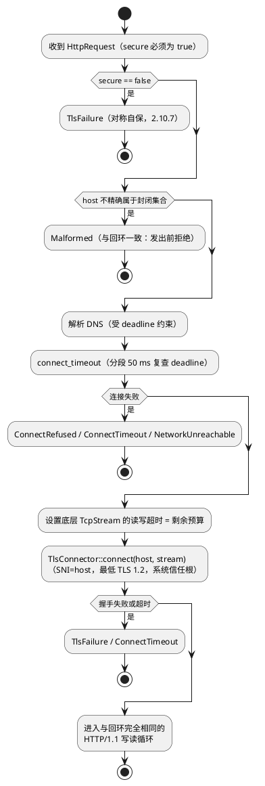

| 真实路径错误 | `TransportError` | `FailureClass`（经 2.1.3(3)） |
|---|---|---|
| DNS 解析失败 | `DnsFailure` | `Offline` |
| 连接被拒绝 | `ConnectRefused` | `Unavailable` |
| 连接超时 / 握手超时 | `ConnectTimeout` | `Timeout` |
| 证书不受信 / 协议版本不符 / 握手失败 | `TlsFailure` | `Unavailable` |
| 读超时 | `ReadTimeout` | `Timeout` |
| 对端关闭 | `PeerClosed` | `Unavailable` |
| 响应过大 | `TooLarge` | `InvalidSchema` |
| 预算触顶 | `BudgetExhausted` | **无**（`None`，非外部故障） |

**TLS 基线断言（离线可判定）**：`TlsConnector` 的构建必须满足
1. `min_protocol_version == Some(Tlsv12)`；
2. 不调用 `danger_accept_invalid_certs` / `danger_accept_invalid_hostnames`；
3. 不设置自定义 `Certificate`/`Identity`（即使用系统信任根）；
4. SNI 参数等于已校验的 host。

这四项通过"构建函数的只读参数结构"在单元测试中断言（不需要真实握手）。

### 2.11.6 不依赖真实公网的单元测试方案

| # | 用例 | 手段 | 断言 | 需公网 |
|---|---|---|---|---|
| 1 | `tls_connector_policy_is_pinned` | 断言构建出的连接器配置结构 | 最低 TLS 1.2；无 danger 开关；无自定义 CA；SNI=host | 否 |
| 2 | `plaintext_peer_is_rejected` | 本机 `TcpListener` 回写明文 HTTP 响应 | `Err(TlsFailure)`，**且不会**把明文响应当作合法响应 | 否 |
| 3 | `garbage_peer_is_rejected` | 本机 listener 回写随机字节 | `Err(TlsFailure)` | 否 |
| 4 | `connect_refused_is_classified` | 连接 `127.0.0.1:1`（或已关闭端口） | `Err(ConnectRefused)` | 否 |
| 5 | `handshake_timeout_respects_deadline` | listener `accept` 后不发送任何字节 | `Err(ConnectTimeout)`；返回时刻不超过 deadline + 200 ms | 否 |
| 6 | `insecure_request_is_rejected_by_tls_transport` | 直接传 `secure=false` | `Err(TlsFailure)`，且 listener 收到连接数 = 0 | 否 |
| 7 | `codec_contract_is_shared` | 内存 buffer 上跑既有 codec 断言 | 与回环结果一致 | 否 |
| 8 | `real_handshake_smoke`（`#[ignore]`） | 阶段 C 真实端点 | 记录型 | **是** |

**为什么不做"自签证书接受/拒绝"用例**：需要生成证书（新增依赖 `rcgen`）或预置私钥夹具（触发 `scan-secrets.sh` 的私钥块规则）。两者都违反 2.11.1 的边界，因此"自签被拒绝"改由 #2/#3 的"非 TLS peer 必失败"间接覆盖，并由阶段 C 记录（P11）。

**mock 继续可用的保证**：`LoopbackTransport` 与 `BudgetedTransport` 均不受 feature 影响；AC-02/03/04~AC-17 的全部 mock 用例在**未启用** feature 时照常运行。`TlsTransport` 只在 `--features llm-https` 下新增用例，默认测试集不进入 TLS 代码路径。

### 2.11.7 门禁与回归影响

| 门禁 | 未启用 `llm-https` | 启用 `llm-https` | 结论 |
|---|---|---|---|
| `cargo test --workspace` | 与 v1.1 一致，既有 80 个测试不减 | 增加 TLS 离线用例（只增不减） | AC-17 |
| `cargo clippy --workspace --all-targets -- -D warnings` | 不编译 TLS 代码 | 必须零告警（`native-tls` 的错误类型需显式映射） | AC-17 |
| `bash scripts/check-layering.sh` | domain 无新增依赖 | domain 仍无 TLS | 分层不变 |
| `cargo deny check licenses bans sources advisories` | 依赖闭包不变 | 新增 `native-tls` 与平台绑定需登记并通过 | AC-17、SPEC 11.9.3-4 |
| `cargo fmt --all --check` | 通过 | 通过 | — |

**风险提示（R28）**：真实握手失败最常见的原因是系统信任根异常（企业代理 MITM、根证书过期、系统时间偏移）。本设计**不提供**任何"跳过校验"的开关；失败按 `TlsFailure → Unavailable` 记录原因码 `tls_trust_root`，交阶段 C 评估。
## 2.12 C1~C3 的 fail-closed 与单一执行入口

> 定位：SPEC 11.9.8 的 C1（端点路径）、C2（模型名）、C3（采样预算）在 v1.3 已**全部确认**（详见 SPEC 11.10.1）。本节保留 v1.2 的 fail-closed 矩阵作为"输入缺失时"的兜底口径，并标注"已确认"后的实际行为；只把"已确认 → 可判定"这一变化写清，不删除任何既有拒绝路径。

### 2.12.1 三项未确认的 fail-closed 矩阵

| 编号 | 未确认项 | 未确认时的信号 | 发生位置 | 请求数 | 记录的"未实测"原因码 |
|---|---|---|---|---|---|
| C1 | 端点路径（`host` 之后用哪个 path） | **已确认**：path 存在但 **不等于** `PATH_CONSTANT` 时，记 `path_confirmed = false` 但不阻止 `Admit`（AC-28 只锁 host）；path 缺失或仅为 `/` 时仍 `E-PROVIDER-009`（`detail = "LLM_BASE_URL: endpoint_path_unconfirmed"`） | `LiveRunConfig::try_new`（存在性）+ `admit`（常量比对） | 0（仅"缺失/仅 `/`"分支） | `endpoint_path_unconfirmed` / `path_not_confirmed` |
| C2 | API 模型名 | `model_not_confirmed` | `admit` 第 6/7 步 | 0 | `model_not_confirmed` |
| C3 | 采样预算（单次运行调用上限） | `budget_not_confirmed` | `admit` 第 10 步 | 0 | `budget_not_confirmed` |
| C4 | 其它 DeepSeek 域名 | 集合仅含 `api.deepseek.com`；其它一律 `endpoint_not_allowed` | `admit` 第 3 步 | 0 | `endpoint_not_allowed` |
| C5 | 凭据是否已轮换 | 不阻塞离线判定；记录必须带"凭据未轮换·存在既暴露风险" | 记录写入 | — | `credential_not_rotated`（声明字段，不是失败） |

**C1 的实现约束（v1.3 按 C1 / M6 / AC-34 收敛）**

1. `LLM_BASE_URL` 必须**显式包含路径**（形如 `https://<host>/<path>`），且 path 不能为空或仅为 `/`；否则 `LiveRunConfig::try_new` 返回 `endpoint_path_unconfirmed`、零请求（保留 v1.2 的 fail-closed）。
2. 路径只有**唯一基准常量** `PATH_CONSTANT = "/chat/completions"`（位置见 2.15.1）。**不**内置默认路径、**不**在缺失时自动补全、**不**按环境切换路径；该常量只是"比对基准"，不是"默认值"。
3. path 只保留在 `LiveRunConfig.endpoint`（用于构造 `HttpRequest.path`），**不进入记录**：记录的 `endpoint_host` 只写 host，`path_confirmed` 只写布尔（由 2.15.1 的纯函数计算得出），**禁止**写 path 原文、完整 URL 或查询参数。

**C2/C3 的实现约束**

1. 未确认 → 拒绝，且**不**回落到 `samples=30`、`cap=360` 的"默认值先跑"（SPEC 11.9.4-4 明确禁止）。
2. 确认动作只改变环境变量（`LLM_MODEL_CONFIRMED`、`LLM_LIVE_CALL_CAP`），**不写仓库文件、不改代码**（SPEC 11.9.8 关闭条件）。
3. 记录的 `sub_status` 必须为 `not_measured` + 对应 `reason_code`，**不得**带任何数值（沿用 2.7.4 的三态语义）。

### 2.12.2 补齐后的单一执行入口

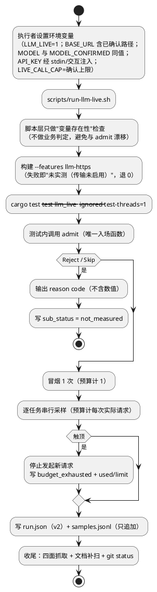

**为什么脚本层不再重复业务判定**：当前 `run-llm-live.sh:14-28` 已有一份"变量存在性 + 顺序"检查，与 `gate.rs::evaluate` 形成两份判定。v1.2 起脚本只做**存在性**前置检查（用于尽早给出人类可读提示），所有**政策判定**只在 `admit` 一处实现；脚本的提示文案与 `admit` 的 `code()` 必须一致，并在 `tests/llm_live_offline.rs` 中用同一张表断言（避免文案漂移）。

**单一入口的强制方式**：

1. `scripts/run-llm-live.sh` 是唯一对外入口；
2. `tests/llm_live.rs` 的每个用例在采样前调用 `admit`，因此即便有人直接 `cargo test --test llm_live -- --ignored`，也无法绕过政策闸；
3. `assemble_live` 只接受 `AdmissionTicket`（`live/mod.rs:29-35` 的占位签名改为"票据 + 配置"后仍不暴露无门构造路径）。

### 2.12.3 环境变量总表（v1.2）

| 变量 | 必需性 | 作用 | 未提供时 | 是否进入记录 |
|---|---|---|---|---|
| `LLM_LIVE` | 必需 | 总开关，严格 `"1"` | `Skip(LiveDisabled)` | 是（布尔） |
| `LLM_BASE_URL` | 必需 | 端点（含已确认路径） | `Skip(EndpointMissing)`；缺 path → `E-PROVIDER-009` | 仅 host + `path_confirmed` 布尔 |
| `LLM_MODEL` | 必需 | 实际模型名 | `Reject(ModelNotConfirmed)` | 是（运行值） |
| `LLM_MODEL_CONFIRMED` | 必需（v1.2 新增） | 确认凭条，须与 `LLM_MODEL` 逐字节相同 | `Reject(ModelNotConfirmed)` | **否** |
| `LLM_API_KEY` | 必需 | 凭据，只经环境变量读一次 | `Skip(CredentialMissing)` | **否（任何形态）** |
| `LLM_LIVE_CALL_CAP` | 必需（v1.2 新增） | 用户确认的单次运行调用上限 | `Reject(BudgetNotConfirmed)` | 是（数值） |
| `LLM_ALLOWLIST` | 可选 | **仅存在性检查**；取值不参与 host 集合（AC-37） | `Skip(AllowlistMissing)`（既有语义不变） | 是（只写 host，不写该变量取值） |
| `LLM_LIVE_SAMPLES` | 可选 | 每任务样本数（1..=200） | 30 | 是（数值） |
| `LLM_LIVE_DEADLINE_MS` | 可选 | 单次截止（100..=8000） | 现有默认 6000；**建议值 8000 未确认前不得写死** | 是（数值） |
| `LLM_LIVE_CONCURRENCY` | 可选 | 并发（强制 1；>1 拒绝） | 1 | 是（数值） |

> **收窄隐性配置面**：除上表外，**不读取任何** `LLM_*` 变量（沿用 2.7.3 的收窄策略）。新增两个变量（`LLM_MODEL_CONFIRMED`、`LLM_LIVE_CALL_CAP`）是为了让 C2/C3 的确认成为**可判定输入**，而不是新增模型/预算入口（2.10.6 已说明）。

### 2.12.4 记录契约 v2（只增不删）

`RunRecord` 从 `llm.live.v1` 升为 `llm.live.v2`，新增字段（既有 13 个字段与三态序列化语义不变）：

| 新增字段 | 类型 | 内容 | 脱敏要求 |
|---|---|---|---|
| `path_confirmed` | `bool` | C1 是否已确认（不写路径原文） | — |
| `call_limit` | `u64` | `min(samples×3×4, cap)` | — |
| `calls_used` | `u64` | 实际发出的 HTTP 请求数（含重试） | — |
| `budget_hit` | `bool` | 是否触顶（`budget_exhausted`） | — |
| `model_confirmed` | `bool` | 模型确认比对是否通过 | — |
| `host_locked` | `bool` | host 是否命中封闭集合 | — |
| `data_terms_declaration` | `String` | "自用；已接受服务商条款"（SPEC 11.9.6-2 的第 12 项） | 不含任何条款文本/账号信息 |
| `credential_rotated` | `bool` | 凭据是否已在服务商侧轮换（C5） | — |
| `tls_trust_root` | `Option<String>` | 握手失败时的原因码（`ok` / `tls_trust_root` / `other`） | 不含证书内容 |

**字段纪律**：`run.json` 用显式结构体写出，**不存在** `serde_json::Value` 自由字段（2.7.1-3 继续有效）；`samples.jsonl` 继续只写 `stats.rs::Sample` 的封闭字段。新增字段必须同步 `tests/llm_live_offline.rs` 的键集断言与 `scripts/llm-live-recompute.mjs`（AC-27）。

### 2.12.5 脚本层 argv 泄漏修正（AC-32 的硬要求）

当前 `scripts/run-llm-live.sh:43` 把凭据值作为 `grep` 的**命令行参数**（`grep -RIl -- "${LLM_API_KEY}" ...`），会使凭据出现在进程命令行中，直接违反 AC-32 的"进程命令行 0 命中"。

| 项 | 现状 | v1.2 修正 |
|---|---|---|
| 泄漏面 | `grep` 的 argv 含凭据值 | 改为 `grep -RIlF -f -`：模式经 **stdin** 传入，argv 只含 `-f -` |
| 断言方式 | 无命令行检查 | 收尾段抓取自身进程命令行（`ps`/`wmic`），与 stdin 提供的值比对，只输出"命中计数" |
| 输出纪律 | `grep` 命中时会打印路径（可接受）+ 可能打印内容 | 统一改为"只输出计数与 `文件:行号`"，禁止回显整行 |
| 退出码 | 恒 `exit 0` | 泄漏命中 → 非零；文档扫描面缺失 → 专用码 `2`（"不可判定"，禁止当 0） |

> 该修正是**脚本改动**（文件 #19），不涉及任何 Rust 源码；本次设计阶段只登记，不执行修改。
## 2.13 AC-28~AC-32 测试映射与六载体泄漏扫描

> 判定类别沿用 2.9.1：**O**（离线可判定，默认 CI 必绿）、**L**（需真实端点/真实凭据）、**R**（记录型：通过条件为"记录完整 + 标注准确"）。AC-28~AC-32 **全部属 O**（AC-32 的运行期抓取面另标 L），不进入 8.1 的 DoD。

### 2.13.1 判定类别与执行位置

| 类别 | 载体 | 何时执行 | 是否允许"无结论" | 与 AC-17 的关系 |
|---|---|---|---|---|
| O | `tests/llm_live_gate.rs`、`tests/llm_transport_tls.rs`（feature 下）、`scripts/scan-secrets-docs.sh`、`scripts/check-model-candidates.sh` | 每次 CI（TLS 用例仅 `--features llm-https`） | 否（必须绿） | 新增测试，只增不减 |
| L | `tests/llm_live.rs` 的四面抓取段、`scripts/run-llm-live.sh` 收尾段 | 显式执行 | 是（未就绪即如实标注） | 不进入默认执行 |
| R | `run.json` v2 的 `calls_used` / `call_limit` / `budget_hit` | 显式执行 | 是 | 不进入默认执行 |

### 2.13.2 AC-28 至 AC-32 逐条追溯

| 编号 | 载体（用例/脚本） | 断言要点 | 类别 |
|---|---|---|---|
| AC-28 | `llm_live_gate::endpoint_host_locked` | ①同域两写法（无路径 / 含路径）→ `Admit`；②子域、前缀拼接、后缀拼接、国别域变体、相似拼写、其它域名、userinfo、非 443 端口、尾随点 → `Reject(EndpointNotAllowed)`；③每个拒绝用例断言 `probe.transports_constructed == 0`、`probe.sockets_opened == 0`、`probe.credential_reads == 0` | O |
| AC-29 | `llm_live_gate::model_explicitly_confirmed`；`scripts/check-model-candidates.sh` | ①五种取值（空 / 仅空白 / 候选值未确认 / 与确认值不逐字节相同 / 完全相同）→ 前四 `Reject(ModelNotConfirmed)` + `requests == 0`，第五 `Admit`；②`spec.md` 候选行均带"待确认"；③代码/夹具/脚本中候选字面量命中 `0`；④`run.json.model` 等于运行期 `LLM_MODEL` | O |
| AC-30 | `llm_live_gate::insecure_transport_rejected`；`llm_transport_tls::insecure_request_is_rejected_by_tls_transport` | ①`http://<host>` → `Reject(InsecureTransportRejected)`，且 `probe.sockets_opened == 0`；②`https://<host>` → `Admit`（不判定连通）；③TLS 传输收到 `secure=false` → `TlsFailure` 且 listener 连接数 `0` | O |
| AC-31 | `llm_live_gate::budget_cap_enforced`；`live::budget` 内联单测 | ①`samples=30` → `limit == min(360, cap)`；②`BudgetLedger` 在 `try_acquire` 第 `limit+1` 次返回 `BudgetExhausted`；③经 `BudgetedTransport` 驱动到上限后继续提交 → 实际 `send` 次数 `== limit`；④未提供 `LLM_LIVE_CALL_CAP` → `Reject(BudgetNotConfirmed)` + 0 请求；⑤触顶后 `samples.jsonl` 未被截断（用合成样本断言行数不减少） | O |
| AC-32 | `scripts/scan-secrets-docs.sh`；`llm_live_offline` 的静态面；`run-llm-live.sh` 收尾段（L） | ①文档/代码/记录/报告面 0 命中；②输出只含 `文件:行号`，不含命中内容；③`.tmp/llm-live/**` 的 `run.json`/`samples.jsonl` 未知键 `0`；④扫描面覆盖 `*.md`（否则退出码 `2` = 不可判定）；⑤运行期日志/审计/错误/命令行四面抓取（L） | O（静态）+ L（运行期） |

**AC-28 的可观测探针设计**（离线、零 socket）：

```text
CountingEnv     : EnvView 包装，统计各变量 get 次数（用于断言"未读确认凭条"等）
CountingTransport: HttpTransport 包装，统计构造次数、send/open_stream 调用次数
CredentialProbe : SecretString 构造/expose 计数（"凭据读取"的可判定定义，2.10.4-3）
```

三个探针都是**测试替身**，只存在于 `tests/llm_live_gate.rs`（测试脚手架），不进入产物。

**AC-29 的"规格文本检查"边界**：脚本只断言"候选行含待确认"与"代码中候选字面量命中 0"，**不**校验候选本身的正确性（候选是否可用属 C2，由用户确认）。

**AC-31 的"含重试"验证方式**：`FakeTransport` 脚本化"首次超时 + 第二次成功"两次尝试，经 `BudgetedTransport` 后断言 `used == 2`；再以 `limit=1` 重跑，断言第二次尝试在传输入口被短路（`send` 实际调用次数 `1`），且网关侧拿到 `DegradeCause::BudgetExhausted`。

### 2.13.3 新增测试文件与用例清单

| 文件 | 用例（建议名） | 断言核心 | 是否默认执行 |
|---|---|---|---|
| `tests/llm_live_gate.rs` | `endpoint_host_locked` | AC-28 矩阵 + 三探针 0 值 | 是 |
| 同上 | `model_explicitly_confirmed` | AC-29 五取值 | 是 |
| 同上 | `insecure_transport_rejected` | AC-30 两 scheme | 是 |
| 同上 | `budget_cap_enforced` | AC-31 公式、触顶、缺确认 | 是 |
| 同上 | `admit_order_is_deterministic` | 11 步顺序可复现（连续 3 次一致） | 是 |
| `tests/llm_transport_tls.rs` | `tls_connector_policy_is_pinned` / `plaintext_peer_is_rejected` / `garbage_peer_is_rejected` / `connect_refused_is_classified` / `handshake_timeout_respects_deadline` / `insecure_request_is_rejected_by_tls_transport` | 2.11.6 的 #1~#7 | 否（`--features llm-https`） |
| `live::policy` 内联 | `host_is_locked_is_exact_not_suffix` | 明确断言 `evil.<host>` 不通过（防复用 `DomainPattern::matches`） | 是 |
| `live::budget` 内联 | `ledger_never_exceeds_limit` | 并发 8 线程各 100 次 `try_acquire`，成功次数恰为 `limit` | 是 |
| `scripts/scan-secrets-docs.sh` | 自检段 | 用"合成命中样例（不含真实值）"验证脚本能报出 `文件:行号` 且不回显内容 | 是（CI 执行脚本） |

**既有测试的改动边界**：`tests/llm_live_offline.rs` 只**追加**记录 v2 字段断言；`tests/llm_live.rs` 只把入口从 `evaluate` 改为 `admit`（其 8 个 `#[ignore]` 用例名与跳过语义不变）。既有 3 个 `gate.rs` 内联用例、6 个 `SkipReason` 断言、`degrade.rs` 的 8 条错误映射断言均不改。

### 2.13.4 AC-32：六载体零泄漏与补充扫描设计

**六载体矩阵**

| 载体 | 扫描对象 | 扫描手段 | 谁执行 | 0 命中的含义 |
|---|---|---|---|---|
| 文档 | 全仓库 `*.md`（含 `.codeartsdoer/specs/**`、`docs/**`） | `scan-secrets-docs.sh --all-md` | CI + 每次提交前 | 规格/设计/进度文档不含凭据或编号片段 |
| 代码 | `crates/**`、`app/src/**`、`scripts/**` | 既有 `scan-secrets.sh` + 候选字面量检查 | CI | 源码与夹具无真实凭据、无候选模型名 |
| 日志 | 运行期捕获（`LlmObserver::log` 的落点） | 四面抓取段 + 白名单字段断言（AC-15 继续） | 阶段 C | 只出现白名单字段 |
| 审计 | `AuditChain` 追加内容 | 审计 `summary` 字段白名单断言 | 阶段 C | 摘要只含编号/任务/字符数/模型/耗时/分类 |
| 记录 | `.tmp/llm-live/**/{run.json,samples.jsonl,summary.md}` | `scan-secrets-docs.sh --artifacts` + 未知键检测 | 每次联调收尾 | 记录字段封闭、无 URL/凭据 |
| 报告 | 由 `run.json` 派生的 `summary.md` 与未来 `docs/baseline/*.md` | 同"文档"面 | 每次联调收尾 + 13.4 交付前 | 报告不含凭据、不含完整 URL |

**补充扫描脚本设计（`scripts/scan-secrets-docs.sh`）**

```text
用法：
  scan-secrets-docs.sh --all-md          # 全仓库 *.md
  scan-secrets-docs.sh --artifacts DIR   # 指定记录目录（默认 .tmp/llm-live）
  scan-secrets-docs.sh --all-md --artifacts
```

| 规则 | 模式（**结构**，非真实值） | 说明 |
|---|---|---|
| 凭据完整形态 | `sk-[A-Za-z0-9_-]{16,}` | 与既有脚本 `:32` 同源，但**包含 md** |
| 凭据遮蔽形态 | `sk-[A-Za-z0-9]{1,8}(\*{2,}|…|\.{3,})[A-Za-z0-9]{1,8}` | 覆盖"前缀 + 省略号 + 末段"的截图式转录 |
| 凭据末四位 | `(\*{4,}|x{4,}|•{4,})[A-Za-z0-9]{4}` 且同行含 `key|凭据|credential` | 上下文词降低误报 |
| 编号完整形态 | `[0-9a-fA-F]{8}-[0-9a-fA-F]{4}-[0-9a-fA-F]{4}-[0-9a-fA-F]{4}-[0-9a-fA-F]{12}` 且同行含 `tracking|credential|key id|凭据编号` | Tracking ID 全量 |
| 编号片段 | `[0-9a-fA-F]{4,}` 且同行含上述上下文词 | 覆盖"4 位以上连续片段"的泄漏（SPEC 11.9.5-2） |
| 完整 URL 泄漏 | `https?://[^ \t"']+\?[^ \t"']+` | 记录/报告中不得出现查询参数（SPEC 11.5.8-2） |
| 自定义 CA / 关闭校验 | `danger_accept_invalid|--insecure|CERT_NONE` | 防止"为了跑通"关闭校验（2.11.1） |

**输出与退出码（强制）**

1. 命中时**只**输出 `文件:行号`（`grep -rnE ... | cut -d: -f1,2`），**绝不**回显命中内容、不输出上下文行。
2. 退出码：`0` = 0 命中；`1` = 命中；`2` = 扫描面缺失或不可读（"不可判定"）。**禁止**把 `2` 当 `0`。
3. 脚本**自身**不得包含任何真实凭据、编号或其片段；自检样例使用明显假值（如 `sk-test-0000`），且自检段必须验证"不回显内容"。
4. `.tmp/llm-live` 不存在的处理：`--artifacts` 在"本次未运行联调"时应视为**正常**（0 命中、退 0），但在"已声明实测却无产物"时应由 AC-27 判定记录不完整，二者不混用。

**记录与报告的额外校验**

| 校验 | 手段 | 失败含义 |
|---|---|---|
| `run.json` 键集封闭 | 与 `RunRecord` v2 的字段清单比对（脚本内维护同一份键表） | 出现未知键 → 可能夹带 URL/凭据 → AC-32 不通过 |
| `samples.jsonl` 每行键集封闭 | 与 `Sample` 字段清单比对 | 同上 |
| `summary.md` 只由 json 派生 | 断言 `summary.md` 中出现的数值均能在 `run.json` 中找到 | 手写报告可能夹带原文/URL |
| 记录中 URL 形态 | 规则表第 6 条 | 记录不得含查询参数或完整路径 |

### 2.13.5 与既有 AC 的隔离与回归约束

1. **AC-28~AC-32 不计入 8.1**；其失败只关闭真实联调路径，不改变 AC-01~AC-27 的任何判定（SPEC 8.4 首段）。
2. **默认路径零网络**：`llm_live_gate.rs` 全部零 socket；`llm_transport_tls.rs` 只连本机回环；`llm_live.rs` 仍 `#[ignore]`。
3. **默认构建零 TLS**：未启用 `llm-https` 时，依赖闭包与 v1.1 一致，`cargo test --workspace` 既有 80 个测试不减（AC-17）。
4. **判定单一来源**：政策判定只在 `admit` 一处；脚本只做存在性提示，文案与 `code()` 由同一张表断言（2.12.2）。
5. **不新增错误码**：运行门的五个判定标识（`GateReject` 枚举）与 v1.3 的四个样本标注标识（`thinking_not_disabled` / `path_not_confirmed` / `placeholder_sample_detected` / `credential_not_rotated`）均不进 `ErrorCode`；需要 `Err` 时复用 `E-PROVIDER-009`（SPEC 8.4、8.5 符号说明）。
6. **不修改权威文档**：`docs/sdd/spec.md`、`docs/sdd/design.md` 零改动（SPEC 9.3-3）。

### 2.13.6 v1.2 收口结论

| 结论项 | 内容 |
|---|---|
| 本版新增的能力 | 服务商锁定运行门（host 精确集合 / scheme / 模型确认 / 预算确认）、预算账本与触顶语义、TLS 传输（系统 TLS + 协议复用）、覆盖 `*.md` 与记录目录的补充泄漏扫描、记录契约 v2 |
| 本版新增的依赖 | 仅 `native-tls`（`llm-https` + Windows/macOS target 条件）；默认构建零增量 |
| 现在就能判定的 AC | AC-28、AC-29、AC-30、AC-31 全部；AC-32 的静态五面（文档/代码/记录/报告/脚本自检） |
| 仍需阶段 C 的 AC/项 | AC-32 的运行期四面抓取（L）；AC-20~AC-25（真实端点）；P11（真实握手与信任根） |
| 仍需用户确认的信息 | v1.3 收敛后：C1/C2/C3/C4、M6、M7 **均已确认**（见 SPEC 11.10.1）；C5 已答复"未轮换"并固定写 `credential_rotated = false`；仅余 **D-DEADLINE**（`LLM_LIVE_DEADLINE_MS` 建议值 8000 是否接受，见 2.22） |
| 不得据此宣称 | 13.1/13.2 完成、13.4 完成、AC-18 已实测、真实端点能力已验证 |
| 对既有结论的影响 | 无。AC-01~AC-27 的判定口径、载体与断言全部不变 |

**一句话边界（v1.2）**：本版把"用哪个服务商、哪个模型、走不走 HTTPS、能花多少钱"这四件事，从**口头约定**变成了**断网可判定的运行门**与**唯一计数点**；它只决定"能否开始花钱"，不证明"花得值"，也不抬高任何既有验收结论。
---

## 2.14 AC-33：真实请求体固定关闭思考模式（SPEC 11.10.2）

> 定位：本节回答"已确认的输入是否被真正使用"的第一项——真实请求体是否**固定**关闭思考模式。它不改任何既有编号，只新增 2.14.x。

### 2.14.1 现状与缺口

| 事实 | 位置 | 结论 |
|---|---|---|
| 请求体由 `build_http` 一处构造，mock 与真实共用 | `gateway.rs:81-119` | 加字段一处即可覆盖两条路径，**不需要**"真实分支" |
| 现有字段：`model` / `temperature` / `max_tokens` / `stream` / `messages` / `response_format` | `gateway.rs:93-103` | **缺** `thinking` |
| 网关对 live 零感知 | 2.6.2 | 构造器内不得出现 `live` 符号或"是否联调"判断 |

服务商默认开启思考模式时，首 token 之前先执行推理：采样温度被忽略、首 token 被推理延迟、6 s 端到端预算被击穿。因此必须**显式关闭**，不得依赖服务商默认值（SPEC 5.1.1-9、4.1-3、11.10.2-1/2）。

### 2.14.2 构造器位置与签名

**位置**：`crates/infrastructure/src/llm/gateway.rs` 的**模块级自由函数**（不是 `impl StructuredGateway` 方法）。

```rust
pub const THINKING_FIELD: &str = "thinking";
pub const THINKING_DISABLED_VALUE: &str = "disabled";

/// 纯函数：不读配置、不读环境、不做 IO；mock 与真实共用同一份规则。
pub fn request_body(
    model: &str,
    request: &LlmGenerationRequest,
    stream: bool,
) -> serde_json::Value;

/// 判定：None = 通过；Some("thinking_not_disabled") = 该样本无效。
pub fn thinking_verdict(body: &serde_json::Value) -> Option<&'static str>;
```

| 决策 | 理由 |
|---|---|
| 抽成自由函数而不是留在 `build_http` | `build_http` 的输入含 endpoint（host/port/path/secure），输出是 `HttpRequest`；用它做断言会把端点拖进测试夹具。抽出后测试只需"固定 request + 占位模型" |
| 签名不含 `thinking` 参数 | 从类型层杜绝"运行期可配开关"（SPEC 11.10.2-2）；该字段只能是固定字面量 |
| `build_http` 改为调用 `request_body(&config.model, request, stream)` | 序列化、header、`json_post` 构造全部保持原样，行为差异只有多一个字段 |
| 判定函数独立 | 让"构造正确"与"判定正确"可分别单测；反例可对正例做字段删除/改写，避免测试复制实现 |

### 2.14.3 离线断言设计（AC-33）

用例落点：`tests/llm_live_gate.rs::thinking_is_fixed_disabled`（断网、零 socket，与 AC-34/AC-37 同文件）。

| # | 用例 | 输入 | 断言 |
|---|---|---|---|
| 1 | 正例（一次性） | 固定 request，`stream = false` | `body["thinking"]["type"] == "disabled"`；`thinking_verdict` 返回 `None` |
| 2 | 正例（流式） | 固定 request，`stream = true` | 同 #1（流式与一次性共用同一字段规则） |
| 3 | 反例：缺失字段 | 对 #1 的 body 删除 `thinking` | `thinking_verdict` 返回 `Some("thinking_not_disabled")` |
| 4 | 反例：`type` 非 disabled | 对 #1 的 body 改写 `thinking.type` | 同上 |
| 5 | 反例：空对象 | `thinking = {}` | 同上 |

**反例构造纪律**：反例必须由正例 body 派生（删除/改写），**不得**另写一份请求体。否则"实现与测试同错"无法被发现。

**静态补充断言**（低成本、可脚本化）：`gateway.rs` 及其调用链中不出现除 `disabled` 之外的 `thinking.type` 取值字面量；`grep -c '"enabled"' crates/infrastructure/src/llm/gateway.rs` 必须为 `0`。

### 2.14.4 mock 路径不变

| 面 | 变化 | 约束 |
|---|---|---|
| `tests/llm_gateway_mock.rs::complete_ok` / `stream_ok` | 请求体多一个字段 | 若用例做**精确字段集**比较，改为"必需字段存在 + 允许未知字段"；**不得删除**既有断言（SPEC 11.10.2-4） |
| 判定结论 | 不变 | `thinking` 不进入 `SchemaRegistry::decode`、不参与 `degrade::classify`、不映射到 `FailureClass` |
| 其它模块 | 零改动 | `schema.rs`、`fallback.rs`、`degrade.rs` 不感知该字段 |

### 2.14.5 失败即无效的落点

| 环节 | 行为 |
|---|---|
| 采样写入前 | 以 `request_body` 生成与真实发送体**同源**的 body，调用 `thinking_verdict` |
| 判定失败 | `Sample { outcome: "thinking_not_disabled", excluded: Some("thinking_not_disabled"), first_token_ms: None }`，不写任何时延数值 |
| 记录 | 对应子项 `sub_status = not_measured` + `reason_code = "thinking_not_disabled"` |
| 错误码 | **不新增** `ErrorCode` 变体（SPEC 8.5 符号说明）；需要 `Err` 时复用 `E-PROVIDER-009` |

## 2.15 AC-34：`path_confirmed` 由常量比对计算（SPEC 11.10.4 / M6）

### 2.15.1 常量与纯函数

**位置**：`crates/infrastructure/src/llm/live/policy.rs`（与 `DEEPSEEK_HOSTS` 同属"服务商端点契约"，避免第三处定义）。

```rust
/// 唯一比对基准；只含路径段，不含 host。
pub const PATH_CONSTANT: &str = "/chat/completions";

/// 逐字节相等；不 trim、不做大小写/尾部斜杠归一化。
pub fn path_confirmed(path: &str) -> bool;
```

| 决策 | 理由 |
|---|---|
| 常量放 `policy.rs` 而非 `config.rs` | 它是"政策契约"而非 URL 解析细节；`config.rs::path_from_url` 继续只做解析（`:78-85`） |
| 只允许路径段常量 | SPEC 11.9.1-5、11.10.4-4：仓库中**禁止**host 与 path 拼接的完整 URL 字面量；host 仍只在 `DEEPSEEK_HOSTS` 中 |
| 逐字节比较 | AC-34 的"仅常量值得 true，其余四种得 false"要求不做归一化 |

### 2.15.2 五取值矩阵（AC-34 判定面）

| 注入 path | `path_confirmed(path)` | `LiveRunConfig::try_new` |
|---|---|---|
| `/chat/completions` | `true` | `Ok` |
| `/` | `false` | `Err(endpoint_path_unconfirmed)`（零请求） |
| `/v1/chat/completions` | `false` | `Ok`（允许 `Admit`，记录 `false`） |
| 空 path | `false` | `Err(endpoint_path_unconfirmed)`（零请求） |
| 仅 query / fragment（解析后 path 为空） | `false` | `Err(endpoint_path_unconfirmed)`（零请求） |

**两层职责分离**：`try_new` 只判"path 是否存在"，`path_confirmed(path)` 只判"是否等于常量"。这样 AC-34 的纯函数用例不被 `try_new` 的拒绝路径干扰，`try_new` 的既有 fail-closed 也不被削弱。

### 2.15.3 票据与记录传递链路

```text
env.LLM_BASE_URL
  └─ config::path_from_url ──> endpoint_path（栈内，不落任何结构）
        └─ policy::path_confirmed(endpoint_path) ──> bool
              └─ AdmissionTicket { endpoint_host, scheme, call_limit, path_confirmed }
                    └─ assemble_live（2.16.2）
                          └─ LiveRunConfig { .., path_confirmed }   // 只传递，不重算
                                └─ RunRecord.path_confirmed          // 只取该布尔
```

| 约束 | 说明 |
|---|---|
| 单一计算点 | 只在 `admit` 计算一次；`LiveRunConfig` 与 `RunRecord` **不得**再次调用比对函数（否则出现第二基准） |
| 票据只加布尔 | `AdmissionTicket` 新增 `path_confirmed: bool`，不携带 path 原文 |
| 记录字段不变 | 沿用 v2 既有 `path_confirmed` 键，键集封闭不变（2.12.4） |
| path 原文不入记录 | 记录/日志/审计只允许 `endpoint_host` 与 `path_confirmed`；禁止 path、完整 URL、查询参数 |

### 2.15.4 禁止手写 `true`

| 面 | 判定方式 | 通过条件 |
|---|---|---|
| 生产代码 | `grep -rnE 'path_confirmed[[:space:]]*[:=][[:space:]]*true' crates/infrastructure/src` | 命中数 `0` |
| 测试夹具 | 只允许 `path_confirmed(PATH_CONSTANT)` 产生，或与函数返回值比对 | 每个命中必须能追溯到函数调用 |
| 记录 json | 只出现布尔；不出现路径段/查询串 | 2.13.4 规则表第 6 条继续有效 |

**已知需修正的夹具**：`live/record.rs` 单测（`:213`）与 `tests/llm_live_offline.rs:135` 的 `path_confirmed: true` 改为函数调用；`tests/llm_live_gate.rs:276` 的 `false` 不属禁止项，可保留。

### 2.15.5 `path_not_confirmed` 的语义

`path_not_confirmed` 是**记录一致性标识**，不是拒绝：path 存在但不等于常量时，`Admit` 仍放行（AC-28 只锁 host），但记录必须写 `path_confirmed = false`。若样本因路径不匹配而 404，按 `FailureClass` 既有映射记录（`classify_status(404) = None` → 归为 schema/响应层失败），不得把 404 写成"路径已确认"。

## 2.16 AC-35：L22 真实采样链路与非占位样本（SPEC 11.10.3）

### 2.16.1 上下文视图

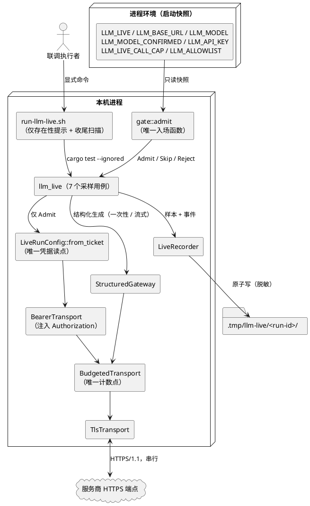

| 边界 | 方式 | 频率 | 失败影响 |
|---|---|---|---|
| `admit` → 用例 | 进程内三值返回 | 每用例 1 次 | Skip/Reject 即零外发 |
| `LiveRunConfig::from_ticket` | 进程内，读凭据 1 次 | 仅 Admit | 凭据进入 `SecretString` 后不再复制 |
| `BudgetedTransport` → `TlsTransport` | 装饰器调用 | 每次实际请求（含重试） | 触顶返回 `BudgetExhausted`，不发 socket |
| 网关 → 记录 | 结构化结果 + 样本 | 每样本 1 行 | 记录失败不静默 |

### 2.16.2 `assemble_live` 最终签名与依赖注入

**取代**现有占位签名（`live/mod.rs:38-44`）。

```rust
pub struct LiveSession {
    pub gateway: Arc<dyn StructuredLlmGateway>,
    pub ledger: Arc<BudgetLedger>,
    pub recorder: Arc<LiveRecorder>,
    pub config: Arc<LiveRunConfig>,
}

pub fn assemble_live(
    ticket: &AdmissionTicket,
    env: &dyn EnvView,
    transport: Arc<dyn HttpTransport>,
    observer: Arc<dyn LlmObserver>,
    clock: Arc<dyn Clock>,
    run_id: &str,
) -> Result<LiveSession, CopilotError>;
```

| 依赖 | 由谁提供 | 设计理由 |
|---|---|---|
| `ticket` | `admit` 唯一产出 | 类型层 fail-closed：没有 `Admit` 票据就无法构造会话 |
| `transport` | **调用点**（feature 门控处） | `assemble_live` 在默认构建下不引用 `transport_tls` → 默认零 TLS 依赖；离线测试可注入 `MockTransport` 驱动装配 |
| `observer` / `clock` | 调用点 | 与既有网关装配一致；测试可注入假时钟驱动超时与首 token 计时 |
| `run_id` | 调用点 | 交给 `LiveRecorder::new` 做路径片段校验（`record.rs:108-120`） |

**内部固定装配顺序**（顺序本身是安全设计）：

```text
LiveRunConfig::from_ticket(env, ticket, overrides)      // 唯一凭据读点
  → BearerTransport::new(transport, config.secret)      // 注入 Authorization
    → BudgetedTransport::new(authed, Arc::new(BudgetLedger::new(ticket.call_limit)))
      → StructuredGateway::new(RwLock::new(LlmConfig::from_session(&config, ticket)), ..)
        → LiveRecorder::new(run_id)
```

| 决策 | 理由 |
|---|---|
| 预算装饰器在 **Bearer 外层** | 触顶时连 header 都不构造、凭据 `expose()` 次数为 0；计数点仍是"每次实际请求" |
| `LlmConfig` 由会话派生 | `endpoint` = 运行期 URL（含 path）；`model` = 运行期模型；`domain_allowlist` = 票据的单一精确 host；`request_timeout_ms` = 会话 deadline；`max_concurrency = 1`；`credential_ref` 只放引用名，**不落值** |
| 调用方拿不到裸 transport | `LiveSession` 只暴露 gateway 与 ledger，调用方无法绕过预算直接 `send` |
| 默认构建可编译 | `assemble_live` 的签名只依赖 `HttpTransport` trait，不依赖任何 feature |

**装配层已知偏差（D-1）**：`LlmConfig::validate` 用 `DomainPattern::matches`（后缀语义，`provider.rs:110-116`），会接受子域。由于请求 host 来自 `admit` 的**精确**票据，装配层只作二次防线；**不得**用装配层替代 AC-28 判定，也不修改 domain 层既有断言。

### 2.16.3 凭据注入（v1.3 补齐的前置缺口）

**现状缺口**：`gateway::build_http` 只写 `Content-Type` / `Accept`，不写 `Authorization`（网关不持有凭据）；`TlsTransport` 也不注入。真实请求必然因未授权失败，AC-35 无法产出真实样本。

**设计**：新增 `live/auth.rs`（默认构建，与 feature 无关）。

```rust
pub struct BearerTransport {
    inner: Arc<dyn HttpTransport>,
    secret: SecretString,
}

impl HttpTransport for BearerTransport { /* send / open_stream 构造带 Authorization 的请求副本 */ }
```

| 约束 | 说明 |
|---|---|
| 凭据只在请求时 `expose()` | 每次实际发送 expose 一次；拒绝路径不进入此组件 |
| 不进入日志/记录/审计 | `HttpRequest` 的 `Debug` 已遮蔽 authorization（`transport.rs:78-100`）；错误信息只含分类 |
| 不实现 `Serialize` / `Display` | 沿用 `SecretString`（`config.rs:21-47`）的掩码语义 |
| 不改变既有契约 | 纯装配层装饰器；`gateway.rs` 与 `transport.rs` 零改动 |

### 2.16.4 7 个 `#[ignore]` 用例的真实职责

| # | 用例 | 采样方式 | 写入 | 判定要点 |
|---|---|---|---|---|
| 1 | `first_token_latency_p50_p95` | 流式，逐任务 | `Sample { first_token_ms, total_ms }` | 只有 `first_token_ms.is_some()` 的样本进入首 token 时延分母 |
| 2 | `total_latency_four_tasks` | 一次性 × 4 任务 | `Sample { total_ms }` | 四任务各 ≥1 条真实样本 |
| 3 | `schema_conformance_rate` | 一次性 + decode | `Sample { outcome, failure_class }` | 违规记 `InvalidSchema`，计入分母、不计入原生成功率分子 |
| 4 | `rate_limit_observation` | 采样窗口内观察 | `Sample { http_status, failure_class }` | 429 → `RateLimited`；未出现 → `not_triggered` + 窗口/请求数 |
| 5 | `deadline_forced_timeout` | 极小 deadline | `Sample { failure_class, excluded }` | `Timeout`；`excluded = "deadline_forced"`，排除出成功率分子 |
| 6 | `schema_violation_probe_once` | 1 次真实请求 + decode | `Sample` + 结果标注 | 未触发即 `not_triggered`，**不伪造**违规 |
| 7 | `record_is_recomputable` | 不请求 | 重算 | `summarize` 复算 p50/p95 与 `run.json` 一致；键集封闭 |

**共享采样骨架**：

| 项 | 规则 |
|---|---|
| `run_id` | 时间戳（毫秒精度）+ 熵（进程号 / 随机 / 原子计数，**进程号不是唯一来源**）；同一次运行内全部用例共享同一 `run_id`（v1.4 / AC-42，见 2.27.1） |
| `seq` | 全局单调递增，跨用例不重置（同一 `run_id` 内由运行级计数器分配；现有实现每用例写死 `1`，按 AC-42 修正） |
| `attempt` | 取 `outcome.attempts.max(1)`；保证 `attempt >= 1` |
| `total_ms` | 取单调时钟实测差（整数毫秒）；**禁止**写死为 0 或 1、禁止 `max(1)` 补齐；亚毫秒记 0 并标 `precision_insufficient`（AC-41，见 2.26.3） |
| 写入 | 样本只追加（`LiveRecorder::append_sample`）；不删改已写行 |
| 入口 | 每个用例采样前调用 `admit`；Skip/Reject → `println` 原因码后 `return` |

### 2.16.5 429 / 超时 / schema 违规的标注

| 现象 | `Sample` 字段 | `run.json` 子项 | 禁止 |
|---|---|---|---|
| 429 | `http_status = 429`、`failure_class = RateLimited` | 窗口内 ≥1 → measured；0 → `not_triggered`（附窗口与请求数） | 把 mock 的 429 结果填入真实列 |
| 超时 | `failure_class = Timeout`、`excluded = "deadline_forced"`（仅强制超时用例） | measured / not_measured 按样本 | 用整包耗时冒充首 token |
| schema 违规 | `outcome = "schema_violation"`、`failure_class = InvalidSchema` | measured（违规率） | 把降级样本算进成功率分子 |
| 预算降级 | `degraded = true`、`failure_class = None` | 分母计入、分子不计，单列"兜底次数" | 删除已取得样本 |

### 2.16.6 预算触顶与 0 请求 fail-closed

| 分支 | 传输构造 | socket | 样本 | 退出与输出 |
|---|---|---|---|---|
| `Skip(任一)` | 0 | 0 | 0 | 0；"未实测（原因码）" |
| `Reject(任一)` | 0 | 0 | 0 | 0；"拒绝 code" |
| `Admit` 后触顶 | 已构造 | 已发出的保留 | 不删改 | 0；`run.json` 写 `budget_hit = true`、`calls_used == call_limit` |

- `limit = ticket.call_limit`（= `min(samples × 12, LLM_LIVE_CALL_CAP)`，C3 口径不变）。
- `BudgetedTransport` 在 `send` / `open_stream` **入口**计数，超时/429/schema 修复重试全部经过同一点。
- 触顶后采样循环立即 `break`，不再发起任何新请求。

### 2.16.7 非占位判定（AC-35）

| # | 断言 | 手段 |
|---|---|---|
| 1 | `samples.jsonl` 行数 ≥ 1 | 读文件计行 |
| 2 | 每行 `attempt >= 1` 且 `total_ms > 0` | 逐行反序列化 `Sample` |
| 3 | `outcome` 不含占位标记（`not_measured` / `未实测` / `placeholder`） | 字符串集合比对 |
| 4 | `run.json` 为 `llm.live.v2` 且键集封闭 | 与 `record.rs` 的键表比对 |

任一不满足 → `placeholder_sample_detected`，AC-35 不通过；该判定只在**显式路径**执行，默认关闭路径只断言"0 构造 / 0 socket / 0 样本 / 退出 0"。

## 2.17 AC-36：增量 SSE 读取（SPEC 11.10.6）

### 2.17.1 现状事实（须记录）

| 位置 | 行为 | 结论 |
|---|---|---|
| `transport_tls.rs:140-151 send_tls` | 读完整个响应体才返回 `Vec<u8>` | 整包缓冲 |
| `transport_tls.rs:165-186 open_stream` | 用 `MemoryStream` 一次性交付 | **无增量** |
| `transport.rs:396-444 LoopbackStreamReader` | chunked 分支先读完整包再 `decode_chunked`（`:412-416`） | 回环路径同样整包 |

因此 AC-36 当前**不通过**；AC-20 只能标"未实测（流式读取未增量）"（4. 未补齐时的口径）。

### 2.17.2 设计：泛型增量读取器

**位置**：`transport.rs`（默认构建，不受 feature 门控）。

```rust
pub struct IncrementalBodyReader<R: Read> { /* reader, framing, buffer, first_byte_at, done, max_bytes */ }

impl<R: Read> StreamReader for IncrementalBodyReader<R> { /* next_chunk */ }
```

| 决策 | 理由 |
|---|---|
| 泛型 `R: Read`，不绑 TLS | AC-36 的离线判定只能连本机回环（无证书夹具，2.11.1）；增量逻辑与 TLS 解耦后，可在默认构建、断网、零 TLS 依赖下判定 |
| 回环与 TLS 共用同一实现 | `LoopbackStreamReader` 与 `TlsStreamReader` 都退化为"选择 `R` + 解析头"，协议只有一份 |
| 同时修正回环 chunked 分支 | 现状回环也缓冲整包；统一后 AC-03 与 AC-36 的读取语义一致 |

**复用关系**：

| 传输 | 读取器 | 是否 feature 门控 |
|---|---|---|
| 回环（mock/离线） | `IncrementalBodyReader<TcpStream>` | 否 |
| TLS（真实） | `IncrementalBodyReader<TlsStream<TcpStream>>` | 是 |

### 2.17.3 读取状态机

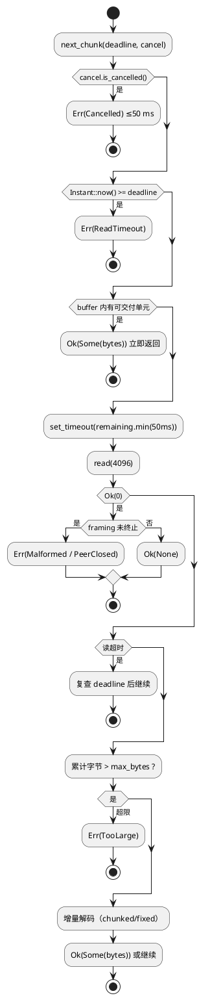

| 要点 | 设计 |
|---|---|
| 缓冲 | 只保留"尚未交付"的字节；不保留整包历史 |
| 行解析 | **仍由网关负责**（`gateway.rs:526-570` 按 `\n` 切分、`data:` 前缀、`[DONE]`、空/重复 delta 丢弃）；读取器只交付字节 |
| 首 token 计时 | 不变：gateway 在首个非空 `Delta` 时记录 `first_token_ms`（`:550-559`）；增量读取只是让该时刻更早到达 |
| 取消 | 每次 `next_chunk` 入口 + 50 ms 读超时周期复查，保证 ≤50 ms |
| 截止 | `set_timeout(remaining.min(50ms))`；超时后复查 `Instant::now() >= deadline` |
| 分块解码 | 新增 `ChunkedDecoder` 状态（`NeedMore` / `Item` / `Done`），语义与既有 `decode_chunked`（`:222-241`）一致；整包 `decode_chunked` 保留给 `parse_response` |
| 定长 | `Content-Length` → `remaining`；读到 0 → `Ok(None)` |
| 无定界 | `Ok(0)` → `Ok(None)`（HTTP/1.1 连接关闭定界） |

**为什么不在读取器内解析 SSE**：会形成第二份协议实现，破坏 2.11.4 的"只处理字节"契约，并使 AC-03 的既有断言失去判定意义。

### 2.17.4 离线可判定部分 / 真实联调部分

| 部分 | 类别 | 手段 | 断言 |
|---|---|---|---|
| 首增量 ≤200 ms | O | 本机 `TcpListener`：写 1 个 SSE 事件后 `sleep 500 ms` **不关闭** | 首个 `Delta` 在事件写入后 ≤200 ms 内产生 |
| chunked 跨块边界 | O | 分片写 chunk（半块/跨块） | 与整包 `decode_chunked` 结果一致 |
| 取消 ≤50 ms | O | 读循环中途 `cancel` | `Err(Cancelled)`，返回时刻 ≤ cancel + 50 ms |
| 截止 | O | 对端静默 + `deadline = now + 100 ms` | `Err(ReadTimeout)`，返回时刻 ≤ deadline + 200 ms |
| 超长 | O | 累计超过 `max_bytes` | `Err(TooLarge)` |
| TLS 首 token | L | 真实端点 | `first_token_ms < total_ms`，进入 AC-20 记录 |

**用例落点**：`tests/llm_stream_incremental.rs`（新增，默认构建）承载 O 部分；`tests/llm_transport_tls.rs` 只保留既有 7 个策略/错误映射用例（无证书夹具，不做真实握手）。

### 2.17.5 协议行为不变（AC-03 回归）

| 既有行为 | 归属 | 是否变化 |
|---|---|---|
| 序号递增 | gateway | 否 |
| 唯一终止（`Completed` 或 `Failed` 只一次） | gateway | 否 |
| 重复/空 delta 丢弃 | gateway | 否 |
| `[DONE]` 结束 | gateway | 否 |
| 取消 ≤50 ms | reader + gateway | 否（reader 保证检查周期） |
| 非 2xx 的首包标记 `HTTPSTATUS:` | 读取器选择器 | 否（语义与 `ImmediateStream` / `MemoryStream` 一致） |

`stream_ok` 的断言**零修改**；新增用例只追加。若读取时序变化导致抖动，只允许调整等待上限，不允许放宽语义断言（SPEC 11.10.6-5）。

### 2.17.6 门禁影响

| 门禁 | 未启用 `llm-https` | 启用 `llm-https` |
|---|---|---|
| `cargo test --workspace` | 新增增量用例（只增不减） | 同上 + TLS 既有 7 用例 |
| `clippy -D warnings` | 泛型读取器需零告警 | TLS 侧零告警 |
| 默认依赖闭包 | 不变（无新依赖） | `native-tls`（既有） |

## 2.18 AC-37：`LLM_ALLOWLIST` 语义收敛与候选脚本重定义

### 2.18.1 现状核对

| 事实 | 位置 | 结论 |
|---|---|---|
| 集合唯一常量 | `policy.rs:6` `DEEPSEEK_HOSTS` | 已是唯一来源 |
| `admit` 第 3 步只用常量 | `gate.rs:215` | 正确 |
| 第 8 步只判存在性 | `gate.rs:235-237` | 符合 AC-37 |
| `LiveRunConfig.allowlist` 保存变量取值 | `config.rs:57`、`:140-150` | **多余数据流**：字段存在即可能被误用 |
| 旧文本称"登记项参与集合" | 本文档 2.10.5 / 2.12.3 | v1.3 已修正 |

### 2.18.2 语义表（强制）

| 变量 / 常量 | 存在性检查 | 参与 host 判定 | 参与集合构造 | 进入记录 |
|---|---|---|---|---|
| `LLM_ALLOWLIST` | 是（缺失 → `Skip(AllowlistMissing)`） | **否** | **否** | 否（只写 host） |
| `DEEPSEEK_HOSTS` | — | **是（唯一）** | **是（唯一）** | 间接（`host_locked` 布尔） |

### 2.18.3 修正项

1. **移除** `LiveRunConfig.allowlist: Vec<String>` 字段（`config.rs:57`、`:140-150`），使"环境变量 → 允许集合"的数据流在结构上不存在。影响面：`try_new` 少一次解析；既有测试不读取该字段。
2. `TlsTransport::new` 已从 `DEEPSEEK_HOSTS` 派生（`:48-52`），保持；`with_allowed_hosts` 标注"仅供离线回环"，并加 `#[cfg(test)]` 或在文档中声明非生产入口，防止成为第二来源。
3. 装配 `LlmConfig.domain_allowlist` 只用 `ticket.endpoint_host` 的单一精确项；后缀语义偏差登记为 D-1（见 2.16.2），不承担 AC-28 判定。

### 2.18.4 静态断言

| 断言 | 命令（示意） | 通过条件 |
|---|---|---|
| 集合定义唯一 | `grep -rn 'DEEPSEEK_HOSTS' crates/infrastructure/src` | 定义 1 处（`policy.rs`），引用 2 处（`gate.rs`、`transport_tls.rs`） |
| 无"环境变量 → 集合"路径 | `grep -rn 'LLM_ALLOWLIST' crates/infrastructure/src` | 只在 `gate.rs`（存在性判断）与注释 |
| host 判定单点 | `grep -rn 'host_is_locked' crates/infrastructure/src` | 只被 `admit` 调用（+ 单测） |
| 环境变量不可扩集 | `llm_live_gate::allowlist_cannot_widen_hosts` | 三断言全过 |

**AC-37 用例三断言**：

| # | 输入 | 断言 |
|---|---|---|
| 1 | `LLM_ALLOWLIST` = 非官方 host | 该 host 仍 `host_is_locked == NotAllowed`；只有常量内 host 可 `Admit` |
| 2 | `LLM_ALLOWLIST` 缺失 / 空 | `DEEPSEEK_HOSTS` 判定的 host 集合不变（直接对 `host_is_locked` 断言，不经过 `admit` 的 Skip 分支） |
| 3 | 静态 | 集合唯一来源是 `DEEPSEEK_HOSTS`（上表命令） |

### 2.18.5 `check-model-candidates.sh` 重定义

**背景**：旧脚本定位 `spec.md` 的 11.9.2 候选表；该小节随 C2 收敛被移除，脚本现恒返回 `2`（不可判定）。新脚本**不再依赖规格小节**，判定目标改为"模型值不落仓库 + 无默认/回退模型值"。

**判定面（四面）**

| 面 | 规则 | 失败含义 |
|---|---|---|
| 代码：模型字段字面量 | 模型字段被赋字符串字面量，且不属于占位白名单 → 命中 | 模型值落仓库（违反 C2） |
| 代码：默认 / 回退 | 联调路径（`llm/live/**`、`gateway.rs`）出现 `unwrap_or` / `unwrap_or_else` / `||` 产出模型字面量 | 存在默认模型或回退链 |
| 文档 / 规格 | 出现"候选模型 / 默认模型 / 回退模型"与具体字面量并列的结构 | 候选被写成事实 |
| 脚本自身 | 本脚本不含任何真实模型名 | 自举失败 |

**占位白名单**：只允许通用占位标识（不含任何真实模型名），例如 `test-model`、`fake-model`、`fixture-model`、`mock-model`、`placeholder-model`。白名单是"允许的占位词"，**不是候选**；脚本不得引用任何历史候选表。

**可执行判定命令（bash；在普通终端 / WSL 执行）**

```bash
# A. 联调路径的默认/回退模型值：命中即失败
grep -rnE '(LLM_MODEL[^=]*\|\|)|(model[[:space:]]*:[^,;]*unwrap_or)|(unwrap_or_else\([^)]*"[^"]+"\))' \
  crates/infrastructure/src/llm/live crates/infrastructure/src/llm/gateway.rs

# B. 模型字段字面量：结果再与占位白名单比对，非白名单即失败
grep -rnE '("model"[[:space:]]*:[[:space:]]*"[^"]+")|(model[[:space:]]*[:=][[:space:]]*"[^"]+")' \
  crates app/src scripts docs .codeartsdoer/specs

# C. 候选/默认/回退的表述面
grep -rnE '(候选模型|默认模型|回退模型|fallback model)' \
  docs .codeartsdoer/specs crates app/src scripts

# D. 自举：脚本自身加入扫描面（B/C 已覆盖 scripts）
```

**退出码（强制）**

| 码 | 含义 | 约束 |
|---|---|---|
| `0` | 四面全部通过 | 唯一"通过" |
| `1` | 任一命中 | 只输出 `文件:行号` + 规则编号，**不回显命中内容** |
| `2` | 扫描面缺失 / 不可读（目录不存在、`grep` 不可用） | **禁止当 0**；沙箱内 bash 不可用时直接记"不可判定"（R33） |

**已知例外**：`LlmConfig::default()` 的模型值是**离线网关默认占位**，不是联调默认。要求在该字段处加注释"离线默认占位·不得用于真实请求"，并在脚本中登记为"非联调路径例外"；联调路径的模型值只来自 `LLM_MODEL`，缺失即 `Reject(ModelNotConfirmed)`（`LiveRunConfig::try_new` 同样拒绝）。

**与 AC-29 的关系**：AC-29 的编号、判定方式与通过条件**不变**；本脚本只承担"候选不构成既定值 + 模型值不落仓库"的静态面。

## 2.19 C5 留痕与依赖许可

### 2.19.1 C5：凭据未轮换

| 项 | 设计 |
|---|---|
| 记录字段 | `credential_rotated = false`（`RunRecord` 既有字段，键集不变） |
| 风险文案 | 固定"凭据未轮换·存在既暴露风险"，写入 `summary.md` 首行与联调终端输出 |
| 不进 `sub_status` | 避免触发 `RunRecord::validate` 的"`NotMeasured` ⇒ `calls_used == 0`"约束（`record.rs:72-78`） |
| 判定标识 | `credential_not_rotated` 仅为**声明标识**，不是失败，不关闭任何 AC |
| 零转录 | 凭据及其任何片段、凭据编号不写入 `design.md` / 代码 / 夹具 / `b1-status.md`；记录目录由 2.13.4 扫描 |
| 与 AC-32 关系 | 不阻塞 AC-28~AC-31；风险标注不得隐去 |

### 2.19.2 依赖与许可（增量确认）

| 项 | 现状 | 结论 |
|---|---|---|
| `native-tls` | 已引入：`llm-https = ["dep:native-tls"]`（`Cargo.toml:16`）+ Windows/macOS target 条件 | **本次零新增依赖** |
| 默认构建 | feature 关闭 | 依赖闭包不变、不下载 TLS 包、既有测试不减（AC-17） |
| 不打包 OpenSSL / ring | Linux target 未声明 → 构建失败（有意的 fail-closed） | 保持 |
| 许可登记 | `docs/compliance/license-review.md` 已有 `native-tls` 条目（2.11.1） | **不重复登记**；仅当传递依赖（`schannel` / `security-framework` / `tempfile` 等）未在表中时补登，不改 `deny.toml` allow 列表 |
| `cargo deny` | MIT / Apache-2.0 已在 allow 列表 | 全量校验保持通过（AC-17） |

## 2.20 AC-33~AC-37 测试映射与执行入口

### 2.20.1 映射表

| AC | 文件 / 载体 | 用例 | 断言核心 | 类别 |
|---|---|---|---|---|
| AC-33 | `tests/llm_live_gate.rs` | `thinking_is_fixed_disabled` | 正例 2 + 反例 3；`thinking_not_disabled` | O |
| AC-33 | `tests/llm_gateway_mock.rs` | `complete_ok` / `stream_ok`（既有） | 字段集放宽后结论不变；断言不删 | O |
| AC-34 | `tests/llm_live_gate.rs` | `path_confirmed_derived_from_constant` | 五取值 + 生产代码手写 `true` 命中 0 | O |
| AC-35 | `tests/llm_live.rs` | 7 个采样用例 | `samples.jsonl ≥1`、`attempt ≥1`、`total_ms > 0`、v2 键集 | L |
| AC-35 | `tests/llm_live_offline.rs` | `live_assembly_offline_drivable` | 注入 `MockTransport` 可构造会话；默认路径 0 构造 / 0 socket / 0 样本 | O |
| AC-35 | `scripts/run-llm-live.sh --check`（或等价脚本） | 非占位 4 断言 | `placeholder_sample_detected` | O |
| AC-36 | `tests/llm_stream_incremental.rs`（新增） | `first_delta_incremental_loopback` / `cancel_is_prompt` / `deadline_is_respected` / `chunked_boundaries` / `too_large_is_rejected` | ≤200 ms；≤50 ms；≤deadline+200 ms；跨块一致；`TooLarge` | O |
| AC-36 | `tests/llm_transport_tls.rs` | 既有 7 用例 | 策略与错误映射不变 | O |
| AC-37 | `tests/llm_live_gate.rs` | `allowlist_cannot_widen_hosts` | 三断言 | O |
| AC-29 回归 | `scripts/check-model-candidates.sh` | 四面零字面量 | `0 / 1 / 2` | O |

### 2.20.2 离线可判定 vs 真实联调

| 类别 | 包含 |
|---|---|
| O（断网、默认 CI 必绿） | AC-33 全部、AC-34 全部、AC-36 的离线五项、AC-37 全部、AC-35 的默认关闭路径与装配可驱动性、AC-29 脚本面 |
| L（需真实端点 / 凭据） | AC-35 显式路径的 7 用例、AC-36 的 TLS 首 token、AC-20~AC-25 数值 |
| R（记录型） | `run.json` / `samples.jsonl` 的完整性与标注准确性 |

### 2.20.3 执行入口与"沙箱 bash 不可用"的替代

| 场景 | 首选命令 | 沙箱（bash 不可用）替代 |
|---|---|---|
| 离线全量 | `cargo test --workspace` | 同（PowerShell 下 `cargo` 可用） |
| TLS 离线 | `cargo test -p meeting-copilot-infrastructure --features llm-https` | 同 |
| 真实联调 | `bash scripts/run-llm-live.sh` | **直接**：`cargo test -p meeting-copilot-infrastructure --features llm-https --test llm_live -- --ignored --test-threads=1`；环境变量注入仍由用户在自己终端完成（脚本只做存在性提示与收尾扫描，非判定来源） |
| 候选 / 泄漏脚本 | `bash scripts/check-model-candidates.sh`、`bash scripts/scan-secrets-docs.sh --all-md --artifacts` | 普通终端或 WSL 执行；或用 2.18.5 的 grep 命令手工判定（退出码语义不变） |

> **沙箱限制登记（R33）**：当前执行环境 bash 不可用（Win32 error 5）。脚本类门禁（G-SECRET-DOC / G-CAND / G-TEST-TLS）在沙箱内只能标"未验证"，必须在普通终端或 WSL 执行后出结论。该限制**不改变**任何 AC 的判定条件，只影响何时能出结论；**不可判定不得记 0**。

## 2.21 风险追加（R31~R35）与 AC-20 标注

| 编号 | 风险 | 影响 | 缓解 |
|---|---|---|---|
| R31 | 服务商默认开启思考模式；字段遗漏或被忽略 | 温度失效、首 token 延迟、6 s 预算击穿 | AC-33 纯函数断言 + `thinking_not_disabled` 标注 |
| R32 | 误认为 `LLM_ALLOWLIST` 可扩大 host 集合 | 运维改环境变量无效，误判"已放行" | AC-37 + 2.18.2 语义表 + 启动提示"该变量仅作存在性检查" |
| R33 | 沙箱 bash 不可用（Win32 error 5） | 脚本门禁在沙箱内无法验证 | 2.20.3 替代入口；普通终端 / WSL 执行；不可判定不得记 0 |
| R34 | 增量读取引入 chunked 边界、取消、超长回归 | AC-03 抖动或数据截断 | 泛型读取器 + 状态机单测 + `stream_ok` 零修改 + 跨块一致性用例 |
| R35 | 模型名字面量误入代码 / 文档 / 脚本 | 违反 C2"值不落仓库"、AC-29 | 2.18.5 四面检查 + 文档零字面量 |

**AC-20 标注（强制）**：AC-36 通过前，AC-20 只能写"未实测（流式读取未增量）"；AC-36 通过后仍需真实样本，AC-20 才可进入"实测"。**AC-35 通过不等于 AC-20 通过**；AC-33~AC-37 的任何结论都不得用于宣称 13.1/13.2 已完成真实端点验证或 AC-18 已实测。

## 2.22 偏差登记与待确认项

| 编号 | 事项 | 状态 | 处理 |
|---|---|---|---|
| D-1 | 装配层 `DomainPattern::matches` 后缀语义 | 已知偏差 | 仅作二次防线；AC-28 判定在 `admit` 的精确比较；不改 domain 既有断言 |
| D-2 | `BearerTransport` 为 v1.3 新增组件（原设计缺口） | 待确认命名 / 位置 | 建议 `live/auth.rs`；若不采纳，则必须在 `assemble_live` 内等价注入 header，且仍满足"预算在外层" |
| D-3 | `LiveRunConfig.allowlist` 字段移除 | 待确认 | 建议移除（2.18.3-1）；若保留，须标注"不参与判定"并加静态断言 |
| D-4 | `check-model-candidates.sh` 的占位白名单 | 待确认 | 白名单只含通用占位词；新增占位词不得含真实模型标识 |
| D-DEADLINE | `LLM_LIVE_DEADLINE_MS` 建议默认 8000 | **未确认** | 未确认前沿用 6000；8000 只作建议，**不得写死为运行值** |

---

## 2.23 AC-38：请求体 system prompt 显式 JSON 指令（SPEC 11.11.2）

> 定位：本节回答"请求体是否满足服务商的显式契约"。它只新增 2.23.x 与两个常量/两个纯函数，不改 AC-01~AC-37 的编号、判定方式与通过条件。

### 2.23.1 现状与缺口

| 事实 | 位置 | 结论 |
|---|---|---|
| 请求体由单一自由函数构造，mock 与真实共用 | `crates/infrastructure/src/llm/gateway.rs:37-51`（`request_body`） | 只需改一处即可覆盖两条路径 |
| system 消息当前内容为"任务标识 + Schema 版本" | `gateway.rs:44` | **不含** `json` / `JSON` 字样 → 与 `response_format` 冲突 |
| `response_format: {"type":"json_object"}` 已存在 | `gateway.rs:47` | 保留，**禁止**为规避 400 而移除（SPEC 11.11.2-5） |
| `thinking.type = disabled` 已固定 | `gateway.rs:49-50` | 保留，AC-33 结论不变 |
| 诊断结论：基础请求 200、加温度仍 200、仅加 `json_object` 时 400（`invalid_request_error`，语义为"提示词必须包含 `json`"）、加 `stream=false` 仍 200 | SPEC 8.6 触发事实、11.11.1 | 变量收敛到**提示词契约**；与 Key、模型、端点、网络、TLS 无关 |

**缺口定义**：四类任务的 system prompt 均无法证明"显式要求 JSON 输出"，因此服务商在 `json_object` 模式下拒绝请求。AC-38 要求把该约束前移到**构造期**与**判定期**，而不是依赖服务商隐式行为（SPEC 11.11.2-2）。

### 2.23.2 构造与判定接口（`gateway.rs`，模块级自由函数）

```rust
/// 判定结果标识；不进入 ErrorCode（SPEC 8.6 符号说明、11.11.6-4）。
pub const JSON_INSTRUCTION_MISSING: &str = "json_instruction_missing";

/// 固定指令片段名（片段值由实现确定，不在设计文档中固化，避免形成第二份提示词）。
pub const JSON_INSTRUCTION_FRAGMENT: &str;

/// 唯一的 system prompt 生成点：四类任务共用，不按 task 分支。
pub fn system_prompt(request: &LlmGenerationRequest) -> String;

/// 纯函数：None = 通过；Some(JSON_INSTRUCTION_MISSING) = 该样本无效。
pub fn json_instruction_verdict(body: &serde_json::Value) -> Option<&'static str>;

/// 执行侧前置校验：失败即拒绝构造 HttpRequest。
pub fn ensure_json_instruction(body: &serde_json::Value) -> Result<(), CopilotError>;
```

| 决策 | 理由 |
|---|---|
| `system_prompt` 与 `request_body` 同文件、同模块 | 保持"请求体单点构造"（2.14.2）；测试只断言纯函数，不接触端点 |
| 指令片段是**常量**而非参数 | 从类型层杜绝"运行期可关闭 JSON 指令"（对应 11.10.2-2 的同款约束） |
| 判定只读 `messages[*]` 中 `role == "system"` 的 `content` | J1 采用**更严**口径：四类任务的 system prompt 各至少一处；不认 user 载荷、Schema 字段名、`response_format` 字段名或模型名 |
| 大小写不敏感、子串匹配 `json` | 规格允许 `json` / `JSON`（11.11.2-1）；只要求"至少一处"，不规定措辞 |
| 四类任务共用同一函数 | 规格 11.11.3-3（统一提示片段）；避免"某类任务漏加"的第二实现 |

**识别边界（强制）**

| 位置 | 是否计入 JSON 指令 | 说明 |
|---|---|---|
| `messages[role=system].content` | **是**（唯一认可位置） | 且必须含至少一处 `json`/`JSON` 子串 |
| `messages[role=user].content` | 否 | 反例 B 命中即判缺失（11.11.2-2） |
| Schema 字段名（含 `json`） | 否 | 反例 C 命中即判缺失 |
| `response_format` 字段名/取值 | 否 | 字段存在不等于提示词指令 |
| `model` 取值 | 否 | 模型名中的子串不构成指令 |

### 2.23.3 纯函数判定矩阵（离线、零 socket）

用例落点：`crates/infrastructure/tests/llm_live_gate.rs`（与 AC-33/34/37 同文件，断网、零 socket）。

| # | 输入 | 期望 |
|---|---|---|
| 1 | 四类任务各构造一次（`stream = false`） | 四个 system content 均含 `json`/`JSON`；`json_instruction_verdict == None` |
| 2 | 四类任务各构造一次（`stream = true`） | 同 #1（流式与一次性共用同一构造规则） |
| 3 | 反例 A：由 #1 派生，删除 system content 中的 `json` 字样 | `Some(JSON_INSTRUCTION_MISSING)` |
| 4 | 反例 B：由 #1 派生，把 `json` 字样只放在 user 载荷 | `Some(JSON_INSTRUCTION_MISSING)` |
| 5 | 反例 C：由 #1 派生，仅 Schema 字段名/`response_format` 含 `json` | `Some(JSON_INSTRUCTION_MISSING)` |
| 6 | 反例 D：删除 `role=system` 消息 | `Some(JSON_INSTRUCTION_MISSING)` |

**反例构造纪律**：反例必须由正例 body 派生（删除/移动/改写），不得另写请求体；否则"实现与测试同错"无法被发现（沿用 2.14.3、2.17 的纪律）。

**"请求计数为 0"的判定方式**：

| 环节 | 设计 |
|---|---|
| 校验位置 | `build_http` 内、`serde_json::to_vec` 与 `HttpRequest::json_post` **之前**调用 `ensure_json_instruction` |
| 失败行为 | 返回 `CopilotError::ProviderConfigInvalid { detail: JSON_INSTRUCTION_MISSING }`（复用 `E-PROVIDER-009`），不构造请求、不进入传输层 |
| 可观测 | 测试装配 `FakeTransport` / `CountingTransport`，断言 `send` 与 `open_stream` 调用次数均为 `0` |
| 反例如何驱动网关 | 仅测试可见的派生构造入口（`#[cfg(test)]`）生成"缺指令"body；生产构建中不存在关闭指令的路径（D-8） |

### 2.23.4 失败即无效的落点

| 环节 | 行为 |
|---|---|
| 网关入口（一次性 / 流式） | 两路径都经 `build_http` → 同一处校验；失败即返回 `Err`，**零构造、零 socket** |
| 采样侧 | 捕获该 `Err` 后写一行"未实测"样本：`excluded = Some(JSON_INSTRUCTION_MISSING)`、`http_status = None`、`total_ms = 0`；此处 0 仅表示"未发出请求"（该行 `excluded` 非空，不参与耗时分布与 AC-41 判定），不填写任何实测时延 |
| 记录 | 子项 `sub_status = not_measured` + `reason_code = json_instruction_missing` |
| 错误码 | 不新增 `ErrorCode` 变体；需要 `Err` 时复用 `E-PROVIDER-009` |

### 2.23.5 与 `thinking` / `response_format` 的共存约束

| 约束 | 判定方式 |
|---|---|
| 三者必须同时存在同一份 body | 正例断言：`thinking.type == disabled`、`response_format.type == json_object`、system 含 JSON 指令 |
| 不得为加入指令而移除任一字段 | 静态断言：`gateway.rs` 中 `json_object` 与 `disabled` 字面量各 ≥1；删除即失败 |
| 不得新增"关闭结构化输出"的分支 | `grep -n "response_format" crates/infrastructure/src` 只命中构造点（及测试），不存在条件移除 |
| mock 用例只允许放宽、不允许删除 | `request_body_field_set` 追加"system 含 JSON 指令"；若既有用例做精确文本相等，改为"必需片段存在 + 允许新增文本"（SPEC 11.11.2-6） |
| AC-02 / AC-03 / AC-17 结论不变 | 既有用例名称与断言不删；`cargo test --workspace` 只增不减 |

### 2.23.6 零转录与可观测边界

| 面 | 允许 | 禁止 |
|---|---|---|
| 日志（`LlmLogRecord`） | 只记 `json_instruction_missing` 标识与任务标识 | system/user prompt 原文、载荷片段、Schema 全文 |
| 审计（`LlmAuditRecord`） | 既有白名单字段（`request_id`/`task`/`char_count`/耗时/分类） | 提示词原文、指令片段值 |
| 记录（`run.json` / `samples.jsonl`） | `excluded` 标识、`outcome` 枚举、字符数 | 提示词原文、完整 URL、凭据任何片段 |
| 判定函数 | 只返回 `&'static str` 标识 | 返回匹配到的文本或偏移量（会把原文带出） |

---

## 2.24 AC-39：4xx 分类矩阵纠正（SPEC 11.11.3）

> 定位：纠正"非 429 的 4xx 统一归 `ContentFiltered`"的兜底分支。只改分类语义与一处判定点，JSON/SSE 解析、退避与截止逻辑不变。

### 2.24.1 现状偏差（必须记录）

| 位置 | 现状 | 偏差 |
|---|---|---|
| `gateway.rs:393-400` | `(400..500)` 一律置 `ContentFiltered`（虽读取 `content_filter`，但两个分支返回同一值） | 401/402/403、400、404、422 全部错归"内容被拒" |
| `degrade.rs:35-43`（`classify_status`） | `400..=499 → None`；429 已在前置分支捕获 | 4xx 无分类，形成第二处判定语义 |
| `tests/llm_degrade_inject.rs:200` | 内容过滤夹具的正文为**纯文本** `content_filter` | 不足以支撑"结构化显式标记"的判定；按新规则会被判 `InvalidSchema` |
| 真实诊断 | 400 + 普通 `invalid_request_error` 被归 `ContentFiltered` | 掩盖"请求契约不匹配"的真实原因（SPEC 11.11.1-3） |

### 2.24.2 单一判定点与依赖方向

**位置**：`crates/infrastructure/src/llm/degrade.rs`（与 `classify` / `classify_status` 同文件，保持"分类唯一来源"）。

```rust
/// 正文标记的**结构化**提取结果；不含正文原文。
pub enum ContentPolicyMarker { None, Explicit }

/// 纯函数：状态码 + 结构化标记 → 六类故障。
pub fn classify_http(status: u16, marker: ContentPolicyMarker) -> Option<FailureClass>;

/// 纯函数：只从正文中提取"显式内容策略标记"，不做自由文本猜测。
pub fn content_policy_marker(body: &str) -> ContentPolicyMarker;
```

| 决策 | 理由 |
|---|---|
| 4xx 判定收敛到 `classify_http` | 消除 `gateway` 内的第二份 4xx 语义；AC-39 要求"矩阵"只有一个实现 |
| `classify_status` **保留且语义不变** | AC-04/06/07 的既有断言与 `stream` 分支（`gateway.rs:539`）继续使用；只让 4xx 分支改调 `classify_http` |
| `content_policy_marker` 与 `classify_http` 分离 | "输入构造"与"判定"分开：前者只做结构化字段提取，后者只查表；两者均可单独单测 |
| 依赖方向 `gateway → degrade`，`degrade` 不引用 `gateway`/`live` | 无循环依赖（infrastructure 内部既有的单向依赖）；`degrade` 保持不感知 HTTP 客户端结构 |
| `content_filtered()` 保留 | 仅允许 `classify_http` 调用（静态断言：生产代码调用点 1 处） |

**与 `classify_status` 的关系（强制）**

1. `classify_status(status)` 只做"纯状态码"映射：2xx → `None`、429 → `RateLimited`、3xx/5xx → `Unavailable`；**4xx 仍返回 `None`**（既有语义零改动）。
2. 网关的 4xx 分支改为：先 `content_policy_marker(body)`，再 `classify_http(status, marker)`；**不再**自行判断 `contains("content_filter")`。
3. `classify_http` 是 4xx 的唯一判定入口；`classify_status` 不是它的替代，也不是第二判定点。

### 2.24.3 分类矩阵（固定优先级）

| 优先级 | 状态码 | 附加条件 | 结果 | 是否重试 |
|---|---|---|---|---|
| 1 | 200..=299 | — | `None`（正常） | 不适用 |
| 2 | 429 | — | `RateLimited` | 1（既有退避，上限 2 s） |
| 3 | 401 / 402 / 403 | **无论正文** | `Unavailable` | **0**（4xx 分支不重试；J2/J3） |
| 4 | 400 | 正文**显式**携带内容策略标记 | `ContentFiltered` | 0 |
| 5 | 400 / 404 / 422 | 无显式标记 | `InvalidSchema` | **0**（契约错误不修复重试） |
| 6 | 其它 4xx（405/409/413/415/418 等） | — | `InvalidSchema`（保守，禁止归 `ContentFiltered`） | 0 |
| 7 | 300..=399 | — | `Unavailable` | 2（既有） |
| 8 | 500..=599 | — | `Unavailable` | 2（既有） |
| 9 | 其它 | — | `Unavailable` | 2（既有） |

**边界约定**

1. **402 归 `Unavailable`**（J2：余额/额度不足）；即使正文含内容策略字样，优先级 3 仍压过标记。
2. **`ContentFiltered` 的唯一入口**是"400 + 显式结构化标记"；404/422 即使含标记也按 `InvalidSchema`（路径/语义不匹配优先，避免把端点错误当内容拒绝）。
3. **401/402/403 在网关内不重试**：`retry_allowance(Unavailable) = 2` 只适用于 5xx 与传输错误；4xx 分支直接 `break`，不进入 `maybe_retry`（与 J3"中止采样、不继续消耗配额"一致）。
4. **禁止项**：实现中出现"`4xx` 且 `不是 429` → `ContentFiltered`"的兜底分支即判 AC-39 不通过（静态检查：`gateway.rs` 的 4xx 分支不得出现 `FailureClass::ContentFiltered` 字面量）。
5. **5xx 与 3xx 判定不变**；429 的退避规则不变（AC-06）。

### 2.24.4 判定输入约束（禁止自由文本猜测）

| 输入 | 允许 | 说明 |
|---|---|---|
| HTTP 状态码 | 是 | 唯一的状态输入 |
| 结构化错误字段（如 `error.code` / `error.type`）**精确等于** `content_filter` 或服务商声明的内容策略错误码白名单 | 是 | 大小写归一后逐字符比较；白名单封闭，只增需规格变更 |
| 顶层结构化数组/布尔标记（服务商声明形态） | 是 | 只认固定字段名，不认"看起来像"的文本 |
| `finish_reason=content_filter`（2xx 流式/一次性） | 是 | 沿用既有 `content_filtered()` 语义 |
| 正文中的任意自由文本（"违规""敏感""policy"等） | **否** | 出现即判规格违规（SPEC 11.11.3-1） |
| 响应正文进入日志/记录/审计 | **否** | 只传标记枚举；正文仅栈内解析一次 |

**解析失败的处置**：正文非 JSON 或缺少固定字段 → `ContentPolicyMarker::None`（按状态码归类），**不得**回退为"包含关键词即命中"。这样"400 + 普通 `invalid_request_error`"必然落到 `InvalidSchema`（AC-39 必过项）。

### 2.24.5 原始状态的保留与 401/402/403 的中止

| 项 | 设计 |
|---|---|
| 分类结果 | 只携带 `FailureClass`（六类封闭） |
| 原始状态 | 由 `StructuredOutcome.http_status: Option<u16>` 携带（2.25）；样本行同值落盘 |
| 网关内行为 | 4xx 分支 `break` → 由 `degraded_outcome` 构造结果，`http_status = Some(status)`、`failure = Some(class)` |
| 采样侧中止 | 运行级 `abort_flag`（2.27.4）：首样本状态 ∈ {401,402,403} → 置位；后续用例在 `admit` 后立即返回，不构造传输、不发请求 |
| 中止后的记录 | 对应子项 `not_measured` + `reason_code`（鉴权/余额/权限），**不写数值**；`calls_used` 保持已发生数 |
| J3 确认口径 | 401/402/403 **中止**而非仅记录后继续；本次只改分类标签，不改变中止语义（SPEC 11.11.3-7） |

### 2.24.6 AC-09 夹具修正（不改判定方式）

| 项 | 现状 | 修正 | 必须不变 |
|---|---|---|---|
| 内容被拒注入 | `tests/llm_degrade_inject.rs:200`：`Step::Status(400, [], "content_filter")`（纯文本） | 正文改为**结构化错误体**，显式携带 `content_filter` 标记（固定字段名 + 精确值） | 用例名 `all_failures_no_panic`、六类各注入一次、断言 `failure == Some(ContentFiltered)`、无 panic |
| 用例数量 | 六类各 1 次 | 不变 | AC-09 的判定方式与用例数不变（SPEC 11.11.3-9） |
| 新增反例 | 无 | 追加"400 + 普通 `invalid_request_error` 正文 → `InvalidSchema`"，归入 AC-39 矩阵用例，**不替换** AC-09 | AC-09 与 AC-39 边界清晰：前者验"不 panic + 六类可达"，后者验"矩阵正确" |

### 2.24.7 与既有重试/退避的关系

| 分类 | 来源 | 重试上限 | 说明 |
|---|---|---|---|
| `RateLimited` | 429 | 1 | 既有退避（`Retry-After`，上限 2 s）；不变 |
| `InvalidSchema` | 2xx 解码失败 | 1 | "修复重试"只用于解码失败；4xx 契约错误为 0 次 |
| `InvalidSchema` | 400/404/422 | **0** | 4xx 分支不进入 `maybe_retry`；避免对契约错误做无效重试 |
| `ContentFiltered` | 400 + 显式标记 | 0 | 不变（SPEC 5.3.1-2） |
| `Unavailable` | 5xx / 传输错误 | 2 | 不变 |
| `Unavailable` | 401/402/403 | **0** | 见 2.24.3-3 |

---

## 2.25 AC-40：真实状态码落盘（SPEC 11.11.4-1）

### 2.25.1 字段语义与所有权

| 项 | 设计 |
|---|---|
| 领域字段 | `StructuredOutcome.http_status: Option<u16>`（`crates/domain/src/model/llm.rs`，已在 2.2.2 C 节同步） |
| 语义 | 与本次 outcome 对应的**最后一次 HTTP 响应**的状态码；无 HTTP 响应时为 `None` |
| 不变量 | `degraded = true` 且 `failure ∈ {InvalidSchema, ContentFiltered, RateLimited, Unavailable}` 的"HTTP 来源"样本必须 `Some`；传输错误/离线/冷却/排队/载荷/审计/预算短路为 `None` |
| 不参与 | Schema 校验、六类分布、成功率分子、审计字段、日志白名单；只用于记录与诊断 |
| mock 口径 | `None`（J5：允许 `null` 或省略；本设计固定 `null`，保证键存在便于键集断言） |

### 2.25.2 填充点矩阵（必须逐点覆盖）

| 路径 | 构造位置 | `http_status` | 说明 |
|---|---|---|---|
| 一次性成功（2xx） | `gateway.rs:406` 附近的 `StructuredOutcome` | `Some(response.status)` | `200..=299` 的原始状态 |
| 一次性 429 降级 | `degraded_outcome` | `Some(429)` | 429 已有分类，状态仍需保留 |
| 一次性 4xx 降级 | `degraded_outcome`（4xx 分支） | `Some(status)` | 与 `failure` 同时存在（AC-39 矩阵） |
| 一次性 5xx 降级 | `degraded_outcome`（`classify_status` 分支） | `Some(status)` | 既有 5xx 分类不变 |
| 传输错误 / 离线 / 超时 | `degraded_outcome` | `None` | 无 HTTP 响应 |
| 本地短路（冷却/排队/载荷/审计/预算） | `degraded_outcome` | `None` | 未发出请求 |
| 流式非 2xx | `StreamEventKind::Failed` | `None`（D-5） | 读取器只在非 2xx 交付 `HTTPSTATUS:`；当前事件无状态字段 |
| 流式 `Completed` | `gateway.rs:629` 附近 | `None`（D-5） | 读取器不为 2xx 交付状态；不伪造 200 |
| `domain` 内联测试构造（3 处） | `crates/domain/src/model/llm.rs` | 补字段（`None`） | 只补字段，不改既有断言 |

**签名影响**：`degraded_outcome` 增加 `http_status: Option<u16>` 形参；所有调用点（约 8 处）同步；一次性成功构造点直接取 `response.status`。`StructuredOutcome` 字段增加会让所有字面量构造点编译失败，从而**强制**逐个确认，不会漏填。

### 2.25.3 记录 v2 键集不变（无需改 schema）

| 载体 | 现状 | 结论 |
|---|---|---|
| `Sample` | 已有 `http_status: Option<u16>`（`live/stats.rs:15`） | **零字段变更**；`samples.jsonl` 键集不变 |
| `llm-live-recompute.mjs` | `SAMPLE_KEYS` 已含 `http_status`（脚本第 18 行） | 无需修改；`null` 与整数均可解析 |
| `run.json` | 不含状态字段 | 键集不变；`schema_version` 仍为 `llm.live.v2` |
| `llm_live_offline` 键集断言 | 只断言 `run.json` 字段与 `Sample` 存在性 | 追加"样本行 `http_status` 为整数或 `null`"断言，不新增键 |

### 2.25.4 判定与"缺失"的边界

| 面 | 类别 | 手段 | 通过条件 |
|---|---|---|---|
| 字段存在性 | O | `llm_degrade_inject`：400/429/500 各一次，断言 `outcome.http_status` 为对应整数 | 三个值逐一相等 |
| mock 空值 | O | `llm_gateway_mock::complete_ok` / `stream_ok` 追加断言 | `outcome.http_status == None`；既有断言不删 |
| 记录结构 | O | `llm_live_offline` 合成两行样本（`Some(200)` / `None`） | 序列化后键存在；`null` 可被脚本解析 |
| 真实一致性 | L | 真实采样后逐行比对样本 `http_status` 与同次 `outcome.http_status` | 同一请求两者相等；任一缺失判 `http_status_missing` |
| 无响应样本 | L | 传输失败/离线样本 | 允许 `None`，但 `excluded` 必须带 `no_http_response`；**不进入**"每行整数"的判定分母（受控解释 D-8） |

**`http_status_missing` 定义**：真实样本存在 HTTP 响应（状态码在传输层可得）却写成 `None` 或省略；判定标识不进 `ErrorCode`，需要 `Err` 时复用 `E-PROVIDER-009`。

---

## 2.26 AC-41：实测耗时（SPEC 11.11.4-2/3）

### 2.26.1 现状偏差

| 位置 | 现状 | 偏差 |
|---|---|---|
| `crates/infrastructure/tests/llm_live.rs:94` | `let total_ms = 1_u64;` | 写死 1，全部样本同值 |
| 同文件 `:98` | `seq: 1` | 跨用例不递增，合并记录后无法区分样本 |
| 同文件 `:105` | `http_status: None` | 与 AC-40 冲突（见 2.25） |

### 2.26.2 计时点与重试口径

| 项 | 设计 |
|---|---|
| 计时原语 | `std::time::Instant`（单调时钟）；不用墙钟、不用常量 |
| 起点 | 调用 `complete_structured` **之前**取 `Instant::now()`（等价于"请求发出前一刻"；包含 `build_http` 与传输） |
| 终点 | `complete_structured` 返回后立即取 `elapsed()` |
| 重试口径 | **整次耗时**：首次尝试发出 → 最终返回，包含重试与退避等待；不把每次尝试拆成多条样本（`attempt` 字段已记录尝试数） |
| 与网关内部耗时区分 | 网关内部用 `Clock`（可注入假时钟，写审计/指标）；采样侧用 `Instant`（真实）。两者不混用；AC-41 只认采样侧 `Instant` |
| 不新增耗时字段 | `StructuredOutcome` 不加 `elapsed_ms`（避免字段扩散，R38）；总耗时只在采样侧计算 |

### 2.26.3 精度与亚毫秒处置（J4）

| 情形 | 处置 |
|---|---|
| `elapsed.as_millis() ≥ 1` | `total_ms = elapsed.as_millis() as u64`（整数毫秒，J4） |
| `elapsed.as_millis() == 0`（亚毫秒） | `total_ms = 0`，`excluded = Some("precision_insufficient")`；**禁止**补记为 1；该样本不进入 p50/p95 分母 |
| 禁止 | `max(1)`、`unwrap_or(1)`、常量 0/1 赋值、"为凑正数 +1" |

**与 AC-35 的冲突消解（受控解释 D-8）**：AC-35 的"每行 `total_ms > 0`"约束限定为**未排除的有效真实样本**；`precision_insufficient` 行是显式的"未实测（精度不足）"，不补记、不参与分布，也不得被计为占位样本。真实 HTTPS 往返出现亚毫秒的概率极低，该分支主要为离线假时钟用例服务。

### 2.26.4 判定（真实 + 离线）

| 面 | 类别 | 手段 | 通过条件 |
|---|---|---|---|
| 来源 | O | 静态检查：`tests/llm_live.rs` 中 `total_ms` 赋值不得是数字字面量 | 命中 0 |
| 时钟驱动 | O | 离线假时钟用例：连续 3 次分别推进 40/41/42 ms | 记录值分别为 40/41/42，互不相同 |
| 亚毫秒 | O | 假时钟推进 400 µs | `total_ms == 0` + `excluded = precision_insufficient`；不出现 1 |
| 真实多值 | L | 真实采样 ≥2 条有效样本 | 不得全部相同；任一为固定 1 → `total_ms_placeholder` |
| 重试口径 | O | 脚本化"首次超时 + 第二次成功"（`FakeTransport`） | 计时覆盖两次尝试与退避；`attempt >= 2` 且 `total_ms` 非零 |

### 2.26.5 与 AC-04 / AC-35 的关系

1. **AC-04** 的 mock 时限断言（`elapsed ≤ 700 ms`、假时钟）**不变**；AC-41 不改网关内部计时与审计 `elapsed_ms`。
2. **AC-35** 的"非占位"四断言不变；唯一解释性调整是"有效样本"的界定（2.26.3 的 `precision_insufficient` 例外），登记为 D-8。
3. AC-41 通过只表示"耗时如实落盘"，**不表示**首 token 或整次耗时达标；AC-20 仍不得据此标"实测"。

---

## 2.27 AC-42：运行隔离与记录合并（SPEC 11.11.4-4/5）

> 定位：让"一次运行"成为一个**可唯一标识、目录唯一、样本合并**的单元，而不是"每个用例各自一目录、各自覆盖 `run.json`"。

### 2.27.1 `run_id` 的唯一来源

**位置**：新增 `crates/infrastructure/src/llm/live/run_id.rs`（默认构建、零依赖、纯函数可离线判定）。

```rust
/// 由时间戳与熵派生；不含凭据、不含 host/路径、不含模型值。
/// `at_ms` 为 UNIX 毫秒；`entropy` 由调用方提供（进程内原子计数 + 系统随机/进程号混合）。
pub fn new_run_id(at_ms: u128, entropy: u64) -> String;

/// 非唯一来源的熵输入：进程号、启动纳秒、原子计数。
pub fn runtime_entropy() -> u64;
```

| 决策 | 理由 |
|---|---|
| 时间戳用**毫秒**而非秒 | 连续两次独立运行（间隔可能 <1 s）也必须不同；秒级会碰撞 |
| 熵至少 8 个十六进制字符 | 同毫秒内并发/连续启动仍可区分 |
| 进程号只作为熵的**组成部分** | AC-42 明确"不得以进程号作为唯一来源"；单独用进程号会在同一进程内 8 用例复用（现状缺陷） |
| 纯函数 + 熵注入 | 离线用例可固定时钟与熵，断言"不同输入 → 不同 id"、"同输入 → 同 id"（可复现） |
| 路径片段安全 | `LiveRecorder::new` 已有 `/`、`\`、`..`、空串校验（`record.rs:111-124`）；`run_id` 只允许字母数字与 `-` |
| 不含敏感信息 | 不含 host、路径、模型、凭据、`request_id`；只含时间格式与随机/计数值 |

**同次运行共享**：`tests/llm_live.rs` 用进程级只读单元（如 `OnceLock<String>`）生成一次 `run_id`；8 个 `#[ignore]` 用例都读取同一值，并传给 `assemble_live(..., run_id)`。**现有签名已支持**（`live/mod.rs:58-67` 第 6 个参数即 `run_id: &str`），无需改装配签名。

| 场景 | `run_id` 行为 |
|---|---|
| 同一次 `cargo test --test llm_live` 进程内 8 用例 | 同一值（`OnceLock` 初始化一次） |
| 连续两次独立运行（两个进程） | 不同值（毫秒时间戳或熵不同） |
| 同一进程内重复执行（如 `--exact` 单测） | 仍为同一值 → 目录复用；需要"两次运行"时必须**重新启动进程**（判定条件写入 2.27.5） |

### 2.27.2 目录与文件职责

| 文件 | 写方式 | 内容 | 约束 |
|---|---|---|---|
| `.tmp/llm-live/<run_id>/` | 一次创建 | 运行目录 | 同一次运行只对应一个目录 |
| `run.json` | **覆盖写**（原子替换） | 每次写入都是**累计视图**（样本计数、已用预算、起止时间） | 不得写"本用例的局部视图"；不得删除已统计样本 |
| `samples.jsonl` | **只追加** | 一行一样本 | 不覆盖、不重排、不删改已写行 |
| `summary.md` | 覆盖写 | 由 `run.json` 派生 | 不手写数值；首行固定风险文案 |

**"覆盖"与"合并"的区分（强制）**：`run.json` 的**文件写方式**是覆盖（原子替换，避免半写），但其**内容语义**是合并后的累计值。判定不看"文件被写了几次"，只看"最终 `per_task` 是否等于 `samples.jsonl` 行数、样本是否全部保留"。

### 2.27.3 合并写与计数一致（`per_task` 语义收紧，D-7）

| 项 | 现状（缺陷） | v1.4 设计 |
|---|---|---|
| `per_task` | 取配置的 `samples_per_task`（如 30），与实际写入行数无关 | 取**本次运行实际写入的样本行数**（= `samples.jsonl` 非空行数）；配置值保留在 `config` 字符串（如 `samples=30`） |
| 取值时机 | 每用例构造 `RunRecord` 时写死 | 每用例结束后、`write_run` 前由 `LiveRecorder` 统计行数；最后一次写覆盖为最终累计值 |
| `seq` | 每用例写死 `1` | 运行级原子计数器，全局单调递增，跨用例不重置 |
| `started_at` / `ended_at` | 写死常量 | 首次写入时定 `started_at`；每次 `write_run` 更新 `ended_at` |
| `call_limit` / `calls_used` | 每用例新建会话 → 计数被重置 | 同次运行共享同一 `BudgetLedger`（`Arc`），跨用例累计 |
| `sub_status` | 每用例独立 | 合并后按子项保留三态；同一子项多次出现时取"最严"（`not_measured` > `measured`） |

**键集不变**：不新增 `samples_count` 字段；`per_task` 仍是既有 v2 键（`scripts/llm-live-recompute.mjs` 的 `RUN_V2_KEYS` 与 `llm_live_offline` 键集断言零改动）。语义收紧只改变**取值**，不改**键**与 `schema_version`。

**计数实现边界**：`LiveRecorder` 增加 `sample_count()`（只读文件行数，不缓存）；`write_run` 前后不改变 `samples.jsonl`。计数与追加之间不做事务保证（单进程串行执行，见 R39）。

### 2.27.4 串行门、中止标志与预算共享

| 机制 | 位置 | 规则 |
|---|---|---|
| 串行执行 | 执行入口 | `--test-threads=1`（既有要求）；同次运行严禁并行写同一目录 |
| 运行级中止标志 | `tests/llm_live.rs` 的共享上下文（`Arc<AtomicBool>`） | 首样本 401/402/403 → 置位；后续用例在 `admit` 后检查，置位即 `return`（不构造传输、不发请求） |
| 预算共享 | 装配层 | 同次运行共享 `BudgetLedger`；用例之间不重置 `used`；触顶后所有用例立即停止 |
| 状态码共享 | 运行上下文 | `http_status` 进入样本与 `run.json` 统计；401/402/403 分布用于"中止原因"标注 |
| 凭据读取 | 装配层 | `LiveRunConfig::from_ticket` 每会话一次；同次运行可复用同一配置快照（不重复读环境） |

### 2.27.5 判定（AC-42）

| 面 | 类别 | 手段 | 通过条件 |
|---|---|---|---|
| `run_id` 唯一 | O | `live::run_id` 内联：固定 `entropy=0`，`at_ms = T` 与 `T+1` → 不同；`at_ms` 相同、`entropy` 不同 → 不同 | 两组均不相等；格式不含 `/`、`\`、`..` |
| 同次共享 | O | 进程内 `OnceLock` 用例：连续 8 次读取 | 8 次字符串完全相同（同一进程） |
| 目录唯一 | O | 合成模拟：同一 `LiveRecorder` 追加 8 行、每行后 `write_run` | `.tmp/llm-live` 下该运行只有 1 个目录；`per_task == 8` |
| 合并计数 | O | 同上 + 读文件计行 | `run.json.per_task == samples.jsonl` 行数；行数不因 `write_run` 减少 |
| 两次独立运行 | L | 连续两次进程级真实运行（不同进程） | 两个 `run_id` 不同；两个目录并存；先运行目录不被覆盖 |
| 覆盖判定 | O | 逐用例覆盖场景的反例模拟（每用例写 `per_task=1`） | 最终 `per_task < 行数` → 判 `run_id_not_unique`；正例必须通过 |

**判定标识**：`run_id_not_unique`（不进 `ErrorCode`）。"两次独立运行"必须**跨进程**；同一进程内重复跑同一用例不构成"独立运行"。

### 2.27.6 与 AC-27 / AC-35 的关系

1. **AC-27 重算口径不变**：`samples.jsonl` 仍是唯一原始样本载体；`llm-live-recompute.mjs` 不读 `run.json.per_task` 的数值，只做键集校验。
2. **AC-35 非占位判定不变**：行数 ≥1、`attempt ≥1`、`total_ms` 口径（2.26）、无占位标记；合并写不得删除已写行。
3. **AC-32 泄漏面不变**：`run_id` 不含 host/路径/模型/凭据；记录目录扫描规则不变。
4. **AC-20 仍不得据此标"实测"**。

---

## 2.28 AC-38 ~ AC-42 测试映射与执行入口

> 判定类别沿用 2.9.1：**O**（断网、默认 CI 必绿）、**L**（需真实端点/凭据）、**R**（记录型）。AC-38 ~ AC-42 均**不计入** 8.1 完成判据（SPEC 8.6）。

### 2.28.1 逐条映射

| AC | 类别 | 文件 / 载体 | 用例（建议名） | 断言核心 |
|---|---|---|---|---|
| AC-38 | O | `tests/llm_live_gate.rs` | `json_instruction_present_for_four_tasks` | 四类 × 一次性/流式正例；`verdict == None`；`thinking` 与 `response_format` 同时存在 |
| AC-38 | O | 同上 | `json_instruction_negative_cases` | 4 种反例（删词/移 user/仅 Schema/缺 system）→ `Some(json_instruction_missing)`；`CountingTransport` 的 `send`/`open_stream` 均 0 |
| AC-38 | O | `tests/llm_gateway_mock.rs` | `request_body_field_set`（既有，追加） | system content 含 JSON 指令；既有字段存在；允许未知字段；既有断言不删 |
| AC-39 | O | `tests/llm_degrade_inject.rs` | `http_status_classification_matrix` | 401/402/403 → `Unavailable`；400/404/422 → `InvalidSchema`；400+显式标记 → `ContentFiltered`；400+普通正文 → `InvalidSchema`；429 → `RateLimited`；每次保留 `http_status` |
| AC-39 | O | `src/llm/degrade.rs` 内联 | `classify_http_priority_is_fixed` / `content_policy_marker_rejects_free_text` | 优先级表；自由文本（"看起来像违规"）不产生标记；404+标记仍 `InvalidSchema` |
| AC-39 | O | `tests/llm_degrade_inject.rs` | `all_failures_no_panic`（既有，夹具修正） | 六类各一次、无 panic；内容过滤夹具改为结构化标记；用例数不变 |
| AC-39 | L | `tests/llm_live.rs` | 401/402/403 中止 | 首样本鉴权/余额/权限失败 → 中止标志置位；后续用例零请求；分类为 `Unavailable` |
| AC-40 | O | `tests/llm_degrade_inject.rs` | `outcome_carries_http_status` | 400/429/500 三例 `outcome.http_status` 为对应整数；传输错误为 `None` |
| AC-40 | O | `tests/llm_gateway_mock.rs` | `complete_ok` / `stream_ok`（既有，追加） | mock 路径 `http_status == None`；既有断言不删 |
| AC-40 | O | `tests/llm_live_offline.rs` | `samples_http_status_key_is_stable` | 合成 `Some(200)` 与 `None` 两行；序列化键存在；`null` 可解析 |
| AC-40 | L | `tests/llm_live.rs` | 真实样本逐行比对 | 样本 `http_status` == 同次 `outcome.http_status`；缺失判 `http_status_missing` |
| AC-41 | O | `tests/llm_live_offline.rs` / `live::stats` 内联 | `total_ms_from_clock_not_constant` | 假时钟推进 40/41/42 → 记录值一致且互不相同；亚毫秒 → 0 + `precision_insufficient` |
| AC-41 | O | 静态 | `total_ms` 赋值检查 | `tests/llm_live.rs` 无数字字面量赋值；无 `max(1)` |
| AC-41 | L | `tests/llm_live.rs` | ≥2 条有效真实样本 | 取值不全相同；任一固定 1 → `total_ms_placeholder` |
| AC-42 | O | `live::run_id` 内联 | `run_id_is_time_and_entropy_derived` | 不同时间/不同熵 → 不同；同输入 → 同值；格式安全 |
| AC-42 | O | `tests/llm_live_offline.rs` | `single_run_directory_and_merged_count` | 同一 `run_id` 追加 8 行 + 多次 `write_run` → 1 个目录、`per_task == 8` |
| AC-42 | L | `tests/llm_live.rs` | 连续两次独立运行 | 两个 `run_id`/目录不同；先运行样本不被覆盖 |

### 2.28.2 离线与真实的边界

| 类别 | 包含 | 执行入口 |
|---|---|---|
| O（默认 CI 必绿） | AC-38 全部、AC-39 的分类矩阵与 AC-09 夹具、AC-40 的字段/记录结构、AC-41 的时钟与静态面、AC-42 的 `run_id` 与合并模拟 | `cargo test --workspace`（`llm_live_gate`、`llm_gateway_mock`、`llm_degrade_inject`、`llm_live_offline`） |
| L（显式执行） | AC-39 的 401/402/403 真实中止、AC-40 的真实一致性、AC-41 的 ≥2 真实样本、AC-42 的两次独立运行 | `cargo test -p meeting-copilot-infrastructure --features llm-https --test llm_live -- --ignored --test-threads=1` |
| R（记录型） | `run.json.per_task` 与行数一致、样本 `http_status`/`total_ms` 分布、`sub_status` 三态 | 真实采样后由脚本复核（2.20.3） |

### 2.28.3 计数与回归约束

| 约束 | 要求 |
|---|---|
| 默认用例只增不减 | 新增 O 用例 ≥12（AC-38 2 + AC-39 3 + AC-40 3 + AC-41 2 + AC-42 2）；既有用例名称与断言不删 |
| mock 断言方向 | 只允许"精确文本/精确字段集"放宽为"必需片段存在 + 允许新增字段"；**不得删除**既有断言（AC-17） |
| 真实用例数量 | `llm_live.rs` 的 8 个 `#[ignore]` 名称不变；新增判定逻辑写进共享骨架，不新增第 9 个用例名 |
| 串行 | `--test-threads=1`、`max_concurrency = 1`；AC-42 依赖串行 |
| 不新增依赖 | `rand` 不引入：熵用 `SystemTime` 纳秒 + 进程号 + 原子计数（零依赖） |

---

## 2.29 风险追加（R36 ~ R40）

| 编号 | 风险 | 影响 | 缓解 |
|---|---|---|---|
| R36 | JSON 指令与 `response_format` 耦合：为规避 400 而移除 `response_format` 或改非 `json_object` | 结构化输出失效、Schema 解码全部失败 | AC-38 三字段共存断言 + 静态检查 `json_object`/`disabled` 字面量 + SPEC 11.11.2-5 禁止项 |
| R37 | 4xx 分类迁移回归：401/402/403 归 `Unavailable` 后被 `retry_allowance(Unavailable)=2` 误重试 | 配额被无效消耗、401 反复请求 | 4xx 分支直接 `break`（2.24.3-3）+ 矩阵用例断言 `transport.requests()==1` |
| R38 | 状态字段扩散：`http_status` 进入 Schema、审计、成功率口径或日志白名单 | 判定口径漂移、AC-15 失效 | 2.25.1"不参与"清单 + 编译期强制补全所有 `StructuredOutcome` 构造点 + 审计字段零改动 |
| R39 | 运行目录并发：并行用例同时追加/覆盖同一 `run.json` | 计数与行数不一致、样本丢失 | `--test-threads=1` + 单进程 `OnceLock` + `write_run` 原子替换 + `run_id_not_unique` 判定 |
| R40 | 耗时口径混淆：采样侧 `Instant` 与网关 `Clock`（假时钟）混用，或为满足 AC-35 补记 1 | AC-41 与 AC-35 同时失真 | 2.26.2 明确"两个时钟不混用" + 静态禁止 `max(1)` + 亚毫秒标 `precision_insufficient`（D-8） |

**风险编号连续性**：接既有 R31~R35（2.21）之后取 R36~R40；不重排、不覆盖既有条目。

---

## 2.30 偏差登记与待确认项（v1.4）

### 2.30.1 偏差登记（D-5 ~ D-9）

| 编号 | 事项 | 状态 | 处理 |
|---|---|---|---|
| D-5 | 流式路径的 2xx 状态不可得：`StreamReader` 只为非 2xx 交付 `HTTPSTATUS:`，`Completed` 的 `StructuredOutcome` 无法填写 `http_status` | 已知偏差 | 流式样本记 `None` 并标 `not_measured`（原因 `stream_status_unavailable`）；AC-40 的真实判定只覆盖一次性路径（当前 8 用例实际全部一次性）。若后续启用流式采样，须先扩展读取器状态暴露（走规格变更） |
| D-6 | 阶段 E 声明"不改 `crates/domain/**`"；AC-40 要求 `StructuredOutcome` 增加 `http_status` | **必要突破** | 本次仅新增一个 `Option<u16>` 字段，不改既有字段/枚举/`ErrorCode`；`domain` 内联测试只补字段。需在阶段 F 状态登记中显式说明"领域类型最小增量" |
| D-7 | `run.json.per_task` 语义由"配置的每任务样本数"收紧为"本次运行实际样本行数" | 受控语义变更 | 键集与 `schema_version` 不变；配置值保留在 `config`；`llm-live-recompute.mjs` 不读该数值；`llm_live_offline` 的 `per_task: 30` 夹具修正为与行数一致 |
| D-8 | AC-35 的"每行 `total_ms > 0`"与 AC-41 的"亚毫秒不补记"存在张力；AC-40 的"真实样本每行整数"与"无 HTTP 响应的传输失败"存在张力 | 受控解释 | ①`precision_insufficient` 行属"未实测（精度不足）"，不进入 AC-35 有效样本分母；②`no_http_response` 行不进入 AC-40"每行整数"分母；两类都必须显式标注，不得静默 |
| D-9 | AC-38 的"请求计数 0"需要构造"缺指令"的反例 body | 测试专用入口 | 仅 `#[cfg(test)]` 的派生构造器；生产构建不存在关闭指令的路径；反例必须由正例派生 |

### 2.30.2 J1~J5 的落地口径（已确认）

| 编号 | 确认结论 | 落地位置 |
|---|---|---|
| J1 | **更严**：四类任务的 system prompt 各至少一处 `json`/`JSON` | 2.23.2 识别边界、2.23.3 矩阵 |
| J2 | 402 归 `Unavailable`（余额/额度不足） | 2.24.3 优先级 3 |
| J3 | 401/402/403 中止采样 | 2.24.5、2.27.4 |
| J4 | `total_ms` 整数毫秒 | 2.26.2/2.26.3 |
| J5 | mock/离线 `http_status` 允许 `null` | 2.25.1、2.25.4 |

### 2.30.3 仍需确认项

| 编号 | 待确认项 | 影响 | 未确认时的默认行为 |
|---|---|---|---|
| Q-1 | D-5：流式 `Completed` 的 `http_status = None` 是否接受（不扩展 `StreamReader`） | AC-40 的流式面 | 按"流式样本 `not_measured`"执行；一次性路径照常落盘 |
| Q-2 | D-7：`per_task` 语义收紧是否接受（不新增 `samples_count` 键） | AC-42 计数一致 | 按语义收紧执行；若要求新增键，需同步 `RUN_V2_KEYS` 与离线键集断言 |
| Q-3 | D-6：领域类型新增 `http_status` 是否接受突破阶段 E 的"不改 domain" | 编译面与阶段边界 | 按 AC-40 原文执行（必须新增）；登记为受控偏差 |
| Q-4 | 内容策略错误码白名单的具体取值（只写"服务商声明的内容策略错误码"，不落具体值） | AC-39 的 `ContentFiltered` 入口 | 白名单只含 `content_filter` 结构化标记；新增取值需规格变更 |

---

## 2.31 增量文件映射与后续任务对齐

### 2.31.1 新增文件（编号接阶段 E 的 #32）

| # | 文件 | 承载职责 | 对应 AC | 阶段 |
|---|---|---|---|---|
| 33 | `crates/infrastructure/src/llm/live/run_id.rs` | `new_run_id` / `runtime_entropy` 纯函数；零依赖、默认构建 | AC-42 | F |

> #31（`live/auth.rs`）与 #32（`tests/llm_stream_incremental.rs`）已由阶段 E 的文件清单占用，本节接 #33。

### 2.31.2 修改文件（接阶段 E 的 E-1~E-16，取 F-1~F-11）

| # | 文件 | 改动内容 | 不改动内容 | 对应 AC |
|---|---|---|---|---|
| F-1 | `crates/infrastructure/src/llm/gateway.rs` | `system_prompt` 接入 JSON 指令；新增 `json_instruction_verdict` / `ensure_json_instruction` 与常量；4xx 分支改调 `classify_http`；成功/降级构造点填 `http_status` | SSE 解析、首 token、终止唯一、重试/冷却/截止编排不变 | 38/39/40 |
| F-2 | `crates/infrastructure/src/llm/degrade.rs` | 新增 `ContentPolicyMarker`、`classify_http`、`content_policy_marker`；`content_filtered()` 调用点收敛 | `classify` / `classify_status` / 8 条传输错误映射 / 重试上限不变 | 39 |
| F-3 | `crates/domain/src/model/llm.rs` | `StructuredOutcome` 新增 `http_status: Option<u16>`；内联测试构造补字段 | 既有字段、`FailureClass`、`DegradeCause`、`ErrorCode` 不变 | 40 |
| F-4 | `crates/infrastructure/src/llm/live/stats.rs` | `Sample` 字段不变；注释明确 `total_ms` 整数毫秒与 `precision_insufficient` 语义 | 统计口径（nearest-rank、降级排除）不变 | 41 |
| F-5 | `crates/infrastructure/src/llm/live/record.rs` | 新增 `sample_count()`；`write_run` 前取累计值；`per_task` 语义收紧的注释 | 原子写、路径校验、三态序列化不变 | 42 |
| F-6 | `crates/infrastructure/src/llm/live/mod.rs` | 导出 `run_id` 模块；会话共享 `BudgetLedger` 与 `run_id` 的装配说明 | `assemble_live` 签名（已含 `run_id`）不变 | 42 |
| F-7 | `crates/infrastructure/tests/llm_live.rs` | `OnceLock` 共享 `run_id`；`Instant` 计时；`seq` 运行级递增；真实状态写入样本；401/402/403 中止标志；`run.json` 合并写 | 8 个 `#[ignore]` 用例名不变；环境变量仍由用户终端注入 | 39/40/41/42 |
| F-8 | `crates/infrastructure/tests/llm_live_gate.rs` | 追加 AC-38 正例/反例用例 | 既有 AC-33/34/37 用例不改 | 38 |
| F-9 | `crates/infrastructure/tests/llm_degrade_inject.rs` | AC-09 内容过滤夹具改结构化标记；追加 AC-39 矩阵与 AC-40 状态断言 | `all_failures_no_panic` 的用例数与六类判定不变 | 39/40 |
| F-10 | `crates/infrastructure/tests/llm_gateway_mock.rs` | `request_body_field_set` 追加 JSON 指令断言；`complete_ok`/`stream_ok` 追加 `http_status == None` | 既有断言不删、只放宽精确文本/字段集比较 | 38/40 |
| F-11 | `crates/infrastructure/tests/llm_live_offline.rs` | 追加 `total_ms` 假时钟用例、`run_id`/目录合并用例、`http_status` 键集用例；`per_task` 夹具与行数一致 | 既有 6 个离线用例与运行门断言不改 | 40/41/42 |

**明确不改动**：`docs/sdd/*.md`；`crates/application/**`；`deny.toml`；TS 绑定；`scripts/llm-live-recompute.mjs`（键集已含所需字段）；`scripts/check-model-candidates.sh`；环境变量集合（不新增 `LLM_*`）。

### 2.31.3 后续任务对齐建议（供 spec-task-agent，不在本阶段执行）

| 阶段 F 任务（建议） | 内容 | 前置 | 触达 |
|---|---|---|---|
| L32 | AC-38 构造与判定（`system_prompt` + `json_instruction_verdict` + `ensure_json_instruction`） | L23（AC-33 已落地） | F-1、F-8、F-10 |
| L33 | AC-39 分类矩阵与夹具修正（`classify_http` + `content_policy_marker`） | L32（同文件 `gateway.rs` 串行） | F-1、F-2、F-9 |
| L34 | AC-40 状态落盘（domain 字段 + 全构造点 + 样本写入） | L33（`http_status` 由分类路径产生） | F-2、F-3、F-7、F-9、F-10 |
| L35 | AC-41 实测耗时（`Instant` + 亚毫秒口径 + 静态禁止） | L34（同文件 `llm_live.rs` 串行） | F-7、F-11 |
| L36 | AC-42 运行隔离（`run_id` 模块 + 合并写 + 中止标志 + 串行门） | L35（同文件 `llm_live.rs` 串行）；F-11 可并行 | F-5、F-6、F-7、F-11 |

**并行簇**：L32 与 L36.1（`run_id.rs` 纯函数）可并行；L33 依赖 L32 的 `gateway.rs`；L34 依赖 L33；L35/L36 同文件串行。**门禁**：既有 238 用例不减；新增 O 用例 ≥12；`cargo test -p meeting-copilot-infrastructure --features llm-https --test llm_live -- --ignored --test-threads=1` 只在用户终端注入环境变量后执行。

### 2.31.4 本版收口边界

| 结论项 | 内容 |
|---|---|
| 本版新增能力 | system prompt 的 JSON 指令契约、4xx 分类矩阵、真实状态落盘、实测耗时口径、运行隔离与记录合并 |
| 新增依赖 | **零**（`run_id` 用 `SystemTime` + 进程号 + 原子计数，不引入 `rand`） |
| 现在就能判定 | AC-38、AC-39（离线矩阵）、AC-40（字段/记录结构）、AC-41（假时钟与静态）、AC-42（`run_id` 与合并模拟） |
| 仍需真实环境 | AC-39 的真实中止、AC-40 的真实一致性、AC-41 的 ≥2 真实样本、AC-42 的两次独立运行 |
| 不得据此宣称 | AC-20 达标（AC-36 未通过前仍为"未实测（流式读取未增量）"）、13.1/13.2 真实端点已验证、AC-18 已实测、13.4 完成 |
| 与既有结论的关系 | AC-01~AC-37 的编号、判定方式与通过条件零改动；AC-38~AC-42 不计入 8.1 完成判据 |

**一句话边界（v1.3）**：本节把"已确认的输入是否被真正使用"落成五条可判定项——请求体固定关闭思考模式、`path_confirmed` 由常量比对、真实采样非占位、流式首 token 增量、允许 host 集合不可被环境变量扩大。它只决定"载体是否可用、输入是否真的生效"，**不抬高** AC-20~AC-27 的任何数值结论，也不改变 AC-01~AC-32 的既有判定。

---

## 2.32 阶段 G 增量定位：AC-43~AC-46 与存量功能的关系（v1.5）

> 定位：本节回答"Schema 是否进入提示词、模型输出域是否被收敛、服务端元数据是否由网关显式归一"三个问题。新增编号接 2.31 之后取 2.32；不改写 2.23~2.31 的既有条目、结论与编号，也不改 `docs/sdd/*.md`。
> 与阶段 F 的差别：阶段 F 判定"请求体是否被对方接受（JSON 指令 + 4xx 归类）"；阶段 G 判定"提示词是否携带**该任务的完整 Schema 本体**""模型是否被收敛到**可输出域**""服务端元数据是否**显式归一且可追溯**"（SPEC 8.7）。
> 触发事实（用户终端实测，如实记录）：`insight_extract` 3 次成功（HTTP 200、`degraded=false`、整次 527~929 ms）；`summary`、`card_conclusion`、`minutes_draft` 均 HTTP 200，但第 2 次尝试后判 `invalid_schema`。鉴权、端点、模型、网络、TLS、JSON 前置均正常；失败点收敛为"模型不知道完整 Schema 与服务端元数据字段"。

### 2.32.1 存量事实与代码位置（AC-43~AC-46 相关）

| # | 事实 | 代码位置 | 对 AC-43~AC-46 的含义 |
|---|---|---|---|
| S-1 | 请求体由单一自由函数构造，mock 与真实共用 | `crates/infrastructure/src/llm/gateway.rs:37-51`（`request_body`）；生产调用点仅 `gateway.rs:156` | 注入点唯一，只需改一处；不得新增第二构造点 |
| S-2 | system 内容当前为"任务标识 + Schema 版本 + 一句 JSON 指令"，**不含 Schema 本体** | `gateway.rs:43-45` | AC-43 的缺口本体；`properties`/`required` 均缺失 |
| S-3 | `system_prompt` 未抽为独立函数；JSON 指令为内联判定 | `gateway.rs:68-90`（`json_instruction_verdict`）、`gateway.rs:157-161` | AC-43 需把"构造"与"判定"分离，并把判定扩展到 Schema 本体 |
| S-4 | Schema 由领域类型派生并缓存，`json_schema(task)` 是唯一注册表入口 | `crates/infrastructure/src/llm/schema.rs:52-77` | 注入必须取该函数，禁止第二份文本/外部文件 |
| S-5 | 严格解码已存在：未知字段、类型、范围、跨字段 | `schema.rs:80-108`（`decode`）、`schema.rs:120-135`（`from_value`） | wire 解码必须复用同一未知字段与跨字段规则 |
| S-6 | `Summary` 的 `purpose`/`version`/`carried_over`/`produced` 为必填（无 `default`） | `crates/domain/src/model/llm.rs:348-358` | 真实最小结构无法通过现有 `decode`；必须引入 wire + 归一 |
| S-7 | `CardConclusion.notice` 为可选（`default`） | `domain/src/model/llm.rs:382-383` | 归一填 `notice` 不破坏既有结构 |
| S-8 | `MinutesDraft.sources`/`unrefined_count` 为必填；`completion_hint` 可选 | `domain/src/model/llm.rs:408-412` | 同上；`CompletionHint` 已为二值枚举（`domain/src/model/llm.rs:471-476`），K4 可直接映射 |
| S-9 | 请求仅有脱敏文本、任务、预算与截止时间；**无引用集合、无上一版版本号、无未细化计数** | `domain/src/model/llm.rs:95-101`、`domain/src/model/llm.rs:275-283` | 归一来源缺口；必须由调用方提供上下文，禁止由模型或网络决定 |
| S-10 | mock 与真实共用同一 `request_body` 与同一 `decode` | `gateway.rs:156`、`gateway.rs:438`、`gateway.rs:665`；`tests/support/mod.rs:297-310` | 两条路径的差异只允许落在"校验域"与"归一是否生效"两点（SPEC 11.12.6-3） |
| S-11 | 装配入口固定，无结构模式参数 | `crates/infrastructure/src/llm/mod.rs:347-367`（`assemble` / `assemble_with_clock`） | 生产模式必须在装配层固定，不得由配置或环境变量切换 |
| S-12 | 结果载体无归一留痕字段 | `domain/src/model/llm.rs:551-565`（`StructuredOutcome`） | AC-44/45 的"字段名 + 来源枚举可查"不可判定；需领域最小增量 |
| S-13 | mock 结论夹具：`conclusion = null`、`references = []`、`notice = generation_unavailable` | `tests/support/mod.rs:261-271` | 按 AC-45 归一规则（无引用且结论空 → `missing_source`）会与夹具冲突；**必须**保留"mock 完整结构、归一不生效"，否则 AC-17 结论改变 |
| S-14 | `LlmConfig` 已有 `payload_char_limit`（字符）与 `max_response_bytes`，**无请求体总字节上限** | `mod.rs:61-77` | AC-43-6 需新增独立字节上限，不得复用载荷字符上限 |

### 2.32.2 三档匹配关系

**已实现（100%）**

| 需求功能 | 存量功能 | 代码位置 | 匹配度 |
|---|---|---|---|
| Schema 由领域类型单一派生 | `SchemaRegistry::json_schema` + `schemars` | `schema.rs:52-77` | 100% |
| 严格结构化解码与跨字段规则 | `SchemaRegistry::decode` | `schema.rs:80-118` | 100% |
| 请求体单点构造（mock/真实共用） | `request_body` | `gateway.rs:37-51` | 100% |
| JSON 指令、`thinking`、`response_format` 共存 | 内联常量与固定字段 | `gateway.rs:44-50`、`gateway.rs:157-161` | 100% |
| 结构违规进入修复重试/降级（最多 2 次尝试） | `maybe_retry(InvalidSchema)` | 调用 `gateway.rs:479-499`、定义 `gateway.rs:744` | 100% |
| 降级兜底产出完整结构 | `RuleFallback::produce` | `fallback.rs:24-118` | 100% |

**需要扩展（部分匹配）**

| 需求功能 | 存量功能 | 差异说明 | 扩展方向 |
|---|---|---|---|
| system prompt 携带完整 Schema（AC-43） | system 内容仅任务标识 + 版本 | 缺 `properties` 与 `required`；构造与判定耦合 | 抽出 `system_prompt(request)`，拼接 `SchemaRegistry::json_schema(task)` 规范序列化；新增注入判定 |
| 模型可输出域校验（AC-44/45） | `decode` 按完整 Schema 校验 | 服务端归一字段被当作模型必填，导致 200 后 `InvalidSchema` | 新增 wire 类型与 `decode_wire`；域外字段以可判定形态接收 |
| 归一填充（AC-44/45） | 无 | 无来源、无填充点、无留痕 | 新增纯函数 `normalize`、上下文输入与 `NormalizationReport` |
| 请求体大小（AC-43-6） | 仅载荷字符上限 | 无字节上限，Schema 注入后可能超限 | `LlmConfig` 新增 `max_request_bytes`；构造期拒绝不截断 |
| 装配模式（AC-44/45 回归） | 单一装配 | mock 完整结构与真实最小结构需不同的校验域/归一开关 | 装配层固定生产模式；夹具模式仅测试可达 |
| 归一可追溯（AC-44/45） | `StructuredOutcome` 无留痕 | 只有 `degraded`/`failure`/`attempts` | 结果载体新增字段名 + 来源枚举列表（不含文本） |

**需要新增**

| 模块 | 新增能力 | 输入 | 输出 | 核心逻辑 |
|---|---|---|---|---|
| 注入校验 | `schema_injection_verdict` / `ensure_schema_injected` | 请求体、任务 | `Option<&'static str>` / `Result` | 从 system 提取 Schema，比对 `properties` 与 `required` 集合 |
| 模型域清单 | `ModelOutputDomain` | 任务 | 域内字段、域内必填、归一字段、归一必填 | 封闭常量；与完整 Schema 的差异集合可判定 |
| wire 解码 | `decode_wire` | 任务、原始正文 | `WireBody` | 复用未知字段检查；域外字段可选；域内必填无默认 |
| 归一 | `normalize` | 任务、`WireBody`、请求上下文、生成状态 | `NormalizedBody` + `NormalizationReport` | 逐字段显式赋值；已提供则比对，不一致拒绝 |
| 完整复核 | `verify_full` | 任务、归一后的 `StructuredBody` | `Result` | 序列化后走一次既有 `decode`（同源闭环） |
| 结构模式 | `StructureMode` | 装配入口 | 网关 | `LiveModelDomain`（生产）/ `FixtureFull`（仅测试） |

### 2.32.3 不得回退的不变量（阶段 G 强制）

1. **提示词单点**：`request_body` 仍是唯一构造点；`system_prompt` 只被它调用，生产代码调用点计 1。
2. **Schema 单源**：注入文本只能来自 `SchemaRegistry::json_schema(task)`；禁止第二份 Schema 文本、禁止外部文件加载。
3. **严格性不减**：`deny_unknown_fields` 计数不减；域内必填字段不得出现 `serde(default)`/`unwrap_or_default`。
4. **失败分类不新增**：`schema_not_injected`、`prompt_leaked`、`normalization_conflict`、`model_domain_widened` 仅作判定标识，不进入 `ErrorCode`/`FailureClass`；结构违规继续 `InvalidSchema`。
5. **端口与结果类型不分裂**：两条路径共用 `StructuredLlmGateway` 与 `StructuredBody`；不新增第二套端口/结果/错误码。
6. **零转录**：提示词原文、Schema 全文、载荷文本不得进入日志、审计、错误对象、样本、报告、进程命令行。
7. **请求计数**：注入不成立时 `send`/`open_stream` 计数为 0。
8. **AC-20 不自动满足**：AC-43~AC-46 通过只表示"注入成立、归一成立、严格性未回退"。

---

## 2.33 AC-43：Schema 本体注入（SPEC 11.12.3）

### 2.33.1 注入组成与单一来源

**唯一构造点**：`gateway.rs` 的 `request_body` 调用 `system_prompt(request)` 生成 system 内容；`system_prompt` 不按任务分支，只按 `request.task` 选取 Schema。

| 组成 | 来源 | 是否进入提示词 | 是否允许进入可观测面 |
|---|---|---|---|
| JSON 指令片段 | 模块常量（阶段 F 已定义，值不在设计文档固化） | 是 | 否 |
| 任务标识 | `request.task.as_str()` | 是 | 是（任务标识本就在审计/记录中） |
| Schema 版本号 | `request.task.schema_version()` | 是 | 是（既有白名单字段） |
| **Schema 本体** | `SchemaRegistry::json_schema(request.task)` 的规范序列化 | 是 | **否**（只允许字符数与判定标识） |
| `thinking` / `response_format` | 请求体固定字段 | 是（body 其他位置） | 是（既有审计/断言） |

**决策与理由**

| 决策 | 理由 |
|---|---|
| 注入"完整 Schema 对象"而非字段摘要 | AC-43 要求 `properties` 与 `required` 分别相等；摘要无法满足集合比对 |
| 序列化直接使用注册表返回的 `Value` | 与 `decode` 同源；领域类型变更时注入文本随之变化，避免两份定义 |
| 不写字面 Schema 文本到文档 | 零转录与"禁止第二份提示词"；文档只约定结构与判定，不固化值 |
| 任务与 Schema 严格同任务 | 跨任务混入判 `schema_not_injected`（AC-43 反例④） |
| 不做"缺少 `required` 就补空数组"的兜底 | 缺失即注入不成立；补空会掩盖"只注入 `properties`"的反例③ |

**注入块的封装形态（可判定要求）**

1. Schema 本体必须是**可独立解析的 JSON 对象**，与指令片段之间用固定分隔片段拼接；分隔片段是模块常量，不含业务语义、不含端点/模型名。
2. 该 JSON 对象的 `properties` 键集合必须等于 `json_schema(task)["properties"]` 的键集合，`required` 项集合必须逐项相等（顺序不要求）。
3. 不允许把 Schema 以"转义字符串再二次转义"的形态注入，否则提取失败即判注入不成立。

### 2.33.2 提取与判定接口（`gateway.rs`，模块级自由函数）

> `system_prompt(request) -> String` 沿用 2.23.2 的既有契约（同一函数、不新增第二实现），本次只把注入内容从"JSON 指令片段"扩展为"JSON 指令片段 + 该任务的 Schema 本体"；`json_instruction_verdict` 的判定范围与语义不变。

```rust
/// 判定标识；不进入 ErrorCode（SPEC 8.7 符号说明）。
pub const SCHEMA_NOT_INJECTED: &str = "schema_not_injected";

/// 注入块的固定分隔片段（值由实现确定，不在设计文档固化）。
pub const SCHEMA_BLOCK_SEPARATOR: &str;

/// 唯一的 system prompt 生成点：四类任务共用。
pub fn system_prompt(request: &LlmGenerationRequest) -> String;

/// 纯函数：从 system 内容中提取注入的 Schema 对象；无法解析返回 None。
/// 只返回结构，不返回提示词原文。
pub fn extract_injected_schema(system_content: &str) -> Option<Value>;

/// 纯函数：None = 通过；Some(SCHEMA_NOT_INJECTED) = 该样本无效。
pub fn schema_injection_verdict(body: &Value, task: LlmTask) -> Option<&'static str>;

/// 执行侧前置校验：失败即拒绝构造 HttpRequest。
pub fn ensure_schema_injected(body: &Value, task: LlmTask) -> Result<(), CopilotError>;
```

| 判定点 | 规则 | 失败标识 |
|---|---|---|
| 可解析性 | `extract_injected_schema` 必须返回对象 | `schema_not_injected` |
| `properties` 键集合 | 与 `json_schema(task)` 完全相等 | `schema_not_injected` |
| `required` 项集合 | 与 `json_schema(task)` 完全相等 | `schema_not_injected` |
| 任务匹配 | 不得混入其它任务的 `properties` | `schema_not_injected` |
| JSON 指令 | 既有 `json_instruction_verdict` 仍为 `None` | `json_instruction_missing`（阶段 F 标识，不复用） |
| `thinking` / `response_format` | 仍为既有固定值 | 既有标识 |

**识别边界（强制）**

| 位置 | 是否计入 Schema 注入 | 说明 |
|---|---|---|
| `messages[role=system].content` 的注入块 | **是**（唯一认可位置） | 必须可解析且集合相等 |
| `messages[role=user].content` 中出现的 Schema 字样 | 否 | 不构成注入 |
| `response_format` 字段 | 否 | 字段存在不等于携带本体 |
| 提示词中的"符合 Schema"措辞 | 否 | 反例②必须判不通过 |
| 只给版本号 | 否 | 反例①必须判不通过 |

### 2.33.3 构造期拦截与"请求计数为 0"

| 环节 | 设计 |
|---|---|
| 校验位置 | `build_http` 内、`serde_json::to_vec` 与 `HttpRequest::json_post` **之前**：先 `ensure_json_instruction`（阶段 F），再 `ensure_schema_injected`，最后请求体字节上限（2.35） |
| 失败行为 | 返回 `CopilotError::ProviderConfigInvalid { detail: SCHEMA_NOT_INJECTED }`（复用 `E-PROVIDER-009`），不构造请求、不进入传输层 |
| 可观测 | `CountingTransport` 断言 `send`/`open_stream` 调用次数均为 `0` |
| 反例驱动 | 仅 `#[cfg(test)]` 派生构造入口生成"缺 Schema / 缺 `required` / 混任务"的 body（沿用 D-9 机制）；生产构建不存在关闭注入的路径 |
| 采样侧 | 捕获该 `Err` 后写"未实测"样本：`excluded = Some(SCHEMA_NOT_INJECTED)`、`http_status = None`、`total_ms = 0`（0 只表示未发出请求，不参与耗时分布与 AC-41） |
| 记录 | 子项 `sub_status = not_measured` + `reason_code = schema_not_injected` |

### 2.33.4 与既有固定字段的共存

| 约束 | 判定方式 |
|---|---|
| 四者必须同时存在同一份 body | 正例断言：system 含 JSON 指令、system 含完整 Schema、`thinking.type == disabled`、`response_format.type == json_object` |
| 不得为加入 Schema 而移除任一字段 | 静态断言：`gateway.rs` 中 `json_object` 与 `disabled` 字面量各 ≥1 |
| 不得把 Schema 注入做成条件分支 | 静态断言：`system_prompt` 内无 `if task`/`match task` 分支选择不同模板；只允许 `json_schema(task)` 的注册表选择 |
| 不得新增"关闭结构化输出"或"关闭注入"的开关 | 无环境变量、无配置字段、无运行期参数 |
| mock 断言只放宽不删除 | `request_body_field_set` 只追加"system 含完整 Schema"；既有断言不删 |

### 2.33.5 可观测面与零转录矩阵

| 面 | 允许出现 | 禁止出现 | 抓取方式 |
|---|---|---|---|
| 日志（`LlmLogRecord`） | `schema_not_injected`、任务标识、字符数 | 提示词原文、Schema 全文、载荷片段 | `LocalObserver::logs()` 逐字段 `Debug` |
| 审计（`LlmAuditRecord`） | 既有白名单字段（`request_id`/`task`/`chars`/耗时/分类） | 同上 | `LocalObserver::audit_records()` |
| 错误对象 | `detail = schema_not_injected`（或阶段 F 标识） | 提示词、Schema、载荷 | `format!("{err:?}")` 断言不命中 |
| 样本记录（`samples.jsonl`） | `excluded` 标识、`outcome`、字符数、`http_status` | 同上 | 序列化后逐行检查 |
| 报告 | 任务标识、版本、字段名、判定标识 | 同上 | 生成物字符串检查 |
| 进程命令行 | 无提示词相关参数 | 提示词、Schema、载荷 | 启动参数检查（测试进程 `std::env::args()`） |

**`prompt_leaked` 定义**：上述任一面出现提示词原文片段或 Schema 全文；判定标识不进 `ErrorCode`，需要 `Err` 时复用 `E-PROVIDER-009`。**只允许**出现任务标识、Schema 版本号、字符数与判定标识。

---
## 2.34 AC-44 / AC-45：模型可输出域与网关归一（SPEC 11.12.2、11.12.4、11.12.5）

> 定位：把"模型负责内容、网关负责元数据"落成**两套可判定的字段集合**与**一个纯函数**。`StructuredBody` 不变；wire 只是传输校验载体，不是第二套结果类型。

### 2.34.1 域清单（逐任务封闭定义）

`*` 表示该侧必填；"—"表示该侧不存在该字段。

| 任务 | 完整 Schema（`json_schema`） | 模型可输出域（wire） | 服务端归一域 | 归一来源枚举 |
|---|---|---|---|---|
| 要点抽取 | `insights*`（`kind*`、`text*`、`sources*`、`confidence*`、`decision`、`todo`） | 同左，**不裁剪** | — | —（本次不改既有契约） |
| 滚动摘要 | `purpose*`、`text*`、`covered`、`version*`、`carried_over*`、`produced*` | `text*`、`covered` | `purpose*`、`version*`、`carried_over*`、`produced*` | `RequestPurpose` / `ContextVersion` / `PreviousSummary` / `ProductionState` |
| 提示卡结论 | `title*`、`conclusion`、`references*`、`confidence*`、`conflict`、`notice` | `title*`、`conclusion`、`references*`、`confidence*`、`conflict` | `notice` | `GenerationState` + `ReferenceState` |
| 纪要草稿 | `summary*`、`insights*`、`timeline*`、`open_questions*`、`sources*`、`unrefined_count*`、`completion_hint` | `summary*`、`insights*`、`timeline*`、`open_questions*` | `sources`、`unrefined_count`、`completion_hint` | `RequestSources` / `UnrefinedCount` / `ReviewState` |

**域定义载体**：`ModelOutputDomain`（`llm/wire.rs` 内的封闭常量，按任务索引），包含四项：

```rust
pub struct ModelOutputDomain {
    pub model_fields: &'static [&'static str],        // 域内字段名
    pub model_required: &'static [&'static str],      // 域内必填
    pub normalized_fields: &'static [&'static str],   // 归一字段名
    pub normalized_required: &'static [&'static str], // 归一必填
}
pub fn model_output_domain(task: LlmTask) -> &'static ModelOutputDomain;
```

**集合恒等式（AC-46 判定基础）**：

1. `model_fields ∪ normalized_fields` 恰等于 `json_schema(task)` 的 `properties` 键集合（无遗漏、无新增）。
2. `model_fields ∩ normalized_fields` 为空。
3. `model_required ∪ normalized_required` 恰等于 `json_schema(task)` 的 `required` 项集合。
4. 差异集合恰等于 `normalized_fields`（含其 `required` 项）；出现其它差异判 `model_domain_widened`。

> **为什么不用"更容易通过"的宽松结构**：AC-46 明确禁止把域实现为"全部可选"或"合并为一种宽松结构"。上述四项恒等式让"域被悄悄放宽"变成可计算失败，而不是靠人工比对。

### 2.34.2 wire 的严格性

| 项 | 设计 | 理由 |
|---|---|---|
| 容器 | `#[serde(deny_unknown_fields)]` | 未知字段继续拒绝；不得改为宽容解析 |
| 域内必填 | **无** `#[serde(default)]`；`text`/`insights`/`title`/`references`/`confidence`/`summary`/`timeline`/`open_questions` 缺失即解码失败 | AC-46：不得以默认值补齐必填 |
| 域内可选 | 保持既有语义（`covered`/`conclusion`/`conflict`/`decision`/`todo`） | 与完整 Schema 一致 |
| 域外归一字段 | 用 `Option<T>` 表示"模型是否提供"，**不参与域内必填判定** | 需要区分"未提供"与"提供了但与归一值冲突"；`Option` 不是默认值补齐 |
| 未知字段 | 解码前复用 `check_unknown(task, &Value)`（完整 Schema 属性集） | 完整 Schema 未声明 → `UnknownField` |
| 类型/范围 | 复用值对象 `try_from` 与 serde | → `TypeMismatch` / `RangeViolation` |
| 跨字段 | 结论非空但引用为空 → `CrossField`；纪要分区出现"待确认" → `CrossField` | 归一不得放宽跨字段规则（AC-45 反例④） |

**关键区分**："`Option` 字段存在"不等于"校验域包含它"。校验域由 `model_fields` 决定；`Option` 仅用于**越域留痕与 K1 比对**。因此不违反 AC-46 的"相对完整 Schema 只移除归一字段"。

### 2.34.3 归一纯函数与输入

**位置**：`crates/infrastructure/src/llm/normalize.rs`（默认构建、零网络、零时钟、零全局状态）。

```rust
/// 本次请求的上下文：由调用方提供，禁止由模型或网络推导。
pub struct GenerationContext {
    pub sources: Vec<UtteranceRef>,        // 本次请求载荷内的引用集合（去重前）
    pub summary: Option<SummaryContext>,   // 仅 Summary 必须
    pub unrefined: UnrefinedState,         // 仅 Minutes 必须
}

pub struct SummaryContext {
    pub version_base: Option<u32>,         // 上一版版本号；无上一版为 None
    pub carried_over: bool,                // 本次是否沿用上一版摘要
}

pub struct UnrefinedState {
    pub count: u32,                        // 未细化片段计数
    pub human_review_pending: bool,        // 存在待人工复核项
}

pub enum ProductionState {
    ModelProduced,      // 真实路径：模型响应解码成功
    DegradedFallback,   // 降级路径：规则兜底（不进入归一）
}

pub enum NormalizedField { Purpose, Version, CarriedOver, Produced, Notice, Sources, UnrefinedCount, CompletionHint }
pub enum NormalizationSource {
    RequestPurpose, ContextVersion, PreviousSummary, ProductionState,
    GenerationState, RequestSources, UnrefinedCount, ReviewState,
}

/// 只含字段名与来源枚举；不含任何字段值。
pub struct NormalizationTrace {
    pub field: NormalizedField,
    pub source: NormalizationSource,
    pub model_provided: bool,
    pub model_value_matched: bool,
}

pub struct NormalizedBody {
    pub body: StructuredBody,
    pub report: Vec<NormalizationTrace>,
}

pub enum NormalizationError {
    PurposeMismatch,
    VersionMismatch,
    VersionOverflow,
    SourcesOutOfPayload,
    UnrefinedCountMismatch,
    CompletionHintMismatch,
    SourceUnavailable,
}

pub fn normalize(
    task: LlmTask,
    wire: WireBody,
    request: &LlmGenerationRequest,
    production: ProductionState,
) -> Result<NormalizedBody, NormalizationError>;
```

| 决策 | 理由 |
|---|---|
| 纯函数：输入只有任务、wire、请求（含上下文）、生成状态 | 离线可判定；不读环境、不读时钟、不发请求 |
| 上下文挂在请求上而非新增端口参数 | 保持单一端口与单一结果类型（SPEC 11.12.6-3） |
| `report` 只含枚举与布尔 | 可追溯但不泄漏文本（AC-44 第 5 条） |
| 逐字段显式 `match` | AC-46 禁止"遍历 `required` 补默认值"的通用路径 |
| 归一在**解码成功之后** | 解码失败不得进入归一；禁止"先补后解码" |

**上下文来源（fail-closed）**：`GenerationContext` 由应用层在发起请求时提供；`LlmGenerationRequest` 新增 `context` 字段，并提供 `new_with_context` 构造入口。`Summary` 缺 `summary`、`Minutes` 缺 `unrefined` 时，归一返回 `SourceUnavailable`（不交付、不猜测）。

### 2.34.4 Summary 四字段（AC-44，K2 已确认）

| 字段 | 归一值 | 模型提供时 | 不一致处置 |
|---|---|---|---|
| `purpose` | `request.purpose`（`Summary` 构造期已保证 `Some`） | 必须逐项相等 | `PurposeMismatch` → `normalization_conflict`，不采用模型值 |
| `version` | `version_base.checked_add(1)`；无上一版 → `1` | 必须相等 | 溢出 → `VersionOverflow`；不相等 → `VersionMismatch` |
| `carried_over` | `context.summary.carried_over` | 必须相等 | `PreviousSummary` 来源冲突 → 记为 `normalization_conflict` |
| `produced` | `production == ModelProduced` | 必须相等 | 不相等 → 冲突；降级路径不进入归一（由 `fallback` 设 `false`） |
| `text` / `covered` | **不填充、不改写** | 原样交付 | 逐字节相等断言 |

**K2 落地**：`version` 只取上下文版本计数——有上一版取"上一版 + 1"，否则取 `1`；该值必须来自请求或上下文，**禁止**由模型决定、禁止从响应体推断、禁止用 `u32::MAX` 饱和掩盖溢出。

**AC-44 反例对应**

| 反例 | 触发点 | 期望 |
|---|---|---|
| ① `purpose` 与请求用途不一致 | `PurposeMismatch` | 判 `normalization_conflict`；不修正模型值、不静默覆盖 |
| ② `version` 与上下文计数不一致 | `VersionMismatch` | 同上 |
| ③ 缺 `text` | wire 解码失败（无 `default`） | 按既有解码规则判结构违规；不补空串、不补默认值 |

### 2.34.5 Card 的 `notice`（AC-45）

| 情形 | `notice` 归一值 | 来源枚举 |
|---|---|---|
| `references` 为空 **且** `conclusion` 为空 | `MissingSource` | `ReferenceState` |
| 本次生成不可用/降级 | `GenerationUnavailable`（由 `fallback` 产出；降级不进入归一） | `GenerationState` |
| 其余 | `None` | `ReferenceState` |

1. **不得携带结论文本**：`notice` 只表达"未找到可靠来源/生成不可用"，不得成为推测性结论的载体（AC-13）。
2. **模型提供 `notice`**：与实际归一值相等则保留（交付值仍为网关值）；不相等判冲突。
3. **反例④**：结论非空但引用为空 → 在 wire 跨字段规则即判 `CrossField` 结构违规，**不进入归一**、不得因归一而放宽。

### 2.34.6 Minutes 三字段（AC-45，K4 已确认）

| 字段 | 归一值 | 模型提供时 | 不一致处置 |
|---|---|---|---|
| `sources` | `context.sources` 去重、保持首次出现顺序 | 元素必须全部属于请求载荷集合，且集合相等 | 越界 → `SourcesOutOfPayload`（反例①） |
| `unrefined_count` | `context.unrefined.count` | 必须相等；另需与 `open_questions` 中 `reason == unrefined` 的条目数一致 | `UnrefinedCountMismatch`（反例②） |
| `completion_hint` | 优先级：`human_review_pending` → `HumanReview`；否则 `count > 0` → `MoreUtterances`；否则 `None` | 必须与计算值相等 | `CompletionHintMismatch`（反例③） |

**K4 落地**：未细化数量为 0 → 无（`None`）；存在待人工复核项 → `human_review`；`> 0` → `more_utterances`。禁止由模型任意决定。

**顺序稳定性**：`sources` 的去重与排序规则固定（保持载荷提供顺序、删除重复），同一输入多次归一必须得到相同序列；测试以两次调用结果逐项相等判定。

### 2.34.7 越域处理（K1 已确认）与可追溯

| 情形 | 处置 | 交付值 | 留痕 |
|---|---|---|---|
| 模型未提供归一字段 | 按来源填充 | 网关值 | `model_provided = false`，`source` 为对应枚举 |
| 模型提供且与归一值**一致** | 允许通过 | **网关值**（与模型值相同） | `model_provided = true`、`model_value_matched = true`；记录"模型值与归一值一致" |
| 模型提供且与归一值**不一致** | 判 `normalization_conflict` | **不交付** | `model_provided = true`、`model_value_matched = false`；不采用模型值 |
| 模型提供完整 Schema 未声明的字段 | 解码期 `UnknownField` | 不交付 | 结构违规，不进入归一 |

**可追溯载体**：`StructuredOutcome` 新增 `normalization: Vec<NormalizationTrace>`（不可变列表，空表示未归一）。只允许字段名与来源枚举，**禁止**文本类字段值（摘要正文、要点正文、结论正文、纪要正文）。

**归一不得改写模型内容**：归一前后比较域内字段的序列化结果，必须逐字节相等；任一被改写判规格违规（AC-44 第 3 条）。

### 2.34.8 两条路径的流水线与结构模式

| 路径 | 模式 | 校验域 | 归一 | 归一后复核 | 交付值 |
|---|---|---|---|---|---|
| mock / 夹具完整结构 | `FixtureFull` | 完整 Schema（既有 `decode`） | **不生效** | 不需要（`decode` 已完整校验） | 夹具值（既有结论不变） |
| 真实 / 最小结构 | `LiveModelDomain` | 模型可输出域（`decode_wire`） | 生效 | 完整 Schema（`verify_full`） | 网关归一值 |
| 真实 / 模型越域输出 | `LiveModelDomain` | wire（域外字段用于 K1 比对） | 生效 + 比对 | 完整 Schema | 网关归一值 |

**统一流水线（真实）**

```
extract_content → decode_wire（未知字段/类型/范围/跨字段）
               → normalize（逐字段填充或 K1 比对）
               → verify_full（序列化后走既有 decode 闭环）
               → StructuredOutcome { body, normalization }
```

任一步失败 → 既有 `InvalidSchema` → 修复重试（最多 1 次）→ 仍失败则降级 `fallback`（fallback 产出完整结构，`normalization` 为空，`produced = false`）。

**`StructureMode` 的边界（强制）**

```rust
pub enum StructureMode { LiveModelDomain, FixtureFull }
```

1. `assemble` / `assemble_with_clock` **固定** `LiveModelDomain`；生产代码中 `FixtureFull` 只允许出现在装配常量 1 处。
2. 夹具模式只通过 `#[doc(hidden)]` 的测试装配入口可达（如 `assemble_for_fixture`）；**不接受**配置字段、环境变量或请求参数切换。
3. 两条路径共用 wire 类型、`StructuredBody`、失败分类与错误码；差异只允许"校验域"与"归一是否生效"两点（SPEC 11.12.6-3）。
4. **为什么需要该模式**：既有 mock 夹具 `notice = generation_unavailable` 且引用为空（S-13），按 AC-45 归一规则会被改为 `missing_source`，从而改变既有结论并违反 AC-17；SPEC 11.12.6-1 明文允许 mock 走完整校验、归一不生效。

### 2.34.9 归一失败的处置（不新增分类）

| 环节 | 处置 |
|---|---|
| `NormalizationError` | 映射为 `SchemaError { rule: CrossField, path: <字段名> }`，进入既有 `InvalidSchema` 路径 |
| 判定标识 | 日志/记录中写 `normalization_conflict`（纯标识），不改 `FailureClass`/`ErrorCode` |
| 重试 | 与既有"结构违规修复重试"一致：最多 1 次修复；不得增减尝试次数（AC-46、11.12.6-5） |
| 降级 | 重试后仍失败 → `fallback`；`degraded = true`、`failure = InvalidSchema`、`http_status` 保留真实状态 |
| 禁止 | 先归一后解码、冲突时采用模型值、冲突时静默覆盖、用默认值补齐域内必填 |

---
## 2.35 请求体大小：Schema 与载荷的独立预算（AC-43-6，K3 已确认）

### 2.35.1 三段预算必须分别判定

| 预算 | 度量对象 | 现行约束 | 本次处置 |
|---|---|---|---|
| 用户载荷字符上限 | 脱敏后文本的 `chars()` 计数 | `payload_char_limit = 8000`（`LlmConfig`，既有，不变） | **Schema 注入文本不计入**该上限（K3） |
| 请求体总字节上限 | `serde_json::to_vec(body)` 的字节长度 | **不存在** | 新增 `max_request_bytes`（独立硬上限） |
| 响应体上限 | 响应字节/字符 | 既有 `max_response_bytes` / `max_stream_chars` | 不改 |

1. **计入口径**：总字节按**最终序列化字节**计算——包含 system 提示词、Schema 本体、用户载荷、`thinking`、`response_format`、`model` 等全部字段，以及 JSON 转义膨胀。
2. **超限行为**：拒绝构造（不进入传输层），返回 `CopilotError::ProviderConfigInvalid { detail: "request_body_too_large" }`（复用 `E-PROVIDER-009`）；判定标识 `request_body_too_large` 不进入 `ErrorCode`。
3. **严禁截断**：不得截断 Schema、不得截断用户载荷、不得删除 `required` 后发送；截断即判规格违规（SPEC 11.12.3-6）。
4. **与载荷字符上限的关系**：两者都不放松。先由 `RedactedPayload` 在构造期保证 ≤8000 字符；再由 `build_http` 保证总字节 ≤ 上限。

### 2.35.2 建议值与来源（可复核推导）

**建议默认值：`65_536` 字节（64 KiB）**。

| 组成 | 最坏估算 | 来源/依据 |
|---|---|---|
| 用户载荷 UTF-8 字节 | `8000 × 4 = 32_000` B | 既有字符上限 × UTF-8 单字符最坏 4 字节 |
| JSON 字符串转义膨胀 | 最坏约 `8000 × 6 = 48_000` B（控制字符转 `\uXXXX`） | JSON 规范转义；常规中文文本远低于该值 |
| Schema 本体 + 固定字段 + 任务标识 + 指令片段 | ≤ `8_192` B | 四类 Schema 为小型结构；固定字段为常量级 |
| 合计上界 | ≤ `56_192` B | 三项相加 |
| 建议上限 | `65_536` B（余量约 9 KiB） | 覆盖上界并留出格式差异余量 |

> **口径声明**：64 KiB 是**建议值**，来源是上述可复核推导，不是实测标定值；未获得真实样本分布前按该值 fail-closed 执行。若后续标定需要调整，必须同时提供"真实请求体字节分布"证据，不得为通过用例而上调。

### 2.35.3 配置与判定落点

| 项 | 设计 |
|---|---|
| 配置字段 | `LlmConfig.max_request_bytes: usize`（默认 `65_536`） |
| 合法范围 | `validate` 限定 `16_384..=1_048_576`；越界 → `ProviderConfigInvalid` |
| 校验位置 | `build_http` 内、`serde_json::to_vec` 之后、`HttpRequest::json_post` 之前 |
| 可观测 | 失败时 `send`/`open_stream` 计数为 0；样本 `excluded = Some("request_body_too_large")`、`http_status = None` |
| 记录 | 子项 `not_measured` + `reason_code = request_body_too_large`；**不写**请求体内容或长度明细以外的文本 |
| 兼容 | 既有 `..LlmConfig::default()` 构造点不受影响；完整字面量构造点因新字段编译失败，逐个确认（编译期强制） |

---

## 2.36 AC-46：严格性不回退的判定

### 2.36.1 差异集合判定（唯一算法）

| 步骤 | 判定 | 失败标识 |
|---|---|---|
| 1 | `model_fields ∪ normalized_fields == properties(full_schema)` | `model_domain_widened` |
| 2 | `model_fields ∩ normalized_fields == ∅` | `model_domain_widened` |
| 3 | `model_required ∪ normalized_required == required(full_schema)` | `model_domain_widened` |
| 4 | `normalized_fields` 恰等于 2.34.1 表中"服务端归一域"列 | `model_domain_widened` |
| 5 | 域内必填字段在 wire 中无 `serde(default)`、无 `unwrap_or_default` | `model_domain_widened`/AC-46 不通过 |
| 6 | 跨字段规则集合不减少（结论-引用、纪要分区、摘要用途隔离） | AC-46 不通过 |

**要求**：步骤 1~4 以代码内常量与 `json_schema(task)` 的计算结果比对，不靠人工阅读；步骤 5~6 以静态检查与既有用例双保险。

### 2.36.2 四类非法输出映射（四类任务各注入四组）

| 注入 | 期望规则 | 进入路径 | 不得出现 |
|---|---|---|---|
| 完整 Schema 未声明的额外字段 | `UnknownField` | `InvalidSchema` → 修复重试/降级 | 被忽略、被保留、被当作域外归一字段 |
| 类型错误（字符串冒充数字/数组冒充对象） | `TypeMismatch` | 同上 | 自动转型、宽松解析 |
| 范围越界（置信度越界、正文超长、区间倒置） | `RangeViolation` | 同上 | 截断、夹取、置默认 |
| 跨字段违规（结论非空但引用空、待确认进分区、未细化计数与 `open_questions` 矛盾） | `CrossField` | 同上 | 因归一而放宽 |

**用例组织**：单用例表驱动（四任务 × 四类），逐项断言规则与"未交付"；不新增失败分类、不新增错误码。

### 2.36.3 静态检查清单（离线、默认 CI）

| # | 检查 | 命令/手段 | 通过条件 |
|---|---|---|---|
| 1 | `deny_unknown_fields` 计数不减 | `rg -c "deny_unknown_fields" crates/domain/src/model/llm.rs crates/infrastructure/src/llm/wire.rs` | 合计 **≥** 基线（既有计数 + wire 新增） |
| 2 | wire 必填域无默认值 | `rg -n "#\[serde\(default\)\]" crates/infrastructure/src/llm/wire.rs` | 命中项只允许出现在可选字段（`covered`/`conclusion`/`conflict`/`decision`/`todo`） |
| 3 | 无通用补值路径 | `rg -n "unwrap_or_default|unwrap_or\(" crates/infrastructure/src/llm/normalize.rs` | 0 命中（归一必须逐字段显式赋值） |
| 4 | 提示词单点 | `rg -n "system_prompt\(" crates/infrastructure/src` | 定义 1 处 + 调用 1 处，无其它 |
| 5 | 夹具模式不外泄 | `rg -n "FixtureFull" crates/infrastructure/src` | 定义 1 处 + 生产固定值 1 处，其余 0 处 |
| 6 | 注入判定唯一出口 | `rg -n "schema_not_injected" crates/infrastructure/src` | 只在 `gateway.rs` 常量与判定处 |
| 7 | Prompt 文本不出函数 | `rg -n "prompt|system_prompt" crates/infrastructure/src/llm/live crates/infrastructure/src/llm/degrade.rs` | 0 命中 |
| 8 | 载荷与 Schema 不被截断 | `rg -n "truncate\(|\[\.\.|\.take\(" crates/infrastructure/src/llm/gateway.rs` | 命中 0（或仅既有非 Schema 位置，逐条说明） |

### 2.36.4 禁止项（出现即判 AC-46 不通过）

1. 删除或改写 `required`、把域内必填改为可选、在域内必填上使用 `serde(default)`/`unwrap_or_default`。
2. 关闭严格解析、只截取 JSON 前缀、改为非结构化输出、删除 `response_format`、把四类任务合并为一种宽松结构。
3. 按完整 Schema 遍历 `required` 依次填默认值的"通用归一"。
4. 用放宽 Schema 让"四类全部 200 且 `degraded=false`"虚报通过。
5. 为让夹具通过而让归一改写模型内容，或把 `FixtureFull` 暴露为生产可切换模式。

---
## 2.37 AC-43~AC-46 测试映射与执行入口

> 判定类别沿用 2.9.1：**O**（断网、零 socket、默认 CI 必绿）；**L**（需真实端点/凭据，用户终端注入）；**R**（记录型复核）。AC-43~AC-46 均**不计入** 8.1 完成判据。

### 2.37.1 逐条映射

| AC | 类别 | 文件 | 用例（建议名） | 断言核心 |
|---|---|---|---|---|
| AC-43 | O | `tests/llm_schema_injection.rs` | `schema_injected_for_four_tasks` | 四类任务 × 一次性/流式共 8 次；`extract_injected_schema` 的 `properties` 键集合与 `required` 项集合**分别等于** `json_schema(task)`；JSON 指令、`thinking.type == disabled`、`response_format.type == json_object` 同时存在 |
| AC-43 | O | 同上 | `schema_injection_negative_cases` | 四反例（仅版本号 / 只有措辞 / 缺 `required` / 混入其它任务）→ `Some(schema_not_injected)`；`CountingTransport.send == 0` 且 `open_stream == 0` |
| AC-43 | O | 同上 | `schema_prompt_not_observed` | 六面抓取（日志/审计/错误/样本/报告/`args()`）对提示词原文与 Schema 全文 0 命中；允许任务标识、版本号、字符数 |
| AC-43 | O | `tests/llm_gateway_mock.rs` | `request_body_field_set`（既有，追加） | system 含完整 Schema 对象；既有字段断言不删、只允许"必需片段存在 + 允许新增" |
| AC-43 | O | `tests/llm_live_offline.rs` | `request_body_byte_budget_is_enforced` | 上限内可构造；超限返回 `request_body_too_large`；序列化字节不因拒绝而截断；`excluded` 标识落盘 |
| AC-44 | O | `tests/llm_normalize.rs` | `summary_minimal_wire_is_normalized` | 响应仅 `text`/`covered` → 成功、`degraded=false`、`attempt=1`；`purpose == request.purpose`；`version == version_base + 1`（无上一版为 1）；`carried_over == context`；`produced == true` |
| AC-44 | O | 同上 | `summary_full_fixture_is_unchanged` | `FixtureFull` 下完整结构交付值等于夹具值；既有 mock 结论不变 |
| AC-44 | O | 同上 | `summary_normalization_conflicts` | ①`purpose` 不一致 → `normalization_conflict`；②`version` 不一致 → 冲突；③缺 `text` → 结构违规（不补默认值） |
| AC-44 | O | 同上 | `normalization_trace_has_no_text` | `outcome.normalization` 含字段名与来源枚举；不含摘要/要点/结论正文 |
| AC-45 | O | `tests/llm_normalize.rs` | `conclusion_notice_normalization` | 引用空且结论空 → `MissingSource`；模型提供一致 `notice` 时交付网关值；不一致 → 冲突；结论非空且引用空 → `CrossField` |
| AC-45 | O | 同上 | `minutes_service_fields_normalization` | `sources` 去重、顺序稳定（两次调用逐项相等）；`unrefined_count == context`；`completion_hint` 三态：有未细化 → `MoreUtterances`、为 0 → `None`、有待复核 → `HumanReview` |
| AC-45 | O | 同上 | `minutes_normalization_conflicts` | ①载荷外 `sources` → `SourcesOutOfPayload`；②未细化计数与 `open_questions` 矛盾 → 冲突；③`completion_hint` 不符 → 冲突；④结论非空引用空 → 结构违规 |
| AC-46 | O | `tests/llm_strictness.rs` | `illegal_outputs_rejected_per_task` | 四任务 × 四类非法输出（未知字段/类型/越界/跨字段）→ 规则分别为 `UnknownField`/`TypeMismatch`/`RangeViolation`/`CrossField`；均进入既有重试/降级 |
| AC-46 | O | 同上 | `model_domain_difference_set_is_exact` | 2.36.1 的恒等式 1~4 全部成立；差异集合恰为归一字段集合 |
| AC-46 | O | 同上 | `strictness_static_checks` | `deny_unknown_fields` 计数不减；wire 必填域无 `serde(default)`；归一实现无 `unwrap_or_default` |
| AC-46 | O | 同上 | `fixture_mode_not_reachable_from_config` | 配置 JSON/环境变量无法切换 `StructureMode`；生产装配固定 `LiveModelDomain` |
| AC-43 | L | `tests/llm_live.rs` | 8 个既有 `#[ignore]` 用例（名称不变） | 共享骨架断言每类任务的 system 含完整 Schema；只更新三态，不新增第 9 个用例名 |
| AC-44/45 | L | 同上 | 同上 | 最小结构真实响应成功且 `degraded=false` 时才可标"实测"；否则记录失败分类、`http_status` 与尝试次数 |
| AC-46 | L | 同上 | 同上 | 真实重跑中非法输出仍走结构违规；不得以放宽 Schema 虚报通过 |

### 2.37.2 离线与真实的边界

| 类别 | 包含 | 执行入口 |
|---|---|---|
| O（默认 CI 必绿） | AC-43 全部（注入/反例/六面/字节上限）、AC-44/45 的归一与冲突、AC-46 的非法输出与静态检查 | `cargo test --workspace`（新增 3 个测试文件 + 既有 mock/offline 追加） |
| L（显式执行） | 真实 8 用例的注入与归一面 | `cargo test -p meeting-copilot-infrastructure --features llm-https --test llm_live -- --ignored --test-threads=1`（用户终端注入环境变量后） |
| R（记录型） | 样本 `excluded`/失败分类/`http_status`/`attempts` 分布；归一字段名与来源枚举 | 真实采样后由复核脚本检查；不读提示词原文 |

### 2.37.3 计数与回归约束

| 约束 | 要求 |
|---|---|
| 默认用例只增不减 | 新增 O 用例 **≥15**（AC-43 4 + AC-44 4 + AC-45 3 + AC-46 4）；阶段 F 基线 250 → 本轮 **≥265** |
| mock 断言方向 | 只允许"精确文本/精确字段集"放宽为"必需片段存在 + 允许新增"；**不得删除**既有断言（AC-17） |
| 真实用例 | 8 个 `#[ignore]` 名称不变；新增断言写入共享骨架，不新增第 9 个用例名 |
| 串行 | `--test-threads=1`；真实采样单进程 |
| 不新增依赖 | wire/归一/字节上限均用既有 `serde`/`serde_json`/`schemars`；不引入 JSON Schema 校验库 |
| 不改记录键集 | `samples.jsonl`/`run.json` 键集与 `schema_version` 不变；归一留痕只在结果载体（内存）与日志标识 |

---

## 2.38 风险追加（R41~R45）

| 编号 | 风险 | 影响 | 缓解 |
|---|---|---|---|
| R41 | 提示词膨胀：完整 Schema 注入使 system 内容显著变长，叠加长载荷后可能超字节上限或被服务商判超限 | 请求被拒、成本上升、失败原因被误判为结构违规 | 2.35 独立字节上限 + 超限拒绝不截断 + 记录 `request_body_too_large`；禁止截断 Schema 换取通过 |
| R42 | 归一与模型冲突：模型持续输出服务端字段且与网关推导不一致 | 真实采样持续 `normalization_conflict`，看似"修复无效" | K1 一致即通过并留痕；不一致按既有 `InvalidSchema` 重试/降级；记录字段名与来源，便于定位是"模型越域"而非契约不可用 |
| R43 | 请求体字节上限未经真实分布标定（64 KiB 为建议值） | 合法长载荷被误拒，或上限形同虚设 | 明确"建议值 + 可复核推导"；真实标定前 fail-closed；调整须附分布证据；禁止为通过用例上调 |
| R44 | 可追溯字段泄漏：`NormalizationTrace` 若携带值或路径拼接文本 | 违反零转录与 AC-15 | trace 只允许 `NormalizedField`/`NormalizationSource`/两个布尔；测试断言序列化结果不含文本字段值；静态检查禁止 `.to_string()` 进入 trace |
| R45 | mock/真实双路径漂移：`FixtureFull` 与 `LiveModelDomain` 的校验域差异被扩大 | mock 通过但真实失败，或反之；AC-17/AC-46 失真 | 共用 wire 类型/`StructuredBody`/失败分类/归一函数；模式只影响"校验域 + 归一是否生效"两点；静态检查生产引用 1 处；两组用例互相对照 |

**风险编号连续性**：接既有 R36~R40（2.29）之后取 R41~R45；不重排、不覆盖既有条目。

---
## 2.39 偏差登记与待确认项（v1.5）

### 2.39.1 偏差登记（D-10 ~ D-14）

| 编号 | 事项 | 状态 | 处理 |
|---|---|---|---|
| D-10 | 归一来源缺口：现有 `LlmGenerationRequest` 无引用集合、上一版版本号与未细化计数；现有 `StructuredOutcome` 无归一留痕 | **必要突破** | `domain/src/model/llm.rs` 最小增量：请求新增 `context: GenerationContext` 与 `new_with_context`；结果新增 `normalization: Vec<NormalizationTrace>`。只新增字段/类型，不改既有字段、枚举与错误码；所有字面量构造点因编译失败被强制补全 |
| D-11 | 需要 `StructureMode` 区分夹具完整结构与真实最小结构 | 受控设计 | 模式只在装配层固定：生产 `LiveModelDomain`；`FixtureFull` 仅 `#[doc(hidden)]` 测试入口可达；不接受配置/环境变量切换（静态检查约束） |
| D-12 | 新增 `LlmConfig.max_request_bytes`（默认 64 KiB） | 受控新增 | 独立于载荷字符上限；超限拒绝不截断；建议值与推导见 2.35.2，真实标定前 fail-closed |
| D-13 | 模型域由 `ModelOutputDomain` 常量与 wire 类型双载体表达 | 受控设计 | 以 2.36.1 的恒等式与静态检查绑定两者；wire 形状不构成校验域，校验域以常量集合为准，避免 `model_domain_widened` |
| D-14 | 归一失败不新增失败分类 | 受控解释 | `NormalizationError` → `SchemaError{CrossField}` → 既有 `InvalidSchema`；`normalization_conflict` 仅作日志/记录标识 |

### 2.39.2 K1~K4 的落地口径（已确认）

| 编号 | 确认结论 | 落地位置 |
|---|---|---|
| K1 | 模型越域输出：与归一值一致 → 留痕并以网关值为准；不一致 → 拒绝 | 2.34.7、2.36.2 |
| K2 | `Summary.version`：有上一版取上一版 + 1，否则取 1；来源必须为请求/上下文 | 2.34.4 |
| K3 | Schema 注入不计入 8000 字符载荷上限；请求体总字节另有独立上限，超限拒绝不截断 | 2.35.1、2.35.3 |
| K4 | `completion_hint`：未细化 0 → 无；存在待人工复核 → `human_review`；否则 `more_utterances` | 2.34.6 |

### 2.39.3 仍需确认项（未确认时按 fail-closed 执行）

| 编号 | 待确认项 | 影响 | 未确认时的默认行为 |
|---|---|---|---|
| Q-5 | 请求体总字节上限默认值取 64 KiB 是否接受 | AC-43-6 的误拒边界 | 按 64 KiB 执行；调整须附真实字节分布证据，不得为通过用例上调 |
| Q-6 | `NormalizationTrace` 进入 `StructuredOutcome`（内存结果）而非仅日志 | AC-44/45 的可追溯判定 | 按进入结果执行；若拒绝，则改为"仅日志标识 + 离线按日志断言"，但仍不得记录文本值 |
| Q-7 | `unrefined_count` 与 `open_questions` 未细化条目数的口径是否为"wire 提供时必须相等" | AC-45 反例② | 按"相等"执行；真实最小结构未提供 `unrefined_count` 时不触发该等式 |
| Q-8 | `assemble_for_fixture` 作为 `#[doc(hidden)]` 测试装配入口是否接受 | AC-17 mock 结论不变、R45 | 按接受执行；若不接受，则必须修改既有 mock 夹具 `notice` 值并登记对 AC-17 的影响 |

---

## 2.40 增量文件映射与后续任务对齐

### 2.40.1 新增文件（编号接阶段 F 的 #33）

| # | 文件 | 承载职责 | 对应 AC | 任务 |
|---|---|---|---|---|
| 34 | `crates/infrastructure/src/llm/wire.rs` | 四类 wire 类型、`ModelOutputDomain` 常量、`decode_wire`（复用未知字段检查） | 44/45/46 | L40 |
| 35 | `crates/infrastructure/src/llm/normalize.rs` | `normalize` 纯函数、`NormalizationError`、`NormalizationTrace` | 44/45 | L41 |
| 36 | `crates/infrastructure/tests/llm_schema_injection.rs` | AC-43 正例/反例/六面抓取（O 类） | 43 | L39 |
| 37 | `crates/infrastructure/tests/llm_normalize.rs` | AC-44/45 归一与冲突（O 类） | 44/45 | L41/L43 |
| 38 | `crates/infrastructure/tests/llm_strictness.rs` | AC-46 非法输出、差异集合、静态检查（O 类） | 46 | L40/L43 |

### 2.40.2 修改文件（接阶段 F 的 F-1~F-11，取 G-1~G-10）

| # | 文件 | 改动内容 | 不改动内容 | 对应 AC |
|---|---|---|---|---|
| G-1 | `crates/infrastructure/src/llm/gateway.rs` | 抽出 `system_prompt` 并注入完整 Schema；新增 `extract_injected_schema` / `schema_injection_verdict` / `ensure_schema_injected` 与常量；`build_http` 追加字节上限；一次性（`:438`）与流式（`:665`）两处改为 `decode_wire → normalize → verify_full`；成功/降级构造点填 `normalization` | SSE 解析、首 token、终止唯一、重试/冷却/截止、4xx 分类、`thinking`/`response_format` 不变 | 43/44/45/46 |
| G-2 | `crates/infrastructure/src/llm/schema.rs` | 保留 `json_schema`/`decode`；新增 `verify_full`（序列化后走既有 `decode` 闭环）；导出 `ModelOutputDomain` 关联入口 | `decode` 的规则与错误映射不变 | 43/44/46 |
| G-3 | `crates/domain/src/model/llm.rs` | 新增 `GenerationContext`/`SummaryContext`/`UnrefinedState`；`LlmGenerationRequest.context` 与 `new_with_context`；新增 `NormalizedField`/`NormalizationSource`/`NormalizationTrace`；`StructuredOutcome.normalization`；内联构造补字段 | 既有字段、`FailureClass`、`DegradeCause`、`ErrorCode`、`CompletionHint` 不变 | 44/45 |
| G-4 | `crates/infrastructure/src/llm/mod.rs` | 导出 `wire`/`normalize`；`StructureMode`；`assemble`/`assemble_with_clock` 固定 `LiveModelDomain`；新增 `#[doc(hidden)] assemble_for_fixture`；`LlmConfig.max_request_bytes` 与 `validate` 范围 | 装配不含环境变量读取；既有 `assemble` 签名不变 | 43/44/45 |
| G-5 | `crates/infrastructure/src/llm/fallback.rs` | 仅注释对齐（降级不进入归一、`produced=false`、`notice` 语义） | 兜底逻辑与既有断言不变 | 44/45 |
| G-6 | `crates/infrastructure/tests/support/mod.rs` | `request` 提供 `GenerationContext`（摘要四字段、纪要三字段所需）；`gateway` 改用夹具模式；新增 `live_gateway` 装配 | 既有夹具值不变、不删断言 | 43~46 |
| G-7 | `crates/infrastructure/tests/llm_live.rs` | 8 个用例改用 `new_with_context`；共享骨架追加"注入成立 + 归一生效"断言 | 8 个 `#[ignore]` 用例名不变；环境变量仍由用户终端注入 | 43~46 |
| G-8 | `crates/infrastructure/tests/llm_gateway_mock.rs` | `request_body_field_set` 追加"system 含完整 Schema"；追加"夹具模式归一不生效"断言 | 既有断言不删、不改变交付值 | 43/44 |
| G-9 | `crates/infrastructure/tests/llm_live_offline.rs` | 追加字节上限用例；追加归一留痕键集/来源枚举用例 | 既有 6 个离线用例与键集断言不改 | 43/44/45 |
| G-10 | `docs/progress/b1-status.md` | 阶段 G 状态与三态登记（不在本阶段执行） | `docs/sdd/*.md` 零改动 | 43~46 |

### 2.40.3 明确不改动

`docs/sdd/spec.md`、`docs/sdd/design.md`、`docs/sdd/tasks.md`；`crates/application/**`；`platform-*`、`ui-bridge`、`app/src-tauri`、TS 绑定；`deny.toml`；`scripts/llm-live-recompute.mjs`（键集已含所需字段）；`scripts/check-model-candidates.sh`；环境变量集合（不新增 `LLM_*`）；既有 8 个真实用例名与 mock 夹具值。

### 2.40.4 后续任务对齐建议（供 spec-task-agent，不在本阶段执行）

| 阶段 G 任务（建议） | 内容 | 前置 | 触达 |
|---|---|---|---|
| L39 | AC-43 注入：`system_prompt` + 提取/判定/拦截 + 字节上限骨架 | L32（`json_instruction_verdict` 已落地） | G-1、G-4、第 36 号文件 |
| L40 | AC-46 模型域与 wire：`ModelOutputDomain` + `decode_wire` + 差异集合/静态检查 | L39（同 `gateway.rs`/`schema.rs` 串行） | G-1、G-2、第 34/38 号文件 |
| L41 | AC-44/45 归一：上下文 + `normalize` + 两处插入 + 留痕 | L40（wire 类型与域清单先定） | G-1、G-3、第 35/37 号文件 |
| L42 | 字节上限与配置收敛：`max_request_bytes` + 离线用例 | L39（`build_http` 同文件串行） | G-1、G-4、G-9 |
| L43 | 测试收口与真实重跑：mock 兼容、8 用例骨架、三态更新 | L41、L42 | G-6~G-9 |

**并行簇**：第 34 号（wire）与第 35 号（normalize）可先落类型与纯函数；`gateway.rs` 的 G-1 单点必须串行（L39 → L40 → L41）；`mod.rs` 的 G-4 与 `gateway.rs` 不同文件，但 L42 的字节上限校验点仍在 G-1，故串行。**门禁**：既有 250 用例不减；新增 O 用例 ≥15；`cargo fmt --check`、`cargo clippy --workspace --all-targets -- -D warnings`、`cargo test --workspace`（≥265）全绿；真实重跑只在用户终端注入环境变量后执行。

---

## 2.41 本版收口边界

| 结论项 | 内容 |
|---|---|
| 本版新增能力 | 完整 Schema 注入与构造期拦截、模型可输出域与 wire 严格解码、服务端字段显式归一与可追溯、请求体独立字节上限、mock/真实双路径一致性约束 |
| 新增依赖 | **零**（wire/归一/字节上限均用既有 `serde`/`serde_json`/`schemars`） |
| 现在就能判定 | AC-43（注入/反例/六面/字节上限）、AC-44/45（归一与冲突，离线脚本化 200 响应）、AC-46（四类非法输出与差异集合） |
| 仍需真实环境 | AC-43~AC-46 的真实面：真实最小结构成功、归一后 `degraded=false`、真实重跑三态 |
| 不得据此宣称 | AC-20 达标；13.1/13.2 已完成真实端点验证；13.4 完成；AC-18 已实测；"四类全部 200 且 `degraded=false`"（未真实重跑前） |
| 与既有结论的关系 | AC-01~AC-42 的编号、判定方式与通过条件零改动；AC-43~AC-46 不计入 8.1 完成判据；8.1~8.6 结论不受影响 |
| 零转录 | 本文档不出现端点 URL、模型名字面量、凭据片段、提示词原文与 Schema 字面内容 |

**一句话边界（v1.5）**：本版把"模型输出为什么过不了严格 Schema"拆成三个可判定环节——**提示词是否携带完整 Schema 本体**、**校验域是否等于模型可输出域**、**服务端元数据是否由网关按上下文显式归一且可追溯**。它只保证"注入成立、归一成立、严格性未回退"，**不抬高**任何耗时/成功率结论，也不改变 AC-01~AC-42 的既有判定。