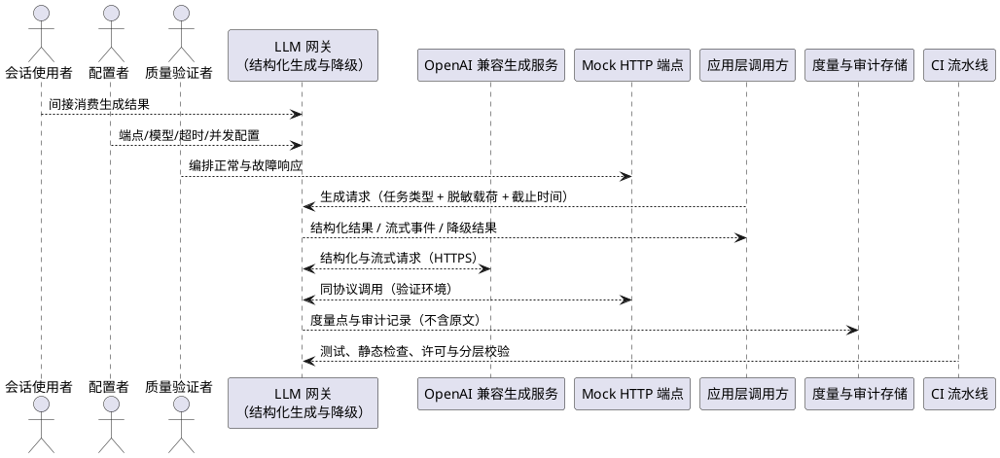
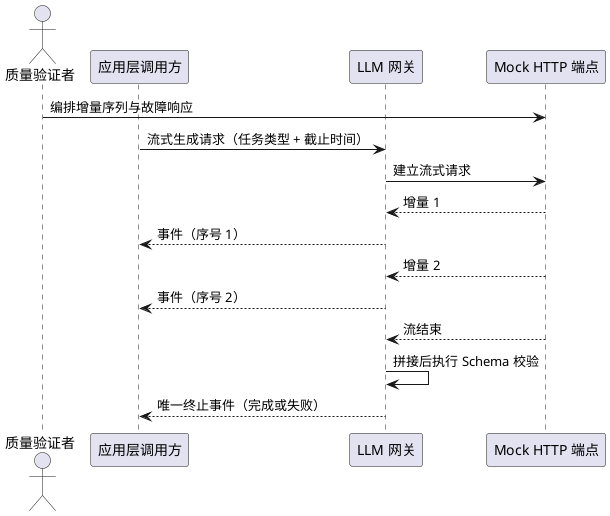
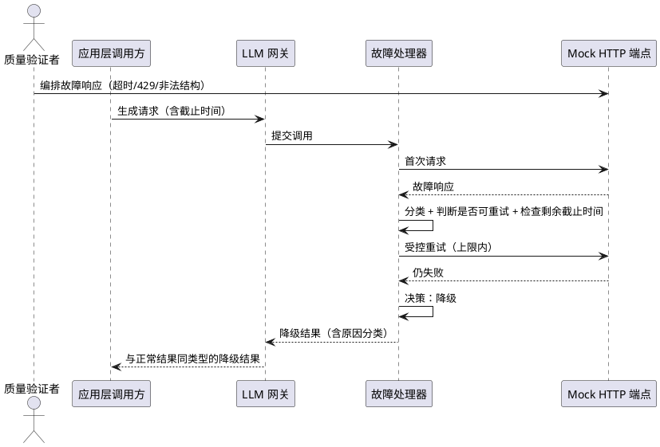
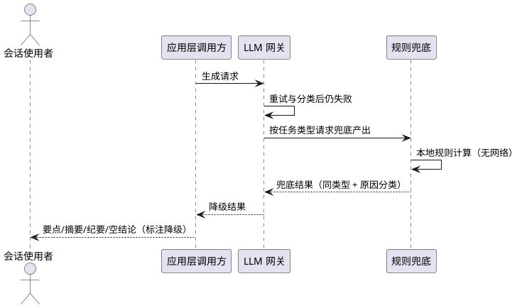
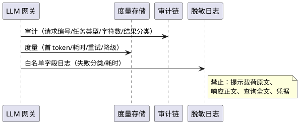

# **1. 组件定位**

> 追溯：`docs/sdd/tasks.md` 任务 13.1、13.2（批次 B1 · M0 技术验证中"可离线完成"的部分）

## **1.1 核心职责**

本组件负责把已脱敏的会话上下文转换成四类结构化生成结果，并在外部生成服务故障时保持会话主链可用。

## **1.2 核心输入**

1. **生成请求**：来自应用层的要点提炼器、滚动摘要器、提示卡合成器与会纪要生成器；内容包括任务类型、已脱敏的提示载荷、输出上限、温度与截止时间。
2. **外部生成服务的 HTTP 响应**：一次性 JSON、流式增量片段、或错误状态码与错误信息。
3. **生成策略配置**：端点地址、模型名、单次超时上限、重试上限、冷却阈值与冷却时长、并发上限、端点域名白名单。
4. **运行期端点与凭据**：由使用者通过配置或环境变量注入，仓库与构建产物中不得存在。
5. **规则兜底输入**：当前窗口的发言片段与上一版滚动摘要，用于外部服务不可用时在本地生成兜底结果。
6. **真实联调环境变量（可选输入，见第 11 章）**：`LLM_BASE_URL`、`LLM_API_KEY`、`LLM_MODEL` 三项；仅在显式开启真实联调时读取，未注入即视为"未配置"，不得据此视为故障。三者只承载运行期值，不进入仓库、构建产物、日志与规格文档。

## **1.3 核心输出**

1. **结构化结果**：`InsightExtract`、`Summary`、`CardConclusion`、`MinutesDraft` 四类之一，且已通过对应 JSON Schema 校验。
2. **流式事件序列**：增量片段、完成事件、失败事件；终止事件唯一。
3. **降级决策与降级结果**：任务类型、降级原因分类、是否降级，以及随任务类型不同的兜底产出。
4. **度量点**：首 token 时延、整次生成耗时、重试次数、按故障分类的失败率、降级次数。
5. **审计记录**：请求编号、任务类型、外发字符数、模型标识、耗时、结果状态；不得包含原文、查询全文与响应正文。

## **1.4 职责边界**

1. 本组件**不负责**脱敏与敏感词判定；输入必须由调用方完成脱敏，本组件不得放宽这一前提，只允许拒绝超限载荷。
2. 本组件**不负责**提示卡引用对齐、来源可信度分级与敏感词终检（属提示卡校验职责）。
3. 本组件**不负责**触发识别、门控判定、检索与网页抓取。
4. 本组件**不负责**提供真实 API Key、采购模型服务，也不承担真实端点上的首 token 与整卡生成基线测量（属任务 13.4）。
5. 本组件**不内置**模型权重，**不做**本地模型推理；本地轻量模型降级默认关闭，且不在本批次范围内。
6. 本组件**不负责**界面降级状态呈现，只输出可供呈现的状态与原因分类。
7. 本组件**不负责**在途请求的持久化与进程重启后的补偿（属检索与 outbox 链）。
8. 本组件**不负责**测试凭据的采购、保管、轮换、分发与合规授权；真实联调所用的端点与凭据由使用者在运行期通过环境变量注入，规格、仓库、构建产物与示例中不得出现其值与编号（见第 11 章）。
9. 第 4 条边界在本章内保持不变：第 11 章的联调只产出可复核的采样数据，不产出基线结论、不代表 13.4 完成，也不改变"首 token 与整卡生成基线属任务 13.4"的归属。

# **2. 领域术语**

**LLM 网关**
: 指本组件中对调用方暴露的"结构化生成能力"，负责请求编排、Schema 校验、故障分类与降级决策，不暴露任何具体服务商细节。

**结构化输出（Structured Output）**
: 指被强制约束为某一任务类型的强类型结果，必须先通过该任务类型的 JSON Schema 校验才可交付下游。

**任务类型（LLM Task）**
: 指四类生成任务的封闭枚举：要点抽取（InsightExtract）、滚动摘要（Summary）、提示卡结论（CardConclusion）、纪要草稿（MinutesDraft）。

**截止时间（Deadline）**
: 指调用方为单次生成设定的最长可等待时长；到期后必须立即返回，任何重试、退避与读取都不得越过该时间点。

**故障分类（Failure Class）**
: 指对外统一的六类可判定故障标签：超时（Timeout）、限流（RateLimited）、结构违规（InvalidSchema）、服务不可用（Unavailable）、内容被拒（ContentFiltered）、网络不可达（Offline）。
: 备注：`InvalidSchema` 同时覆盖"返回内容不是合法 JSON"与"JSON 合法但字段不满足 Schema"两种情况。

**重试**
: 指在剩余截止时间允许的前提下，对同一请求再次发起调用，且重试次数受配置上限约束。

**降级**
: 指外部生成不可用时，按任务类型切换到预先约定的、不依赖外部服务的替代产出路径。

**规则兜底**
: 指仅依赖本地规则与已有上下文产出的替代结果，不引入任何模型调用。

**冷却期（Circuit Open）**
: 指同一端点连续最终失败达到阈值后，在设定时长内不再发起外部请求、直接走降级的保护状态。

**首 token 时延**
: 指从请求发出到调用方收到第一个可用增量内容的时间差。

# **3. 角色与边界**

## **3.1 核心角色**

- **会话使用者**：通过要点、摘要与纪要间接消费生成结果，不直接操作本组件。
- **配置者**（使用者本人或组织管理员）：配置端点、模型名、超时、并发与冷却阈值，不接触生成内容的原文。
- **质量验证者**（开发与测试）：用本地 mock 端点编排正常与故障响应，验证故障分类、重试、降级与用时断言。

## **3.2 外部系统**

- **OpenAI 兼容生成服务**：接收已脱敏的提示载荷，返回结构化 JSON 或流式增量。
- **Mock HTTP 端点**：本地测试替身，可编排正常、限流、超时、非法结构、服务错误五类响应。
- **应用层调用方**（要点提炼器、滚动摘要器、提示卡合成器、纪要生成器）：发起生成请求并消费结果。
- **度量与审计存储**：接收度量点与审计记录。
- **CI 流水线**：执行单元测试、静态检查、依赖许可检查与分层依赖校验。

## **3.3 交互上下文**

# **4. DFX约束**

## **4.1 性能**

1. 在本地 mock 端点下、单请求载荷不超过 4 KB 时，网关自身处理开销（不含服务端处理时间）的 95 分位不得超过 **50 ms**。
2. 从请求发出到调用方收到第一个增量内容，mock 端点下的 95 分位不得超过 **300 ms**（含网关本地处理）。
3. 真实端点上的首 token 时延 95 分位目标为 **≤ 1.2 s**（依据 DESIGN 1.2.4）；本轮以 mock 端点验证网关侧能力，真实端点数值必须记录为"待实测"，不得以 mock 数值替代。
4. 截止时间到期与实际返回调用方的时刻偏差不得超过 **100 ms**（本机单进程、无 GC 场景，允许测试容差 200 ms）。
5. 单请求输出超过配置上限时必须截断并标记截断状态，禁止无界生成。
6. 同一进程内同时在途请求不得超过配置上限（默认 **3**）；超限请求必须排队，且排队不得使调用方等待超过其截止时间。
7. 生成调用期间，采集侧单片段处理耗时的 95 分位不得超过 **200 ms**（与 SPEC 4.1-5 同量级阈值），即生成链不得阻塞采集。

## **4.2 可靠性**

1. 任何故障注入下网关不得 panic、不得使进程以非零码退出，可恢复错误一律以分类结果返回。
2. 同一端点连续 **3 次**最终失败后进入冷却期 **60 s**；冷却期内不得发起外部请求，直接返回降级结果；一次成功即清零计数。
3. 生成失败必须被隔离：要点抽取、滚动摘要、提示卡结论与纪要草稿各自按降级语义产出，不得因单一任务失败导致其它任务或采集主链停止（SPEC 4.2-8）。
4. 流式连接中断必须产生唯一终止事件，不得悬挂超过截止时间。
5. 进程重启后不要求恢复在途请求；不得因在途请求丢失而阻断新的生成请求。

## **4.3 安全性**

1. 凭据只允许从配置或环境变量读取，禁止写入仓库、源码、测试夹具、日志、度量与导出包。
2. 外发内容必须已完成脱敏；网关禁止记录提示载荷原文、响应正文与查询全文，只允许记录字符数与任务类型。
3. 每次外部调用必须产生审计记录（请求编号、任务类型、外发字符数、模型标识、耗时、结果分类与是否降级），保留期为 **180 天**（SPEC 4.3-7）。
4. 日志字段必须落在既有白名单内（12 个允许字段），故障信息只允许使用 `failure_class`、`error_code`、`latency_ms`、`provider_id` 表达。
5. 请求只允许发往配置声明的端点域名白名单内的地址，禁止因配置被改写而向任意域名发请求。

## **4.4 可维护性**

1. 必须记录并可查询的指标：首 token 时延、整次生成耗时、按故障分类的失败率、重试次数、降级次数。
2. 每次生成必须携带可追溯编号，用于串联"触发片段—生成请求—结构化结果—降级状态"，编号不得包含会话内容。
3. 日志必须能区分失败分类、重试次数与是否进入冷却，以支撑平台或服务变更后的快速定位。
4. 禁止把外部响应体原文写入错误信息、日志或度量维度。

## **4.5 兼容性**

1. 必须兼容 OpenAI Chat Completions 风格的端点，允许通过配置替换为同类兼容服务；模型名必须可配置且不得写死。
2. 不得破坏既有领域契约 `LlmGateway::complete_json` 及其契约测试（B0 交付物必须继续通过）。
3. 结构化结果的 Schema 必须带版本标识；新增可选字段不得破坏既有消费方，未知字段必须按拒绝策略处理，避免模型幻觉字段被静默接受。
4. 配置变更（端点、模型、超时、并发、冷却阈值）必须在不重新编译的情况下生效。

# **5. 核心能力**

## **5.1 四类结构化生成**

### **5.1.1 业务规则**

1. **任务类型封闭**：网关只接受四类任务类型，且每类任务必须绑定唯一 JSON Schema。
   a. 验收条件：When 调用方请求 `InsightExtract`/`Summary`/`CardConclusion`/`MinutesDraft` 之一，the LLM 网关 shall 使用该任务类型的 Schema 校验结果；If 任务类型不在四类之内，the LLM 网关 shall 拒绝请求且不发起任何外部调用。
2. **校验前置**：任何结构化结果必须先通过 Schema 校验再交付。
   a. 验收条件：When 外部服务返回 JSON，the LLM 网关 shall 先完成 JSON 解析与 Schema 校验；If 校验失败，the LLM 网关 shall 按"结构违规"处理且不得把未经校验的内容交给调用方。
3. **Schema 与类型同源**：四类 Schema 必须由其对应的领域类型定义派生，禁止维护两份互不相同的手写定义。
   a. 验收条件：When 领域类型定义发生变更，the LLM 网关 shall 在同一次变更内产出与之匹配的 Schema；If Schema 与类型出现不一致，CI 一致性检查 shall 失败。
4. **要点抽取结构约束**：结果必须标注四类之一的关键信息/决策/待办/疑问、正文不超过 60 字、至少引用 1 条来源片段、置信度在 0 至 1 之间。
   a. 验收条件：When 抽取结果缺少来源引用或正文超过 60 字，the LLM 网关 shall 判定为结构违规并进入降级处理。
5. **缺失字段不得编造**：决策类必须允许"决策人待确认"，待办类必须允许"负责人与期限待确认"，禁止由网关填充推测值。
   a. 验收条件：When 外部结果未给出决策人或负责人，the LLM 网关 shall 保留"待确认"表达并原样交付，不得补全为具体人名。
6. **结论与来源绑定**：提示卡结论任务中，结论非空时必须至少携带 1 条引用；无引用时结论必须为空。
   a. 验收条件：If 结果包含结论但引用为空，the LLM 网关 shall 判定为结构违规；When 引用为空，the LLM 网关 shall 允许结论为空并标注"未找到可靠来源"。
7. **摘要用途隔离**：摘要任务的输出只用于上下文维持，必须带"仅供上下文"标识，不得作为对外结论。
   a. 验收条件：When 交付摘要结果，the LLM 网关 shall 附带上下文用途标识；If 摘要在缺少该标识的情况下被复用为结论，shall 由消费方拒绝（网关不得省略标识）。
8. **纪要分区约束**：纪要草稿必须区分"概要/四类要点/时间轴/未决问题/来源清单"五个区，置信度为"待确认"的条目只允许出现在未决问题区。
   a. 验收条件：If 纪要结果把"待确认"条目放入结论区，the LLM 网关 shall 判定为结构违规。
9. **采样参数可配**：温度以千分比表达，输出上限与温度必须按任务类型可配置，并有默认值。
   a. 验收条件：When 未显式配置，the LLM 网关 shall 使用该任务的默认输出上限与温度；When 配置越界，the LLM 网关 shall 拒绝请求并提示配置非法。
10. **禁止项：外发载荷无上限**
    a. 验收条件：If 请求载荷字符数超过配置上限（默认 8000 字符），the LLM 网关 shall 拒绝外发并返回"载荷超限"分类，不得截断后静默发送。

## **5.2 流式结构化生成**

### **5.2.1 业务规则**

1. **顺序交付**：增量必须按到达顺序交付，序号单调递增且不得跳号。
   a. 验收条件：When 外部服务连续返回 3 个增量，the LLM 网关 shall 以递增序号依次交付 3 个增量事件。
2. **终止唯一**：每次流式生成有且仅有一个终止事件（完成或失败），终止后不得再交付任何增量。
   a. 验收条件：When 流式生成结束，the LLM 网关 shall 交付唯一终止事件；If 终止后收到残余增量，the LLM 网关 shall 丢弃并计数。
3. **完整后校验**：流式增量在拼接完成前不构成最终结果，最终结果必须在拼接完成后整体通过 Schema 校验。
   a. 验收条件：When 增量拼接完成，the LLM 网关 shall 对完整结果执行 Schema 校验；If 校验失败，the LLM 网关 shall 以失败终止事件返回"结构违规"，不得交付半截结果作为最终结果。
4. **首 token 可观测**：必须记录并上报第一个增量的时间点，且该时间点必须与截止时间预算联动。
   a. 验收条件：When 收到第一个增量，the LLM 网关 shall 记录首 token 时延并计入指标。
5. **取消即时生效**：调用方取消后必须立即停止读取并释放连接。
   a. 验收条件：When 调用方取消，the LLM 网关 shall 在 100 ms 内停止交付新事件，且不得再发起重试。
6. **禁止项：半截结果透传**
   a. 验收条件：If 流式在截止时间前未完整结束，the LLM 网关 shall 返回失败终止事件与"超时"分类，禁止把已接收的部分片段当作结构化结果交付。

### **5.2.2 交互流程**

### **5.2.3 异常场景**

1. **流被中途关闭**
   a. 触发条件：外部服务在未发送结束标记前关闭连接。
   b. 系统行为：判定为"服务不可用"，在剩余截止时间允许时重试一次，否则降级。
   c. 用户感知：终止事件携带"服务不可用"分类，界面不出现半截结论。
2. **增量乱序或重复**
   a. 触发条件：增量序号回退或内容与上一增量完全相同。
   b. 系统行为：丢弃重复增量并计数，序号回退判定为"结构违规"。
   c. 用户感知：仅在诊断信息中体现丢弃计数，不打断使用者。

## **5.3 超时、限流与结构违规处理**

### **5.3.1 业务规则**

1. **故障分类映射**：所有故障必须映射到六类之一，不得以自由文本表达。
   a. 验收条件：When 出现连接超时或读取超时，the 故障处理器 shall 归类为"超时"；When 返回 429，shall 归类为"限流"；When 返回 5xx 或连接被拒绝，shall 归类为"服务不可用"；When 返回内容无法通过 Schema，shall 归类为"结构违规"；When 内容被服务端安全策略拒绝，shall 归类为"内容被拒"；When 域名解析或网络不可达，shall 归类为"网络不可达"。
2. **重试次数受控**：超时与服务不可用最多重试 2 次（总计 3 次尝试）；限流最多重试 1 次；结构违规最多做 1 次修复重试（重试请求必须携带失败位置提示）；内容被拒与网络不可达不得重试。
   a. 验收条件：When 连续 3 次超时，the 故障处理器 shall 停止重试并进入降级，且尝试次数恰好为 3。
3. **限流退避**：限流重试必须遵循服务端给出的等待时长，等待时长上限 2 s，且不得立即重试。
   a. 验收条件：When 收到 429 且服务端声明等待 1 s，the 故障处理器 shall 等待不少于 1 s 后再重试一次；If 未声明等待时长，shall 采用带抖动的退避且不超过 2 s。
4. **截止时间优先**：任何重试、退避与读取都必须受截止时间约束；剩余时间不足时立即降级。
   a. 验收条件：When 剩余截止时间小于所需重试等待时长，the 故障处理器 shall 不重试并立即返回降级结果；When 截止时间到期，the LLM 网关 shall 在 100 ms 内返回，不得等到外部服务响应。
5. **冷却保护**：同一端点连续最终失败 3 次后进入 60 s 冷却，冷却期内直接降级；一次成功即清零。
   a. 验收条件：When 端点进入冷却，the LLM 网关 shall 在冷却期内不发起任何外部请求，且返回结果必须标注"冷却中"原因。
6. **并发上限**：同时在途请求不得超过配置上限（默认 3），超限排队，排队必须尊重各自截止时间。
   a. 验收条件：When 并发请求数超过上限，the LLM 网关 shall 排队等待；If 排队使调用方将超过截止时间，shall 直接返回降级结果而非继续等待。
7. **错误信息脱敏**：返回给调用方的错误只允许包含分类、重试次数、是否降级与非敏感说明。
   a. 验收条件：When 构造错误结果，the 故障处理器 shall 保证不包含响应体原文、URL 全文、凭据与载荷片段。
8. **不 panic**：可恢复错误一律以结果返回，禁止 panic、禁止对可恢复错误使用会崩溃的取包操作。
   a. 验收条件：When 注入六类故障各一次，进程 shall 保持存活且退出码为 0。
9. **禁止项：无上限重试与 429 立即重试**
   a. 验收条件：If 请求在重试上限内仍失败，the 故障处理器 shall 终止并降级，不得继续尝试；If 收到 429，the 故障处理器 shall 不立即发起下一次请求。

### **5.3.2 交互流程**

### **5.3.3 异常场景**

1. **429 且等待时长超过截止时间**
   a. 触发条件：服务端要求等待 5 s，剩余截止时间 2 s。
   b. 系统行为：不重试，立即降级，并记录一次"限流导致降级"。
   c. 用户感知：结果可用但内容为兜底产出，界面标注降级原因。
2. **结构违规反复出现**
   a. 触发条件：修复重试后仍不满足 Schema。
   b. 系统行为：终止重试，按任务类型降级，计入"结构违规"失败率。
   c. 用户感知：不出现错误结论；提示卡结论为空或要点走规则兜底。
3. **端点长期不可用**
   a. 触发条件：连续 3 次最终失败。
   b. 系统行为：进入 60 s 冷却，期间全部请求走降级。
   c. 用户感知：诊断面板显示"生成服务不可用（冷却中）"，业务功能不中断。
4. **并发排队超时**
   a. 触发条件：并发上限已满且新请求无法在其截止时间内获得执行机会。
   b. 系统行为：直接降级，不进入队列。
   c. 用户感知：结果延迟不高于截止时间，内容为兜底产出。
5. **网络不可达**
   a. 触发条件：域名解析失败或网络中断。
   b. 系统行为：不重试，直接降级，并标注"网络不可达"。
   c. 用户感知：与"服务不可用"相同，但诊断原因可区分。

## **5.4 降级与规则兜底**

### **5.4.1 业务规则**

1. **降级顺序**：必须按"受控重试 → 降级 → 规则兜底"的顺序处理，不得跳级直接兜底（冷却期与载荷超限除外）。
   a. 验收条件：When 首次请求超时，the 降级器 shall 先重试再决策，不得在首次失败时直接返回兜底结果。
2. **同类型返回**：降级结果必须与正常结果同任务类型、同结构，调用方不得为降级单独分支。
   a. 验收条件：When 返回降级结果，the 降级器 shall 保持任务类型与结果结构一致，并额外携带降级原因分类与"已降级"标识。
3. **要点抽取兜底**：外部不可用时，规则兜底仍必须产出四类要点、保留来源引用，并将置信度降到"待确认"档。
   a. 验收条件：When 要点抽取降级，the 规则兜底 shall 至少产出 1 条带来源引用的要点，且置信度不超过 0.5。
4. **摘要兜底**：摘要降级时必须沿用上一版滚动摘要，并记录一次刷新失败。
   a. 验收条件：When 摘要生成降级，the 规则兜底 shall 返回上一版摘要并标注"沿用上一版"；If 无上一版，shall 返回空摘要且标注"未生成"。
5. **结论兜底**：提示卡结论降级时结论字段必须为空，且必须给出"未找到可靠来源"或"生成暂不可用"的说明。
   a. 验收条件：When 结论生成降级，the 规则兜底 shall 返回空结论与说明文案，禁止产出推测性结论。
6. **纪要兜底**：纪要降级时必须产出"部分纪要"，将未完成提炼的片段标为"未提炼"并计入待办复核清单。
   a. 验收条件：When 纪要生成降级，the 规则兜底 shall 在纪要中列出未提炼片段数量与可补全入口标识。
7. **兜底不阻塞**：规则兜底必须在本地完成，单条兜底计算耗时不得超过 50 ms，且不得发起任何网络调用。
   a. 验收条件：When 执行兜底，the 规则兜底 shall 在无网络环境下于 50 ms 内返回结果。
8. **降级必须可观测**：每次降级必须记录任务类型、原因分类、重试次数与耗时，并计入降级次数指标。
   a. 验收条件：When 发生降级，the 降级器 shall 产生 1 条审计记录与 1 个降级度量点。
9. **禁止项：以旧充新**
   a. 验收条件：If 除摘要以外的任务发生降级，the 降级器 shall 不得以历史缓存结论冒充本次结论。

### **5.4.2 交互流程**

### **5.4.3 异常场景**

1. **兜底输入缺失**
   a. 触发条件：降级时既无片段也无上一版摘要。
   b. 系统行为：返回"空结果 + 未生成"标识，记录降级原因，不抛错。
   c. 用户感知：相关区域显示"暂不可用"，不出现空白卡片或错误弹窗。
2. **降级与冷却叠加**
   a. 触发条件：端点处于冷却期且再次收到请求。
   b. 系统行为：直接走兜底并复用"冷却中"原因分类，不重复累加失败计数。
   c. 用户感知：结果稳定可用，原因分类不抖动。

## **5.5 可观测与审计**

### **5.5.1 业务规则**

1. **指标必采集**：必须记录首 token 时延、整次耗时、重试次数、按故障分类失败率与降级次数。
   a. 验收条件：When 完成一次生成，the LLM 网关 shall 至少产生首 token 时延、整次耗时与结果状态 3 个度量点。
2. **维度不含原文**：指标维度只允许端点标识、模型标识、任务类型、故障分类，禁止出现载荷内容。
   a. 验收条件：When 写入度量，the LLM 网关 shall 保证维度值中不含任何会话文本片段。
3. **审计必留痕**：每次外部调用必须留一条审计记录，包含请求编号、任务类型、外发字符数、模型标识、耗时、结果分类与是否降级。
   a. 验收条件：When 发起外部调用，the LLM 网关 shall 写入审计记录；If 审计写入失败，shall 按既有治理策略阻断后续外发并提示。
4. **日志白名单**：日志只允许使用白名单字段，失败信息只允许 `failure_class`、`error_code`、`latency_ms`、`provider_id`。
   a. 验收条件：When 记录故障日志，the LLM 网关 shall 只用白名单字段；If 试图写入非白名单字段，shall 被既有日志校验拒绝。
5. **可追溯编号**：请求编号必须唯一，并可从提示卡/要点反查生成请求与降级状态。
   a. 验收条件：When 生成提示卡或要点，the 调用方 shall 能通过编号串联网关侧记录，且该记录不含原文。
6. **禁止项：敏感信息入日志**
   a. 验收条件：If 外部响应体包含疑似敏感信息，the LLM 网关 shall 只记录分类与长度，禁止记录正文与 URL 全文。

### **5.5.2 交互流程**

### **5.5.3 异常场景**

1. **度量写入失败**
   a. 触发条件：度量存储不可用。
   b. 系统行为：丢弃该度量点并计数，不得影响生成结果返回。
   c. 用户感知：无感知；诊断面板显示"度量缺失"计数。
2. **审计写入失败**
   a. 触发条件：审计链不可写。
   b. 系统行为：阻断后续外发，返回降级结果，并按既有治理策略提示。
   c. 用户感知：提示"审计不可用，已暂停联网生成"。

# **6. 数据约束**

## **6.1 生成请求（Llm Request）**

1. **请求编号**：必填，进程内唯一，不得包含会话文本。
2. **任务类型**：必填，取值只能是四类任务之一。
3. **提示载荷**：必填，必须是已完成脱敏的文本，字符数不超过配置上限（默认 8000）；禁止为空。
4. **输出上限**：必填，取值 1 至 4096，按任务类型有默认值。
5. **温度**：必填，以千分比表达，取值 0 至 1000。
6. **截止时间**：必填，取值 1 ms 至 8000 ms，且不得大于调用方剩余端到端预算。
7. **用途标识**：摘要任务必填"仅供上下文"，其它任务不得填写该标识。

## **6.2 结构化结果（Structured Result）**

1. **任务类型**：必填，必须与请求一致，不一致即视为结构违规。
2. **结果体**：必填，必须通过与任务类型对应的 Schema 校验。
3. **模型标识**：必填，来自配置或服务端返回，不得为空。
4. **消耗计数**：可为空；存在时不得为负数。
5. **降级标识**：必填布尔值；为真时必须同时给出降级原因分类。
6. **降级原因分类**：取值只能是六类故障之一或"无"；降级标识为真时禁止为"无"。
7. **截断标识**：必填布尔值，输出达到上限被截断时为真。
8. **Schema 版本**：必填，与结果体结构对应的版本标识。

## **6.3 流式事件（Stream Event）**

1. **序号**：必填，从 1 开始单调递增，禁止跳号与回退。
2. **事件种类**：必填，取值为增量、完成、失败之一；一次生成内有且仅有一个终止事件。
3. **增量内容**：增量事件必填非空文本；完成与失败事件不得携带增量内容。
4. **失败分类**：失败事件必填，取值只能是六类故障之一。
5. **首 token 标记**：第一个增量事件必须标记为首 token 时间点。

## **6.4 要点抽取结果**

1. **类型**：必填，取值为关键信息、决策、待办、疑问之一。
2. **正文**：必填，不超过 60 字，超出即结构违规。
3. **来源引用**：至少 1 条，引用必须来自本次请求载荷内的片段。
4. **置信度**：必填，取值 0 至 1。
5. **决策附加项**：决策人可为"待确认"，禁止为空字符串或编造姓名。
6. **待办附加项**：动作必填；负责人与期限可为"待确认"。

## **6.5 提示卡结论结果**

1. **标题**：必填，不超过 40 字。
2. **结论**：可为空；非空时不超过 80 字，且引用数量至少为 1。
3. **引用**：可为空集合；为空时结论必须为空。
4. **置信度**：必填，取值 0 至 1。
5. **冲突并列**：存在多个来源冲突时，必须保留冲突标记与来源各自表述，禁止只保留单一结论。

## **6.6 纪要草稿结果**

1. **分区**：必须包含概要、四类要点、时间轴、未决问题、来源清单五个区，缺一即结构违规。
2. **时间轴**：必须覆盖会话起止，允许空区间，禁止压缩刻度。
3. **待确认条目**：只允许出现在未决问题区。
4. **未提炼标记**：降级产出中必须给出未提炼片段数量。

# **7. 范围与非范围**

## **7.1 范围内（本轮可离线完成并判定）**

1. 任务 13.1 全部能力：四类任务 Schema、一次性结构化生成、流式结构化生成、配置化端点与模型、Schema 与类型同源约束。
2. 任务 13.2 全部能力：超时、限流、结构违规（以及服务不可用、内容被拒、网络不可达）的分类、受控重试、截止时间优先、冷却、并发上限、降级与规则兜底。
3. 配套非功能要求：不 panic、不阻塞采集、截止时间到期立即返回、日志与审计脱敏、度量采集。
4. 验证载体：仅使用本地 mock HTTP 端点与本机单元/集成测试，不访问公网。
5. 交付物：新增领域类型与端口、基础设施实现、测试用例、依赖许可复核记录、进度记录更新。

## **7.2 非范围（本轮不做，也不得据此宣称完成）**

1. 真实端点上的首 token 与整卡生成基线（任务 13.4，`docs/baseline/llm-gate.md`）。
2. 门控离线回放框架（任务 13.3，依赖批次 B4 的门控实现）。
3. 触发识别、硬门控、相关性打分、检索与抓取实现。
4. 提示卡引用对齐、来源可信度终检与敏感词终检（提示卡校验职责）。
5. 本地模型推理与模型权重管理（本地降级模型默认关闭）。
6. 平台字幕读取、WASAPI 采集、sherpa-onnx ASR、Silero VAD（任务 7、9、10、11、12）。
7. macOS 平台适配（用户已确认暂不覆盖，任务 8 范围外）。
8. 任何界面呈现、TS 绑定扩展与 IPC 契约变更（本轮不新增跨端 DTO）。
9. M0 评审与 go/no-go 结论（任务 14）。
10. 对 13.1、13.2 之外批次任务的修改；不得顺手重构既有五层结构。
11. **仍不在范围内**：以真实端点为判定依据的"13.1/13.2 DoD 通过结论"。真实联调仅作为第 11 章定义的可选补充验证路径，其结果不得替代 mock 用例、不得反向修改 AC-01 至 AC-18 的判定口径，也不得据此宣称本轮批次完成；`docs/baseline/llm-gate.md` 基线报告的产出仍属任务 13.4。

# **8. 可机器判定的验收标准（DoD）**

## **8.1 本轮完成判据**

本轮 DoD 成立当且仅当 **AC-01 至 AC-17 全部通过**，且 AC-18 的实测项被如实标注为"待实测"。若任一项需要真实外部环境方可判定，该项必须记录为"挂起"并附原因，不得以 mock 结果替代真实结论。

| 编号 | 判定内容 | 判定方式 | 通过条件 |
|---|---|---|---|
| AC-01 | 四类 Schema 均存在且与类型同源 | `cargo test -p meeting-copilot-infrastructure --test llm_schema` 一致性用例 | 四类 Schema 均能校验对应样例；改动类型后未同步 Schema 时用例失败 |
| AC-02 | 一次性结构化生成可用 | `--test llm_gateway_mock` 中 `complete_ok` 用例 | 返回强类型结果且 Schema 校验通过 |
| AC-03 | 流式结构化生成可用 | 同文件 `stream_ok` 用例 | ≥2 个增量事件按序交付，唯一完成终止事件，拼接结果与一次性结果等价 |
| AC-04 | 超时分类与立即返回 | `--test llm_degrade_inject` 中 `timeout_deadline` 用例 | 端点延迟 3 s、截止时间 500 ms 时，调用在 500 ms + 200 ms 容差内返回，分类为"超时" |
| AC-05 | 重试次数上限 | `retry_cap` 用例 | 连续超时场景下总尝试次数恰为 3，随后返回降级结果 |
| AC-06 | 429 退避与上限 | `rate_limit_backoff` 用例 | 收到 429 后不立即重试；等待时长不短于声明值且不超过 2 s；仅重试 1 次 |
| AC-07 | 结构违规修复重试 | `invalid_schema_repair` 用例 | 首次返回非法结构、修复重试返回合法结构时结果通过；两次均非法时返回"结构违规"并按类型降级 |
| AC-08 | 冷却期生效 | `circuit_open` 用例 | 连续 3 次最终失败后，冷却期内 mock 端点收到的请求数为 0，结果标注"冷却中" |
| AC-09 | 六类故障均不 panic | `all_failures_no_panic` 用例 | 六类故障各注入一次，均返回分类结果，进程退出码为 0 |
| AC-10 | 降级结果同类型 | `degrade_same_shape` 用例 | 四类任务在降级时均返回同类型结果，且携带"已降级"+原因分类 |
| AC-11 | 要点兜底合规 | `fallback_insight` 用例 | 降级结果至少 1 条要点、含来源引用、置信度 ≤ 0.5 |
| AC-12 | 摘要兜底沿用上一版 | `fallback_summary` 用例 | 有上一版时返回上一版并标注"沿用上一版"；无上一版时标注"未生成" |
| AC-13 | 结论兜底不推测 | `fallback_conclusion` 用例 | 降级时结论为空且带说明文案；引用为空时结论恒为空 |
| AC-14 | 不阻塞采集 | `non_blocking_capture` 用例 | 生成调用期间注入 100 条片段，处理耗时 p95 ≤ 200 ms |
| AC-15 | 日志与审计脱敏 | `logging_redaction` 用例 | 捕获日志中不含载荷原文、响应正文、URL 全文、凭据；只出现白名单字段 |
| AC-16 | 凭据不入库 | `bash scripts/scan-secrets.sh` + 仓库检索 | 脚本通过；仓库中不存在测试用真实凭据，仅存在明显的假值占位 |
| AC-17 | 既有约束不回退 | `cargo clippy --workspace --all-targets -- -D warnings`、`bash scripts/check-layering.sh`、`cargo deny check licenses bans sources advisories`、`cargo test --workspace` | 全部通过；既有 80 个 Rust 测试仍全绿且数量不减少 |
| AC-18 | 真实端点首 token 与整卡生成 | 需真实端点，本轮不判定 | 必须记录为"待实测（需外部端点与有效凭据）"，不得填写 mock 数值 |

## **8.2 判定环境约束**

1. 全部用例必须在断网环境下通过，且只允许连接本机回环地址上的 mock 端点。
2. 时间类断言以本机单调时钟为准，允许 200 ms 容差；断言不得依赖外部时钟同步。
3. mock 端点必须由测试进程内启动并随机端口，禁止引入外部服务依赖。
4. 用例必须可重复执行，连续 3 次运行结果一致。
5. 本章的 8.1、8.2 只约束 mock 判定路径；真实联调的隔离与判定口径见 8.3 与第 11 章，二者互不替代。

## **8.3 补充需求的可选验证标准（AC-19 至 AC-27）**

> 判定性质：**可选验证项（Optional Verification）**。AC-19 至 AC-27 **不计入 8.1 本轮完成判据**，其全部未执行或未通过均不改变 8.1 与 AC-01 至 AC-18 的既有结论；反之，AC-19 至 AC-27 通过也不得用于替代 AC-02、AC-03、AC-07 等 mock 用例。新增编号从 AC-19 起，不复用、不改写 AC-01 至 AC-18。

| 编号 | 判定内容 | 判定方式 | 通过条件 |
|---|---|---|---|
| AC-19 | 真实联调默认关闭、凭据缺失可跳过 | 未设置显式开关时执行真实联调用例；再单独移除凭据各执行一次 | 两种情况均跳过（`ignored`/显式跳过）且退出码为 0，不产生任何公网请求；输出标注"未实测（未开启真实联调）"或"未实测（凭据缺失）"，不得记为失败、不得以 mock 结果顶替 |
| AC-20 | 真实端点首 token 时延实测 | 显式开启后按 ≥30 次采样（样本不足时按 11.5-4 降级表述） | 记录 p50、p95 实测值与端点域名、模型名、日期（含时区）、样本量；p95 ≤1.2 s 记"达标"，否则记"未达标"，原始样本与计算口径均保留，禁止删改剔除 |
| AC-21 | 真实端点整次生成耗时实测（四类任务各一组） | 每类任务按 ≥30 次采样 | 记录四类任务 p50、p95，并对 6 s 端到端预算给出"可行/不可行"判定；不可行时须写明"摘要兜底出卡"必要性的初判依据 |
| AC-22 | 真实端点四类结构化结果成功率 | 每类任务 ≥10 次请求 | 记录每类任务的成功次数、失败次数与失败分类分布，成功率如实计算；不得只保留成功样本，不得把"结构违规后兜底成功"计为原生成功 |
| AC-23 | 真实端点 429 表现 | 实测期内观察是否出现 429 | 若出现：记录 `Retry-After` 形式（秒/HTTP-date/非法）、实际等待时长、是否 ≤2 s、是否越过截止时间、分类是否为"限流"；若未出现：标"未触发·未实测"。**故障是否出现不作为通过条件，记录完整且标注准确即为通过** |
| AC-24 | 真实端点超时表现 | 人为将单次截止时间压至低于端点常规响应时间 | 记录分类为"超时"、实际返回与截止时间偏差 ≤100 ms（测试容差 200 ms）、无半截结果交付；必须标注"人为压低截止时间，非端点自身超时率" |
| AC-25 | 真实端点 schema 违规表现 | 使用 1 次不携带 Schema 约束的对照请求（人为构造） | 记录是否被判"结构违规"、修复重试是否发生及尝试次数、是否转为同类型兜底；必须标注"人为构造的违规请求，不代表端点常态遵从率"；端点常态遵从率由 AC-22 承担 |
| AC-26 | 凭据与端点信息不泄漏 | 运行期抓取日志、审计记录、错误信息、进程命令行；配合 `bash scripts/scan-secrets.sh` 与 `git status` | 以上位置均不含密钥值、不含凭据编号、不含 URL 查询参数与完整请求路径；仓库无新增未入库文件；进程命令行不含凭据 |
| AC-27 | 实测记录可复核 | 检查实测记录文件与其引用的原始样本 | 记录含端点域名、模型名、日期（含时区）、网关 commit 短哈希、各任务样本量、p50/p95、失败分类分布、原始样本存放位置（未入库）；缺任一项判"记录不完整"，该子项不得标"实测" |

## **8.4 服务商锁定与运行门（AC-28 至 AC-32）**

> 判定性质：**补充门槛项（Supplementary Gate）**。AC-28 至 AC-32 **不计入 8.1 本轮完成判据**，且不改动 AC-01 至 AC-27 的任何编号、判定方式与通过条件。
> 与 8.3 的差别：8.3 的 AC-19 至 AC-27 需真实端点或真实环境才可判定；AC-28 至 AC-32 是**运行门判定与泄漏扫描**，全部可在断网环境判定。任一项不通过时，真实联调路径必须保持关闭（fail-closed），但 8.1 的 mock 结论不受影响；反之，AC-28 至 AC-32 全部通过也不代表真实端点能力已实测。
> 追溯：第 11.9 节（服务商锁定：DeepSeek）。

| 编号 | 判定内容 | 判定方式 | 通过条件 |
|---|---|---|---|
| AC-28 | 服务商与端点锁定 | `--test llm_live_gate` 中 `endpoint_host_locked` 用例：向运行门分别注入"允许候选"（同域，含与不含路径段两种写法）与"近似/仿冒/其它域名"（同域作子域、作前缀、作后缀拼接、国别域变体、其它域名） | 仅 host **精确等于** `api.deepseek.com`（或用户书面确认并已登记的其他 DeepSeek 域名）时判定为"允许"；其余一律返回 `endpoint_not_allowed`，且该判定发生在任何 socket 创建与凭据读取之前（拒绝路径上连接计数为 0、凭据读取计数为 0） |
| AC-29 | 模型名显式且已确认 | `model_explicitly_confirmed` 用例：向运行门分别注入"为空""仅空白""候选值（未获确认）""与确认值不逐字节相同""与确认值完全相同"五种取值；另对规格文本执行候选标注检查 | 前四种一律返回 `model_not_confirmed` 且真实请求数为 0；仅"与确认值完全相同"放行；规格中出现的每个模型候选均带"待确认"标记，且无任何候选被写成默认值、示例值或回退链中的前项 |
| AC-30 | HTTPS 强制 | `insecure_transport_rejected` 用例：注入 `http://<host>` 与 `https://<host>` 各一次 | `http://` 一律拒绝并返回固定码 `insecure_transport_rejected`，且不建立任何 TCP 连接（回环监听器收到的连接数为 0），也不得"降级尝试"其它协议或其它域名；`https://` 仅放行为"允许发起"，是否连通不在本项判定 |
| AC-31 | 费用预算上限 | `budget_cap_enforced` 用例：以 `samples=30`（四类任务）、`attempts_max=3` 构造计数，驱动计数至上限后继续提交请求 | 实际发出的调用数 ≤ `min(samples × 3 × 4, 用户确认上限)`，且每次"调用"按一次实际 HTTP 请求计数（含超时重试、429 退避重试与结构违规修复重试）；达到上限时停止发起新请求并记录 `budget_exhausted` 与"已用数/上限"；预算未确认时返回 `budget_not_confirmed` 且调用数为 0；已取得样本不得因触顶而删除或改写 |
| AC-32 | 凭据零泄漏（文档 / 代码 / 日志 / 审计 / 记录 / 报告） | `bash scripts/scan-secrets.sh`；另执行一套对 `*.md` **同样生效**的补充扫描；配合运行期四面抓取（日志、审计记录、错误信息、进程命令行）与 `git status --short` | 上述各面 0 命中：凭据任何可见片段（前缀、遮蔽形式的中段、末四位）与凭据编号（Tracking ID）的任何可见片段均不得出现；补充扫描必须覆盖既有脚本排除的 `*.md`，否则本项判"不可判定"；命中时输出只含文件与行号，**不得回显命中内容**（避免二次泄漏） |

**判定符号说明**：`endpoint_not_allowed`、`model_not_confirmed`、`insecure_transport_rejected`、`budget_not_confirmed`、`budget_exhausted` 是运行门的**判定结果标识**，不在 `ErrorCode` 枚举中新增变体（避免触碰 AC-17 的既有错误码断言）；需要返回错误对象时统一复用 `E-PROVIDER-009`（配置非法）。

## **8.5 确认收敛与真实采样落地（AC-33 至 AC-37）**

> 判定性质：**补充门槛项续篇（Supplementary Gate, continued）**。AC-33 至 AC-37 **不计入** 8.1 本轮完成判据，且不改动 AC-01 至 AC-32 的任何编号、判定方式与通过条件。
> 与 8.4 的差别：8.4 判定"运行门是否把服务商、模型、传输、预算锁死"；8.5 判定"已确认的输入是否被真正使用"——请求体是否固定关闭思考模式、`path_confirmed` 是否有计算来源、真实采样是否产出非占位样本、流式首 token 是否增量、允许 host 集合是否可被环境变量扩大。
> 追溯：第 11.10 节（确认状态收敛与真实采样落地补充）。
> 判定符号说明：`thinking_not_disabled`、`path_not_confirmed`、`placeholder_sample_detected`、`credential_not_rotated` 是**判定结果标识**，不在 `ErrorCode` 枚举中新增变体（沿用 8.4 的符号说明）；需要返回错误对象时统一复用 `E-PROVIDER-009`（配置非法）。

| 编号 | 判定内容 | 判定方式 | 通过条件 |
|---|---|---|---|
| AC-33 | 真实请求体固定关闭思考模式 | `--test llm_live_gate` 中请求体构造的**纯函数**用例（离线、零 socket）：对固定请求与配置断言构造出的请求体 JSON 满足 `thinking.type == "disabled"`；再注入"缺失 `thinking` 字段""`thinking.type` 为 `enabled`""`thinking` 为空对象"三种反例 | 正例通过；三种反例一律判 `thinking_not_disabled`，真实联调据此判本次样本失败（不得记"实测"）；该字段加入后 mock 路径的判定结论不变 |
| AC-34 | `path_confirmed` 由常量比对计算，不得手写 | `llm_live_gate::path_confirmed_derived_from_constant`：向 path 解析分别注入 `/chat/completions`、`/`、`/v1/chat/completions`、空 path、仅 query/fragment 五种取值；另对生产代码做静态断言（不得出现手写 `path_confirmed = true`） | 仅 `/chat/completions` 得 `true`；其余四种得 `false`；记录 v2 的 `path_confirmed` 与计算函数返回值一致；生产代码中无手写赋值 |
| AC-35 | L22 真实采样产出非占位样本与 v2 记录 | 显式开启且政策闸通过后执行 `--test llm_live -- --ignored --test-threads=1`，检查 `.tmp/llm-live/<run-id>/`；另单独执行默认关闭路径 | 显式路径：`samples.jsonl` ≥1 行真实样本（`attempt ≥ 1`、`total_ms > 0`、无占位标记）、`run.json` 为 `llm.live.v2` 且字段齐备；默认路径：传输构造次数、socket 次数与样本数均为 0，退出码 0，输出"未实测（原因）" |
| AC-36 | 增量首 token：首个 SSE 增量到达即可产出 | 离线用例（本机回环或可注入读循环）：服务端先写 1 个 SSE 事件后**保持连接不关闭**并延迟；断言首个增量在到达后 ≤200 ms 内被读出并作为 `Delta` 交付 | 首增量到达后 ≤200 ms 交付；服务端不关闭连接时不阻塞；若实现仍缓冲整包，本项判"不通过"，且 AC-20 必须标"未实测（流式读取未增量）" |
| AC-37 | `LLM_ALLOWLIST` 不得扩大允许 host 集合 | `llm_live_gate` 用例：①`LLM_ALLOWLIST` 设为非官方 host → 仍只有代码常量内的 host 被 `Admit`；②`LLM_ALLOWLIST` 缺失或为空 → 允许集合不因之改变；③静态断言 host 集合的唯一来源是代码常量 `DEEPSEEK_HOSTS` | 任一环境变量取值下，`Admit` 的 host 集合恒等于代码常量集合；不存在"改环境变量扩大集合"的路径；扩大集合必须改代码常量并走规格变更 |

**与既有条目的追溯关系**

| 本小节 AC | 需求追溯 | 相关既有条目 | 关系 |
|---|---|---|---|
| AC-33 | 11.10.2、SPEC 5.1.1-9、4.1-3 | AC-01~AC-17、AC-20 | 关闭思考模式是"温度生效与首 token 不被推理延迟"的前置；不改任何 mock 用例的判定 |
| AC-34 | 11.10.4、11.9.8-C1 | AC-28 | AC-28 只判 host；AC-34 判 path 的"确认来源"，不把 path 原文写入记录 |
| AC-35 | 11.10.3、11.5.2~11.5.7 | AC-20~AC-27 | AC-35 只判"载体可用、非占位、默认 0 请求"，不判任何数值结论 |
| AC-36 | 11.10.6、SPEC 5.2.1-4 | AC-03、AC-20 | AC-36 是 AC-20 可宣称"实测"的前置；未通过时 AC-20 只能标"未实测" |
| AC-37 | 11.10.5、11.9.1-3 | AC-28、AC-19 | AC-19/AC-28 保留 `LLM_ALLOWLIST` 的存在性检查语义；AC-37 明确它不是判定来源 |

**判定环境约束**

1. AC-33、AC-34、AC-37 必须在断网环境通过，且用例只读注入的环境假视图，不改进程环境、不建 socket。
2. AC-36 只允许连接本机回环地址；不得访问公网。
3. AC-35 的显式路径需要真实环境（传输启用 + C1~C4 明确 + C5 留痕）；其"未实测"标注合法，但不得以 mock 数值顶替。
4. 任一项不通过时，只关闭真实联调路径或使相关 AC 不得宣称满足，**不改变** 8.1、8.3、8.4 与 AC-01 至 AC-32 的既有结论。

## **8.6 请求体 JSON 约束与 4xx 分类纠正（AC-38 至 AC-42）**

> 判定性质：**补充门槛项续篇（Supplementary Gate, continued）**。AC-38 至 AC-42 **不计入** 8.1 本轮完成判据，且不改动 AC-01 至 AC-37 的任何编号、判定方式与通过条件；8.1 至 8.5 的既有结论一字不改。
> 与 8.5 的差别：8.5 判定"已确认的输入是否被真正使用"；8.6 判定"请求体是否满足服务商的显式契约、4xx 是否被正确归类、状态码与实测耗时是否如实落盘、每次运行是否相互隔离"。
> 追溯：第 11.11 节（请求体 JSON 约束与 4xx 分类纠正）。
> 触发事实：一次真实采样中 8 个用例全部 `degraded=true`；对照试验把变量收敛到请求体——"使用 `response_format: {"type":"json_object"}` 且提示词不含 `json` 字样"的形态被服务商以 `invalid_request_error` 拒绝，拒绝正文的语义为"使用 `json_object` 时提示词必须包含 `json`"；Key、模型、端点、网络与 TLS 均正常。
> 判定符号说明：`json_instruction_missing`、`http_status_missing`、`total_ms_placeholder`、`run_id_not_unique`、`pseudo_success` 是**判定结果标识**，不新增 `ErrorCode` 变体（沿用 8.4、8.5 的符号说明）；需要返回错误对象时统一复用 `E-PROVIDER-009`（配置非法）。
> 零转录：本节不出现完整端点 URL、任何模型名字面量、凭据任何片段与凭据编号；只允许出现路径段常量 `/chat/completions`、请求体字段名 `response_format` / `thinking`、错误类型 `invalid_request_error` 与"提示词必须包含 `json`"这一约束表述。

| 编号 | 判定内容 | 判定方式 | 通过条件 |
|---|---|---|---|
| AC-38 | 请求体含 JSON 指令 | 请求体构造的**纯函数**用例（离线、零 socket）：四类任务各构造一次请求体，断言 system prompt 含 `json`/`JSON` 字样；再注入"移除该字样""仅 user 载荷含该字样""仅 Schema 字段名含 json"三种反例（均由正例派生，不另写请求体） | 正例四类任务的 system prompt 均含至少一处 `json`/`JSON`；三种反例一律判 `json_instruction_missing` 且请求发出计数为 0；mock 路径判定结论不变（只允许把"精确文本相等"放宽为"必需片段存在 + 允许新增文本"，不得删除既有断言） |
| AC-39 | 4xx 分类矩阵 | 4xx 分类用例（脚本化响应 / mock 状态码，离线）：401、402、403、400、404、422、429 各一次；400 分三种正文（含 `content_filter`、内容策略错误码、普通 `invalid_request_error`） | 401/402/403 → `Unavailable`；400/404/422 → `InvalidSchema`；仅"正文明确含 `content_filter` 或服务商内容策略错误码"→ `ContentFiltered`；429 → `RateLimited`（不变）；其余 400 一律不得归 `ContentFiltered`；每次分类同时保留原始 HTTP 状态 |
| AC-40 | 状态落盘 | 真实采样后检查样本记录（`samples.jsonl`）每行与结构化结果载体（`StructuredOutcome`）；另跑默认 mock 路径 | 真实样本每行 `http_status` 为整数且与该次实际响应状态一致；`StructuredOutcome` 携带同一状态；mock/离线样本允许为空（`null` 或省略）；真实样本缺失状态判 `http_status_missing` |
| AC-41 | 实测耗时 | 真实采样 ≥2 次后读取 `total_ms`；另以假时钟对记录器做离线用例 | `total_ms` 由请求发出至返回的单调时钟差计算，不来自常量；不得为写死的 0 或 1；同一运行内 ≥2 个真实样本不得取值全部相同；差值小于记录精度时保留更高精度原始值而**不补记为 1**；违反任一条判 `total_ms_placeholder` |
| AC-42 | 运行隔离 | 连续两次独立真实运行；另在一次运行内执行全部 8 个 `#[ignore]` 用例后检查 `.tmp/llm-live/` | 两次独立运行的 `run_id` 不相同，且 `run_id` 不以进程号作为唯一来源；同一次运行内 8 个用例共用同一 `run_id`，运行结束后该运行在 `.tmp/llm-live/` 下只对应一个目录；`run.json` 的样本计数等于 `samples.jsonl` 行数（8 个用例是合并写入而非逐个覆盖）；出现覆盖或 `run_id` 复用判 `run_id_not_unique` |

**与既有条目的追溯关系**

| 本小节 AC | 需求追溯 | 相关既有条目 | 关系 |
|---|---|---|---|
| AC-38 | 11.11.2、5.1.1-1/2 | AC-02、AC-03、AC-17 | 补齐"结构化输出"的请求体契约；只允许放宽 mock 的字段/文本断言方向，不得删除断言 |
| AC-39 | 11.11.3、5.3.1-1/2 | AC-04、AC-06、AC-07、AC-09 | 纠正 4xx 归类；429 与 5xx 的既有判定不变；AC-09"内容被拒"夹具须显式带 `content_filter` 标记（夹具数据修正，判定方式与用例数不变） |
| AC-40 | 11.11.4、5.5.1-1/3 | AC-15、AC-22、AC-27 | 只增加状态码落盘；不改日志白名单、审计字段与成功率口径 |
| AC-41 | 11.11.4、4.1-4 | AC-04、AC-35 | 统一"实测耗时"口径；不改 AC-04 的 mock 时限断言与 AC-35 的"非占位"判定 |
| AC-42 | 11.11.4、11.6-4 | AC-27、AC-35 | 运行隔离与记录合并；不改 AC-27 的"可复核"字段口径 |

**判定环境约束**

1. AC-38、AC-39 必须在断网环境通过；用例只读注入的配置与脚本化响应，不建 socket（或只连本机回环）。
2. AC-40、AC-41 的"真实"面需真实端点；其"字段存在性 / 记录结构 / 时间来源"可在离线以假时钟与合成样本判定。
3. AC-42 的"两次独立运行"需真实环境；"同一次运行内目录唯一 + 样本计数一致"可在离线用合成样本与单进程多用例模拟判定。
4. 任一项不通过时，只使相关真实采样结论不得标"实测成功"，**不改变** 8.1、8.3、8.4、8.5 与 AC-01 至 AC-37 的既有结论。
5. **AC-20 不因本次修复自动满足**：AC-40、AC-41 通过只表示"状态与耗时如实落盘"，不表示首 token 或整次耗时达标；AC-20 仍需真实有效样本，且 AC-36 通过前只能标"未实测（流式读取未增量）"。
6. **不得伪成功**：真实采样在 `degraded=true` 时必须记录失败分类与状态码；测试结果可以仍为"通过"（载体可用），但报告必须标注"非实测成功（降级/兜底）"；把"用例通过"表述为"端点调用成功"判 `pseudo_success`。

## **8.7 Schema 注入与模型输出域收敛（AC-43 至 AC-46）**

> 判定性质：**补充门槛项续篇（Supplementary Gate, continued）**。AC-43 至 AC-46 **不计入** 8.1 本轮完成判据，且不改动 AC-01 至 AC-42 的任何编号、判定方式与通过条件；8.1 至 8.6 的既有结论一字不改。
> 与 8.6 的差别：8.6 判定"请求体是否被对方接受（JSON 指令 + 4xx 归类）"；8.7 判定"提示词是否携带该任务的**完整 Schema 本体**""模型是否被收敛到**可输出域**""服务端元数据是否由网关**显式归一且可追溯**"。
> 追溯：第 11.12 节（Schema 注入与模型输出域收敛）。
> 触发事实（用户终端实测，必须如实记录，不得改写）：8 个 `#[ignore]` 用例全部运行；要点抽取 3 次成功（HTTP 200、`degraded=false`、整次耗时 527~929 ms）；摘要、提示卡结论、纪要草稿三类均 HTTP 200，但在第 2 次尝试后判结构违规。鉴权、模型、端点、网络、TLS 与 JSON 前置均正常；失败点收敛为"模型输出结构与严格 Schema 不一致"。当前 system prompt 仅含"任务标识 + Schema 版本号 + JSON 指令"，**不含 Schema 本体**；模型无从得知 `purpose`/`version`/`carried_over`/`produced`/`sources`/`unrefined_count` 等服务端元数据。
> 判定符号说明：`schema_not_injected`、`prompt_leaked`、`normalization_conflict`、`model_domain_widened` 是**判定结果标识**，不新增 `ErrorCode` 变体（沿用 8.4、8.5、8.6 的符号说明）；需要返回错误对象时统一复用 `E-PROVIDER-009`（配置非法）；结构违规仍沿用既有的 `InvalidSchema` 分类与修复重试路径，不新增失败分类。
> 零转录：本节不出现完整端点 URL、任何模型名字面量、凭据任何片段与凭据编号；只允许出现 Schema 片段名 `properties` / `required`、字段名与既有判定标识。

| 编号 | 判定内容 | 判定方式 | 通过条件 |
|---|---|---|---|
| AC-43 | Schema 本体注入 | 请求体构造的**纯函数**用例（离线、零 socket）：四类任务各构造一次（一次性 + 流式共 8 次），从 system prompt 中提取 Schema 文本并与 `SchemaRegistry::json_schema(task)` 逐字段比对；再由正例派生四类反例：①仅保留 Schema 版本号；②仅保留任务标识与"符合 Schema"措辞但无 `properties`；③仅保留 `properties` 而无 `required`；④把同类任务的另一任务 Schema 混入当前任务提示词。另做四面抓取（日志、审计、错误对象、样本记录）与进程命令行检查 | 正例：四类任务的 system prompt 均含该任务完整 Schema 文本，其 `properties` 键集合与 `required` 项集合**分别等于**该任务 Schema 的对应集合，且 JSON 指令与 `thinking` 固定字段同时存在（AC-33、AC-38 不回退）；四类反例一律判 `schema_not_injected` 且 `send`/`open_stream` 计数为 **0**；四面抓取与命令行对提示词原文、Schema 全文 0 命中，只允许出现任务标识、Schema 版本号、字符数与判定标识；任一命中判 `prompt_leaked` |
| AC-44 | Summary 服务端归一 | 离线用例（脚本化 200 响应 + 真实路径装配）：响应仅含 `text` 与 `covered`，缺 `purpose`/`version`/`carried_over`/`produced`；另用 mock 形态的完整结构响应各跑一次；再注入三种反例：①`purpose` 与请求用途不一致；②`version` 与上下文版本计数不一致；③缺 `text` 字段 | 仅含 `text`/`covered` 时结果成功、`degraded=false`、`attempt=1`：`purpose` 等于请求用途、`version` 等于上下文版本计数、`carried_over` 与"是否沿用上一版摘要"一致、`produced` 为真（本次真实产出）；完整结构响应同样成功且归一结果与之一致；反例①②判 `normalization_conflict` 且不修正模型值、不静默覆盖；反例③按既有解码规则判结构违规（缺必填字段不新增规则、不补默认值）；归一字段名与来源在结果或记录中可追溯，且不含文本类字段值原文 |
| AC-45 | 结论 notice 与纪要服务端归一 | 离线用例：结论响应仅含 `title`/`conclusion`(空)/`references`(空集合)/`confidence`/`conflict`；纪要响应仅含 `summary`/`insights`/`timeline`/`open_questions`；再注入四种反例：①纪要给出 `sources` 但其元素不在本次请求载荷引用集合内；②`unrefined_count` 与 `open_questions` 数量矛盾；③`completion_hint` 与未细化数量不符；④结论非空但引用为空 | 结论成功且 `notice` 由网关按来源与失败状态填充：无引用且结论为空 → `missing_source`；生成不可用/降级 → `generation_unavailable`；其余为空。纪要成功且 `sources` 取自请求载荷内引用集合（去重、顺序稳定）、`unrefined_count` 等于未细化片段计数、`completion_hint` 按未细化数量取值（>0 → `more_utterances`，为 0 → 无，存在待人工复核项 → `human_review`）；反例①②③判 `normalization_conflict`；反例④仍按 5.1.1-6 判结构违规，**不得**因归一化放宽跨字段规则；模型输出上述服务端字段不得改变最终交付值 |
| AC-46 | 严格性不回退 | 四类任务各注入四组非法输出（未知字段、类型错误、范围越界、跨字段违规）；另做三项静态检查：①解码与归一实现中不存在以 `serde(default)` 或等价默认值补齐"模型可输出域"必填字段的路径；②`deny_unknown_fields` 的出现次数不减少；③"模型输出域"相对完整 Schema 只**移除** 11.12.2 所列服务端归一字段及其 `required` 项，未新增可选字段、未降低既有约束 | 四组非法输出一律判结构违规并进入既有修复重试/降级路径（与 AC-07 一致）：未知字段 → `UnknownField`、类型错误 → `TypeMismatch`、越界 → `RangeViolation`、跨字段 → `CrossField`；"模型可输出域"的必填字段缺失一律拒绝，不得以默认值补齐；`deny_unknown_fields` 计数不减；输出域与完整 Schema 的差异集合**恰等于** 11.12.2 列出的服务端归一字段，出现其它差异判 `model_domain_widened`；mock 正例与真实正例均可通过，但不得以放宽 Schema 让"四类全部 200 且 `degraded=false`"虚报通过 |

**与既有条目的追溯关系**

| 本小节 AC | 需求追溯 | 相关既有条目 | 关系 |
|---|---|---|---|
| AC-43 | 11.12.3、5.1.1-1/2/3 | AC-01、AC-17、AC-38 | 注入 Schema 本体；不改 AC-01 的"类型与 Schema 同源"判定，不改 AC-38 的 JSON 指令判定；提示词不落日志/审计 |
| AC-44 | 11.12.2、11.12.4、6.2 | AC-02、AC-07、AC-12 | 摘要四字段归一；AC-12"沿用上一版"的兜底语义不改，`carried_over` 仅表达本次是否沿用 |
| AC-45 | 11.12.2、11.12.4、6.5、6.6 | AC-07、AC-13 | 结论 `notice` 与纪要 `sources`/`unrefined_count`/`completion_hint` 归一；AC-13"不推测"不改，`notice` 只表达"未找到可靠来源/生成不可用"，不产生任何结论内容 |
| AC-46 | 11.12.5、5.1.1-2 | AC-01、AC-07、AC-17、AC-25 | 严格性不回退；mock 用例只允许"必需片段/字段存在 + 允许新增"方向放宽，断言不得删除；AC-25 的人为违规对照请求继续有效 |

**判定环境约束**

1. AC-43、AC-46 必须在断网环境通过，且用例只读注入的配置与脚本化响应，不建 socket（或只连本机回环）。
2. AC-44、AC-45 的"归一"面可用脚本化 200 响应在离线判定；其"真实"面需真实端点，只更新三态。
3. 任一项不通过时，只使相关真实采样结论不得标"实测成功"，**不改变** 8.1、8.3、8.4、8.5、8.6 与 AC-01 至 AC-42 的既有结论。
4. **AC-20 仍不因本次修复自动满足**：AC-43 至 AC-46 通过只表示"Schema 已注入、归一成立、严格性未回退"，不表示首 token 或整次耗时达标；AC-20 仍需真实有效样本，且 AC-36 通过前只能标"未实测（流式读取未增量）"。
5. **真实重跑只更新三态**：本次修复后的真实重跑，只更新 AC-43 至 AC-46 的真实面结论（`measured` / `not_triggered` / `not_measured`）与 AC-38 至 AC-42 的既有三态；不改 AC-01 至 AC-37 的判定结论与三态标注。
6. **不得伪成功**：若重跑后仍有任务 `degraded=true`，必须记录失败分类、`http_status` 与尝试次数，不得只写"已修复"；四类任务全部 `degraded=false` 之前，不得宣称"真实端点结构化成功"。

# **9. 模块与文件映射（任务映射，非设计决策）**

本章仅列出承载需求的最小模块边界，用于对照 `docs/sdd/tasks.md` 的 13.1/13.2 与既有五层结构；具体实现方式由设计阶段确定。

## **9.1 新增文件**

1. `crates/domain/src/model/llm.rs`：任务类型、生成请求、结构化结果、流式事件、故障分类、降级原因与降级结果的领域类型。
2. `crates/domain/src/port/llm.rs`：结构化生成端口（一次性与流式两条能力），保持与既有 `LlmGateway` 并存。
3. `crates/infrastructure/src/llm/mod.rs`：模块注册与内部装配。
4. `crates/infrastructure/src/llm/gateway.rs`：任务 13.1 的网关能力（Schema 绑定、一次性与流式编排）。
5. `crates/infrastructure/src/llm/schema.rs`：四类任务 Schema 的生成与一致性校验。
6. `crates/infrastructure/src/llm/transport.rs`：可替换的 HTTP 传输边界，支持注入本机 mock 端点。
7. `crates/infrastructure/src/llm/degrade.rs`：任务 13.2 的故障分类、重试、冷却、并发与降级决策。
8. `crates/infrastructure/src/llm/fallback.rs`：四类任务的规则兜底产出。
9. `crates/infrastructure/tests/llm_schema.rs`：Schema 与类型一致性用例（AC-01）。
10. `crates/infrastructure/tests/llm_gateway_mock.rs`：正常路径的一次性与流式用例（AC-02、AC-03、AC-14）。
11. `crates/infrastructure/tests/llm_degrade_inject.rs`：故障注入与降级用例（AC-04 至 AC-13）。
12. `crates/infrastructure/tests/llm_logging_redaction.rs`：日志、审计与脱敏用例（AC-15）。

## **9.2 修改文件（最小必要）**

1. `crates/domain/src/model/mod.rs`、`crates/domain/src/port/mod.rs`：导出新增类型与端口。
2. `crates/infrastructure/src/lib.rs`：注册 `llm` 模块。
3. `crates/infrastructure/Cargo.toml`：仅在许可复核通过后新增依赖；未复核前不得引入。
4. `docs/compliance/license-review.md`：登记新增依赖的许可证结论与使用边界。
5. `deny.toml`：仅当新增依赖需要显式登记时修改；白名单已覆盖则保持不动。
6. `docs/progress/b1-status.md`：更新 13.1/13.2 的状态、证据与"待实测"项。
7. `docs/sdd/tasks.md`：仅勾选 13.1、13.2 并附 DoD 证据，不得改动其它任务条目。

## **9.3 明确禁止改动的范围**

1. `crates/application/**`（除仅用于测试装配的必要调整，且不得引入网络依赖）。
2. `crates/platform-win/**`、`crates/platform-mac/**`、`crates/ui-bridge/**`、`app/src-tauri/**`、TS 绑定文件。
3. `docs/sdd/spec.md`、`docs/sdd/design.md`（本规格不反向修改权威文档）。
4. 任务 13.3、13.4、14.x 及批次 B2 之后的任何任务条目。

# **10. 风险与依赖**

## **10.1 风险**

| 编号 | 风险 | 影响 | 缓解措施 |
|---|---|---|---|
| R1 | 无真实端点与凭据，首 token 与整卡生成无法实测 | 13.1 的 DoD 无法完全判定，易出现虚报 | AC-18 强制标注"待实测"；报告区分"网关侧已验证"与"真实端点待测" |
| R2 | 新增 HTTP/TLS 依赖可能引入混合许可证（如 ring/OpenSSL 系） | `cargo deny` 失败或法务红线 | 先复核后引入；未复核则只落地可替换传输边界与 mock 验证，生产传输挂起并记录 |
| R3 | 既有端口为同步 trait，长连接可能占用线程并阻塞采集 | 触发 SPEC 4.1-5/4.1-7 指标劣化 | 独立执行资源 + 强制截止时间 + 并发上限 3；以 AC-14 断言约束 |
| R4 | 时间断言在 Windows 上抖动 | 用例不稳定，误判失败 | 统一 200 ms 容差、只连本机回环、连续 3 次一致性校验 |
| R5 | 429 的等待时长与 6 s 端到端预算冲突 | 提示超时 | 截止时间优先，等待超预算立即降级 |
| R6 | 破坏既有 `LlmGateway::complete_json` 契约 | B0 契约测试回退 | 采用并存扩展而非替换；AC-17 强制全量回归 |
| R7 | Schema 与类型双份维护导致漂移 | 校验失真，幻觉字段被接受 | AC-01 一致性用例；未知字段拒绝策略 |
| R8 | 错误信息内嵌响应体导致日志泄漏 | 违反 SPEC 4.4-2/4.3-7 | 结构化错误只保留分类与长度；AC-15 捕获日志断言 |
| R9 | 冷却状态为进程内状态，多进程不共享 | 桌面单进程可接受，多实例场景保护失效 | 明确记录为已知限制，不宣称多实例防护 |
| R10 | "网络不可达"与"服务不可用"判定边界模糊 | 分类统计偏差 | 以传输层错误类型严格映射，并在用例中固定两端样例 |
| R11 | 真实端点在实测期内可能完全不返回 429 | "限流真实表现"无法测得 | AC-23 以"未触发·未实测"如实标注；禁止用 mock 的 429 结果填入真实表现列 |
| R12 | 环境变量在 CI、调试器或诊断工具中可被读取 | 凭据泄漏面扩大 | 双重开关（显式开启标志 + 凭据非空）才执行；CI 不设开关；禁止命令行参数与临时文件传值；AC-26 运行时抓取断言 |
| R13 | 端点配额、费率或区域限制导致采样不足 | p95 统计不显著、结论失真 | 记录实际样本量；样本 <30 时只报 p50 并标注"样本不足·不作分布结论" |
| R14 | 测试凭据可能在传递过程中已暴露于聊天、工单或截图 | 凭据滥用风险 | 规格不记录任何凭据值与编号；联调结束后由配置者按凭据管理规范轮换 |

## **10.2 依赖**

1. **上游输入**：脱敏后的片段与摘要（由调用方保证），若脱敏实现尚未落地，本轮以固定脱敏样例替代，并在报告中注明前置假设。
2. **既有资产**：领域错误模型、脱敏日志字段白名单、度量存储、审计链、分层校验脚本、CI 流水线。
3. **流程依赖**：依赖许可复核（安全 + 法务）与 `cargo deny` 白名单；未完成前不得引入新依赖。
4. **下游消费**：任务 13.3 门控离线回放与 13.4 LLM 基线以本轮结果为前置；批次 B2/B3 的要点、摘要、提示卡、纪要链后续接入本端口。
5. **门禁关系**：G1（M0）判定仍取决于任务 7–12 的真实环境验证，本轮完成不代表 G1 通过。
6. **不构成依赖**：真实 API Key、外部网络访问、macOS 设备、ASR 模型权重均不是本轮完成的前提。
# **11. 补充需求：真实 OpenAI 兼容端点联调（可选验证路径）**

> 追溯：`docs/sdd/tasks.md` 任务 13.1、13.2、13.4；`docs/progress/b1-status.md` 第 1 节"LLM 端点/Key ❌ 未配置 · 任务 13 阻塞"与第 4 节"LLM 端点与 Key"阻塞记录。
> 本章为**需求补充**，不进入实现编码；实现与用例落地由设计/任务阶段承接。

## **11.1 补充范围与边界**

### **11.1.1 本次补充的定位**

使用者已创建一个**仅用于测试**的凭据（OpenAI 风格 `sk-` 前缀）并附带了该凭据的编号（UUID 形式）。据此，本规格新增一条**可选的真实端点联调验证路径**：在 13.1/13.2 的 mock 验证之外，允许在显式开启时向真实的 OpenAI 兼容端点发起生成请求，用于产出可复核的实测数据，进而解除 13.4 的"端点与凭据缺失"阻塞输入条件。

本章只约定"验证什么、如何判定、如何隔离与如何标注"；**不约定任何实现代码、任何服务商、任何端点地址与任何凭据值**。

### **11.1.2 与任务 13.1 / 13.2 的关系**

1. 13.1、13.2 的 DoD 与判定方式保持不变：AC-01 至 AC-17 仍只由本机回环 mock 与单元/集成测试判定（8.1、8.2）。
2. 真实联调**不是** 13.1/13.2 的通过条件，也**不得**用于替代任何 mock 用例；两者是"网关侧能力已验证"与"真实端点表现已实测"两类不同证据。
3. 真实联调失败（端点不可达、凭据无效、端点不兼容）只能判定为"环境未就绪"或"端点不兼容（待评估）"，**不得**直接判定为 13.1/13.2 的功能缺陷。

### **11.1.3 与任务 13.4 的关系**

1. 13.4 的交付物是 `docs/baseline/llm-gate.md` 基线报告（首 token、整卡生成、门控各级耗时、6 s 预算可行性）。本章**只**定义该报告所需"真实端点实测数据"的采集口径与判定标准，**不**产出报告本体、**不**改写 13.4 的 DoD。
2. 本章的补充**仅解除"端点地址/模型名/凭据缺失"这一输入阻塞**；13.4 仍受"采样预算""合规授权"与"端点稳定性"影响，缺一即维持"未实测"表述。

### **11.1.4 明确不做**

1. 不采购、不代理、不推荐任何具体模型服务商；规格中不出现任何服务商域名、模型家族名或价格信息。
2. 不把真实端点结果写入任何既有 AC 的判定结论，不调整 AC-01 至 AC-18 的通过条件。
3. 不在规格、代码、配置、测试夹具、示例、日志、审计、CI 配置中写入凭据值或其编号。
4. 不实现密钥托管、KMS 集成、自动轮换等凭据基础设施（超出本特性边界）。
5. 不改变 7.2 的非范围判定：以真实端点为依据宣称"本轮批次完成"仍被禁止。

## **11.2 追溯与既有 AC 的关系**

| 补充项 | 需求追溯 | 相关既有条目 | 与既有 AC 的关系 |
|---|---|---|---|
| 真实端点四类结构化结果与 Schema 遵从 | SPEC 5.1.1-1、5.1.1-2、5.1.1-3、5.1.1-4、5.1.1-6、5.1.1-8 | AC-01、AC-02、AC-03、AC-07 | 新增 AC-22、AC-25；仅做真实端点的"补充观测"，不替代 AC-02/03/07 的 mock 判定 |
| 真实端点故障分类、重试与截止时间 | SPEC 5.3.1-1、5.3.1-2、5.3.1-3、5.3.1-4、5.3.1-7 | AC-04、AC-05、AC-06 | 新增 AC-23、AC-24；mock 的确定性断言不变 |
| 真实端点度量、审计与脱敏 | SPEC 5.5.1-1、5.5.1-2、5.5.1-3、5.5.1-4、5.5.1-6、SPEC 4.3-1、4.3-4、4.4-4 | AC-15、AC-16 | 新增 AC-26、AC-27；AC-16 管"仓库与夹具不含真实凭据"，AC-26 管"运行期四个泄漏面不含凭据"，互补不重叠 |
| 首 token 与整次生成基线 | SPEC 4.1-3、任务 13.4 DoD | AC-18 | AC-18 维持"待实测"口径；AC-20、AC-21 通过且记录完整后，方可由 13.4 将 AC-18 状态由"待实测"改为"已实测（附记录）"，该状态变更动作归属 13.4，不在本特性内执行 |
| 默认可关闭与凭据缺失行为 | SPEC 4.3-1、4.3-2、8.2-1 | AC-09、AC-17 | 新增 AC-19；保证 AC-01 至 AC-17 在无网络、无凭据条件下仍可全绿 |

**编号纪律**：AC-19 至 AC-27 为本章新增，不复用、不改写、不重排 AC-01 至 AC-18；AC-18 的"待实测"表述在本章内保持不变。

## **11.3 待补充信息与可配置项**

### **11.3.1 仍缺失、必须由用户补充的信息**

| 编号 | 缺失项 | 说明 | 未提供时的处理 |
|---|---|---|---|
| M1 | **Base URL（端点地址）** | 必须为 `http(s)://host[/path]`；host 必须命中本组件的外发域名白名单（SPEC 4.3-5） | 维持"未实测（端点未配置）"；不得填写任何默认值或猜测地址 |
| M2 | **模型名** | 端点上实际可用的模型标识；非空、≤128 字符（SPEC 4.5-1、DESIGN 2.2.2-G） | 维持"未实测（模型未配置）"；不得使用示例模型名或服务商默称充当配置 |
| M3 | 该域名是否允许外发（白名单授权） | 由配置者确认并写入 `domain_allowlist` | 白名单为空即拒绝一切外发（fail-closed），联调不执行 |
| M4 | 采样预算与费用/配额上限 | 决定 AC-20/21/22 的样本量是否可达成 | 未定则按 11.5-4 的"样本不足"口径降级表述 |
| M5 | 凭据使用授权与轮换责任人 | 该凭据是否允许被本项目脚本调用 | 未确认则不开启真实联调 |

> M1、M2 属**当前已知缺失项**：本章只以可配置项形式表达，不得在规格、代码、默认值或文档中臆测具体服务商、域名或模型名。

### **11.3.2 可配置项与环境变量约定**

1. **端点地址**：配置项 `endpoint`，运行期取值来源为环境变量 `LLM_BASE_URL`。
2. **模型名**：配置项 `model`，运行期取值来源为环境变量 `LLM_MODEL`。
3. **凭据**：配置项只保存**引用名**（`credential_ref`，默认值 `LLM_API_KEY`），运行期以该名称从环境变量读取值；配置对象内**不得**出现凭据值。
4. **白名单**：配置项 `domain_allowlist`；未显式提供时，仅允许从 `LLM_BASE_URL` 的 host 派生出的单一精确项（派生失败即视为未配置）。
5. **开关**：真实联调开关 `LLM_LIVE`（取值 `1` 视为开启）；只接受显式开启，缺省与其它取值一律视为关闭。
6. **参数默认值**：单次截止时间、采样次数、并发上限沿用设计期配置默认值（SPEC 6.1-6、4.1-6），仅在联调时允许通过环境变量覆盖，覆盖值仍须通过既有范围校验（越界即拒绝执行，不得降级运行）。

## **11.4 凭据注入与隔离规则**

1. **只经环境变量读取**：凭据只允许在进程启动时从环境变量读取一次，禁止从命令行参数、文件、注册表、URL 查询参数、标准输入读取。
   a. 验收条件：When 真实联调被开启，the 配置加载器 shall 仅以 `credential_ref` 指定的环境变量名取值；If 该变量缺失，shall 进入 11.4-2 定义的跳过路径，不得报错退出。
2. **缺失即跳过并标"未实测"**：凭据或端点或模型任一缺失时，真实联调 shall 跳过，并在输出与记录中标注"未实测（原因）"。
   a. 验收条件：If `LLM_API_KEY`、`LLM_BASE_URL`、`LLM_MODEL` 任一为空且 `LLM_LIVE=1`，the 联调入口 shall 跳过执行、返回成功退出码、输出"未实测（凭据/端点/模型缺失）"；禁止伪造任何数值、禁止以 mock 结果填入真实列、禁止标记为失败。
3. **双重开关**：真实联调 shall 同时满足"`LLM_LIVE=1`"与"凭据非空"两个条件才执行。
   a. 验收条件：When 仅设置凭据而未设置 `LLM_LIVE`，the 联调入口 shall 不发起任何公网请求，并标"未实测（未开启真实联调）"。
4. **CI 与单元测试零依赖**：CI 流水线与默认测试集 shall 不依赖真实凭据、不访问公网。
   a. 验收条件：When 执行 8.1/8.2 的既有用例集，the 测试进程 shall 在无凭据、无公网条件下全部完成；若 CI 环境误注入凭据但未设置 `LLM_LIVE`，shall 仍不执行真实联调。
5. **四个泄漏面的禁止项**：凭据禁止出现在日志、审计记录、错误信息与进程参数中。
   a. 验收条件：If 任意路径试图把凭据写入日志字段、审计 `summary`、错误 `detail`、度量维度或命令行参数，the 实现 shall 拒绝构造（编译期不可表达或构造期返回 `Err`）；运行期抓取这四个面 shall 不含凭据值与凭据编号。
6. **调试输出遮蔽**：承载凭据的配置类型 shall 以固定 `***` 输出，且不参与序列化、不参与哈希、不进入快照对比。
   a. 验收条件：When 打印配置或将其写入快照，the 输出 shall 只含 `credential_ref` 的变量名与 `***`，不含值。
7. **错误信息最小化**：凭据无效时的错误 shall 只表达"凭据无效/未授权"这一分类，不得回显前缀、长度、后四位、哈希或任何可还原片段。
   a. 验收条件：When 端点返回鉴权失败，the 返回结果 shall 只含分类与非敏感说明；捕获的错误文本 shall 不含凭据任何字符片段。
8. **审计仍须成立**：真实联调的每次外发 shall 遵守 SPEC 4.3-3、4.3-4、5.5.1-3、5.5.1-4；审计与日志只记录请求编号、任务类型、外发字符数、模型标识、耗时、结果分类与是否降级。
   a. 验收条件：When 完成一次真实外发，the 审计记录 shall 含上述字段且不含凭据、不含 URL 查询参数与完整请求路径。
9. **凭据不落盘**：真实联调不得在本地产生任何包含凭据的文件（含临时文件、测试快照、失败转储、日志归档）。
   a. 验收条件：When 联调结束，the 工作目录与被忽略目录 shall 不含凭据字符串；`bash scripts/scan-secrets.sh` 与仓库检索 shall 通过（AC-16、AC-26）。
10. **轮换建议**：若凭据曾在聊天、工单、截图等非受控渠道传递，配置者应当在联调结束后轮换；本规格不记录其值与编号，也不承担轮换动作。

## **11.5 真实联调的验收标准（EARS）**

以下条目与 8.3 的 AC-19 至 AC-27 一一对应。所有数值必须标注"实测"，并同时记录环境三元组（端点域名、模型名、日期含时区）；任一条件不满足即降级为"未实测/未触发"表述，不得反向推断。

### **11.5.1 默认关闭与跳过（AC-19）**

1. **默认可关闭**：真实联调必须默认关闭。
   a. 验收条件：When 未显式开启（`LLM_LIVE` 非 `1`），the 联调用例 shall 标记为跳过（`ignored` 或显式提前返回）且退出码为 0，且不产生任何公网连接。
2. **凭据缺失不失败**：凭据缺失必须表现为"跳过 + 标注"，而非失败或伪造。
   a. 验收条件：If 凭据缺失而开关开启，the 联调入口 shall 输出"未实测（凭据缺失）"并成功退出；If 输出中出现任何实测数值，shall 判定为伪造并视为该次运行无效。
3. **禁止替代 mock**：真实联调结果不得替代 mock 判定。
   a. 验收条件：When 真实联调通过，the 8.1 表格中 AC-02、AC-03、AC-07 的判定 shall 仍以 mock 用例为准，不得改为"由真实联调覆盖"。

### **11.5.2 首 token 时延（AC-20）**

1. **采样与统计**：首 token 时延必须在真实端点上按足够样本统计。
   a. 验收条件：When 执行首 token 实测，the 联调脚本 shall 对指定任务采集 ≥30 次有效样本并给出 p50 与 p95；If 有效样本 <30，shall 只报 p50 并标注"样本不足·不作分布结论"。
2. **目标判定**：p95 与目标值必须显式比较。
   a. 验收条件：When 得到 p95 实测值，the 记录 shall 与 1.2 s 目标比较并给出"达标/未达标"结论；If 未达标，shall 保留原始样本与失败分类分布，禁止只报最优值。
3. **口径一致**：真实采样必须复用 SPEC 5.1.1/5.2.1 已定义的计时口径（自请求发出至首个可用增量/首个完整结果）。
   a. 验收条件：When 记录首 token 时延，the 记录 shall 注明"计时起点=请求发出、终点=首个可用增量"，与 mock 用例口径一致；禁止改用"服务端自报耗时"充当本口径。
4. **环境可追溯**：每次记录必须绑定环境三元组。
   a. 验收条件：When 写入实测数值，the 记录 shall 同时含端点域名、模型名、日期（含时区）与网关 commit 短哈希；If 任一缺失，shall 判"记录不完整"，该数值不得进入 13.4 报告。

### **11.5.3 整次生成耗时（AC-21）**

1. **四类任务全覆盖**：整次生成耗时必须覆盖四类结构性任务。
   a. 验收条件：When 执行耗时实测，the 联调 shall 对 `InsightExtract`、`Summary`、`CardConclusion`、`MinutesDraft` 各采集 ≥30 次并分别给出 p50、p95。
2. **预算判定**：必须对 6 s 端到端预算给出可行性结论。
   a. 验收条件：When 四类任务的 p95 得出，the 记录 shall 对 6 s 预算给出"可行/不可行/边界"判定；If 判定为不可行，shall 写明"摘要兜底出卡"必要性的初判依据，供 13.4 引用。
3. **不得混算**：降级路径耗时不得计入正常生成耗时。
   a. 验收条件：If 某次请求发生降级或兜底，the 统计 shall 将其排除在正常生成耗时样本之外，并单独记录降级次数与原因分类。

### **11.5.4 四类结构化结果成功率（AC-22）**

1. **成功率定义**：成功率 = 原生通过 Schema 校验的结果数 / 有效请求数；兜底成功不计入分子。
   a. 验收条件：When 统计成功率，the 记录 shall 明确分子分母；If 结果由规则兜底产生，shall 计入分母但不计入分子，并单列"兜底次数"。
2. **失败分类分布**：必须给出失败分类分布而非单一成功率。
   a. 验收条件：When 出现失败，the 记录 shall 按六类故障分类（超时、限流、结构违规、服务不可用、内容被拒、网络不可达）分别计数；If 出现六类之外的失败原因，shall 单列"未归类"并说明，不得强行塞入六类。
3. **Schema 遵从率**：必须区分"不是合法 JSON""合法 JSON 但字段不符"两类结构问题。
   a. 验收条件：When 统计结构违规，the 记录 shall 分别给出两类计数；禁止合并为单一数字后声称"遵从率"。
4. **样本下限**：每类任务有效请求不得少于 10 次。
   a. 验收条件：If 有效请求 <10，the 结论 shall 标"样本不足·未实测成功率"，不得给出百分比结论。

### **11.5.5 真实端点 429（AC-23）**

1. **如实记录，不主动伪造**：429 表现只能在实测期内自然出现时记录。
   a. 验收条件：When 真实端点返回 429，the 联调 shall 记录 `Retry-After` 形式（数字秒/HTTP-date/缺失/非法）、实际等待时长、是否 ≤2 s、是否越过截止时间、最终分类；禁止人为构造 429 冒充真实表现。
2. **未出现时的表述**：未出现 429 不等于通过，也不等于失败。
   a. 验收条件：If 实测期内未出现 429，the 记录 shall 填"未触发·未实测"，并注明采样窗口与请求数；禁止填入 mock 的 429 结果。
3. **退避合规复述**：真实环境中观察到的退避必须与 SPEC 5.3.1-3 一致。
   a. 验收条件：If 实际等待时长为 0（立即重试）或超过 2 s，the 记录 shall 判"与规格不一致（待评估）"，并保留原始时间戳序列。
4. **预算冲突**：超过剩余截止时间的等待必须表现为不重试。
   a. 验收条件：When 端点要求等待时长大于剩余截止时间，the 记录 shall 显示"未重试、立即降级"；If 观察到仍发起重试，shall 判"与规格不一致（待评估）"。

### **11.5.6 真实端点超时（AC-24）**

1. **可控制造**：允许通过压低截止时间制造网关侧超时，但必须标注人为性。
   a. 验收条件：When 将单次截止时间设置为低于端点常规响应时间，the 记录 shall 标注"人为压低截止时间"；禁止将其表述为"端点超时率"。
2. **立即返回**：截止时间到期必须立即返回。
   a. 验收条件：When 截止时间到期，the 实测返回时刻与截止时刻偏差 shall ≤100 ms（测试容差 200 ms）；If 观察到等待端点响应后才返回，shall 判"与规格不一致"。
3. **不交付半截结果**：超时路径不得产出结构化结果。
   a. 验收条件：If 流式路径在截止时间前未完整结束，the 结果 shall 为失败终止 + "超时"分类或同类型兜底结果；禁止交付半截 JSON 作为结果体。
4. **分类唯一来源**：超时分类必须来自传输层错误类型，而非错误文本匹配。
   a. 验收条件：When 记录超时分类，the 记录 shall 注明"分类来源=传输层错误类型"；禁止以响应正文或错误文案推断分类。

### **11.5.7 真实端点 schema 违规（AC-25）**

1. **人为构造对照**：允许用一次不携带 Schema 约束的请求制造违规，但必须标注。
   a. 验收条件：When 使用对照请求制造违规，the 记录 shall 标注"人为构造的违规请求"；禁止将该次结果计入 AC-22 的常态遵从率分母。
2. **修复重试可观测**：结构违规的修复重试必须可观测。
   a. 验收条件：When 首次返回非法结构，the 记录 shall 给出实际尝试次数（1 或 2）；If 尝试次数 >2 或对"内容被拒/网络不可达"发起重试，shall 判"与规格不一致"。
3. **修复提示不含原文**：修复重试携带的提示只允许含字段路径与规则名。
   a. 验收条件：When 构造修复提示，the 提示 shall 只含 `path` 与 `rule`；If 提示中出现载荷片段、模型响应正文或凭据，shall 判失败。
4. **兜底同类型**：真实违规最终必须落到同类型兜底。
   a. 验收条件：When 两次尝试均违规，the 结果 shall 为与请求任务同类型的结果体，且 `degraded=true` + 原因分类为"结构违规"。

### **11.5.8 凭据与端点信息不泄漏（AC-26）**

1. **四个泄漏面**：日志、审计、错误信息、进程参数必须全部无凭据。
   a. 验收条件：When 完成一轮真实联调，the 抓取的日志、审计记录、错误文本与进程命令行 shall 均不含凭据值、不含凭据编号；If 任一面出现，shall 判失败并保留现场证据。
2. **URL 收敛**：记录中只允许保留 host 与路径模板，不得保留查询参数与完整请求路径。
   a. 验收条件：When 记录端点信息，the 记录 shall 只含 host（或配置的 `endpoint_id`）；If 出现完整 URL 或查询参数，shall 判失败。
3. **仓库零变更**：联调不得在仓库产生未入库的凭据文件。
   a. 验收条件：When 联调结束执行 `git status --short`，the 输出 shall 无新增凭据相关文件；`bash scripts/scan-secrets.sh` shall 通过。

### **11.5.9 实测记录可复核（AC-27）**

1. **记录字段完备**：实测记录必须含 11.7 定义的全部字段。
   a. 验收条件：When 检查实测记录，the 记录 shall 含端点域名、模型名、日期（含时区）、网关 commit 短哈希、各任务样本量、p50、p95、失败分类分布、原始样本存放位置；If 缺任一字段，shall 判"记录不完整"。
2. **原始样本可回溯**：原始样本必须保留在本地未入库位置。
   a. 验收条件：When 复核任一数值，the 复核者 shall 能由记录定位到对应的原始样本与计算脚本版本；If 原始样本缺失或已入库，shall 判不合格。
3. **数值与标本一致**：报告数值必须可由原始样本重算得到。
   a. 验收条件：When 重算 p50/p95，the 重算结果 shall 与记录一致（允许格式化舍入差异）；If 不一致，shall 判"数值不可复核"。

## **11.6 测试隔离与执行方式**

1. **形态**：真实联调必须以**显式开启**的形式存在（`#[ignore]` 集成测试目标，或独立脚本），默认不进入任何常规测试运行。
2. **默认路径不受影响**：`cargo test --workspace`、AC-17 的既有全量回归在无凭据、无公网条件下必须保持全绿且数量不减少。
3. **CI 零依赖**：CI 配置中不得设置 `LLM_LIVE`，不得注入 `LLM_API_KEY`；即便被误注入，未设置开关也不得执行真实联调。
4. **运行隔离**：真实联调不得与 mock 用例共享进程内状态（度量环形缓冲、审计链、冷却状态）；两种证据分别由不同测试目标或独立进程产生，避免互相污染。
5. **失败处置**：端点不可达、凭据无效、端点不兼容只能记为"环境未就绪/端点不兼容（待评估）"，不得作为功能缺陷或 AC-01 至 AC-18 的失败证据。
6. **产物位置**：原始样本与实测记录只能写入本地未入库路径（例如构建产物目录下的独立子目录），并须被忽略规则覆盖；禁止写入 `docs/`、`crates/`、仓库根目录与任何会被提交的位置。
7. **可重复性**：同一环境下连续执行 3 次，分类结果与统计口径必须一致；时延数值允许波动，但记录必须保留每次原始样本，禁止"择优选样"。

## **11.7 实测记录模板与"未实测"三态标注**

### **11.7.1 三态定义（强制）**

| 状态 | 含义 | 允许的配套信息 |
|---|---|---|
| **实测** | 已在真实端点执行并取得有效样本 | 必须附环境三元组、样本量、p50/p95、失败分类分布、原始样本位置 |
| **未触发** | 已执行，但被测故障在采样窗口内未自然出现（如 429） | 必须附采样窗口、请求数、说明"未出现不等于通过" |
| **未实测** | 未执行（未开启开关、凭据/端点/模型缺失、预算不足） | 必须附具体原因码；**禁止**填写任何数值 |

**禁止项**：三种状态不得混用；不得以 mock 数值填"实测"列；不得把"未触发"写成"通过"；不得只保留成功样本。

### **11.7.2 记录字段**

1. **端点域名**：仅 host，禁止完整 URL 与查询参数。
2. **模型名**：端点实际返回或配置声明的模型标识。
3. **日期（含时区）**：采样起止时间与本地时区。
4. **网关 commit 短哈希**：用于定位被测代码。
5. **配置快照摘要**：截止时间、输出上限、温度、并发上限（不含凭据）。
6. **样本量**：每类任务的有效请求数与被排除数（含排除原因）。
7. **统计量**：p50、p95（样本不足时只报 p50）。
8. **失败分类分布**：六类计数 + "未归类"计数。
9. **降级/兜底次数**：与正常样本分开。
10. **原始样本位置**：未入库路径与文件命名规则。
11. **状态标注**：按 11.7.1 三态之一，逐子项标注。

## **11.8 待用户补充项与关闭条件**

1. **M1 Base URL**：未提供 → 真实联调维持"未实测（端点未配置）"，13.4 端点阻塞不解除。
2. **M2 模型名**：未提供 → 同上，且不得以服务商示例模型名替代。
3. **M3 白名单授权**：未确认 → 拒绝一切外发，联调不执行。
4. **M4 采样预算**：未定 → 按"样本不足"口径降级表述，不输出 p95 结论。
5. **M5 凭据使用授权与轮换责任人**：未确认 → 不开启真实联调。
6. **关闭条件**：当 M1 至 M5 全部明确，且 AC-19 至 AC-27 中与 13.4 相关的子项（AC-20、AC-21、AC-22、AC-27）状态为"实测"或如实标注时，本条补充需求的验证路径视为"已具备可执行条件"；13.4 的阻塞是否解除，由 13.4 依据记录完整性与合规结论单独判定。
## **11.9 服务商锁定：DeepSeek（OpenAI 兼容 API）**

> **追溯**：使用者已通过截图显式指明服务商为 **DeepSeek 开放平台**（后台菜单含"用量信息 / API keys / 充值 / 账单"，凭据列表与创建行为均在该平台）。据此，11.3 的"服务商未定"状态收敛为"服务商已确定为 DeepSeek"，本节逐项登记端点、模型、传输、预算、凭据与数据外发口径。
> **性质**：本节为**需求补充**，不进入实现编码；只定义"锁定什么、如何判定、如何 fail-closed"，不定义实现细节。
> **与 11.1.4-1、11.3.1 的关系（收敛声明，非改写）**：11.1.4-1"不做服务商推荐、规格不出现服务商域名"的原文保留不动，其成立前提是"使用者未指定服务商"；该前提已由使用者显式确认改变，故本节以**范围收窄（scope narrowing）**方式定向放开：仅允许出现 DeepSeek 官方 API 域名与 DeepSeek 官方文档模型候选，**其它服务商仍禁止出现**。11.1.4-1 的"不采购、不代理、不推荐、不写凭据"部分继续有效。
> **编号说明**：第 11 章的 11.2 已被"追溯与既有 AC 的关系"占用，为满足"编号连续、不改既有编号"，本节编号取 11.9（接 11.8 之后）。

### **11.9.1 服务商与端点**

1. **服务商确定**：真实联调的生成服务商为 **DeepSeek（OpenAI 兼容 API）**，协议形态沿用 SPEC 4.5-1（OpenAI Chat Completions 风格）。
   a. 验收条件：When 装配真实联调配置，the 运行门 shall 将服务商标识固定为 DeepSeek；若配置声明的 host 不属于 11.9.1-3 的封闭域名集合，shall 返回 `endpoint_not_allowed`，不得按"其它兼容服务"放行。
2. **端点（C1 已确认）**：host 由运行期 `LLM_BASE_URL` 提供（具体 host 只在代码常量 `DEEPSEEK_HOSTS` 中，本规格不记录）；路径段已确认，常量为 `/chat/completions`，完整 URL 只由运行期值提供。
   a. 验收条件：When 构造真实端点，the 完整 URL shall 由运行期 `LLM_BASE_URL` 提供；If 规格、代码、注释或记录中出现 host 与 path 拼接的完整 URL 字面量，或出现任何"默认路径/备用路径/自动补全"，shall 判定为规格越界（追溯 11.10.4、AC-34）。
3. **域名集合封闭**：允许的外发 host 集合 = 代码常量 `DEEPSEEK_HOSTS`（单一官方 API host）∪ {用户书面确认并登记的其他官方域名}；本节不记录具体 host 字面量。
   a. 验收条件：When 校验 `LLM_BASE_URL` 的 host，the 运行门 shall 执行**精确匹配**；If host 为"同域作子域/前缀/后缀拼接""国别域变体""相似拼写"等形式，shall 一律判为不允许，不得使用"包含/前缀/正则模糊"匹配。
   b. 备注：本条只锁定 host，不锁定路径；路径段常量与 `path_confirmed` 的计算来源见 11.10.4 与 AC-34。
4. **唯一配置入口**：`LLM_BASE_URL` 仍是端点的**唯一**配置入口，且仍是可选输入（SPEC 1.2-6 不变）。
   a. 验收条件：When 真实联调被开启，the 配置加载器 shall 只从 `LLM_BASE_URL` 读取端点；If 在代码、配置文件、构建产物或示例中出现任何 DeepSeek 域名常量作为默认值，shall 判定为违反本项（`LLM_BASE_URL` 未注入时只能表现为"未配置/跳过"，不得回落到内置地址）。
5. **禁止项：把端点写成完整 URL 字面量**
   a. 验收条件：If 规格、代码、注释、测试夹具或记录中出现"host 与 path 拼接的完整 URL 字面量""内置默认路径""缺 path 自动补全"或"按环境切换路径"，shall 判定为规格违规；正确表述只能是"host 由运行期 `LLM_BASE_URL` 提供、路径段常量为 `/chat/completions`"（追溯 11.10.4、AC-34）。

### **11.9.2 模型名（C2 已确认，原候选表已作废）**

> **本小节状态更新（由第 11.10 节收敛，编号与规则条目保留）**：C2 已由使用者确认，模型名以运行期 `LLM_MODEL` 的实际取值为唯一有效值；该值不落仓库。
> **原候选表整体作废**：本小节原列的候选字面量已按"零转录"红线（规格不得出现模型名字面量）**全部移除**，不再作为候选、示例值、默认值、回退链前项或自动探测目标；原候选自本版起**全部失效**，规格中也不再列举任何替代值。
> **判定口径不变**："模型名必须显式且已确认"、"禁止候选自动回退与自动探测"、"记录只写运行期实际值"三条继续有效（AC-29 的编号、判定方式与通过条件不改）。

1. **必须显式且已确认**：真实联调必须使用经使用者书面确认的模型名，且该值由 `LLM_MODEL` 注入。
   a. 验收条件：When `LLM_MODEL` 为空、仅空白、或其值不等于确认值，the 运行门 shall 返回 `model_not_confirmed` 并保持零真实请求；仅当取值与确认值逐字节相同才放行。
2. **禁止自动回退与自动探测**：不得实现"先试候选 A、失败再试候选 B"或"查询 `/models` 自动挑选"的策略。
   a. 验收条件：If 出现候选间自动切换、自动探测可用模型或按名称猜测模型的行为，shall 判定为规格违规（理由：放大调用数与费用，并掩盖配置错误）。
3. **候选表作废后的唯一来源**：模型名只来自运行期 `LLM_MODEL`；本规格不列举、不记录任何模型名字面量（含旧候选与新确认值）。
   a. 验收条件：When 检查规格文本，the 规格 shall 不含任何模型名字面量；If 出现任一模型名字面量（旧候选或新值），shall 判定为零转录违规（AC-32 的文档面）。
4. **记录中的模型名**：实测记录只能填写 `LLM_MODEL` 的实际取值，不得填写候选值。
   a. 验收条件：When 写入 AC-20/AC-21/AC-22/AC-27 所要求的"模型名"字段，the 记录 shall 取自运行期实际配置值；If 记录值与运行期值不一致，shall 判"记录不可复核"。

### **11.9.3 传输与 TLS**

1. **HTTPS 强制**：真实端点必须使用 HTTPS。
   a. 验收条件：When `LLM_BASE_URL` 以 `http://` 开头，the 运行门 shall 拒绝执行并返回固定码 `insecure_transport_rejected`，且不建立任何 TCP 连接；禁止"先连再看"或"HTTP 失败后自动升 HTTPS 重试"。
2. **TLS 基线**：最低 TLS 1.2，使用系统信任根，SNI 取 host，禁止跳过证书校验、禁止使用"接受任意证书"的连接器。
   a. 验收条件：When 建立 TLS 连接，the 传输层 shall 按上述基线握手；If 出现关闭校验、固定指纹白名单外的自签证书被接受、或 TLS 版本低于 1.2，shall 判定为与规格不一致。
3. **个人项目口径下的许可简化（不作为硬阻塞）**：本项目为个人项目、非商业交付，`native-tls` 引入所涉的"安全 + 法务双签"**不作为阻塞条件**。
   a. 验收条件：When 引入 `native-tls`，the 交付物 shall 在 `docs/compliance/license-review.md` 登记三项内容——许可结论（MIT / Apache-2.0）、系统 TLS 依赖边界（Windows 走 SChannel、macOS 走 Security.framework、不额外打包 OpenSSL）、以及"个人自用、未做商业分发合规评审"的说明；If 三项缺任一，shall 判定为登记不完整（联调可继续，但该缺口必须留痕）。
4. **简化边界（不可豁免项）**：上述简化只覆盖"审批签字流程"，不覆盖许可类别红线。
   a. 验收条件：When 执行 `cargo deny check licenses bans sources advisories`，the 检查 shall 仍必须通过；If 引入 GPL/AGPL/SSPL 等传染性许可或新增未登记依赖，shall 判定为不通过，不得以"个人项目"为由豁免。
5. **沿用既有传输约束**：不跟随 3xx、不读取系统代理、不使用预置凭据的自定义 Header（11.4-5、DESIGN 2.1.3(10) 不变）。
   a. 验收条件：When 端点返回 3xx，the 传输层 shall 按"服务不可用"分类处理且不跟随跳转，不得因跟随跳转而绕过 11.9.1-3 的域名集合。

### **11.9.4 费用与采样预算**

1. **默认采样量**：默认每任务 30 条，四类任务合计计划 120 条有效样本（与 11.5.2-1、11.5.3-1 的 ≥30 口径一致）。
   a. 验收条件：When 未提供采样覆盖值，the 联调计划 shall 按每任务 30 条、四类合计 120 条登记；该默认值**只用于已获预算确认后的执行计划**，不得作为"自动开始"的依据。
2. **重试计入预算**：一次"调用"等于一次实际 HTTP 请求；超时重试、429 退避重试、结构违规修复重试全部计入调用计数。
   a. 验收条件：When 统计调用数，the 计数器 shall 按请求发出次数（而非按任务数、而非按成功数）累加；If 只统计成功请求，shall 判定为预算计量失真。
3. **单次运行调用上限**：调用上限 = `min(samples × 3 × 4, 用户确认上限)`；`samples = 30` 时理论值为 **360**。
   a. 验收条件：When 单次运行的累计调用数达到上限，the 联调 shall 立即停止发起新请求，记录 `budget_exhausted`、已用数与上限值，并保留已取得样本；If 触顶后仍继续发起请求，shall 判定为 AC-31 不通过。
4. **未获预算确认前不得自动放量**：预算确认（11.9.8-C3）未关闭时，真实联调不得自动开始。
   a. 验收条件：If 预算未确认而开关开启，the 运行门 shall 返回 `budget_not_confirmed` 且真实调用数为 0，输出标注"未实测（预算未确认）"；禁止以"默认 30 条很小"为由先行执行后补确认。
5. **不得用并发放大或跨运行续跑绕过上限**：并发只影响吞吐，不改变总量上限。
   a. 验收条件：When 提高并发，the 调用上限 shall 保持不变；If 通过多进程、多批次或多脚本串联使累计调用数超过"每次运行上限之和"而无登记，shall 判定为预算失控。
6. **费用可事后核算**：个人项目不要求提交报价单，但记录必须可支撑事后核算。
   a. 验收条件：When 写入实测记录，the 记录 shall 含实际调用总数、各任务样本数、重试次数；If 缺调用总数，shall 判"记录不完整"（与 AC-27 联动）。

### **11.9.5 凭据**

1. **只经环境变量 `LLM_API_KEY`**：沿用 11.4-1、11.4-2，凭据只从该环境变量读取一次。
   a. 验收条件：When 装配真实联调配置，the 加载器 shall 仅从 `LLM_API_KEY` 取值；If 出现命令行参数、文件、注册表、URL 查询参数、标准输入等其它通道，shall 判定为违反本项。
2. **零转录（硬约束）**：截图中出现的凭据**任何可见片段**——包括前缀、遮蔽形式的中段、末四位——以及该凭据对应的编号（Tracking ID）的**任何可见片段**，一律不得写入规格、代码、注释、测试夹具、提交信息、Issue/PR 描述、日志、审计、记录与报告。
   a. 验收条件：When 检查六个面向（文档、代码、日志、审计、记录、报告），the 扫描 shall 为 0 命中；If 任一面出现可辨识片段（哪怕只有 4 位以上连续字符），shall 判定为 AC-32 不通过，并只输出文件与行号、不回显内容。
   b. 备注：本节刻意不含该凭据与其编号的任何字面值，包括"用于举例"的遮蔽写法。
3. **建议先轮换再联调**：凡凭据已在对话、截图、工单等非受控渠道以明文或部分明文出现，应视为**已泄露**。
   a. 验收条件：When 准备首次真实联调，the 配置者 shall 先在服务商后台轮换凭据再注入 `LLM_API_KEY`；If 未轮换即联调，shall 在记录中标注"凭据未轮换·存在既暴露风险"，且该风险不得被隐去。
   b. 备注：轮换动作与新旧值均由配置者在服务商侧管理；规格不记录、不比对、不推测任何值。
4. **沿用既有遮蔽与最小化**：调试输出恒 `***`（11.4-6）、鉴权失败不回显前缀/长度/末四位/哈希（11.4-7）、凭据不落盘（11.4-9）继续有效。
   a. 验收条件：When 端点返回鉴权失败，the 返回结果 shall 只含"凭据无效/未授权"分类与非敏感说明。

### **11.9.6 数据外发与条款**

1. **个人项目口径**：本项目为个人自用，**不要求**取得"数据不训练/数据保留期限"条款的法务签字。
   a. 验收条件：When 准备真实联调，the 流程 shall 不因缺少该签字而阻塞；If 未来用途变更为商业交付或对外分发，shall 立即回到 11.1.3 与 R23 的合规确认路径，本简化自动失效。
2. **必须在实测记录中留声明**：不签字不等于不记录。
   a. 验收条件：When 写入实测记录，the 记录 shall 含一条声明字段——「数据外发口径 = 自用；已接受服务商条款」，并含接受日期（含时区）；If 该字段缺失，shall 判"记录不完整"，相关数值不得进入 13.4 报告。
   b. 备注：该字段是 11.7.2 第 1~11 项之外的**追加字段（第 12 项）**，不删除、不改写既有字段。
3. **脱敏前提不变**：外发内容仍必须已完成脱敏（1.4-1、4.3-2 不变）。
   a. 验收条件：When 发起真实外发，the 网关 shall 只接收调用方已脱敏的载荷；If 载荷含未脱敏原文，shall 判定为违反 1.4-1，与是否个人项目无关。
4. **公告能力不扩大范围**：截图公告中"新增 API 支持网页搜索与抓取"属服务商能力，**不改变**本组件的非范围。
   a. 验收条件：When 出现"网关是否启用服务端搜索/抓取"的讨论，the 规格 shall 以 1.4-3（检索与网页抓取不属本组件）为准；If 代码引入服务端搜索/抓取参数，shall 判定为范围蔓延。

### **11.9.7 与既有条目的追溯关系**

| 补充项 | 需求追溯 | 相关既有条目 | 与既有条目的关系 |
|---|---|---|---|
| 服务商与域名锁定 | 11.9.1、4.3-5、4.5-1 | AC-16、AC-28 | 新增 AC-28；不改 4.3-5 的"白名单"语义，只是把白名单集合收窄为 DeepSeek 域名 |
| 模型名显式确认 | 11.9.2、4.5-1、4.5-4 | AC-29 | 新增 AC-29；4.5-1 "不得写死"不变，本条补充"不得把候选当既定值" |
| HTTPS 与 TLS 基线 | 11.9.3、4.3-1 | AC-17、AC-30 | 新增 AC-30；许可登记简化只作用于审批流程，`cargo deny` 仍受 AC-17 约束 |
| 费用与预算上限 | 11.9.4、11.5.2-1、11.5.3-1 | AC-20、AC-21、AC-31 | 新增 AC-31；不改变 AC-20/21 的统计口径，只约束"能调多少次" |
| 凭据零转录与零泄漏 | 11.9.5、4.3-1、11.4-5、11.4-9 | AC-16、AC-26、AC-32 | 新增 AC-32；AC-16 管"仓库与夹具"，AC-26 管"运行期四面"，AC-32 追加"文档/记录/报告（含 `*.md`）"并覆盖凭据编号 |
| 自用口径与记录声明 | 11.9.6、11.7.2 | AC-27 | 追加记录字段第 12 项，不改 11.7.2 既有的 1~11 项 |

**编号纪律**：AC-28 至 AC-32 在本节与 8.4 中定义，不新增、不重排 AC-01 至 AC-27；AC-18 的"待实测"表述、8.1 的完成判据均不受本节影响。

### **11.9.8 仍需使用者确认的事项（本节关闭条件）**

| 编号 | 待确认项 | 影响范围 | 未确认时的行为（fail-closed） |
|---|---|---|---|
| C1 | **端点路径** | **已确认（详见 11.10.1）**：路径段常量为 `/chat/completions`；完整 URL 只由运行期 `LLM_BASE_URL` 提供；`path_confirmed` 由常量比对计算（AC-34） | AC-28 只校验 host；路径决定请求可用性 | 已确认后仍禁止：拼接完整 URL 字面量、内置默认路径、缺 path 时自动补全 |
| C2 | **API 模型名** | **已确认（运行期）**：值不落仓库；`LLM_MODEL_CONFIRMED` 必须与 `LLM_MODEL` 逐字节相等；原候选表整体作废（详见 11.10.1） | AC-29、AC-20/21/22 的模型维度 | 不一致 → `model_not_confirmed`、零真实请求；不得填入任何候选值或第二入口 |
| C3 | **采样预算** | **已确认**：`LLM_LIVE_CALL_CAP = 360`，单次运行上限 `min(samples × 12, 360)`（详见 11.10.1） | AC-31、AC-20/21/22 的样本量 | 未确认值缺失/非法 → `budget_not_confirmed`、零真实请求；不得以默认样本量自行放量 |
| C4 | **其它官方域名** | **已确认**：白名单集合仅含单一官方 API host（具体 host 只在代码常量 `DEEPSEEK_HOSTS` 中）；`LLM_ALLOWLIST` 不是判定来源，仅作存在性检查 | AC-28 的域名集合、AC-37 | 集合外的 host 一律 `endpoint_not_allowed`；扩大集合必须改代码常量并走规格变更 |
| C5 | **凭据是否已轮换** | **已答复：未轮换**（无需再确认）；记录固定写 `credential_rotated = false` 与"凭据未轮换·存在既暴露风险" | AC-32 的前置风险 | 不阻塞离线判定与 AC-28~AC-31，但风险标注不得隐去 |

**关闭条件**：C1、C2、C3 全部明确后，本节定义的运行门（AC-28 至 AC-32）方可进入"可执行"状态；在此之前，真实联调维持关闭，13.4 的"端点/模型/预算"阻塞不解除。AC-28 至 AC-32 的通过与否，均不改变 8.1 与 AC-01 至 AC-27 的既有结论。
## **11.10 确认状态收敛与真实采样落地补充**

> **追溯**：8.5（AC-33 至 AC-37）、11.9.8（C1~C5）、11.5（AC-20 至 AC-27 的采样语义）、tasks L14~L22。
> **性质**：本节是**需求补充**，只收敛"已确认项的取值状态"与"三处硬缺口的判定要求"，不写实现代码、不定义实现细节。
> **编号纪律**：本节编号接 11.9 之后取 11.10；不改 AC-01 至 AC-32 的任何编号、判定方式与通过条件；新增 AC-33 至 AC-37 定义在 8.5。
> **零转录**：本节不出现完整端点 URL、任何模型名字面量、凭据任何片段与凭据编号；路径只以路径段常量表达；host 只在代码常量 `DEEPSEEK_HOSTS` 中。

### **11.10.1 已确认项的收敛结论（C1~C4、M6、M7）**

| 编号 | 事项 | 收敛结论（本版生效） | 判定落点 |
|---|---|---|---|
| C1 | 端点路径 | **已确认**：官方路径段常量为 `"/chat/completions"`；完整 URL 只由运行期 `LLM_BASE_URL` 提供；代码中**只允许**该路径常量，不得出现 host 与 path 拼接的完整 URL 字面量 | AC-34、11.10.4；11.9.1-5 继续有效 |
| C2 | API 模型名 | **已确认（运行期）**：模型名以 `LLM_MODEL` 的实际取值为唯一有效值，**值不落仓库**；`LLM_MODEL_CONFIRMED` 必须与运行期 `LLM_MODEL` **逐字节相等**；原候选表整体作废，不再作为候选、示例、默认值或回退项 | AC-29（口径不变）、11.10.1-2 |
| C3 | 采样预算 | **已确认**：`LLM_LIVE_CALL_CAP = 360`；单次运行调用上限 `limit = min(samples × 12, cap)`（`12 = 4 类任务 × 每任务最多 3 次尝试`，与既有 `samples × 3 × 4` 等价） | AC-31（口径不变）、11.10.3-5 |
| C4 | 其它官方域名 | **已确认**：白名单集合仅含**单一官方 API host**（具体 host 只在代码常量 `DEEPSEEK_HOSTS` 中）；`LLM_ALLOWLIST` **不是**判定来源，仅作存在性检查；新增域名必须改代码常量并走规格变更 | AC-28（口径不变）、AC-37、11.10.5 |
| C5 | 凭据是否已轮换 | **已答复：未轮换**。记录必须写 `credential_rotated = false`，并附"凭据未轮换·存在既暴露风险"标注；不阻塞离线判定 | AC-32（前置风险留痕）、11.10.7 |
| M6 | `path_confirmed` 计算来源 | **已确认**：必须由"运行期 path 与常量 `/chat/completions` 逐字节相等"计算，**不得手写 `true`** | AC-34、11.10.4 |
| M7 | 非 443 端口 | **已确认**：非 443 端口默认拒绝，且**无放行开关**（保持现状，不新增"允许非 443"的配置） | AC-28 既有拒绝形态不变 |

1. **确认不改变判定语义**：C1~C4 的收敛只是把"未确认 → fail-closed"变为"已确认 → 可判定"，不改变 AC-28 至 AC-31 的判定方式与通过条件。
   a. 验收条件：When 对比本版与 8.4 表格，the AC-28 至 AC-31 的判定方式与通过条件 shall 逐字不变；If 出现口径改写，shall 判定为越界。
2. **C2 的唯一入口**：`LLM_MODEL` 仍是唯一模型入口；`LLM_MODEL_CONFIRMED` 只作确认凭条，不参与请求构造、不进入记录。
   a. 验收条件：When 检查请求体与记录，the 模型值 shall 只来自 `LLM_MODEL`；If `LLM_MODEL_CONFIRMED` 出现在请求体或记录中，shall 判规格违规。
3. **C3 的计数口径**：一次"调用"等于一次实际 HTTP 请求；超时重试、429 退避重试与结构违规修复重试全部计入。
   a. 验收条件：When 统计 `calls_used`，the 计数 shall 按请求发出次数累加；If 只统计成功请求或按任务数累加，shall 判预算计量失真。

### **11.10.2 思考模式固定关闭（thinking）**

> 业务理由：该服务商默认开启思考模式时，生成服务会在返回首 token 前执行推理，导致采样温度被忽略、首 token 被推理延迟、6 s 端到端预算被击穿。因此真实请求体必须**显式关闭**，不得依赖服务商默认值。

1. **请求体固定包含关闭字段**：真实请求体必须固定包含 `thinking: {"type":"disabled"}`。
   a. 验收条件：When 构造任何真实联调请求体，the 请求构造器 shall 写入 `thinking` 字段且其 `type` 恒为 `"disabled"`；If 缺失该字段或取值为其它值，shall 判失败标识 `thinking_not_disabled`。
2. **不得依赖服务商默认**：禁止以"服务商默认已关闭"为由省略该字段；该字段**不得**做成运行期可配开关（避免出现"忘记关闭"的运行态）。
   a. 验收条件：When 检查请求构造器，the 字段 shall 为固定字面量，不存在从配置或环境变量读取该值的路径；If 出现可配开关，shall 判规格违规。
3. **失败即无效**：If 真实联调请求体缺失该字段或值不为 `"disabled"`，the 联调 shall 以 `thinking_not_disabled` 判本次样本失败，并把该样本排除在 AC-20 至 AC-25 的有效样本之外；本次运行不得标"实测"。
   a. 验收条件：When 记录中 `thinking_not_disabled` 出现 ≥1 次，the `run.json` 的对应子项 shall 为 `not_measured`，且不得附带任何时延数值结论。
4. **不改变 mock 路径**：该字段加入后，AC-01 至 AC-17 的判定方式与通过条件不变；mock 用例若对请求体做字段集断言，必须以"忽略未知字段"或"同步允许该字段"的方式保持全绿，**不得删除既有断言**。
   a. 验收条件：When 执行 `cargo test --workspace`，the AC-01 至 AC-17 对应用例 shall 全部通过且数量不减少；If 以删除/放宽断言的方式通过，shall 判 AC-17 不通过。
5. **同一构造规则**：mock 与真实必须使用同一请求体构造规则，禁止"真实路径写入、mock 路径省略"的两套构造。
   a. 验收条件：When 检查请求构造器，the 逻辑 shall 不含"是否真实联调"的分支；If 出现两套请求体，shall 判规格违规。

### **11.10.3 L22 真实采样落地（禁止占位）**

1. **必须发出真实请求**：`tests/llm_live.rs` 的 7 个 `#[ignore]` 用例不得再只打印占位文本；必须经 `admit` → `BudgetedTransport` → `TlsTransport` → 网关完成真实请求与记录。
   a. 验收条件：When `admit` 返回 `Admit`，the 用例 shall 产生 ≥1 条真实样本并写入 `samples.jsonl`（`attempt ≥ 1`、`total_ms > 0`）；If 只有 `println!` 输出而无样本，shall 判 `placeholder_sample_detected`（AC-35 不通过）。
2. **未确认/未启用时 0 请求（fail-closed）**：If `LLM_LIVE` 非 `"1"`、C1~C3 任一未确认、传输未启用或政策闸返回 `Skip`/`Reject`，the 采样 shall 不构造传输、不建 socket、不写任何数值，退出码 0，并输出"未实测（原因码）"。
   a. 验收条件：When 走任一 fail-closed 分支，the 传输构造次数、socket 次数与样本数 shall 均为 0；If 出现 ≥1 次外发，shall 判 AC-19/AC-35 不通过。
3. **采样语义沿用既有口径**：AC-20 至 AC-25 的统计语义（每任务 ≥30 有效样本、成功率 ≥10、p50/p95、降级样本排除、六类失败 + "未归类"）沿用 11.5，不得因落地而放宽或改写。
   a. 验收条件：When 检查 `run.json` 的 `stats_rule` 与样本排除规则，the 口径 shall 与 11.5 一致；If 出现"用全部样本算耗时"或"兜底计入成功率分子"，shall 判不符合。
4. **降级与 429 未触发必须如实标注**：If 采样窗口内未出现 429，the 记录 shall 写 `not_triggered` 并附采样窗口与请求数；If 发生降级，the 样本 shall 计入分母但不计入原生成功率分子，并单列"兜底次数"。
   a. 验收条件：When 未出现 429，the 记录 shall 不含"通过"字样；If 把 mock 的 429 结果填入真实列，shall 判 AC-23 不通过。
5. **预算唯一计数与触顶即停**：每次实际 HTTP 请求（含全部重试）计 1 次；上限为 `min(samples × 12, 360)`；触顶后不得再发起新请求，已取得样本不删除、不改写。
   a. 验收条件：When 累计调用达到上限，the 记录 shall 写 `budget_hit = true`、`calls_used == call_limit`，且 `samples.jsonl` 行数不减少；If 触顶后仍发起请求，shall 判 AC-31 不通过。
6. **与 mock 证据隔离**：live 采样不得复用 mock 用例的度量、审计链与冷却状态；不得把 mock 样本写入 live 记录。
   a. 验收条件：When 检查 live 记录与 mock 实例，二者 shall 无共享状态、无交叉样本；If 出现复用，shall 判证据污染。
7. **不得据此宣称**：AC-35 通过只代表"采样载体可用、非占位"，不代表 AC-20 至 AC-25 的数值结论达标，也不代表 AC-18 已实测。

### **11.10.4 `path_confirmed` 的计算来源（M6）**

1. **唯一计算基准**：`path_confirmed` 必须由"运行期 `LLM_BASE_URL` 解析出的 path 与常量 `/chat/completions` 逐字节相等"计算得出。
   a. 验收条件：When path 为 `/chat/completions`，the 结果 shall 为 `true`；When path 为 `/`、`/v1/chat/completions`、空 path 或仅 query/fragment，the 结果 shall 为 `false`。
2. **禁止手写**：生产代码禁止出现 `path_confirmed = true`（或等价字面量赋值）；测试夹具中的期望值必须由被测函数产生或与之比对，不得绕过计算直接断言常量。
   a. 验收条件：When 对生产代码做静态检索，the 手写赋值命中数 shall 为 0；If 命中，shall 判 AC-34 不通过。
3. **path 原文不入记录**：记录只允许写 `endpoint_host` 与 `path_confirmed` 布尔；禁止写 path 原文、完整 URL 或查询参数。
   a. 验收条件：When 检查 `run.json`，the 字段 shall 不含任何路径段与查询串；If 出现，shall 判 AC-26/AC-32 不通过。
4. **不引入第二基准**：`/chat/completions` 是该布尔值的唯一比对基准，不得再出现"默认路径""备用路径"或按环境切换路径的实现。

### **11.10.5 `LLM_ALLOWLIST` 的语义（C4 / AC-37）**

1. **不是判定来源**：`LLM_ALLOWLIST` 只参与"是否存在"检查（缺失即 `Skip(AllowlistMissing)`）；host 判定的唯一依据是代码常量 `DEEPSEEK_HOSTS`。
   a. 验收条件：When 把 `LLM_ALLOWLIST` 设为任意值（含非官方 host），the `Admit` 的 host 集合 shall 不变；If 集合随该变量变化，shall 判 AC-37 不通过。
2. **集合结构固定**：允许集合 = 单一官方 API host；其唯一来源是代码常量 `DEEPSEEK_HOSTS`。本节不记录 host 字面量；AC-28 表格中的既有表述按"不改既有口径"保留。
   a. 验收条件：When 检查本节与代码，the 本节 shall 不含 host 字面量，代码 shall 只有一处常量定义；If 出现第二处定义，shall 判越界。
3. **扩大集合必须改代码并走规格变更**：新增域名必须修改代码常量并伴随本规格的章节变更登记；禁止通过环境变量、配置文件、命令行参数或 URL 派生扩大集合。
   a. 验收条件：When 检查数据流，the 实现 shall 不存在"环境变量 → 允许集合"的路径；If 存在，shall 判 AC-37 不通过。
4. **保留既有语义**：`LLM_ALLOWLIST` 变量本身不删除；AC-19 的 `AllowlistMissing` 跳过语义与 AC-28 的既有断言继续有效。
   a. 验收条件：When 执行既有 `gate_*` 用例，the 结果 shall 不变；If 因本节改动而需修改既有断言，shall 判 AC-17 不通过。

### **11.10.6 增量首 token 的前置要求（AC-36）**

1. **现状事实（须记录）**：当前 TLS 传输的 `open_stream` 先完成整次请求读取再返回内存流，等价于"整包缓冲后一次性交付"，不具备增量首 token 能力。
   a. 验收条件：When 服务端发出首个 SSE 事件后保持连接不关闭，the 现行实现 shall 阻塞至整包结束；该行为 shall 被记录为"流式读取未增量"，AC-36 判不通过。
2. **补齐要求**：L22 执行前，TLS 流式路径必须返回真正的增量读取器（可逐块/逐行产出），首个 SSE 增量到达即可交付 `Delta`。
   a. 验收条件：When 首个增量到达，the 交付 shall 在 ≤200 ms 内完成，且 `first_token_ms` 明显小于 `total_ms`。
3. **不得以整包冒充增量**：禁止在流式路径上继续复用"整包读取 + 内存流"来声称满足 AC-03 或 AC-20；AC-03 的 mock 判定不受本项影响（mock 增量由脚本注入）。
   a. 验收条件：When 检查流式读取实现，the 首增量路径 shall 不依赖"先读完整个响应体"；If 依赖，shall 判 AC-20 不得宣称满足。
4. **未补齐时的口径**：If 增量读取未补齐，the AC-20 结论 shall 标"未实测（流式读取未增量）"，不得以整包耗时冒充首 token 时延。
5. **协议行为不变**：增量读取不得改变既有 SSE 解析规则（序号递增、唯一终止、重复丢弃、取消 ≤50 ms、`[DONE]` 结束）；AC-03 继续通过。
   a. 验收条件：When 执行 `stream_ok` 用例，the 断言 shall 与改动前一致。

### **11.10.7 仍需确认的事项（C5 留痕 + 截止建议值）**

| 编号 | 待确认项 | 状态 | 规格处理 | 未确认时的行为 |
|---|---|---|---|---|
| C5-事实 | 凭据是否已轮换 | **已答复：未轮换**（无需再确认） | 记录固定写 `credential_rotated = false` 与"凭据未轮换·存在既暴露风险" | 不阻塞离线判定；不得隐去风险标注 |
| D-DEADLINE | 是否接受把 `LLM_LIVE_DEADLINE_MS` 的默认建议值写成 **8000** | **待确认** | 规格仅记录为**建议值，不强制**；不改变 AC-01 至 AC-32 的任何判定 | 未接受前沿用既有默认（4000）；接受后只影响"单次生成预算上限"，不改变 6 s 端到端交付目标 |

1. **建议值的边界**：8000 ms 只是"单次生成预算上限"的建议，不代表允许生成占用 6 s 端到端预算之外的额外时间；截止时间仍须服从调用方剩余预算（SPEC 6.1-6）。
   a. 验收条件：When 调用方剩余预算小于该值，the 网关 shall 以更小值为准；If 实现固定使用 8000 ms 而不看剩余预算，shall 判违反 SPEC 5.3.1-4。
2. **C1~C4、M6、M7 已关闭**：不再列为"待确认"；其状态固定在 11.10.1 的表中，变更须走规格修订。

### **11.10.8 与既有章节的关系与不改动声明**

1. **11.9.8 关闭条件**：C1、C2、C3 已明确，运行门（AC-28 至 AC-32）进入"可执行"状态；但真实采样仍受"传输启用、记录前置、C5 风险标注"约束。
   a. 验收条件：When 检查运行门状态，the 拒绝路径 shall 仍按 8.4 的五个标识 fail-closed；If 因"已确认"而删掉任一拒绝路径，shall 判 AC-28 至 AC-31 不通过。
2. **11.9.2 候选表**：已整体作废，候选字面量已从规格移除；AC-29 的编号、判定方式与通过条件不变（"模型名显式且已确认"与"候选不得写成事实"继续有效）。
   a. 验收条件：When 检查规格，the 模型名字面量命中数 shall 为 0；If 命中，shall 判 AC-32 文档面不通过。
3. **11.10 不新增错误码**：`thinking_not_disabled`、`path_not_confirmed`、`placeholder_sample_detected`、`credential_not_rotated` 均为判定结果标识，不进入 `ErrorCode` 枚举。
4. **不改动既有结论**：8.1、8.2、8.3、8.4 与 AC-01 至 AC-32 的判定方式、载体与通过条件零改动；`docs/sdd/*.md` 零改动。
5. **不得据此宣称**：本节的确认收敛与 AC-33 至 AC-37 的通过，均不得用于宣称 13.1/13.2 已完成真实端点验证、13.4 完成或 AC-18 已实测。

## **11.11 请求体 JSON 约束与 4xx 分类纠正（补充需求）**

> **追溯**：8.6（AC-38 至 AC-42）、11.10.2（请求体固定字段）、5.3.1-1（故障分类映射）、11.7（记录三态）。
> **性质**：本节是**需求补充**，只约定"请求体必须满足什么契约、4xx 如何归类、状态与耗时如何落盘、运行如何隔离"，不写实现代码、不定义实现细节。
> **编号纪律**：本节编号接 11.10 之后取 11.11；不改 AC-01 至 AC-37 的任何编号、判定方式与通过条件；新增 AC-38 至 AC-42 定义在 8.6。
> **零转录**：本节不出现完整端点 URL、任何模型名字面量、凭据任何片段与凭据编号；路径只以路径段常量 `/chat/completions` 表达，host 只在代码常量 `DEEPSEEK_HOSTS` 中。

### **11.11.1 故障背景与定位结论**

1. **现象**：一次真实采样中 8 个用例全部 `degraded=true`，且未出现传输层错误（无超时、无连接拒绝、无 TLS 失败）。
   a. 验收条件：When 检查该次运行的样本记录，the 每行 shall 同时记录失败分类与真实状态码；If 只记录 `degraded=true` 而无失败分类与状态码，shall 判该次记录"不可诊断"。
2. **定位**：对照试验把变量逐一收敛到请求体后，"使用 `response_format: {"type":"json_object"}` 且提示词不含 `json` 字样"的形态稳定被服务商以 `invalid_request_error` 拒绝；其它形态可通过；Key、模型、端点、网络与 TLS 均正常。
   a. 验收条件：When 检查定位记录，the 结论 shall 收敛为"请求体契约（提示词缺少 JSON 指令）+ 4xx 归类错误"两方面；If 结论把原因归为 Key、模型、端点、网络或 TLS，shall 判定位结论错误。
3. **既有归类缺陷**：既有"非 429 的 4xx 统一归 `ContentFiltered`"的判定把上述 400 误判为"内容被拒"，掩盖了真实的"请求契约不匹配"。
   a. 验收条件：When 用 400 + 普通 `invalid_request_error` 正文驱动分类，the 结果 shall 为 `InvalidSchema`；If 结果为 `ContentFiltered`，shall 判 AC-39 不通过。
4. **既有可观测缺陷**：该次运行的样本未保留真实 `http_status`；`total_ms` 存在写死为 1 ms 的痕迹；`run_id` 在同一进程内被 8 个用例复用，`run.json` 被逐用例覆盖。
   a. 验收条件：When 检查该次运行的记录，the 上述三项 shall 被登记为缺陷并分别触发 AC-40、AC-41、AC-42；If 以"测试已通过"掩盖，shall 判 `pseudo_success`。

### **11.11.2 请求体 JSON 约束**

1. **提示词必须显式含 JSON 字样**：当请求体使用 `response_format: {"type":"json_object"}` 时，system prompt 必须显式包含 `json`（或 `JSON`）字样，例如"只输出符合 schema 的 JSON"。
   a. 验收条件：When 构造任一任务的请求体，the system prompt shall 至少含一处 `json`/`JSON`；If 缺失，shall 判 `json_instruction_missing` 并**不发出请求**（请求计数为 0）。
2. **不得依赖服务商隐式行为**：不得以"服务商可能自行补充""模型会推断"或"JSON 字样出现在别处"为由省略该指令。
   a. 验收条件：When 检查构造器，the JSON 指令 shall 位于 system prompt；If 只出现在 user 载荷、Schema 字段名或 `response_format` 字段名中，shall 判 `json_instruction_missing`。
3. **四类任务一致**：JSON 指令必须由与任务类型 Schema 绑定的统一提示片段产出，四类任务的 system prompt 均含该片段。
   a. 验收条件：When 分别构造四类任务的请求体，the 四个 system prompt shall 均含该片段；If 任一任务缺失，shall 判 `json_instruction_missing`。
4. **与既有固定字段共存**：该 JSON 指令不得挤占或取消 11.10.2 要求的 `thinking` 固定字段；两者必须同时存在于同一份构造规则中。
   a. 验收条件：When 检查请求体，the `thinking` 字段与 JSON 指令 shall 同时存在；If 为加入其一而移除另一，shall 判规格违规。
5. **禁止项：以移除 `response_format` 规避 400**
   a. 验收条件：If 出现"为绕过该 400 而删除 `response_format`、改为非 `json_object` 模式或关闭结构化输出"的实现，shall 判规格违规；正确做法只能是补齐提示词约束。
6. **不改变既有判定**：新增提示片段后，AC-01 至 AC-37 的判定方式与通过条件不变；mock 用例若对 system prompt 做精确文本相等断言，须改为"必需的 JSON 指令片段存在 + 允许新增文本"，**不得删除**既有断言。
   a. 验收条件：When 执行 `cargo test --workspace`，the AC-01 至 AC-37 对应用例 shall 全部通过且数量不减少；If 通过方式是删除或放宽既有断言，shall 判 AC-17 不通过。

### **11.11.3 4xx 分类纠正（矩阵）**

1. **分类输入受约束**：分类只允许依据 HTTP 状态码与响应正文中的显式错误码/关键词标记，禁止按自由文本猜测。
   a. 验收条件：When 构造分类输入，the 输入 shall 只含状态码与显式标记；If 以"正文看起来像内容违规"之类自由文本推断，shall 判规格违规。
2. **429 不变**：429 → `RateLimited`，退避规则沿用 5.3.1-3（不立即重试、上限 2 s、截止时间优先）。
3. **401/402/403 → `Unavailable`**：鉴权失败、余额/额度不足、权限不足均表示"服务当前不可用"，不得归 `ContentFiltered`，也不得归 `InvalidSchema`。
   a. 验收条件：When 分别注入 401、402、403，the 分类 shall 均为 `Unavailable`；If 任一为 `ContentFiltered` 或 `InvalidSchema`，shall 判 AC-39 不通过。
4. **400/404/422 → `InvalidSchema`**：请求与端点契约不匹配（含提示词契约不满足、路径或参数不被接受）均归结构/契约违规。
   a. 验收条件：When 注入 400、404、422，the 分类 shall 均为 `InvalidSchema`。
5. **`ContentFiltered` 的唯一入口**：只有当响应正文**明确包含** `content_filter`（或服务商声明的内容策略错误码）时，才归 `ContentFiltered`；其余 400 一律不得归 `ContentFiltered`。
   a. 验收条件：When 注入"400 + 普通请求错误正文"，the 分类 shall 不为 `ContentFiltered`；When 注入"400 + 显式 `content_filter` 正文"，the 分类 shall 为 `ContentFiltered`。
6. **保留原始状态**：分类结果、结构化结果与样本记录必须同时保留原始 HTTP 状态用于诊断；不得"只保留分类、丢弃状态码"。
   a. 验收条件：When 记录任一 4xx/5xx 样本，the 记录 shall 含原始状态码；If 缺失，shall 判 `http_status_missing`（AC-40）。
7. **401/402/403 的中止语义不变**：真实采样遇 401/402/403 时仍按 11.10 既有语义中止采样并标"未实测（凭据无效/未授权）"；本次纠正只改变分类标签，不改变中止行为。
   a. 验收条件：When 真实采样首个样本为 401/403，the 采样 shall 中止且不继续消耗配额，分类为 `Unavailable`；If 因分类改变而继续采样，shall 判规格违规。
8. **禁止项：把所有非 429 的 4xx 统一归 `ContentFiltered`**
   a. 验收条件：If 分类实现出现"4xx 且非 429 → `ContentFiltered`"的兜底分支，shall 判 AC-39 不通过。
9. **既有 mock 用例的数据修正（不改判定方式）**：AC-09"内容被拒"的注入夹具必须显式携带 `content_filter` 标记（正文或错误码）；这是夹具数据修正，AC-09 的判定方式、用例数与断言均不变。
   a. 验收条件：When 执行 AC-09 用例，the 六类故障 shall 仍各注入一次且均不 panic；If 因分类纠正而删除"内容被拒"注入项或放宽断言，shall 判 AC-17 不通过。

### **11.11.4 可观测：状态码、实测耗时与运行隔离**

1. **状态码落盘**：`StructuredOutcome` 与样本记录（`samples.jsonl`）必须记录真实 `http_status`；mock/离线路径允许为空。
   a. 验收条件：When 完成一次真实请求，the 结构化结果与样本行 shall 携带同一 `http_status`；If 缺失，shall 判 `http_status_missing`。
2. **耗时为实测**：`total_ms` 必须由请求发出至返回的单调时钟差计算；禁止写死为 0 或 1，禁止用 `max(1)` 之类补齐。
   a. 验收条件：When 连续采样 ≥2 次，the `total_ms` shall 来自时钟且不得取值全部相同；If 出现固定常量或全部相同，shall 判 `total_ms_placeholder`。
3. **亚毫秒不补记**：若实测差值小于记录精度，必须保留更高精度的原始差值，或将样本标为"未实测（精度不足）"；不得补记为 1。
4. **`run_id` 唯一**：每次真实运行产生唯一 `run_id`，不得以进程号作为唯一来源；同一次运行内多个用例共用该 `run_id`。
   a. 验收条件：When 连续执行两次独立真实运行，the 两个 `run_id` shall 不相同；If 相同，shall 判 `run_id_not_unique`。
5. **`run.json` 合并而非覆盖**：同一次运行的 8 个用例必须把样本追加到同一记录并在结束时合并统计，`run.json` 的样本计数必须等于样本记录行数。
   a. 验收条件：When 一次运行执行完全部用例，the 该运行目录下 `run.json` 的样本计数 shall 等于 `samples.jsonl` 行数；If 计数小于行数（被逐用例覆盖），shall 判 `run_id_not_unique`。
6. **mock 路径允许为空**：mock/离线样本的 `http_status` 可为 `null` 或省略；该允许**不得**扩展到真实样本。

### **11.11.5 不得伪成功**

1. **降级必须记失败分类**：真实采样在 `degraded=true` 时必须记录失败分类与状态码，不得只记 `degraded=true`。
   a. 验收条件：When 某样本 `degraded=true`，the 该行 shall 含非空失败分类；If 失败分类为空，shall 判记录不完整。
2. **"用例通过"不等于"端点成功"**：测试可以因"载体可用、记录完整"而判通过，但报告必须区分"原生成功"与"降级/兜底"，并标注"非实测成功"。
   a. 验收条件：When 一次运行中所有样本均为 `degraded=true`，the 报告该子项 shall 标"未实测（全部降级）"；If 标为"实测成功"，shall 判 `pseudo_success`。
3. **不得以通过掩盖缺陷**：任何"8 个用例全绿"的结论必须同时给出 `degraded` 计数、失败分类分布与 `http_status` 分布；缺任一项不得宣称"联调通过"。
   a. 验收条件：When 输出联调结论，the 结论 shall 附上述三项分布；If 缺项，shall 判结论不可复核。

### **11.11.6 与既有章节的关系与不改动声明**

1. **AC-01 至 AC-37 零改动**：编号、判定方式、载体与通过条件一字不改；8.1 至 8.5 的既有结论不受本次补充影响。
2. **AC-20 仍不得自动满足**：本次修复与 AC-40、AC-41 的通过，只表示"状态与耗时如实落盘"，不表示首 token 或整次耗时达标；AC-20 仍需真实有效样本，且 AC-36 通过前只能标"未实测（流式读取未增量）"。
3. **不改 8.1 完成判据**：AC-38 至 AC-42 不计入本轮完成判据；任一项不通过只使相关真实采样结论不得标"实测成功"。
4. **不新增错误码**：`json_instruction_missing`、`http_status_missing`、`total_ms_placeholder`、`run_id_not_unique`、`pseudo_success` 均为判定结果标识，不进入 `ErrorCode` 枚举；需要 `Err` 时统一复用 `E-PROVIDER-009`。
5. **`docs/sdd/*.md` 零改动**：本节不反向修改权威文档。
6. **不得据此宣称**：不得用本次修复宣称 13.1/13.2 已完成真实端点验证、13.4 完成、AC-18 已实测或 AC-20 已达标。

### **11.11.7 仍需用户确认的事项**

| 编号 | 待确认项 | 影响范围 | 未确认时的行为（fail-closed） |
|---|---|---|---|
| J1 | JSON 指令的最小要求：是"四类任务的 system prompt 各至少一次"，还是"整份请求体任意位置至少一次" | AC-38 的判定面 | 未确认按**更严**口径执行：四类任务的 system prompt 各至少一次 |
| J2 | 402 是否确认为"余额/额度不足"语义（部分服务商用于 payment required） | AC-39 的 401/402/403 行 | 未确认仍按 `Unavailable` 处理，但记录中保留原始 402 供复盘 |
| J3 | 401/402/403 是否继续保持"中止采样"，而非仅记录后继续 | 真实采样是否继续消耗配额 | 未确认按**中止**执行（沿用 11.10 既有语义，只改分类标签） |
| J4 | `total_ms` 的记录精度：毫秒整数还是一位小数 | AC-41 的判定阈值 | 未确认按现有记录契约（一位小数）执行，并在亚毫秒时保留更高精度 |
| J5 | mock/离线样本 `http_status` 空值的形态：`null` 还是省略字段 | AC-40 的"允许为空"判定 | 未确认允许二者之一；真实样本必须为整数 |
## **11.12 Schema 注入与模型输出域收敛（补充需求）**

> **追溯**：8.7（AC-43 至 AC-46）、11.11.2（JSON 指令）、5.1.1（四类结构化生成规则）、6.2~6.6（结果字段约束）、11.7（三态记录）。
> **性质**：本节是**需求补充**，只约定"提示词必须携带什么、哪些字段由模型负责、哪些字段由网关归一、严格性如何不被削弱"，不写实现代码、不定义实现结构。
> **编号纪律**：本节编号接 11.11 之后取 11.12；不改 AC-01 至 AC-42 的任何编号、判定方式与通过条件；新增 AC-43 至 AC-46 定义在 8.7。
> **零转录**：本节不出现完整端点 URL、任何模型名字面量、凭据任何片段与凭据编号；只允许出现 Schema 片段名 `properties` / `required`、字段名与既有判定标识。

### **11.12.1 触发背景与定位结论**

1. **现象（必须如实记录）**：8 个 `#[ignore]` 用例全部运行；要点抽取 3 次成功（HTTP 200、`degraded=false`、整次耗时 527~929 ms）；摘要、提示卡结论、纪要草稿三类均 HTTP 200，但在第 2 次尝试后判结构违规。
   a. 验收条件：When 记录该次运行，the 每类任务 shall 分别记录请求次数、尝试次数、`http_status`、`degraded` 与失败分类；If 只记录"成功/失败"二元结论，shall 判该记录"不可诊断"。
2. **排除项**：鉴权、模型可用性、端点路径、网络、TLS 与 JSON 解析前置均正常；不得把失败归因为上述任一项。
   a. 验收条件：When 检查定位结论，the 结论 shall 明确写出"失败点在模型输出结构与严格 Schema 不一致"；If 结论把原因归为凭据、模型、网络或 TLS，shall 判定位结论错误。
3. **根因一：Schema 本体未注入**。当前 system prompt 只给出任务标识、Schema 版本号与一句"只输出符合该 schema 的 JSON"，未包含 `properties` 与 `required`；模型无法知道各字段的名称、类型与必填性。
   a. 验收条件：When 检查修复前的提示词，the 缺失项 shall 被登记为"Schema 本体缺失"并触发 AC-43；If 以"版本号即契约"解释，shall 判定位结论不成立。
4. **根因二：服务端元数据被当作模型必填字段**。`purpose`/`version`/`carried_over`/`produced`、`sources`/`unrefined_count`/`completion_hint`、`notice` 等字段的真实来源是请求、上下文与失败状态，模型无从推导；把它们放在模型的必填域里，必然导致"HTTP 200 但结构违规"。
   a. 验收条件：When 检查四类结果的必填字段集合，the 上述字段 shall 被划入服务端归一域；If 仍要求模型输出这些字段，shall 判 AC-44、AC-45 的设计前提不成立。
5. **修复方向的边界**：本次修复只能走"注入完整 Schema + 收敛模型可输出域 + 网关显式归一"三条；**禁止**以放宽 Schema、关闭严格解析、删除必填约束或改用非结构化输出来"解决"。
   a. 验收条件：If 出现"为让四类任务通过而删除 `required`、改为全可选、或以默认值补齐"的实现，shall 判 AC-46 不通过。

### **11.12.2 模型可输出域与服务端归一域**

**术语定义**

**模型可输出域**
: 由模型对结果内容负责、必须由模型真实生成的字段集合；逐任务封闭定义，域内必填字段缺失即结构违规。

**服务端归一域**
: 由网关依据请求、上下文与失败状态推导并显式填充的字段集合；模型不承担其真实性责任，也不得以模型输出改变最终交付值。

| 任务类型 | 模型可输出字段（`*` 为必填） | 服务端归一字段 | 归一来源 |
|---|---|---|---|
| 要点抽取 | `insights[*]`：`kind*`、`text*`、`sources*`、`confidence*`、`decision`、`todo` | 无 | 沿用既有契约，本次不改 |
| 滚动摘要 | `text*`、`covered`（可选） | `purpose*`、`version*`、`carried_over*`、`produced*` | `purpose` ← 请求用途；`version` ← 上下文版本计数（见 11.12.8-K2）；`carried_over` ← 本次是否沿用上一版摘要；`produced` ← 本次是否真实产出（非降级/非兜底） |
| 提示卡结论 | `title*`、`conclusion`（可空）、`references*`（可为空集合）、`confidence*`、`conflict` | `notice` | 无引用且结论为空 → `missing_source`；生成不可用/降级 → `generation_unavailable`；其余为空 |
| 纪要草稿 | `summary*`、`insights*`、`timeline*`、`open_questions*` | `sources`、`unrefined_count`、`completion_hint` | `sources` ← 本次请求载荷内的引用集合（去重、顺序稳定）；`unrefined_count` ← 未细化片段计数；`completion_hint` ← 未细化数量（>0 → `more_utterances`；为 0 → 无；存在待人工复核项 → `human_review`） |

1. **域外字段不得由模型承担**：表外字段（含本表"服务端归一字段"列）一律不属于模型可输出域；真实路径出现即按 11.12.5-5 处理，mock 路径允许其存在（11.12.6-1）。
   a. 验收条件：When 校验真实路径响应，the 校验域 shall 等于该任务的模型可输出域；If 校验域等于完整 Schema（含服务端字段为必填），shall 判 AC-44/AC-45 不成立。
2. **域内必填不得默认补齐**：模型可输出域内标注 `*` 的字段缺失，一律判结构违规，禁止用空串、0、`false`、`null` 或默认枚举值补齐。
   a. 验收条件：When 摘要响应缺 `text`，the 结果 shall 判结构违规；If 结果给出空 `text` 并通过，shall 判 AC-46 不通过。
3. **归一不得改变模型内容**：归一只能填充服务端归一域，不得改写 `text`、`insights`、`title`、`conclusion`、`references`、`summary`、`timeline`、`open_questions` 等模型可输出字段。
   a. 验收条件：When 归一完成，the 模型可输出字段 shall 与解码结果逐字节一致；If 任一被改写，shall 判规格违规。
4. **归一结果必须仍满足完整 Schema**：归一后必须通过该任务完整 Schema 校验（类型同源约束，AC-01 不变）；归一后仍不合法即按结构违规处理。
   a. 验收条件：When 归一填充完成，the 结果 shall 通过完整 Schema 校验；If 未校验即交付，shall 判 AC-01 不通过。

### **11.12.3 Schema 注入**

1. **必须注入完整 Schema 本体**：四类任务的 system prompt 必须包含该任务的完整 JSON Schema 文本（至少含 `properties` 与 `required` 两个片段，或与之等价的完整结构定义）；**不得**只给 Schema 版本号、任务名、"符合 Schema"措辞或字段清单摘要。
   a. 验收条件：When 构造任一任务的请求体，the system prompt shall 含该任务 Schema 的 `properties` 与 `required` 内容；If 只含版本号或概述性措辞，shall 判 `schema_not_injected` 且**不发出请求**（请求计数为 0）。
2. **单一来源**：注入内容必须由该任务类型已有的 Schema 注册表派生（`SchemaRegistry::json_schema(task)`），禁止手写第二份 Schema 文本、禁止从外部文件另行加载。
   a. 验收条件：When 领域类型变更，the 注入文本 shall 在同一次变更内随之变化；If 存在两份互不相同的定义，shall 判 AC-01 不通过。
3. **必须与本任务类型匹配**：注入的 Schema 必须是当前任务类型的 Schema，不得跨任务复用或混入其它任务的 `properties`。
   a. 验收条件：When 把任一任务的 Schema 与请求任务做比对，the `properties` 键集合 shall 完全一致；If 出现跨任务混入，shall 判 `schema_not_injected`。
4. **与既有固定字段共存**：Schema 注入不得挤占或取消 11.11.2 的 JSON 指令，也不得移除 `thinking` 固定字段与 `response_format` 的 `json_object` 形态；四者必须同时存在于同一份构造规则中。
   a. 验收条件：When 检查请求体，the JSON 指令、Schema 本体、`thinking.type == disabled`、`response_format.type == json_object` shall 同时存在；If 为加入其一而移除另一，shall 判规格违规。
5. **提示词不得写入可观测面**：system prompt 原文、Schema 全文、用户载荷与任何提示词片段**禁止**写入日志、审计记录、错误对象、样本记录、报告与进程命令行。
   a. 验收条件：When 运行期抓取上述六面，the 提示词与 Schema 全文 shall 0 命中；只允许出现任务标识、Schema 版本号、字符数与判定标识；If 命中，shall 判 `prompt_leaked` 并中止该次采样。
6. **注入不改变载荷上限语义**：既有"提示载荷超过 8000 字符即拒绝"约束的是用户载荷（脱敏后文本）；Schema 注入文本的计入方式见 11.12.8-K3，未确认前按"不计入用户载荷字符上限、但请求体总字节受独立上限约束且超限拒绝不截断"执行。
   a. 验收条件：When 用户载荷为上限值且 Schema 注入后请求体总字节超限，the 网关 shall 拒绝并返回配置/载荷类错误；If 截断 Schema 或载荷后静默发送，shall 判规格违规。

### **11.12.4 归一填充规则与可追溯**

1. **Summary 四字段**：`purpose` 取请求用途（摘要任务固定为滚动窗口用途）；`version` 取上下文版本计数；`carried_over` 取"本次是否沿用上一版摘要"（有上一版且本次沿用为真，否则为假）；`produced` 取"本次是否真实产出"（真实成功为真，降级/兜底为假）。
   a. 验收条件：When 真实响应仅含 `text` 与 `covered`，the 四字段 shall 按上述规则填充且与请求/上下文一致；If 任一字段由模型输出决定或取值无来源，shall 判 `normalization_conflict`。
2. **结论 `notice`**：仅在"结论为空且无引用"时填 `missing_source`，仅在"生成不可用/降级"时填 `generation_unavailable`，其余为空；`notice` 不得携带任何结论文本。
   a. 验收条件：When 引用为空且结论为空，the `notice` shall 为 `missing_source`；When 降级，the `notice` shall 为 `generation_unavailable`；If 用 `notice` 表达推测性结论，shall 判违反 AC-13。
3. **纪要三字段**：`sources` 只能取本次请求载荷内的引用（去重且顺序稳定，不得凭空生成）；`unrefined_count` 等于未细化片段数量，且与 `open_questions` 的数量矛盾时以事实计数为准判冲突；`completion_hint` 按未细化数量取值，不得由模型任意决定。
   a. 验收条件：When 模型给出域外 `sources` 且含载荷外元素，the 结果 shall 判 `normalization_conflict`；When 未细化数量为 0，the `completion_hint` shall 为无；If 取值与数量不符，shall 判 `normalization_conflict`。
4. **填充时机**：归一必须在严格解码成功之后、结果交付之前完成；解码失败不得进入归一，也不得先归一后解码。
   a. 验收条件：When 解码失败，the 结果 shall 直接进入结构违规处理且不产生任何归一字段；If 出现"先补字段再解码"，shall 判 AC-46 不通过。
5. **可追溯**：结果载体或样本记录必须能看出"哪些字段被服务端归一、来源是什么"（字段名 + 来源枚举），但**禁止**记录文本类字段值原文（如摘要正文、要点正文、结论正文）。
   a. 验收条件：When 检查归一记录，the 字段名与来源枚举 shall 可查；If 记录中出现提示词原文或文本字段值，shall 判 `prompt_leaked`。
6. **归一不得滥用**：归一实现必须按字段逐项显式赋值，禁止写成"缺什么补什么"的通用兜底（例如遍历 `required` 依次填默认值）。
   a. 验收条件：When 检查归一实现，the 赋值 shall 可按字段名逐项定位；If 存在按 Schema 遍历补默认值的通用路径，shall 判 AC-46 不通过。

### **11.12.5 严格性保留与越域处理**

1. **未知字段继续拒绝**：完整 Schema 声明的未知字段、以及模型可输出域之外的其它字段（非本表列出的服务端归一字段），一律拒绝；`deny_unknown_fields` 不得删除、不得改为宽容解析。
   a. 验收条件：When 注入完整 Schema 未声明的额外字段，the 结果 shall 判 `UnknownField`；If 被忽略或保留，shall 判 AC-46 不通过。
2. **类型与范围继续拒绝**：字符串冒充数字、数组冒充对象、正文超长、置信度越界、回退区间倒置等仍按既有规则拒绝，不得因注入 Schema 或归一而降低。
   a. 验收条件：When 注入上述四类非法输出，the 结果 shall 分别判 `TypeMismatch` / `RangeViolation` / `CrossField`；If 任一类被放过，shall 判 AC-46 不通过。
3. **禁止用默认值吞掉漏字段**：不得通过 `serde(default)`、`#[serde(default)]`、`unwrap_or_default()` 或等价手段让"模型可输出域"的必填字段缺失后仍能通过。
   a. 验收条件：When 静态检查解码与归一实现，the 上述手段 shall 不出现在模型可输出域的必填字段上；If 出现，shall 判 AC-46 不通过。
4. **禁止整体放宽**：不得把"模型可输出域"实现为"完整 Schema 全部字段可选"，也不得删除既有跨字段规则（结论非空必须引用非空、`待确认` 只允许出现在未决问题区、摘要用途隔离）。
   a. 验收条件：When 比较模型可输出域与完整 Schema，the 差异 shall 仅为服务端归一字段及其 `required` 项被移除；If 出现新增可选字段、常量放宽或跨字段规则删除，shall 判 `model_domain_widened`。
5. **越域处理（fail-closed）**：真实路径中若模型输出了服务端归一字段，必须与网关可推导的归一值比对：不一致判 `normalization_conflict`；一致时允许通过，但仍以网关值为准并在记录中标注"模型值与归一值一致"（见 11.12.8-K1）。
   a. 验收条件：When 模型给出的 `purpose` 与请求用途不一致，the 结果 shall 判 `normalization_conflict` 且不得交付；When 一致，the 交付值 shall 等于网关值；If 直接采用模型值，shall 判规格违规。
6. **禁止项：以规避手段替代修复**
   a. 验收条件：If 出现"关闭严格解析、只截取 JSON 前缀、改为非结构化输出、删除 `response_format`、把四类任务合并为一种宽松结构"中的任一实现，shall 判规格违规，且 AC-43 至 AC-46 一律不通过。

### **11.12.6 回归：mock 与真实两条路径的一致性**

1. **mock 路径允许完整结构**：mock 夹具可以继续输出含服务端归一字段的完整结构；其校验走完整 Schema，归一化不生效（交付值即夹具值），既有 mock 用例的结论不变。
   a. 验收条件：When 执行既有一致性/成功用例，the 结果 shall 与修复前一致；If 因归一化导致 mock 结果变化，shall 判 AC-17 不通过。
2. **真实路径按模型可输出域校验**：真实路径的校验域是 11.12.2 的模型可输出域；允许模型只输出 `text`/`covered`、`title`/`conclusion`/`references`/`confidence`/`conflict`、`summary`/`insights`/`timeline`/`open_questions` 等最小集合。
   a. 验收条件：When 真实响应只含模型可输出域字段，the 结果 shall 成功并完成归一；If 因缺服务端字段而判结构违规，shall 判 AC-44/AC-45 不通过。
3. **同一端口与同一结果类型**：两条路径必须共用同一个领域端口与同一结果类型；模式差异只允许体现在"校验域"与"归一是否生效"两点，禁止新增第二套端口、第二套结果类型、第二套失败分类或第二套错误码枚举。
   a. 验收条件：When 检查端口与结果类型，the 两条路径 shall 完全一致；If 出现分叉类型或分叉端口，shall 判规格违规。
4. **断言只增不减**：mock 侧若对 system prompt 做精确文本相等或精确字段集相等断言，只允许放宽为"必需片段/字段存在 + 允许新增文本/未知字段"，**不得删除**既有断言；用例数不得减少。
   a. 验收条件：When 执行 `cargo test --workspace`，the 既有用例 shall 全部通过且数量不减；If 通过方式是删除断言或删减用例，shall 判 AC-17 不通过。
5. **修复重试口径不变**：注入 Schema 与归一化不得改变 AC-07 的"最多 2 次尝试（首次 + 1 次修复）"口径与 AC-05 的重试上限；本次实测的"第 2 次尝试后判结构违规"仍是既有路径的正常表现。
   a. 验收条件：When 注入持续非法结构，the 尝试次数 shall 与修复前一致；If 因归一化增加或减少尝试次数，shall 判 AC-05/AC-07 不通过。
6. **成功率口径不得混淆**：记录真实采样时，必须区分"模型原生输出在模型可输出域内即通过"与"经网关归一后通过"；不得把归一后通过计为"模型原生结构遵从"。
   a. 验收条件：When 输出成功率与失败分类分布，the 两项 shall 分别计数并可按任务下钻；If 合并为单一"成功"，shall 判 AC-22 记录口径不完整。

### **11.12.7 与既有章节的关系与不改动声明**

1. **AC-01 至 AC-42 零改动**：编号、判定方式、载体与通过条件一字不改；8.1 至 8.6 的既有结论不受本次补充影响。
2. **AC-20 仍不得自动满足**：AC-43 至 AC-46 通过只表示"Schema 已注入、归一生效、严格性未回退"，不表示首 token 或整次耗时达标；AC-20 仍需真实有效样本，且 AC-36 通过前只能标"未实测（流式读取未增量）"。
3. **真实重跑只更新三态**：重跑结果只更新 AC-38 至 AC-46 的三态标注；不改 AC-01 至 AC-37 的任何结论与三态。
4. **不改 8.1 完成判据**：AC-43 至 AC-46 不计入本轮完成判据；任一项不通过只使相关真实采样结论不得标"实测成功"。
5. **不新增错误码与失败分类**：`schema_not_injected`、`prompt_leaked`、`normalization_conflict`、`model_domain_widened` 均为判定结果标识，不进入 `ErrorCode` 枚举，也不新增 `FailureClass` 变体；结构违规继续使用既有 `InvalidSchema` 分类。
6. **与 11.11 的关系**：11.11 的 JSON 指令约束继续有效，本次 Schema 注入是在其之上的加强；两者不互斥、不互相替代，也不得为加入其一而削弱另一。
7. **`docs/sdd/*.md` 零改动**：本节不反向修改权威文档。
8. **不得据此宣称**：不得用本次修复宣称 13.1/13.2 已完成真实端点验证、13.4 完成、AC-18 已实测或 AC-20 已达标。

### **11.12.8 仍需用户确认的事项**

| 编号 | 待确认项 | 影响范围 | 未确认时的行为（fail-closed） |
|---|---|---|---|
| K1 | 真实路径模型输出服务端归一字段且与归一值**一致**时，是否允许通过（当前默认允许并记录，但以网关值为准）；**不一致**是否一律判 `normalization_conflict`（当前默认是） | AC-44、AC-45 的越域判定 | 未确认按**更严**执行：一致也留痕告警，不一致一律拒绝且不交付 |
| K2 | `Summary.version` 的上下文版本计数来源（请求字段 / 上下文快照 / 上一版 + 1） | AC-44 的 `version` 一致性判定 | 未确认按"有上一版取上一版 + 1，无上一版取 1"，且该值必须来自请求或上下文，禁止由模型决定 |
| K3 | Schema 注入文本是否计入既有 8000 字符载荷上限 | AC-43 与 5.1.1-10 的边界 | 未确认按"不计入用户载荷字符上限；请求体总字节受独立上限约束，超限拒绝且不截断 Schema 或载荷" |
| K4 | 纪要 `completion_hint` 在未细化数量为 0 时的取值（无 / `human_review`） | AC-45 的取值规则 | 未确认按"0 → 无；存在待人工复核项 → `human_review`"，禁止由模型任意决定 |