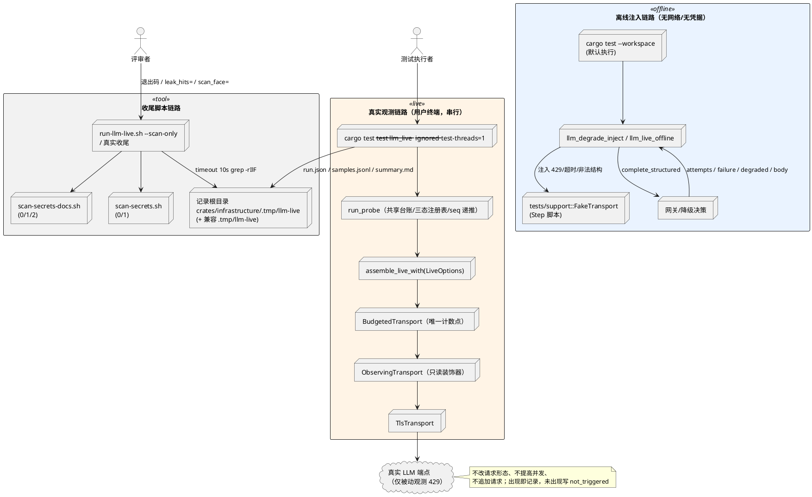
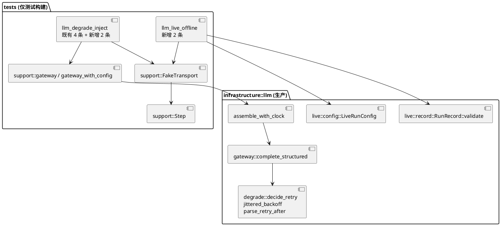
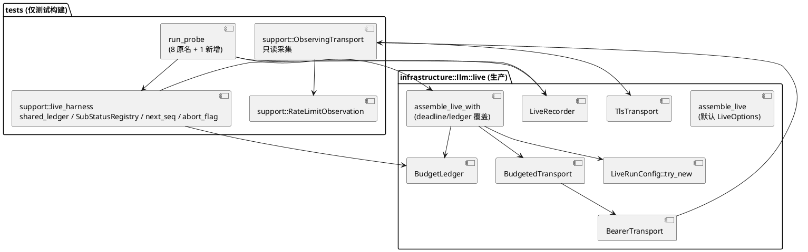
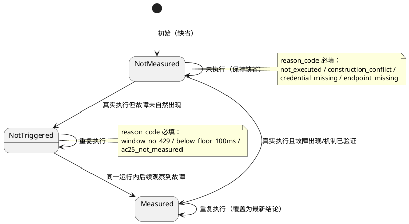
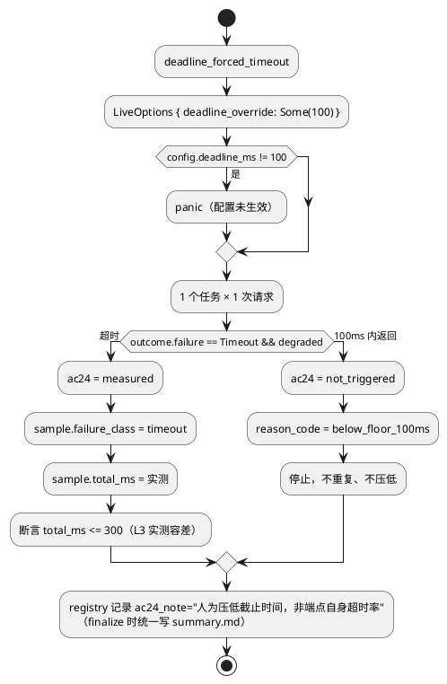
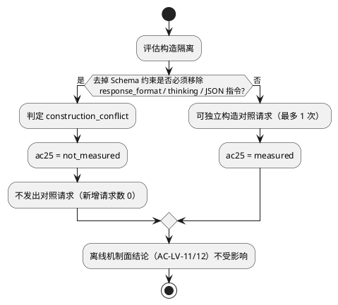
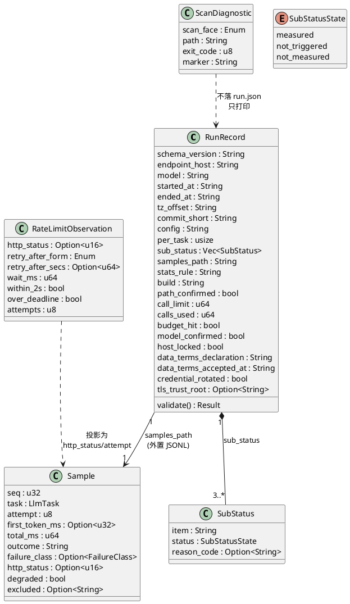
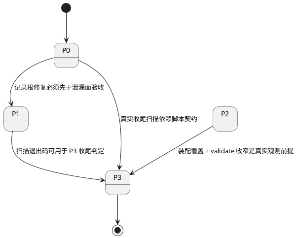

# 一、需求与存量功能关系分析

> **需求基线**：`.codeartsdoer/specs/llm_live_hardening/spec.md`（907 行，32 条 `AC-LV-01~AC-LV-32`，冲突 `X1~X7`，风险 `R1~R6`，已裁决 `X1/X4/X5/X6/X7`）。本文件只回答"如何落地"，不重复定义需求语义、不重新裁决已定事项。
>
> **既有权威口径**（只读）：`.codeartsdoer/specs/llm_gateway_degrade/spec.md` §11.7.1（三态定义）、§11.12.3-4（Schema 注入四要素共存）、§11.12.5（严格性保留）。
>
> **本阶段约束**：不修改任何代码、脚本、`.github/workflows/ci.yml`；`docs/sdd/**` 只读。文中代码片段是**实施阶段的契约描述**，不是本阶段产物。

## 1.1 需求功能与存量功能对比

### 1.1.1 已实现功能

| 需求功能 | 存量功能 | 代码位置 | 匹配度 |
|---|---|---|---|
| AC-LV-01 · 429 注入后不降级、重试 1 次 | `rate_limit_backoff`：注入 `Step::Status(429,[("Retry-After","1")])` + 1 条合法响应，断言 `attempts==2`、`requests==2`、`!degraded` | `crates/infrastructure/tests/llm_degrade_inject.rs:61-74` | 75%（缺"等待非零且不立即重试"的时长断言；合法 `Retry-After` 走固定等待而非抖动） |
| AC-LV-02 · 429 超预算立即降级 | `rate_limit_beyond_remaining_budget_degrades`：`Retry-After=5` + `deadline=2000` | `crates/infrastructure/tests/llm_degrade_inject.rs:76-89` | 50%（`Retry-After>2s` 先命中 `MAX_RETRY_AFTER` 分支，未覆盖"超过剩余截止"分支） |
| AC-LV-06 · 截止合法域下限 100ms | `LiveRunConfig::try_new(env, Some(100), ..)` 可接受、`Some(99)` 拒绝、默认 6000 | `crates/infrastructure/src/llm/live/config.rs:107-147`、`:196-205` | 100%（配置层）；装配层不可达（见 1.1.2） |
| AC-LV-07 · 单任务单次即止 | `run_probe` 每用例一次 `complete_structured` | `crates/infrastructure/tests/llm_live.rs:40-66`、`:99-103` | 25%（无请求计数断言；`deadline_forced_timeout` 仍用默认 6000） |
| AC-LV-11 · 两次非法后同类型兜底 | `invalid_schema_twice_degrades_with_same_shape` | `crates/infrastructure/tests/llm_degrade_inject.rs:106-117` | 100% |
| AC-LV-12 · 修复重试不降级 | `invalid_schema_repair`：首次 `{}`、第二次合法，`attempts==2` | `crates/infrastructure/tests/llm_degrade_inject.rs:91-104` | 75%（缺"修复提示只含 `path`/`rule`"的静态断言） |
| AC-LV-15 · 严格性不回退 | `deny_unknown_fields`、未知字段拒绝、AC-46 四组非法输出用例 | `crates/infrastructure/src/llm/schema.rs`、`tests/llm_schema.rs` | 100%（只需加"不删减"的静态比对） |
| AC-LV-30 · 三态载体结构 | `SubStatus` / `SubStatusState` / `RunRecord.sub_status` | `crates/infrastructure/src/llm/live/record.rs:14-27`、`:30-54` | 75%（结构具备，`llm_live` 只写 `ac35` 一项） |
| AC-LV-28 · 记录 23 键闭集 | `v2_key_set_is_closed` 用例 + `RunRecord` 字段集 | `crates/infrastructure/src/llm/live/record.rs:277-310` | 100% |
| AC-LV-31 · `seq` 字段存在 | `Sample.seq: u32` | `crates/infrastructure/src/llm/live/stats.rs:7-18` | 25%（`llm_live` 硬编码 `seq: 1`，见 `llm_live.rs:108`） |
| AC-LV-24 · 唯一计数点 | `BudgetedTransport` 在 `send`/`open_stream` 前 `try_acquire` | `crates/infrastructure/src/llm/live/budget.rs:88-114` | 75%（计数点正确；每用例新建台账导致会话总量失真） |
| 真实装配链路 | `assemble_live`：票据 → 配置 → Bearer → 预算 → 网关 → 记录器 | `crates/infrastructure/src/llm/live/mod.rs:59-103` | 75%（`LiveRunConfig::try_new(env, None, None, None)` 硬编码默认截止，见 `:67`） |
| AC-LV-16/20/21 · 扫描只输出 `文件:行号` | `scan_file` 用 `grep -nE` + `cut -d: -f1` + `sed` 拼路径 | `scripts/scan-secrets-docs.sh:39-47` | 100%（不回显内容） |
| AC-LV-17/18/22 · 扫描退出码三分 | `scan-secrets-docs.sh` 0/1/2；`scan-secrets.sh` 0/1 | `scripts/scan-secrets-docs.sh:153-164`、`scripts/scan-secrets.sh:41-46` | 75%（`--artifacts` 目录缺失 `return 0`，见 `scan-secrets-docs.sh:90-97`） |
| AC-LV-19 · 命中即 1 | `scan-secrets.sh` `FAIL=1` → `exit 1` | `scripts/scan-secrets.sh:23-27`、`:41-44` | 100% |
| AC-LV-29 · 差集只拦 removed | `test-name-inventory.sh --diff` 用 `comm -23`，新增条目不失败 | `scripts/test-name-inventory.sh:75-83` | 100% |
| AC-LV-28 · CI 只列举不执行 | `llm-https-compile (C2)` 仅 `--list` / `--list --ignored`，无 `--ignored` 执行、无 `LLM_*` 注入 | `.github/workflows/ci.yml:99-131`（断言在 `:113`） | 100%（下界断言 `-ge 8` 需随新增用例上调） |
| 零转录 · 日志字段白名单 | `ALLOWED_LLM_LOG_FIELDS = [failure_class,error_code,latency_ms,provider_id]` + 守卫用例 | `crates/domain/src/model/llm.rs:737-738`、`crates/infrastructure/tests/llm_logging_redaction.rs:27-54` | 100%（可直接复用，无需新增面） |
| 离线注入设施 | `FakeTransport` + `Step::{Json,Status,Fail,Delay,DelayThen,Sse,Empty}`，`requests()` 计数 | `crates/infrastructure/tests/support/mod.rs:28-163` | 100%（`AC-LV-01/02/11/12` 可直接复用，禁止新写第二套 mock） |
| 抖动退避已实现 | `jittered_backoff`：RateLimited 基 800ms、±20% → 640~960ms；`decide_retry` 截止优先 | `crates/infrastructure/src/llm/degrade.rs:83-128` | 100%（算法具备，`llm_degrade_inject` 未断言区间） |
| 确定性测试时钟 | `FakeClock::sleep` 只推进偏移、不真实睡眠；`now()` 返回 base+offset | `crates/infrastructure/src/llm/degrade.rs:158-200` | 100%（可用于断言等待时长） |
| 会话 `run_id` 共享 | `shared_run_id()` 进程内 `OnceLock`，8 个 ignored 用例同目录 | `crates/infrastructure/src/llm/live/run_id.rs:18-22` | 100% |
| 离线自检入口（文档扫描） | `scan-secrets-docs.sh --self-test` 双向断言且不回显 | `scripts/scan-secrets-docs.sh:130-146` | 100%（可复用其形态） |
| 记录目录相对路径与原子写 | `LiveRecorder::new` 固定 `.tmp/llm-live/<run-id>`；`atomic_write` 临时文件 + rename | `crates/infrastructure/src/llm/live/record.rs:111-124`、`:177-189` | 100% |
| `.tmp` 不入库 | `.gitignore:17` 覆盖 `.tmp/` | `.gitignore:17` | 100% |

### 1.1.2 需要扩展的功能

| 需求功能 | 存量功能 | 差异说明 | 扩展方向 |
|---|---|---|---|
| AC-LV-01 · 抖动区间与"不立即重试" | `rate_limit_backoff` 用合法 `Retry-After=1`，走 `Some(value)` 固定 1000ms | ① 输入差异：合法 `Retry-After` 不产生抖动；② 断言差异：未断言等待时长与"首次失败→第二次请求"的时间差；③ 边界差异：`Retry-After` 缺失/HTTP-date 走抖动分支未覆盖 | 保留用例名与"合法 `Retry-After` 精确等待"语义，补 `FakeClock` 差值断言；抖动分支另立新增用例（见 2.5-U1） |
| AC-LV-02 · 剩余截止不足 | 既有用例用 `Retry-After=5s` | 触发的是 `MAX_RETRY_AFTER(2s)` 上限分支，而非 `remaining < delay + MIN_ATTEMPT_BUDGET(50ms)` 分支 | 新增用例 `Retry-After=1s` + `deadline=300ms`，覆盖"剩余预算不足"（见 2.5-U2） |
| AC-LV-06/07/08/09 · 人为截止 | `assemble_live` 固定 `try_new(env, None, None, None)` | 装配层无法传 `deadline_override`；`deadline_forced_timeout` 使用 6000ms | 新增 `LiveOptions` + `assemble_live_with`（既有 `assemble_live` 签名与行为不变）；用例改用 100ms 并断言单次 |
| AC-LV-03/04/05 · 429 被动观测 | `rate_limit_observation` 只调 `run_probe`，无 429 观测载体 | ① 无 `Retry-After` 形式采集；② 无 `not_triggered` 三态写入；③ 无"出现即记录"载体 | 新增测试侧 `ObservingTransport`（只读装饰器，包装真实传输）+ 进程内观测槽 + `sub_status.ac23` upsert |
| AC-LV-13/14 · schema 真实对照 | `schema_violation_probe_once` 发 1 次合法请求 | 无"对照请求"分支，也无 `not_measured` 标注 | 设计裁决"不做对照"（见 2.4.3 与 2.4.3），用例保持零改动请求形态，新增零请求固化用例写 `ac25` |
| AC-LV-24/25 · 会话预算与增量 | 每用例独立 `BudgetLedger`，`run.json` 逐用例覆盖 | `calls_used` 只反映最后一个用例；无法验证"会话总请求数"与"新增增量 ≤2" | 新增进程级共享 `BudgetLedger`（`OnceLock`）+ `LiveOptions.ledger`；`run.json.calls_used` 改为会话累计 |
| AC-LV-29/31 · `seq` 唯一单调 | 硬编码 `seq: 1`，同目录多行重复 | 同一次运行目录内 `seq` 冲突 | 新增 `next_seq() = samples.jsonl 现有行数 + 1`（串行执行，`--test-threads=1`） |
| AC-LV-30 · 三项三态 | `sub_status` 仅 `ac35` 一项 | 缺 `ac23/ac24/ac25`；缺"未执行"缺省项 | 新增测试侧 `SubStatusRegistry`（三项全量写，缺省 `not_measured` + 原因码） |
| AC-LV-16~23 · 扫描面与退出码 | `run-llm-live.sh:54-61` 遍历 `.tmp/llm-live` + `${TMPDIR:-/tmp}`，`grep -RIlF` | ① 扫描面含系统临时目录（实测 `/tmp` 13,862 子目录、`timeout 30` rc=124）；② 仓库根路径与 crate CWD 记录位置不一致；③ `-R` 跟随符号链接；④ 无超时与三分退出 | 重写收尾段：`record_roots()` 单函数、`timeout 10s`、`-r`、`0/1/2` 优先级、`--scan-only` 自检（见 2.6） |
| AC-LV-17 · 记录目录缺失 | `scan-secrets-docs.sh:90-97` 目录不存在 `return 0` | "扫不到"被判"0 命中" | 显式传入目录时缺失即 2；无参 `--artifacts` 保持旧行为（CI 只用 `--all-md`，不受影响） |
| AC-LV-28 · CI 静态断言 | `ci.yml:113` `test "${live_count}" -ge 8` | 新增用例后需同步上调；缺"8 个原名逐字存在"断言 | 上调为 `-ge 9` + 逐名 `grep -q` + `--ignored`/`--nocapture`/`LLM_*` 零命中断言 |
| AC-LV-27 · 六面零转录 | 日志/审计白名单已具备；记录键集闭集已具备 | 缺"失败信息不回显 Key/URL/模型名"的统一码表；缺 `summary.md` 诊断面约束 | 复用 `ALLOWED_LLM_LOG_FIELDS`；失败信息只输出 `error_code` 级固定码；记录面只写白名单字段（见 2.4.1） |

### 1.1.3 需要新增的功能或接口

**A. 装配层（`crates/infrastructure/src/llm/live/mod.rs`）**

1. `LiveOptions`：`deadline_override: Option<u64>`、`samples_override: Option<usize>`、`concurrency_override: Option<usize>`、`ledger: Option<Arc<BudgetLedger>>`；默认全 `None`，语义与现状完全一致。
2. `assemble_live_with(ticket, env, transport, observer, clock, run_id, LiveOptions)`：唯一新增装配入口；`assemble_live` 改为以 `LiveOptions::default()` 委托，**签名与行为不变**，既有调用点（`llm_live.rs:80`、`llm_live_baseline.rs:46`）零改动。

**B. 记录层（`crates/infrastructure/src/llm/live/record.rs`）**

1. `RunRecord::validate` 的"未实测 ⇒ 零调用"规则由"任一子项 `not_measured`"收窄为"**全部子项均 `not_measured`**"（见 2.4.8 X-LV-01，附既有单测兼容证明）。
2. 新增单测 `partial_not_measured_allows_nonzero_calls`（离线，`cargo test -p ... --lib`）。

**C. 测试脚手架（`crates/infrastructure/tests/support/`，测试专用，禁止进入生产路径）**

1. `live_observe.rs`：`ObservingTransport`（实现 `HttpTransport`，包装真实传输，只读采集 `status`、`Retry-After` 原始串、请求时刻）+ `RateLimitObservation`（形式枚举 / 是否 ≤2s / 是否越过截止 / 最终分类 / 请求间隔）。
2. `live_harness.rs`：`shared_ledger(limit)`（`OnceLock<Arc<BudgetLedger>>`）、`SubStatusRegistry`（三项 upsert + `snapshot()`）、`next_seq(recorder)`、`abort_flag()`（401/403/网络/TLS 失败后置位）。
3. 上述模块只在 `tests/` 内被 `mod support;` 引用，不新增 crate 依赖、不进入 `src/`。

**D. 测试载体（既有文件内新增，不新增 target 文件）**

1. `tests/llm_live.rs` 新增 1 个 `#[ignore]` 用例（`--list --ignored` 由 8 → 9）。
2. `tests/llm_degrade_inject.rs` 新增 2 个离线用例。
3. `tests/llm_live_offline.rs` 新增 2 个离线用例。

**E. 脚本层（`scripts/`）**

1. `run-llm-live.sh`：`record_roots()` 单函数、`scan_one()` 超时与命中区分、`finish()` 退出码优先级、`--scan-only` / `--record-root DIR` / `--selftest-sample-rc N` 入口。
2. `scan-secrets-docs.sh`：`--artifacts <DIR>` 显式目录缺失 → 2（`credential_missing`/`record_dir_missing` 由调用方区分）。
3. 自检夹具：`scripts/fixtures/scan/{leak,clean,absent,symlink}`（仓库内相对路径，不入库敏感值，使用明显假值）。

**F. CI（`.github/workflows/ci.yml`，实施阶段修改）**

1. `llm-https-compile (C2)`：`live_count` 下界 8 → 9；新增 8 个原名的逐字 `grep -q` 断言；新增 `--ignored|--nocapture|run-llm-live` 与 `LLM_*` 零命中断言（静态断言，不执行）。

## 1.2 存量功能详细分析

### 1.2.1 `assemble_live`（`crates/infrastructure/src/llm/live/mod.rs:59-103`）

- **接口契约**：入参为 `AdmissionTicket` + `EnvView` + `Arc<dyn HttpTransport>` + `Arc<dyn LlmObserver>` + `Arc<dyn Clock>` + `run_id: &str`；出参 `LiveSession { gateway, ledger, recorder, config }`；异常为 `CopilotError::ProviderConfigInvalid` / `StoreFailure`。
- **业务规则**：`LiveRunConfig::try_new(env, None, None, None)`（`:67`）→ `LiveRecorder::new(run_id)`（`:68`）→ `BudgetLedger::new(config.call_budget)`（`:69`）→ `BearerTransport`（`:70`）→ `BudgetedTransport`（`:71`）→ `assemble_with_clock`（`:95-96`）。
- **扩展点**：`Arc<dyn HttpTransport>` 参数是**唯一既有注入点**，可在不触碰生产代码的前提下于外层包装只读装饰器；`LiveRunConfig::try_new` 的 `deadline_override/samples_override/concurrency_override` 已存在但未被装配层使用（`:109-114`）。
- **约束**：`llm_config.max_concurrency = 1` 写死（`:83`）；`request_timeout_ms = config.deadline_ms`（`:82`）；`call_budget = min(samples×12, cap)`（`config.rs:150-155`）。任何新增外发必须经 `BudgetedTransport`，不得另建 `TlsTransport::new()` 后直发（`AC-LV-24` 判定项）。

### 1.2.2 `RunRecord::validate`（`record.rs:60-85`）

- **接口契约**：入参 `&self`，出参 `Result<(), CopilotError>`；被 `write_run`（`:141`）在每次写前调用。
- **业务规则**：`schema_version == "llm.live.v2"`；`data_terms_declaration` 逐字等于常量；`data_terms_accepted_at` 形如 RFC3339；`tls_trust_root ∈ {None, ok, tls_trust_root, other}`；**`:76-82` 若任一 `sub_status.status == NotMeasured` 则 `calls_used == 0 && !budget_hit`**。
- **扩展点**：无钩子；校验为纯函数式，无 IO。
- **约束（关键）**：`AC-LV-30` 要求在**同一次真实运行**的 `run.json` 中同时存在 `ac23/ac24/ac25` 三项，且 `AC-LV-13` 要求 `ac25` 可为 `not_measured + construction_conflict`。这与上述"任一 `not_measured` ⇒ `calls_used == 0`"直接冲突：该次运行必然有真实调用（`ac23`/`ac24` 需真实样本）。冲突处理见 2.4.8 X-LV-01。
- **既有三态语义来源**（只读）：`llm_gateway_degrade/spec.md:911-919` 明确三态是**逐子项**标注，"未实测"的"禁止填写数值"约束的是该子项自身数值，不是整次运行的总请求数。因此上述耦合属于实现层过度约束，可在不改变"整次未执行 ⇒ 零调用"强约束的前提下修正。

### 1.2.3 记录载体与 `seq`（`record.rs:101-175`、`stats.rs:7-18`）

- **接口契约**：`LiveRecorder::new(run_id)` 只接受不含 `/`、`\`、`..` 的片段（`:113-120`）；`root = ".tmp/llm-live/<run-id>"`（`:121-123`）；`append_sample` 以 `OpenOptions::append` 追加一行 JSONL（`:151-166`）；`write_run` 原子替换 `run.json`（`:140-149`、`:177-189`）。
- **业务规则**：目录按 `run_id` 隔离；同进程中 `shared_run_id()` 固定（`run_id.rs:18-22`），故 8 个 ignored 用例写同一目录。
- **约束**：`seq` 由调用方给出（`llm_live.rs:108` 硬编码 `1`），记录器不做唯一性校验；`per_task` 由调用方按"读 `samples.jsonl` 行数"计算（`llm_live.rs:120-122`），在 `run.json` 覆盖写模式下不会累积。`AC-LV-31` 要求同目录 `seq` 唯一单调，必须由调用方引入递推。

### 1.2.4 预算台账与 `calls_used`（`budget.rs:26-114`）

- **接口契约**：`BudgetLedger::try_acquire` 原子递增、不回收（`:45-61`）；`BudgetedTransport` 在 `send`/`open_stream` 前置计数（`:88-114`）。
- **业务规则**：失败与重试同样计数（`:1-3` 注释与 `:95-99`）；`BudgetExhausted` 在到达上限后不再外发（`:95-98`、`:100-101`）。
- **约束**：台账实例由每次 `assemble_live` 新建（`mod.rs:69`），故跨用例不累计；`run.json` 的 `calls_used` 取 `session.ledger.used()`（`llm_live.rs:144`）只反映**最后一个用例**的台账。`AC-LV-24` 要求 `calls_used` 等于实际 HTTP 请求数、`AC-LV-25` 要求会话增量可判定，必须引入进程级共享台账。

### 1.2.5 真实探针（`tests/llm_live.rs`）

- **接口契约**：`run_probe(task, stream)` → `admit` → `live_call` → `append_sample` + `write_run`；Skip/Reject 只打印"未实测"/"拒绝"并返回（`:40-66`），退出码 0。
- **业务规则**：`transport_available() = cfg!(feature = "llm-https")`（`:36-38`）；`live_call` 固定 `seq: 1`（`:108`）、`sub_status = [ac35/measured]`（`:134-138`）、`per_task = 样本行数`（`:120-122`）、`calls_used = ledger.used()`（`:144`）。
- **约束**：8 个用例名已被 `docs/progress/test-names-before.txt:303-310` 冻结，**改名即触发差集门禁 `removed`**；`deadline_forced_timeout` 使用 `session.config.deadline_ms`（`:95` → 默认 6000），与 `AC-LV-06` 的 100ms 冲突；`schema_violation_probe_once` 发送合法载荷（`:205-209` → `run_probe(LlmTask::MinutesDraft, false)`），未构造任何违规。
- **可利用点**：`run_probe` 是唯一入口，所有用例共用；把"三态 upsert / `seq` 递推 / 共享台账 / 中止标志"集中在 `run_probe` 内实现，可一次性满足 8 个原有用例与新增用例，且不改名。

### 1.2.6 离线注入设施（`tests/support/mod.rs:28-163`）

- **接口契约**：`FakeTransport::new(Vec<Step>)`；`Step::{Json, Status(u16, headers, body), Fail(TransportError), Delay(Duration), DelayThen(..), Sse, Empty}`；`requests()` 计数器；`send`/`open_stream` 各自计数（`:93-163`）。
- **业务规则**：`Step::Delay` 若 `now + duration >= deadline` 立即返回 `ReadTimeout`，**不真实睡眠**（`:73-79`）；脚本耗尽后返回 `Step::Empty` → `{}`（`:56-63`），便于断言"第二次请求已发生"。
- **约束**：`AC-LV-01` 的等待时长无法由 `Step` 断言，必须用 `FakeClock` 的 `now()` 差值；`Step::Status` 的 headers 已是 `Vec<(String,String)>`，可直接构造 `Retry-After` 缺失/数字/HTTP-date 三态。

### 1.2.7 扫描脚本（`scripts/run-llm-live.sh`、`scripts/scan-secrets-docs.sh`）

- **接口契约**：`run-llm-live.sh` 无位置参数；前置 8 项检查后执行 `cargo test ... -- --ignored --test-threads=1`（`:20-52`）；收尾扫描（`:54-82`）；退出码由末段决定（`:84-90`）。`scan-secrets-docs.sh` 支持 `--all-md` / `--artifacts [DIR]` / `--self-test`，退出 0/1/2（`:1-4`、`:153-164`）。
- **业务规则（缺陷定位）**：
  1. `:56` 的 `for target in ".tmp/llm-live" "${TMPDIR:-/tmp}"`：仓库根 `.tmp/llm-live` 通常不存在（记录实际落在 crate CWD），而 `${TMPDIR}` 必扫且不可控。
  2. `:57` 的 `grep -RIlF`：`-R` 跟随符号链接，可能扩出仓库。
  3. `scan-secrets-docs.sh:90-97`：目录不存在 `return 0`，把"未生成记录"判为"0 命中"。
  4. `:71` 的 `bash scripts/scan-secrets-docs.sh --all-md --artifacts` 未传目录，用的是脚本内默认 `.tmp/llm-live`（仓库根），同样扫空。
  5. `:84-89` 的退出码顺序为"采样 rc → 泄漏 → 0"，`DOC_RC=2` 在 `:73-76` 提前 `exit 2`，但"命中 + 采样失败"会先 `exit 1`（`:77-80`），"超时 + 采样失败"也会 `exit 2`，与 `AC-LV-22` 的优先级**部分**一致但缺少统一的优先级函数，且 `LEAKS` 只计数不区分"扫描面缺失"。
- **约束**：必须兼容 bash 3.2+（无 `${var,,}`、无数组负索引）；行尾 LF；`grep -f -` 从 stdin 读模式在 git-bash 与 GNU grep 下均可用；`timeout` 来自 coreutils（git-bash 自带），rc=124 为超时唯一来源；空 `LLM_API_KEY` 会产生空 pattern（匹配所有行），必须先拦截。

### 1.2.8 CI 静态面（`.github/workflows/ci.yml:99-131`）

- **接口契约**：C2 先列 `llm_live_baseline`（断言含 `baseline_30_samples_per_task`），再列 `llm_live --list --ignored` 并 `test -ge 8`（`:110-113`），最后列 baseline ignored `-ge 1`（`:114-117`）；产物写入 `RUNNER_TEMP/llm-https-coverage-*.txt` 供 `feature-coverage` 校验。
- **业务规则**：`grep -cE ': test$'` 统计用例条目；下界断言是"只增不减"的宽松门禁。
- **约束**：C2 不得出现 `--ignored` 执行、`--nocapture`、`run-llm-live`、`LLM_*`（`AC-LV-28` 判定）；`test-name-inventory (C3)` 以 365 行基线做差集（`:164-170`），只拦 removed。
# 二、增量设计方案

## 2.1 实现模型

### 2.1.1 上下文视图

两条链路**物理分离**：离线注入链路不触碰网络、不读凭据；真实观测链路只在用户终端执行，且只做 1 次短截止请求与 1 次被动观测请求。脚本链路只在本地收尾。



**通信协议与频率**：离线链路为进程内函数调用（每次 `cargo test` 全量执行，累计 <5s）；真实链路为 HTTPS（单次运行 ≤ 既有 11 次 + 新增 0 次，串行 `concurrency=1`）；脚本链路为本地文件系统遍历（单次 ≤10s）。

### 2.1.2 服务/组件总体架构

**（a）离线注入链路组件**



要点：离线链路**不新增 mock**（`spec 4.4-4`），`Step` 与 `FakeTransport` 已是唯一脚本化传输；新增用例只是组合既有 `Step` 并补断言。`LiveRunConfig` 的范围校验与 `RunRecord::validate` 可直接离线断言，无需装配真实传输。

**（b）真实观测链路组件**



要点：
1. `ObservingTransport` 位于 `BearerTransport` 之外、`TlsTransport` 之内（`Bearer → Observing → Tls`），因此能看到原始响应状态与 `Retry-After` 头，且**不改变**请求形态。
2. `BudgetedTransport` 仍在链路上（`assemble_live_with` 内部构造），任何外发都先 `try_acquire`，满足 `AC-LV-24`。
3. `LiveOptions.ledger = Some(shared_ledger(limit))` 后，跨用例累计 `used()`，`run.json.calls_used` 即会话总量。
4. `deadline_override = Some(100)` 只影响该用例的 `request_timeout_ms` 与 `Request.deadline`，默认 `None` 时仍为 6000，`AC-LV-06` 的"不得沿用默认"与"不改默认值"同时满足。

### 2.1.3 实现设计文档

**（a）三态状态机（`sub_status` 单项）**



**三态缺省与初始化裁决**：

| 子项 | 初始值 | 初始 `reason_code` | 置位者 |
|---|---|---|---|
| `ac23` | `not_measured` | `not_executed` | `rate_limit_observation`（既有用例，真实执行后置 `not_triggered` 或 `measured`） |
| `ac24` | `not_measured` | `not_executed` | `deadline_forced_timeout`（100ms 后置 `measured` 或 `not_triggered/below_floor_100ms`） |
| `ac25` | `not_measured` | **`construction_conflict`** | 设计裁决即确定（见 2.4.3），无执行依赖 |
| `ac35`（既有） | `measured` | — | 既有 8 用例（保持不变） |

关键：`ac25` 的缺省值取 `construction_conflict` 而非 `not_executed`，使 `AC-LV-13` 的"二选一必居其一"在**任意用例执行顺序**下都成立，不依赖 `ac25` 固化用例最后执行。

**（b）`ac23` 真实被动观测流程（分支与触发条件）**

```plantuml
@startuml
start
:run_probe(rate_limit_observation);
:admit 判定;
if (Skip / Reject) then (是)
  :打印 未实测 / 拒绝;
  :ac23 = not_measured + gate 原因码;
  stop
endif
:assemble_live_with(默认选项, ObservingTransport);
:1 次合法请求（形态不变、并发 1）;
:读取 Outcome + Observation;
if (http_status == 429) then (出现)
  :ac23 = measured;
  :reason_code = rate_limited_observed;
  :registry 记录 retry_after_form / wait_ms /
   within_2s / over_deadline / attempts
   （finalize 时统一写 summary.md）;
else (未出现)
  :ac23 = not_triggered;
  :reason_code = window_no_429;
  :registry 记录 window_requests=1; endif
:append_sample(seq=next_seq, http_status, attempt, total_ms);
:registry.finalize → write_run;
stop
@enduml
```

触发条件与处理策略：
- `Retry-After` 形式枚举：`seconds`（纯数字秒）/ `http_date` / `missing` / `invalid`；由测试侧复用 `degrade::parse_retry_after` 判定（只调用纯函数，不复制算法）。
- "是否 ≤2s"：由 `parse_retry_after` 结果与 `MAX_RETRY_AFTER` 比较；`None` 时记 `n/a`。
- "是否越过截止"：用 `decide_retry(class, attempt=1, remaining, retry_after, request_id)` 在测试侧复算，只读纯函数，不影响生产决策。
- "实际等待时长"：`ObservingTransport` 记录两次请求的 `Instant` 差值；未发生第二次请求则记 `0`。

**（c）`ac24` 人为截止流程（单任务单次）**



**（d）`ac25` 对照请求裁决流程**



本设计裁决走**左分支**：`llm_gateway_degrade/spec.md:1314-1315` 要求 JSON 指令、Schema 本体、`thinking.type == disabled`、`response_format.type == json_object` 四者必须同时存在；"无结构约束的对照请求"必须在构造上移除其中至少一项，与 `AC-43`/`AC-46` 的"同一构造规则"直接冲突。因此不做真实对照（详见 2.4.3）。

**（e）扩展点设计**

| 扩展点 | 位置 | 默认实现 | 变更影响 |
|---|---|---|---|
| `LiveOptions` | `live/mod.rs`（新增） | 全 `None`，与现状等价 | 只增不改；既有调用点零改动 |
| `assemble_live_with` | `live/mod.rs`（新增） | 委托 `try_new(env, None, None, None)` | 唯一新增装配入口 |
| `assemble_live` | `live/mod.rs:59` | 改为 `assemble_live_with(.., LiveOptions::default())` | 签名、返回、错误语义不变 |
| `Arc<dyn HttpTransport>` 参数 | `assemble_live` 既有 | 直接传 `TlsTransport` | 测试侧可传只读装饰器 |
| `SubStatusRegistry` | `tests/support/`（新增） | 三项全量快照 | 只存在测试侧，不进生产 |
| `record_roots()` | `scripts/run-llm-live.sh`（新增） | crate 根优先、仓库根兼容 | 单一来源 |

**（f）事务与一致性设计**

1. `run.json` 仍走 `atomic_write`（写 `.tmp` 再 `rename`），不引入部分写；`samples.jsonl` 仍为追加写，崩溃最多丢失当前行。
2. 三态注册表在进程内 `Mutex`，每次 `write_run` 都写**三项全量快照**，因此并发/顺序变化不会出现"只写了自己那一项"的残缺记录（`AC-LV-30`）。
3. `seq` 递推用"读 `samples.jsonl` 行数 + 1"，并且只在 `--test-threads=1` 下使用（脚本与文档都固定串行）；`AC-LV-31` 的判定命令会再兜底校验唯一性。
4. 中止采用"标志位 + 入口检查"：任一用例检测到 401/402/403、DNS/网络不可达、TLS 失败即置 `abort_flag`，后续 `run_probe` 在 `admit` 之后、构造传输之前直接返回并写 `reason_code=aborted_*`；`calls_used` 自然停止增长（`AC-LV-26`）。这比依赖 `cargo test` 的进程调度更可靠，同时脚本仍加 `--fail-fast` 作为第二道闸。
5. `summary.md` 是**整体覆盖写**（`record.rs:168-175` 经 `atomic_write`），不得由各用例分别调用；必须由 `SubStatusRegistry::finalize` 在写 `run.json` 的同一步**一次性**生成内容（`CREDENTIAL_RISK` 首行由 `write_summary` 保留），内容仅含 `ac23_*`/`ac24_*` 固定键值与"人为压低截止时间"标注，避免后写覆盖先写导致诊断丢失。

## 2.2 接口设计

### 2.2.1 总体设计

| 接口 | 归属 | 稳定性 | 调用方 | 说明 |
|---|---|---|---|---|
| `LiveOptions` | 生产 crate（新增） | 稳定 | 测试 | 装配覆盖项，全 `Option`，默认等价现状 |
| `assemble_live_with` | 生产 crate（新增） | 稳定 | 测试 | 唯一新增装配入口 |
| `assemble_live` | 生产 crate（既有） | 稳定（不变） | 测试 | 委托新增入口，零改动调用点 |
| `RunRecord::validate` | 生产 crate（既有） | 稳定（语义收窄） | `write_run` | 见 2.4.8 X-LV-01 |
| `record_roots()` | 脚本（新增） | 稳定 | 脚本自身 | 记录根唯一来源 |
| `--scan-only` / `--record-root DIR` / `--selftest-sample-rc N` | 脚本（新增） | 实验 | 测试执行者、自检 | 零真实调用、零真实凭据 |
| `ObservingTransport` / `RateLimitObservation` | 测试（新增） | 实验 | `run_probe` | 只读装饰器与观测载体 |
| `SubStatusRegistry` / `shared_ledger` / `next_seq` / `abort_flag` | 测试（新增） | 实验 | `run_probe` | 会话级共享状态 |

变更策略：生产侧只做**加法**（`LiveOptions`、`assemble_live_with`）与**一处语义收窄**（`validate`），不删除、不改名、不新增依赖。

### 2.2.2 接口清单

#### A. `LiveOptions`（`crates/infrastructure/src/llm/live/mod.rs`）

```rust
pub struct LiveOptions {
    pub deadline_override: Option<u64>,
    pub samples_override: Option<usize>,
    pub concurrency_override: Option<usize>,
    pub ledger: Option<Arc<BudgetLedger>>,
}

impl Default for LiveOptions {
    fn default() -> Self;
}
```

- **业务说明**：供真实用例显式覆盖截止时间与复用会话台账；`Default` 与现状完全一致。
- **前置条件**：`deadline_override` 若给出必须落在 `100..=8000`（由 `LiveRunConfig::try_new` 校验，`config.rs:141-143`）。
- **后置条件**：`session.config.deadline_ms` 等于覆盖值；`session.ledger` 指向传入台账（若给出）。
- **异常映射**：越界 → `CopilotError::ProviderConfigInvalid`，`detail` 只含字段名与规则（`config.rs:77-81`），不含端点/凭据。
- **调用示例**（契约形态，不含函数体）：

```rust
let options = LiveOptions {
    deadline_override: Some(100),
    ledger: Some(shared_ledger(ticket.call_limit)),
    ..LiveOptions::default()
};
let session = assemble_live_with(&ticket, &env, transport, observer, clock, &run_id, options)?;
```

#### B. `assemble_live_with`（`live/mod.rs`）

```rust
pub fn assemble_live_with(
    ticket: &AdmissionTicket,
    env: &dyn EnvView,
    transport: Arc<dyn HttpTransport>,
    observer: Arc<dyn LlmObserver>,
    clock: Arc<dyn Clock>,
    run_id: &str,
    options: LiveOptions,
) -> Result<LiveSession, CopilotError>;
```

- **业务说明**：按 `LiveOptions` 装配；`ledger` 为 `None` 时新建（现状），为 `Some` 时复用。
- **前置条件**：`ticket` 只可能来自 `Admission::Admit`（`gate.rs:207-256`）。
- **后置条件**：`session.ledger.used()` 在共享台账下跨调用累加；`session.config` 反映覆盖值。
- **异常映射**：配置/存储错误同 `assemble_live`。
- **不变式**：`max_concurrency` 恒为 1（`mod.rs:83`），即使 `concurrency_override = Some(1)` 也不改变。

#### C. `RunRecord::validate`（语义收窄）

```rust
// 现状：任一 NotMeasured ⇒ calls_used == 0 && !budget_hit
// 目标：全部 NotMeasured ⇒ calls_used == 0 && !budget_hit
pub fn validate(&self) -> Result<(), CopilotError>;
```

- **业务说明**：把"整次运行未执行"与"某子项未实测"解耦；单项 `not_measured` 不再要求整次零调用。
- **前置条件 / 后置条件**：签名与错误类型不变；`schema_version`、`data_terms_*`、`tls_trust_root` 校验不变。
- **异常映射**：仅 `CopilotError::ProviderConfigInvalid`，`detail` 只含字段名与规则。
- **兼容证明**：既有全部单测在三种组合下结论不变——全 `not_measured` + 0 调用（`record.rs:313-320`、`llm_live_offline.rs:114-200`）仍通过；全 `measured` + 非零调用（`record.rs:342-353`）仍通过；无"部分 `not_measured` + 非零调用"的既有用例，故不产生行为回退（详见 2.4.8 X-LV-01）。

#### D. `record_roots()`（`scripts/run-llm-live.sh`）

```text
record_roots() -> 按优先级输出（每行一个，仓库相对、正斜杠）：
  1) crates/infrastructure/.tmp/llm-live      # cargo 以包根为测试进程 CWD
  2) .tmp/llm-live                            # 兼容候选（存在才扫）
```

- **业务说明**：记录根**唯一来源**；`--scan-only` 与真实收尾共用同一函数。
- **前置条件**：CWD 必须是仓库根（脚本 `:6-7` 已 `cd "${ROOT}"`）。
- **后置条件**：返回存在的目录列表；全不存在时由调用方置 `RECORD_DIR_MISSING=1`。
- **约束**：不得出现 `${TMPDIR}` 或任何系统临时目录；不得对 `record_roots()` 之外的路径调用 `grep`。

#### E. 脚本入口与退出码

| 入口 | 入参 | 行为 | 退出码 |
|---|---|---|---|
| 无参（真实模式） | `LLM_*` 环境变量 | 前置 8 项检查 → 采样（`--fail-fast`）→ 收尾扫描 | `0/1/2`（2 优先，其次 1，其次采样非 0） |
| `--scan-only` | `LLM_API_KEY`（可为假值）、可选 `--record-root DIR`、`--selftest-sample-rc N`、`LLM_LIVE_SCAN_TIMEOUT_S`、`LLM_LIVE_TIMEOUT_BIN` | 跳过采样，只执行收尾扫描 | 同上 |
| `--record-root DIR` | 仓库内相对路径 | 覆盖 `record_roots()`（自检/夹具用） | 非仓库内 → `2` + `record_root_outside_repo` |

标记串（`spec 4.4-1` 要求可 grep）：`leak_hits=<N>`、`scan_timeout`、`record_dir_missing`、`credential_missing`、`scan_face=<crate|repo>`。

#### F. 测试脚手架（`tests/support/`）

```text
ObservingTransport::new(inner: Arc<dyn HttpTransport>, slot: Arc<Mutex<Option<RateLimitObservation>>>)
RateLimitObservation { http_status, retry_after_form, retry_after_secs, wait_ms, within_2s, over_deadline, attempts }
shared_ledger(limit: u64) -> Arc<BudgetLedger>            // OnceLock，进程内唯一
SubStatusRegistry::upsert(item, status, reason_code)       // 三项固定槽位
SubStatusRegistry::snapshot() -> [SubStatus; 3]            // 每次都全量
next_seq(recorder: &LiveRecorder) -> u32                   // 读取 samples.jsonl 行数 + 1
abort_flag() -> &'static AtomicBool                        // 失败即停
```

- **约束**：全部位于 `tests/support/`，`#![allow(dead_code)]` 既有惯例；不新增 `Cargo.toml` 依赖；不写入 `src/`。
- **调用示例**：见 2.5 各用例的"注入点/断言"列。

## 2.3 数据模型

### 2.3.1 设计目标

1. **零转录**：所有新增载体的字段集必须是闭集且不含 `payload/content/prompt/request_id/URL/凭据`；`run.json` 顶层键恒为 23。
2. **可机器判定**：每条 `AC-LV-*` 都能由"用例名 + 退出码 + 记录字段 + 标记串"判定，无需人工阅读正文。
3. **与存量兼容**：`samples.jsonl` 的 10 键闭集、`run.json` 的 23 键闭集、`sub_status` 的枚举序列化形态均不变。
4. **容量与生命周期**：单次真实运行记录量级为百行 JSONL（既有 14~120 行），新增 ≤ 3 行；目录按 `run_id` 隔离、`atomic_write` 提交、`.tmp/` 由 `.gitignore` 覆盖。

### 2.3.2 模型实现



说明：
- `SubStatusState` 的 `serde(rename_all = "snake_case")` 既有实现（`record.rs:14-20`）保证落盘为 `measured/not_triggered/not_measured`，与 `AC-LV-30` 的判定字符串一致，**不得新增枚举变体**。
- `RateLimitObservation` 是**测试侧内存结构**，不落 `run.json`；其字段只能投影到既有 `Sample.http_status/attempt` 与 `summary.md` 的固定标记串，因此不破坏键集闭集。
- `ScanDiagnostic` 只以 stdout 标记串呈现（`scan_face=`、`path=`、`exit_code=`、`marker=`），**不写入任何文件**，避免新增记录载体。
- 对象生命周期：`SubStatusRegistry` 为进程级单例（`OnceLock`），随 `cargo test` 进程结束销毁；`BudgetLedger` 同进程唯一，内存计数；`LiveRecorder` 每次装配新建（指向同一 `run_id` 目录）；`run.json` 每次覆盖、`samples.jsonl` 只追加。
## 2.4 关键裁决

> **编号说明**：spec 有两套 `X` 编号——§9.2 主表（429 / 人为截止 / schema / 预算 / CI / 命名 / 扫描面）与"冲突补充表"（零转录 vs 模型名 / 记录目录双源 / `run.json` 闭集 / `seq` / 短截止 vs 装配默认 / 对照 vs 同一构造 / 新增用例 vs fail-fast）。本节以 `X-裁决-n` 指主表、`X-补充-n` 指补充表，避免同一编号指两件事。用户指令中"X2 最关键"指**补充表 X2（记录目录双源）**，见 2.4.2。

### 2.4.1 X-补充-1 · 零转录红线的落地机制

**裁决：三面松紧分区 + 单一字段白名单 + 失败信息码化。**

| 面 | 落地机制 | 具体约束 |
|---|---|---|
| 记录面（`run.json`/`samples.jsonl`） | 结构体字段即白名单 | `RunRecord` 23 键（`record.rs:30-54`）、`Sample` 10 键（`stats.rs:7-18`）不变；新增内容只能进 `sub_status[].item/status/reason_code` 与 `Sample.excluded`（取值限定为固定码：`control_request`、`aborted_unauthorized`、`aborted_network`、`aborted_tls`、`construction_conflict`）。`RunRecord.model` 允许运行期实际值（`spec 6.5` 收窄解释，显式确认：**只允许这一个字段，且该目录不入库、不上传、不作文本正文**） |
| 日志/审计/错误面 | 复用既有白名单 | 只允许 `ALLOWED_LLM_LOG_FIELDS = [failure_class,error_code,latency_ms,provider_id]`（`domain/src/model/llm.rs:737-738`）；新增用例**不得**直接 `println!` 任何 `CopilotError` 的 `Display` 原文，只输出 `error_code` 级固定码（`assembly_failed`/`gateway_failed`/`sample_write_failed`） |
| 报告/诊断面 | 固定标记串，无自由文本 | `summary.md` 只写 `ac23_*`/`ac24_*` 结构化键值（枚举与数值），不写请求正文、不写 URL、不写模型名；`stdout` 只写 `leak_hits=`/`scan_face=`/`调用数` |
| 代码/脚本/测试夹具 | 明显假值占位 | 自检夹具使用固定假值前缀（形如 `<FAKE_KEY>` 常量，长度不足以匹配 `sk-` 生产模式时另用显式模式），不得复用任何真实值片段 |
| `request_id` | 全禁 | 既有 `TaskId` 仅本地构造（`live-<task>-<n>`），不是端点 `request_id`；新增用例禁止打印 `outcome.request_id` |

**失败信息不回显 Key/URL/模型名的具体做法**：
1. `run_probe` 的失败分支统一走 `fn safe_code(error: &str) -> &'static str`：按已知前缀（`assembly:`/`gateway:`/`sample:`/`run.json`）映射为固定码，其余一律 `unknown`；**不透传 `{error}` 原文**（现状 `llm_live.rs:62-64`、`:103`、`:119`、`:156` 直接 `format!("{error}")`，属需改造点）。
2. `Admission::Skip/Reject` 只打印 `reason.code()`（既有实现已如此，`gate.rs:25-47`）。
3. `ObservingTransport` 只保存 `status` 与 `Retry-After` 的**形式枚举**，不保存 header 原文（HTTP-date 原文可能含时区串，统一归为 `http_date` 枚举）。
4. 静态守卫：`grep -nE 'println!.*\{error|format!\("\{error\}"' crates/infrastructure/tests/llm_live.rs` 在改造后 0 命中（纳入 `AC-LV-27` 的验收命令）。

**为什么记录面允许 `model`**：`AC-27`/`AC-29` 既有结论要求记录含模型名；`spec 6.5` 已给出收窄解释并登记为 `X1`。本设计确认该解释，并补充"`summary.md` 与报告面一律不写模型名"，避免"记录允许"被扩大（`R5`）。

### 2.4.2 X-补充-2 · 记录根解析的唯一方案（用户所指"X2"，最关键）

**裁决：单一来源 = 脚本内 `record_roots()` 函数；测试侧不改路径、不新增环境变量。**

**（a）事实基础**

| 事实 | 证据 |
|---|---|
| 记录器以相对路径 `.tmp/llm-live/<run-id>` 落盘 | `record.rs:121-123` |
| `cargo test` 运行测试二进制时 CWD 为**包根**（`crates/infrastructure`） | `docs/progress/b1-status.md:224` 实测"记录落在 `crates/infrastructure/.tmp/llm-live/<run-id>`" |
| 8 个 ignored 用例共享同一 `run_id` 目录 | `run_id.rs:18-22` + `llm_live.rs:79` |
| 脚本始终在仓库根执行 | `run-llm-live.sh:6-7` |
| 既有脚本只扫仓库根 `.tmp/llm-live`（通常不存在） | `run-llm-live.sh:56` + `b1-status.md:251` |

**（b）被否方案与理由**

| 方案 | 做法 | 否决理由 |
|---|---|---|
| B1 | 测试显式设置 `LLM_LIVE_RECORD_ROOT` 绝对路径，`LiveRecorder` 读取该变量 | ① 需改生产 `record.rs`（新增环境变量读取点），扩大生产语义；② 若用户不经脚本直接 `cargo test`，变量缺失 → 回退默认路径，脚本与测试仍有双源；③ 绝对路径含用户名，进入日志时触碰零转录边界 |
| B2 | 记录器同时写 crate 根与仓库根两份 | 违反"记录只写一处"的既有约束，且双份会破坏 `seq` 唯一性与 `AC-LV-31` |
| B3 | 脚本用 `find` 全仓库搜 `run.json` | 扫描面不受控，耗时不可保证 ≤10s（`AC-LV-23`） |
| **A（选定）** | 脚本按"crate 包根 → 仓库根"两个固定仓库内相对路径解析，单函数输出 | 不改生产代码；扫描面封闭、可静态断言 `TMPDIR` 零命中；一致性由离线守卫用例绑定 |

**（c）选定方案的三重保障（回答"为什么不会两处都扫不到 → 全判不可判定"）**

1. **解析优先级与兼容**：`record_roots()` 固定输出 `crates/infrastructure/.tmp/llm-live`（主）与 `.tmp/llm-live`（兼容）。只有**两者都不存在/不可读**才置 `RECORD_DIR_MISSING=1` → 退出 2。既有历史运行产生的仓库根目录仍可被扫到。
2. **常量与真实落点由离线用例绑定**：新增 `llm_live_offline::record_root_matches_crate_dir`（非 ignore、零 IO）断言两件事——`env!("CARGO_MANIFEST_DIR")` 的目录名为 `infrastructure` 且父目录名为 `crates`；`LiveRecorder::new("t").root()` 以 `.tmp/llm-live` 开头。任何 crate 改名/移动或记录相对路径变动都会让该用例失败，从而使脚本常量与实现**不可能静默分叉**。
3. **可判定的诊断面**：脚本每次输出 `scan_face=crate|repo` 与 `record_root=<相对路径>`；真实模式在采样后若主目录不存在，退出 2 并提示"可能未真实执行（`admit` 为 Skip）或 CWD 不在包根"，而不是输出 `leak_hits=0`。这把"扫不到"与"没泄漏"在**输出上**强制区分（`AC-LV-17`）。

**（d）残余风险与缓解**

| 风险 | 缓解 |
|---|---|
| 未来 `cargo` 改变 integration test 的 CWD 约定 | 守卫用例断言 `CARGO_MANIFEST_DIR` 与相对根；若 CWD 改变，真实用例的 `LiveRecorder` 落点会变，脚本主路径扫空 → 退出 2（不误判通过），并在 `b1-status` 记录后调整常量 |
| 用户在 crate 目录内直接跑脚本 | 脚本 `cd "${ROOT}"`，行为不变 |
| 仓库根存在陈旧 `.tmp/llm-live` 旧数据 | 兼容候选会把旧文件纳入扫描；这是**更严格**（可能命中旧假值并退出 1），需在验收时清理 `.tmp/` 或用 `--record-root` 指定 |
| `--record-root` 被滥用为仓库外扫描 | 入口校验：解析后的绝对路径必须以 `ROOT/` 开头，否则退 2 + `record_root_outside_repo` |

**（e）为什么不采用"由测试显式传 `LLM_LIVE_RECORD_ROOT`"**：它把"唯一来源"放到一个**可选**变量上，默认路径仍然存在；而 `spec 6.4` 要求"扫描面四类结果离线可判定"，可选的显式传递会让自检与真实运行走不同路径。选定方案中，脚本常量是**唯一**来源，测试侧只维护"相对路径 + 包根"两个既有事实，且由离线用例强绑定。

### 2.4.3 X-裁决-3 · schema 真实对照请求

**裁决：不做真实对照请求；`ac25 = not_measured + construction_conflict`。**

理由（引既有权威条款，不重新权衡需求）：
1. `llm_gateway_degrade/spec.md:1314-1315` 规定 JSON 指令、Schema 本体、`thinking.type == disabled`、`response_format.type == json_object` **四者必须同时存在于同一份构造规则**。
2. `AC-LV-13` 的对照请求语义是"无结构约束输入"；要在构造上去掉结构约束，必然移除上述四项之一（通常是 `response_format` 或 Schema 注入），直接违反 1。
3. 唯一替代是"独立第二套构造规则"，但 `spec 7.2-3`/`AC-LV-15` 禁止第二套 Schema 文本与放宽严格性（`11.12.3-2` 单一来源）。
4. 因此走 `AC-LV-13` 的 `IF 构造隔离不可行` 分支；`AC-LV-14` 的"机制面已判定、真实面 not_measured"自然成立。

**影响**：`schema_violation_probe_once` 保持原名与"1 次合法请求"行为不变（不改名、不改请求形态、不新增请求）；`ac25` 由缺省值直接给出，新增零请求固化用例只做断言与全量写盘。

### 2.4.4 X-裁决-4 · 预算与新增增量

**裁决：进程级共享台账；本特性新增真实请求为 0（预算上限 `spec 允许 ≤2` 的严格子集）。**

- `shared_ledger(ticket.call_limit)`：进程内 `OnceLock`，8+1 个 ignored 用例共用；`run.json.calls_used = ledger.used()` 变为**会话累计**，满足 `AC-LV-24`。
- `call_limit` 仍由 `admit` 计算（`min(samples×12, cap)`，`gate.rs:192-203`），`samples=30`、`cap=360` 时为 360（`AC-LV-24` 判定项），不因共享台账而改变。
- 新增/变更的真实请求数核算：

| 用例 | 现状请求数 | 改造后 | 增量 |
|---|---|---|---|
| `rate_limit_observation` | 1 | 1（同一请求外包只读装饰器） | 0 |
| `deadline_forced_timeout` | 1（6000ms） | 1（100ms） | 0 |
| `schema_violation_probe_once` | 1 | 1 | 0 |
| `ac25_control_request_skipped_construction_conflict` | — | 0 | 0 |
| 其余 5 个既有用例 | 各 1（`total_latency_four_tasks`/`schema_conformance_rate` 各 4） | 不变 | 0 |

合计新增 **0**，严格满足 `AC-LV-25` 的 `≤2`；验收记录写明"实际增量 0，优于上限 2"。

- `budget_hit` 语义不变：`used() >= limit()`（`llm_live.rs:145`）。触顶时后续用例 `try_acquire` 失败 → `BudgetExhausted` 降级样本，`calls_used` 不再增长（`AC-LV-26` 触顶即停）。

### 2.4.5 X-补充-5 · 截止覆盖接线

**裁决：新增 `LiveOptions.deadline_override`，`assemble_live` 默认 `None`。**

- 现有 `LiveRunConfig::try_new` 已支持覆盖并校验 `100..=8000`（`config.rs:140-143`）；缺口只在装配层（`mod.rs:67` 传 `None`）。
- 默认值保持 6000（`config.rs:140`），`AC-LV-06` 判定"`None` 仍为 6000"与"`Some(100)` 通过"、"`Some(99)` 拒绝"全部成立。
- 用例内二次断言：`session.config.deadline_ms == 100` 且 `request.deadline.value() == 100`（防止配置被装配层回落默认值）。

### 2.4.6 X-裁决-6 · 命名与共存

**裁决：8 个原名逐字保留；只新增 1 个 `#[ignore]` 用例；`--list --ignored` 由 8 → 9。**

- 既有 8 条已冻结于 `docs/progress/test-names-before.txt:303-310`，逐字引用不改。
- 新增 ignore 用例命名 `ac25_control_request_skipped_construction_conflict`：唯一映射 `AC-LLM-25`（满足 `spec 4.4-3` 的"唯一映射"），零请求，执行时只做"三态固化 + 断言 + 写盘"。
- 差集门禁：新增条目属 added，`comm -23` 不产出 → `removed=0`（`scripts/test-name-inventory.sh:75-83`）。
- 共存方式：9 个用例全部经 `run_probe`，共享 `run_id`/台账/三态注册表；执行顺序无关（缺省值已定义）。

### 2.4.7 X-补充-7 / X-裁决-7 · 失败即停

**裁决：三层闸门。**

1. 用例级：`abort_flag` 在 401/402/403、`NetworkUnreachable`、TLS 失败时置位；`run_probe` 入口检查后直接返回，写 `reason_code=aborted_*`、`Sample.excluded=aborted_*`，不再外发。
2. 运行器级：脚本采样命令追加 `--fail-fast`（libtest 支持），首个用例失败即停止后续用例。
3. 预算级：`BudgetExhausted` 由 `BudgetedTransport` 短路（`budget.rs:95-98`），不再外发。

`AC-LV-26` 判定"首个失败后无后续请求"由 1 保证（即使 2 失效也不会新增请求）。

### 2.4.8 新增冲突点与裁决（规格未识别）

| 编号 | 冲突点 | 冲突事实 | 裁决 | 对既有结论的影响 |
|---|---|---|---|---|
| `X-LV-01` | `RunRecord::validate` 与三项三态直接冲突 | `record.rs:76-82`："任一 `not_measured` ⇒ `calls_used==0`"；而 `AC-LV-30` 要求同一次运行同时含 `ac25=not_measured`，且该次运行必有真实调用 | 规则收窄为"全部子项 `not_measured` ⇒ 零调用"；`calls_used` 定义保持"整次运行实际请求数"（`AC-31` 语义） | 三种既有组合结论不变（见 2.2.2-C 兼容证明）；新增单测锁定 |
| `X-LV-02` | 抖动区间数值与实现不一致 | `spec 5.1.1-1` 与 `AC-LV-01` 写"800~960ms"；实现 `jittered_backoff`：基 800 ±20% → **640~960ms**（`degrade.rs:113-128`） | **不改生产退避算法**（该算法是既有 AC-LLM-23 离线结论的载体）；断言取实现合法域 `[640,960]` 且 `>0`，并在验收记录注明"区间下界差异"。同时保留既有 `rate_limit_backoff` 的"合法 `Retry-After` 精确 1000ms"断言 | 既有 `jitter_is_deterministic`（`degrade.rs:415-424`）不变 |
| `X-LV-03` | 空凭据 pattern | `printf '%s\n' "" | grep -f -` 会匹配所有行 | 扫描前强制非空且非纯空白，否则退 2 + `credential_missing`（`spec 5.4.3-4`） | 无（既有脚本同样有此隐患，本次一并修） |
| `X-LV-04` | `grep -f -` 与进程替换兼容 | git-bash 支持 `<(...)`，但 bash 3.2 与部分环境对 `timeout` 包裹进程替换的行为不一致 | 统一用**管道**：`printf '%s\n' "$KEY" \| timeout "${budget}s" grep -rIlF -f - "$root"`；不使用 `<(...)` | 无 |
| `X-LV-05` | 三态缺省项的原因码 | `AC-LV-30` 要求非 `measured` 必填 `reason_code`，但未规定"未执行"的取值 | 固定 `not_executed`（`ac23`/`ac24`）；`ac25` 固定 `construction_conflict` | 无 |
| `X-LV-06` | 扫描超时预算跨两个目录 | `AC-LV-23` 要求总耗时 ≤10s，若每个目录各 `timeout 10s` 最坏 20s | 用 `SECONDS` 维护总预算（bash 3.2 可用）：每次 `timeout` 用剩余预算，剩余 ≤0 直接 `scan_timeout` | 无 |
| `X-LV-07` | Windows 无法创建符号链接 | `AC-LV-21` 需要符号链接夹具 | 优先 `ln -s`；失败时用目录联接（`mklink /J`）；两者都失败则**不判通过**，输出 `symlink_unsupported_on_host` 并退 2（不可判定） | 无（不把"未验证"记为通过） |
| `X-LV-08` | 共享台账改变既有"每用例 `calls_used`"读数 | 现状 `run.json.calls_used` 是单用例台账 | 会话累计更严格且符合 `AC-31`；30 样本基线由 `llm_live_baseline` 独立 `run_id` 生成，不受影响（`llm_live_baseline.rs:45`） | AC-20/21/22 结论与 30 样本基线不变 |

## 2.5 用例清单（输入 / 注入点 / 断言 / 产物 / 耗时）

### 2.5.1 新增用例（5 个）

| 编号 | 用例名 | 目标 AC | 输入 | 注入点 | 断言 | 产物字段 | 期望耗时上限 | 忽略状态 |
|---|---|---|---|---|---|---|---|---|
| U1 | `rate_limit_backoff_jitter_without_retry_after` | `AC-LV-01` | `Step::Status(429, [], "")` + 1 条合法 `Step::Json`；`deadline=6000` | `tests/support::FakeTransport`；`gateway_with_config(..., FakeClock)` | `requests==2`；`attempts==2`；`!degraded`；`FakeClock` 前后差值 ∈ `[640,960]ms` 且 `>0`（即不立即重试） | 无落盘；`transport.requests()`、`clock.now()` 差值 | <50ms | 不忽略（L1） |
| U2 | `rate_limit_retry_after_exceeds_remaining_deadline` | `AC-LV-02` | `Step::Status(429, [("Retry-After","1")], "")`；`deadline=300`；步骤仅 1 条 | 同上 | `requests==1`；`failure==RateLimited`；`degraded==true`；无第二次请求 | `outcome.failure`、`transport.requests()` | <50ms | 不忽略（L1） |
| U3 | `deadline_floor_100ms_only` | `AC-LV-06` / `AC-LV-07` | `MapEnv` 完整假值 + `LiveRunConfig::try_new(Some(100))`；`FakeTransport` 3×`Step::Delay(3s)` | `live/config` + `support::gateway` + `support::request(env, deadline=100)` | `config.deadline_ms==100`；`try_new(Some(99))` 报错；`try_new(None)` 仍 6000；`requests<=3`（受 `retry_allowance(Timeout)=2` 约束）；`deadline` 字段 == 100；`failure==Timeout`；`degraded` | 无落盘；`LiveRunConfig`、`transport.requests()` | <50ms（`Step::Delay` 不真实睡眠） | 不忽略（L1） |
| U4 | `record_root_matches_crate_dir` | `AC-LV-16`（X-补充-2 守卫） | 无环境依赖 | `env!("CARGO_MANIFEST_DIR")`、`LiveRecorder::new("t")` | `CARGO_MANIFEST_DIR` 目录名 `infrastructure`、父目录名 `crates`；`recorder.root()` 以 `.tmp/llm-live` 开头；`samples_path` 文件名为 `samples.jsonl` | 无（不创建目录，`new` 不触盘） | <10ms | 不忽略（L1） |
| U5 | `ac25_control_request_skipped_construction_conflict` | `AC-LV-13` / `AC-LV-14` / `AC-LV-28` / `AC-LV-30` | `LLM_*` 环境变量（缺失则 Skip） | `admit` → `assemble_live_with(默认)` → `SubStatusRegistry` → `write_run` | 执行前后 `ledger.used()` 增量 == 0；`registry[ac25] == not_measured/construction_conflict`；回读 `run.json` 的 `sub_status` 含三项；`calls_used` 未因本用例增长 | `run.json.sub_status`（三项）、`run.json.calls_used` | 本地 <50ms；不发起任何 HTTP | **`#[ignore]`**（L3 记录面） |

**注**：
1. U1 用"`Retry-After` 缺失"触发抖动分支（走 `jittered_backoff`），与既有 `rate_limit_backoff` 的"合法 `Retry-After=1` 精确 1000ms"形成互补；两者的"仅重试 1 次、不降级"一致。
2. U2 用 `Retry-After=1s` + `deadline=300ms` 精确命中 `remaining < delay + MIN_ATTEMPT_BUDGET` 分支（`degrade.rs:104-107`），与既有 `rate_limit_beyond_remaining_budget_degrades`（`Retry-After>2s` 命中 `MAX_RETRY_AFTER` 分支）互补。
3. U3 的 3 次 `Step::Delay` 只用于离线验证"截止优先 + 超时分类 + 重试上限"，**不构成 `AC-LV-07` 的"真实单次"判定**；`AC-LV-07` 的"1 个任务 1 次请求"由 L3 的 `deadline_forced_timeout` 判定（`calls_used` 增量 1）。
4. U4 只做路径与常量断言，不创建目录、不读记录内容；U5 零 HTTP 请求，仅写 `run.json` 与断言。

### 2.5.2 既有用例的增强（不改名）

| 用例名（逐字保留） | 增强内容 | 对应 AC | 请求数变化 |
|---|---|---|---|
| `run_gate_skips_without_live` | 走 `run_probe` 新入口；Skip/Reject 分支打印固定码；`registry` 三项缺省写盘 | `AC-LV-30` | 0 → 0 |
| `first_token_latency_p50_p95` | `seq = next_seq()`；共享台账 | `AC-LV-24/31` | 1 → 1 |
| `total_latency_four_tasks` | `seq` 递推；共享台账；中止标志检查 | `AC-LV-24/26/31` | 4 → 4 |
| `schema_conformance_rate` | 同上 | `AC-LV-24/26/31` | 4 → 4 |
| `rate_limit_observation` | 外包 `ObservingTransport`；`ac23` 三态 upsert；观测键值交 `registry`（`finalize` 统一写 `summary.md`）；`http_status` 保证为整数 | `AC-LV-03/04/05` | 1 → 1 |
| `deadline_forced_timeout` | `LiveOptions { deadline_override: Some(100) }`；单次；`ac24` 三态；人为性标注交 `registry`（`finalize` 统一写 `summary.md`）；断言 `total_ms`（L3 实测） | `AC-LV-06/07/08/09/10` | 1 → 1 |
| `schema_violation_probe_once` | 保持 1 次合法请求；不构造对照；`ac25` 由缺省值给出 | `AC-LV-13/14/15` | 1 → 1 |
| `record_is_recomputable` | `seq` 递推；共享台账；`per_task` 按实时行数 | `AC-LV-24/31` | 1 → 1 |
| `rate_limit_backoff`（离线） | 增补 `FakeClock` 精确等待断言（合法 `Retry-After=1` → 1000ms）、`requests==2` | `AC-LV-01` | 0（离线） |
| `rate_limit_beyond_remaining_budget_degrades`（离线） | 保持；补 `attempt==1`、无第二次请求 | `AC-LV-02` | 0（离线） |
| `invalid_schema_repair`（离线） | 增补"修复提示只含 `path`/`rule`"的静态断言（`grep` 提示构造点） | `AC-LV-12` | 0（离线） |
| `invalid_schema_twice_degrades_with_same_shape`（离线） | 保持；补 `body.task == request.task` 断言（`StructuredBody::task()`） | `AC-LV-11` | 0（离线） |

### 2.5.3 `--list` 计数与 CI 断言同步

| 面 | 现状 | 改造后 | 断言 |
|---|---|---|---|
| `cargo test ... --test llm_live -- --list --ignored` | 8 条 | **9 条**（8 原名 + U5） | `grep -cE ': test$'` = 9；8 个原名逐字 `grep -q` |
| `cargo test ... --test llm_live -- --list` | 8 条 | 9 条 | 同上（非 ignored 过滤） |
| `cargo test ... --test llm_degrade_inject -- --list` | 14 条 | 16 条（+U1/U2） | 不设精确数，只由差集门禁保证 removed=0 |
| `cargo test ... --test llm_live_offline -- --list` | 8 条 | 10 条（+U3/U4） | 同上 |
| `ci.yml` C2 `test "${live_count}" -ge 8` | 8 | `-ge 9` | 见 2.6-F |
| `test-names-before.txt` | 365 行 | **不变**（`AC-LV-32`） | `wc -l == 365`；`sha256` 不变 |
| `removed` | 0 | 0 | `test-name-inventory.sh --diff` 退出 0 且含 `removed=0` |

**结论**：`--list --ignored` 期望值 **9**；新增仅 1 条 ignore；其余 4 个新增用例均为离线（不进入 ignore 集合）。
## 2.6 `run-llm-live.sh` 改造后伪代码

> 契约形态，非本阶段实现；变量名按 `LLM_*` 全大写惯例，不引入 bash 4 语法（`SECONDS`、`[[ ]]`、数组在 bash 3.2 均可用）。

### 2.6.1 常量与唯一来源

```text
ROOT            = 脚本上两级（既有 :6-7，保持不变）
RECORD_ROOTS    = 由 record_roots() 唯一产出：
                    crates/infrastructure/.tmp/llm-live   # 主：cargo 测试进程 CWD = 包根
                    .tmp/llm-live                         # 兼容：历史/手工运行
SCAN_BUDGET_S   = ${LLM_LIVE_SCAN_TIMEOUT_S:-10}          # 总预算，默认 10s（AC-LV-23）
TIMEOUT_BIN     = ${LLM_LIVE_TIMEOUT_BIN:-timeout}        # 仅自检注入桩
MARK_SCAN_FACE  = "scan_face=crate|repo"

record_roots() {
  printf '%s\n' "crates/infrastructure/.tmp/llm-live" ".tmp/llm-live"
}
```

**唯一来源说明**：`record_roots()` 是脚本内**唯一**产生记录根的函数；真实模式与 `--scan-only` 共用；`--record-root DIR` 只是"覆盖输入"，不新增第二个解析器。测试侧不读取任何记录根变量（见 2.4.2）。

### 2.6.2 参数解析

```text
SCAN_ONLY=0; SAMPLE_RC=0; ROOT_OVERRIDE=""
while $# > 0:
  --scan-only            -> SCAN_ONLY=1
  --record-root DIR      -> ROOT_OVERRIDE=DIR
  --selftest-sample-rc N -> SAMPLE_RC=N（仅自检）
  其它                    -> echo "未知参数" >&2; exit 2
```

真实模式（`SCAN_ONLY=0`）：保持既有 8 项前置检查（`:20-43`）与"编译探测"（`:45-47`），采样命令追加 `--fail-fast`：

```text
cargo test -p meeting-copilot-infrastructure --features llm-https --test llm_live \
  -- --ignored --test-threads=1 --fail-fast
SAMPLE_RC=$?
```

`--scan-only`：跳过一切 `LLM_LIVE/LLM_BASE_URL/LLM_MODEL/LLM_LIVE_CALL_CAP` 检查与 `cargo` 调用，仅要求 `LLM_API_KEY` 非空（自检时用明显假值）。

### 2.6.3 记录根解析与扫描（命中与超时的区分）

```text
# 1) 凭据空/纯空白 → 立即不可判定（避免空 pattern 全匹配，X-LV-03）
KEY="${LLM_API_KEY:-}"
if [[ -z "${KEY//[[:space:]]/}" ]]; then
  echo "credential_missing" >&2; UNDETERMINED=1; EXIT_REASON=credential_missing
fi

# 2) 确定扫描面
if [[ -n "${ROOT_OVERRIDE}" ]]; then
  ABS="$(cd "${ROOT_OVERRIDE}" 2>/dev/null && pwd)" || ABS=""
  case "${ABS}" in
    "${ROOT}"/*) TARGETS=("${ROOT_OVERRIDE}") ;;
    *) echo "record_root_outside_repo" >&2; UNDETERMINED=1 ;;
  esac
else
  TARGETS=()
  for root in $(record_roots); do
    [[ -d "${root}" ]] && TARGETS+=("${root}")
  done
fi

# 3) 全不存在 → 2（AC-LV-17），不得输出 leak_hits=0
if [[ ${#TARGETS[@]} -eq 0 ]]; then
  echo "record_dir_missing" >&2; UNDETERMINED=1; EXIT_REASON=record_dir_missing
fi

# 4) 逐目录扫描；共用总预算（X-LV-06）
LEAK_HITS=0
for root in "${TARGETS[@]}"; do
  remaining=$(( SCAN_BUDGET_S - SECONDS ))
  if [[ ${remaining} -le 0 ]]; then
    echo "scan_timeout" >&2; UNDETERMINED=1; EXIT_REASON=scan_timeout; break
  fi
  files="$(printf '%s\n' "${KEY}" | \
           "${TIMEOUT_BIN}" "${remaining}s" grep -rIlF -f - "${root}" 2>/dev/null)"
  rc=$?
  case ${rc} in
    0)   n=$(printf '%s\n' "${files}" | grep -c . || true)
         LEAK_HITS=$((LEAK_HITS + n)) ;;          # 只计数，不回显文件内容（AC-LV-19）
    1)   : ;;                                     # 无命中
    124) echo "scan_timeout" >&2; UNDETERMINED=1; EXIT_REASON=scan_timeout; break ;;
    2)   echo "record_dir_unreadable" >&2; UNDETERMINED=1; EXIT_REASON=scan_timeout ;;
    *)   echo "scan_error rc=${rc}" >&2; UNDETERMINED=1; EXIT_REASON=scan_timeout ;;
  esac
  echo "scan_face=$([[ "${root}" == crates/* ]] && echo crate || echo repo) record_root=${root}"
done
echo "leak_hits=${LEAK_HITS}"
```

要点：
- `grep -r`（小写）不跟随符号链接（`AC-LV-21`）；`-I` 跳过二进制；`-l` 只输出文件名；`-F` 按字面匹配；`-f -` 从 stdin 读模式（`X-LV-04` 用管道而非进程替换）。
- **超时唯一来源是 `timeout` 的 rc=124**；grep 自身错误返回 2，映射为不可判定；命中返回 0，无命中返回 1。三者在 `case` 中互斥，不存在"超时被映射为 0/1"。
- 命中时**只打印 `leak_hits=<N>`**（`spec 6.3-5` 允许计数），不打印文件列表内容。
- `scan-secrets-docs.sh` 协作：对每个存在的 `root` 调 `--artifacts "${root}"`（显式传目录，缺失即 2，见 1.1.2）；`--all-md` 与 `scan-secrets.sh` 保持既有调用；任一 `2` 置 `UNDETERMINED=1`；任一 `1` 计入 `LEAK_HITS` 或置 `DOC_HIT=1`。
- 进程命令行面（既有 `:63-69`）保留：命中 → `LEAK_HITS+=1`；`KEY` 为空时该段已被前置拦截，不会出现空 pattern。

### 2.6.4 退出码三分与优先级（`AC-LV-22`）

```text
finish() {
  if [[ "${UNDETERMINED}" -ne 0 ]]; then
    echo "不可判定 reason=${EXIT_REASON:-scan_timeout}" >&2
    exit 2                                  # 2 最高，且不得被后续覆盖
  fi
  if [[ "${LEAK_HITS}" -gt 0 || "${DOC_HIT}" -ne 0 ]]; then
    exit 1                                  # 命中优先于采样失败
  fi
  if [[ "${SAMPLE_RC}" -ne 0 ]]; then
    exit "${SAMPLE_RC}"                     # 零命中 + 采样失败 → 保留采样非 0
  fi
  exit 0
}
```

优先级固定为 `2（不可判定）> 1（命中）> 采样非 0 > 0`；`UNDETERMINED` 只置不消，任何后续步骤不得清零。

### 2.6.5 四类结果的离线自检入口（`AC-LV-16`~`AC-LV-23`）

| 目标结果 | 自检命令（本地） | 期望 |
|---|---|---|
| 零命中 | `bash scripts/run-llm-live.sh --scan-only --record-root scripts/fixtures/scan/clean` | `0`，`leak_hits=0`，`scan_face=repo`（或指定面） |
| 命中 | `... --record-root scripts/fixtures/scan/leak` | `1`，`leak_hits>=1`，输出不含假值任意连续 8 字符 |
| 缺失 | `... --record-root scripts/fixtures/scan/absent` | `2`，`record_dir_missing`，无 `leak_hits=0` |
| 超时 | `LLM_LIVE_TIMEOUT_BIN=scripts/fixtures/timeout-124.sh ... --record-root scripts/fixtures/scan/clean` | `2`，`scan_timeout`，无 `leak_hits=0` |
| 优先级 | `... --record-root .../leak --selftest-sample-rc 7` | `1`（命中优先于采样失败） |
| 优先级 | `LLM_LIVE_TIMEOUT_BIN=... ... --selftest-sample-rc 7` | `2`（不可判定最高） |
| 优先级 | `... --record-root .../clean --selftest-sample-rc 7` | `7`（保留采样 rc） |
| 符号链接 | `... --record-root scripts/fixtures/scan/symlink` | 链接目标内容不计入 `leak_hits`；链接不可创建时 `2` + `symlink_unsupported_on_host` |

**夹具约束**：全部位于仓库内相对路径；假值使用明显占位（不含真实凭据片段）；`scripts/fixtures/timeout-124.sh` 为单行 `exit 124` 的桩；夹具目录不含 `run.json`/`samples.jsonl` 之外的未知键。

### 2.6.6 `scripts/scan-secrets-docs.sh` 的最小改动

```text
--artifacts DIR 显式传目录时：
  目录不存在或不可读 → return 2（现状 :90-97 返回 0）
--artifacts 无参（默认 .tmp/llm-live）：
  保持现状 return 0，避免影响 CI 的 --all-md 与其它潜在调用方
```

调用方核对：仓库内唯一调用 `--artifacts` 的是 `run-llm-live.sh:71`（`rg` 结果），CI 的 compliance 只用 `--all-md`（`ci.yml:230-232`），因此语义变化面封闭。

### 2.6.7 CI 静态断言同步（实施阶段修改 `ci.yml`）

```text
live_ignored="$(cargo test ... --test llm_live -- --list --ignored)"
live_count="$(printf '%s\n' "${live_ignored}" | grep -cE ': test$' || true)"
test "${live_count}" -ge 9                                   # 由 8 上调

# 8 个原名逐字保留（AC-LV-29）
for name in run_gate_skips_without_live first_token_latency_p50_p95 \
            total_latency_four_tasks schema_conformance_rate \
            rate_limit_observation deadline_forced_timeout \
            schema_violation_probe_once record_is_recomputable; do
  printf '%s\n' "${live_ignored}" | grep -q "::${name}: test$"
done

# 静态边界（AC-LV-28）：CI 不得执行真实用例
# 精确规则：--ignored 只允许作为 “--list --ignored” 的第二个参数出现
bad="$(grep -nE '\-\-ignored' .github/workflows/ci.yml \
       | grep -vE '\-\-list[[:space:]]+\-\-ignored' || true)"
test -z "${bad}"
! grep -nE '\-\-nocapture|run-llm-live' .github/workflows/ci.yml
! grep -nE 'LLM_(LIVE|API_KEY|BASE_URL|MODEL|MODEL_CONFIRMED|ALLOWLIST)' .github/workflows/ci.yml
```

说明：`--list --ignored` 本身含 `--ignored` 字面量，故断言必须先剔除"合法列举行"，再对剩余行断言为空；不得用单条 `grep -q --ignored` 直接判失败（会误报）。该细节记入 2.10-R9。

## 2.7 测试映射表（每条 AC 的落地位置与验证方式）

> 层级定义：**L1 = 离线自检**（零网络、零凭据，含 `--scan-only` 夹具）；**L2 = 本地注入**（`FakeTransport`/`FakeClock` 或装配层离线断言，需 `--features llm-https` 编译但不外发）；**L3 = 真实端点**（用户终端注入 `LLM_*`，串行）。

| AC | spec 章节 | 落地位置（design） | 验证方式（命令 / 断言 / 退出码 / 产物 / 用例） | 层级 |
|---|---|---|---|---|
| `AC-LV-01` | 5.1.1-1 | 2.4.8 `X-LV-02`、2.5-U1 | `cargo test --test llm_degrade_inject rate_limit_backoff_jitter_without_retry_after` 退出 0；`requests==2`、`attempts==2`、`!degraded`、`FakeClock` 差值 ∈ `[640,960]` 且 `>0`；另 `rate_limit_backoff` 断言 1000ms | L2 |
| `AC-LV-02` | 5.1.1-2 | 2.5-U2 | `rate_limit_retry_after_exceeds_remaining_deadline` 退出 0；`requests==1`、`failure==RateLimited`、`degraded` | L2 |
| `AC-LV-03` | 5.1.1-3 | 2.1.3-b、2.5-增强 | `run.json` 含 `item=="ac23"` 且 `status ∈ {measured,not_triggered}`；`samples.jsonl` 中 `task=="rate_limit_observation"` 的 `http_status` 为整数；`summary.md` 含 `ac23_retry_after_form=`；请求增量为 0 | L3 |
| `AC-LV-04` | 5.1.1-4 | 2.1.3-a、2.4.1 | `grep -n 'ac23_not_triggered' <run 目录>` ≥1；`grep -nE '通过\|达标\|pass'` 在 `sub_status` 行 0 命中；`samples.jsonl` 无 `source=offline` | L3 |
| `AC-LV-05` | 5.1.1-5 | 2.4.4、2.4.7 | `grep -nE 'loop.*429\|while.*429\|retry_until_rate_limit\|concurrency *= *[2-9]'` 在 `src/llm/live` 与 `tests/llm_live.rs` 0 命中；`run.json.config` 含并发 1 | L1 |
| `AC-LV-06` | 5.2.1-1 | 2.4.5、2.5-U3 | `LiveRunConfig::try_new(Some(100))` 通过、`Some(99)` 拒绝、`None` 为 6000（U3 退出 0）；L3 断言 `session.config.deadline_ms==100` | L2 + L3 |
| `AC-LV-07` | 5.2.1-2 | 2.1.3-c、2.5-增强 | L3：`samples.jsonl` 新增 1 行；`calls_used` 增量 == 1 | L3 |
| `AC-LV-08` | 5.2.1-3 | 2.1.3-c | L3：样本 `failure_class=="timeout"`、`degraded==true`、`total_ms<=300`；`outcome.body` 为同类型兜底或空 | L3 |
| `AC-LV-09` | 5.2.1-4 | 2.1.3-c | `run.json.sub_status` 含 `ac24` + `not_triggered` + `below_floor_100ms`；`calls_used` 增量 == 1 | L3 |
| `AC-LV-10` | 5.2.1-5 | 2.1.3-c | `grep -n '人为压低截止时间' <run 目录>` ≥1；`grep -nE '端点超时率\|timeout_rate'` 在 `ac24` 行 0 命中 | L3 |
| `AC-LV-11` | 5.3.1-1 | 2.5-增强 | `invalid_schema_twice_degrades_with_same_shape` 退出 0；`attempts==2`、`failure==InvalidSchema`、`body.task==request.task` | L2 |
| `AC-LV-12` | 5.3.1-2 | 2.5-增强 | `invalid_schema_repair` 退出 0；`attempts==2`、`!degraded`；静态检查修复提示构造只使用 `path`/`rule` | L2 |
| `AC-LV-13` | 5.3.1-3 | 2.4.3、2.5-U5 | `run.json.sub_status` 含 `ac25` + `not_measured` + `construction_conflict`；`calls_used` 无对应增量 | L3（记录面）/ L1（静态裁决） |
| `AC-LV-14` | 5.3.1-4 | 2.4.3 | 验收记录 `AC-LLM-25` 行同时含"机制面=已判定"与"真实面=not_measured"；U1/U2/U5 与离线用例退出 0 | L1 + L2 |
| `AC-LV-15` | 5.3.1-5 | 1.1.1、2.10-R3 | `grep -c 'deny_unknown_fields'` 不减；AC-46 四组用例退出 0；静态检索无"放宽 Schema"改动 | L1 |
| `AC-LV-16` | 5.4.1-1 | 2.4.2、2.6.1 | `grep -nE 'TMPDIR' scripts/run-llm-live.sh` 0 命中；`grep -nE 'for target in.*TMPDIR'` 0 命中；日志只出现两个仓库内路径 | L1 |
| `AC-LV-17` | 5.4.1-2 | 2.6.3、2.6.5 | `--scan-only --record-root .../absent` → `echo $?` 为 2；输出含 `record_dir_missing`，不含 `leak_hits=0` | L1 |
| `AC-LV-18` | 5.4.1-3 | 2.6.3、2.6.5、`X-LV-06` | `LLM_LIVE_TIMEOUT_BIN=...timeout-124.sh` → 退出 2；输出含 `scan_timeout`，无 `leak_hits=0` | L1 |
| `AC-LV-19` | 5.4.1-4 | 2.6.3、2.6.5 | 夹具写入假值 → 退出 1；输出匹配 `leak_hits=[1-9]`；输出不含假值任意连续 8 字符 | L1 |
| `AC-LV-20` | 5.4.1-5 | 2.6.5 | `--scan-only --record-root .../clean` → 退出 0；输出 `leak_hits=0` | L1 |
| `AC-LV-21` | 5.4.1-6 | 2.6.3、`X-LV-07` | 静态：`grep -nE 'grep -[A-Za-z]*R'` 0 命中、`grep -nE 'grep -[A-Za-z]*r'` ≥1；夹具符号链接目标不计入；不可创建 → 2 + `symlink_unsupported_on_host` | L1 |
| `AC-LV-22` | 5.4.1-7 | 2.6.4、2.6.5 | 超时 + 采样失败 → 2；命中 + 采样失败 → 1；零命中 + 采样失败 → 保留采样 rc | L1 |
| `AC-LV-23` | 5.4.1-8 | 2.6.3、`X-LV-06` | `time bash scripts/run-llm-live.sh --scan-only` wall time ≤10s；无 30s 挂起；默认 `SCAN_BUDGET_S=10` | L1 |
| `AC-LV-24` | 5.5.1-1/3 | 2.4.4、2.5-增强 | 新增用例无直接 `TlsTransport::new()` 外发；`run.json.calls_used == Σ samples.attempt`（允许失败未写样本的差值 == `excluded` 数）；`samples=30`、`cap=360` 时 `call_limit==360` | L1（静态 + 离线台账）/ L3（会话核对） |
| `AC-LV-25` | 5.5.1-2 | 2.4.4 | 同一 `run_id` 下新增用例请求增量 == 0（优于 ≤2）；`rate_limit_observation` 请求数仍为 1；`calls_used` 不超过既有探针基数 | L3 |
| `AC-LV-26` | 5.5.1-4/5/6 | 2.4.7 | 首个失败后样本序列无后续请求；`budget_hit==true`（触顶）或 `sub_status.reason_code` 含 `aborted_*`；`calls_used` 不再增长 | L3 |
| `AC-LV-27` | 8.5（spec 章节） | 2.4.1 | `bash scripts/scan-secrets.sh` 退出 0；`bash scripts/scan-secrets-docs.sh --all-md` 退出 0；记录目录 `grep -nE 'https?://\|sk-\|request_id'` 0 命中；`git status --short` 无新增未入库文件 | L1 |
| `AC-LV-28` | 8.6 | 2.5.3、2.6.7 | C2 `live_count == 9` 且 8 原名逐字存在；CI 无 `--ignored` 执行/`--nocapture`/`run-llm-live`/`LLM_*` | L1（静态） |
| `AC-LV-29` | 8.6 | 2.4.6、2.5.3 | `cargo test ... -- --list` 含 8 原名；`test-name-inventory.sh --diff` 退出 0 且含 `removed=0` | L1 |
| `AC-LV-30` | 8.6 | 2.1.3-a、2.4.8 `X-LV-01` | `v2_key_set_is_closed` 退出 0；`run.json` 顶层 23 键；`sub_status` 三项存在、状态合法、非 `measured` 有 `reason_code` | L3（记录面）/ L1（单测） |
| `AC-LV-31` | 8.6 | 2.1.3-f、2.3.2 | `jq -r '.seq' samples.jsonl \| sort -n \| uniq -d` 为空；`run.json.per_task == wc -l samples.jsonl` | L3 |
| `AC-LV-32` | 8.6 | 2.9 | `git status --short docs/sdd docs/progress/test-names-before.txt` 为空；`wc -l == 365`；`cargo test --workspace` 用例总数不减；AC-20/21/22 基线结论不改写 | L1 |

## 2.8 实施阶段划分与依赖顺序

| 阶段 | 范围 | 交付 | 关键验收 | 依赖 |
|---|---|---|---|---|
| **P0** 脚本记录根修复 | `record_roots()`、`--scan-only`、总预算、`-r`、退出码三分、`scan-secrets-docs --artifacts` 缺失语义、自检夹具、U4 守卫用例 | 2.6 全部脚本契约 + U4 | `AC-LV-16/17/18/19/20/21/22/23` 的 L1 自检通过；`grep TMPDIR` 0 命中 | 无（可立即开工） |
| **P1** 泄漏面验收 / 关闭 `D-L31-1` | 在 P0 基础上执行四类自检 + 真实运行收尾 | 验收记录 + 偏差关闭说明 | `AC-LV-16~23` 全绿；`time --scan-only ≤10s`；`D-L31-1` 标记关闭 | **必须在 P0 之后** |
| **P2** 离线注入增强 + 装配扩展 | U1/U2/U3、`rate_limit_backoff`/`rate_limit_beyond...`/`invalid_schema_*` 断言增强、`LiveOptions` + `assemble_live_with`、`validate` 收窄 + 单测 | 代码/测试改动（实施阶段） | `AC-LV-01/02/06/07/11/12/15` + `X-LV-01` 单测通过；`cargo test --workspace` 全绿 | 与 P0 并行不冲突；**必须在 P3 之前**（P3 依赖 `LiveOptions` 与 `validate`） |
| **P3** 真实观测隔离 + 三态/预算/CI | `run_probe` 改造（共享台账、`next_seq`、三态注册表、中止标志、`ObservingTransport`、失败码化）、U5、`ci.yml` 断言上调 | 代码/测试/CI 改动 | `AC-LV-03/04/05/08/09/10/13/14/24/25/26/27/28/29/30/31/32`；L3 由用户终端执行 | **必须在 P2 与 P0/P1 之后** |

依赖图：



**顺序裁决依据**：
1. "脚本记录根修复"先于"泄漏面验收"：否则 P1 的验收会落在错误的扫描面上，把"扫不到"当"零命中"。
2. "离线注入用例（P2）"先于"真实观测隔离（P3）"：`ac24` 依赖 `deadline_override`、`ac23` 依赖不破坏离线结论的退避算法、`AC-LV-30` 依赖 `validate` 收窄；若先做 P3，真实运行会因 `validate` 拒绝 `not_measured` 而无法落盘。
3. P0 与 P2 无代码耦合，可由不同人力并行；但 P3 的验收必须等 P1 的脚本可用，否则收尾无法判定。

**建议工作项编号映射**（`W-LV-*` 由任务阶段最终确认，本设计只给建议）：P0 → `W-LV-01~06`；P1 → `W-LV-07~08`；P2 → `W-LV-09~14`；P3 → `W-LV-15~24`。

### 2.8.1 执行环境约束（Windows + git-bash）

1. **工具链路径**：`PATH` 中的 rustup shim 损坏，所有 `cargo` 命令前必须执行
   `export PATH="$HOME/.rustup/toolchains/stable-x86_64-pc-windows-msvc/bin:$PATH"`。
2. **禁止 `grep -R` 到系统临时目录**：实测 `/tmp` 有 13,862 个子目录、`timeout 30` 返回 124；本设计**彻底移除** `${TMPDIR}` 扫描面（`AC-LV-16` 静态断言）。
3. **`timeout` 来源**：git-bash 自带 coreutils `timeout`，rc=124 为超时唯一信号；不得用 `grep` 的时间参数代替。
4. **符号链接**：Windows 默认不允许普通用户创建符号链接；自检按 `X-LV-07` 降级为"不可判定"，不得判通过。
5. **命令模板**（本地）：
   `cargo test -p meeting-copilot-infrastructure --features llm-https --test llm_live -- --list --ignored`
   `cargo test -p meeting-copilot-infrastructure --features llm-https --test llm_degrade_inject`
   `bash scripts/run-llm-live.sh --scan-only --record-root scripts/fixtures/scan/clean`
6. **行尾**：脚本保持 LF（既有 `.gitattributes`），不得引入 CRLF。

## 2.9 回滚与兼容

### 2.9.1 不变项（必须先证明，再谈新增）

| 既有结论 | 不变证据 |
|---|---|
| AC-20 / AC-21 / AC-22 的 30 样本基线（120 样本 / 122 调用 / `RUN_ID=18ea0235a172d040-524-0`） | 基线由 `llm_live_baseline.rs` 生成，使用 `fresh_run_id()` 独立目录（`:45`），不共享台账、不改 `samples` 字段、不改 `stats_rule`、不改 `call_limit` 公式；本设计不触碰该文件 |
| AC-26 运行期四泄漏面 | 本特性只改收尾脚本；运行期日志/审计/错误/命令行四面不改，`ALLOWED_LLM_LOG_FIELDS` 不变 |
| `run.json` 23 键 / `samples.jsonl` 10 键 | 不新增字段；三态与中止原因只进 `sub_status[].reason_code` 与 `Sample.excluded` |
| 8 个 `llm_live` 用例名 | 逐字保留（`test-names-before.txt:303-310`）；`removed=0` |
| `test-names-before.txt` 365 行 | 不重写、不追加；`AC-LV-32` 校验哈希 |
| `DeadlineMs` 默认 6000 | `LiveOptions::default()` 传 `None` |

### 2.9.2 失败注入用例的默认状态

| 用例 | 默认是否执行 | 说明 |
|---|---|---|
| U1/U2/U3/U4 + 既有 `llm_degrade_inject` 全部 | `cargo test --workspace` 默认执行 | 纯内存、无网络、无凭据；累计 <5s（`spec 4.1-2`） |
| U5 + 既有 8 个 `llm_live` | 默认**不执行**（`#[ignore]`） | 本地与 CI 默认跳过；CI 只 `--list --ignored` 计数 |
| 真实采样（`--ignored`） | 仅用户终端显式执行 | 需 `LLM_LIVE=1` + 凭据 + 预算；Skip 时退出 0、请求数 0 |

### 2.9.3 脚本退出码变更对既有调用方的影响

| 调用方 | 变更前 | 变更后 | 影响 |
|---|---|---|---|
| 用户终端 `bash scripts/run-llm-live.sh` | 0/1/2 混用，超时挂起 30s | 固定 `2>1>采样>0`，≤10s | 语义更严格；"不可判定"不再被误判为通过 |
| CI（compliance / C2 / C3） | 不调用该脚本 | 仍不调用 | 无影响（`AC-LV-28` 静态断言） |
| `scan-secrets-docs.sh --artifacts DIR` | 目录缺失返回 0 | 显式目录缺失返回 2 | 唯一调用方是 `run-llm-live.sh:71`，已在 2.6.6 同步 |
| `scan-secrets-docs.sh --all-md` | 0/1/2 | 不变 | CI compliance 不受影响 |

### 2.9.4 回滚单元

| 单元 | 回滚方式 | 影响面 |
|---|---|---|
| R-A 脚本收尾段 | 还原 `run-llm-live.sh` 与 `scan-secrets-docs.sh` 两个文件 | 仅本地收尾；不影响 CI 与测试 |
| R-B 装配扩展 | 删除 `LiveOptions`/`assemble_live_with`，`assemble_live` 保持原实现 | 测试侧需同步回退调用 |
| R-C 测试脚手架 | 删除 `tests/support/live_*.rs` 与 5 个新增用例 | `--list` 回到 8；`ci.yml` 下界回 8 |
| R-D `validate` 收窄 | 恢复"任一 `not_measured` ⇒ 零调用" | 三项三态无法共存，需同时回退 P3 的三态写盘 |

四个单元互不阻塞；R-D 必须与 P3 同步回滚（否则 `run.json` 写入失败）。

### 2.9.5 依赖与入库约束

- 不新增第三方依赖：`Cargo.toml` 不变；扫描只用 `grep`/`timeout`/`find`/`ps`/`SECONDS`；测试只用 `std` 与既有 crate。
- 记录目录仍由 `.gitignore:17` 的 `.tmp/` 覆盖；`summary.md` 与 JSONL 均不入库。
- 本阶段（设计）**不产生**除 `design.md` 之外的任何文件。

## 2.10 风险与残余

| 编号 | 风险 | 本设计的缓解 | 残余 |
|---|---|---|---|
| `R1` | 扫描路径与记录目录不一致 | 2.4.2 单函数 + 守卫用例 U4 + `scan_face` 诊断 + 缺失退 2 | 未来 cargo CWD 约定变化 → 退 2（不误判通过） |
| `R2` | 100ms 截止在 TLS 握手阶段即超时 | 只判 `failure_class=timeout` + `total_ms<=300`，不宣称"生成超时率"；`summary.md` 文字标注"人为压低截止时间" | 无法区分握手超时与生成超时（`spec R2` 接受） |
| `R3` | 对照请求破坏 AC-46 严格性 | 2.4.3 裁决不做对照；`ac25=not_measured+construction_conflict` | 真实面 `AC-LLM-25` 永久 `not_measured`（按 spec 允许） |
| `R4` | 新增样本 `seq` 冲突 | `next_seq()` 读行数 + 1；串行执行；`AC-LV-31` 判定命令 | 若并发执行（禁止）仍可能冲突 → 脚本固定 `--test-threads=1` |
| `R5` | 零转录解释被扩大 | 2.4.1 三面分区；`summary.md` 不写模型名；失败信息码化 | 记录面 `model` 字段仍是既有限制（`spec 6.5` 已收窄） |
| `R6` | 超时阈值过短导致误判 | 超时只判"不可判定"、不判"命中"；命中优先于超时？**否**：不可判定优先（`2>1`），符合 `spec 5.4.1-7` | 慢盘环境下会得到 2 而非 0，需人工复核 |
| `R7`（新增） | `validate` 收窄被滥用为"允许部分未实测却声称有调用" | 单测 `partial_not_measured_allows_nonzero_calls` + `AC-LV-30` 三项校验 + `reason_code` 必填 | 仍需评审者核对 `status` 与 `reason_code` 语义 |
| `R8`（新增） | 共享台账使用例间产生预算耦合（前一用例耗尽导致后续 `BudgetExhausted`） | `call_limit=360`，既有 11 次 + 新增 0 次，远低于上限；`budget_hit` 显式落盘 | 若未来样本数上调，需重算容量 |
| `R9`（新增） | CI 静态断言 `--ignored` 与 C2 自身的 `--list --ignored` 冲突 | 断言规则限定为"`--ignored` 只允许紧跟 `--list`"；实施阶段用精确正则 | 断言写法错误会误报 |
| `R10`（新增） | Windows 无法创建符号链接导致 `AC-LV-21` 无法本地验证 | `X-LV-07`：不可创建 → 退 2 + `symlink_unsupported_on_host`，不判通过 | 需在支持符号链接的环境补验，或接受"不可判定" |

## 2.11 与 spec 的追溯缺口自检

- 32 条 `AC-LV-*` 全部在 2.7 映射表出现，且每条都有"落地位置 + 验证方式 + 层级"。
- `AC-LV-01/02/11/12` 的载体是**既有离线用例**（`llm_degrade_inject.rs`），本设计只做增强 + 2 条新增，不重复造第二套。
- `AC-LV-03~05/08~10/13/14/24~26/30/31` 的载体是**既有 8 个真实探针 + 1 条新增零请求用例**，不新增真实外发。
- `AC-LV-16~23` 的载体是**脚本与其自检入口**，全部可离线复现。
- `AC-LV-27/28/29/32` 的载体是**静态断言 + 既有 CI 门禁**，不需要新增运行期机制。
- 未落实为独立用例的 AC（如 `AC-LV-05/15/16/21/28/32`）均给出可 grep 的静态判定命令，满足"可机器判定"。