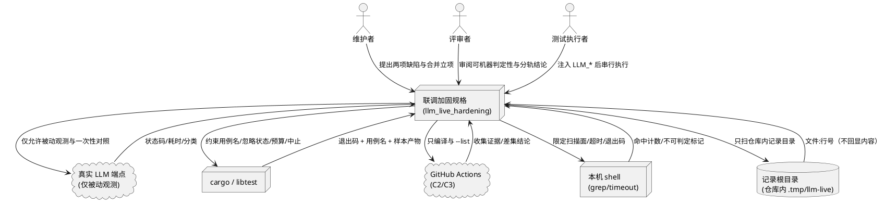
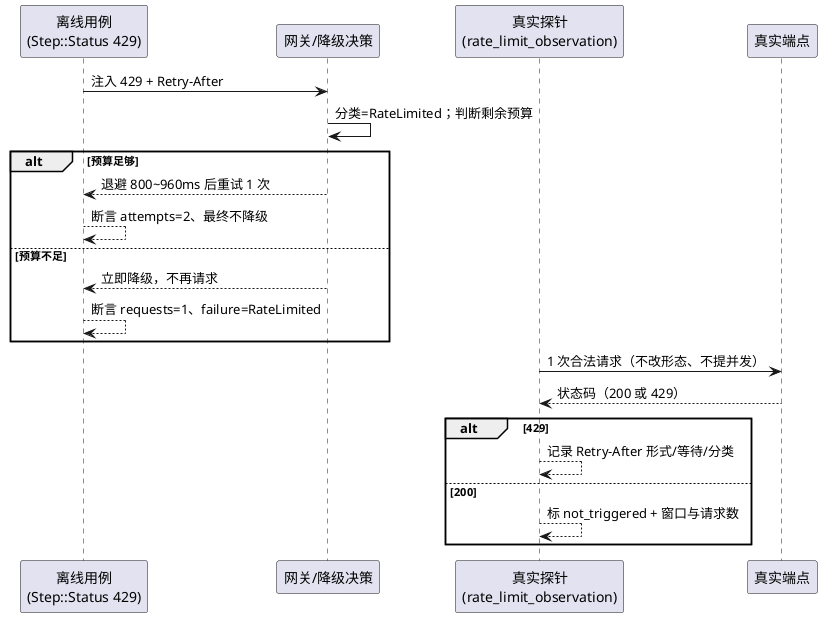
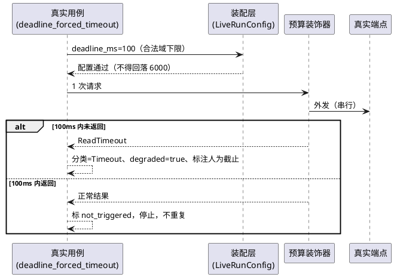
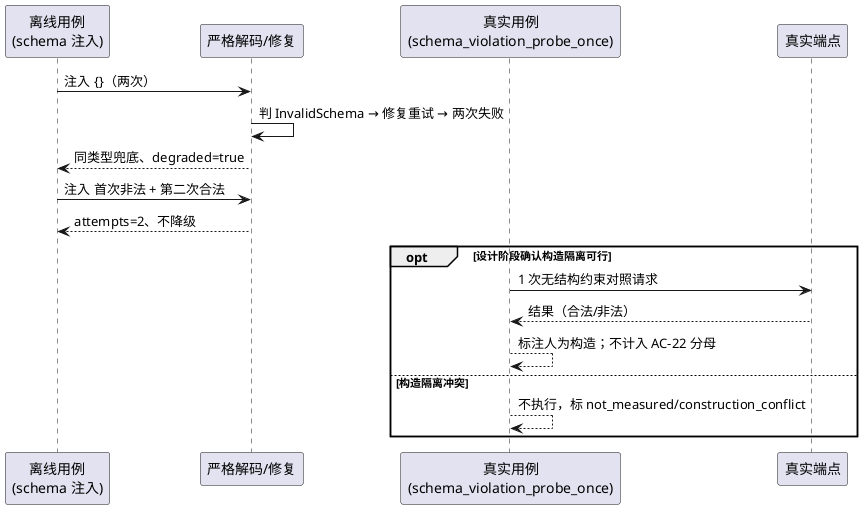
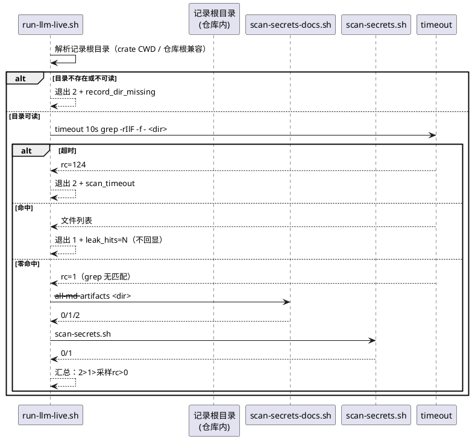
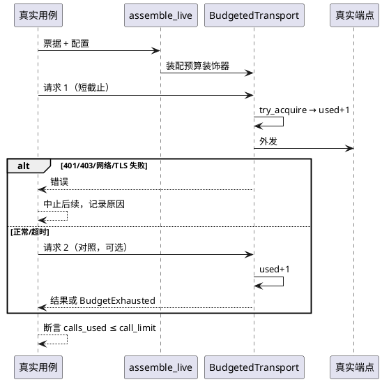
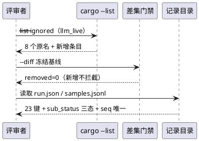

# **1. 组件定位**

## **1.1 核心职责**

本组件负责把真实 LLM 联调中"故障注入覆盖不足"与"泄漏面扫描不可用"两项缺陷收敛为可机器判定的验收契约，实现"故障行为可判定、收尾扫描不挂起、既有结论不回退"。

## **1.2 核心输入**

1. **现状基线**：`docs/progress/b1-status.md` 第 9 节（30 样本基线）与第 10 节（探针复验、AC 判定、偏差 D-L31-1）。
2. **既有权威验收口径**：`docs/sdd/spec.md`（EARS 正文）与 `.codeartsdoer/specs/llm_gateway_degrade/spec.md` 第 8.3 节 `AC-23`/`AC-24`/`AC-25`、第 11.5.5~11.5.7 节、第 11.10.3 节（L22 真实采样）、第 11.11.4 节（记录与隔离）、第 11.12 节（严格性不回退）。
3. **现有真实探针**：`crates/infrastructure/tests/llm_live.rs`（221 行，8 个 `#[ignore]` 用例共用 `run_probe`）。
4. **运行门与预算**：`crates/infrastructure/src/llm/live/gate.rs`（`admit` 固定 11 步）、`crates/infrastructure/src/llm/live/budget.rs`（`BudgetLedger`/`BudgetedTransport` 唯一计数点）、`crates/infrastructure/src/llm/live/config.rs`（`DeadlineMs` 合法域 100~8000、samples 1~200、并发必须为 1）。
5. **记录载体**：`crates/infrastructure/src/llm/live/record.rs`（`RunRecord` v2 闭集 23 键、`samples.jsonl`、原子写、相对路径 `.tmp/llm-live/<run-id>`）。
6. **泄漏面扫描脚本**：`scripts/run-llm-live.sh` 第 54~61 行（`for target in ".tmp/llm-live" "${TMPDIR:-/tmp}"` + `grep -RIlF -f -`）、`scripts/scan-secrets-docs.sh`、`scripts/scan-secrets.sh` 的退出码三分约定（0=PASS / 1=命中 / 2=扫描面缺失）。
7. **CI 约束**：`.github/workflows/ci.yml` 的 `llm-https-compile (C2)` 只允许编译与 `--list`，禁止真实调用；`test-name-inventory (C3)` 以 `docs/progress/test-names-before.txt` 为冻结基线执行差集门禁。
8. **用户指令**：合并"故障注入覆盖"与"泄漏面扫描修复"为同一批次立项。

## **1.3 核心输出**

1. **两项缺陷的现状 / 期望行为 / 不做会怎样**对照，以及每项的 `AC-LV-*` 编号映射。
2. **故障注入的判定分轨**：哪些结论由离线注入判定、哪些必须由真实端点判定、哪些只允许"被动观测且出现与否不构成通过条件"。
3. **真实调用的预算与中止契约**：新增真实调用上限、唯一计数点、失败即停/超时即停/触顶即停的可机器判定产物。
4. **泄漏面扫描的路径、超时与退出码契约**：扫描面限定、`-R`→`-r`、超时映射、命中与不可判定的严格区分。
5. **零转录红线的分面判定表**：Key、完整端点 URL、模型名字面量、`request_id` 在文档/代码/日志/审计/记录/报告六面的允许与禁止边界。
6. **与既有 `AC-20/21/22/26/27/31/35/42/46` 的兼容约束**，以及 `test-names-before.txt` 差集门禁的兼容约束。
7. **设计阶段必须裁决的冲突点清单**（`X1`~`X7`），本规格对可裁决项直接给出结论，仅对确需设计定案的项标注"待裁决"。

## **1.4 职责边界**

本组件**不负责**以下事项：

1. 不修改 `docs/sdd/spec.md`、`docs/sdd/design.md`、`docs/sdd/tasks.md`、`.codeartsdoer/specs/llm_gateway_degrade/**` 等权威文档（只读引用）。
2. 不修改任何代码、脚本、测试、CI 配置；不产出 `design.md` / `tasks.md`；实现由后续阶段承接。
3. 不重新定义 `AC-LLM-23/24/25` 的原始判定口径；只补"可机器判定的载体与分轨结论"。
4. 不重跑、不替换、不改写第 9 节的 30 样本基线（120 样本 / 122 调用 / `RUN_ID=18ea0235a172d040-524-0`）。
5. 不实现真实压测、并发压测、限流压测；不主动制造 429。
6. 不采购、保管、轮换、分发任何凭据；不记录任何凭据值与编号。
7. 不改变 `run.json` 的 `llm.live.v2` 键集；不新增顶层字段。
8. 不解决端点不可达、凭据未轮换、网络受限等外部阻塞。
9. 不新增第三方依赖（含 HTTP mock 框架、扫描器、超时工具库）；只允许使用仓库已有工具与 shell 能力。

# **2. 领域术语与编号约定**

## **2.1 编号约定**

| 编号族 | 含义 | 使用规则 |
|---|---|---|
| `AC-LLM-23` / `AC-LLM-24` / `AC-LLM-25` | 既有权威验收项（429 表现 / 人为截止 / schema 违规对照） | 只读引用；本规格不得改写其编号、判定方式与通过条件 |
| `AC-LV-01`~`AC-LV-32` | 本规格新增验收标准编号 | 每条必须可机器判定；不得与 `AC-CI-*`、`AC-B2-OC-*`、`AC-LLM-*` 混用或简写 |
| `W-LV-*` | 下一阶段（任务分解）的工作项编号 | 本规格只保留编号空间，不定义具体工作项 |
| `X1`~`X7` | 本规格识别的冲突点编号 | 仅用于第 9 章冲突清单 |
| `R1`~`R6` | 本规格识别的风险编号 | 仅用于第 10 章 |
| `D-L31-1` | 既有已登记偏差（全 `/tmp` 面未扫） | 只读引用；本规格负责关闭该偏差 |

约定：同一编号在四族之间**不得复用**；交叉引用必须写全前缀（例如 `AC-LV-07` 不得写作 `AC-07`）。

## **2.2 术语**

**故障注入覆盖**
: 指测试用例能够主动构造被测故障（429、超时、结构违规）并对其分类、重试、降级、兜底行为做断言的状态；与"只发合法请求并观察是否碰巧出现故障"严格区分。

**被动观测**
: 指真实端点采样过程中不改变请求形态、不提高并发、不重复轰炸，仅如实记录是否出现某类故障的状态；出现与否均不构成通过条件。

**离线注入判定**
: 指在无网络、无凭据、无外部端点的条件下，以脚本化传输（`Step::Status`、`Step::Json`、`Step::Delay`、`Step::Fail`）构造故障并做确定性断言；其结论可重复、可机器判定，但不得替代真实端点表现结论。

**真实端点判定**
: 指必须向真实端点发出请求并取得有效样本才能成立的结论；本规格中仅限"是否出现 429""人为截止的实际偏差""对照违规请求的实际分类"三类观测。

**人为截止**
: 指把单次请求的 `DeadlineMs` 压到合法域下限（100 ms）以制造网关侧超时的对照实验；必须标注"人为压低，非端点自身超时率"。

**对照违规请求**
: 指为观察端点对"无结构约束输入"的响应而构造的一次性请求；必须标注"人为构造的违规请求，不代表端点常态遵从率"，且不得计入 `AC-22` 的遵从率分母。

**记录根目录**
: 指记录器以相对路径 `.tmp/llm-live/<run-id>` 落盘的目录。真实运行中 `cargo test` 的 CWD 为 `crates/infrastructure`，故实际位置为 `crates/infrastructure/.tmp/llm-live/<run-id>`；仓库根 `.tmp/llm-live/<run-id>` 为兼容候选，存在时一并扫描。

**扫描面**
: 指泄漏面扫描实际遍历的目录集合。本规格的扫描面**仅限仓库内记录根目录**；系统临时目录（`${TMPDIR}` 及其回退值）不属于扫描面。

**扫描面缺失**
: 指扫描所需的记录根目录不存在、不可读、不可进入，或扫描进程被超时终止；该状态必须与"0 命中"严格区分。

**退出码三分**
: 指扫描收尾只允许 `0`（无命中）、`1`（命中）、`2`（扫描面缺失/不可判定）三种语义；`2` 不得被映射为 `0`。

**零转录**
: 指凭据值、完整端点 URL、真实模型名字面量、`request_id` 不得被写入任何持久化载体。分面边界见 6.5。

**用例名差集门禁**
: 指 `scripts/test-name-inventory.sh --diff docs/progress/test-names-before.txt` 在出现"基线有而当前无"条目时以退出码 1 失败的检查；新增条目（当前有而基线无）不构成失败。

# **3. 角色与边界**

## **3.1 核心角色**

维护者：执行真实联调、修复探针覆盖、期望收尾扫描不再挂起且故障结论可复核。

评审者：在不执行真实调用的前提下，依据用例名、退出码、样本字段与记录产物判断故障覆盖是否真实存在、扫描是否真正生效。

测试执行者：在用户终端注入 `LLM_*` 环境变量后串行执行 `#[ignore]` 用例，需要明确的预算、频次与中止边界。

## **3.2 外部系统**

真实 LLM 端点：由 `LLM_BASE_URL` 运行期提供的 OpenAI 兼容服务；本规格只允许被动观测 429，不主动制造限流。

cargo / libtest 工具链：提供 `--list`、`--list --ignored`、`--test-threads=1`、`--fail-fast` 与测试退出码；是离线判定与 CI 边界的主要执行器。

GitHub Actions：执行 `llm-https-compile (C2)` 与 `test-name-inventory (C3)`；只允许编译与列举，不得执行真实联调用例。

本机 shell（git-bash / bash）：提供 `grep`、`timeout`、`find`、`ps` 等扫描与收尾能力；其可用性直接决定泄漏面扫描的结论。

文件系统（仓库内 `.tmp`）：承载记录根目录与样本产物；其路径与 CWD 的一致性决定扫描能否命中真实记录。

## **3.3 交互上下文**

# **4. DFX 约束**

## **4.1 性能**

1. 仓库内泄漏面扫描单次总耗时不得超过 **10 s**；单目录扫描必须由 `timeout 10s` 包裹，超时即终止。
2. 新增离线故障注入用例在 `cargo test --workspace` 中的累计耗时不得超过 **5 s**（纯内存脚本化传输，不得真实睡眠）。
3. 新增真实调用导致的单次运行增量耗时不得超过 **5 s**（最多 2 次请求，含 100 ms 截止与一次对照请求）。
4. 真实联调仍严格串行（`concurrency = 1`）；任何新增用例不得提高并发。

## **4.2 可靠性**

1. 离线故障注入判定在同一工作副本连续执行 3 次，退出码与断言结果必须一致。
2. 扫描收尾必须落在 `0` / `1` / `2` 三态；`2` 不得被映射为 `0`。
3. 新增真实用例在 `LLM_LIVE` 非 `1`、凭据缺失、端点缺失、预算未确认时必须以退出码 0 跳过，且请求数为 0。
4. 真实调用失败时必须立即中止后续请求，不得以"继续跑完再看"的方式消耗预算。
5. 新增用例不得改变既有样本的 `seq` 唯一性与 `run.json` 的样本计数口径。

## **4.3 安全性**

1. 凭据值、完整端点 URL、真实模型名字面量、`request_id` 不得写入任何持久化载体（分面边界见 6.5）。
2. 扫描命中时只允许输出 `文件:行号` 或文件计数，禁止回显命中内容、键值片段、URL 与模型名。
3. 新增真实用例不得绕过 `BudgetedTransport` 直接构造传输；所有外发必须经过唯一计数点。
4. 真实端点只允许被动观测 429；禁止为触发 429 而提高并发、缩短间隔、重复轰炸或切换模型。
5. 记录根目录必须被 `.gitignore` 覆盖；新增用例不得把记录写入 `docs/`、`crates/` 源码目录或任何会被提交的位置。

## **4.4 可维护性**

1. 新增判定必须包含可 grep 的固定标记串，至少包含：`ac23_not_triggered`、`ac24_forced_deadline`、`ac25_offline_injected`、`scan_timeout`、`record_dir_missing`、`leak_hits=`、`calls_used=`。
2. 扫描脚本必须提供离线自检入口（零真实调用、零凭据），用于双向证明"命中"与"扫描面缺失"被识别。
3. 新增用例名必须能唯一映射到 `AC-LLM-23/24/25` 之一；禁止用含义模糊的 `probe_once` 一类命名。
4. 离线注入必须复用既有 `tests/support` 的 `FakeTransport`/`Step`，不得新写第二套 mock。

## **4.5 兼容性**

1. 既有 8 个 `llm_live` 用例名必须逐字保留；新增用例只增不减。
2. `run.json` 必须保持 `llm.live.v2` 的 23 键闭集；中止原因与故障标注写入 `sub_status[].reason_code` 或 `samples.jsonl` 的 `excluded` 字段。
3. 脚本必须兼容 bash 3.2+ 与 git-bash；不得使用 bash 4 专有语法；行尾保持 LF。
4. 扫描命令必须使用 `-r` 而非 `-R`，不得跟随符号链接。
5. `DeadlineMs` 覆盖必须仍落在 100~8000；不得为制造超时而突破下限或修改默认 6000。

# **5. 核心能力**

## **5.1 429 治理：离线注入判定 + 真实被动观测（推进 AC-LLM-23）**

**现状**：`rate_limit_observation` 用例名暗示 429 观测，但实现只调用 `run_probe` 发一次合法请求；30 样本基线与探针复验的 134 条样本全部 `http_status=200`，从未出现 429。限流分类、退避、`Retry-After` 处理与"越过截止时间不重试"的治理行为没有任何真实或离线联调载体。

**期望行为**：429 的**治理机制**由离线注入做确定性判定；真实端点侧只做**被动观测**，出现则如实记录，不出现则标 `not_triggered`，且不主动制造。

**不做会怎样**：AC-LLM-23 永远停留在"未实测"，且用例名继续误导评审者以为 429 已被覆盖；若改为真实制造 429，则构成对生产端点的滥用并可能触发账号风控。

### **5.1.1 业务规则**

1. **治理机制离线判定**：必须存在离线用例，注入 429 + 合法 `Retry-After` 后断言"不立即重试、退避在 800~960 ms 抖动区间、仅重试 1 次、最终成功不降级"。
   a. 验收条件：`AC-LV-01`
2. **超预算不重试**：必须存在离线用例，注入 429 + `Retry-After` 大于剩余截止时间，断言"仅 1 次请求、分类限流、降级、无第二次请求"。
   a. 验收条件：`AC-LV-02`
3. **真实侧只被动观测**：真实运行中若出现 429，必须记录 `Retry-After` 形式（数字秒/HTTP-date/缺失/非法）、实际等待时长、是否 ≤2 s、是否越过截止时间、最终分类；若未出现，必须写 `not_triggered` 并附采样窗口与请求数。
   a. 验收条件：`AC-LV-03`
4. **未出现不等于通过**：`not_triggered` 不得写成"通过""达标"；不得把离线注入的 429 结果填入真实列。
   a. 验收条件：`AC-LV-04`
5. **禁止主动制造 429**：真实路径不得存在"重复请求直到 429""提高并发触发限流""缩短间隔轰炸"的实现；并发固定 1。
   a. 验收条件：`AC-LV-05`
6. **禁止项**：禁止删除或改名 `rate_limit_observation` 以规避差集门禁；其语义保留为"真实窗口内是否观察到 429"。

### **5.1.2 交互流程**

### **5.1.3 异常场景**

1. **`Retry-After` 为 HTTP-date 或非法值**
   a. 触发条件：响应头 `Retry-After` 不是纯数字秒。
   b. 系统行为：按未声明处理，使用抖动退避；不得解析失败即重试。
   c. 用户感知：记录中 `retry_after_form=missing_or_invalid`，分类仍为限流。
2. **`Retry-After` 超过 2 s**
   a. 触发条件：端点要求等待 5 s，剩余截止时间充足。
   b. 系统行为：立即降级，不重试。
   c. 用户感知：样本 `failure_class=rate_limited`、`attempt=1`。
3. **窗口内未出现 429**
   a. 触发条件：真实采样全部返回 2xx。
   b. 系统行为：写 `not_triggered`，附窗口与请求数。
   c. 用户感知：输出 `ac23_not_triggered`，不得出现"通过"字样。
4. **误把离线结果当真实结果**
   a. 触发条件：真实记录中出现 mock 注入的 429 时间戳或固定等待值。
   b. 系统行为：判"证据污染"，该次运行无效。
   c. 用户感知：记录中 `source=offline` 不得出现在真实 `samples.jsonl`。

## **5.2 人为截止：100 ms 单次对照（推进 AC-LLM-24）**

**现状**：`deadline_forced_timeout` 用例使用默认 6000 ms，端点正常返回，未触发任何超时；用例名与实际行为不符。

**期望行为**：使用 `DeadlineMs` 合法域下限 100 ms，对单一任务发起 1 次请求，断言超时分类、返回偏差与"无半截结果"；若 100 ms 内返回则标 `not_triggered`，不继续压低或重复。

**不做会怎样**：AC-LLM-24 的"人为截止"永远没有真实载体；若用 6000 ms 默认值继续跑，则每次都在正常生成，无法判定超时路径。

### **5.2.1 业务规则**

1. **截止取合法域下限**：人为截止必须取 `DeadlineMs = 100`，不得低于 100，不得沿用默认 6000。
   a. 验收条件：`AC-LV-06`
2. **单任务单次即止**：只允许 1 个任务、1 次请求；不得四类任务各跑一遍。
   a. 验收条件：`AC-LV-07`
3. **超时判定**：分类必须为 `Timeout`、`degraded=true`、返回时刻与截止偏差 ≤100 ms（测试容差 200 ms，即 `total_ms ≤ 300 ms`）、不得交付半截结构化结果。
   a. 验收条件：`AC-LV-08`
4. **未触发处理**：若 100 ms 内返回，必须标 `not_triggered` + `below_floor_100ms`，不得再压低、不得重复请求。
   a. 验收条件：`AC-LV-09`
5. **标注人为性**：记录与报告必须含"人为压低截止时间，非端点自身超时率"。
   a. 验收条件：`AC-LV-10`
6. **预算计入**：该次请求必须计入 `calls_used` 与 `LLM_LIVE_CALL_CAP`。

### **5.2.2 交互流程**

### **5.2.3 异常场景**

1. **截止值越界**
   a. 触发条件：构造 `DeadlineMs < 100` 或 `> 8000`。
   b. 系统行为：配置层拒绝，请求数 0。
   c. 用户感知：错误只含字段名与规则，不含端点或凭据。
2. **超时后仍交付半截结果**
   a. 触发条件：流式路径在截止前未完整结束。
   b. 系统行为：必须返回失败终止或同类型兜底，不得交付半截 JSON。
   c. 用户感知：`outcome` 为降级，`body` 为同类型兜底。
3. **100 ms 内返回**
   a. 触发条件：端点极快或缓存命中。
   b. 系统行为：标 `not_triggered`，结束该用例，不追加请求。
   c. 用户感知：输出 `ac24_forced_deadline not_triggered`。

## **5.3 Schema 违规：离线注入为主、真实对照为可选（推进 AC-LLM-25）**

**现状**：`schema_violation_probe_once` 发送合法 payload，端点返回合法结构，未构造任何违规；`invalid_schema_repair` 等离线用例虽已存在，但没有与 live 记录/三态标注打通。

**期望行为**：schema 违规的**机制面**（严格解码、修复重试、两次违规后同类型兜底）由离线注入判定；真实端点的"一次无结构约束对照请求"作为可选观测，且不得破坏 `AC-43`/`AC-46` 的"同一构造规则"与严格性。

**不做会怎样**：AC-LLM-25 仍为"未实测"，且评审者无法区分"端点常态遵从率"（AC-22）与"人为构造违规的对照结果"。

### **5.3.1 业务规则**

1. **离线注入非法响应**：必须存在离线用例，注入 `{}`（缺必填字段）两次，断言分类 `InvalidSchema`、`attempts=2`、最终同类型兜底、`degraded=true`。
   a. 验收条件：`AC-LV-11`
2. **修复重试可观测**：必须存在离线用例，首次非法、第二次合法，断言 `attempts=2`、最终不降级；修复提示只含 `path` 与 `rule`，不得含载荷片段或响应正文。
   a. 验收条件：`AC-LV-12`
3. **真实对照可选且最多 1 次**：若设计阶段能证明对照请求不违反 `AC-43`/`AC-46` 的构造隔离，则允许 1 次；必须标注"人为构造违规请求"、不得计入 AC-22 分母。若不能证明，则不做，标 `not_measured` + `construction_conflict`。
   a. 验收条件：`AC-LV-13`
4. **离线结论不因真实未执行而回退**：AC-LLM-25 的机制面结论以离线用例为准；真实面对照未执行只影响"真实表现"三态，不得使离线判定失效。
   a. 验收条件：`AC-LV-14`
5. **禁止用放宽 Schema 制造违规**：不得删除 `required`、`deny_unknown_fields`、跨字段规则，不得关闭严格解码，不得改用非结构化输出。
   a. 验收条件：`AC-LV-15`
6. **禁止项**：禁止把离线注入的非法响应写入真实 `samples.jsonl`；禁止用"端点恰好返回非法"冒充"人为构造"。

### **5.3.2 交互流程**

### **5.3.3 异常场景**

1. **对照请求与生产构造冲突**
   a. 触发条件：为去掉 Schema 约束而必须移除 `response_format` 或 `thinking` 固定字段。
   b. 系统行为：禁止执行对照请求，标 `construction_conflict`。
   c. 用户感知：`ac25 not_measured`，离线机制面仍为已判定。
2. **两次非法后仍返回成功**
   a. 触发条件：解码器放宽或默认值补齐。
   b. 系统行为：判 `AC-46` 不通过，阻断该次运行结论。
   c. 用户感知：用例失败，错误只含字段路径与规则名。
3. **修复提示泄漏原文**
   a. 触发条件：修复提示拼接了载荷或响应正文。
   b. 系统行为：判失败并中止该样本。
   c. 用户感知：输出 `prompt_leaked` 判定标识。

## **5.4 泄漏面扫描修复：限定仓库内、超时即不可判定（关闭 D-L31-1）**

**现状**：`run-llm-live.sh` 第 56~57 行遍历 `.tmp/llm-live` 与 `${TMPDIR:-/tmp}`，对后者执行 `grep -RIlF`。本机 `/tmp` 有 13,862 个子目录，30 s 超时返回 124，用户被迫 Ctrl+C。同时，记录器实际落盘在 `crates/infrastructure/.tmp/llm-live/<run-id>`（cargo test 的 CWD），脚本在仓库根扫描 `.tmp/llm-live`，该目录不存在时被当作"0 命中"，形成"扫描面为空却 PASS"的静默失败。

**期望行为**：只扫描仓库内记录根目录；缺失即退出 2；超时即退出 2；命中退出 1；零命中退出 0；`-R` 改 `-r`；提供离线自检入口。

**不做会怎样**：AC-26 的收尾无法自动完成，真实联调每次都要人工 Ctrl+C；且"扫不到"被误判为"没泄漏"。

### **5.4.1 业务规则**

1. **扫描面限定仓库内**：只允许扫描记录根目录（`crates/infrastructure/.tmp/llm-live` 与存在时的仓库根 `.tmp/llm-live`），不得扫描 `${TMPDIR}` 或任何系统临时目录。
   a. 验收条件：`AC-LV-16`
2. **记录目录缺失即不可判定**：记录根目录不存在、不可读或不可进入时，必须以退出码 2 终止并输出 `record_dir_missing`，不得输出 0 命中。
   a. 验收条件：`AC-LV-17`
3. **超时即不可判定**：单目录扫描必须由 `timeout 10s` 包裹；超时（rc=124）必须映射为退出 2 并输出 `scan_timeout`，不得映射为 0 或 1。
   a. 验收条件：`AC-LV-18`
4. **命中即失败**：扫描到凭据时必须退出 1，只输出 `文件:行号` 或命中文件数 `leak_hits=<N>`，不得回显内容。
   a. 验收条件：`AC-LV-19`
5. **零命中才通过**：扫描面存在、可读、未超时且无命中时，退出 0 并输出 `leak_hits=0`。
   a. 验收条件：`AC-LV-20`
6. **不跟随符号链接**：必须使用 `-r` 而非 `-R`，不得扫描符号链接指向的仓库外目录。
   a. 验收条件：`AC-LV-21`
7. **退出码优先级**：收尾退出码按 `2（不可判定）> 1（命中）> 采样非 0 > 0` 固定优先级；任一不可判定不得被后续步骤覆盖为通过。
   a. 验收条件：`AC-LV-22`
8. **扫描耗时有上限**：仓库内扫描总耗时 ≤10 s；不得出现因扫描导致的 30 s 挂起。
   a. 验收条件：`AC-LV-23`
9. **提供离线自检**：脚本必须提供 `--scan-only`（或等价）入口，在零真实调用、零凭据条件下可复现"命中 / 缺失 / 超时 / 零命中"四类结果。
   a. 验收条件：`AC-LV-16`~`AC-LV-23` 的判定均通过该入口完成。

### **5.4.2 交互流程**

### **5.4.3 异常场景**

1. **记录目录被清理或未生成**
   a. 触发条件：真实用例在 `admit` 阶段 Skip，未写任何记录。
   b. 系统行为：退出 2 + `record_dir_missing`，不得视为"无泄漏"。
   c. 用户感知：收尾明确"不可判定"，需先确认是否真的执行过真实调用。
2. **扫描进程卡死**
   a. 触发条件：目录巨大、文件系统慢或网络盘。
   b. 系统行为：`timeout` 终止，退出 2。
   c. 用户感知：输出 `scan_timeout`，不再需要 Ctrl+C。
3. **符号链接指向仓库外**
   a. 触发条件：记录目录含指向 `/tmp` 或用户目录的符号链接。
   b. 系统行为：`-r` 不跟随，扫描面不扩大。
   c. 用户感知：扫描耗时不因外部目录膨胀。
4. **凭据为空**
   a. 触发条件：`LLM_API_KEY` 为空或仅空白。
   b. 系统行为：不得执行空 pattern 扫描（空 pattern 会匹配所有行）；退出 2 + `credential_missing`。
   c. 用户感知：明确"未扫描"而非"0 命中"。
5. **文档扫描返回 2**
   a. 触发条件：`scan-secrets-docs.sh --all-md` 扫描面缺失。
   b. 系统行为：收尾退出 2，不得被后续 `scan-secrets.sh` 的 0 覆盖。
   c. 用户感知：日志含 `扫描面缺失`。

## **5.5 预算、频次与中止**

**现状**：`BudgetedTransport` 已是唯一计数点，`call_limit = min(samples × 12, cap)`；但 `run-llm-live.sh` 注释声称"失败即退出"，实际 `cargo test` 会继续执行后续用例，且新增故障注入若绕过装配层将不计入预算。

**期望行为**：新增真实调用全部经 `assemble_live` → `BudgetedTransport`；单次运行总上限不变；新增增量 ≤2 次；失败/超时/触顶即停。

### **5.5.1 业务规则**

1. **唯一计数点**：新增真实用例必须经 `assemble_live` 装配，不得直接构造 `TlsTransport` 或 `BearerTransport` 发请求。
   a. 验收条件：`AC-LV-24`
2. **新增增量上限**：本特性新增真实调用合计不得超过 **2 次**（人为截止 1 次 + 对照请求 1 次）；429 观测不新增请求，复用既有探针样本。
   a. 验收条件：`AC-LV-25`
3. **总上限不变**：单次运行调用上限仍为 `min(samples × 12, cap)`；`samples=30`、`cap=360` 时为 360。
   a. 验收条件：`AC-LV-24`
4. **失败即停**：首个样本为 401/402/403、DNS/网络不可达、TLS 失败时，必须立即中止后续请求并记录原因。
   a. 验收条件：`AC-LV-26`
5. **超时/冷却即停**：连续 3 次最终失败触发端点冷却时，必须停止后续请求，不得继续消耗预算。
   a. 验收条件：`AC-LV-26`
6. **触顶即停**：`calls_used == call_limit` 时必须停止，保留已取得样本，不得删除或改写。
   a. 验收条件：`AC-LV-26`

### **5.5.2 交互流程**

### **5.5.3 异常场景**

1. **预算触顶**
   a. 触发条件：`used == limit`。
   b. 系统行为：`TransportError::BudgetExhausted`，不再外发。
   c. 用户感知：`run.json` 的 `budget_hit=true`、`calls_used==call_limit`。
2. **绕过装配直接发请求**
   a. 触发条件：新增用例直接 `TlsTransport::new()` 后调用。
   b. 系统行为：静态审计判违规，预算计数失真。
   c. 用户感知：`calls_used` 小于实际请求数，评审者据此判不通过。
3. **401/403 后继续采样**
   a. 触发条件：未中止逻辑。
   b. 系统行为：判违反 `AC-LV-26`，该次运行无效。
   c. 用户感知：样本序列出现第二个请求。

## **5.6 记录、命名与兼容**

**现状**：8 个用例共用 `run_probe`，每用例写一次 `run.json`（覆盖），样本 `seq` 恒为 1；`run.json` 为 v2 闭集 23 键；差集门禁冻结 365 行基线，重命名会触发 removed。

**期望行为**：保留 8 个原名，只新增用例；新增样本不得破坏 `seq` 唯一性与 `run.json` 计数；不新增 `run.json` 顶层键。

### **5.6.1 业务规则**

1. **保留原名**：既有 8 个用例名必须逐字保留；禁止重命名。
   a. 验收条件：`AC-LV-27`
2. **只增不减**：新增用例在 `--list` 与 `--list --ignored` 中只增加条目；差集门禁 `removed=0`。
   a. 验收条件：`AC-LV-27`
3. **记录键集闭集**：`run.json` 必须保持 23 键；故障标注写 `sub_status[].reason_code`，排除原因写 `samples.jsonl` 的 `excluded`。
   a. 验收条件：`AC-LV-28`
4. **样本序号唯一**：同一次运行目录内 `seq` 必须唯一且单调；新增样本不得与既有样本冲突。
   a. 验收条件：`AC-LV-29`
5. **三态标注**：`run.json` 的 `sub_status` 必须包含 `ac23`/`ac24`/`ac25` 三项，每项为 `measured`/`not_triggered`/`not_measured` 之一，并带 `reason_code`。
   a. 验收条件：`AC-LV-30`

### **5.6.2 交互流程**

### **5.6.3 异常场景**

1. **重命名既有用例**
   a. 触发条件：为使命名更准确而改名。
   b. 系统行为：差集门禁出现 removed，退出 1。
   c. 用户感知：CI C3 失败；必须回退改名或走基线显式更新（不属本特性）。
2. **新增顶层字段**
   a. 触发条件：为记录中止原因而扩展 `RunRecord`。
   b. 系统行为：`v2_key_set_is_closed` 失败，`scan-secrets-docs.sh` 报 unknown-key。
   c. 用户感知：记录不可复核。
3. **seq 冲突**
   a. 触发条件：新用例从 1 开始编号，与既有样本重复。
   b. 系统行为：统计口径失真，重算脚本无法唯一定位样本。
   c. 用户感知：`AC-LV-29` 不通过。

# **6. 数据约束**

## **6.1 样本（Sample）**

1. **seq**：同一次运行目录内唯一、单调递增的正整数；不得重置为 1 造成重复。
2. **task**：必须是四类任务之一；新增故障用例的任务归属必须与 `AC-LLM-23/24/25` 的观测对象一致。
3. **attempt**：≥1；429 离线用例允许为 2（首次 + 1 次重试）；短截止用例通常为 1~3（重试受截止约束）。
4. **first_token_ms**：真实探针可为 `null`（既有探针不记录首 token）；不得为缺失编造数值。
5. **total_ms**：必须由单调时钟实测；短截止用例 ≤300 ms；不得写死 0 或 1。
6. **outcome**：`ok` 或 `degraded`；`not_triggered` 不写入 `outcome`，写入 `run.json` 的 `sub_status`。
7. **failure_class**：`degraded=true` 时必须非空；429 未触发且 `degraded=false` 时可为 `null`。
8. **http_status**：真实样本必须为整数；未触发 429 时为 `200` 或其他 2xx。
9. **excluded**：中止/排除原因（如 `aborted_unauthorized`、`construction_conflict`）；不得放文本正文。
10. **禁止字段**：不得出现 `payload`、`content`、`prompt`、`request_id`、完整 URL、模型名以外的自由文本。

## **6.2 运行记录（RunRecord v2）**

1. **schema_version**：固定 `llm.live.v2`；不得升级。
2. **键集**：必须恰为既有 23 键；不得新增、删除、重命名。
3. **sub_status**：新增 `ac23`/`ac24`/`ac25` 三项；`item` 为小写编号，`status` 为三态，`reason_code` 在非 `measured` 时必填。
4. **calls_used / call_limit**：`calls_used` 等于实际 HTTP 请求数（含重试）；`call_limit = min(samples × 12, cap)`。
5. **budget_hit**：`calls_used == call_limit` 时为 `true`。
6. **model**：允许写运行期 `LLM_MODEL` 实际值（`AC-27` 既有要求）；该文件必须被 `.gitignore` 覆盖、不得入库、不得上传、不得作为报告正文。
7. **path_confirmed / model_confirmed / host_locked**：仍由既有计算来源产生，不得手写 `true`。

## **6.3 扫描诊断（ScanDiagnostic）**

1. **scan_face**：取值为 `record_root_crate`、`record_root_repo` 之一。
2. **path**：仓库相对路径、正斜杠；不得出现盘符路径。
3. **exit_code**：只能是 `0`、`1`、`2`。
4. **marker**：`leak_hits=<N>`、`scan_timeout`、`record_dir_missing`、`credential_missing` 之一。
5. **可见性**：命中时只输出 `文件:行号` 或计数；不得输出命中内容。

## **6.4 判定分界：离线可判定 vs 必须真实端点判定**

| 判定对象 | 离线可判定 | 必须真实端点判定 | 说明 |
|---|---|---|---|
| 429 分类、退避区间、重试上限、截止优先 | 是 | 否 | `Step::Status(429)` 确定性注入，`FakeClock` 可断言等待 |
| 429 是否在采样窗口内出现 | 否 | 是 | 被动观测；出现与否不构成通过条件 |
| `Retry-After` 形式解析（秒/HTTP-date/非法） | 是 | 否 | 纯函数与注入头 |
| 人为截止 100 ms 的构造合法性 | 是 | 否 | `LiveRunConfig` 范围校验 |
| 超时分类与返回偏差 ≤100 ms | 机制面是 | 实测偏差是 | 离线注入可验证分类；真实偏差必须真实采样 |
| schema 违规解码、修复重试、同类型兜底 | 是 | 否 | `{}`/非法字段/类型/范围/跨字段注入 |
| 端点常态 Schema 遵从率 | 否 | 是 | 归属 `AC-22`，本特性不判定 |
| 对照违规请求的实际响应 | 否 | 是（可选） | 最多 1 次；构造隔离冲突时不做 |
| 泄漏面扫描四类结果（命中/缺失/超时/零命中） | 是 | 否 | `--scan-only` + 夹具目录 + `timeout` 桩 |
| 运行期四泄漏面（日志/审计/错误/命令行） | 否 | 是 | 归属 `AC-26`，本特性只修扫描脚本 |
| 预算计数与触顶 | 是 | 部分 | `BudgetLedger` 单测离线；`calls_used` 需真实运行核对 |
| CI 只编译与 `--list` | 静态可判定 | 是（远端执行） | `ci.yml` 静态审计 + 远端日志 |

## **6.5 零转录分面边界（ZeroTranscription）**

| 载体面 | Key | 完整端点 URL | 真实模型名字面量 | request_id |
|---|---|---|---|---|
| 规格/文档（`docs/**`、`.codeartsdoer/**`） | 禁止 | 禁止 | 禁止（含默认值/候选/回退） | 禁止 |
| 代码/脚本/配置/测试夹具 | 禁止 | 禁止（仅允许 `host` 与路径常量） | 禁止（允许明显假值占位） | 禁止 |
| 日志/审计/错误信息/进程命令行 | 禁止 | 禁止 | 禁止 | 禁止 |
| 记录（`run.json`/`samples.jsonl`） | 禁止 | 禁止（只允许 `endpoint_host`） | **允许运行期实际值**（`AC-27` 既有要求） | 禁止 |
| 报告/汇总（`summary.md`、基线报告） | 禁止 | 禁止 | 禁止 | 禁止 |
| CI 日志/上传产物 | 禁止 | 禁止 | 禁止 | 禁止 |

说明：表中"记录面允许模型名"是对用户红线表述的**收窄解释**，理由是与 `AC-27`"记录含模型名"和 `AC-29`"记录只写运行期实际值"的既有结论兼容；该记录目录不入库、不上传、不作为报告正文。此解释登记为冲突点 `X1`，设计阶段必须显式确认。

# **7. 范围与非范围**

## **7.1 本轮范围内（可离线完成并判定）**

1. 429 治理的离线注入判定（分类、退避、重试上限、截止优先）与真实被动观测的三态标注。
2. 人为截止 100 ms 的构造合法性、单任务单次、超时判定与人为性标注。
3. schema 违规的离线注入判定（解码、修复、兜底）与真实对照请求的可选边界。
4. 泄漏面扫描的扫描面限定、`-r`、`timeout 10s`、退出码三分、离线自检入口。
5. 预算唯一计数、新增增量上限、失败/超时/触顶即停。
6. 命名兼容（保留 8 个原名、只增不减）、`run.json` 键集闭集、`seq` 唯一、`sub_status` 三态。
7. 零转录分面判定与 CI 边界。

## **7.2 本轮明确不做（附理由）**

1. **不做真实压测/限流压测**：主动制造 429 属于对生产端点的滥用，且不可控；只允许被动观测。
2. **不重命名既有 8 个用例**：会触发 `test-names-before.txt` 差集门禁的 removed 拦截，破坏既有 CI 结论。
3. **不引入新依赖**：离线注入复用既有 `support` 脚手架；扫描复用 `grep`/`timeout`；不新增 mock 框架或超时库。
4. **不修改 `docs/sdd/**` 与 `.codeartsdoer/specs/llm_gateway_degrade/**`**：只读引用，冲突以第 9 章登记。
5. **不修改 `run.json` 的 v2 键集**：新增顶层字段会破坏 `v2_key_set_is_closed` 与 `scan-secrets-docs.sh` 的 known-key 校验。
6. **不重跑/替换 30 样本基线**：新增故障样本不得计入 AC-20/21/22 的分母。
7. **不扫 `${TMPDIR}` 全量**：系统临时目录不属于本项目产物，且本机 `/tmp` 有 13,862 个子目录，扫描不可控。
8. **不让 CI 执行真实用例**：C2 只编译与 `--list`；不注入 `LLM_*`；不出现 `--ignored`。
9. **不实现新的凭据托管/轮换**：只要求不记录、不回显、不入库。
10. **不产出 `design.md` / `tasks.md` / 代码**：本阶段只产出需求规格。

## **7.3 进度基线（实测事实）**

| 事实 | 数值 / 证据 |
|---|---|
| 8 个 `#[ignore]` 用例 | 共用 `run_probe`，只发合法请求；`llm_live.rs:165-215` |
| 30 样本基线 | 四类任务各 30；首 token p95 ≤1.2 s；总耗时 p95 ≤6 s；`RUN_ID=18ea0235a172d040-524-0` |
| 探针复验 | `RUN_ID=18ea115484f44b50-28680-0`；`samples=14`；全部 `http_status=200` |
| 429 出现次数 | 0（基线 + 复验合计 134 条真实样本） |
| 记录实际落盘 | `crates/infrastructure/.tmp/llm-live/<run-id>/`（cargo test CWD） |
| 脚本扫描路径 | 仓库根 `.tmp/llm-live`（当前不存在）+ `${TMPDIR:-/tmp}` |
| `/tmp` 子目录数 | 13,862；`timeout 30` 返回 124 |
| `run.json` 键数 | 23（v2 闭集） |
| 基线清单 | 365 行；`llm_live` 8 条 |

# **8. 可机器判定的验收标准**

## **8.1 429 治理（AC-LV-01~AC-LV-05）**

**AC-LV-01（离线 429 退避与重试）**
- EARS：WHERE 离线传输注入 `429` 且 `Retry-After` 为合法数字秒时，WHEN 执行故障注入用例，系统 shall 不立即重试、在 800~960 ms 抖动区间等待后仅重试 1 次，并最终返回非降级结果。
- 判定：用例名 `rate_limit_backoff` 存在且退出码 0；`transport.requests()==2`、`outcome.attempts==2`、`outcome.degraded==false`；等待时长由 `FakeClock` 断言落在区间内。
- 追溯：`AC-LLM-23` · `degrade.rs:113-128` · `llm_degrade_inject.rs:61-74`

**AC-LV-02（离线 429 超预算立即降级）**
- EARS：IF `429` 的 `Retry-After` 大于剩余截止时间，THEN 系统 shall 仅发出 1 次请求、分类为限流并立即降级，且 shall 不发出第二次请求。
- 判定：用例名 `rate_limit_beyond_remaining_budget_degrades`；`requests==1`、`failure_class==rate_limited`、`degraded==true`。
- 追溯：`AC-LLM-23` · `llm_degrade_inject.rs:77-89`

**AC-LV-03（真实 429 被动观测与三态）**
- EARS：WHILE 真实采样执行时，系统 shall 不改请求形态、不提高并发、不追加请求；WHEN 出现 `429`，shall 记录 `Retry-After` 形式、等待时长、是否 ≤2 s、是否越过截止时间与最终分类；IF 未出现，shall 在 `run.json` 的 `sub_status` 写 `ac23` + `not_triggered` + `window_no_429`。
- 判定：`run.json` 的 `sub_status` 含 `item=="ac23"`，`status ∈ {measured, not_triggered}`；`samples.jsonl` 中 `task=="rate_limit_observation"` 的样本 `http_status` 为整数；新增真实请求数相对既有 8 探针为 0。
- 追溯：`AC-LLM-23` · `11.5.5` · `11.7.1`

**AC-LV-04（未出现不得写成通过）**
- EARS：IF 429 未出现，THEN 记录与输出 shall 出现 `ac23_not_triggered`，且 shall 不出现 `通过`、`达标`、`pass` 与真实列中的 mock 数值。
- 判定：`grep -n 'ac23_not_triggered'` ≥1；`grep -nE '通过|达标|pass'` 在 `ac23` 相关记录行 0 命中；`samples.jsonl` 无 `source=offline`。
- 追溯：`AC-LLM-23` · `11.5.5-2`

**AC-LV-05（禁止主动制造 429）**
- EARS：系统 shall 在真实路径保持 `concurrency == 1`，且 shall 不存在"循环请求直到 429""提高并发""缩短间隔"的实现；静态审计时上述模式命中数 shall 为 0。
- 判定：`grep -nE 'loop.*429|while.*429|retry_until_rate_limit|concurrency *= *[2-9]'` 在 `crates/infrastructure/src/llm/live` 与 `tests/llm_live.rs` 0 命中；`run.json` 的 `config` 含并发 1。
- 追溯：`AC-LLM-23` · `11.9.4-5` · 本规格 4.3-4

## **8.2 人为截止（AC-LV-06~AC-LV-10）**

**AC-LV-06（截止取合法域下限）**
- EARS：WHEN 构造人为截止请求，系统 shall 使用 `DeadlineMs == 100`，且 shall 不接受 `<100` 或沿用默认 `6000`。
- 判定：用例内断言 `request.deadline_ms == 100`；`LiveRunConfig::try_new(Some(99))` 返回错误、`Some(100)` 通过；默认 `None` 仍为 `6000`。
- 追溯：`AC-LLM-24` · `config.rs:140-143` · `11.5.6-1`

**AC-LV-07（单任务单次即止）**
- EARS：WHEN 执行人为截止用例，系统 shall 只对 1 个任务发出 1 次请求，且 shall 不在四类任务上重复执行。
- 判定：用例内 `requests == 1`；`calls_used` 相对执行前增量 == 1；`samples.jsonl` 新增行数 == 1。
- 追溯：`AC-LLM-24` · 本规格 4.1-3

**AC-LV-08（超时分类与偏差）**
- EARS：IF 端点未在 100 ms 内返回，THEN 结果 shall 分类为 `Timeout`、`degraded == true`、实测返回与截止偏差 ≤100 ms（容差 200 ms，即 `total_ms ≤ 300`），且 shall 不交付半截结构化结果。
- 判定：样本 `failure_class == timeout`、`degraded == true`、`total_ms <= 300`；`outcome` 为降级且 `body` 为同类型兜底或空。
- 追溯：`AC-LLM-24` · `11.5.6-2/3`

**AC-LV-09（未触发处理）**
- EARS：IF 端点在 100 ms 内返回，THEN 系统 shall 标 `ac24` + `not_triggered` + `below_floor_100ms`，且 shall 不继续压低截止或重复请求。
- 判定：`run.json` 的 `sub_status` 含 `item=="ac24"` 且 `status=="not_triggered"`、`reason_code=="below_floor_100ms"`；`calls_used` 增量为 1。
- 追溯：`AC-LLM-24` · 本规格 5.2.1-4

**AC-LV-10（人为性标注）**
- EARS：WHEN 写入人为截止结果，记录或报告 shall 含"人为压低截止时间，非端点自身超时率"，且 shall 不将该结果表述为端点超时率。
- 判定：`grep -n '人为压低截止时间'` 在记录或报告 ≥1；`grep -nE '端点超时率|timeout_rate'` 在 `ac24` 行 0 命中。
- 追溯：`AC-LLM-24` · `11.5.6-1`

## **8.3 Schema 违规（AC-LV-11~AC-LV-15）**

**AC-LV-11（离线非法响应两次兜底）**
- EARS：WHERE 离线传输连续注入两次缺必填字段的 `{}` 响应时，WHEN 执行故障注入用例，系统 shall 判 `InvalidSchema`、尝试次数为 2、返回与请求同类型的兜底结果且 `degraded == true`。
- 判定：用例名 `invalid_schema_twice_degrades_with_same_shape` 退出码 0；`attempts==2`、`failure==InvalidSchema`、`body.task==request.task`。
- 追溯：`AC-LLM-25` · `llm_degrade_inject.rs:106-117` · `11.5.7-4`

**AC-LV-12（修复重试与提示最小化）**
- EARS：WHERE 首次响应非法、第二次响应合法时，系统 shall 尝试 2 次并最终不降级；修复提示 shall 只含字段路径与规则名，且 shall 不含载荷片段、响应正文或凭据。
- 判定：用例名 `invalid_schema_repair` 退出码 0；`attempts==2`、`degraded==false`；静态检查修复提示构造只使用 `path`/`rule` 字段。
- 追溯：`AC-LLM-25` · `11.5.7-2/3`

**AC-LV-13（真实对照请求可选且最多 1 次）**
- EARS：WHERE 设计阶段确认对照请求可独立构造且不违反 `AC-43`/`AC-46` 的同一构造规则时，系统 shall 最多发出 1 次对照请求并标注"人为构造的违规请求"；IF 构造隔离不可行，THEN `ac25` shall 标 `not_measured` + `construction_conflict`，且 shall 不发出该请求。
- 判定：二选一必居其一——`samples.jsonl` 新增 1 行且含 `excluded=control_request`；或 `run.json` 的 `sub_status` 含 `ac25` + `not_measured` + `construction_conflict` 且 `calls_used` 无对应增量。
- 追溯：`AC-LLM-25` · `11.5.7-1` · `11.12.3-4` · `AC-46`

**AC-LV-14（离线为主判定）**
- EARS：WHEN `AC-LV-11` 与 `AC-LV-12` 通过，系统 shall 将 `AC-LLM-25` 的机制面标为已判定；IF 真实对照未执行，shall 只将真实表现标为 `not_measured`，且 shall 不回退离线结论。
- 判定：验收记录中 `AC-LLM-25` 行同时含"机制面=已判定"与"真实面=not_measured"；离线用例退出码 0。
- 追溯：`AC-LLM-25` · 本规格 6.4

**AC-LV-15（严格性不回退）**
- EARS：系统 shall 不删除 `required`、`deny_unknown_fields`、跨字段规则，shall 不关闭严格解码，shall 不改为非结构化输出；静态检查与 `AC-46` 用例 shall 全部通过。
- 判定：`grep -c 'deny_unknown_fields'` 不减；`AC-46` 四组非法输出用例退出码 0；静态检索不存在"为制造违规而放宽 Schema"的改动。
- 追溯：`AC-46` · `11.12.5` · `11.12.6-4`

## **8.4 泄漏面扫描（AC-LV-16~AC-LV-23）**

**AC-LV-16（扫描面限定仓库内）**
- EARS：系统 shall 只扫描仓库内记录根目录（`crates/infrastructure/.tmp/llm-live` 与存在时的仓库根 `.tmp/llm-live`），且 shall 不读取 `${TMPDIR}` 或任何系统临时目录。
- 判定：脚本静态检查中 `TMPDIR` 命中数 0；`grep -nE 'for target in.*TMPDIR' scripts/run-llm-live.sh` 0 命中；扫描日志只出现两个仓库内路径。
- 追溯：`D-L31-1` · `run-llm-live.sh:56`

**AC-LV-17（记录目录缺失即不可判定）**
- EARS：IF 记录根目录不存在、不可读或不可进入，THEN 扫描收尾 shall 以退出码 `2` 终止并输出 `record_dir_missing`，且 shall 不输出 `leak_hits=0`。
- 判定：在 `--scan-only` 下临时移除/改名记录目录 → `echo $?` 为 `2`；输出含 `record_dir_missing`；不含 `leak_hits=0`。
- 追溯：`scan-secrets-docs.sh:90-97` 的"不存在返回 0"缺陷 · 本规格 5.4.3-1

**AC-LV-18（超时即不可判定）**
- EARS：WHEN 单目录扫描超过 `timeout 10s`，系统 shall 以退出码 `2` 终止并输出 `scan_timeout`，且 shall 不将超时映射为 `0` 或 `1`。
- 判定：以慢速桩或受限目录使扫描超过 10 s → 退出码 `2`；输出含 `scan_timeout`；无 `leak_hits=0`。
- 追溯：`run-llm-live.sh:56-59` · 既有 `timeout 30` 实测 rc=124

**AC-LV-19（命中即 1 且不回显）**
- EARS：WHEN 记录根目录中存在凭据字符串，系统 shall 退出 `1` 并输出 `leak_hits=<N>` 或 `文件:行号`，且 shall 不回显凭据值、URL 或模型名。
- 判定：在隔离夹具目录写入 `<FAKE_KEY>` → 退出码 `1`；输出匹配 `leak_hits=[1-9]`；输出不含 `<FAKE_KEY>` 的任意连续 8 字符。
- 追溯：`scan-secrets-docs.sh:144` · 本规格 4.3-2

**AC-LV-20（零命中即通过）**
- EARS：WHEN 扫描面存在、可读、未超时且无命中，系统 shall 退出 `0` 并输出 `leak_hits=0`。
- 判定：对干净记录目录执行 `--scan-only` → 退出码 `0`；输出匹配 `leak_hits=0`。
- 追溯：本规格 5.4.1-5

**AC-LV-21（不跟随符号链接）**
- EARS：系统 shall 使用 `grep -r`（小写）而非 `-R`，且 shall 不扫描符号链接指向的仓库外目录。
- 判定：静态检查 `grep -nE 'grep -[A-Za-z]*R'` 0 命中、`grep -nE 'grep -[A-Za-z]*r'` ≥1；夹具中符号链接目录不被遍历（`leak_hits` 不包含其内容）。
- 追溯：本规格 4.5-4

**AC-LV-22（退出码优先级）**
- EARS：WHEN 多个收尾步骤同时产生结论，退出码 shall 按 `2（不可判定）> 1（命中）> 采样非 0 > 0` 固定优先级；任一不可判定 shall 不被覆盖为 `0`。
- 判定：构造"扫描超时 + 采样失败" → 退出 `2`；构造"命中 + 采样失败" → 退出 `1`；构造"零命中 + 采样失败" → 保留采样非 0。
- 追溯：本规格 5.4.1-7

**AC-LV-23（扫描耗时有上限）**
- EARS：WHEN 执行仓库内扫描，总耗时 shall ≤10 s，且 shall 不出现 30 s 挂起。
- 判定：`time bash scripts/run-llm-live.sh --scan-only` 的 wall time ≤10 s；无 rc=124 的 30 s 超时。
- 追溯：本规格 4.1-1 · `D-L31-1`

## **8.5 预算、中止与零转录（AC-LV-24~AC-LV-26）**

**AC-LV-24（唯一计数点与总上限）**
- EARS：系统 shall 使所有真实外发经 `BudgetedTransport` 计数；`calls_used` shall 等于实际 HTTP 请求数（含重试），`call_limit` shall 为 `min(samples × 12, cap)`。
- 判定：新增用例静态检查无直接 `TlsTransport::new()` 外发；`run.json` 的 `calls_used` 与 `samples.jsonl` 的请求计数一致；`samples=30`、`cap=360` 时 `call_limit==360`。
- 追溯：`AC-31` · `budget.rs:88-114` · `11.10.3-5`

**AC-LV-25（新增增量 ≤2）**
- EARS：本特性新增真实调用合计 shall ≤2（短截止 1 次 + 对照 1 次）；429 观测 shall 不新增请求。
- 判定：同一 `run_id` 下新增用例的请求增量为 1 或 2；`rate_limit_observation` 的请求数仍为 1；`calls_used` 不超过既有探针基数 + 2。
- 追溯：本规格 5.5.1-2

**AC-LV-26（失败/超时/触顶即停）**
- EARS：IF 首个样本为 401/402/403、DNS/网络不可达、TLS 失败，或连续 3 次最终失败触发冷却，或 `calls_used == call_limit`，THEN 系统 shall 立即停止后续请求并记录原因。
- 判定：样本序列在首个失败后无后续请求；`run.json` 的 `budget_hit==true`（触顶时）或 `sub_status.reason_code` 含 `aborted_*`；`calls_used` 不再增长。
- 追溯：`11.11.3-7` · `degrade.rs:202-260` · 本规格 5.5.1-4/5/6

**AC-LV-27（零转录六面）**
- EARS：系统 shall 使凭据值、完整端点 URL、真实模型名字面量、`request_id` 在文档、代码、日志、审计、报告六面 0 命中；记录面只允许凭据与 URL 0 命中、运行期模型名按 6.5 例外。
- 判定：`bash scripts/scan-secrets.sh` 退出 0；`bash scripts/scan-secrets-docs.sh --all-md` 退出 0；记录目录 `grep -nE 'https?://|sk-|request_id'` 0 命中；`git status --short` 无新增未入库文件。
- 追溯：`AC-26` · `AC-32` · `11.4-5/9` · `11.9.5-2`

## **8.6 CI、命名与记录兼容（AC-LV-28~AC-LV-32）**

**AC-LV-28（CI 只编译与列举）**
- EARS：系统 shall 使新增真实用例保持 `#[ignore]`；CI shall 只执行 `--list` 或 `--no-run`，shall 不出现 `--ignored`、`--nocapture`、`run-llm-live.sh`，且 shall 不注入任何 `LLM_*` 变量。
- 判定：`grep -nE '\-\-ignored|\-\-nocapture|run-llm-live' .github/workflows/ci.yml` 0 命中；`grep -nE 'LLM_(LIVE|API_KEY|BASE_URL|MODEL|MODEL_CONFIRMED|ALLOWLIST)'` 0 命中；`cargo test ... --test llm_live -- --list --ignored | grep -c ': test$'` ≥9（8 个原名 + 新增）。
- 追溯：`AC-CI-16` · `AC-CI-17` · 本规格 4.3-3

**AC-LV-29（命名兼容与差集门禁）**
- EARS：既有 8 个 `llm_live` 用例名 shall 逐字保留；新增用例只增加条目；`test-name-inventory.sh --diff` shall 返回 `removed=0`。
- 判定：`cargo test ... --test llm_live -- --list` 的输出包含 8 个原名字符串；`bash scripts/test-name-inventory.sh --diff docs/progress/test-names-before.txt` 退出 0 且含 `removed=0`。
- 追溯：`AC-B2-OC-E11` · `AC-CI-20` · `docs/progress/test-names-before.txt:303-310`

**AC-LV-30（记录键集与三态）**
- EARS：`run.json` shall 保持 23 键闭集；`sub_status` shall 含 `ac23`/`ac24`/`ac25` 三项，每项状态为 `measured`/`not_triggered`/`not_measured` 之一，非 `measured` 时 `reason_code` 必填。
- 判定：`v2_key_set_is_closed` 用例退出 0；`run.json` 顶层键集合等于 23 键；`sub_status` 三项存在且状态合法。
- 追溯：`AC-27` · `record.rs:277-310` · `11.7.1`

**AC-LV-31（样本序号唯一）**
- EARS：同一次运行目录内 `samples.jsonl` 的 `seq` shall 唯一且单调；新增样本 shall 不与既有样本冲突。
- 判定：`jq -r '.seq' samples.jsonl | sort -n | uniq -d` 输出为空；`run.json.per_task` 等于 `samples.jsonl` 行数。
- 追溯：`11.11.4-5` · `AC-42`

**AC-LV-32（文档边界与既有结论不回退）**
- EARS：本阶段 shall 只新增 `.codeartsdoer/specs/llm_live_hardening/spec.md`；`docs/sdd/**` 与 `docs/progress/test-names-before.txt` 的哈希 shall 保持不变；`AC-20/21/22` 的 30 样本基线结论 shall 不被改写。
- 判定：`git status --short docs/sdd docs/progress/test-names-before.txt` 为空；`git diff --stat docs/sdd` 为空；基线文件行数仍为 365；`cargo test --workspace` 用例总数不减少。
- 追溯：本规格 1.4-1/4 · `AC-20/21/22`

## **8.7 判定环境约束（对全部 AC 生效）**

1. 离线 AC 不得依赖外部网络、真实凭据与真实端点；真实 AC 只在用户终端显式执行。
2. 判定必须在 bash（git-bash）中执行；涉及 cargo 的判定允许 `CARGO` 覆盖。
3. 同一 AC 连续执行 3 次，结论必须一致。
4. 任何"未执行"（跳过、超时、扫描面缺失、`not_measured`）不得记为"通过"。
5. 真实 AC 的判定必须同时给出 `run_id`、样本行数、`calls_used`、`call_limit` 与三态标注；缺任一项判"记录不完整"。

# **9. 与既有 SDD 的关系及冲突处理**

## **9.1 与既有规格的关系**

1. 本规格**不重复定义** `AC-LLM-23/24/25` 的原始判定口径；只补"可机器判定的载体、分轨结论与三态标注"。
2. `AC-LLM-23` 的"故障是否出现不作为通过条件"继续有效；本规格不把"未出现 429"改为失败。
3. `AC-LLM-24` 的"人为压低截止、标注人为性"继续有效；本规格只把截止值收敛为合法域下限并限定为单次。
4. `AC-LLM-25` 的"一次不携带 Schema 约束的对照请求"继续有效；本规格把机制面判定移到离线注入，把真实对照降为可选并加构造隔离前置。
5. `AC-26` 的运行期四泄漏面继续有效；本规格只修 `run-llm-live.sh` 的收尾扫描，不替代四泄漏面。
6. `AC-27` 的记录字段口径继续有效；本规格不新增 `run.json` 顶层键。
7. 若本规格与既有 AC 冲突，以"更严格者"为准，并在 9.2 登记冲突编号。

## **9.2 七个边界的裁决结论与冲突清单**

| 编号 | 边界问题 | 本规格裁决 | 设计阶段状态 |
|---|---|---|---|
| `X1` | 429 如何构造 | **离线注入判定治理机制；真实端点只被动观测，不主动制造**。离线用例覆盖分类/退避/重试上限/截止优先；真实侧出现即记录，未出现写 `not_triggered` | 已裁决，无需再议 |
| `X2` | 人为截止取哪个值、是否允许 1 次即止 | **取 `DeadlineMs=100`（合法域下限），单任务 1 次即止**；若 100 ms 内返回则标 `not_triggered`，不继续压低、不重复 | 已裁决；设计需确认装配层支持显式 deadline 覆盖（当前 `assemble_live` 固定读默认值） |
| `X3` | schema 违规如何构造 | **离线注入非法响应为主判定；真实对照请求为可选、最多 1 次**；若与 `AC-43`/`AC-46` 同一构造规则冲突，则不做并标 `construction_conflict` | 真实对照是否可做，**设计阶段待裁决**（需证明构造隔离） |
| `X4` | 预算与频次 | **新增真实调用计入 `LLM_LIVE_CALL_CAP`，经 `BudgetedTransport` 唯一计数；单次运行总上限 `min(samples×12, cap)=360`；本特性新增增量 ≤2** | 已裁决 |
| `X5` | CI 边界 | **新增真实用例保持 `#[ignore]`；CI 只 `--list`/`--no-run`；不注入 `LLM_*`；不执行 `--ignored`** | 已裁决 |
| `X6` | 8 个探针重命名还是保留 | **保留 8 个原名，只新增用例**；不重命名以避免差集门禁 removed 拦截；新增条目属 added，不构成失败 | 已裁决 |
| `X7` | 泄漏面扫描范围、超时与退出码 | **`${TMPDIR}` 彻底不扫；只扫仓库内记录根目录；`timeout 10s`；超时退出 2（不可判定）；`-R`→`-r`** | 已裁决；设计需解决"脚本在仓库根、记录在 crate CWD"的路径双源（见 `R1`） |

**冲突补充表**

| 编号 | 冲突点 | 既有口径 | 本规格口径 | 处理方式 |
|---|---|---|---|---|
| `X1` | 零转录红线 vs 记录模型名 | `AC-27` 要求记录含模型名；`AC-29` 允许记录运行期实际值 | 用户红线称"模型名字面量不得写入记录" | 按 6.5 收窄解释：静态面与日志/审计/报告禁止；`run.json.model` 允许运行期值且不入库。**设计阶段必须显式确认** |
| `X2` | 记录目录双源 | 记录器相对路径 `.tmp/llm-live/<run-id>`；cargo test CWD 为 `crates/infrastructure` | 脚本在仓库根扫描 `.tmp/llm-live` | 扫描面必须同时覆盖 crate CWD 与仓库根；两者都不存在 → 退出 2。**设计阶段最需关注** |
| `X3` | `run.json` 闭集 vs 中止原因落盘 | `v2_key_set_is_closed` 固定 23 键；`scan-secrets-docs.sh` 有 known-key 白名单 | 中止原因需要可判定产物 | 写入 `sub_status.reason_code` 与 `samples.jsonl.excluded`，不新增顶层键 |
| `X4` | 新增样本 vs 既有 `seq` | 既有 8 用例 `seq` 恒为 1、`run.json` 逐用例覆盖 | 新用例需追加样本 | 同一次运行目录内 `seq` 必须唯一单调；`run.json.per_task` 等于样本行数 |
| `X5` | 短截止 vs 装配层默认值 | `assemble_live` 调用 `LiveRunConfig::try_new(env, None, None, None)`，deadline 固定默认 6000 | 人为截止需 100 ms | 需提供显式覆盖入口，且不得改变默认 6000；**设计阶段待落地** |
| `X6` | 对照请求 vs 同一构造规则 | `11.12.3-4`：JSON 指令、Schema、thinking、response_format 必须同时存在 | 对照请求需去掉 Schema 约束 | 只允许独立对照构造；冲突则不做。**设计阶段待裁决** |
| `X7` | 新增用例 vs `cargo test` 失败即停 | `cargo test` 默认跑完剩余用例 | 要求失败即停 | 必须使用 `--fail-fast` 或等价机制，并以 `calls_used` 增量验证 |

# **10. 风险**

| 编号 | 风险 | 影响 | 缓解 |
|---|---|---|---|
| `R1` | 扫描路径与实际记录目录不一致 | 修好后仍扫不到记录，且缺失时退出 2 使每次运行都"不可判定" | 设计阶段显式解析 crate CWD 与仓库根；`--scan-only` 自检覆盖两路径 |
| `R2` | 100 ms 截止在 TLS 握手阶段即超时 | `total_ms` 可能远小于 300 ms，但分类仍为超时，无法区分"握手超时"与"生成超时" | 记录 `failure_class=timeout` 与阶段标记；不宣称"生成超时率" |
| `R3` | 对照请求破坏 `AC-46` 严格性 | 为制造违规而放宽 Schema，导致既有结论回退 | 将真实对照设为可选；构造隔离不可行即不做 |
| `R4` | 新增样本 `seq` 冲突 | 统计口径失真、重算脚本无法唯一定位 | `AC-LV-31` 强制唯一单调 |
| `R5` | 零转录解释被扩大 | 以"记录允许"为由把模型名写入报告或日志 | 6.5 分面表 + `AC-LV-27` 六面扫描 |
| `R6` | 超时阈值过短导致误判 | 正常目录被 `timeout 10s` 中断 | 仓库内记录目录规模有限（单次运行 JSONL 百行级）；超时只判"不可判定"，不判"命中" |