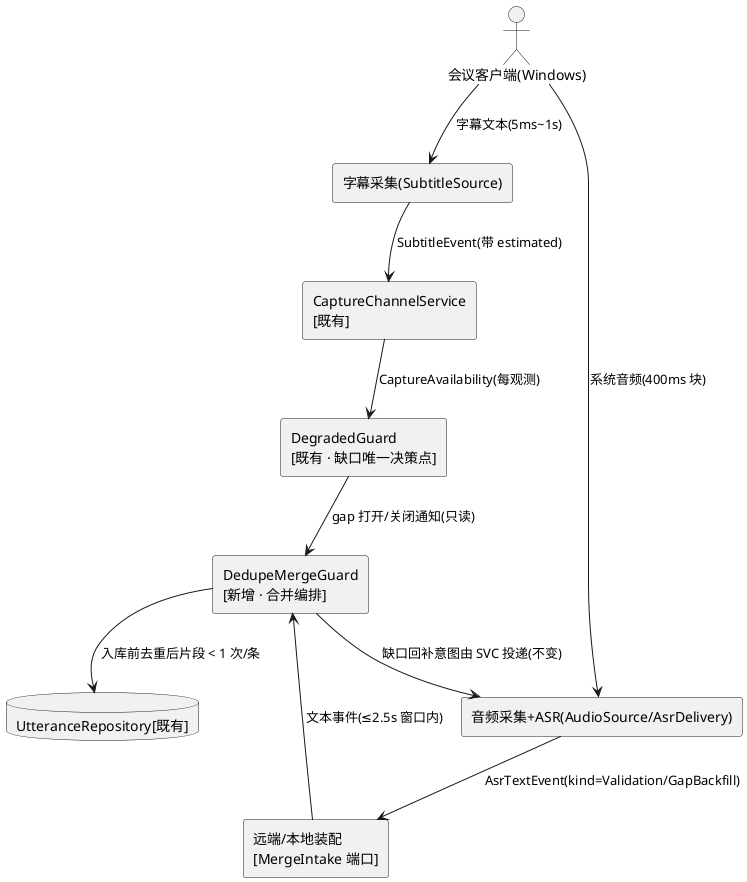
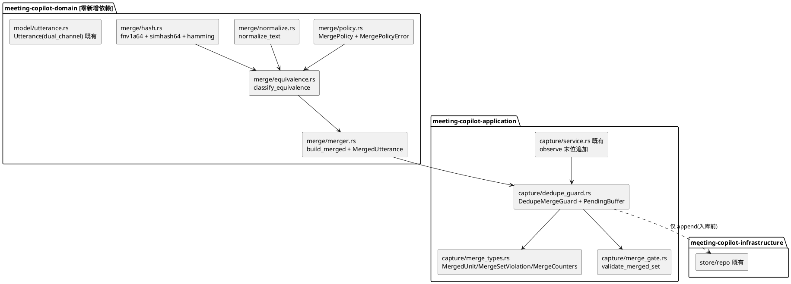
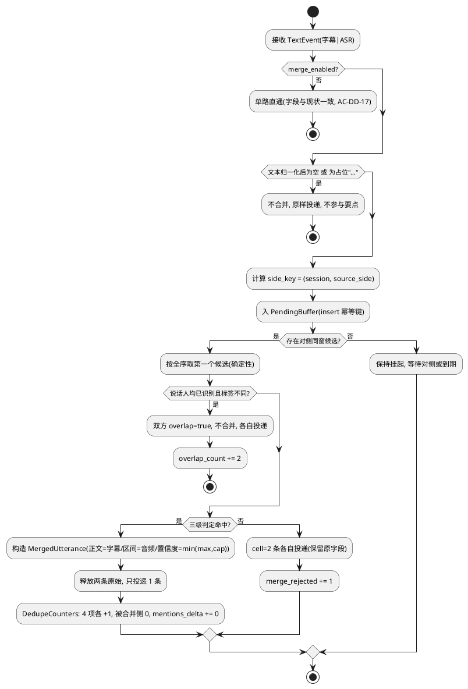
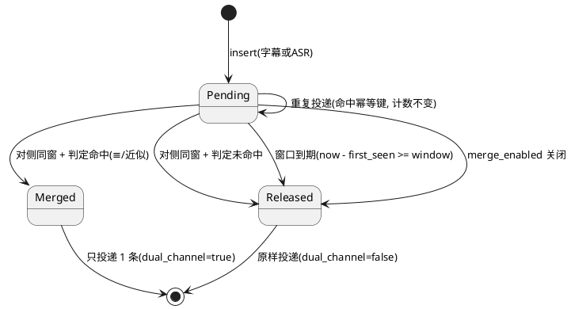
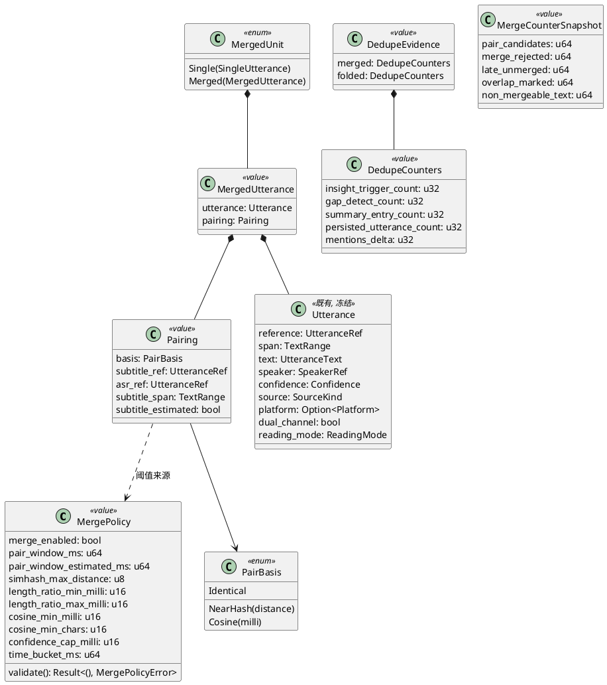
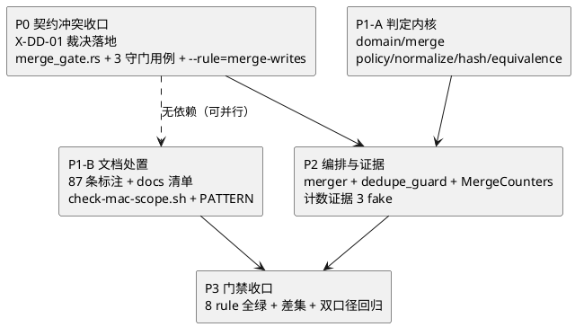

# mac_scope_and_b2_24 · 增量技术设计

> 上游唯一需求基线：`.codeartsdoer/specs/mac_scope_and_b2_24/spec.md`（636 行，AC-MS-01~13 + AC-DD-01~20）。
> 本文件只做"怎么做"：不修改 `docs/sdd/**`、不修改任何代码、不产出 tasks。
> 代码行号口径：2026-11-21 工作区快照（`crates/` 与 `scripts/` 实际内容），文档回写后以章节号为准。
> 已裁决输入（直接采用，不重开）：K1 = Windows 单 OS 的 G2；K3 = 允许字符 n-gram 余弦替代向量余弦；K4 = `merge_enabled` 默认 true；mac 处置 = 31 真机 NA + 10 共享契约降级 + 2 删除。

# 一、需求与存量功能关系分析

## 1.1 需求功能与存量功能对比

### 1.1.1 已实现功能

| 需求功能 | 存量功能 | 代码位置 | 匹配度 |
|---|---|---|---|
| 缺口区间合并（相邻容差内并为 1 条，保留最早起点/最晚终点，`backfilled` 取 OR） | `merge_gaps` / `merge_for_persist` | `crates/application/src/capture/capture_gap.rs:11-48`、`capture_gap_gate.rs:31-54` | 100% |
| 短板片段落盘门限（半开区间 `[start,end)`，`end<=start` 丢弃） | `persist_gate` | `crates/application/src/capture/capture_gap_gate.rs:18-27` | 100% |
| 恢复边界 `resume = close - min(8000, duration)` | `resume_boundary` | `crates/application/src/capture/capture_gap_gate.rs:57-61` | 100% |
| 要点幂等（同 `point_id` 只计一次） | `CaptureResumeLedger::record_point` | `crates/application/src/capture/capture_resume.rs:31-37` | 75% |
| 缺口关闭即投递 `GapBackfill` 意图（受 10 s 预算与抖动抑制） | `apply_transition` + `AsrBudget::try_issue` | `crates/application/src/capture/service.rs:284-309` | 100% |
| 字幕 5 s 失效回退 / 10 s 稳定切回 | `subtitle_fallback_due` / `stable_switch_back_due` | `crates/application/src/capture/channel_arbiter.rs:93-114` | 100% |
| 16 行通道仲裁决策表 | `decide` | `crates/application/src/capture/channel_arbiter.rs:19-90` | 100% |
| 通道四状态与 14 原因码、2 缺口原因 | `ChannelState` / `StateReason` / `GapReason` | `crates/domain/src/model/channel.rs:34-42`、`106-140`、`171-177` | 100% |
| 片段双通道承载字段 `dual_channel`、`SourceKind`（4 值）、`ReadingMode`（2 值） | `Utterance` / `SourceKind` / `ReadingMode` | `crates/domain/src/model/utterance.rs:28-40`、`enums.rs:53-72`、`104-107` | 100%（字段在、无赋值路径） |
| 片段区间与缺口区间的代数校验 | `validate_intervals` | `crates/application/src/capture/capture_gap_gate.rs:93-137` | 75% |
| 阈值配置可注入且在构造期拒绝越界 | `CapturePolicy`（20 字段）+ `validate` | `crates/application/src/capture/types.rs:191-327` | 100% |
| 采集离线静态门禁（依赖闭包/禁用调用/占位/载荷白名单） | `check-capture-offline.sh` 7 条 rule | `scripts/check-capture-offline.sh:38-80` | 100% |
| G2 宣称扫描（5 条禁止词） | `check-g2-claims.sh` `PATTERN` | `scripts/check-g2-claims.sh:12` | 75% |
| 用例名冻结与差集门禁 | `test-name-inventory.sh --diff` | `scripts/test-name-inventory.sh`（`NEW_TARGETS` 白名单 5 项） | 100% |
| macOS 交叉编译与可移植性锚点 | `platform-mac` 空壳 + `PLATFORM_NAME` | `crates/platform-mac/src/lib.rs:1-7`、`Cargo.toml:9` | 100% |
| 依赖图跨 4 target 检查面 | `deny.toml [graph].targets` | `deny.toml:2-8` | 100% |

> 匹配度判定依据：函数签名、默认值、边界行为与 spec 条款逐项对照；75% 表示"能力在、作用域或载体不匹配"，需要扩展而非重写。

### 1.1.2 需要扩展的功能

| 需求功能 | 存量功能 | 差异说明 | 扩展方向 |
|---|---|---|---|
| 区间不交校验需覆盖"合并单元" | `validate_intervals(gaps, segments, 400)` | **输入输出差异**：既有函数只认 `(start,end)` 二元组，无来源/来源对概念；**逻辑差异**：片段两两 `overlap>0` 即违规，未区分"同源对已合并"与"异源晚到"；**边界差异**：缺口 vs 片段允许 400 ms 重叠，spec AC-DD-16 要求"允许接触但不重叠" | 新增独立函数 `validate_merged_set`（严格 0 容差），**既有 `validate_intervals` 与其 12 个用例零改动**。详见 2.5.1 |
| 诊断计数需承载去重证据 | `DiagnosticCounter` 13 项封闭枚举 | **输入差异**：需 `merge_rejected`/`late_unmerged`/`overlap_count`/4 项去重计数；**约束差异**：`ALL.len()==13` 被 `diagnostics_bump_accumulates_per_counter` 断言，扩枚举会破坏既有用例 | 新增独立 `MergeCounters`（`[u64; 9]` 固定数组），**不新增 `DiagnosticCounter` 变体**。详见 1.2.4 |
| 配对与等价判定 | `design.md` 2.5.5 只有文字设计，代码 0 行 | **输入差异**：字幕 `estimated` 标记与音频精确时间需分级窗口；**逻辑差异**：三级判定未定义度量与哈希函数，缺确定性保证；**边界差异**：短片段（≤8 字）不得启用相似度级 | 新增 `crates/domain/src/merge/*`（纯函数）+ `crates/application/src/capture/dedupe_guard.rs`（编排），沿用 `tasks.md` 24.1~24.4 既有路径 |
| 片段幂等 | `CaptureResumeLedger`（要点粒度） | **粒度差异**：ledger 幂等键是 `point_id` 字符串，无会话内片段对概念 | 新增 `MergedSet` 幂等键 `(session, normalized_text, time_bucket)`；ledger 不动 |
| 缺口回补文本进入合并 | `GapBackfill` 只投递 `AsrIntent`，无文本回流 | **路径差异**：现有链路到"投递意图"为止，无产出文本的入口 | 新增 `MergeIntake` 端口（`AsrTextEvent`），由装配层把 ASR 结果回送至合并器；`AsrIntent` 契约不变。详见 2.6 |
| G2 宣称扫描词表 | `PATTERN` 5 条（`三平台稳定运行已验证…`） | **覆盖差异**：缺少 `macOS 已验证`/`mac 真机通过`/`三平台真机矩阵全部通过` | 扩 `PATTERN`（追加，不改既有 5 条），`--self-test` 保持退出 1 |
| 用例名差集白名单 | `NEW_TARGETS` 5 个 target 名 | **覆盖差异**：新增合并测试 target 不在白名单，差集不保护它 | 追加 `merge_dedupe` 到 `NEW_TARGETS`（只增不删） |

### 1.1.3 需要新增的功能或接口

**A. 合并策略与配置（AC-DD-10、AC-DD-12、spec 6.1）**
- 输入：无（构造期常量）；输出：`MergePolicy` 实例或 `MergePolicyError`；核心逻辑：10 字段默认值 + 6 类边界校验，与 `CapturePolicy` 完全隔离。
- 依赖：无（`domain` 层纯类型，零依赖新增）。

**B. 文本归一化与等价判定（AC-DD-02~05、AC-DD-18、AC-DD-20）**
- 输入：两段 `UtteranceText` + `MergePolicy`；输出：`Equivalence { basis: PairBasis, distance: Option<u8>, cosine_milli: Option<u16> }`。
- 核心逻辑：三级顺序判定；`PairBasis` 封闭三值 `Identical | NearHash { distance } | Cosine { milli }`。
- 依赖：仅 `domain` 内部（自实现 FNV-1a 64 与字符 n-gram），**禁止新增 crate**（AC-DD-14）。

**C. 合并单元构造（AC-DD-03、AC-DD-06、AC-DD-07、AC-DD-18、spec 6.2）**
- 输入：字幕 `SubtitleEvent` + 音频 `AsrTextEvent` + 判定结果；输出：`MergedUtterance`（含两路原始引用）。
- 核心逻辑：正文取字幕、段落取音频、置信度 `min(max(a,b), cap)`、说话人已识别优先、`dual_channel=true`、`source=PlatformSubtitle`。

**D. 去重挂起缓冲与合并集合（AC-DD-01、AC-DD-19、AC-DD-17）**
- 输入：逐条片段事件 + `now: MonoMillis`；输出：`Vec<MergedUnit>`（已释放的规范化片段）。
- 核心逻辑：窗口内挂起等待对侧；到期单路直通；重复投递命中幂等键；输出按全序排序 → 顺序无关。

**E. 计数证据（AC-DD-08、AC-DD-09、spec 6.3）**
- 输入：合并结果 + 被合并侧标记；输出：`DedupeCounters`（4 项计数 + `mentions_delta`）。
- 核心逻辑：合并单元各计 1，被合并侧各计 0；`mentions_delta=0`。

**F. mac 范围裁剪的机器判定（AC-MS-01~11）**
- 新增 `scripts/check-mac-scope.sh`（8 个 rule：`na/matrix/ci/g2/claims/contracts/docs/forbidden`），输入为 `docs/**` 与代码常量，输出退出码 0/1/2。
- 新增两份 `capability_matrix.toml` 投影（见 2.5.3 的事实缺口裁决）。

**G. 合并集合区间校验（AC-DD-16）**
- 输入：`&[MergedUnit]` + `&[CaptureGapRecord]` + `MergePolicy`；输出：`Result<(), MergeSetViolation>`；严格不重叠（`overlap_ms == 0`）。

## 1.2 存量功能详细分析

### 1.2.1 `CapturePolicy`：阈值承载边界（spec 4.5-3、6.1-10）

- **接口契约**：20 个 `u64/u8/u32` 公有字段，`Copy + Eq`，`Default` 提供全部默认值，`validate()` 返回 `CapturePolicyError`（2 变体：`OutOfRange { field, value }`、`ZeroDenominator`）。
- **业务规则**：`advance_interval_ms ∈ [100,250]`；9 个字段非零；`ocr_failure_denominator != 0` 且分子 ≤ 分母；`validation_interval_ms ∈ [5000,60000]`；`gap_reopen_merge_ms ∈ [1,2000]`；`status_queue_capacity == 64`（恰等）；`status_handler_timeout_ms ∈ [1,500]`；`status_latency_ring ≥ 256`；`seq_upper_bound_margin != 0`；`boundary_contact_max_ms ≤ 1000`。
- **扩展点**：**无**。spec 4.5-3 与 6.1-10 明确禁止在此承载合并阈值；`policy_default_keeps_existing_values`（`types.rs:400-413`）逐字段断言 9 个默认值，任何改动都会失败。
- **约束**：`Copy` 语义 + 值传递（`service.rs:51` `policy: CapturePolicy`）→ 新增字段会改变 `size_of` 与所有构造点，判定为**禁止**。

### 1.2.2 缺口链路：`merge → gate → resume` 的单点决策（AC-DD-16 的边界）

- **接口契约**：`merge_for_persist(pending, incoming, reopen_merge_ms) -> Option<CaptureGapRecord>` 只在同会话且 `incoming.start <= pending.end + reopen` 时返回合并结果；`persist_gate` 判定是否落盘；`resume_boundary` 计算回补起点。
- **业务规则**：缺口记录是**半开区间**语义（`end <= start` 丢弃）；`backfilled` 取 OR；`reason` 取最新 incoming（`capture_gap_gate.rs:52`）。
- **扩展点**：`DegradedGuard` 是缺口"合并→门限"的唯一决策点（`degraded_guard.rs:1-6` 注释 K1）；合并器**不得**在此插入第二个决策点，否则出现双写。
- **约束**：`DegradedGuard` 的依赖集显式排除所有仓储写 trait（I5）。合并器若在守卫内部做片段落盘，会破坏该约束并触发 `check-capture-offline.sh --rule=guard-deps`（`check-capture-offline.sh:69-71` 扫描 `dyn (Insight|Utterance|Session|Card)Repository|fn (save|append|delete|migrate)\(`）。

> **结论**：合并器必须在 `DegradedGuard` **之外**（`service.observe` 的末位副作用之后），且不得让 `degraded_guard.rs` 出现仓储写调用。

### 1.2.3 区间代数：X-DD-01 的存量硬约束

`validate_intervals`（`capture_gap_gate.rs:93-137`）当前三条不变量：

1. `gaps` 两两 `overlap_ms > 0` → `GapOverlap`；
2. `segments` 两两 `overlap_ms > 0` → `SegmentOverlap`（**严格不交**，接触放行）；
3. `segment × gap` `overlap_ms > boundary_contact_max_ms`（默认 400）→ `OverlapWithGap`。

三点的现存证据：`validate_intervals_rejects_segment_overlap`、`validate_intervals_allows_boundary_contact_400ms`、`validate_intervals_rejects_overlap_beyond_boundary`（`capture_gap_gate.rs:249-295`）。这三例属于 AC-22 兼容面（spec 7.4），**不得改名、不得改变期望值**。

因此 X-DD-01 的可行空间被压缩为：
- 不能修改 `validate_intervals` 的语义（否则 3 个既有用例失败 → AC-DD-13 失败）；
- 不能让合并单元与被合并原始片段同时进入 `segments`（否则第 2 条不变量必然触发，因为两路时间区间按 spec 定义就会重叠）；
- 不能改用 `delete` 回溯删除已落盘字幕（`UtteranceRepository::delete`，`repository.rs:34`）来"消除重叠"，因为 spec 4.1-2 规定去重发生在入库前。

### 1.2.4 诊断计数：13 项封闭枚举的边界

- `DiagnosticCounter::ALL.len() == 13` 被 `diagnostics_bump_accumulates_per_counter` 硬断言（`diagnostics.rs:142`），且 `DiagnosticsSnapshot` 用 `[u64; 13]` 定长数组。
- `DiagnosticsSink::bump(&self, counter: DiagnosticCounter, delta: u64)` 的签名只接受该封闭枚举（`capture_ports.rs:73-76`）。
- **结论**：合并计数（`merge_rejected`/`late_unmerged`/`overlap_count`/4 项去重计数/`mentions_delta`）一律进独立 `MergeCounters`，通过只读快照暴露，**不扩展** `DiagnosticCounter`。这样 AC-DD-08 的"计数证据"与 AC-DD-13 的"既有用例不变"同时成立。

### 1.2.5 既有基线与 43 项 AC 的冻结面

| 冻结项 | 现状证据 | 本设计的处理 |
|---|---|---|
| `passed ≥404 / failed=0 / ignored ≤9` | `docs/progress/b1-status.md:309`（38 targets / 404 / 0 / 9）；`docs/progress/b2-offline-closure.md:118` 为历史 399/8 | 新增用例只追加；不改 `#[ignore]`；AC-MS-12/AC-DD-13 |
| 用例名差集 `removed=0` | `test-names-before.txt` + `NEW_TARGETS` 5 项 | 只追加 target 名到 `NEW_TARGETS` |
| B2 离线 43 项 AC = "部分完成" | `b2-offline-closure.md:5`、`:180` | 不改 43 项判定；只改 G2 口径句（AC-MS-13 要求保留"部分完成"与"本轮通过 ≠ B2 G2 通过"） |
| `CapturePolicy` 默认值 | `CapturePolicy` 20 字段 + `policy_default_keeps_existing_values` | 零改动 |
| 六个 CI job | `web`/`rust`(3 target 矩阵)/`test-name-inventory`/`feature-coverage`/`compliance`/`sqlcipher`（`ci.yml:17/56/137/177/208/248`） | 零删除；mac 两 target 保留 |
| `feature-coverage` 的三 target 断言 | `ci.yml:197` 对 `x86_64-pc-windows-msvc`、`aarch64-apple-darwin`、`x86_64-apple-darwin` 逐个 grep | **保留**（属"可移植性观察"，非发布门禁）。这是 AC-MS-05 最容易被误删的一处，见 2.7.3 |

## 1.3 口径分歧登记（影响 AC 判定的三处事实差异）

设计必须在实现前把三处"spec 与实际不一致"固定下来，否则下游会按错误路径实现。

| # | 分歧 | spec 陈述 | 工作实际 | 设计裁决 |
|---|---|---|---|---|
| GAP-1 | 受影响条款条数 | 5.1.4 表体 A12+B27+C35+D13 = **87 行**；第 328 行统计写"NA 31 + EXT 10 + DEL 2 + KEEP 22 = 65"；任务书写"74 条" | 87 行可逐行复现；65 与 74 均无法从表体复现 | **以 87 行为唯一审查基数**（2.10 逐行给出），四类分布 = 保留 38 / 标注 35 / 删除 2 / 降级 12（详见 2.10 汇总）。65 与 74 仅作为汇总口径记录，不作为映射基数，也不得写进 `docs/sdd/**` |
| GAP-2 | `CapabilityMatrix` 载体 | AC-MS-03 判定命令引用 `crates/platform-mac/resources/capability_matrix.toml` 与 `crates/platform-win/resources/capability_matrix.toml` 键集合相等 | 两个 `resources/` 目录**均不存在**；`CapabilityMatrix` 只出现在 `design.md:1284/1359` 的文档描述，无 Rust 类型 | **新增两份 toml 投影**（只增不改），并由 `--rule=matrix` 断言键集合相等 + mac 行 `status="not_applicable"`。不发明 Rust 类型（避免与 M3/M5 的"契约保留"混淆）。见 2.5.3 |
| GAP-3 | LLM ignored 计数 | AC-DD-13/AC-MS-12 写 `ignored ≤9` | 默认构建 8 ignored，`--features llm-https` 为 9（`b2-offline-closure.md:153`） | 判定必须写清构建口径：**默认构建断言 `ignored == 9` 会失败**。设计把断言固定为"默认构建 `ignored ≤ 9` 且 `--features llm-https` 下 `ignored == 9`"，两条命令分别取证。不修改 AC 文字，只在测试映射表给出双口径命令 |

# 二、增量设计方案

## 2.1 实现模型

### 2.1.1 上下文视图



- 通信协议：进程内同步调用 + 端口 trait；无网络、无音频设备访问（AC-DD-11）。
- 频率：`observe` 由采集回路驱动（观测间隔 100 ms 级）；`advance_to(now)` 由调度方定期驱动，用于释放挂起缓冲到期项。

### 2.1.2 服务/组件总体架构



模块职责：
- `domain/merge/*`：纯函数，无 I/O、无时钟、无 `panic!`（`check-capture-offline.sh --rule=source`/`--rule=placeholders` 会扫 `crates/application/src/capture`，域层另由 clippy `-D warnings` 保障）。
- `application/capture/dedupe_guard.rs`：唯一有状态的编排者（挂起缓冲 + 幂等集合），只持有 `MonoMillis`，禁止墙钟。
- `application/capture/merge_gate.rs`：新增区间校验，与 `capture_gap_gate.rs` 并列而不修改其内容。

配置项与取值：`MergePolicy` 由装配层注入（`CaptureChannelService::with_merge`，新增构造器，不改既有 3 个构造器签名）。

### 2.1.3 实现设计文档

**(1) 合并流水线（活动图）**



**(2) 挂起缓冲状态机（AC-DD-01、AC-DD-19）**



触发条件与处理策略：

| 分支 | 触发条件 | 处理策略 | 计数 |
|---|---|---|---|
| `Merged` | 同会话 + 对侧 + 时间窗命中 + 三级判定命中 + 说话人不冲突 | 只投递合并单元 | 4 项各 1；`mentions_delta=0` |
| `Released`（未命中） | 同窗但三级皆未命中 | 两路原样投递，`overlap=false` | `merge_rejected +1` |
| `Released`（超窗） | `now - first_seen >= 窗口` 且无对侧 | 原样投递 | `late_unmerged +1`（仅当对侧最终到达且超窗） |
| `Released`（冲突） | 双方均已识别且标签不同 | 两路原样投递 + `overlap=true`，不进高置信要点 | `overlap_count +2` |
| 拒绝 | 任一路 `end <= start` 或落在会话范围外 | 两路原样投递，标记未合并 | `merge_rejected +1` |

**(3) 扩展点设计**

| 扩展点 | 接口 | 默认实现 | 二期替换 |
|---|---|---|---|
| 等价判定度量 | `fn classify(&self, a: &str, b: &str, p: &MergePolicy) -> Option<Equivalence>`（trait `EquivalenceJudge`） | `DeterministicJudge`（三级确定性） | 允许替换为字符 TF-IDF，但 `PairBasis` 三值封闭不变 |
| 合并入口 | `trait MergeIntake { fn push(&self, ev: AsrTextEvent); }` | `DedupeMergeGuard` | 平台侧可复用同一入口回送 OCR 文本 |
| 计数出口 | `MergeCounters::snapshot() -> MergeCounterSnapshot` | 本地原子累加 | 可接诊断包导出（字段名不改） |

**(4) 事务设计**

- 合并是**入库前**纯内存决策；`UtteranceRepository::append` 每合并单元调用 1 次（AC-DD-08 `persisted_utterance_count==1`）。
- 禁止在合并链路调用 `UtteranceRepository::delete`/`apply_correction`（`repository.rs:25-34`）。静态拦截：`check-capture-offline.sh` 新增 `--rule=merge-writes`，禁止 `dedupe_guard.rs` 出现 `fn (delete|apply_correction)` 与 `delete\(`。
- 无跨库事务需求：合并失败即两路各自 `append`，各自成功/失败独立。
## 2.2 接口设计

### 2.2.1 总体设计

接口分四组，按"纯函数 → 有状态编排 → 端口 → 脚本"分层，稳定性逐层降低。

| 组 | 接口 | 位置 | 稳定性 | 变更策略 |
|---|---|---|---|---|
| 配置 | `MergePolicy` / `MergePolicyError` / `MergePolicy::validate` | `domain/src/merge/policy.rs` | 稳定（AC-DD-10 冻结 10 字段与默认值） | 只允许追加字段并同步 `merge_policy_defaults_match_design` |
| 判定 | `normalize_text` / `simhash64` / `hamming_distance` / `ngram_cosine_milli` / `classify_equivalence` | `domain/src/merge/{normalize,hash,equivalence}.rs` | 稳定（AC-DD-02~05、18） | 签名冻结；度量实现可换但须保持 `PairBasis` 三值与整数语义 |
| 构造 | `build_merged` / `MergedUtterance` / `Pairing` | `domain/src/merge/merger.rs` | 稳定（AC-DD-03/06/07） | `MergedUtterance` 只追加，不重排既有字段 |
| 编排 | `DedupeMergeGuard::{push, advance_to, counters, snapshot}` | `application/src/capture/dedupe_guard.rs` | 实验（AC-DD-01/08/09/12/13/17/19） | 新增方法允许；`push/advance_to` 签名冻结 |
| 校验 | `validate_merged_set` | `application/src/capture/merge_gate.rs` | 稳定（AC-DD-16） | 新增违规变体允许，既有变体语义不变 |
| 端口 | `MergeIntake`（ASR 文本回送） | `application/src/capture/merge_types.rs` | 实验 | 可追加方法 |
| 脚本 | `check-mac-scope.sh` 8 rule | `scripts/` | 稳定（AC-MS-02/03/05/07/08/09/10） | 只加 rule，不改既有 rule 名与退出码语义 |
| 既有 | `validate_intervals` / `merge_for_persist` / `resume_boundary` / `CapturePolicy` | 既有文件 | **冻结** | 零改动（AC-21/AC-22 兼容面） |

接口继承体系：不使用 trait 继承；仅 `EquivalenceJudge` 与 `MergeIntake` 两个单方法 trait 作为扩展点。版本管理：不引入版本号，靠 `MergePolicy` 字段追加 + 用例名冻结实现兼容。

### 2.2.2 接口清单

#### (1) 配置：`MergePolicy`

```rust
// crates/domain/src/merge/policy.rs
#[derive(Debug, Clone, Copy, PartialEq, Eq, Serialize, Deserialize)]
#[serde(deny_unknown_fields)]
pub struct MergePolicy {
    pub merge_enabled: bool,
    pub pair_window_ms: u64,
    pub pair_window_estimated_ms: u64,
    pub simhash_max_distance: u8,
    pub length_ratio_min_milli: u16,
    pub length_ratio_max_milli: u16,
    pub cosine_min_milli: u16,
    pub cosine_min_chars: u16,
    pub confidence_cap_milli: u16,
    pub time_bucket_ms: u64,
}

#[derive(Debug, Clone, PartialEq, Eq, thiserror::Error)]
pub enum MergePolicyError {
    #[error("{field} 越界：{value}，允许 {min}..={max}")]
    OutOfRange { field: &'static str, value: u64, min: u64, max: u64 },
    #[error("估算窗口小于基础窗口：estimated={estimated_ms} < base={base_ms}")]
    WindowInverted { estimated_ms: u64, base_ms: u64 },
    #[error("长度比倒置：min={min_milli} >= max={max_milli}")]
    RatioInverted { min_milli: u16, max_milli: u16 },
    #[error("时间桶小于配对窗口：bucket={bucket_ms} < window={window_ms}")]
    BucketBelowWindow { bucket_ms: u64, window_ms: u64 },
}

impl Default for MergePolicy { /* 见 2.3.3 默认值表 */ }

impl MergePolicy {
    pub fn validate(&self) -> Result<(), MergePolicyError>;
}
```

- **业务说明**：承载 spec 6.1 的 9 个阈值 + 幂等时间桶（spec 6.2-1 要求"时间桶"参与幂等键，故作为第 10 字段）。
- **前置条件**：无（`Default` 恒合法）。
- **后置条件**：`validate()` 返回 `Ok` 后，全部字段满足 2.3.3 的区间与交叉约束；返回 `Err` 时不修改任何全局状态，调用方保留默认策略。
- **异常映射**：`MergePolicyError` **不并入** `ErrorCode`（`error_code_all_len_frozen` 断言 `ALL.len()==12`）。装配层把 `MergePolicyError` 映射为"启动诊断提示 + 回落默认策略"，不产生 `ErrorCode`。
- **调用示例**：

```rust
let policy = MergePolicy::default();
assert!(policy.validate().is_ok());

let illegal = MergePolicy { pair_window_ms: 0, ..MergePolicy::default() };
assert!(matches!(illegal.validate(), Err(MergePolicyError::OutOfRange { field: "pair_window_ms", .. })));
```

#### (2) 判定：归一化与三级等价

```rust
// crates/domain/src/merge/normalize.rs
pub fn normalize_text(raw: &str) -> String;
// 规则（确定性、无外部表）：1) 去除 Unicode 标点与空白（P* 与 Z* 类）；
// 2) 全角 ASCII（U+FF01..U+FF5E）→ 半角；3) 繁→简通过内置 24 个高频映射常量表（不引入第三方）；
// 4) ASCII 小写化；5) 连续空白归一为空（已整体去除）。

// crates/domain/src/merge/hash.rs
pub fn fnv1a64(bytes: &[u8]) -> u64;                  // offset=0xcbf29ce484222325, prime=0x100000001b3
pub fn simhash64(normalized: &str) -> u64;            // 特征=字符 2-gram（CJK）+ ASCII 词 unigram
pub fn hamming_distance(a: u64, b: u64) -> u8;        // a^b count_ones

// crates/domain/src/merge/equivalence.rs
#[derive(Debug, Clone, Copy, PartialEq, Eq)]
pub enum PairBasis {
    Identical,
    NearHash { distance: u8 },
    Cosine { milli: u16 },
}

pub fn classify_equivalence(a: &str, b: &str, policy: &MergePolicy) -> Option<PairBasis>;
pub fn ngram_cosine_milli(a: &str, b: &str) -> u16;   // 3-gram 多重集，整数定点
```

- **业务说明**：`classify_equivalence` 按 `Identical → NearHash → Cosine` 严格顺序，前级未命中才进入下级（spec 5.2.1-3、AC-DD-04/05）。
- **前置条件**：入参为已 `normalize_text` 的字符串；空串一律返回 `None`。
- **后置条件**：返回 `Some` 即"可合并"；返回 `None` 即"不可合并"。`PairBasis` 必为三值之一（AC-DD-18）。
- **异常映射**：不返回 `Result`；非法输入（空串）表现为 `None`，不 panic（`--rule=placeholders` 禁止 `panic!`）。
- **调用示例**：

```rust
let p = MergePolicy::default();
let a = normalize_text("确认下周灰度上线。");
let b = normalize_text("确认下周灰度上线");
assert_eq!(classify_equivalence(&a, &b, &p), Some(PairBasis::Identical));
```

#### (3) 构造：合并单元

```rust
// crates/domain/src/merge/merger.rs
#[derive(Debug, Clone, PartialEq)]
pub struct Pairing {
    pub basis: PairBasis,
    pub subtitle_ref: UtteranceRef,
    pub asr_ref: UtteranceRef,
    pub subtitle_span: TextRange,   // 估算区间原样保留（spec 6.2-7）
    pub subtitle_estimated: bool,
}

#[derive(Debug, Clone, PartialEq)]
pub struct MergedUtterance {
    pub utterance: Utterance,       // 既有类型；dual_channel=true，source=PlatformSubtitle
    pub pairing: Pairing,
}

pub fn build_merged(
    subtitle: &SubtitleEvent,
    asr: &AsrTextEvent,
    basis: PairBasis,
    policy: &MergePolicy,
) -> Option<MergedUtterance>;
```

- **业务说明**：正文取字幕文本；`span` 取 ASR 精确起止；`confidence = min(max(sub, asr), cap/1000)`；`speaker` 已识别方优先，双方均未知则 `SpeakerRef::unknown()`；`reading_mode` 取字幕侧；`platform` 取字幕侧。
- **前置条件**：`basis` 来自 `classify_equivalence` 命中；双方 `span` 均满足 `start < end`；双方会话一致。
- **后置条件**：返回 `None` 仅当"双方均已识别且标签不同"（该情形应在编排层已拦截，双保险）；`utterance.text` 非空且 ≤2000 字（`UtteranceText::LIMIT`）。
- **异常映射**：`UtteranceText::new` 的 `TextBoundError` 不向外交付，`build_merged` 直接 `None`（回退为两路原样投递）。
- **调用示例**：

```rust
let merged = build_merged(&sub, &asr, PairBasis::Identical, &MergePolicy::default()).expect("merged");
assert!(merged.utterance.dual_channel);
assert_eq!(merged.utterance.span.start_ms, asr.span.start_ms);
assert_eq!(merged.pairing.subtitle_span, sub.span);
```

#### (4) 编排：挂起缓冲与规范化输出

```rust
// crates/application/src/capture/dedupe_guard.rs
pub struct DedupeMergeGuard { /* policy, pending, seen, counters 均内部持有 */ }

impl DedupeMergeGuard {
    pub fn new(policy: MergePolicy) -> Result<Self, MergePolicyError>;
    pub fn push(&self, ev: TextEvent) -> Vec<MergedUnit>;        // 幂等；重复投递返回空
    pub fn advance_to(&self, now: MonoMillis) -> Vec<MergedUnit>; // 到期释放，按全序输出
    pub fn counters(&self) -> MergeCounterSnapshot;
    pub fn dedupe_evidence(&self) -> DedupeEvidence;
}

pub enum MergedUnit {
    Single(SingleUtterance),   // dual_channel=false，字段与输入逐字段相等
    Merged(MergedUtterance),   // dual_channel=true
}
```

- **业务说明**：唯一有状态的合并入口；`push` 决定"立刻合并 / 挂起 / 单路直通"，`advance_to` 负责到期释放（由既有 `service.advance_to` 同频驱动）。
- **前置条件**：`DedupeMergeGuard::new` 时 `MergePolicy::validate()` 通过。
- **后置条件**：`push` 返回空表示"本次不产出"（已挂起或重复投递）；返回非空时元素数 ∈ {1, 2}，且按 `(span.start_ms, ref)` 升序。
- **异常映射**：区间非法 → 计数 `merge_rejected` 后返回 2 条 `Single`，不抛错（spec 5.2.3-1）。
- **调用示例**：

```rust
let guard = DedupeMergeGuard::new(MergePolicy::default()).expect("policy");
let out = guard.push(TextEvent::subtitle(sub.clone()));
assert!(out.is_empty(), "首条字幕应挂起等待对侧");

let out = guard.push(TextEvent::asr(asr.clone()));
assert_eq!(out.len(), 1);
assert!(matches!(&out[0], MergedUnit::Merged(m) if m.utterance.dual_channel));
```

#### (5) 校验：合并集合区间不交

```rust
// crates/application/src/capture/merge_gate.rs
#[derive(Debug, Clone, Copy, PartialEq, Eq)]
pub enum MergeSetViolation {
    MergedOverlap { left: usize, right: usize, overlap_ms: u64 },
    MergedOverlapsGap { unit: usize, gap: usize, overlap_ms: u64 },
    CrossOriginOverlapNotMarked { left: usize, right: usize, overlap_ms: u64 },
    InvalidSpan { unit: usize },
}

pub struct MergeSpan {
    pub start: MonoMillis,
    pub end: MonoMillis,
    pub dual_channel: bool,
    pub overlap_marked: bool,
    pub origin_pair: Option<(UtteranceRef, UtteranceRef)>,
}

pub fn validate_merged_set(
    units: &[MergeSpan],
    gaps: &[CaptureGapRecord],
) -> Result<(), MergeSetViolation>;
```

- **业务说明**：AC-DD-16 的唯一判定载体。**严格不重叠**：任何 `overlap_ms > 0` 即违规（比既有 400 ms 容差更严）。
- **前置条件**：`units` 只包含**输出集合**（被合并的两条原始片段不在其中，仅存于 `origin_pair` 引用）。
- **后置条件**：`Ok` 表示四条不变量（见 2.3.4）成立。
- **异常映射**：违规变体不进 `ErrorCode`；离线用例直接断言变体。
- **与既有函数的关系**：`validate_intervals` 完全不变，继续覆盖"缺口 vs 单路片段"基线；`validate_merged_set` 只覆盖"合并产物"。二者并存，不互相调用。

#### (6) 端口：ASR 文本回送

```rust
// crates/application/src/capture/merge_types.rs
#[derive(Debug, Clone, PartialEq)]
pub struct AsrTextEvent {
    pub session: SessionId,
    pub kind: AsrIntentKind,         // Validation | GapBackfill | Primary（既有枚举）
    pub span: TextRange,
    pub text: UtteranceText,
    pub speaker: SpeakerRef,
    pub confidence: Confidence,
    pub estimated: bool,             // 默认 false（ASR 为精确时间）
    pub platform: Platform,
    pub reference: UtteranceRef,
}

pub trait MergeIntake: Send + Sync {
    fn push(&self, ev: AsrTextEvent);
}
```

- **业务说明**：为 `GapBackfill`/`Validation` 的**产出文本**提供回流入口，不改 `AsrDeliverySink::deliver(AsrIntent)` 契约（`capture_ports.rs:23-26`）。
- **前置条件**：`span` 来自 ASR 音频时间轴（`AudioClock`），非墙钟。
- **后置条件**：实现方必须幂等（同 `reference` 重复 push 不产生第二条）。
- **异常映射**：`push` 无返回（异步/尽力）；失败由调用方计数。

## 2.3 数据模型

### 2.3.1 设计目标

1. 支持"同一会话内字幕与音频回补同段文本只计一次"（spec 5.2.1-8），同时保持单路输入逐字段不变（AC-DD-17）。
2. 配置与既有 `CapturePolicy` **物理隔离**（spec 4.5-3、6.1-10），使关闭合并不影响任何既有默认值。
3. 领域对象与 spec 术语一致：`MergedUtterance`（合并单元）、`Pairing`（配对依据）、`DedupeEvidence`（计数证据）、`MergeCounters`（异常计数）。
4. 与存量数据兼容：复用既有 `Utterance`（含 `dual_channel`/`source`/`reading_mode`），**不新增数据库列**、不改 `deny_unknown_fields` 契约。
5. 容量与性能：1000 对候选判定 ≤200 ms 单线程（spec 4.1-1）；`simhash64` 与余弦均 O(n)（n=文本字符数 ≤2000）。

### 2.3.2 模型实现



- 对象生命周期：`MergePolicy` 进程内单例（`Copy`）；`Pairing`/`MergedUtterance` 随合并单元一并投递后即释放；`DedupeEvidence` 按会话累计、会话 `detach` 时清零（与 `CaptureResumeLedger` 同生命周期）。
- 持久化策略：只持久化 `Utterance`（既有仓储），`Pairing` 作为诊断/回溯字段随合并记录一并保存（spec 6.2-7/8），**不新增表**；`subtitle_span` 与 `subtitle_estimated` 只能出现在合并记录里，不得写入音频时间轴字段。
- `ControlPolicy` 与 `MergePolicy` 无任何引用关系（编译期可断言：`grep -F "MergePolicy" crates/application/src/capture/types.rs` 命中 0）。

### 2.3.3 `MergePolicy` 字段表（默认值 / 边界 / 错误码）

| # | 字段 | 类型 | 默认值 | 合法区间 | 交叉约束 | 违规变体 |
|---|---|---|---|---|---|---|
| 1 | `merge_enabled` | `bool` | `true` | `{true,false}` | 关闭时 `push` 恒返回 `Single` | — |
| 2 | `pair_window_ms` | `u64` | `2500` | `[500,5000]` | — | `OutOfRange` |
| 3 | `pair_window_estimated_ms` | `u64` | `3500` | `[pair_window_ms,5000]` | 必须 `≥` 字段 2 | `WindowInverted` / `OutOfRange` |
| 4 | `simhash_max_distance` | `u8` | `3` | `[0,8]` | 超过 8 无意义（64 位汉明） | `OutOfRange` |
| 5 | `length_ratio_min_milli` | `u16` | `600` | `[100,1000]` | `<` 字段 6 | `OutOfRange` |
| 6 | `length_ratio_max_milli` | `u16` | `1600` | `(min,3000]` | `>` 字段 5 | `RatioInverted` / `OutOfRange` |
| 7 | `cosine_min_milli` | `u16` | `860` | `[0,1000]` | — | `OutOfRange` |
| 8 | `cosine_min_chars` | `u16` | `8` | `[0,200]` | — | `OutOfRange` |
| 9 | `confidence_cap_milli` | `u16` | `950` | `[0,1000]` | — | `OutOfRange` |
| 10 | `time_bucket_ms` | `u64` | `2500` | `[500,5000]` | 必须 `≥` 字段 2 | `BucketBelowWindow` / `OutOfRange` |

校验顺序固定（保证同一非法值总报同一变体，可稳定断言）：`merge_enabled`（无）→ 字段 2 → 字段 3（区间→倒置）→ 字段 4 → 字段 5 → 字段 6（区间→倒置）→ 字段 7 → 字段 8 → 字段 9 → 字段 10（区间→桶下界）。

`Default` 实现必须逐字段写字面量（禁止 `..Default::default()` 递归），与 `CapturePolicy::default`（`types.rs:224-249`）同风格。

### 2.3.4 合并集合不变量

| # | 不变量 | 判定载体 | 关联 AC |
|---|---|---|---|
| I1 | 幂等：同 `(session, side, reference)` 重复 `push` 产出 0 条；同幂等键至多 1 个合并单元 | `duplicate_pair_applied_once`、`seen` 集合 | AC-DD-19 |
| I2 | 顺序无关：同批输入的任意排列，输出按规范键排序后逐元素相等 | `merge_is_order_insensitive`（新增 L1） | AC-DD-01/19 |
| I3 | 结构唯一：只跨通道配对，同通道永不配对 → 每组恰 2 条，无传递闭包 | `no_chain_merge_across_same_side`（新增 L1） | AC-DD-01 |
| I4 | 区间不交：`Merged` 单元两两 `overlap_ms == 0`；`Single` 异源重叠仅允许 `late_unmerged` 且必标 `overlap=true` | `validate_merged_set` + `merged_span_does_not_overlap_gap_interval` | AC-DD-16 |
| I5 | 计数一致：合并单元 4 项各 1、被合并侧各 0、`mentions_delta == 0` | `DedupeEvidence` | AC-DD-08/09 |
| I6 | 单路不变：无对侧时 `Single` 与输入逐字段相等（`dual_channel=false`，来源原样） | `single_channel_output_unchanged` | AC-DD-17 |
| I7 | 缺口不冲突：合并单元与缺口区间 `overlap_ms == 0`（允许接触） | `validate_merged_set` 的 `MergedOverlapsGap` | AC-DD-16 |
| I8 | 零转录：`MergedUtterance` 与 `Pairing` 字段集不含音频样本/特征/URL/Key/模型名/`request_id` | 字段白名单静态断言 + `scan-secrets*.sh` | AC-DD-15/20 |

## 2.4 合并算法

### 2.4.1 伪代码

```text
// 全序：确定性候选选择与确定性输出
ORDER(u) = (u.span.start_ms, u.span.end_ms, normalize(u.text), u.reference.as_str())

PUSH(policy, buf, seen, counters, ev) -> [MergedUnit]:
    if not policy.merge_enabled:
        return [Single(ev)]                                  # AC-DD-17

    n = normalize_text(ev.text.raw)
    if n == "" or is_placeholder(ev.text.raw):                # spec 5.2.3-2
        counters.non_mergeable_text += 1
        return [Single(ev)]

    if ev.span.start_ms >= ev.span.end_ms:                    # spec 5.2.3-1
        counters.merge_rejected += 1
        return [Single(ev), ...]                              # 两路均可

    if seen.contains((ev.session, ev.side, ev.reference)):     # I1
        return []

    window = if ev.estimated { policy.pair_window_estimated_ms } else { policy.pair_window_ms }

    cands = [o for o in buf.same_session(ev.session)
               if o.side != ev.side
               and intersect(o.span, ev.span) > 0             # spec 5.2.1-1
               and |o.span.start_ms - ev.span.start_ms| <= window]
    sort cands by ORDER

    if cands is empty:
        buf.insert(ev, deadline = ev.observed_at + window)
        return []                                              # 挂起，可能是首路

    o = cands[0]
    if conflict_speaker(ev.speaker, o.speaker):                # spec 5.2.1-6
        counters.overlap_marked += 2
        buf.remove(o)
        return [Single(o, overlap=true), Single(ev, overlap=true)]

    basis = classify_equivalence(n, normalize_text(o.text.raw), policy)
    if basis is None:                                          # spec 5.2.1-5
        counters.merge_rejected += 1
        buf.remove(o)
        return sort([Single(o), Single(ev)])

    if not within_length_ratio(n, o.normalized, policy):       # 双保险（L2 内已判）
        counters.merge_rejected += 1
        buf.remove(o)
        return sort([Single(o), Single(ev)])

    m = build_merged(ev, o, basis, policy)                     # 正文=字幕，区间=ASR
    if m is None:
        counters.merge_rejected += 1
        buf.remove(o)
        return sort([Single(o), Single(ev)])

    buf.remove(o)
    seen.insert((session, side, ev.reference))
    seen.insert((session, other_side, o.reference))
    counters.pair_candidates += 1
    evidence.merged = {insight:1, gap:1, summary:1, persisted:1, mentions_delta:0}
    evidence.folded = {insight:0, gap:0, summary:0, persisted:0, mentions_delta:0}
    return [Merged(m)]

ADVANCE_TO(policy, buf, counters, now) -> [MergedUnit]:
    expired = [e for e in buf if now >= e.deadline]
    sort expired by ORDER
    for e in expired:
        buf.remove(e)
        if e.had_candidate_late: counters.late_unmerged += 1   # 对侧超窗到达由 PUSH 侧置位
    return [Single(e) for e in expired]
```

`intersect(a,b) = max(0, min(a.end,b.end) - max(a.start,b.start))`，整数运算。

### 2.4.2 不变量证明与确定性说明

**确定性（随机种子无关）**
1. **无随机源**：全链路无 `rand`、无 `HashMap` 迭代序（候选收集后必须 `sort` 才取 `[0]`）、无浮点。证据：`crates/application/src/capture` 由 `--rule=source` 扫描禁用调用；域层由 `clippy -D warnings` + 人工评审保证无 `rand`/`HashMap`（用 `BTreeMap`/`Vec`）。
2. **哈希固定**：`fnv1a64` 的 offset 与 prime 为编译期常量，跨平台、跨版本、跨进程一致；**禁用** `std::collections::hash_map::DefaultHasher`（不保证跨版本稳定）。
3. **整数相似度**：`ngram_cosine_milli(a,b) = (1000 * Σ min(count_a,count_b)) / isqrt(Σ count_a² * Σ count_b²)`，分子用 `u128` 累积避免溢出，除数为 0 时返回 0。全程无 `f64`，故无平台浮点差异（x86/ARM 结果一致，满足 AC-MS-04 的跨 target 编译与同值语义）。
4. **全序键唯一**：`ORDER` 以 `reference`（唯一字符串）收尾，任意两条候选不会并列 → `cands[0]` 唯一。

**顺序无关（I2）证明**：把 `PUSH` 视为对多重集的归约操作 `fold`。因①候选集合只依赖"同会话 + 异侧 + 相交 + 窗内"，与插入顺序无关；②取候选恒取 `ORDER` 最小者；③同侧永不互相配对 → 配对关系是一个**匹配**（matching），不含三元链。故任意排列归约到同一匹配集合；输出按 `ORDER` 排序后相等。∎

**幂等（I1）证明**：`seen` 在合并产出时插入两条 `reference`，后续同 `reference` 的 `push` 在入口返回 `[]`；`MergedKey = (session, normalized_text, start_ms / time_bucket_ms)` 用于跨会话重放的二次校验（`time_bucket_ms ≥ pair_window_ms` 使同窗对落入同桶；桶边界处由 `reference` 集合兜底）。∎

**区间不交（I3/I4）**：合并单元输出集合只含 `MergedUnit::Merged` 与"从未参与合并的 `Single`"。被合并的两条从缓冲移除且不投递 → 不进入集合。同侧不配对 → 不存在同一侧两条区间重叠的合并产物。唯一允许重叠的是"对侧超窗到达"的 `late_unmerged` 对，此时必置 `overlap=true` 并由 `validate_merged_set` 拦截未标记的情形（`CrossOriginOverlapNotMarked`）。∎

### 2.4.3 计数证据链（AC-DD-08/09 的断言方式）

| 计数 | 产生点 | 断言方式 | 用例名 |
|---|---|---|---|
| `insight_trigger_count == 1` | 合并单元投递后调用要点提炼入口 1 次 | `DedupeEvidence.merged.insight_trigger_count` + 记录型 fake 的回调次数 | `merged_utterance_triggers_insight_once` |
| `gap_detect_count == 1` | 合并单元进入缺口识别入口 1 次 | 同上（fake 计数） | `merged_utterance_triggers_insight_once` 同例双断言 |
| `summary_entry_count == 1` | 合并单元进入摘要窗口 1 条 | fake 记录的入窗片段条数 | `summary_window_counts_once` |
| `persisted_utterance_count == 1` | `UtteranceRepository::append` 调用 1 次 | `RecordingRepo.append_calls == 1` | `merged_utterance_triggers_insight_once` 同例三断言 |
| 被合并侧 4 项 == 0 | 被合并的原始片段不投递 | `DedupeEvidence.folded` 全 0 | `duplicate_side_triggers_zero_insight` |
| `mentions_delta == 0` | 合并本身不递增提及次数 | `DedupeEvidence.merged.mentions_delta == 0`；要点侧 `mentions == 1` | `mentions_not_incremented_by_dual_channel` |
| `merge_rejected` / `late_unmerged` / `overlap_marked` | 异常分支 | `MergeCounterSnapshot` 逐字段 | 对应异常用例 |

证据链要求：**同一用例内同时断言"下游调用次数"与"计数器字段"**，防止只改计数器不改调用。三个 fake（`RecordingInsight`/`RecordingSummary`/`RecordingRepo`）放进 `crates/application/tests/support/fakes.rs`，须满足 `--rule=fakes` 的方法面约束（不出现 `fn delete`、`fn clear`、`fn remove*`）。
## 2.5 关键冲突裁决

### 2.5.1 X-DD-01：配对窗口允许重叠 vs 片段区间不允许重叠

**候选方案与否决理由（先否决，再给唯一方案）**

| 候选 | 内容 | 否决理由（可验证） |
|---|---|---|
| A. 放宽既有契约 | 修改 `validate_intervals`，允许"同源对"片段重叠 | 会改变 `validate_intervals_rejects_segment_overlap`（`capture_gap_gate.rs:288-295`）的期望值 → AC-DD-13 失败；且 AC-22 兼容面（spec 7.4）明令"合并不改变区间代数判定" |
| B. 合并阶段区间切分 | 把合并单元裁成 `[max(S.start,A.start), A.end]` 或 `[S.end, A.end]`，使其与字幕片段不重叠 | 违反 AC-DD-07/spec 5.2.1-4"合并片段起止 **shall 等于** 音频回补起止"；切分后区间不再可回溯到 ASR 时间轴，`resumed`/缺口校验也会用到非原始边界 |
| C. 合并后删除被合并侧 | 用 `UtteranceRepository::delete` 抹掉已落盘字幕 | 违反 spec 4.1-2"去重只允许在片段入库前完成"；且 `delete` 在"被要点引用时禁止删除"（`repository.rs:33-34`），会产生新的失败路径 |
| **D（采纳）** | **入库前合并 + 被合并侧不进入输出集合 + 新增更严格的独立集合校验 + 唯一例外显式标记** | 既不改既有函数、不改既有用例、不切分区间，又让"输出集合两两不交"在整个集合上成立 |

**方案 D 的完整不变量（严格强于既有口径）**

在"输出片段集合"层面定义（只作用于合并产物的校验函数 `validate_merged_set`）：

- **D-1** `Merged` 单元两两 `overlap_ms == 0`（比既有 `validate_intervals` 的片段规则同强度，接触放行）。
- **D-2** `Merged` 单元 × `gap` 区间 `overlap_ms == 0`（**严格 0**，比既有 `boundary_contact_max_ms=400` 更严；更严即不破坏既有结论）。
- **D-3** 异源 `Single`（字幕与 ASR 未合并）允许区间重叠，**当且仅当** `overlap_marked == true`；未标记即 `CrossOriginOverlapNotMarked`。
- **D-4** 被合并的两条原始片段**不得出现在输出集合中**，只允许以 `Pairing.{subtitle_ref, asr_ref, subtitle_span, subtitle_estimated}` 形式作引用（spec 6.2-7）。
- **D-5** 同通道（同为字幕或同为 ASR）碎片**永不配对**，因此不存在"同侧区间重叠"的合并产物。

**"允许重叠"被精确限定为一条路径**：只有当对侧片段**超过配对窗口**才到达（`late_unmerged`）时，才允许两条异源片段在输出集合中重叠，且必须 `overlap=true`、不进高置信要点（spec 6.2-9）。这条路径由 `advance_to` 判定到期释放后，`push` 侧再见到超窗对侧时置位——两种情况共用同一标记，不可跳过。

**时间窗与重叠的关系（消除"±2.5 s 必然重叠"的误解）**

配对窗口是**候选必要条件**，不是合并后区间的性质：候选要求"交集 > 0"（`intersect(o.span, ev.span) > 0`）**且**"起点差 ≤ 窗口"。合并后区间取 ASR 起止；字幕区间只作引用。因此"窗口内两条区间重叠"只发生在**输入侧**，输出侧只剩 1 条。这就是 D-1 能成立的原因。若字幕与 ASR 区间**不相交但起点差 ≤ 窗口**（例如字幕 `[0,800]`、ASR `[2000,3000]`，差 2000 ms），按 spec 5.2.1-1"交集落在窗口内"必须判 0 个候选 → 用例 `pair_outside_window_is_none` 覆盖此点。

**必须新增的回归用例（AC-DD-16 之外的三条守门用例）**

| 用例名 | 断言 | 层级 |
|---|---|---|
| `merged_span_does_not_overlap_gap_interval` | 合并单元 `[a1,a2]` 与缺口 `[g1,g2]` 交集为 0；`validate_merged_set` 返回 `Ok` | L1 |
| `merged_set_spans_are_pairwise_disjoint` | 3 条合并单元两两 `overlap_ms == 0`；插入一条人为重叠返回 `MergedOverlap` | L1 |
| `late_unmerged_pair_requires_overlap_mark` | 超窗对侧到达 → 两条 `Single` 且 `overlap=true`；人为清标记 → `CrossOriginOverlapNotMarked` | L1 |

**AC 映射**：AC-DD-01（窗内/窗外候选数）→ `pair_within_default_window`/`pair_outside_window_is_none`；AC-DD-07（区间取 ASR）→ `merged_span_uses_asr_precise_bounds`；AC-DD-16（与缺口不重叠）→ 上表第 1 条。

### 2.5.2 X-DD-02：字幕与音频回补文本"近似"的判定口径

**唯一规则：三级确定性判定，禁止编辑距离与前缀包含**

| 级 | 规则 | 参数（`MergePolicy`） | 命中即停 | 依据字段 |
|---|---|---|---|---|
| L1 完全相同 | `normalize_text(a) == normalize_text(b)` | — | 是 | `PairBasis::Identical` |
| L2 近似哈希 | `hamming_distance(simhash64(a), simhash64(b)) <= simhash_max_distance` **且** `length_ratio ∈ [min_milli, max_milli]` | `simhash_max_distance=3`、`600/1600` | 是 | `NearHash { distance }` |
| L3 字符相似度 | `ngram_cosine_milli(a,b) >= cosine_min_milli`，仅当 `min(chars(a),chars(b)) > cosine_min_chars` | `860`、`8` | 是 | `Cosine { milli }` |

**时间维度单独且确定**：不参与文本相似度，作为**门**使用——`intersect > 0` 且 `|Δstart| ≤ 窗口（2500 或 3500）`。不用"时间包含百分比"或"中点距离"，因为两者都需要额外阈值且与窗语义重复。

**为什么排除用户列出的另两个候选**

| 候选 | 排除理由 |
|---|---|
| 编辑距离（Levenshtein） | ① 断句差异会把它击穿：ASR 把一句拆成两句时，插入整句使距离 ≈ 句子长度，阈值失去意义；② 需要"归一化距离 ≤ x"的第二个阈值，与 `MergePolicy` 10 字段冻结冲突；③ 复杂度 O(n·m)，2000 字片段在 1000 对批量下超过 200 ms 预算（spec 4.1-1） |
| 归一化后前缀/后缀包含 | ① 无法区分"同一句被 ASR 截断"与"不同句恰好共享前缀"；② 需额外的"最短包含长度"阈值；③ 对"字幕整句 + ASR 半句"放行、对"字幕半句 + ASR 整句"也放行，导致误合并率不可控 |

**L3 为什么用字符 3-gram 多重集而非向量**：K3 已裁决允许字符 n-gram 余弦替代向量余弦；3-gram 对中文断句差异的鲁棒性优于 2-gram（2-gram 对单字差异过敏感），且多重集实现无需词典、零依赖（AC-DD-14）。相似度公式 `1000·Σmin(ca,cb) / sqrt(Σca²·Σcb²)` 用整数 `u128` 中间量 + `isqrt`，无浮点（见 2.4.2）。

**归一化规则（`normalize_text`，确定性、可离线复现）**
1. 去除 Unicode `P*`（标点）与 `Z*`（空白）类字符；
2. 全角 ASCII `U+FF01..=U+FF5E` 映射为半角（按码位差 0xFEE0 平移）；
3. 繁→简只做 24 个高频字常量映射（`著→着`、`祗→只`…），不引入词库，也不承诺全覆盖；未映射字符原样保留（宁可不合并，也不误合并）；
4. ASCII 字母小写化；
5. 结果为空即"不可合并"（`non_mergeable_text`）。

**AC 映射**：AC-DD-02 → `normalization_makes_variants_equal`；AC-DD-04 → `near_duplicate_within_simhash_distance_merges`；AC-DD-05 → `dissimilar_text_is_not_merged` + `short_fragment_skips_cosine`；AC-DD-18 → `pair_basis_is_recorded`。

### 2.5.3 X-MS-01：74/87 条条款的处置如何落入 `docs/sdd/**`

**先固定基数（见 1.3 GAP-1）**：以 5.1.4 表体 **87 行**为唯一审查基数，逐行在 2.10 给出映射；spec 第 328 行的 31/10/2/22 与任务书"74 条"作为汇总口径留存，不进入逐条表。

**处置→动作的机械映射（保证 `git diff` 可审查）**

| 处置 | 文档动作 | diff 形态 | 机器判定 |
|---|---|---|---|
| `KEEP`（保留） | 不改正文；仅在对应章节末尾追加一行 `> 平台口径：Windows 单平台（macOS/Linux 不适用）；本条款对 Windows 仍有约束力。` | 纯新增行 | `--rule=contracts` 存在性断言 |
| `改写`（保留语义 + 收敛 OS 维度） | 保留原句，**追加**括注 `（平台口径：Windows 10+ x64/ARM64 验收；macOS 编译级观察、Linux 不适用）`；只有 4.5-1 允许重写主句（唯一例外） | 除 4.5-1 外均为新增行 | `--rule=g2` + `--rule=claims` |
| `标注 NA`（真机项） | **不动编号、不动正文**，在条目后第 1 行插入 `- 平台处置：macOS 不适用（无设备）`；表格类条款用单元格追加 `｜macOS 不适用` | 纯新增行 | `--rule=na`（6 行内出现"平台处置"） |
| `标注 分支 NA`（mac 分支） | 同上，文案为 `- 平台处置：macOS 分支不适用；Windows 分支保留` | 纯新增行 | `--rule=na` |
| `EXT`（降级为可扩展点） | 正文不改；追加 `> 可扩展点：契约保留、本期不实现、不验收、不宣称。` | 纯新增行 | `--rule=contracts` + 编译通过 |
| `降级`（风险/矩阵） | 原文保留 + 追加 `（当前不适用：交付不含 macOS）` | 纯新增行 | `--rule=docs` |
| `DEL`（删除，仅 2 处） | 删除目标行，并在原位置插入替换行 `<!-- removed-by: mac_scope_and_b2_24；原因：无 macOS 交付项 -->` | hunk 内 1 删 1 增，替换行含追溯 ID | `--rule=docs` 计数 `removed-by` 恰 2 |

**为什么这样能"避免破坏 Windows 侧类型契约"**
1. 全部动作只触及 `.md`；`.rs`、`.toml`、`.sh`、`.yml` 仅"追加"（新增脚本、`MergePolicy` 类型、两份 toml 投影、`NEW_TARGETS` 追加、`PATTERN` 追加）。
2. `Cargo.toml` workspace 成员、`deny.toml [graph].targets`、`check-layering.sh` 的 `platform-mac` 断言、`platform-mac/src/lib.rs` 的 `PLATFORM_NAME` 一律**零改动**（M1/M2/M8/M9 保留清单）。
3. `ci.yml` 零改动：`rust` job 的三 target 矩阵与 `feature-coverage` 的三 target 断言**都保留**（见 2.7.3）。
4. `CapabilityMatrix` 的"字段集合保留"以**新增两份 `resources/capability_matrix.toml` 投影**落地（1.3 GAP-2）：`platform-win` 与 `platform-mac` 各一份，键集合相同（6 类能力 + `version_range` + `last_verified_at`），mac 全部 `status = "not_applicable"`。这是"只增不改"，不发明 Rust 类型。

**审查口径（评审时按此三步走）**
1. `git diff --stat docs/` 应只见"新增行数 > 删除行数"，删除行仅出现在 D22 与 77.1~77.3 两处；
2. `bash scripts/check-mac-scope.sh --rule=na` 退出 0，缺失清单为空；
3. `bash scripts/check-mac-scope.sh --rule=contracts` 退出 0（M1~M11 逐项 `grep -F` 存在）。

## 2.6 与 `capture_gap` / `capture_resume` 的衔接

**衔接点 1：副作用位置（不改既有顺序）**

`service.rs:5` 明确"任何新副作用只能追加在末位"。合并接线位置：

```
observe():
  1 状态机(registry)
  2 通道事件发布(publish_status)
  3 仲裁/切换记录(tracker)
  4 汇总事件发布(publish_availability)
  5 守卫缺口判定(guard.on_availability → apply_transition: gap 落盘 + Backfill 意图)
  6 【新增】合并摄入(dedupe.push) —— 末位
```

第 6 步只消费已判定的结果，不回写状态机、不发状态事件。若 `dedupe.push` 返回 `Merged`，则取代原本的"字幕片段投递 + ASR 片段投递"两次投递，成为一次投递。

**衔接点 2：回补片段进入合并的入口与时机**

| 环节 | 既有行为 | 合并的接入方式 |
|---|---|---|
| 缺口关闭 | `apply_transition` 生成 `AsrIntent { kind: GapBackfill, window_start, window_end, chunk_count }` 并投递（`service.rs:299-302`） | **不改**。意图投递时机与预算抑制（`AsrBudget` 10 s）完全保持 |
| ASR 产出 | 当前止于意图，无文本回流 | 装配层实现 `MergeIntake`：ASR 完成回调里把结果封装为 `AsrTextEvent { kind: GapBackfill|Validation, span: ASR 自身时间轴, estimated: false }` 调 `push` |
| 字幕产出 | `SubtitleSource::subscribe` 的 sink（`capture.rs:84-90`） | 同一 sink 内把 `SubtitleEvent` 转 `TextEvent { estimated: <由字幕层按首次观测置位> }` 调 `push` |
| 到期释放 | 无 | `service.advance_to(now)` 内追加 `dedupe.advance_to(now)`，与既有 5 s 回退判定同频（不新增定时器、不新增线程） |

关键约束：**合并判定必须在缺口判定（第 5 步）之后、`append` 之前**。理由：① `gap_detect_count == 1` 依赖缺口识别只看合并单元（AC-DD-08）；② `append` 前完成去重才满足 spec 4.1-2 与 D-4。

**衔接点 3：与 `capture_resume` 的关系**

| 维度 | 既有 `CaptureResumeLedger` | 合并后的变化 |
|---|---|---|
| 幂等粒度 | 要点 `point_id` | 不变（`record_point` 调用次数 = 合并单元数） |
| 缺口期间 | `begin_gap`/`end_gap` 不变 | 不变；合并只影响"片段条数"，不影响 `resume_from` |
| 投递计数 | `delivered_count` | 合并后 = 合并单元数；`DedupeEvidence.persisted_utterance_count` 与之相等（可交叉断言） |
| `ResumeBoundary` | `resume = close - min(8000,duration)` | **零改动**（spec 4.2-3、AC-22） |

**衔接点 4：与缺口区间的只读关系**

- 合并器**只读**缺口区间（`validate_merged_set` 的入参），**不写** `ChannelGapLog`（`capture_ports.rs:15-17` 只有 `append`，合并链路禁止调用）。
- 若合并单元的 ASR 起止落入缺口区间内部（`overlap > 0`），`validate_merged_set` 返回 `MergedOverlapsGap`，编排层降级为"两条 `Single` + `merge_rejected`"，不静默改写区间。

## 2.7 回滚与兼容

### 2.7.1 关闭 `MergePolicy` 时行为与现状逐字段一致

| 路径 | 触发方式 | 行为 | 证据 |
|---|---|---|---|
| R1 配置关闭 | `MergePolicy { merge_enabled: false, .. }` | `push` 首行短路 → 恒返回 `[Single(ev)]`；`advance_to` 恒返回空（缓冲无入队） | `merge_disabled_is_passthrough`（L1，逐字段断言 9 个字段相等） |
| R2 不装配 | 不调用 `CaptureChannelService::with_merge`（既有 3 个构造器保持原签名） | 合并代码路径**零执行**，与引入前二进制行为等价（仅有链接差异） | 既有 404 用例全部仍通过 |
| R3 提交级回退 | revert 合并相关文件（新增文件独立成组，不修改既有文件） | 回到引入前状态；需按 2.11 清单回退文档标注 | `git diff --stat` 可判定"是否只涉及新增文件" |

逐字段一致性（R1 的断言表）：

| 字段 | 关闭合并时取值 | 与引入前是否相同 |
|---|---|---|
| `reference` | 输入片段的 `reference` 原样 | 相同 |
| `span` | 输入 `TextRange` 原样 | 相同 |
| `text` | 输入 `UtteranceText` 原样（未经归一化写回） | 相同 |
| `speaker` | 输入 `SpeakerRef` 原样（不因合并"已识别优先"改写） | 相同 |
| `confidence` | 输入 `Confidence` 原样（不做上限截断） | 相同 |
| `source` | 输入 `SourceKind` 原样 | 相同 |
| `platform` | 输入 `Option<Platform>` 原样 | 相同 |
| `dual_channel` | `false` | 相同（既有默认） |
| `reading_mode` | 输入 `ReadingMode` 原样 | 相同 |

### 2.7.2 不改既有 43 项 B2 AC 的判定

| AC 组 | 判定载体 | 本设计是否触碰 | 说明 |
|---|---|---|---|
| C01~C09 | `capture_gap_merge`/`capture_gap_gate` 用例 + `merge_for_persist`/`persist_gate`/`resume_boundary`/`validate_intervals` | **不触碰** | 四个函数零改动；12 个函数级用例零改动 |
| D01~D10 | `capture_status_push` 13 例 + `StatusPublisher` | 不触碰 | 合并不发状态事件 |
| E01~E13 | `capture_offline_gate`/`capture_fakes`/`capture_contract_freeze` + 脚本 | 只**追加** rule 与 target 名 | `--rule=source/fakes/harness/placeholders/payload` 的既有规则行为不变 |
| F01~F06 | 全量测试与五门禁 | 只增用例 | `passed` 单调不减 |
| OC-01~05 | 全量测试/`git diff --stat` | 只增不改 | `CapturePolicy` 与 `DiagnosticCounter` 零改动 |

`b2-offline-closure.md` 的结论串"部分完成"与"本轮通过 ≠ B2 G2 通过"必须**原样保留**（AC-MS-13）：改写只允许追加"（G2 口径：Windows 单平台；macOS/Linux 不适用）"。

### 2.7.3 mac 标注不影响 Windows 编译与既有 CI 六 job

| CI job | 本设计的动作 | 是否影响 |
|---|---|---|
| `web` | 无 | 无 |
| `rust`（3 target：`x86_64-pc-windows-msvc`、`aarch64-apple-darwin`、`x86_64-apple-darwin`，`ci.yml:60-68`） | **零改动**；新增 `merge` 模块无平台 cfg | 无（新增代码三 target 均可编译） |
| `test-name-inventory` | 追加 `merge_dedupe` 到 `NEW_TARGETS` | 仅扩大差集保护面 |
| `feature-coverage`（三 target 断言 `ci.yml:197`） | **零改动**，保留三个 triple 断言 | 无。这是最易误删处：删它会破坏"可移植性观察可见"（AC-MS-05 只要求"不作发布必过项"，不要求删 CI 断言） |
| `compliance` | 新增 toml/脚本需通过 license/sbom/secrets/layering | 无（新增文件不含依赖） |
| `sqlcipher` | 无 | 无 |

"不作发布必过项"的落地方式：**不在发布清单/`G10` 里写 mac 项**（文档动作），而非删除 CI 断言。理由：删断言会使"mac 编译绿灯"从"可见但非门禁"变成"不可见"，反而更易被误当作已验证（spec 5.1.3-3）。

### 2.7.4 兼容性风险点与缓解

| 风险 | 触发 | 缓解 |
|---|---|---|
| `merge_enabled=true` 默认开启导致既有快照用例字段变化 | 若合并器被装配进既有测试的 `build_offline_capture` | 既有 harness **不装配**合并器（`with_merge` 独立构造器）；只有新增 `merge_dedupe` target 装配 |
| `validate_merged_set` 被误用在既有路径 | 有人把 `validate_intervals` 调用替换掉 | `check-capture-offline.sh --rule=merge-writes` 反向断言：`capture_gap_gate.rs` 中 `validate_intervals` 仍存在且签名不变 |
| `NEW_TARGETS` 漏加导致新 target 用例不被冻结 | 新增 `merge_dedupe` 后未登记 | `--rule=merge-writes` 同时断言 `NEW_TARGETS` 含 `merge_dedupe` |
| `ignored` 口径误判（1.3 GAP-3） | 只跑默认构建就断言 `ignored == 9` | 测试映射表给出双口径命令（见 2.8） |
## 2.8 测试映射表（33 条 AC → 验证方式）

**层级定义**：L1 = 离线单测/纯函数（`crates/*/src/**/mod tests` 或 `crates/application/tests/` 单 target）；L2 = 本地集成（多模块装配、仍离线、无网络无设备）；L3 = 真机（本轮一律"不适用"，不判定）。

**环境前缀（所有 cargo 命令）**：
```bash
export PATH="$HOME/.rustup/toolchains/stable-x86_64-pc-windows-msvc/bin:$PATH"
export TEMP="$PWD/.tmp/test-temp"; export TMP="$TEMP"; mkdir -p "$TEMP"
export RUSTC="$HOME/.rustup/toolchains/stable-x86_64-pc-windows-msvc/bin/rustc.exe"
export RUSTDOC="$HOME/.rustup/toolchains/stable-x86_64-pc-windows-msvc/bin/rustdoc.exe"
```

### 2.8.1 AC-MS（13 条，全部 L1/脚本级）

| AC | 层级 | 用例名 / 命令 | 断言 | 期望退出码 |
|---|---|---|---|---|
| AC-MS-01 | L1(脚本) | `grep -F "macOS 13" docs/sdd/spec.md`；`grep -F "macOS 不适用" docs/sdd/spec.md`；`grep -F "Linux 不适用" docs/sdd/spec.md`；`grep -F "Windows 10" docs/sdd/spec.md` | 分别 0 / ≥1 / ≥1 / ≥1 行 | grep 各自 1/0/0/0 |
| AC-MS-02 | L1(脚本) | `bash scripts/check-mac-scope.sh --rule=na` | 缺失清单为空；每条 mac 条目后 6 行内出现"平台处置" | 0 |
| AC-MS-03 | L1(脚本) | `bash scripts/check-mac-scope.sh --rule=matrix` | 两份 `capability_matrix.toml` 键集合相等；mac 行 `status="not_applicable"` | 0 |
| AC-MS-04 | L2 | `cargo check -p meeting-copilot-platform-mac`；`grep -F "crates/platform-mac" Cargo.toml`；CI 上 `--target aarch64-apple-darwin` / `x86_64-apple-darwin` | 编译通过；命中 1 行；两 target 编译通过 | 0 |
| AC-MS-05 | L1(脚本) | `grep -c "apple-darwin" .github/workflows/ci.yml`；`bash scripts/check-mac-scope.sh --rule=ci` | ≥2；发布清单无 mac 必过项 | 0 / 0 |
| AC-MS-06 | L1(脚本) | `bash scripts/check-g2-claims.sh`；`bash scripts/check-g2-claims.sh --self-test`；植入 `macOS 已验证` 样本 | 0 命中；自检 1；植入样本 1 | 0 / **1** / **1** |
| AC-MS-07 | L1(脚本) | `bash scripts/check-mac-scope.sh --rule=g2`；`grep -F "三平台均可建立会话并稳定运行 30 分钟" docs/sdd/tasks.md`；`grep -F "G2 仍需真实三平台" docs/progress/b2-status.md` | 每个 G2 结论句含"Windows"；两处旧口径命中 0 | 0 / 1 / 1 |
| AC-MS-08 | L1(脚本) | `bash scripts/check-mac-scope.sh --rule=claims` | `docs/`、`crates/`、`README.md` 的 mac 宣称 0 命中 | 0 |
| AC-MS-09 | L2 | `bash scripts/check-mac-scope.sh --rule=contracts`；`cargo test --workspace` | M1~M11 逐项存在；全量通过 | 0 / 0 |
| AC-MS-10 | L1(脚本) | `bash scripts/check-mac-scope.sh --rule=docs` | `docs/test/mac-*.md` 不存在或首行含"不适用（无设备）"；G9/G10 无 mac 必过项 | 0 |
| AC-MS-11 | L1(脚本) | `grep -c "unknown-linux" .github/workflows/ci.yml` | `0` | 1 |
| AC-MS-12 | L2 | `cargo test --workspace`；`cargo test --workspace -- --list --ignored \| grep -c ": test$"`；`cargo test --workspace --features llm-https -- --list --ignored \| grep -c ": test$"` | `passed ≥ 404`、`failed = 0`、默认 `ignored ≤ 9`、`llm-https` 下 `ignored = 9` | 0 |
| AC-MS-13 | L1(脚本) | `grep -F "部分完成" docs/progress/b2-offline-closure.md`；`grep -F "本轮通过 ≠ B2 G2 通过" 同文件` | 各 ≥1 | 0 |

### 2.8.2 AC-DD（20 条，全部 L1/L2，无 L3）

| AC | 层级 | 用例名 / 命令 | 断言 | 期望退出码 |
|---|---|---|---|---|
| AC-DD-01 | L1 | `pair_within_default_window`；`pair_outside_window_is_none`；`merge_policy_defaults_match_design` | 窗内 1 候选、窗外 0；默认 2500/3500 | 0 |
| AC-DD-02 | L1 | `normalization_makes_variants_equal` | `normalize_text` 输出相等 | 0 |
| AC-DD-03 | L1 | `identical_text_merges_to_single_utterance` | 1 条、`dual_channel=true`、`source=PlatformSubtitle` | 0 |
| AC-DD-04 | L1 | `near_duplicate_within_simhash_distance_merges` | `pair_basis == NearHash{distance<=3}`、长度比 ∈[0.6,1.6] | 0 |
| AC-DD-05 | L1 | `dissimilar_text_is_not_merged`；`short_fragment_skips_cosine` | 保留 2 条；≤8 字不启用 L3 | 0 |
| AC-DD-06 | L1 | `unknown_speaker_adopts_identified_side`；`conflicting_identified_speakers_are_not_merged` | 已识别优先；冲突时合并数 0 且两条 `overlap=true` | 0 |
| AC-DD-07 | L1 | `merged_span_uses_asr_precise_bounds`；`estimated_subtitle_beyond_window_is_not_paired` | `span == asr.span`；偏差 >3500 ms 候选 0 | 0 |
| AC-DD-08 | L2 | `merged_utterance_triggers_insight_once`；`duplicate_side_triggers_zero_insight` | 4 项各 1；被合并侧全 0；`append_calls==1` | 0 |
| AC-DD-09 | L2 | `summary_window_counts_once`；`mentions_not_incremented_by_dual_channel` | 入窗 1 条；`mentions==1`、`mentions_delta==0` | 0 |
| AC-DD-10 | L1 | `merge_policy_defaults_match_design`；`merge_policy_rejects_out_of_range`；`policy_default_keeps_existing_values`（既有） | 10 字段默认值；9 类越界各 1 次；既有 9 断言仍过 | 0 |
| AC-DD-11 | L1 | `dedupe_chain_has_zero_connections`；`bash scripts/check-capture-offline.sh --rule=deps`；`--rule=source` | 建连 0；依赖闭包洁净；无 `TcpStream/reqwest::` | 0 |
| AC-DD-12 | L1(脚本) | `bash scripts/test-name-inventory.sh --diff` | `removed=0`；新增 target 已登记 | 0 |
| AC-DD-13 | L2 | `cargo test --workspace`（双口径，见 AC-MS-12） | `failed=0`、`passed≥404`、`ignored≤9` | 0 |
| AC-DD-14 | L1(脚本) | `git diff --exit-code deny.toml`；`cargo tree -e normal -p meeting-copilot-domain` | `deny.toml` 无差异；不含 `simhash/strsim/textdistance` | 0 |
| AC-DD-15 | L1(脚本) | `bash scripts/scan-secrets.sh`；`bash scripts/scan-secrets-docs.sh`；新增文件集正则 | 均 0 命中 | 0 |
| AC-DD-16 | L1 | `gap_backfill_text_merges_with_subtitle`；`merged_span_does_not_overlap_gap_interval`；`merged_set_spans_are_pairwise_disjoint` | 判定生效；与缺口 `overlap==0`；单元两两不交 | 0 |
| AC-DD-17 | L1 | `single_channel_output_unchanged`；`merge_disabled_is_passthrough` | 9 个字段逐字段相等；`dual_channel=false` | 0 |
| AC-DD-18 | L1 | `pair_basis_is_recorded` | `pair_basis` 非空，三值之一 | 0 |
| AC-DD-19 | L1 | `duplicate_pair_applied_once`；`late_asr_final_merges_within_window`；`merge_is_order_insensitive` | 重复投递产出 1；延迟到达仍合并；乱序等价 | 0 |
| AC-DD-20 | L1(脚本) | `bash scripts/check-mac-scope.sh --rule=forbidden`；`grep -rInE "fingerprint\|voiceprint\|speaker_embedding\|audio_hash"` 新增文件集 | 0 命中 | 0 |

**用例落点**：`crates/domain/src/merge/*/mod tests`（L1 纯函数：01~07、10、17、18、19 的排序/幂等部分）；`crates/application/tests/merge_dedupe.rs`（L2 装配：08、09、13、16、17 的直通、19 的延迟到达）。新增 target `merge_dedupe` 必须追加进 `test-name-inventory.sh` 的 `NEW_TARGETS`（见 2.7.4）。

**L3 清单（本轮不判定）**：G2 三款会议平台 × Windows 30 分钟稳定运行、字幕 5 s 失效与 10 s 切回实测、真实双通道去重率（≥200 对语料）、macOS 全部真机项（SCStream/权限/AX/DMG 公证）。全部标注"不适用（无设备）"或"本轮不执行、不宣称"。

## 2.9 实施阶段划分（P0~P3）与依赖顺序



| 阶段 | 范围 | 依赖 | 出口条件（可机器判定） |
|---|---|---|---|
| **P0** | `merge_gate.rs`（`validate_merged_set` + `MergeSetViolation`）、3 条守门用例、`check-capture-offline.sh --rule=merge-writes` | 无 | `cargo test -p meeting-copilot-application --test merge_dedupe` 中 3 例通过；`--rule=merge-writes` 退出 0；`validate_intervals` 源码零 diff |
| **P1-A** | `MergePolicy`/`normalize_text`/`fnv1a64`/`simhash64`/`ngram_cosine_milli`/`classify_equivalence` | P0 的 `MergeSetViolation` 不需要本阶段，但 P2 需要两者 | `merge_policy_defaults_match_design`、`merge_policy_rejects_out_of_range` 通过；`cargo tree` 无新依赖 |
| **P1-B** | 87 条文档处置、`docs/sdd` 变更清单、`check-mac-scope.sh`（8 rule）、`check-g2-claims.sh` PATTERN 追加、两份 `capability_matrix.toml` | **与 P0/P1-A 完全并行**（不同文件面，无编译依赖） | `--rule=na/matrix/ci/g2/claims/contracts/docs/forbidden` 逐个退出 0；`check-g2-claims.sh --self-test` 退出 1 |
| **P2** | `build_merged`、`DedupeMergeGuard`、`PendingBuffer`、`MergeCounters`、`DedupeEvidence`、3 个 recording fake、`with_merge` 构造器 | P0 + P1-A | AC-DD-01~09、11、16~20 的 L1/L2 用例通过 |
| **P3** | 用例名差集、双口径 ignored、全量回归、`scan-secrets*`、`cargo deny` | P1-B + P2 | AC-MS-12/13、AC-DD-12/13/14/15 全绿；六 CI job 零改动 |

**关键路径**：`P0 → P1-A → P2 → P3` 是最长链（P1-B 可并行且不阻塞 P3 的编译部分，只阻塞 AC-MS 判定）。

**为什么 X-DD-01 必须最先**：`validate_merged_set` 的函数签名（`MergeSpan` 的 `dual_channel`/`overlap_marked`/`origin_pair` 三字段）决定 `MergedUnit` 与 `DedupeMergeGuard::push` 的输出形态。若先写编排再补校验，会出现"输出集合无法表达 overlap 标记"的返工，且 P2 的计数证据断言会全部重写。

**禁止的并行**：P0 与 P2 不得并行（签名耦合）；P1-A 内部 `hash.rs` 与 `equivalence.rs` 不得双人并行（`PairBasis` 的 `milli`/`distance` 取值域需一致）。
## 2.10 受影响条款逐条处置映射表（spec 5.1.4 表体 87 行）

> 规则说明：`spec 处置` 为 5.1.4 原表值；`设计动作` 按 2.5.3 的四类归一（保留 = KEEP/改写；标注 = NA/分支 NA/标注；降级 = EXT/降级；删除 = DEL）。
> `位置` 后括号为 spec 登记时的 `docs/sdd` 行号（快照口径），回写一律以章节号为准。
> `判定` 列给出该条回写后必须通过的机器判定 rule（`check-mac-scope.sh` 的 8 rule 或其它命令）。

### A. `docs/sdd/spec.md`（12 行：保留 6 / 标注 6）

| # | 位置 | spec 处置 | 设计动作 | 落点（文件·章节） | 判定 |
|---|---|---|---|---|---|
| S1 | 4.5-1（L206） | 改写 + NA | 标注（**唯一允许重写主句**） | `spec.md`·4.5-1 | `--rule=g2` |
| S2 | 5.8.1-2a（L753） | 标注 NA（实现维度） | 标注 | `spec.md`·5.8.1-2a | `--rule=na` |
| S3 | 5.8.1-2b（L754） | 标注 NA（实现维度） | 标注 | `spec.md`·5.8.1-2b | `--rule=na` |
| S4 | 5.8.3-5（L815-818） | 标注 NA（mac 分支） | 标注 | `spec.md`·5.8.3-5 | `--rule=na` |
| S5 | 5.1.3-1（L272-275） | 标注 NA（mac 分支） | 标注 | `spec.md`·5.1.3-1 | `--rule=na` |
| S6 | 4.1-6（L167） | 标注（OS 维度消歧） | 标注 | `spec.md`·4.1-6 | `--rule=g2` |
| S7 | 5.8.1-1（L750） | KEEP | 保留 | `spec.md`·5.8.1-1 | `--rule=contracts` |
| S8 | 6.2-9（L854） | KEEP + 细化 | 保留（追加合并计数口径） | `spec.md`·6.2-9 | `--rule=contracts` |
| S9 | 5.1.1-5（L230-231） | KEEP + 细化 | 保留（追加 `MergePolicy` 可配阈值） | `spec.md`·5.1.1-5 | `--rule=contracts` |
| S10 | 4.2-7（L180） | KEEP | 保留 | `spec.md`·4.2-7 | `--rule=contracts` |
| S11 | 6.10-1/2/6（L936-941） | KEEP | 保留 | `spec.md`·6.10 | `--rule=contracts` |
| S12 | 3.2-1~3（L110-112） | KEEP | 保留 | `spec.md`·3.2 | `--rule=contracts` |

### B. `docs/sdd/design.md`（27 行：保留 7 / 标注 8 / 降级 11 / 删除 1）

| # | 位置 | spec 处置 | 设计动作 | 落点（文件·章节） | 判定 |
|---|---|---|---|---|---|
| D1 | 选型总表 L21（macOS SCK） | EXT | 降级 | `design.md`·2.4.1 选型表 | `--rule=contracts` |
| D2 | 选型总表 L26（macOS AX） | EXT | 降级 | `design.md`·2.4.1 选型表 | `--rule=contracts` |
| D3 | L19（Tauri 跨平台） | 标注 | 标注 | `design.md`·2.4.1 | `--rule=docs` |
| D4 | L5（平台系统能力 Win/mac） | 标注 NA | 标注 | `design.md`·1.1 | `--rule=na` |
| D5 | L92-95（SCK 契约/13.0–14.3） | EXT | 降级 | `design.md`·2.2.2-A | `--rule=contracts` |
| D6 | L100-106（字幕差异含 mac 列） | 标注 NA | 标注 | `design.md`·2.2.2-B | `--rule=na` |
| D7 | L165（上下文图 Win10+/macOS13+） | 改写 | 保留（追加平台口径括注） | `design.md`·2.2.1 上下文图 | `--rule=g2` |
| D8 | L253（上下文图 macOS 音频捕获） | 标注 EXT | 降级 | `design.md`·2.2.1 上下文图 | `--rule=contracts` |
| D9 | L686-687（Subtitle/AudioSource + mac 权限） | KEEP + 标注 NA | 保留（mac 权限句标注） | `design.md`·2.2.2-A | `--rule=contracts` |
| D10 | L966、L1500（macOS Keychain） | EXT | 降级 | `design.md`·2.4.1、2.7.3 | `--rule=contracts` |
| D11 | L1210（SCK、不捆绑 BlackHole） | EXT + KEEP 红线 | 降级（红线句保留） | `design.md`·2.5.4、1.2.1-2 | `--rule=contracts` |
| D12 | L1223（AXUIElement/AXObserver） | EXT | 降级 | `design.md`·2.5.3 L2 | `--rule=contracts` |
| D13 | L1230（MSI/NSIS、DMG） | 标注 NA（DMG 分支） | 标注 | `design.md`·2.7.4 | `--rule=na` |
| D14 | L1246、L1249（AXSwift / sysinfo mac 权限） | EXT | 降级 | `design.md`·2.4.1 | `--rule=contracts` |
| D15 | L1288-1292（平台探测矩阵 mac 行） | 标注 NA（mac 行） | 标注 | `design.md`·2.5.2 | `--rule=na` |
| D16 | L1303（macOS AXObserver） | EXT | 降级 | `design.md`·2.5.3 L2 | `--rule=contracts` |
| D17 | L1318-1325（音视频路径表 mac 列） | 标注 NA（mac 列） | 标注 | `design.md`·2.5.4 | `--rule=na` |
| D18 | L1500（L0 密钥 Keychain） | EXT | 降级 | `design.md`·2.7.3 | `--rule=contracts` |
| D19 | L1558（Time Machine 留存副本） | 标注 NA | 标注 | `design.md`·2.7.5 | `--rule=na` |
| D20 | L1579（风险 R3 SCK 不稳定） | 降级 | 降级（改"可扩展点风险·当前不适用"） | `design.md`·2.8.1 R3 | `--rule=docs` |
| D21 | L1599-1606（M0/M1/M3 分期三平台并行） | 改写 | 保留（追加 Windows 单平台口径） | `design.md`·2.8.2 | `--rule=g2` |
| D22 | L1604（macOS 平台适配 1 人） | **DEL** | **删除**（插 `removed-by` 追溯行） | `design.md`·2.9 | `--rule=docs`（`removed-by` 计数 1） |
| D23 | L1655（4.5-1 追溯含 mac 真机冒烟） | 改写 | 保留（真机冒烟收敛为 Windows） | `design.md`·追溯表 | `--rule=g2` |
| D24 | L1678（5.8.1-1~9 三平台真机矩阵） | 标注（消歧） | 标注 | `design.md`·追溯表 | `--rule=g2` |
| D25 | L1696（平台兼容回归三平台） | 改写 | 保留（仅 Windows 列） | `design.md`·2.8.2 | `--rule=g2` |
| D26 | 2.5.5（L1336-1346 去重算法） | KEEP + 补细化 | 保留（追加阈值/说话人/时间戳/幂等/计数 5 条子项） | `design.md`·2.5.5 | `--rule=contracts` + AC-DD 用例 |
| D27 | 2.3.2（L1004-1016 Utterance 字段） | KEEP | 保留 | `design.md`·2.3.2 | `--rule=contracts` |

### C. `docs/sdd/tasks.md`（35 行：保留 16 / 标注 17 / 降级 1 / 删除 1）

| # | 位置 | spec 处置 | 设计动作 | 落点（文件·章节） | 判定 |
|---|---|---|---|---|---|
| T1 | 1.1（L114） | 改写 | 保留（Windows 两架构验收 + mac 两架构编译级） | `tasks.md`·1.1 | `--rule=ci` |
| T2 | 1.4（L121-122） | 改写 | 保留（同 T1，无 Linux） | `tasks.md`·1.4 | `--rule=ci` |
| T3 | 8.1（L226-228） | NA | 标注 | `tasks.md`·8.1 | `--rule=na` |
| T4 | 8.2（L229-231） | NA | 标注 | `tasks.md`·8.2 | `--rule=na` |
| T5 | 8.3（L232-234） | NA（实现可 EXT） | 标注 | `tasks.md`·8.3 | `--rule=na` |
| T6 | 8.4（L235-237） | NA | 标注 | `tasks.md`·8.4 | `--rule=na` |
| T7 | 9.2（L244） | 标注 mac 分支 NA | 标注 | `tasks.md`·9.2 | `--rule=na` |
| T8 | 14.1（L318-320） | 改写（会议平台维度） | 保留 | `tasks.md`·14.1 | `--rule=g2` |
| T9 | 14.2（L321-323） | 改写（Windows 单系统） | 保留 | `tasks.md`·14.2 | `--rule=g2` |
| T10 | 14.3（L324-326） | 降级（mac 行待校准） | 降级 | `tasks.md`·14.3 + `capability_matrix.toml` | `--rule=matrix` |
| T11 | 16.1~16.4（L354-367） | NA | 标注（4 条各插 1 行） | `tasks.md`·16.1~16.4 | `--rule=na` |
| T12 | 17.2（L376） | 标注 mac 分支 NA | 标注 | `tasks.md`·17.2 | `--rule=na` |
| T13 | 18.1（L389-391） | 标注 mac 分支 NA | 标注 | `tasks.md`·18.1 | `--rule=na` |
| T14 | 19.1（L406） | 标注 mac 分支 NA | 标注 | `tasks.md`·19.1 | `--rule=na` |
| T15 | 20.1（L421） | 标注 mac 分支 NA | 标注 | `tasks.md`·20.1 | `--rule=na` |
| T16 | 21.1（L434-436） | 标注 mac 分支 NA | 标注 | `tasks.md`·21.1 | `--rule=na` |
| T17 | 22.1（L451） | 标注 mac 分支 NA | 标注 | `tasks.md`·22.1 | `--rule=na` |
| T18 | 24.1~24.5（L483-497） | KEEP + 补 24.6~24.10 | 保留（新增 5 子任务） | `tasks.md`·24.x | AC-DD 用例 + `--rule=contracts` |
| T19 | 44.2（L852-854） | 标注 mac 分支 NA | 标注 | `tasks.md`·44.2 | `--rule=na` |
| T20 | 49.3（L930-932） | 标注 mac 分支 NA | 标注 | `tasks.md`·49.3 | `--rule=na` |
| T21 | 49.4（L935） | 标注 mac 分支 NA | 标注 | `tasks.md`·49.4 | `--rule=na` |
| T22 | 67.1（L1226） | 改写（仅 Windows） | 保留 | `tasks.md`·67.1 | `--rule=g2` |
| T23 | 68.1（L1235） | 保持不变 | 保留 | `tasks.md`·68.1 | `--rule=contracts` |
| T24 | 69.1（L1250） | 改写（仅 Windows） | 保留 | `tasks.md`·69.1 | `--rule=g2` |
| T25 | 71.1~71.3（L1270-1280） | NA | 标注（3 条各插 1 行） | `tasks.md`·71.1~71.3 | `--rule=na` |
| T26 | 75.3（L1334） | 改写（Windows 两架构验收） | 保留 | `tasks.md`·75.3 | `--rule=ci` |
| T27 | 77.1~77.3（L1360-1371） | NA（spec 表）/ DEL（spec 第 328 行统计） | **删除**（按用户裁决：mac 专项交付文档） | `tasks.md`·77.1~77.3 | `--rule=docs`（`removed-by` 计数 2） |
| T28 | 77.4（L1371-1373） | KEEP 通用红线 + mac 专项 NA | 保留（红线句不动，mac 专项标 NA） | `tasks.md`·77.4 | `--rule=contracts` |
| T29 | B2 G2（L334） | 改写（Windows 单平台） | 保留 | `tasks.md`·B2 门禁 | `--rule=g2` |
| T30 | 附录 D-5（L1457） | 改写（Windows × 三款会议平台） | 保留 | `tasks.md`·附录 D | `--rule=g2` |
| T31 | 附录 F G1（L1479） | 改写 | 保留 | `tasks.md`·附录 F | `--rule=g2` |
| T32 | 附录 F G2（L1480） | 改写 | 保留 | `tasks.md`·附录 F | `--rule=g2` |
| T33 | G10（L1342、L1379） | 改写 | 保留 | `tasks.md`·G10 | `--rule=ci` |
| T34 | 附录 C P0（L1444） | 标注（会议平台非 OS） | 标注 | `tasks.md`·附录 C | `--rule=g2` |
| T35 | 附录 E-1/9（L1463、L1471） | KEEP | 保留 | `tasks.md`·附录 E | `--rule=contracts` |

### D. CI、脚本与进度文档（13 行：保留 9 / 标注 4）

| # | 位置 | spec 处置 | 设计动作 | 落点（文件·章节） | 判定 |
|---|---|---|---|---|---|
| O1 | `ci.yml` L63-67、L197 | KEEP（编译级） | 保留（零改动） | `.github/workflows/ci.yml`·rust/feature-coverage | `--rule=ci` + `grep -c apple-darwin` |
| O2 | `deny.toml` L3-8 | KEEP | 保留（零改动） | `deny.toml`·`[graph]` | `--rule=contracts` + `git diff` |
| O3 | `Cargo.toml` L9 | KEEP | 保留（零改动） | `Cargo.toml`·members | `--rule=contracts` |
| O4 | `check-layering.sh` L14 | KEEP | 保留（零改动） | `scripts/check-layering.sh` | `--rule=contracts` |
| O5 | `platform-mac/src/lib.rs` | KEEP | 保留（零改动） | `crates/platform-mac/src/lib.rs` | `--rule=contracts` |
| O6 | `check-g2-claims.sh` L2/L12 | 改写（新增禁止词） | 保留（`PATTERN` 追加，不改既有 5 条） | `scripts/check-g2-claims.sh` | `--rule=claims` + `--self-test` 退出 1 |
| O7 | `b2-status.md` L59 | 改写 | 保留（旧口径句改为 Windows 单平台） | `docs/progress/b2-status.md`·明确不可宣称 | `--rule=g2` |
| O8 | `b2-offline-closure.md` L179 | 改写 | 保留（追加口径，保留"部分完成"） | `docs/progress/b2-offline-closure.md`·第 8 节 | AC-MS-13 |
| O9 | `b1-status.md` L14/24/48/57 | 标注 | 标注（正式写"不适用（无设备）"） | `docs/progress/b1-status.md` | `--rule=na` |
| O10 | `ci-readiness.md` L28/64/76-77/131-138/145/314 | 标注 | 标注（编译级、非验收） | `docs/progress/ci-readiness.md` | `--rule=ci` |
| O11 | `tasks-b2-offline-closure.md` L774、L780 | 标注 | 标注（mac 项不适用） | `docs/sdd/tasks-b2-offline-closure.md`·7.2 | `--rule=na` |
| O12 | `README.md` L45 | 标注 | 标注（仅编译级可扩展点） | `README.md`·目录说明 | `--rule=docs` |
| O13 | `license-review.md` L20/L30 | KEEP + 标注 NA | 保留（红线不动，mac 交付标 NA） | `docs/compliance/license-review.md` | `--rule=contracts` |

### 2.10.1 汇总（以 87 行为基数）

| 设计动作 | A | B | C | D | 合计 |
|---|---|---|---|---|---|
| 保留 | 6 | 7 | 16 | 9 | **38** |
| 标注 | 6 | 8 | 17 | 4 | **35** |
| 降级 | 0 | 11 | 1 | 0 | **12** |
| 删除 | 0 | 1 | 1 | 0 | **2** |
| 合计 | 12 | 27 | 35 | 13 | **87** |

> 与 spec 第 328 行统计（NA 31 / EXT 10 / DEL 2 / KEEP 22 = 65）的差异来源：该统计把"改写"计入 NA 或 KEEP 且未把 A 表与 D 表计入总数，故总数为 65 而非 87；本设计的四类分布共 87，**逐行可复现**。任务书"74 条"为汇总口径，不进入逐行表。

## 2.11 `docs/sdd/**` 与文档/脚本变更清单（文件 + 章节 + 动作）

| # | 文件 | 章节/条目 | 动作 | 与 AC 的关系 |
|---|---|---|---|---|
| 1 | `docs/sdd/spec.md` | 4.5-1 | **改写主句**（唯一例外）+ 追加 `macOS 不适用（无设备）` `Linux 不适用` | AC-MS-01、AC-MS-11 |
| 2 | `docs/sdd/spec.md` | 5.8.1-2a、5.8.1-2b | 追加"平台处置：macOS 实现不适用" | AC-MS-02 |
| 3 | `docs/sdd/spec.md` | 5.1.3-1、5.8.3-5 | 追加"平台处置：macOS 分支不适用" | AC-MS-02 |
| 4 | `docs/sdd/spec.md` | 4.1-6 | 追加 OS/会议平台维度消歧句 | AC-MS-07 |
| 5 | `docs/sdd/spec.md` | 5.1.1-5、6.2-9 | 追加"阈值由 `MergePolicy` 承载、计数口径 4 项各 1" | AC-DD-08/10 |
| 6 | `docs/sdd/design.md` | 1.2.1-2、2.4.1（L21/L26/L1246/L1249） | 追加"可扩展点：契约保留、不实现、不验收" | AC-MS-09 |
| 7 | `docs/sdd/design.md` | 2.5.2、2.5.3、2.5.4 | 单元格追加"macOS 不适用" | AC-MS-02/15 追溯 |
| 8 | `docs/sdd/design.md` | 2.5.5 | **追加** 5 条子项（阈值可配/说话人/时间戳/幂等/计数），既有 6 条不动 | AC-DD-01~19 规格依据 |
| 9 | `docs/sdd/design.md` | 2.8.1 R3 | 追加"（当前不适用：交付不含 macOS）" | AC-MS-08 |
| 10 | `docs/sdd/design.md` | 2.8.2、2.9、L1655、L1696 | 追加 Windows 单平台口径括注 | AC-MS-07 |
| 11 | `docs/sdd/design.md` | L1604（macOS 适配人力） | **删除** + 插 `removed-by` 行 | 用户裁决（删除 1/2） |
| 12 | `docs/sdd/design.md` | 2.3.2 | 不动（`Utterance.dualChannel` 共享契约） | AC-MS-09 (M7) |
| 13 | `docs/sdd/tasks.md` | 1.1、1.4、14.1~14.3 | 追加"Windows 验收 + mac 编译级" | AC-MS-05 |
| 14 | `docs/sdd/tasks.md` | 8.1~8.4、16.1~16.4、71.1~71.3 | 每条后插 `- 平台处置：macOS 不适用（无设备）` | AC-MS-02 |
| 15 | `docs/sdd/tasks.md` | 9.2、17.2、18.1、19.1、20.1、21.1、22.1、44.2、49.3、49.4、75.3、67.1、69.1 的 mac 分支 | 每条后插 `- 平台处置：macOS 分支不适用；Windows 分支保留` | AC-MS-02 |
| 16 | `docs/sdd/tasks.md` | 77.1~77.3 | **删除** + 插 `removed-by` 行 | 用户裁决（删除 2/2） |
| 17 | `docs/sdd/tasks.md` | 24.1~24.5 | 追加细化 DoD；新增 24.6~24.10 | AC-DD-01~20 |
| 18 | `docs/sdd/tasks.md` | B2 G2（L334）、附录 D-5、附录 F G1/G2、G10 | 追加"Windows 单平台 + 三款会议平台" | AC-MS-07 |
| 19 | `docs/sdd/tasks.md` | 附录 C P0、附录 E-1/9 | 追加"三款会议平台"消歧 | AC-MS-07 |
| 20 | `docs/sdd/tasks-b2-offline-closure.md` | 7.2 未实测表 | 追加 mac 项 NA 标注 | AC-MS-02 |
| 21 | `docs/progress/b2-status.md` | "明确不可宣称"（L59） | 改写为 Windows 单平台口径 | AC-MS-07 |
| 22 | `docs/progress/b2-offline-closure.md` | 第 8 节结论 | 追加口径；**保留**"部分完成"与"本轮通过 ≠ B2 G2 通过" | AC-MS-13 |
| 23 | `docs/progress/b1-status.md` | 任务 8 状态 | 追加"不适用（无设备）" | AC-MS-02 |
| 24 | `docs/progress/ci-readiness.md` | mac 编译记录 | 追加"编译级、非验收" | AC-MS-05 |
| 25 | `docs/compliance/license-review.md` | BlackHole / security-framework 行 | 追加"macOS 交付不适用；红线保留" | AC-MS-09 (M11) |
| 26 | `scripts/check-g2-claims.sh` | `PATTERN`（L12） | **追加** 3 类禁止词，既有 5 条不动 | AC-MS-06 |
| 27 | `scripts/check-mac-scope.sh` | 全文 | **新增**，8 rule | AC-MS-02/03/05/07/08/09/10、AC-DD-20 |
| 28 | `scripts/check-capture-offline.sh` | 新增 `--rule=merge-writes` | **追加** rule（既有 7 rule 不动） | AC-DD-11、2.7.4 |
| 29 | `scripts/test-name-inventory.sh` | `NEW_TARGETS` | **追加** `merge_dedupe` | AC-DD-12 |
| 30 | `crates/platform-{win,mac}/resources/capability_matrix.toml` | 全文 | **新增** 两份投影（键集合相等，mac 全 `not_applicable`） | AC-MS-03 |
| 31 | `.github/workflows/ci.yml` | 全文 | **零改动** | AC-MS-05、六 job 不变 |
| 32 | `README.md` | L45 | 追加"仅编译级可扩展点" | AC-MS-08 |

## 2.12 风险与误判防护

| # | 风险 | 触发条件 | 检测手段 | 缓解 |
|---|---|---|---|---|
| R-1 | **新 target 未登记 `NEW_TARGETS` 导致差集"假绿"** | 新增 `crates/application/tests/merge_dedupe.rs` 后忘记改脚本 | `--rule=merge-writes` 断言 `NEW_TARGETS` 含 `merge_dedupe` | 脚本级断言而非人工检查 |
| R-2 | `ignored` 口径误判（1.3 GAP-3） | 用默认构建断言 `ignored == 9` | 双口径命令（2.8.1 AC-MS-12 三行） | 默认断言 `≤9`，`--features llm-https` 断言 `==9` |
| R-3 | 误删 `feature-coverage` 的三 mac target 断言 | 把"mac 不作门禁"误解为"删 mac CI" | `--rule=ci` + `grep -c apple-darwin ≥2` | 明确"保留 job、不进发布清单"（2.7.3） |
| R-4 | 合并器被塞进 `DegradedGuard` | 为实现"缺口回补文本入合并"图省事 | `--rule=guard-deps` 扫 `degraded_guard.rs` 的仓储写/`fn save|append` | 合并只在 `observe` 末位与 `advance_to` 两处接线 |
| R-5 | 用 `delete`/`apply_correction` 回溯删除已落盘片段 | "先落盘后合并"的错误实现 | `--rule=merge-writes` 扫 `dedupe_guard.rs` 的 `delete`/`apply_correction` | 落盘前合并（spec 4.1-2）+ `validate_merged_set` 的 D-4 |
| R-6 | 用 `DefaultHasher` 算特征哈希 | 图省事 | 代码评审 + `--rule=source` 追加 `DefaultHasher` 到禁用模式 | 用自实现 `fnv1a64`（常量固定） |
| R-7 | 用 `f64` 算余弦导致跨 target 差异 | 直接写 `cosine` | `--rule=merge-writes` 追加 `f64::cos`/`as f64` 扫描 | 定点 milli + `u128` 中间量 |
| R-8 | 占位文本 `…` 参与合并后仍进要点 | 未过滤 | `non_mergeable_text` 计数 + `is_eligible_for_insight` 既有规则 | 合并入口前置过滤（伪代码第 2 步） |
| R-9 | 文档回写把"标注"做成"删除" | 批量替换脚本误用 | `--rule=docs` 的 `removed-by` 计数**恰 2** | 删除只允许 2 处，且必须带追溯行 |
| R-10 | 两份 `capability_matrix.toml` 键集合漂移 | 只改一侧 | `--rule=matrix` 断言键集合相等 | 单一键清单常量在脚本内，两边对照 |

**最易被忽略的风险排序**：R-1（差集假绿，最隐蔽）> R-2（口径数字，容易"看起来对"）> R-3（误解"不作门禁"）> R-9（文档批量操作）。

---

## 附：AC 覆盖自检表

| AC | 设计落点（章节） |
|---|---|
| AC-MS-01 | 2.10 S1、2.11 #1、2.8.1 |
| AC-MS-02 | 2.11 #2/#3/#14/#15、2.5.3 标注动作、`--rule=na` |
| AC-MS-03 | 1.3 GAP-2、2.5.3、2.11 #30、`--rule=matrix` |
| AC-MS-04 | 2.10 O1/O3/O5、2.8.1 |
| AC-MS-05 | 2.7.3、2.10 O1/O10、`--rule=ci` |
| AC-MS-06 | 1.1.2（PATTERN 追加）、2.11 #26 |
| AC-MS-07 | 2.10 S1/S6/D21/D23/D25/T29~T33/T34、2.11 #4/#10/#18/#19/#21 |
| AC-MS-08 | 2.10 D3/O12、`--rule=claims` |
| AC-MS-09 | 2.5.3、2.10 O2~O5/O13/D9/D27、`--rule=contracts` |
| AC-MS-10 | 2.10 O11/O12、`--rule=docs` |
| AC-MS-11 | 2.10 T1/T2、`unknown-linux` 计数 0 |
| AC-MS-12 | 1.2.5、2.8.1（双口径） |
| AC-MS-13 | 2.7.2、2.11 #22 |
| AC-DD-01 | 2.4.1 伪代码、2.5.1（窗语义）、2.8.2 |
| AC-DD-02 | 2.5.2 归一化规则 |
| AC-DD-03 | 2.2.2(3)、2.4.1 |
| AC-DD-04 | 2.5.2 L2、2.3.3 字段 4~6 |
| AC-DD-05 | 2.5.2 L3、`cosine_min_chars=8` |
| AC-DD-06 | 2.4.1 `conflict_speaker`、2.5.1 D-3 |
| AC-DD-07 | 2.5.1（区间取 ASR）、2.4.1 `build_merged` |
| AC-DD-08 | 2.4.3 计数证据链 |
| AC-DD-09 | 2.4.3（`mentions_delta`） |
| AC-DD-10 | 2.3.3 全表、2.2.2(1) |
| AC-DD-11 | 2.1.2（零 I/O）、1.2.2 约束 |
| AC-DD-12 | 1.1.2（`NEW_TARGETS` 追加）、2.7.4 |
| AC-DD-13 | 1.2.5、2.8.2 |
| AC-DD-14 | 2.5.2（零依赖）、2.11 #28 |
| AC-DD-15 | 2.3.4 I8、2.8.2 |
| AC-DD-16 | **2.5.1 全章**、2.3.4 I4/I7 |
| AC-DD-17 | 2.7.1 逐字段表、I6 |
| AC-DD-18 | 2.3.2 `Pairing`、2.5.2 `PairBasis` |
| AC-DD-19 | 2.4.2 幂等证明、I1 |
| AC-DD-20 | 2.3.4 I8、`--rule=forbidden` |