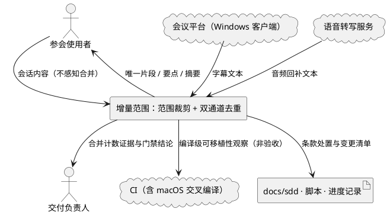
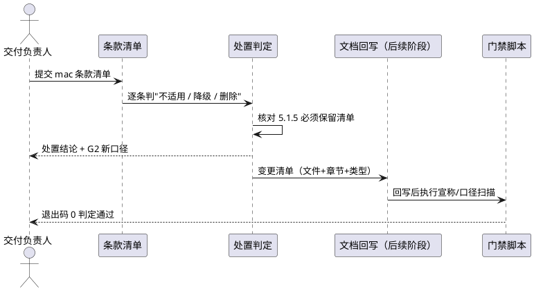
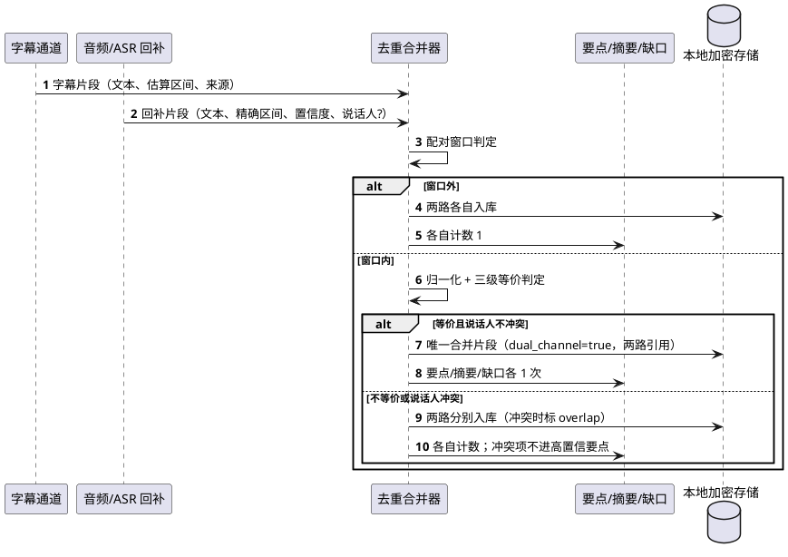

# mac_scope_and_b2_24 · 增量需求规格

> 阶段：第一阶段（需求规格设计）。本文件只产出需求，不修改任何代码。
> 基线文档：`docs/sdd/spec.md`（942 行）、`docs/sdd/design.md`（1700 行）、`docs/sdd/tasks.md`（1492 行）、`docs/sdd/tasks-b2-offline-closure.md`、`docs/progress/*`、`docs/baseline/asr.md`。
> 行号口径：均为 2026-11-21 版本快照，文档回写后行号会位移，回写时以"章节号 + 条目号"为准。
> 本规格包含两个增量：**A. macOS 范围裁剪（全局）**、**B. B2.24 双通道去重合并（本轮推进）**。

# **1. 组件定位**

## **1.1 核心职责**

本增量负责把交付口径收敛为 Windows 单操作系统平台，并在既有双通道采集骨架上补齐"字幕通道与音频回补同段文本只计一次"的去重合并能力。

## **1.2 核心输入**

1. 使用者裁决：用户明确声明"没有 macOS 设备"，要求删去 mac 真机交付项（本次输入）。
2. 既有条款：`spec.md` 4.5-1、5.1.1-5、5.8.1-2a/2b、5.8.3-5、6.2-9，`design.md` 2.5.2~2.5.5、2.8.2，`tasks.md` 1.1/1.4、8.x、14.x、16.x、17.2、18.1、19.1、20.1、21.1、22.1、24.x、44.2、49.3/49.4、67.1、69.1、71.x、75.3、77.x、G1/G2/G10。
3. 字幕通道文本事件：平台字幕（含 OCR 兜底）产出的带时间范围文本，时间可能为"首次观测"估算值（`estimated=true`）。
4. 音频回补文本：字幕缺口期间由 ASR `GapBackfill`、以及字幕可用期的 ASR `Validation` 产出的带时间范围文本与置信度。
5. 说话人标识：任一路可带"已识别"或"未知说话人"，不保证存在。
6. 阈值配置：配对时间窗、近似判定阈值、相似度下限等可注入配置。
7. 既有离线基线：`cargo test --workspace` 404 passed / 0 failed / 9 ignored；B2 离线 43 项 AC 结论"部分完成"。

## **1.3 核心输出**

1. 范围裁剪结论：受影响的 `spec.md` / `design.md` / `tasks.md` / CI / 脚本条款清单，逐条给出"不适用 / 降级为可扩展点 / 删除"处置。
2. G2 新口径的书面定义与可扫描约束（禁止词、门禁表、状态文件表述）。
3. 合并后的唯一发言片段：`dual_channel=true`、以上限截断的置信度、可解释的配对依据、保留两路原始引用。
4. 去重计数证据：要点提炼触发 1 次、缺口识别 1 次、摘要入窗 1 条、片段落盘 1 条。
5. 文档变更清单：文件 + 章节 + 修改类型（标注 / 改写 / 删除 / 降级）。
6. 可机器判定的验收集合：AC-MS-01~13、AC-DD-01~20。

## **1.4 职责边界**

1. 本增量**不修改** `docs/sdd/**` 与 `docs/progress/**`，只在第 9 章给出变更清单，由后续阶段落地。
2. 本增量**不实现** B2.24 的算法与代码，只定义行为、阈值语义、可判定条件。
3. 本增量**不新增** macOS 相关工作项，也**不删除**跨平台共享契约（见 5.1.5）。
4. 本增量**不缩减**会议平台范围：腾讯会议、飞书（含 Lark）、Zoom 仍是 Windows 上必备的三款会议平台（SPEC 5.8.1-1 对 Windows 有约束力）。
5. 本增量**不涉及** Linux 交付：原 `spec.md` 4.5-1 从未把 Linux 列入支持范围，本次仅显式标注"不适用"。
6. 本增量**不引入**音频指纹、声纹识别、第三方相似度库，不改变既有 capture 用例名。

## **1.5 两个"平台"的消歧（本规格强制口径）**

为避免本次裁剪把"会议平台"误删，本规格统一定义两个维度：

1. **操作系统维度（OS Platform）**：Windows / macOS / Linux。交付口径收敛为 **Windows 单平台**；macOS、Linux = 不适用。
2. **会议平台维度（Meeting Platform）**：腾讯会议 / 飞书（Lark）/ Zoom。**三款均保留且必需**，不因本次裁剪减少。

> 原文多处"三平台"存在混用：`tasks.md` G1/G2 的"三平台"指会议平台；`tasks.md` 1.1/1.4 与 CI 矩阵的"三平台四架构"指 OS/架构。本规格要求回写时在每个"三平台"处显式写成"三款会议平台"或"三个操作系统"，禁止继续裸用"三平台"。

# **2. 领域术语**

**操作系统交付平台（OS Delivery Platform）**
: 本产品对外承诺可安装运行的操作系统集合；本次唯一取值为 Windows 10 及以上（x64 与 ARM64）。

**会议平台（Meeting Platform）**
: 承载会议并提供字幕的第三方桌面软件，首版为腾讯会议、飞书（Lark）、Zoom 三款；与操作系统维度无关。

**可扩展点（Extensible Point）**
: 保留接口契约、枚举分支或能力矩阵字段，但本期不实现、不验收、不宣称的占位能力；删除它会破坏 Windows 侧类型契约的项不得删除。

**macOS 真机项（macOS Device Item）**
: 必须在 macOS 物理设备上执行才能取得结论的验收项，如 SCStream 采集、屏幕录制/辅助功能授权、AX 字幕读取、Universal DMG 公证。

**双通道重复（Dual-Channel Duplication）**
: 同一时间段内，字幕通道文本与音频回补文本表达同一发言，若各自独立入库将导致要点、摘要、检索触发被重复计入的现象。

**同源重复（Same-Origin Duplication）**
: 两路文本归一化后完全相同，或近似度达到阈值而被判定为同一发言的重复。

**配对窗口（Pairing Window）**
: 判定两路文本"可能属于同一发言"的时间容差；字幕时间为估算值时使用更宽的容差。

**合并单元（Merged Utterance）**
: 经配对与等价判定后生成的唯一发言片段，标记"双通道"，只计一次。

**配对依据（Pair Basis）**
: 支撑合并判定的可解释证据，取值为"完全相同 / 近似哈希距离 / 向量相似度"之一，须可记录、可回溯。

**G2 门禁（Windows 单平台口径）**
: M1 前半出口门禁。在 Windows 上，腾讯会议、飞书（Lark）、Zoom 各自可建立会话并连续稳定运行 30 分钟，通道状态 5 秒内更新，字幕失效 5 秒内回退音频，双通道不重复计入；macOS 与 Linux 不计入通过条件。

# **3. 角色与边界**

## **3.1 核心角色**

1. 参会使用者：不感知合并过程，只看到一条字幕、一条要点、一条摘要计数。
2. 会话主持人：结束会话后核对片段总数与要点数，不出现"同一句出现两次"。
3. 组织管理员：在能力差异与诊断中只看到 Windows 平台结论，不出现 mac 能力宣称。
4. 交付负责人：按 G2 新口径判定 Windows 单平台是否达标，并对 mac 编译结果只作可移植性观察。

## **3.2 外部系统**

1. 三款会议平台桌面客户端（Windows）：字幕文本与系统音频的来源。
2. 语音转写服务（本地或外部）：输出带时间范围与置信度的回补文本。
3. CI 系统：保留 macOS 交叉编译，但结果不进入发布门禁。
4. 文档与脚本体系：`docs/sdd/**`、`docs/progress/**`、`scripts/check-g2-claims.sh`、`scripts/test-name-inventory.sh`、`scripts/check-capture-offline.sh`。

## **3.3 交互上下文**

# **4. DFX 约束**

## **4.1 性能**

1. 单次配对判定的纯计算开销必须可离线测量：1000 对候选片段的一次批量判定不得超过 200 ms（开发机单线程基准），且不引入网络调用。
2. 合并不得改变既有采集链路时延预算（字幕→要点 p95 ≤1.5 s、音频→要点 p95 ≤3 s）；去重只允许在片段入库前完成，不得增加额外等待。

## **4.2 可靠性**

1. 合并判定必须是幂等的：同一对片段重复投递（重放、乱序、重试）只产生一条合并结果。
2. 合并失败（任一路缺字段、时间区间非法）时，必须保留两路原始片段各自入库并标记未合并，禁止丢弃任何一路。
3. 合并不得破坏 B2.23 已判定的缺口语义：`ResumeBoundary`、缺口区间、要点"零写零删零迁移"结论保持不变。

## **4.3 安全性**

1. 零转录红线（强制）：Key、完整 URL、模型名、`request_id` 不得出现在任何新增文件、日志、记录、诊断、测试夹具与提交信息中。
2. 合并产物只允许保存文本、时间、来源、说话人标签与置信度；不得保存音频样本、音频特征、声纹向量。
3. 新增脚本对文档与源码的扫描必须接入门禁，命中即失败（退出码非 0）。

## **4.4 可维护性**

1. 每条范围裁剪处置必须可在 `tasks.md` 对应条目 6 行内读到"平台处置"字段，禁止只在评审记录里口头说明。
2. 每条 AC 必须有唯一判定载体：脚本规则名、用例名或产物字段，三者至少其一。
3. 合并判定必须输出配对依据，便于回归时定位"为什么合并/为什么没合并"。

## **4.5 兼容性**

1. 既有 404 passed / 0 failed / 9 ignored 基线不得回退；`ignored` 不得因本增量增加。
2. 既有 capture 用例名不得改名、删除；`test-name-inventory.sh --diff` 的 `removed` 必须为 0。
3. `CapturePolicy` 既有字段与默认值不得变更；新增阈值必须放在独立配置对象中。
4. 删除 mac 相关代码前必须核对 5.1.5 的"必须保留"清单；删除共享契约视为回归。

# **5. 核心能力**

## **5.1 macOS 范围裁剪（全局变更）**

### **5.1.1 业务规则**

1. **交付平台收敛**：产品对外交付范围必须收敛为 Windows 10 及以上（x64 与 ARM64）；macOS 13 及以上与 Linux 必须显式标注"不适用（用户无设备）"。
   a. 验收条件：When 查阅 `spec.md` 4.5-1，the 文档 shall 不再出现"必须支持 macOS 13 及以上"的承诺句，且出现"macOS / Linux 不适用"的显式标注。
2. **真机项不适用**：所有必须 macOS 物理设备才能判定的验收项必须标注"不适用（无设备）"，并保留原条目编号与追溯关系，禁止删除编号造成追溯断链。
   a. 验收条件：When 扫描 `tasks.md` 中 8.1~8.4、16.1~16.4、71.1~71.3、77.1~77.3 及 9.2/17.2/18.1/19.1/20.1/21.1/22.1/44.2/49.3/49.4/75.3/67.1/69.1 的 mac 分支，the 每条 shall 在条目后 6 行内出现"平台处置"字段且取值为"macOS 不适用"或"macOS 分支不适用"。
3. **接口与能力矩阵降级为可扩展点**：`PlatformDescriptor`、`SubtitleSource`/`AudioSource` 端口契约、`CapabilityMatrix` 字段、`SourceKind`/`ReadingMode`/`ChannelKind`/`StateReason` 中平台无关取值必须保留；macOS 专属实现、真机验证、交付物不实现、不验收。
   a. 验收条件：When 删除任一共享契约，the 编译或契约用例 shall 失败；保留时 Windows 全量用例 shall 通过。
4. **G2 口径重述**：G2 必须表述为"Windows 单平台：三款会议平台各自可建立会话并连续稳定运行 30 分钟；通道状态 5 s 内更新；字幕失效 5 s 内回退音频；双通道不重复计入"；macOS 与 Linux 不计入通过条件。
   a. 验收条件：When 检索所有 G2 结论句，the 每句 shall 含"Windows"且不含"三平台稳定运行"作为通过条件。
5. **CI 保留编译、不保留验收**：CI 必须保留 `aarch64-apple-darwin` 与 `x86_64-apple-darwin` 两个编译目标以验证代码可移植性；macOS 编译结果不得作为 G2/G9/G10 或发布清单的必过项。
   a. 验收条件：When 检查 CI 配置，the 两个 mac target shall 存在；When 检查发布门禁清单，the mac 真机项 shall 不作为必过项。
6. **禁止宣称**：任何文档、进度记录、提交信息、README 不得出现"macOS 已验证 / mac 真机通过 / 三平台真机矩阵全部通过"等表述。
   a. 验收条件：When 执行宣称扫描，the 命中数 shall 为 0。
7. **Linux 不适用**：Linux 从未在支持范围内，本次必须在 4.5-1 显式写出"Linux 不适用"，且 CI 不得新增 Linux 编译/测试门禁。
   a. 验收条件：When 检查 CI target 列表，the Linux target 数量 shall 为 0。
8. **会议平台不裁剪**：本次裁剪只针对操作系统维度；三款会议平台的适配、字幕/音频通道、能力差异声明必须继续作为 Windows 交付项。
   a. 验收条件：When 查阅 SPEC 5.8.1-1 与 6.10-1，the 三款会议平台 shall 仍为"必备"。
9. **禁止项**：禁止以"无设备"为由删除共享契约、删除枚举分支、删除交叉编译目标或删除 Windows 侧既有回归用例。

### **5.1.2 交互流程**

### **5.1.3 异常场景**

1. **误删共享契约**
   a. 触发条件：处置时把 `platform-mac` 成员、`CapabilityMatrix` 字段或 `PlatformDescriptor` 一并删除。
   b. 系统行为：编译或分层门禁失败；规格要求回滚该处置并改为"可扩展点"。
   c. 用户感知：门禁退出码非 0，输出缺失项清单。
2. **误把会议平台当 OS 平台裁剪**
   a. 触发条件：把 G2 的"三平台"理解为腾讯/飞书/Zoom 并裁掉其一。
   b. 系统行为：SPEC 5.8.1-1 追溯检查失败，判定为越界裁剪。
   c. 用户感知：规格评审记录标记"会议平台维度不可裁"。
3. **mac 编译被误当作验收通过**
   a. 触发条件：发布清单把 mac CI 绿灯写成"mac 平台已验证"。
   b. 系统行为：宣称扫描命中，退出码 1。
   c. 用户感知：报错并列出命中文件与行号。
4. **G2 表述残留旧口径**
   a. 触发条件：`tasks.md` G2、附录 F、`b2-status.md` 未同步。
   b. 系统行为：口径一致性扫描命中"三平台稳定运行"。
   c. 用户感知：输出待改文件清单。

### **5.1.4 受影响条款清单（逐条处置）**

> 处置图例：`NA`=不适用（无设备）；`EXT`=降级为可扩展点；`DEL`=删除；`KEEP`=保留（对 Windows 仍有约束力）。结论遵循用户倾向：**接口与能力矩阵保留为可扩展点，真机验证类 AC 全部标不适用，G2 改 Windows 单平台**。

#### A. `docs/sdd/spec.md`

| # | 位置 | 原文要点 | 处置 | 理由 |
|---|---|---|---|---|
| S1 | 4.5-1（L206） | "必须支持 Windows 10+（x64/ARM64）与 macOS 13+（Apple Silicon/Intel）" | 改写 + NA | 交付承诺直接冲突；改为 Windows 单平台，mac/Linux 标注不适用 |
| S2 | 5.8.1-2a（L753） | 系统音频通道（mac 侧为 SCK） | 标注 NA（实现维度） | 通道语义对 Windows 有效；mac 实现不适用 |
| S3 | 5.8.1-2b（L754） | 字幕文本通道（mac 侧为 AX） | 标注 NA（实现维度） | 同上 |
| S4 | 5.8.3-5（L815-818） | 系统音频捕获失败（mac 屏幕录制权限） | 标注 NA（mac 分支） | Windows 分支（独占/虚拟声卡）仍有效 |
| S5 | 5.1.3-1（L272-275） | 采集权限被拒（mac 屏幕录制/辅助功能） | 标注 NA（mac 分支） | Windows 麦克风隐私分支仍有效 |
| S6 | 4.1-6（L167） | "三平台任一接入下均须满足" | 标注：OS 维度 Windows；会议平台维度三款 | 消歧后不裁会议平台 |
| S7 | 5.8.1-1（L750） | 三款会议平台必备 | KEEP | 对 Windows 有约束力，不可裁 |
| S8 | 6.2-9（L854） | 双通道合并标记、只计一次 | KEEP + 细化 | B2.24 的规格依据 |
| S9 | 5.1.1-5（L230-231） | 双通道去重合并规则 | KEEP + 细化 | B2.24 的主条款 |
| S10 | 4.2-7（L180） | 字幕失效 5 s 回退 | KEEP | 平台无关 |
| S11 | 6.10-1/2/6（L936-941） | 平台绑定与版本矩阵 | KEEP | 会议平台维度 |
| S12 | 3.2-1~3（L110-112） | 外部系统三款会议客户端 | KEEP | 会议平台维度 |

#### B. `docs/sdd/design.md`

| # | 位置 | 原文要点 | 处置 | 理由 |
|---|---|---|---|---|
| D1 | 选型总表 L21 | macOS 系统音频 SCK 选型 | EXT（标注不实现） | 保留选型记录与接口语义 |
| D2 | 选型总表 L26 | macOS AX 无障碍读取 | EXT | 同上 |
| D3 | L19 | Tauri 跨平台 Win/mac、x64/ARM64 | 标注：交付仅 Windows；跨平台能力保留 | 壳层能力对 Windows 无冲突 |
| D4 | L5 | 平台系统能力（Win/mac） | 标注 NA（mac 分支） | — |
| D5 | L92-95 | macOS/ScreenCaptureKit 接口契约与 13.0–14.3 稳定性约束 | EXT | 契约保留，真机约束不验收 |
| D6 | L100-106 | 字幕差异（含 macOS AX 列） | 标注 NA（mac 列） | 会议平台差异仍有效 |
| D7 | L165 | 上下文图"Windows 10+ / macOS 13+" | 改写 | 上下文图对外承诺 |
| D8 | L253 | 上下文图 [macOS 音频捕获] | 标注 EXT | 保留可扩展点图元 |
| D9 | L686-687 | `SubtitleSource`/`AudioSource` 说明与 mac 权限前置 | KEEP + 标注 NA（mac 权限句） | 端口契约是共享抽象 |
| D10 | L966、L1500 | 密钥库 macOS Keychain | EXT | 密钥分层契约对 Windows 有效；Keychain 分支不实现 |
| D11 | L1210 | 系统音频（mac）SCK、不捆绑 BlackHole | EXT + KEEP 红线 | "不捆绑 GPL"保留为通用红线 |
| D12 | L1223 | 无障碍（mac）AXUIElement/AXObserver | EXT | — |
| D13 | L1230 | 打包签名（MSI/NSIS、DMG） | 标注 NA（DMG 分支） | Windows 打包不变 |
| D14 | L1246、L1249 | AXSwift 参考、sysinfo macOS 权限限制 | EXT | 参考记录保留 |
| D15 | L1288-1292 | 平台探测矩阵（macOS 应用标识、CFBundle） | 标注 NA（mac 行） | Windows 行保留 |
| D16 | L1303 | L2 事件读取（macOS AXObserver） | EXT | 字节目录/事件抽象保留 |
| D17 | L1318-1325 | Win/mac 音频路径表、mac 权限 | 标注 NA（mac 列） | Windows 列保留 |
| D18 | L1500 | L0 密钥 macOS Keychain | EXT | 同 D10 |
| D19 | L1558 | 存储限制"Time Machine 可能留存副本" | 标注 NA | mac 特有风险 |
| D20 | L1579 | 风险 R3（macOS SCK 不稳定） | 降级：改为"可扩展点风险（当前不适用）" | 交付不含 mac，风险不成立 |
| D21 | L1599-1606 | M0/M1/M3 分期"三平台并行/Win/mac 音频/三平台矩阵" | 改写 | 门禁与排期口径 |
| D22 | L1604 | 团队"macOS 平台适配 1 人" | 删除 | 无 mac 交付项 |
| D23 | L1655 | 4.5-1 追溯"Win x64/ARM64 + mac Intel/Apple Silicon + 真机冒烟" | 改写 | 真机冒烟仅 Windows |
| D24 | L1678 | 5.8.1-1~9 "三平台真机矩阵" | 标注：三款会议平台 × Windows | 消歧 |
| D25 | L1696 | 平台兼容回归"三平台 × … ×（Win/mac）" | 改写 | 仅 Windows |
| D26 | 2.5.5（L1336-1346） | 双通道去重算法（±2.5 s、SimHash、余弦、字幕主） | KEEP + 补细化 | B2.24 设计依据 |
| D27 | 2.3.2（L1004-1016） | `Utterance.dualChannel` 等字段 | KEEP | 共享数据契约 |

#### C. `docs/sdd/tasks.md`

| # | 位置 | 原文要点 | 处置 | 理由 |
|---|---|---|---|---|
| T1 | 1.1（L114） | 三平台四架构（win-x64/win-arm64/mac-arm64/mac-x64）build 全绿 | 改写：Windows 两架构为验收；mac 两架构为编译级 | 保留可移植性验证 |
| T2 | 1.4（L121-122） | 建立三平台 CI 矩阵（4 target） | 改写：Windows 验收 + mac 编译 + 无 Linux | 与 AC-MS-05 一致 |
| T3 | 8.1（L226-228） | SCStream 采集、13.4/14.x 30 分钟无中断 | NA | 真机项 |
| T4 | 8.2（L229-231） | 屏幕录制权限申请与引导 | NA | 真机项 |
| T5 | 8.3（L232-234） | 静音看门狗与 stream 重建 | NA（实现可 EXT 保留） | 无设备无法验收 |
| T6 | 8.4（L235-237） | macOS 音频可行性结论 | NA | 无设备 |
| T7 | 9.2（L244） | UIA TextPattern / AX 事件读取 | 标注 mac 分支 NA | Windows 分支保留 |
| T8 | 14.1（L318-320） | 三款会议平台字幕可行性结论 | 改写：会议平台维度保留 | 消歧 |
| T9 | 14.2（L321-323） | 双系统音频可行性结论 | 改写：Windows 单系统 | 无 mac |
| T10 | 14.3（L324-326） | CapabilityMatrix 初版冻结（含 mac 资源文件） | 降级：mac 行标"不适用/待校准" | 能力矩阵字段保留 |
| T11 | 16.1~16.4（L354-367） | macOS 音频通道工程化（SCK/权限/看门狗/设备） | NA | 真机项 |
| T12 | 17.2（L376） | macOS AXObserver 封装 | 标注 mac 分支 NA | 事件抽象保留 |
| T13 | 18.1（L389-391） | TencentMeeting.app 与 CFBundle 版本读取 | 标注 mac 分支 NA | Windows descriptor 保留 |
| T14 | 19.1（L406） | Feishu.app/Lark.app 识别 | 标注 mac 分支 NA | 同上 |
| T15 | 20.1（L421） | zoom.us.app 识别 | 标注 mac 分支 NA | 同上 |
| T16 | 21.1（L434-436） | Apple Vision OCR 封装 | 标注 mac 分支 NA | Windows OCR 保留 |
| T17 | 22.1（L451） | CFBundle 版本读取 | 标注 mac 分支 NA | Windows 文件版本资源保留 |
| T18 | 24.1~24.5（L483-497） | 双通道去重合并（时钟/三级判定/策略/只计一次/回归集） | KEEP + 补 24.6~24.10 | 本轮新特性 |
| T19 | 44.2（L852-854） | macOS 非激活 panel | 标注 mac 分支 NA | Windows `WS_EX_NOACTIVATE` 保留 |
| T20 | 49.3（L930-932） | macOS 全局快捷键与辅助功能引导 | 标注 mac 分支 NA | Windows 快捷键保留 |
| T21 | 49.4（L935） | macOS LoginItems 开机自启 | 标注 mac 分支 NA | Windows 自启保留 |
| T22 | 67.1（L1226） | 腾讯矩阵 ×（Win/mac） | 改写：仅 Windows | — |
| T23 | 68.1（L1235） | 飞书/Lark 矩阵（未显式 mac） | 保持不变 | 会议平台维度 |
| T24 | 69.1（L1250） | Zoom 矩阵 ×（Win/mac） | 改写：仅 Windows | — |
| T25 | 71.1~71.3（L1270-1280） | macOS 版本/权限/休眠矩阵 | NA | 真机项 |
| T26 | 75.3（L1334） | 四架构数据一致性 | 改写：Windows 两架构验收；mac 编译级 | 保留可移植性 |
| T27 | 77.1~77.3（L1360-1371） | Universal DMG、公证、mac 权限说明 | NA | 无 mac 交付物 |
| T28 | 77.4（L1371-1373） | 不捆绑 GPL 组件核验 | KEEP 为通用红线；mac 专项 NA | Windows 侧仍需 |
| T29 | B2 G2（L334） | 三平台均可建会话稳定 30 分钟 | 改写：Windows 单平台 + 三款会议平台 | AC-MS-04 |
| T30 | 附录 D-5（L1457） | 三平台 × … ×（Win/mac）≥12 组合 | 改写：Windows × 三款会议平台 | — |
| T31 | 附录 F G1（L1479） | 三平台字幕 + Win/mac 音频跑通 | 改写：Windows + 三款会议平台 | — |
| T32 | 附录 F G2（L1480） | 三平台建会话稳定 30 min | 改写：Windows 单平台 | — |
| T33 | G10（L1342、L1379） | 三平台版本矩阵全部验证 | 改写：Windows + 三款会议平台 | — |
| T34 | 附录 C P0（L1444） | 三平台对接不可裁 | 标注：三款会议平台（非 OS） | 消歧 |
| T35 | 附录 E-1/9（L1463、L1471） | 三平台进程名/延迟以实测为准 | KEEP | 会议平台维度 |

#### D. CI、脚本与进度文档

| # | 位置 | 原文要点 | 处置 | 理由 |
|---|---|---|---|---|
| O1 | `.github/workflows/ci.yml` L63-67、L197 | mac 两个 target（build/clippy/test）与 llm-https 三 target 覆盖断言 | KEEP（编译级）；标注不进入发布门禁 | 用户明确保留 mac 编译 |
| O2 | `deny.toml` L3-8 | `[graph] targets` 含两 mac target | KEEP | 删除会改变 native-tls/security-framework 检查面 |
| O3 | `Cargo.toml` L9 | workspace 成员 `crates/platform-mac` | KEEP | 删除破坏 workspace 与分层契约 |
| O4 | `scripts/check-layering.sh` L14 | 禁止依赖含 `meeting-copilot-platform-mac` | KEEP | 共享架构约束 |
| O5 | `crates/platform-mac/src/lib.rs` | 空壳、`PLATFORM_NAME`、"非 mac 目标保留空壳保证可交叉检查" | KEEP | 可扩展点与可移植性锚点 |
| O6 | `scripts/check-g2-claims.sh` L2/L12 | 禁止词表 | 改写（新增 mac 宣称禁止词） | AC-MS-06 |
| O7 | `docs/progress/b2-status.md` L59 | "G2 仍需真实三平台、30 分钟稳定运行" | 改写 | 口径同步 |
| O8 | `docs/progress/b2-offline-closure.md` L179 | "三平台真实运行…均未实测" | 改写 | 口径同步，保留"部分完成" |
| O9 | `docs/progress/b1-status.md` L14/L24/L48/L57 | 无 mac 设备、任务 8 阻塞/范围外 | 标注：正式写入"不适用（无设备）" | 既有事实 |
| O10 | `docs/progress/ci-readiness.md` L28/L64/L76-77/L131-138/L145/L314 | mac runner、交叉编译、llm-https 三 target | 标注：mac 编译保留，不作交付验收 | 与 O1 一致 |
| O11 | `docs/sdd/tasks-b2-offline-closure.md` L774、L780 | "需安装三平台客户端，macOS 缺失""无 mac 设备" | 标注：mac 项不适用 | 离线闭环边界 |
| O12 | `README.md` L45 | `platform-mac/ macOS 适配（SCK/AX/Vision）` | 标注：仅编译级可扩展点 | 对外表述 |
| O13 | `docs/compliance/license-review.md` L20/L30 | BlackHole 不得捆绑、security-framework 路径 | KEEP + 标注 NA（mac 交付） | 许可红线通用 |

> 处置统计（去重后）：不适用（NA）31 项、降级为可扩展点（EXT）10 项、删除（DEL）2 项（D22 团队角色、mac 专项交付文档）、保留（KEEP）22 项。删除仅限"对 Windows 无任何约束力"的项。

### **5.1.5 不可裁剪的边界（必须保留清单）**

| # | 必须保留项 | 位置 | 删除后果 |
|---|---|---|---|
| M1 | workspace 成员 `crates/platform-mac` | `Cargo.toml` L9 | workspace 解析、分层门禁、交叉检查失效 |
| M2 | `platform-mac` 空壳与 `PLATFORM_NAME` | `crates/platform-mac/src/lib.rs` | 可移植性锚点丢失，`cfg(not(target_os))` 策略失效 |
| M3 | `PlatformDescriptor` 契约（平台/版本/字幕可用/音频可用/能力等级） | design 2.2.2-A | Windows 适配器实现与契约用例编译失败 |
| M4 | `SubtitleSource` / `AudioSource` 端口契约 | design 2.2.2-A | 字幕通用框架与音频通道失去共同接口 |
| M5 | `CapabilityMatrix` 字段集合（6 类能力 + 版本范围 + 最近验证时间） | design 2.5.2/2.5.6 | Windows 能力差异 UI 与追溯矩阵缺字段 |
| M6 | `ChannelKind` / `ChannelState` / `StateReason`（含 `PermissionMissing`/`PermissionRevoked`） | `crates/domain/src/model/channel.rs` | 通道状态机与 14 原因码契约破坏 |
| M7 | `Utterance.dual_channel`、`SourceKind`、`ReadingMode` | `crates/domain/src/model/{utterance,enums}.rs` | B2.24 合并标记与来源标注失去承载字段 |
| M8 | `deny.toml` 两 mac target（依赖图检查面） | `deny.toml` L3-8 | 许可检查覆盖面缩小，历史结论失效 |
| M9 | `check-layering.sh` 对 `platform-mac` 的禁止依赖断言 | `scripts/check-layering.sh` L14 | 分层约束出现缺口 |
| M10 | CI mac 两 target 的编译 job | `ci.yml` L63-67 | 可移植性回归不可见（不阻断发布，但必须保留） |
| M11 | "不捆绑 GPL 组件"通用红线 | design 1.2.1-2、license-review L20 | 合规红线失效（与 mac 交付无关） |

## **5.2 B2.24 双通道去重合并**

### **5.2.1 业务规则**

1. **候选配对**：同一会话内，字幕片段与音频回补片段必须在配对窗口内才可进入等价判定；字幕时间为估算值时使用更宽窗口。
   a. 验收条件：When 两片段起止时间交集落在默认窗口内，the 系统 shall 生成 1 个候选对；When 超出窗口，shall 生成 0 个候选对。
2. **文本归一化**：等价判定前必须去除标点与空白、统一繁简、数字与英文小写化；归一化结果相同视为同源重复。
   a. 验收条件：When 两路文本仅在全/半角标点、繁简、英文大小写上不同，the 归一化结果 shall 相等并进入合并。
3. **三级等价判定**：必须按"完全相同 → 近似哈希（汉明距离与长度比）→ 字符相似度（仅长片段）"顺序判定，任一级命中即合并；前一级未命中才进入下一级。
   a. 验收条件：When 文本完全相同，the 判定依据 shall 为"完全相同"；When 仅近似，shall 为"近似哈希"或"相似度"。
4. **字幕主文本、音频精确时间**：合并后正文必须取字幕文本（断句更自然），起止时间必须取音频回补的精确时间；字幕估算区间只作为原始引用保留。
   a. 验收条件：When 合并完成，the 合并片段正文 shall 等于字幕文本，起止 shall 等于音频回补起止。
5. **置信度上限**：合并片段置信度必须取两路最大值，且不得超过 0.95。
   a. 验收条件：When 两路置信度为 0.6 与 0.99，the 合并置信度 shall 为 0.95；When 为 0.6 与 0.7，shall 为 0.7。
6. **说话人取舍**：一方为"未知说话人"、另一方已识别时必须采用已识别一方；双方均已识别且标签不同时禁止合并，两条均标记"重叠"且不进入高置信要点。
   a. 验收条件：When 字幕未知、音频已识别，the 合并片段说话人 shall 为音频标签且 `identified=true`；When 双方已识别且标签不同，the 合并数 shall 为 0、两条 `overlap=true`。
7. **时间戳冲突取舍**：当字幕估算时间与音频起点偏差超过估算窗口时禁止配对；窗口内合并时以音频时间为准。
   a. 验收条件：When 偏差大于估算窗口，the 候选对 shall 为 0；When 在窗口内，the 合并片段起止 shall 等于音频起止。
8. **只计一次**：合并片段必须只触发 1 次要点提炼、1 次缺口识别、1 次摘要入窗、1 次持久化；被合并侧计数必须为 0。
   a. 验收条件：When 一对片段合并，the `insight_trigger_count`、`gap_detect_count`、`summary_entry_count`、`persisted_utterance_count` shall 均为 1。
9. **提及次数不重复**：双通道合并本身不得增加要点的"提及次数"；只有语义重复再次出现时才能递增。
   a. 验收条件：When 同一发言经双通道合并为 1 条，the 要点 `mentions` shall 保持 1。
10. **幂等与乱序**：同一对片段重复投递只合并一次；音频 final 晚于字幕到达但仍在窗口内时必须可合并。
    a. 验收条件：When 同一对重复投递 2 次，the 合并结果数 shall 为 1；When 音频 final 延迟到达，shall 仍合并。
11. **可解释**：每次合并必须输出配对依据与依据参数（哈希距离或相似度分值），可记录、可回溯。
    a. 验收条件：When 合并完成，the 合并记录 shall 含非空 `pair_basis` 字段。
12. **阈值可配**：配对窗口、近似距离、长度比、相似度下限、置信度上限必须可注入配置；默认值必须与设计一致，越界必须在构造期拒绝。
    a. 验收条件：When 使用默认配置，the 取值 shall 与 6.1 表一致；When 注入越界值，the 配置构造 shall 返回错误。
13. **默认行为不变**：只有同时存在字幕与音频回补两路文本时才进入合并；单路输入必须输出与现状一致的片段（`dual_channel=false`，来源原样）。
    a. 验收条件：When 只有字幕或只有音频，the 输出片段 shall 与未接入合并前字段一致。
14. **既有基线不回归**：全量测试必须保持 0 失败、`ignored ≤9`、`passed ≥404`；既有 capture 用例名不得改名。
    a. 验收条件：When 执行全量测试与用例名差集，the 退出码 shall 为 0 且 `removed=0`。
15. **缺口回补兼容**：`GapBackfill` 产生的文本与字幕同窗时必须走同一合并判定；合并后区间不得与既有缺口区间重叠（允许边界接触）。
    a. 验收条件：When 回补文本与字幕同窗，the 合并判定 shall 生效；When 合并完成，the 片段区间与缺口区间 shall 不重叠。
16. **禁止项**：禁止引入音频指纹、声纹识别、语音嵌入；禁止为相似度新增第三方依赖；禁止在合并记录中保存音频样本或特征。
    a. 验收条件：When 扫描合并模块与依赖闭包，the 指纹/声纹标识与新依赖数量 shall 为 0。

### **5.2.2 交互流程**

### **5.2.3 异常场景**

1. **两路时间区间非法**
   a. 触发条件：任一路结束时间不晚于开始时间，或落在会话范围外。
   b. 系统行为：拒绝合并，保留原始片段与失败计数，不删除任何一路。
   c. 用户感知：诊断计数 `merge_rejected` +1，界面无异常提示。
2. **文本为空或占位**
   a. 触发条件：任一路归一化后为空，或为"…"等占位文本。
   b. 系统行为：不合并；占位片段不参与要点提炼（沿用既有规则）。
   c. 用户感知：无重复要点产生。
3. **说话人冲突**
   a. 触发条件：双方均已识别且标签不同。
   b. 系统行为：不合并，两条标"重叠"，不进入高置信要点。
   c. 用户感知：字幕流显示"重叠发言，参考价值有限"。
4. **乱序到达**
   a. 触发条件：音频 final 晚于字幕超过窗口边界到达。
   b. 系统行为：超出窗口则不合并并记录 `late_unmerged`；窗口内正常合并。
   c. 用户感知：无重复片段。
5. **重复投递**
   a. 触发条件：同一对片段被重放或重试投递。
   b. 系统行为：命中幂等键，返回已合并结果，不产生第二条。
   c. 用户感知：片段与要点数量不增加。
6. **配置越界**
   a. 触发条件：配对窗口为 0、相似度越界、长度比倒置。
   b. 系统行为：拒绝构造配置，保留默认配置并输出错误。
   c. 用户感知：启动诊断提示配置非法。
7. **既有用例被误改**
   a. 触发条件：为实现合并而重命名/删除既有 capture 用例。
   b. 系统行为：用例名差集门禁失败。
   c. 用户感知：输出 `removed` 清单与退出码 1。

# **6. 数据约束**

## **6.1 合并策略配置（MergePolicy）**

1. **merge_enabled**：布尔值，默认 true；关闭时为单路直通，行为与现状一致。
2. **pair_window_ms**：整数，默认 2500，取值范围 500~5000；字幕与音频均为精确时间时使用。
3. **pair_window_estimated_ms**：整数，默认 3500，必须 ≥ `pair_window_ms` 且 ≤ 5000；字幕时间为估算值时使用。
4. **simhash_max_distance**：整数，默认 3，取值范围 0~8。
5. **length_ratio_min_milli**：整数，默认 600（即 0.6），取值 100~1000。
6. **length_ratio_max_milli**：整数，默认 1600（即 1.6），必须 > `length_ratio_min_milli` 且 ≤ 3000。
7. **cosine_min_milli**：整数，默认 860（即 0.86），取值 0~1000。
8. **cosine_min_chars**：整数，默认 8，取值 0~200；片段长度不超过该值时不启用相似度级判定。
9. **confidence_cap_milli**：整数，默认 950（即 0.95），取值 0~1000。
10. **禁止项**：不得修改 `CapturePolicy` 既有字段或默认值来承载上述阈值。

## **6.2 合并单元（Merged Utterance）**

1. **唯一性**：同一会话内，同一对原始片段至多产生 1 个合并单元；幂等键由会话标识、归一化文本与时间桶共同决定。
2. **正文**：必须非空，取字幕文本；长度约束沿用发言片段 2000 字上限。
3. **起止时间**：必须取音频回补的精确起止；结束必须晚于开始，且落在会话范围内。
4. **双通道标记**：必须为 true；来源必须标注为"平台字幕"（主文本来源）。
5. **置信度**：取两路最大值且不超过配置上限，取值 0~1。
6. **说话人**：已识别一方优先；均为未知时置"未知说话人"；冲突时不生成合并单元。
7. **原始引用**：必须保留两路原始片段引用（可追溯），字幕估算区间与 `estimated` 标记必须随引用保留。
8. **配对依据**：必须记录"完全相同 / 近似哈希（含距离）/ 相似度（含分值）"之一。
9. **重叠标记**：不可合并且说话人冲突的片段必须标 `overlap=true`，且不得进入高置信要点。
10. **零转录**：合并单元不得含音频样本、音频特征、声纹向量、完整 URL、Key、模型名、`request_id`。

## **6.3 计数证据（DedupeCounters）**

1. **insight_trigger_count**：合并单元 1，被合并侧 0。
2. **gap_detect_count**：合并单元 1，被合并侧 0。
3. **summary_entry_count**：合并单元 1，被合并侧 0。
4. **persisted_utterance_count**：合并单元 1，被合并侧 0。
5. **mentions_delta**：双通道合并不产生提及次数增量（0）。
6. **merge_rejected / late_unmerged / overlap_count**：异常与冲突计数，必须可查。

# **7. 验收判定**

## **7.1 离线可判定与必须真机判定的分界**

| 类别 | 判定方式 | 本增量覆盖 |
|---|---|---|
| **离线可判定** | `cargo test` 退出码、脚本退出码、静态 grep、产物字段、用例名差集 | 全部 AC-MS、全部 AC-DD |
| **必须真机判定（Windows）** | 真实会议客户端、真实设备、真实 30 分钟运行；本轮不执行、不得宣称 | G2 的"30 分钟稳定运行"；字幕 5 s 失效与 10 s 切回实测；真实双通道去重率 |
| **必须真机判定（macOS）** | SCStream、屏幕录制/辅助功能授权、AX、DMG 公证 | 本次全部标"不适用（无设备）"，不判定 |
| **不可判定（已删除）** | 无 | — |

> 纪律：离线通过 ≠ G2 通过；mac 编译通过 ≠ mac 平台已验证；本轮不得把任何离线结果写成真机结论。

## **7.2 AC-MS：范围裁剪（13 条）**

| 编号 | EARS 陈述 | 可机器判定 |
|---|---|---|
| AC-MS-01 | When 查阅 `spec.md` 4.5-1，the 文档 shall 仅承诺 Windows 10+（x64/ARM64），并显式写出"macOS 不适用（无设备）""Linux 不适用"。 | `grep -F "macOS 13" docs/sdd/spec.md` 命中 0；`grep -F "macOS 不适用" ` 命中 ≥1；`grep -F "Linux 不适用"` 命中 ≥1；`grep -F "Windows 10"` 命中 ≥1 |
| AC-MS-02 | When 扫描 `tasks.md` 的 mac 真机条目（8.1~8.4、16.1~16.4、71.1~71.3、77.1~77.3 与 9.2/17.2/18.1/19.1/20.1/21.1/22.1/44.2/49.3/49.4/75.3/67.1/69.1 的 mac 分支），the 每条 shall 在条目后 6 行内出现"平台处置：macOS 不适用"或"平台处置：macOS 分支不适用"。 | `bash scripts/check-mac-scope.sh --rule=na` 退出 0；缺失清单为空 |
| AC-MS-03 | When 检查 `CapabilityMatrix`，the 字段集合 shall 保留 6 类能力 + 版本范围 + 最近验证时间；mac 行 shall 标"不适用/待校准"而非删除。 | `bash scripts/check-mac-scope.sh --rule=matrix` 退出 0；`crates/platform-mac/resources/capability_matrix.toml` 与 `crates/platform-win/resources/capability_matrix.toml` 的键集合相等；mac 行含 `status = "not_applicable"` |
| AC-MS-04 | When 构建 `meeting-copilot-platform-mac`，the crate shall 在 Windows 与两个 mac target 上编译通过，且 workspace 成员关系保持。 | `cargo check -p meeting-copilot-platform-mac` 退出 0；`grep -F "crates/platform-mac" Cargo.toml` 命中 1；CI 上 `--target aarch64-apple-darwin` 与 `x86_64-apple-darwin` 退出 0 |
| AC-MS-05 | While CI 保留 mac 编译，the mac job shall 只作可移植性观察，不得作为 G2/G9/G10 与发布清单的必过项。 | `grep -c "apple-darwin" .github/workflows/ci.yml` ≥2；`bash scripts/check-mac-scope.sh --rule=ci` 退出 0（断言发布门禁不含 mac 真机必过项） |
| AC-MS-06 | When 执行 G2 宣称扫描，the 脚本 shall 识别"macOS 已验证 / mac 真机通过 / 三平台真机矩阵全部通过"等新增禁止词并返回 1。 | `bash scripts/check-g2-claims.sh` 退出 0；`bash scripts/check-g2-claims.sh --self-test` 退出 1；植入新增词样本命中 1 |
| AC-MS-07 | When 检索所有 G2 结论句，the 每句 shall 含"Windows"且不得以"三平台稳定运行"作为通过条件。 | `bash scripts/check-mac-scope.sh --rule=g2` 退出 0；`grep -F "三平台均可建立会话并稳定运行 30 分钟" docs/sdd/tasks.md` 命中 0；`grep -F "G2 仍需真实三平台" docs/progress/b2-status.md` 命中 0 |
| AC-MS-08 | When 扫描 `docs/`、`crates/`、`README.md`，the "macOS 已完成/已验证/真机通过"类宣称 shall 为 0 命中。 | `bash scripts/check-mac-scope.sh --rule=claims` 退出 0 |
| AC-MS-09 | When 删除或改写 5.1.5 任一"必须保留"项，the 编译、契约用例或分层门禁 shall 失败；未删除时 Windows 全量用例 shall 通过。 | `bash scripts/check-mac-scope.sh --rule=contracts` 退出 0（逐项存在性断言）；`cargo test --workspace` 退出 0 |
| AC-MS-10 | When 检查交付文档，the `docs/test/mac-*.md` shall 不存在，或首行含"不适用（无设备）"；G9/G10 清单 shall 不含 mac 真机必过项。 | `bash scripts/check-mac-scope.sh --rule=docs` 退出 0 |
| AC-MS-11 | When 检查 CI target 列表，the Linux target 数量 shall 为 0，且 `spec.md` 显式写"Linux 不适用"。 | `grep -c "unknown-linux" .github/workflows/ci.yml` = 0 |
| AC-MS-12 | When 执行全量离线回归，the 结果 shall 为 passed ≥404、failed = 0、ignored ≤9。 | `cargo test --workspace` 退出 0；`--list --ignored` 计数 9 |
| AC-MS-13 | When 检查 B2 离线闭环记录，the 结论 shall 仍为"部分完成"，并保留"本轮通过 ≠ B2 G2 通过"。 | `grep -F "部分完成" docs/progress/b2-offline-closure.md` 命中 ≥1；`grep -F "本轮通过 ≠ B2 G2 通过"` 命中 ≥1 |

## **7.3 AC-DD：B2.24 双通道去重（20 条）**

| 编号 | EARS 陈述 | 可机器判定 |
|---|---|---|
| AC-DD-01 | When 字幕与音频回补片段的交集落在配对窗口内，the 合并器 shall 生成 1 个候选对；超出窗口时 shall 生成 0 个。 | 用例 `pair_within_default_window`、`pair_outside_window_is_none`；默认窗口字段断言 2500/3500 ms |
| AC-DD-02 | When 两路文本仅在标点、空白、繁简、数字或英文大小写上不同，the 归一化结果 shall 相等并进入合并。 | 用例 `normalization_makes_variants_equal` |
| AC-DD-03 | When 两路文本完全相同，the 合并结果 shall 为 1 条、`dual_channel=true`、来源为"平台字幕"。 | 用例 `identical_text_merges_to_single_utterance`；产物字段 `dual_channel`、`source` |
| AC-DD-04 | When 两路文本近似且哈希距离 ≤3、长度比 ∈[0.6,1.6]，the 合并器 shall 合并并记录"近似哈希"依据。 | 用例 `near_duplicate_within_simhash_distance_merges`；`pair_basis` 字段 |
| AC-DD-05 | When 相似度不足（哈希距离 >3、长度比越界或相似度分低于下限），the 合并器 shall 不合并并保留 2 条。 | 用例 `dissimilar_text_is_not_merged`、`short_fragment_skips_cosine`（≤8 字不启用相似度级） |
| AC-DD-06 | When 一方说话人未知、另一方已识别，the 合并片段 shall 采用已识别标签；When 双方均已识别且标签不同，the 合并数 shall 为 0 且两条 `overlap=true`。 | 用例 `unknown_speaker_adopts_identified_side`、`conflicting_identified_speakers_are_not_merged` |
| AC-DD-07 | When 合并完成，the 片段起止 shall 等于音频回补起止；When 字幕估算起点偏差超过估算窗口，the 候选对 shall 为 0。 | 用例 `merged_span_uses_asr_precise_bounds`、`estimated_subtitle_beyond_window_is_not_paired` |
| AC-DD-08 | When 一对片段合并，the `insight_trigger_count`、`gap_detect_count`、`summary_entry_count`、`persisted_utterance_count` shall 均为 1，被合并侧均为 0。 | 用例 `merged_utterance_triggers_insight_once`、`duplicate_side_triggers_zero_insight`；计数结构字段 |
| AC-DD-09 | When 同一发言经双通道合并，the 要点 `mentions` shall 保持 1，摘要入窗条数 shall 为 1。 | 用例 `summary_window_counts_once`、`mentions_not_incremented_by_dual_channel` |
| AC-DD-10 | When 使用默认合并配置，the 取值 shall 与 6.1 表一致；When 注入越界值，the 构造 shall 返回错误；the `CapturePolicy` 既有默认值 shall 不变。 | 用例 `merge_policy_defaults_match_design`、`merge_policy_rejects_out_of_range`；既有 `policy_default_keeps_existing_values` 仍通过 |
| AC-DD-11 | While 执行合并判定，the 模块 shall 不建立网络连接、不访问音频设备、不依赖真机。 | 用例 `dedupe_chain_has_zero_connections`；`bash scripts/check-capture-offline.sh --rule=deps` 退出 0 |
| AC-DD-12 | When 执行用例名差集，the `removed` shall 为 0，新增用例只允许追加。 | `bash scripts/test-name-inventory.sh --diff` 退出 0；输出 `removed=0` |
| AC-DD-13 | When 执行全量测试，the failed shall 为 0、passed ≥404、ignored ≤9。 | `cargo test --workspace` 退出 0；四项计数与基线一致 |
| AC-DD-14 | When 检查依赖闭包与新依赖，the 相似度相关第三方依赖数量 shall 为 0，`deny.toml` 不变。 | `git diff --exit-code deny.toml` 退出 0；`cargo tree -e normal -p meeting-copilot-domain` 不含 `simhash`/`strsim`/`textdistance`；新增 registry 依赖 0 |
| AC-DD-15 | When 扫描新增文件、日志、记录、诊断与夹具，the 完整 URL、`request_id`、LLM Key、模型名字面量 shall 为 0 命中。 | `bash scripts/scan-secrets.sh` 退出 0；`bash scripts/scan-secrets-docs.sh` 退出 0；`grep -rInE "https?://\|request_id\|bilingual-zh-en\|sk-" <新增文件集>` 命中 0 |
| AC-DD-16 | When `GapBackfill` 文本与字幕同窗，the 合并判定 shall 生效；When 合并完成，the 片段区间与缺口区间 shall 允许接触但不重叠。 | 用例 `gap_backfill_text_merges_with_subtitle`、`merged_span_does_not_overlap_gap_interval`；沿用 AC-22 区间代数判定 |
| AC-DD-17 | When 只有单路输入（仅字幕或仅音频），the 输出片段 shall 与未接入合并前字段一致（`dual_channel=false`、来源原样）。 | 用例 `single_channel_output_unchanged` |
| AC-DD-18 | When 合并完成，the 记录 shall 含非空 `pair_basis`（完全相同 / 近似哈希距离 / 相似度分值）。 | 用例 `pair_basis_is_recorded`；产物字段 `pair_basis` |
| AC-DD-19 | When 同一对片段重复投递或音频 final 延迟到达，the 合并结果 shall 至多 1 条。 | 用例 `duplicate_pair_applied_once`、`late_asr_final_merges_within_window` |
| AC-DD-20 | While 合并模块存在，the 音频指纹、声纹识别、语音嵌入标识 shall 为 0 命中。 | `bash scripts/check-mac-scope.sh --rule=forbidden` 或专用 `--rule=no-voiceprint` 退出 0；grep `fingerprint|voiceprint|speaker_embedding|audio_hash` 命中 0 |

## **7.4 与既有结论的兼容约束**

| 既有结论 | 兼容要求 | 判定 |
|---|---|---|
| 404 passed / 0 failed / 9 ignored | 本增量不得降低 passed、不得增加 failed 或 ignored | AC-MS-12、AC-DD-13 |
| 399 passed / 8 ignored（历史口径） | 保留为历史记录，不被覆写或删除 | `grep -F "399" docs/progress/b2-offline-closure.md` 命中 ≥1 |
| AC-20（汇总可用性可见） | 去重不改变汇总事件语义与 5 s 扇出 | 既有 `capture_status_push` 13 例全部通过 |
| AC-21（缺口落盘 ≥1000 ms、容差 ±400 ms） | 合并不改变缺口落盘门限与容差 | 既有 `capture_gap_merge` 用例通过 |
| AC-22（恢复边界 `resume=close-min(8000,duration)`、区间不重叠） | 合并后片段区间与缺口区间允许接触不允许重叠；`ResumeBoundary` 语义不变 | AC-DD-16；既有 `capture_asr_backfill` 用例通过 |
| AC-26（同状态不同原因不重复推送） | 去重不得触发额外状态推送 | 既有 `capture_status_push` 用例通过 |
| B2 离线 43 项 AC（"部分完成"） | 不得改写为"已通过"；不得宣称 G2 | AC-MS-13 |
| 8 个（含 `llm-https` 下 9 个）真实 LLM 未实测项 | 不因本增量改变 ignored 集合语义 | `--list --ignored` 计数 9 |

## **7.5 零转录红线（强制）**

1. 新增/修改的任何文件中禁止出现：LLM Key、完整 URL、ASR/LLM 模型名（含 `bilingual-zh-en-2023-02-20`、`sherpa`）、`request_id`。
2. 合并记录、诊断计数、日志、审计事件、测试夹具同样禁止出现上述内容。
3. 判定载体：`scripts/scan-secrets.sh`、`scripts/scan-secrets-docs.sh` 退出 0；新增文件集正则扫描命中 0；提交信息命中 0（沿用既有扫描面）。
4. 违反即视为阻塞项，不得以"仅测试数据"为由豁免。

# **8. 与 `tasks.md` 的条目映射（供后续回写）**

## **8.1 B2.24 直接相关条目**

| 条目 | 现有内容 | 本轮需求补充 |
|---|---|---|
| 24.1（L483-485） | 音频时钟统一与配对（±2.5 s，估算 ±3.5 s） | AC-DD-01、AC-DD-07、AC-DD-10 |
| 24.2（L486-488） | 三级等价判定（相同 / SimHash / 余弦） | AC-DD-02~05、AC-DD-20 |
| 24.3（L489-491） | 合并策略与置信度上限 0.95 | AC-DD-03、AC-DD-06、AC-DD-18 |
| 24.4（L492-494） | 只计一次与重叠标记 | AC-DD-08、AC-DD-09、AC-DD-16 |
| 24.5（L495-497） | ≥200 对真实回归集、准确率 ≥95%、误合并 ≤3% | 真机/语料项，本轮不执行；离线可用合成对替代（AC-DD-11） |
| 17.2 / 18.2 / 20.2 | 字幕事件与增量 diff | 为配对提供字幕侧输入 |
| 23.2 / 23.3 | 仲裁与缺口保护 | AC-DD-16 的边界 |
| 25.2 | 8 s 环形缓冲用于字幕缺失回补 | 回补文本来源 |
| B3.29 / 30 / 31 / 32 | 摘要、要点、要点去重、缺口识别 | AC-DD-08/09 的计数下游 |

## **8.2 建议新增的 B2.24 子任务（回写用）**

| 建议编号 | 内容 | 对应 AC |
|---|---|---|
| 24.6 | 合并策略配置对象与越界拒绝（不改 `CapturePolicy`） | AC-DD-10 |
| 24.7 | 说话人与时间戳冲突取舍 | AC-DD-06、AC-DD-07 |
| 24.8 | 幂等键、乱序容忍与配对依据记录 | AC-DD-18、AC-DD-19 |
| 24.9 | 计数不重复证据（要点/摘要/缺口/落盘） | AC-DD-08、AC-DD-09 |
| 24.10 | 零转录与无声纹静态扫描接入 | AC-DD-15、AC-DD-20 |

# **9. 文档变更清单（后续阶段落地）**

| 文件 | 章节/条目 | 修改类型 |
|---|---|---|
| `docs/sdd/spec.md` | 4.5-1 | 改写（Windows 单平台 + mac/Linux 不适用） |
| `docs/sdd/spec.md` | 5.8.1-2a、5.8.1-2b | 标注（mac 实现不适用） |
| `docs/sdd/spec.md` | 5.1.3-1、5.8.3-5 | 标注（mac 权限分支不适用） |
| `docs/sdd/spec.md` | 4.1-6 | 标注（OS 维度消歧） |
| `docs/sdd/spec.md` | 5.1.1-5、6.2-9 | 标注（补充可配阈值与计数口径） |
| `docs/sdd/design.md` | 1.2.1-2、2.4.1（L21/L26/L1246/L1249） | 标注（可扩展点） |
| `docs/sdd/design.md` | 2.5.2、2.5.3、2.5.4 | 标注（mac 列/分支不适用） |
| `docs/sdd/design.md` | 2.5.5 | 改写/补充（阈值、说话人、时间戳、幂等、计数） |
| `docs/sdd/design.md` | 2.8.1 R3 | 降级（可扩展点风险） |
| `docs/sdd/design.md` | 2.8.2、2.9、L1655、L1696 | 改写（Windows 单平台） |
| `docs/sdd/design.md` | L1604 | 删除（mac 平台适配人力） |
| `docs/sdd/design.md` | 2.3.2 | 保留（`dualChannel` 共享契约） |
| `docs/sdd/tasks.md` | 1.1、1.4、14.1~14.3 | 改写（Windows 验收 + mac 编译级） |
| `docs/sdd/tasks.md` | 8.1~8.4、16.1~16.4、71.1~71.3、77.1~77.3 | 标注"不适用（无设备）" |
| `docs/sdd/tasks.md` | 9.2、17.2、18.1、19.1、20.1、21.1、22.1、44.2、49.3、49.4、75.3、67.1、69.1 | 标注"macOS 分支不适用" |
| `docs/sdd/tasks.md` | 24.1~24.5 + 新增 24.6~24.10 | 改写/新增 |
| `docs/sdd/tasks.md` | B2 G2（L334）、附录 D-5、附录 F G1/G2、G10 | 改写（Windows 单平台） |
| `docs/sdd/tasks.md` | 附录 C P0、附录 E-1/9 | 标注（会议平台维度消歧） |
| `docs/sdd/tasks-b2-offline-closure.md` | 7.2 未实测表 | 标注（mac 项不适用） |
| `docs/progress/b2-status.md` | "明确不可宣称" | 改写（Windows 单平台） |
| `docs/progress/b2-offline-closure.md` | 第 8 节结论 | 改写（保留"部分完成"） |
| `docs/progress/b1-status.md` | 任务 8 状态 | 标注（正式不适用） |
| `docs/progress/ci-readiness.md` | mac 编译记录 | 标注（编译级、非验收） |
| `docs/compliance/license-review.md` | BlackHole/security-framework 行 | 标注（mac 交付不适用，红线保留） |
| `scripts/check-g2-claims.sh` | 禁止词表 | 改写（新增 mac 宣称禁止词） |
| `scripts/check-mac-scope.sh` | 新增脚本 | 新增（`--rule=na/matrix/ci/g2/claims/contracts/docs/forbidden`） |
| `.github/workflows/ci.yml` | mac 两 target | 保留 + 标注（不进入发布门禁） |
| `README.md` | 目录说明 | 标注（mac 仅编译级） |

# **10. 不做什么（本轮与后续明确排除）**

1. 不引入音频指纹、声纹识别、语音嵌入或任何说话人聚类算法。
2. 不新增第三方依赖（含相似度库、哈希库、分词库）；相似度在现有依赖闭包内自行实现。
3. 不改既有 capture 用例名、不删除既有用例、不修改 `CapturePolicy` 既有字段默认值。
4. 不实现 mac 真机能力，不新建 `docs/test/mac-*.md`，不做 DMG/公证，不写 mac 验证结论。
5. 不缩减腾讯会议、飞书（Lark）、Zoom 三款会议平台范围。
6. 不正本阶段修改 `docs/sdd/**` 与 `docs/progress/**`，只按第 9 章回写。
7. 不把离线结果写成 G2 通过；不把 mac 编译绿灯写成 mac 平台已验证。
8. 不删除 5.1.5 的共享契约；不删除 CI mac 编译目标。
9. 不使用真实会议录音/真实字幕语料作为本增量验收前置（`merge_corpus` 的真机语料项保留为后续）。
10. 不在合并链路中持久化音频样本、特征或任何可复原音频的数据。

# **11. 待确认项**

| # | 待确认 | 影响 | 本规格默认处置 |
|---|---|---|---|
| K1 | G2 的"三平台"原文指会议平台（腾讯/飞书/Zoom），本次用户口径为"Windows 单平台"。是否确认"OS 维度单平台 + 会议平台维度仍三款"？ | AC-MS-04、AC-MS-07、G2 表述 | 按"OS 单平台 + 会议平台三款"执行（不缩减会议平台） |
| K2 | mac 编译 job 失败时是否阻断合入？用户表述为"不作为交付验收项"，未说明是否阻断 CI | AC-MS-05、CI 分支保护 | 默认：保留 job 且可见，失败标"可移植性告警"，不阻断发布；是否阻断合入由用户确认 |
| K3 | 合并的"相似度级"是否允许在无第三方库前提下用字符 n-gram 余弦替代设计中的向量余弦？ | AC-DD-04/05、AC-DD-14 | 默认：允许字符 n-gram 余弦（纯函数、零依赖），阈值语义不变 |
| K4 | 合并默认开关：是否默认开启？关闭可完全保持现状，但 B2.24 价值不生效 | AC-DD-17、AC-DD-13 | 默认开启；仅当双路同窗时生效，单路行为不变 |