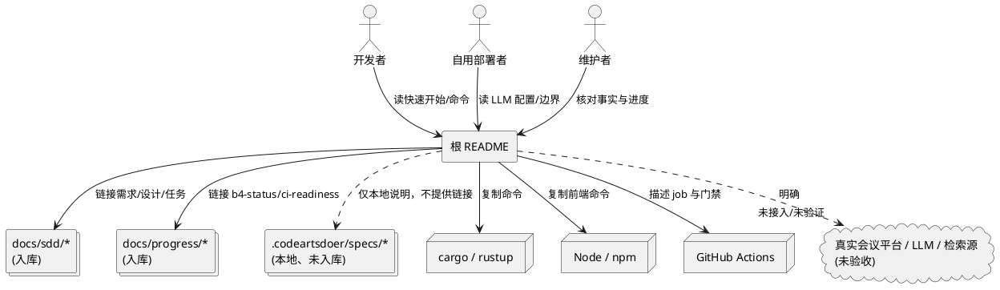
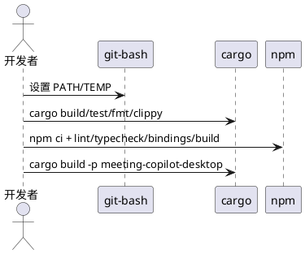
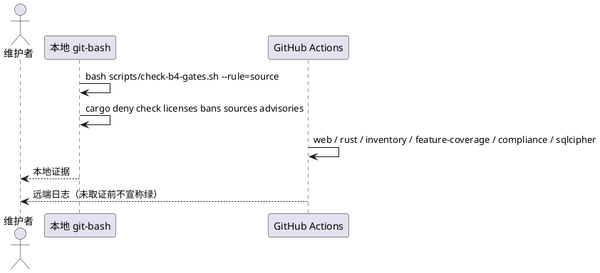
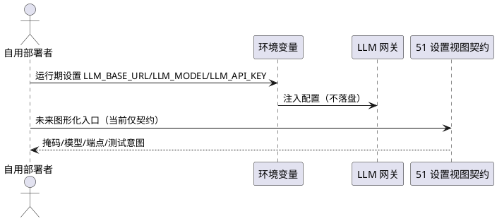
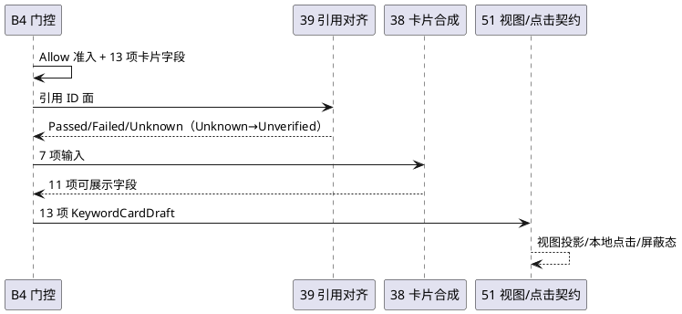
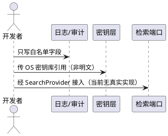
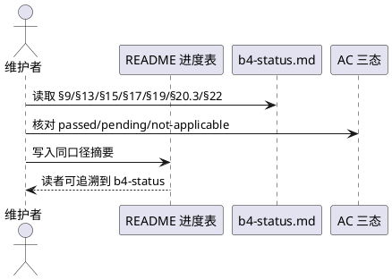
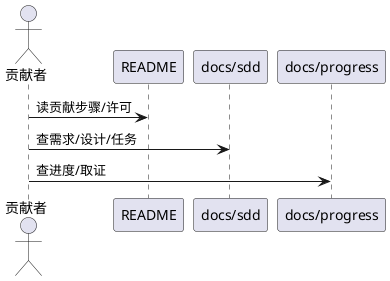

# readme_update · 根 README 更新需求规格

> **阶段定位**：文档维护阶段的**需求规格**（只定义"README 必须写成什么"，不产出 README 正文、不改代码、不改配置）。
> **目标读者**：仓库开发者与自用部署者。非技术用户的图形化入口规划为 51 设置向导，但该向导目前只有离线视图契约，尚未接入桌面壳，README 不得把它写成"已可用"。
> **事实基线**：2026-11-22 在本机项目根 `TSC/` 实测；进度口径以 `docs/progress/b4-status.md`（§1~§22）与 `.codeartsdoer/specs/{b4_gate,ci_deny_repair}` 为准。
> **编号纪律**：本规格不新增 `AC-B4-*` 编号（理由见 §7.1），使用本地验收号 `RD-AC-01~20`；不改写任何既有 AC 编号与语义。

---

# **1. 组件定位**

## **1.1 核心职责**

本组件负责把仓库**当前可验证的事实**整理为根 `README.md`，实现"开发者能照着命令跑通、边界不被夸大、进度可追溯到取证文件"。

## **1.2 核心输入**

1. 现有根 `README.md`（130 行，最后更新 2026-11-22 11:43）。
2. `.codeartsdoer/specs/b4_gate/{spec.md,requirements.md,design.md,tasks.md}`：B4 五级门控、38 卡片合成、39 引用对齐、51 点击 UI、51 设置向导、13.3 回放本体；AC-B4-01~104。
3. `.codeartsdoer/specs/ci_deny_repair/{spec.md,design.md,tasks.md}`：CI `compliance` 的 cargo-deny 修复；AC-B4-105~110。
4. `docs/progress/b4-status.md`：§1~§22 快照、AC 三态、U-06/U-07/U-08、CI deny 修复取证。
5. 仓库结构：`crates/{domain,application,infrastructure,platform-win,platform-mac,ui-bridge}`、`app/`、`scripts/*.sh`、`.github/workflows/ci.yml`、`deny.toml`、`Cargo.toml`。
6. 实际可运行命令与退出码：`cargo test --workspace`、`cargo fmt --all --check`、`cargo clippy --workspace --all-targets -- -D warnings`、`cargo deny check licenses bans sources advisories`、`bash scripts/check-b3-gates.sh --rule=...`、`bash scripts/check-b4-gates.sh --rule=...`、`bash scripts/check-layering.sh`、`bash scripts/scan-secrets.sh`、`bash scripts/sbom.sh`。

## **1.3 核心输出**

1. 更新后的根 `README.md`（唯一交付物）。
2. 可选的进度登记：若维护者要求留痕，可在 `docs/progress/b4-status.md` 追加一节 README 更新记录（不新增 AC 编号、不改旧节）。
3. 不含任何代码、配置、CI、依赖或测试变更。

## **1.4 职责边界**

1. **不负责**重新定义 B4 门控、38/39/51、13.3 或 CI deny 修复的需求；README 只做事实转述与索引。
2. **不负责**修改 `crates/**`、`app/**`、`scripts/**`、`Cargo.toml`、`Cargo.lock`、`deny.toml`、`.github/workflows/ci.yml`。
3. **不负责**补实现 U-06/U-07/U-08；不因 README 需要"更好看"而伪造能力。
4. **不负责**把 `.codeartsdoer/specs/**` 写成对外可访问链接：该目录被 `.gitignore` 忽略（`.gitignore` 第 8 行 `.codeartsdoer/`），克隆仓库后不存在。
5. **不负责** CI 远端结论：未实际 push 并取证前，不得写"CI 全绿/远端通过"。
6. **不负责**真实端点、真实密钥、真实模型名、request_id、日志原文的展示；任何示例只能用占位变量名。

## **1.5 现有 README 现状诊断**

现有 README 的结构与问题如下（行号对应当前 130 行版本）：

| 当前行 | 现有内容 | 判定 | 处置 |
|---|---|---|---|
| L1~L5 | 标题、一句话定位、"首版约束：全自动主动提示；强制对接腾讯会议/飞书/Zoom" | **过期/夸大**：把目标写成已具备能力；未说明真实采集与真实会议平台尚未验收 | 改写为"目标 + 当前边界" |
| L7~L18 | "当前状态"表，止于 B3 与 CI 门禁加固 | **过期**：缺 B4、缺 CI deny 修复、缺 38/39/51 | 重写进度表 |
| L18 | "最近一次全量回归：45 targets / 560 passed / 0 failed / 9 ignored" | **过期且不可复核**：`NEW_TARGETS` 当前 25 项（含历史增量），B4 快照已到 797 passed 量级；硬编码数字会继续漂移 | 删除硬编码；改为"以命令实测为准" |
| L20 | 只链接 `b3-status.md` 与 `docs/sdd/tasks.md` | **缺失**：缺 `b4-status.md`、`ci-readiness.md` | 补链接 |
| L22~L27 | "仍未实测（需真实环境）" | **方向正确但缺项**：缺 B4/U-06/U-07/U-08、缺 CI deny 远端取证 | 重写为完整未完成清单 |
| L29~L48 | 目录结构 | **局部过期**：`platform-win` 写成"WASAPI / UIA / OCR"（实际 `src/lib.rs` 仅有 `PLATFORM_NAME` 空壳）；`platform-mac` 写成"能力矩阵"（同样只有空壳）；`application` 未列 `gate/`、`cards/`、`citation/`；`ui-bridge` 未列 `keyword_card/`、`settings/`；`scripts/` 未列 B4 门禁 | 重写 |
| L50~L59 | Windows 环境注意 | **可用但不完整**：只前置 rustup toolchain，未前置 `~/.cargo/bin`，`cargo deny` 会找不到；TEMP/TMP 处理正确 | 补 PATH 与说明 |
| L61~L68 | Rust 命令 | **基本可用**：`cargo fmt --all --check` 与 CI 一致；缺 `--locked` 说明、缺测试耗时/9 ignored 说明 | 保留并补充 |
| L70~L79 | 前端命令 | **可用**：`lint`/`typecheck`/`check:bindings`/`build` 均在 `app/package.json` 存在 | 保留 |
| L81~L94 | 门禁脚本清单 | **过期/误导**：缺 `check-b4-gates.sh`；`cargo deny --offline` 与 CI 实际命令串不一致；未说明哪些脚本**不在** CI 中运行 | 重写 |
| L96~L102 | 桌面端 | **误导**：`npm run dev` 只启动 Vite 前端，不启动 Tauri 桌面壳；仓库没有 `npm run tauri dev` 脚本 | 修正 |
| L104~L119 | 文档索引 | **缺失**：缺 `b4-status.md`、`ci-readiness.md`、`docs/sdd/tasks-b2-offline-closure.md`；未说明 `.codeartsdoer` 不入库 | 重写 |
| L120~L127 | 安全与合规 | **部分夸大**：把"审计保留 180 天""检索源 SPI 接入""数据库 OS 密钥库"写成已落地；实际审计链为内存实现、SPI 只有 trait、真实检索源未接入 | 按"已实现/契约/设计约束"三态改写 |
| L128~L130 | 许可证 `MIT OR Apache-2.0` | **正确** | 保留，补贡献入口 |

**缺失章节**：快速开始（前置条件 + 5 分钟跑通）、架构与 crate 职责（分层与空壳说明）、门禁与 CI 的边界、LLM 配置入口、关键词卡片能力（38/39/51 边界）、当前进度与未完成项、贡献指南。

## **1.6 与既有文档的关系**

1. README 是**入口与索引**，不是规格正文；详细契约仍在 `docs/sdd/*` 与（本地）`.codeartsdoer/specs/*`。
2. README 的进度表必须与 `docs/progress/b4-status.md` 同口径；若两者冲突，以 `b4-status.md` 的实测记录为准，并在 README 标注时点。
3. README 的 CI 描述必须与 `.github/workflows/ci.yml` 逐项对应；本地脚本不得冒充 CI 步骤。

---

# **2. 领域术语**

**README（根说明文档）**
: 仓库根目录的 `README.md`，面向开发者与自用部署者，承担"定位、跑通、边界、进度、索引"五类信息。

**事实来源（Fact Source）**
: 可被命令、文件内容或进度记录直接验证的来源；README 中每个易漂移结论必须能指向至少一个事实来源。

**可复制命令（Copy-Pasteable Command）**
: 读者在 Windows git-bash（主）或 PowerShell（标注等价写法）中直接粘贴即可执行、且不依赖未说明的隐藏前置条件的命令。

**时点断言（Point-in-Time Assertion）**
: 只在某个提交/日期成立的数字或状态，例如"AC 汇总=104""NEW_TARGETS=25"；README 若引用必须标注时点或改为"以脚本为准"。

**NEW_TARGETS**
: `scripts/test-name-inventory.sh` 中登记的新增测试 target 清单；当前为 25 项（含历史增量），是 target 口径的唯一来源，不是"9 个"。

**AC 三态**
: 验收标准的三种状态：`passed`（已实测通过）、`pending`（规格已定、待实现/待取证）、`not-applicable`（不适用，例如 macOS 无设备）。

**B4 离线契约**
: 五级门控 G1~G5、关键词卡片契约、38 合成、39 对齐、51 视图/点击、设置视图等可离线判定的部分；不等于真实端点、真机或产品级 UI。

**产品级可点击卡片**
: 真实渲染、真实焦点/点击、真实投屏与紧急遮蔽、真实引用可访问性均通过的卡片；当前**未交付**，不得宣称。

**38 / 39 / 51**
: 38 = 卡片合成（只产 11 项卡片数据）；39 = 引用对齐（只做 `Passed`/`Failed`/`Unknown` 判定，`Unknown→Unverified` 唯一投影）；51 = 点击 UI 与设置向导（只做视图模型、点击契约与设置意图，不落盘明文）。

**设置向导**
: 51 的 LLM 配置视图契约（API Key 掩码、模型/端点选择、连通性测试状态机、保存/清除意图）；当前只有离线契约，未接入桌面壳、不直连网络、不落盘明文。

**零转录（Zero Transcript）**
: 原文、URL 全文、查询全文、凭据、模型名、request_id 不进入门控记录、审计、回放夹具、报告、日志或进度文档的边界。

**本地门禁（Local Gate）**
: 通过 `bash scripts/check-*.sh` 在开发者机器上执行的静态/契约检查；其中 `check-b3-gates.sh`、`check-b4-gates.sh`、`check-mac-scope.sh` 当前**不在** CI 中运行。

**CI 门禁（CI Gate）**
: `.github/workflows/ci.yml` 中实际定义的 job：`web`、`rust`、`test-name-inventory`、`feature-coverage`、`compliance`、`sqlcipher`。

**真机 / 真实端点**
: 真实 Windows 设备上的音频捕获、会议平台适配、OCR、LLM 端点、检索源访问；当前均未验收，9 个 `#[ignore]` 保留。

---

# **3. 角色与边界**

## **3.1 核心角色**

开发者：克隆仓库后按 README 完成构建、测试与本地门禁；需要知道哪些能力是契约、哪些是已实现。
自用部署者：在自己的 Windows 机器上配置 LLM 环境变量并运行桌面壳；需要知道默认关闭、凭据不落盘、真实端点未验证。
维护者/评审者：核对 README 是否与 `b4-status.md`、CI 配置和脚本一致；拒绝夸大措辞与过期数字。

## **3.2 外部系统**

Rust 工具链（cargo/rustc）：提供构建、测试、fmt、clippy；`Cargo.toml` 要求 `rust-version = "1.89"`，CI 固定 1.100.0。
Node.js/npm：构建 React 前端与绑定检查；CI 使用 Node 22。
GitHub Actions：执行 `web`/`rust`/`test-name-inventory`/`feature-coverage`/`compliance`/`sqlcipher`。
cargo-deny 与 rustsec advisory-db：执行许可证/ban/source/advisory 检查；advisory-db 需网络或本地缓存。
会议平台 / 真实 LLM / 真实检索源：README 只能写"目标/未接入/未验证"，不得写成已对接。
操作系统密钥库与 SQLCipher：设计约束与部分实现；README 必须区分契约与已落地。

## **3.3 交互上下文**



图中不展示 README 内部章节结构，只展示读者、事实来源与外部系统的关系。

---

# **4. DFX 约束**

## **4.1 性能**

1. 首次读者在 **30 秒内**能回答"这是什么、现在能做什么、不能做什么"；因此首屏必须包含定位与能力边界。
2. 快速开始在**有缓存**的机器上应能在 **10 分钟内**完成 `cargo build --workspace` + `cargo test --workspace`；README 不得承诺无缓存下的固定耗时。
3. 命令块总长度不得超过 **60 行**；长命令必须拆分为可独立执行的步骤。

## **4.2 可靠性**

1. 每个易漂移结论必须有事实来源；同一事实不得在 README 内出现两个互相矛盾的版本。
2. 所有命令必须可直接复制执行；不得出现未说明的占位符（环境变量名除外）。
3. 进度数字必须标注时点或改为"以命令/脚本为准"，不得使用无法复核的历史快照。

## **4.3 安全性**

1. README 中禁止出现真实端点、真实 API Key、真实模型名、鉴权头、request_id、日志原文、完整 URL 查询串。
2. 示例只能使用变量名：`LLM_BASE_URL`、`LLM_MODEL`、`LLM_API_KEY`、`LLM_LIVE_CALL_CAP`；不得给出赋值样例。
3. README 必须明确"凭据只经运行期环境变量注入，不写入仓库任何文件"。
4. README 必须明确设置向导当前不落盘明文；保存意图由装配层执行，51 本身不写 OS 安全存储。

## **4.4 可维护性**

1. 章节顺序稳定；新增事实优先写入对应章节，不重复粘贴到多处。
2. 所有相对链接使用仓库内路径；锚点必须与标题实际 slug 一致。
3. 脚本与 CI 的职责边界必须写清楚；不得用"门禁"一词同时指本地脚本和 CI job。
4. README 正文控制在 **120~200 行**；超过 200 行必须拆分到 `docs/` 并在 README 留索引。

## **4.5 兼容性**

1. 主平台为 Windows（git-bash）；所有 bash 命令必须在 git-bash 下可执行。
2. PowerShell 不是主路径；如给出等价写法，必须标注"可选"，且不得引入 `curl`/Python 作为前置。
3. macOS 一律写"不适用（无设备）"；CI 的 macOS matrix 只写"交叉编译观察"，不得写成"支持"。
4. 不得承诺 Linux 桌面支持；CI 的 `web`/`compliance` 在 ubuntu 上运行不代表 Linux 桌面可用。

---

# **5. 核心能力**

## **5.1 项目定位与能力边界**

### **5.1.1 业务规则**

1. **一句话定位**：README 必须在首屏用不超过 50 字说明"会议副驾"的目标，并紧接一句"当前阶段"。
   a. 验收条件：首屏出现"目标"与"当前"两个语义块 → 读者能区分愿景与实况。
2. **能力三态**：所有能力必须标注为"已实现 / 仅有契约 / 未实现或未验证"之一，不得混写。
   a. 验收条件：任意能力描述都能对应到 §6.2 事实表的某一状态。
3. **真实采集边界**：必须写明"采集协议与离线状态机已实现；真实音频捕获、腾讯会议/飞书/Zoom 适配与真机稳定性未验收（G2 未通过）"。
   a. 验收条件：出现"真实音频/会议平台未验收"或等价表述；不得出现"已对接腾讯会议/飞书/Zoom"的完成态。
4. **平台边界**：必须写明"Windows 为主；macOS 不适用（无设备）；CI 仅交叉编译观察"。
   a. 验收条件：出现 Windows/macOS/CI 三句边界；不得出现"三平台支持"。
5. **禁止项**：禁止把"全自动主动提示""主动联网补全"写成已经可用；禁止用"产品级"修饰当前能力。
   a. 验收条件：全文检索"已实现全自动""产品级" → 0 命中（除"不宣称产品级"的否定句）。

### **5.1.2 交互流程**

读者首屏路径：标题 → 一句话定位 → 当前阶段 → 能力边界 → 快速开始入口。README 必须让这条路径在无滚动或一次滚动内完成。

### **5.1.3 异常场景**

1. **读者把目标当现状**
   a. 触发条件：README 只写"全自动主动提示"而不写当前阶段。
   b. 系统行为：读者按"已可用"预期运行，遇到 9 个 ignored 或空壳平台层后误判项目失败。
   c. 用户感知：README 评审不通过，RD-AC-06 失败；必须补"当前阶段"块。
2. **平台表述被误读为支持**
   a. 触发条件：把 CI 的 macOS matrix 写成"macOS 支持"。
   b. 系统行为：自用部署者在 mac 上尝试并失败。
   c. 用户感知：RD-AC-08 失败；必须改为"交叉编译观察/不适用（无设备）"。

## **5.2 快速开始与构建测试**

### **5.2.1 业务规则**

1. **前置条件**：必须列出 Rust（`rust-version = "1.89"`，CI 使用 1.100.0）、Node 22、Windows git-bash；SQLCipher 相关测试需要 nasm（仅该 job）。
   a. 验收条件：前置条件与 `Cargo.toml`、`.github/workflows/ci.yml` 一致。
2. **Windows PATH**：必须给出可复制的 PATH 前置命令，同时包含 rustup toolchain 与 `~/.cargo/bin`，否则 `cargo deny` 内部 `cargo metadata` 会失败。
   a. 验收条件：命令块含 `export PATH="$HOME/.rustup/toolchains/stable-x86_64-pc-windows-msvc/bin:$HOME/.cargo/bin:$PATH"`。
3. **TEMP/TMP**：必须给出 `export TEMP="$PWD/.tmp/test-temp"; export TMP="$TEMP"; mkdir -p "$TEMP"`，避免 Windows 临时目录权限问题。
   a. 验收条件：命令块可复制执行。
4. **Rust 命令**：必须列出 `cargo build --workspace`、`cargo test --workspace`、`cargo fmt --all --check`、`cargo clippy --workspace --all-targets -- -D warnings`。
   a. 验收条件：四条命令与 CI 的 `fmt`/`clippy`/`build`/`test` 步骤对应；`fmt` 不得写成非 workspace 形式。
5. **前端命令**：必须列出 `cd app && npm ci && npm run lint && npm run typecheck && npm run check:bindings && npm run build`。
   a. 验收条件：五个 npm script 均在 `app/package.json` 中存在。
6. **桌面端命令**：必须写明 `npm run dev` 仅启动 Vite 前端；桌面壳用 `cargo build -p meeting-copilot-desktop` 或 `cargo run -p meeting-copilot-desktop`。
   a. 验收条件：不得出现 `npm run tauri dev`（脚本不存在）。
7. **测试口径**：必须说明全量测试含 9 个 `#[ignore]`（真实端点/真机相关），不得把 ignored 当作 failed。
   a. 验收条件：出现"9 ignored / 真实端点未验证"说明；不得写"0 failed 即全部能力已验证"。

### **5.2.2 交互流程**



### **5.2.3 异常场景**

1. **cargo-deny 报 cargo metadata 错误**
   a. 触发条件：只前置 rustup toolchain，未前置 `~/.cargo/bin`，或 `cargo.exe` 为不完整 shim。
   b. 系统行为：`cargo deny` 找不到可用 cargo，退非 0。
   c. 用户感知：README 的 PATH 命令不完整，RD-AC-05 失败；必须补 `~/.cargo/bin` 与说明。
2. **把前端 dev 当桌面壳**
   a. 触发条件：README 只写 `npm run dev`。
   b. 系统行为：读者只看到浏览器页面，没有 Tauri 窗口。
   c. 用户感知：RD-AC-07 失败；必须补桌面壳命令与"仅前端"说明。
3. **把 ignored 当失败**
   a. 触发条件：README 只写"测试 0 failed"。
   b. 系统行为：读者看到 9 ignored 后误判。
   c. 用户感知：RD-AC-09 失败；必须说明 ignored 的归属。

## **5.3 架构与 crate 职责**

### **5.3.1 业务规则**

1. **crate 清单**：必须列出 `domain`、`application`、`infrastructure`、`platform-win`、`platform-mac`、`ui-bridge` 与 `app`/`app/src-tauri`。
   a. 验收条件：与 `Cargo.toml` 的 workspace members 一致。
2. **职责准确**：`domain` 只放领域模型/值对象/端口 trait；`application` 放采集编排、治理、理解层、门控、卡片合成、引用校验；`infrastructure` 放存储/加密/审计/度量/日志/LLM 传输；`ui-bridge` 放 IPC DTO、`keyword_card`、`settings`；`app` 是 React 19 + Vite，`app/src-tauri` 是 Tauri 2 桌面壳。
   a. 验收条件：与各 crate `src/` 目录一致；不得把 `gate/`、`cards/`、`citation/` 漏掉。
3. **平台空壳必须写明**：`platform-win/src/lib.rs` 与 `platform-mac/src/lib.rs` 当前只有 `PLATFORM_NAME` 常量与条件编译空壳；真实 WASAPI/UIA/OCR 与 macOS 适配未实现。
   a. 验收条件：出现"平台适配为空壳/未实现"；不得写"Windows 适配（WASAPI / UIA / OCR）"作为已实现能力。
4. **分层约束**：必须说明 domain 不依赖 infrastructure/platform-*，application 不直接依赖平台实现，平台能力通过端口 trait 注入；本地可用 `bash scripts/check-layering.sh` 验证。
   a. 验收条件：与 `scripts/check-layering.sh` 的断言一致。
5. **本地 SDD 目录**：`.codeartsdoer/` 被 `.gitignore` 忽略，不得作为 README 的可点击链接；如需提及，必须标注"本地工作区、未入库"。
   a. 验收条件：README 的相对链接中不出现 `.codeartsdoer/`。
6. **禁止项**：禁止在 README 写类图、接口签名、数据库表结构或内部调用链；这些属于 design 文档。
   a. 验收条件：README 不出现 `pub fn`、trait 方法签名、表名/列名。

### **5.3.2 交互流程**

读者从"架构"节应能回答：我要改门控看哪个 crate、我要接平台看哪里、我要改前端看哪里。README 只需给"目录 → 职责 → 边界"的映射，不展开实现。

### **5.3.3 异常场景**

1. **把空壳写成已实现**
   a. 触发条件：沿用旧 README 的"WASAPI / UIA / OCR"描述。
   b. 系统行为：读者以为平台适配已可用，实际调用空壳。
   c. 用户感知：RD-AC-10 失败；必须改为"空壳/未实现"。
2. **链接到未入库目录**
   a. 触发条件：README 写 `[spec](.codeartsdoer/specs/...)`。
   b. 系统行为：克隆仓库后链接 404。
   c. 用户感知：RD-AC-03 失败；必须改为 `docs/sdd/*` 或标注"本地、未入库"。

## **5.4 门禁与 CI**

### **5.4.1 业务规则**

1. **本地门禁清单**：必须列出 `bash scripts/check-layering.sh`、`bash scripts/scan-secrets.sh`、`bash scripts/scan-secrets-docs.sh --all-md`、`bash scripts/check-capture-offline.sh --all`、`bash scripts/check-mac-scope.sh --rule=na`、`bash scripts/check-b3-gates.sh --rule=...`、`bash scripts/check-b4-gates.sh --rule=...`、`bash scripts/check-g2-claims.sh`、`bash scripts/test-name-inventory.sh --diff ...`、`bash scripts/sbom.sh`。
   a. 验收条件：每个脚本路径存在；用法与脚本内 `usage`/`case` 分支一致。
2. **B3/B4 规则**：`check-b3-gates.sh` 有 6 条规则（`source`/`no-truncate`/`zero-transcript`/`fallback-untouched`/`new-targets`/`exports`）；`check-b4-gates.sh` 有 7 条规则（`source`/`budget`/`record`/`outbound`/`zero-transcript`/`targets`/`doc-plan`）加 `--self-test`。
   a. 验收条件：README 不得写不存在的规则名；可列规则，但不得承诺固定退出码（`targets` 的退出码随 target 状态演进）。
3. **CI 与本地必须分栏**：必须明确 `check-b3-gates.sh`、`check-b4-gates.sh`、`check-mac-scope.sh` **当前不在** `.github/workflows/ci.yml` 中；CI 实际运行的是 `web`、`rust`、`test-name-inventory`、`feature-coverage`、`compliance`、`sqlcipher`。
   a. 验收条件：README 出现"本地门禁"与"GitHub Actions"两个子节；不得写"CI 已运行 B3/B4 六条/七条门禁"。
4. **cargo-deny**：必须写同版同命令：`cargo deny --version` 为 `cargo-deny 0.22.0`（CI 固定），命令为 `cargo deny check licenses bans sources advisories`；不得用 `--offline` 作为唯一命令（advisory-db 需要网络或缓存），不得写 `--warn`/`--allow` 制造口径分叉。
   a. 验收条件：命令串与 `ci.yml` 的 `licenses` 步骤逐字符一致。
5. **CI deny 状态**：必须写"AC-B4-105~110 本地通过；远端 CI 取证待推送后确认"，不得写"CI 全绿"。
   a. 验收条件：出现"本地通过/远端待确认"；全文检索"CI 全绿""远端已通过" → 0 命中。
6. **NEW_TARGETS**：必须写"新增 target 清单以 `scripts/test-name-inventory.sh` 的 `NEW_TARGETS` 为准，当前 25 项（含历史增量）"；不得写"9 个 target"或"45 targets"。
   a. 验收条件：出现 `NEW_TARGETS` 与 25；不得出现 `45 targets`、`9 个 target`。
7. **CI job 内容**：必须准确描述：`web`（npm lint/typecheck/bindings/build + gzip 预算）、`rust`（三 target matrix + fmt/clippy/build/test + llm-https 编译覆盖）、`test-name-inventory`（Windows 上 diff）、`feature-coverage`（汇总 llm-https 覆盖）、`compliance`（layering/secrets/capture-offline/g2-claims/secrets-docs/cargo deny/sbom）、`sqlcipher`。
   a. 验收条件：与 `ci.yml` 的 job 名和步骤一致；不得遗漏 `feature-coverage` 与 `sqlcipher`。

### **5.4.2 交互流程**



### **5.4.3 异常场景**

1. **把本地门禁写成 CI 门禁**
   a. 触发条件：README 说"CI 已跑 B3 六条、B4 七条"。
   b. 系统行为：读者以为 CI 会拦截 B4 回归，实际不会。
   c. 用户感知：RD-AC-11 失败；必须拆分本地/CI 两栏。
2. **cargo-deny 离线命令失败**
   a. 触发条件：README 只给 `cargo deny --offline ...`，本机无 advisory 缓存。
   b. 系统行为：命令退非 0，读者误判配置错误。
   c. 用户感知：RD-AC-12 失败；必须给同版同命令并说明网络/缓存前提。
3. **过期 target 数字**
   a. 触发条件：保留"45 targets / 560 passed"。
   b. 系统行为：与脚本当前 25 项 `NEW_TARGETS` 和 B4 快照冲突。
   c. 用户感知：RD-AC-06 失败；必须删除硬编码。

## **5.5 LLM 配置入口与设置向导**

### **5.5.1 业务规则**

1. **默认关闭**：必须写明 LLM 默认关闭；真实联调需显式开启并有预算上限。
   a. 验收条件：出现"默认关闭/需显式配置"；不得写"开箱即用"。
2. **环境变量**：必须列出 `LLM_BASE_URL`、`LLM_MODEL`、`LLM_API_KEY`、`LLM_LIVE_CALL_CAP`；可补充 `scripts/run-llm-live.sh` 额外校验的 `LLM_LIVE`、`LLM_MODEL_CONFIRMED`、`LLM_ALLOWLIST`。
   a. 验收条件：变量名与 `crates/infrastructure/src/llm/live/config.rs` 和 `scripts/run-llm-live.sh` 一致；不得给真实值。
3. **凭据边界**：必须写明端点/模型/凭据只经运行期环境变量注入，不写入仓库任何文件，测试记录不包含凭据、完整端点、模型名与 request_id。
   a. 验收条件：出现"不写入仓库/不落日志"；全文无 `sk-` 形态字符串、无带查询串 URL。
4. **设置向导现状**：必须写明"51 设置向导目前只有离线视图契约（`SettingsView`/`SettingsInput`/`ProbeRequest` 等），未接入桌面壳；不直连网络、不读环境变量、不落盘明文；真实连通性由装配层调用既有网关"。
   a. 验收条件：出现"仅契约/未接线"；不得写"在设置向导填 Key 即可使用"。
5. **模型与端点来源**：必须写明模型名与端点显示名来自注入清单；51 只接受端点清单下标，不扩展白名单。
   a. 验收条件：README 不内联真实模型名/域名；接受"注入清单"表述。
6. **禁止项**：禁止在 README 给出真实端点、真实模型名、真实 Key、真实 request_id；禁止把 `licenses ok` 当成法律合规结论。
   a. 验收条件：`bash scripts/scan-secrets-docs.sh --all-md` 退 0；人工检索无真实值。

### **5.5.2 交互流程**



### **5.5.3 异常场景**

1. **把设置向导写成可用**
   a. 触发条件：README 写"打开设置向导填入 Key 即可测试"。
   b. 系统行为：桌面壳没有接线，读者找不到入口。
   c. 用户感知：RD-AC-13 失败；必须改为"仅契约/未接线"。
2. **泄露真实配置**
   a. 触发条件：README 示例写真实域名/模型/Key。
   b. 系统行为：`scan-secrets-docs.sh` 命中。
   c. 用户感知：RD-AC-15 失败；必须换成变量名。

## **5.6 关键词卡片能力（B4 契约）**

### **5.6.1 业务规则**

1. **B4 契约范围**：必须写明 B4 定义关键词候选、13 项卡片业务字段、出卡前置（只有 `Allow` 可出卡/可点击）、点击权限状态、零转录边界。
   a. 验收条件：出现"13 项/Allow 前置/本地点击/零转录"；与 `b4_gate/spec.md` §5.6、§6.11~6.13 一致。
2. **38 的边界**：必须写明 38 只做确定性组装，输出 11 项可展示字段；`gate_decision_ref`/`click_state` 由装配方补齐；不调 LLM、不复制引用正文、不判定点击。
   a. 验收条件：出现"38 只产卡片数据"；不得写"38 已实现可点击卡片"。
3. **39 的边界**：必须写明 39 只做引用对齐三态 `Passed`/`Failed`/`Unknown`，落 B4 时 `Unknown→Unverified` 唯一投影；只存引用 ID 面，不联网抓正文。
   a. 验收条件：出现"39 只做对齐/唯一投影"；不得写"39 已验证引用真实可访问"。
4. **51 的边界**：必须写明 51 只做视图模型与点击契约（10/4/5/6/2/2 封闭字段），点击只本地展开、0 外发/0 LLM/0 审计；投屏/紧急遮蔽隐藏正文；撤回不复活。
   a. 验收条件：出现"51 只做视图与点击契约"；不得写"产品级可点击卡片已交付"。
5. **未交付声明**：必须写明"仍不宣称产品级可点击卡片；真实 UI 渲染、焦点、投屏/遮蔽、真实引用可访问性未验收"。
   a. 验收条件：出现明确否定句；RD-AC-14 通过。
6. **禁止项**：禁止把 38/39/51 写成"三个已完成的产品模块"；禁止把契约测试通过等同于真机交互质量。
   a. 验收条件：全文无"产品级可点击卡片/真机可用"肯定句。

### **5.6.2 交互流程**



### **5.6.3 异常场景**

1. **读者把契约当产品**
   a. 触发条件：README 只写"支持可点击关键词卡片"。
   b. 系统行为：读者在桌面壳中找不到卡片 UI。
   c. 用户感知：RD-AC-14 失败；必须补"仅契约/未交付"。
2. **把引用对齐写成抓取**
   a. 触发条件：README 写"自动抓取并校验引用正文"。
   b. 系统行为：与 39 的"不联网抓正文"冲突。
   c. 用户感知：RD-AC-16 失败；必须改为"只做 ID 面三态对齐"。

## **5.7 隐私与凭据边界**

### **5.7.1 业务规则**

1. **零转录**：必须写明原文、URL 全文、查询全文、凭据、模型名、request_id 不进入门控记录、审计、回放夹具、报告、日志或进度文档。
   a. 验收条件：出现"零转录/字段白名单"；与 `crates/infrastructure/src/telemetry/mod.rs` 的 `ALLOWED_FIELDS` 一致。
2. **日志白名单**：必须写明只允许白名单字段（平台、通道、客户端版本、会话状态、错误码、时延、提供方、信任档、卡片状态、触发类型、失败类、脱敏计数）。
   a. 验收条件：不把原文/URL/查询/凭据列为可日志字段。
3. **审计状态**：必须区分"设计约束 180 天只追加"与"当前实现为内存哈希链、持久化未实现（U-07/52）"；不得把 180 天写成已落地。
   a. 验收条件：出现"内存实现/持久化未实现"限定；RD-AC-17 通过。
4. **数据库密钥**：必须写明打开存储需 OS 密钥库引用（`dpapi://`/`keychain://`），不接受明文口令；SQLCipher 为页级加密特性。
   a. 验收条件：与 `crates/infrastructure/src/crypto/mod.rs`、`store/mod.rs` 的文档注释一致。
5. **检索源 SPI**：必须写明 `SearchProvider` 只是领域端口契约，真实检索源尚未接入；不得写"检索源已接入"。
   a. 验收条件：出现"端口契约/未接入真实源"。
6. **禁止项**：禁止在 README 写真实密钥、真实端点、真实模型名、完整 URL 查询串、日志原文、request_id 样例。
   a. 验收条件：`scan-secrets-docs.sh --all-md` 退 0；人工复核无真实值。

### **5.7.2 交互流程**



### **5.7.3 异常场景**

1. **审计保留期被写成已实现**
   a. 触发条件：README 写"审计记录保留 180 天"。
   b. 系统行为：读者以为已有持久化审计表与归档。
   c. 用户感知：RD-AC-17 失败；必须补"设计约束/内存实现"。
2. **把 SPI 写成已接入**
   a. 触发条件：README 写"检索源通过开放 SPI 接入"。
   b. 系统行为：读者找不到真实 provider。
   c. 用户感知：RD-AC-18 失败；必须改为"端口契约，真实源未接入"。

## **5.8 当前进度与未完成项**

### **5.8.1 业务规则**

1. **进度表必须覆盖 B0~B4**：B0 工程基座、B1 LLM 网关、B2 离线闭环、B3 理解层、B4 门控与增量契约；每行状态必须与既有进度文档一致。
   a. 验收条件：B4 行存在；不得止于 B3。
2. **AC 口径**：必须写"AC-B4-01~94 已通过；AC-B4-95~104 规格已定、待实现（U-06）；AC-B4-105~110 本地通过、远端 CI 待确认"。
   a. 验收条件：与 `docs/progress/b4-status.md` §9/§13/§15/§17/§18/§19/§20.3/§22 一致；不得写"AC-B4-01~104 全部闭环"（与仓库实况冲突，见 §9.2 C-RD-01）。
3. **未完成项**：必须列出 U-06（13.3 回放本体，P9 未开工）、U-07（41.5/42/43/52）、U-08（真实端点/真机/性能）；状态均为 open。
   a. 验收条件：三个编号均出现，且状态 open；不得把 U-06 写成已完成。
4. **9 ignored**：必须写明 9 个 `#[ignore]` 保留，真实端点/真机未验证；不得宣称 G4、6s/10s p95、误触发率 ≤30%。
   a. 验收条件：出现"9 ignored"与"不宣称 G4/真机"。
5. **平台进度**：必须写明 Windows 单平台；macOS 不适用（无设备）；CI 仅交叉编译观察。
   a. 验收条件：与 `b4_gate/spec.md` §1.10 一致。
6. **禁止项**：禁止伪造 CI 绿、伪造真机通过、伪造 AC 状态；禁止用"基本完成/接近完成"替代三态。
   a. 验收条件：全文无"CI 全绿/远端已通过/真机可用/产品级"肯定句。

### **5.8.2 交互流程**



### **5.8.3 异常场景**

1. **AC 状态冲突**
   a. 触发条件：README 写"01~104 全部闭环"，但 `gate/replay.rs` 仍为 65 字节占位、`tests/gate_replay_driver.rs` 不存在、`b4-status` §20.3 为 pending。
   b. 系统行为：README 与仓库实况矛盾。
   c. 用户感知：RD-AC-19 失败；必须按 §9.2 C-RD-01 裁决后再写。
2. **硬编码回归数字**
   a. 触发条件：README 写"797 passed"等快照数字。
   b. 系统行为：下次测试后即过期。
   c. 用户感知：RD-AC-06 失败；必须删除或标注时点+命令。

## **5.9 贡献、许可与文档索引**

### **5.9.1 业务规则**

1. **许可**：必须保留 `MIT OR Apache-2.0`；与 `Cargo.toml` 的 `license.workspace` 一致。
   a. 验收条件：出现 SPDX 表达式。
2. **高风险许可证**：必须写明不内置/不捆绑 AGPL/GPL/SSPL/OSL/EUPL；`deny.toml` 的 allow 白名单之外一律拒绝。
   a. 验收条件：与 `deny.toml` 的 `allow` 列表和注释一致；不得写"许可证已全面合规"。
3. **贡献步骤**：必须给出最小贡献路径：改代码 → 跑 `cargo fmt --all --check`、`cargo clippy ...`、`cargo test --workspace`、相关门禁脚本 → 提 PR；不得新增依赖除非有明确理由。
   a. 验收条件：步骤可执行；不引用不存在的 `CONTRIBUTING.md`。
4. **文档索引**：必须链接 `docs/sdd/{spec,design,tasks}.md`、`docs/progress/{b0,b1,b2,b3,b4}-status.md`、`docs/progress/{b2-offline-closure,b2-24-merge,ci-readiness}.md`、`docs/compliance/license-review.md`、`docs/sdd/tasks-b2-offline-closure.md`。
   a. 验收条件：所有链接文件存在；不得链接 `.codeartsdoer/`（未入库）。
5. **本地 SDD 说明**：如需提及 `.codeartsdoer/specs/`，必须标注"本地工作区、未入库；克隆后不存在"，且不得做成链接。
   a. 验收条件：README 中无 `.codeartsdoer/` 相对链接。
6. **禁止项**：禁止在 README 写贡献者个人信息、真实凭据、内部端点；禁止把许可证章节写成法律意见。
   a. 验收条件：人工复核通过。

### **5.9.2 交互流程**



### **5.9.3 异常场景**

1. **文档链接失效**
   a. 触发条件：链接到已改名/未入库路径。
   b. 系统行为：克隆后 404。
   c. 用户感知：RD-AC-03 失败；必须修正为实际入库路径。
2. **许可表述夸大**
   a. 触发条件：写"所有依赖许可证已合规"。
   b. 系统行为：与 `deny.toml` 的白名单机制和 `license-review.md` 的边界不符。
   c. 用户感知：RD-AC-20 失败；必须改为"白名单外拒绝，不构成法律意见"。

---

# **6. 数据约束**

## **6.1 README 文档结构约束**

更新后的 README 必须按以下顺序包含二级标题（标题文字可微调，语义不可缺）：

| 顺序 | 章节 | 必含内容 |
|---|---|---|
| 1 | 项目定位与当前能力边界 | 一句话目标、当前阶段、已实现/契约/未实现三态、平台边界 |
| 2 | 快速开始 | 前置条件、PATH/TEMP、build/test、前端、桌面壳 |
| 3 | 架构与 crate 职责 | 6 crates + app、分层、平台空壳、本地 SDD 不入库 |
| 4 | 构建与测试 | Rust/前端命令、9 ignored、可选 SQLCipher/nasm |
| 5 | 门禁与 CI | 本地脚本清单、B3/B4 规则、CI job 清单、cargo-deny 状态 |
| 6 | LLM 配置入口 | 默认关闭、环境变量名、设置向导仅契约、凭据不落盘 |
| 7 | 关键词卡片能力 | B4 契约、38/39/51 边界、未交付声明 |
| 8 | 隐私与凭据边界 | 零转录、日志白名单、审计/SPI/密钥三态 |
| 9 | 当前进度与未完成项 | B0~B4、AC 三态、U-06/07/08、9 ignored |
| 10 | 文档索引 | 入库文档链接、`.codeartsdoer` 不入库说明 |
| 11 | 贡献 | 最小步骤、门禁、依赖纪律 |
| 12 | 许可证 | `MIT OR Apache-2.0`、白名单边界 |

约束：
1. 一级标题必须唯一；不得使用多个 H1。
2. 章节标题不得包含 emoji 或营销词。
3. 每个命令块必须标注语言（`bash`/`text`/`toml`/`json`）；不得使用无语言围栏。
4. 表格列数一致；不得用图片代替文字事实。

## **6.2 事实表（README 必须准确的值）**

| 事实 | 必须写法/值 | 事实来源 |
|---|---|---|
| 项目名 | `Meeting Copilot（会议副驾）` | 现有 README L1 |
| 许可 | `MIT OR Apache-2.0` | `Cargo.toml` `[workspace.package].license` |
| Rust 版本 | `rust-version = "1.89"`；CI 固定 1.100.0 | `Cargo.toml`；`.github/workflows/ci.yml` |
| Node 版本 | 22 | `.github/workflows/ci.yml` |
| crate 数 | 6 个 `crates/*` + `app/src-tauri` | `Cargo.toml` members |
| 平台 | Windows 主；macOS 不适用（无设备）；CI mac 仅交叉编译观察 | `b4_gate/spec.md` §1.10；`ci.yml` matrix |
| B4 AC | 01~94 passed；95~104 pending；105~110 本地 passed、远端待确认 | `docs/progress/b4-status.md` §9/§13/§15/§17/§19/§20.3/§22 |
| 未完成项 | U-06、U-07、U-08 均 open | `b4-status.md` §10.1/§20.3 |
| ignored | 9 个 `#[ignore]` | `b4-status.md` §3、§9 |
| NEW_TARGETS | 25 项（含历史增量） | `scripts/test-name-inventory.sh` 第 18 行 |
| cargo-deny | 0.22.0；命令 `cargo deny check licenses bans sources advisories` | `ci.yml`；`ci_deny_repair/spec.md` §8.3 |
| url 版本 | 2.5.9（≥2.5.9） | `Cargo.lock`；`b4-status.md` §22 |
| 38 | 只产 11 项卡片数据 | `b4_gate/spec.md` §5.8/§6.16~6.18 |
| 39 | 只做引用对齐三态，`Unknown→Unverified` 唯一投影 | `b4_gate/spec.md` §5.7/§6.14~6.15 |
| 51 点击 | 只做视图模型与点击契约，本地点击 0 外发 | `b4_gate/spec.md` §5.9/§6.19~6.23 |
| 51 设置 | 只做设置视图/意图，不落盘明文、不直连网络 | `b4_gate/spec.md` §5.10/§6.24~6.28 |
| 平台适配 | `platform-win`/`platform-mac` 仅空壳 | `crates/platform-*/src/lib.rs` |
| 审计 | 设计为只追加/180 天；当前内存哈希链，持久化未实现 | `crates/infrastructure/src/audit/mod.rs`；`docs/sdd/design.md` |
| 检索源 | `SearchProvider` 端口契约；真实源未接入 | `crates/domain/src/port/search.rs` |
| 真实端点/真机 | 未验证；保留 9 ignored | `b4-status.md` §10.1 U-08 |
| CI 远端 | 未取证；不得写"全绿" | `b4-status.md` §22 |

## **6.3 禁止措辞表**

| 禁止措辞/写法 | 原因 | 允许的替代 |
|---|---|---|
| `已实现全自动主动提示` | 真实采集/提示链路未验收 | `目标为全自动主动提示；当前仅离线门控与契约` |
| `已对接腾讯会议/飞书/Zoom` | 平台适配为空壳 | `目标对接；真实适配与 G2 未验收` |
| `产品级可点击卡片已交付` | 38/39/51 只有契约与数据 | `38 只产卡片数据；39 只做对齐；51 只做视图/点击契约` |
| `设置向导可用` | 未接入桌面壳 | `设置向导仅离线视图契约，未接线` |
| `真机可用` / `G4 达标` | 未实测 | `真机/真实端点未验证；不宣称 G4` |
| `CI 全绿` / `远端已通过` | 未 push 取证 | `本地通过；远端 CI 取证待确认` |
| `45 targets / 560 passed` | 过期且不可复核 | `以 scripts/test-name-inventory.sh 与实测为准` |
| `9 个 target` | 与 NEW_TARGETS=25 冲突 | `NEW_TARGETS 当前 25 项（含历史增量）` |
| `Windows 适配（WASAPI / UIA / OCR）` | 平台层为空壳 | `平台层为空壳；真实适配未实现` |
| `审计保留 180 天`（无限定） | 持久化未实现 | `设计约束 180 天；当前内存实现` |
| `检索源已接入` | 只有端口契约 | `检索源端口契约存在；真实源未接入` |
| `licenses ok = 合规` | 仅是工具结论 | `白名单外拒绝；不构成法律意见` |
| `advisories ok = 无漏洞` | 仅对当日 advisory-db | `仅对当日 advisory-db 快照成立` |

## **6.4 命令块约束**

1. 每个命令块必须以 `bash` 或 `text` 标注；不得使用 `sh`/`shell` 等非必需变体。
2. 命令块中的路径必须相对仓库根；不得出现 `C:\Users\...` 等本机绝对路径。
3. 必须给出 Windows git-bash 的 PATH/TEMP 前置；不得假设 `cargo` 已在 PATH。
4. 不得把 `cargo deny --offline` 作为唯一命令；必须给同版同命令，并说明 advisory-db 需要网络或缓存。
5. 不得出现未说明的占位符；环境变量名除外。
6. 长命令（如 `test-name-inventory.sh --diff`）必须单独成块，并说明可能耗时。

## **6.5 链接与锚点约束**

1. 所有相对链接必须指向仓库内**已入库**文件；`.codeartsdoer/` 不得作为链接目标。
2. 锚点必须与标题实际 slug 一致；中文标题的锚点按 GitHub 规则生成，不得手写错误锚点。
3. 同一文档链接最多出现两次（章节内一次 + 文档索引一次），避免重复维护。
4. 外部链接只允许官方工具文档（Rust/Node/GitHub Actions）；不得链接到真实端点或内部系统。

---

# **7. 验收判定**

## **7.1 编号策略**

本规格**不新增 `AC-B4-*` 编号**，理由：

1. B4 的 AC 链已在 `b4_gate/spec.md` §7.10 冻结到 104，`ci_deny_repair/spec.md` §8.1 又增量到 110；README 是文档维护，不是门控能力增量，新增 `AC-B4-111+` 会污染"AC 汇总=104/110"的时点断言。
2. 若后续维护者要求在 B4 链留痕，再按 `AC-B4-111` 起映射，当前不预占号；本规格使用 `RD-AC-01~20` 作为本地验收号。
3. 无论是否新增编号，**不得改写** AC-B4-01~110 的编号、语义与状态。

## **7.2 验收标准（RD-AC-01~20）**

| 编号 | EARS 陈述 | 机器判定 |
|---|---|---|
| **RD-AC-01** | The 根 `README.md` shall 存在、为 UTF-8 Markdown、且仅含一个一级标题。 | `test -s README.md`；`grep -c '^# ' README.md` = 1 |
| **RD-AC-02** | The README shall 按 §6.1 顺序包含 12 个二级章节（语义等价即可）。 | `grep -c '^## ' README.md` ≥ 12；逐节标题命中 §6.1 清单 |
| **RD-AC-03** | The README 的相对链接 shall 全部指向已入库且存在的文件；不得链接 `.codeartsdoer/`。 | Node/Python 链接检查脚本退 0；`grep -c '](\.codeartsdoer/' README.md` = 0 |
| **RD-AC-04** | The README 的代码围栏 shall 全部标注语言，且不含本机绝对路径。 | `grep -c '^```$' README.md` = 0；`grep -cE '```(bash|text|toml|json)'` ≥ 命令块数；`grep -c 'C:\\\\Users'` = 0 |
| **RD-AC-05** | The 快速开始 shall 含 PATH/TEMP 前置、Rust 四条命令、前端五条命令、桌面壳命令。 | 逐条 `grep -F` 命中 `cargo test --workspace`、`cargo fmt --all --check`、`cargo clippy --workspace --all-targets -- -D warnings`、`npm run check:bindings`、`cargo build -p meeting-copilot-desktop` |
| **RD-AC-06** | The README shall 不含过期硬编码数字与过期路径。 | `grep -cE '45 targets|560 passed|docs/progress/b3-status\.md.*唯一' README.md` = 0；所有 `docs/` 路径存在 |
| **RD-AC-07** | The README shall 明确 `npm run dev` 仅前端、桌面壳用 cargo/Tauri。 | 命中"仅前端"或等价句；`grep -c 'npm run tauri dev' README.md` = 0 |
| **RD-AC-08** | The README shall 写明 Windows 主平台、macOS 不适用、CI 交叉编译观察。 | 命中三句边界；`grep -cE '三平台|macOS 支持' README.md` = 0 |
| **RD-AC-09** | The README shall 说明 9 个 `#[ignore]` 与真实端点/真机未验证。 | 命中 `9` 与 `ignore`；命中"真实端点/真机未验证" |
| **RD-AC-10** | The README shall 把 `platform-win`/`platform-mac` 写成空壳/未实现，不得写成已实现 WASAPI/UIA/OCR。 | `grep -c 'WASAPI / UIA / OCR'` = 0；命中"空壳/未实现" |
| **RD-AC-11** | The README shall 分栏"本地门禁"与"GitHub Actions"，且不声称 CI 运行 B3/B4 脚本。 | 命中两个子节；`grep -cE 'CI.*check-b[34]-gates|CI.*B4 七条'` = 0 |
| **RD-AC-12** | The README 的 cargo-deny 命令 shall 与 CI 同版同命令，且不把 `--offline` 当唯一命令。 | `grep -F 'cargo deny check licenses bans sources advisories'` ≥ 1；`grep -c 'cargo deny --offline'` = 0 或明确标注为可选 |
| **RD-AC-13** | The README shall 写明 LLM 默认关闭、环境变量名、设置向导仅契约未接线。 | 命中 `LLM_BASE_URL`/`LLM_MODEL`/`LLM_API_KEY`/`LLM_LIVE_CALL_CAP`；命中"仅契约/未接线" |
| **RD-AC-14** | The README shall 写 38/39/51 边界与"不宣称产品级可点击卡片"。 | 命中 `38`/`39`/`51` 三句边界与否定句；`grep -cE '产品级可点击卡片已交付|真机可用'` = 0 |
| **RD-AC-15** | The README shall 不含真实凭据/端点/模型名/request_id/日志原文。 | `bash scripts/scan-secrets-docs.sh --all-md` 退 0；人工复核无真实值 |
| **RD-AC-16** | The README shall 写明 39 只做引用对齐、不联网抓正文、`Unknown→Unverified` 唯一投影。 | 命中"唯一投影/不联网抓正文" |
| **RD-AC-17** | The README shall 区分审计"设计 180 天"与"当前内存实现/持久化未实现"。 | 命中"内存/持久化未实现"限定 |
| **RD-AC-18** | The README shall 写明检索源 SPI 仅为端口契约、真实源未接入。 | 命中"端口契约/真实源未接入"；`grep -c '检索源已接入'` = 0 |
| **RD-AC-19** | The README 的 AC 进度 shall 与 `b4-status.md` 同口径：01~94 passed、95~104 pending、105~110 本地 passed/远端待确认。 | 逐句 `grep -F`；不得出现 `01~104 全部闭环`（除非 §9.2 C-RD-01 已裁决并补证据） |
| **RD-AC-20** | The README 的许可表述 shall 为 `MIT OR Apache-2.0` 且不构成法律意见。 | 命中 SPDX；命中"不构成法律意见"或等价句 |

## **7.3 验收命令清单**

以下命令在项目根 `TSC/` 下用 git-bash 执行；先设置环境：

```bash
export PATH="$HOME/.rustup/toolchains/stable-x86_64-pc-windows-msvc/bin:$HOME/.cargo/bin:$PATH"
export TEMP="$PWD/.tmp/test-temp"; export TMP="$TEMP"; mkdir -p "$TEMP"
```

结构/措辞核查（示例，具体断言可按 §7.2 落地）：

```bash
test -s README.md; echo "readme=$?"
grep -c '^# ' README.md
grep -nE '45 targets|560 passed|产品级可点击卡片已交付|CI 全绿|远端已通过' README.md; echo "banned=$?"
grep -nE 'WASAPI / UIA / OCR|检索源已接入|审计记录只追加，保留 180 天' README.md; echo "overclaim=$?"
grep -n '](\.codeartsdoer/' README.md; echo "local_sdd_link=$?"
```

链接检查（Node 一行式，检查相对链接是否存在）：

```bash
node -e '
const fs=require("fs"),path=require("path");
const s=fs.readFileSync("README.md","utf8");
const bad=[];
for(const m of s.matchAll(/\]\(([^)#]+)(?:#[^)]*)?\)/g)){
  const p=m[1];
  if(/^(https?:|mailto:)/.test(p)) continue;
  if(!fs.existsSync(path.resolve(p))) bad.push(p);
}
if(bad.length){console.log("BROKEN:",bad.join(", "));process.exit(1)}
console.log("links ok")
'
```

既有门禁基线（README 更新后必须仍退 0）：

```bash
bash scripts/check-b4-gates.sh --rule=doc-plan; echo "docplan=$?"
bash scripts/check-b4-gates.sh --rule=zero-transcript; echo "zero=$?"
bash scripts/scan-secrets-docs.sh --all-md; echo "secrets=$?"
cargo fmt --all --check; echo "fmt=$?"
```

可选的全量验证（耗时较长，按需执行）：

```bash
cargo test --workspace; echo "test=$?"
cargo clippy --workspace --all-targets -- -D warnings; echo "clippy=$?"
```

## **7.4 判定环境与不可判定项**

1. 必须在 Windows git-bash 下验证主路径；PowerShell 等价写法只做人工复核。
2. `cargo deny` 的 advisories 需要网络或本地 advisory 缓存；离线时 AC-B4-107 类证据为 `not-applicable`，不得据此宣称通过。
3. 远端 CI 状态不可在本地判定；没有 `gh run view` 证据时，README 只能写"待确认"。
4. 真实 UI 渲染、真机音频、真实引用可访问性、真实 LLM 端点不可在 README 更新阶段判定；只能写"未验证"。
5. README 的"可读性/语气"无法完全机器判定，需维护者人工复核；机器判据只覆盖结构、链接、命令、禁用措辞与事实一致性。

---

# **8. 文档变更清单**

## **8.1 README 章节变更表**

| 当前 README 位置 | 动作 | 目标章节 | 说明 |
|---|---|---|---|
| L1~L5 | 改写 | 项目定位与当前能力边界 | 目标与现状分开；删除完成态暗示 |
| L7~L27 | 重写 | 当前进度与未完成项 | 覆盖 B0~B4、AC 三态、U-06/07/08、9 ignored |
| L29~L48 | 重写 | 架构与 crate 职责 | 补 `gate/cards/citation/keyword_card/settings`；平台空壳 |
| L50~L102 | 重组 | 快速开始 / 构建与测试 | PATH 补 `~/.cargo/bin`；桌面壳命令修正 |
| L81~L94 | 重写 | 门禁与 CI | 本地/CI 分栏；补 B4；cargo-deny 同版同命令 |
| L104~L119 | 重写 | 文档索引 | 补 b4-status/ci-readiness；`.codeartsdoer` 不入库 |
| L120~L127 | 改写 | 隐私与凭据边界 | 审计/SPI/密钥按三态限定 |
| L128~L130 | 保留+扩展 | 许可证 / 贡献 | 保留 SPDX；补最小贡献步骤 |
| 无 | 新增 | LLM 配置入口 | 默认关闭、变量名、设置向导仅契约 |
| 无 | 新增 | 关键词卡片能力 | 38/39/51 边界与未交付声明 |

## **8.2 可选进度登记**

1. 若维护者要求留痕，可在 `docs/progress/b4-status.md` 追加 `## §24 README 更新记录`，记录：更新日期、README 行数、执行过的验收命令与退出码、未裁定项（C-RD-01）。
2. 该节不得改动 §1~§22；不得新增/改写 AC 编号；不得复制 README 正文。
3. 若不留痕，本规格本身即为需求记录，不强制改 `b4-status.md`。

## **8.3 明确不修改的文件**

- `crates/**`、`app/**`、`app/src-tauri/**`
- `Cargo.toml`、`Cargo.lock`
- `deny.toml`
- `.github/workflows/ci.yml`
- `scripts/**`
- `.codeartsdoer/specs/b4_gate/**`、`.codeartsdoer/specs/ci_deny_repair/**`（只读引用）
- `docs/sdd/**`（只读引用）

---

# **9. 裁决登记与待确认**

## **9.1 已裁决项**

| 编号 | 冲突/歧义 | 本规格裁决 |
|---|---|---|
| **C-RD-02** | `.codeartsdoer/specs` 是否可作为 README 链接 | **不可**。`.gitignore` 已忽略 `.codeartsdoer/`，克隆后不存在；README 只链接 `docs/sdd/*` 与 `docs/progress/*`，本地 SDD 只做文字说明。 |
| **C-RD-03** | "门禁"是否等于 CI | **不等于**。README 必须分"本地门禁"与"GitHub Actions"；`check-b3-gates.sh`/`check-b4-gates.sh`/`check-mac-scope.sh` 当前不在 CI。 |
| **C-RD-04** | 审计 180 天/检索源 SPI/平台适配是否已实现 | **分别限定**：审计为设计约束+内存实现；SPI 为端口契约；平台层为空壳。不得写完成态。 |
| **C-RD-05** | 是否保留回归数字 | **不保留硬编码**；改为命令/脚本口径，必要时标注"截至日期 + 命令"。 |
| **C-RD-06** | 是否新增 `AC-B4-111+` | **不新增**；使用 `RD-AC-01~20`，避免污染 B4 时点断言；若维护者坚持，再映射。 |
| **C-RD-07** | README 语言 | 正文简体中文；命令、路径、变量名保持英文；不写营销式口号。 |

## **9.2 待确认（需用户裁决）**

**C-RD-01（主）：AC-B4-95~104 的状态口径冲突。**

- 用户输入称"B4 离线契约与门控 AC-B4-01~104 已闭环"。
- 仓库实况与之冲突：
  1. `crates/application/src/gate/replay.rs` 仍为 65 字节占位（`//! 回放驱动骨架；P0 骨架，P3 填充 200 例对比。`），未见 13.3 驱动契约；
  2. `crates/application/tests/gate_replay_driver.rs` 不存在；
  3. `docs/progress/b4-status.md` §20.3 明确 AC-B4-95~104 为 `pending`；§20.5 结论为"规格已定，待实现"；
  4. `NEW_TARGETS` 虽已含 `gate_replay_driver` 共 25 项，但 target 文件未落地。
- 本规格的默认裁决：**README 必须写"AC-B4-01~94 passed；AC-B4-95~104 pending（U-06 未开工）"**，除非用户在确认阶段提供已实现的代码/测试证据并更新 `b4-status.md`。
- 若用户确认"01~104 已闭环"，则必须先补齐 13.3 实现与取证，再改 README；不得只改文档制造闭环。

**C-RD-08（次）：README 是否保留"首版约束：强制对接腾讯会议/飞书/Zoom"。**
建议保留为"目标/约束"，但必须加"未验收"限定；若用户要求删除，需确认是否改变产品定位。

## **9.3 已知不可判定项**

1. 远端 CI 是否通过：无 `gh run view` 证据前不可判定。
2. 真实音频捕获、会议平台、OCR、真机交互：无设备/未接入，不可判定。
3. 真实 LLM 端点、真实检索源、真实引用可访问性：未联调，不可判定。
4. 38 的解释语义质量、39 的语义对齐质量、51 的渲染/焦点质量：离线不可判定。
5. README 的"可读性"：只能人工评审，机器判据不覆盖。

---

# **10. 明确不做**

1. **不改 README 正文**：本阶段只产出本规格；README 更新由后续执行阶段完成。
2. **不编码、不改配置**：不改 `crates/**`、`app/**`、`scripts/**`、`Cargo.toml`、`Cargo.lock`、`deny.toml`、`ci.yml`。
3. **不伪造 CI 绿**：不写"远端已通过"，不贴伪造的 run URL/日志。
4. **不写真实端点/密钥/模型名/request_id**：示例只用变量名。
5. **不宣称未实现能力**：不宣称产品级可点击卡片、真机可用、G4 达标、设置向导可用、真实检索源已接入。
6. **不新增依赖**：README 更新不得引入任何 crate/npm 包。
7. **不新增 AC-B4 编号**：不改写 AC-B4-01~110；使用 `RD-AC-01~20`。
8. **不链接未入库目录**：`.codeartsdoer/**` 只做文字说明，不做链接。
9. **不把本地门禁写成 CI 门禁**：`check-b3-gates.sh`/`check-b4-gates.sh`/`check-mac-scope.sh` 当前不在 CI。
10. **不替用户裁决 C-RD-01**：AC-B4-95~104 的状态必须先由用户确认；确认前 README 按 `pending` 写。