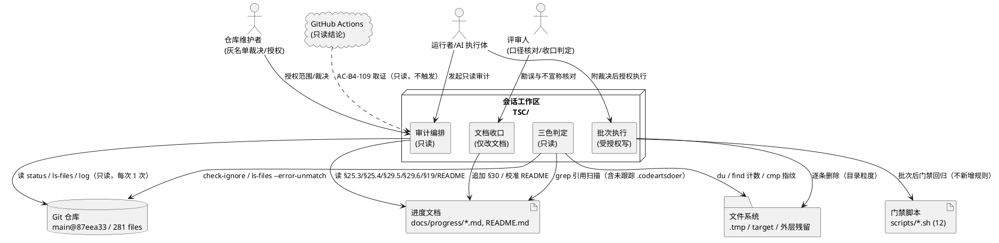
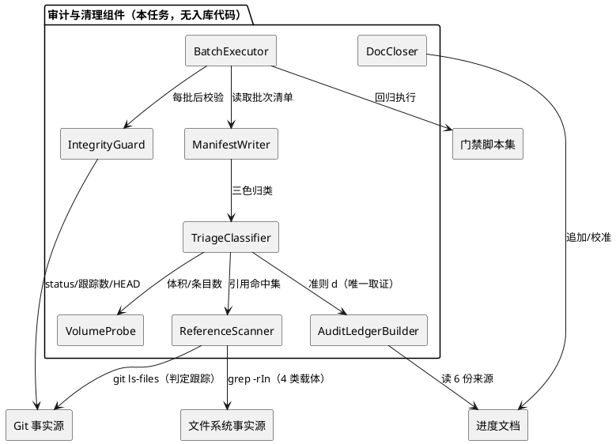
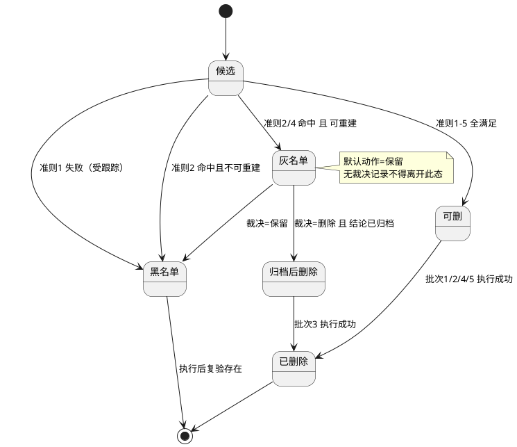
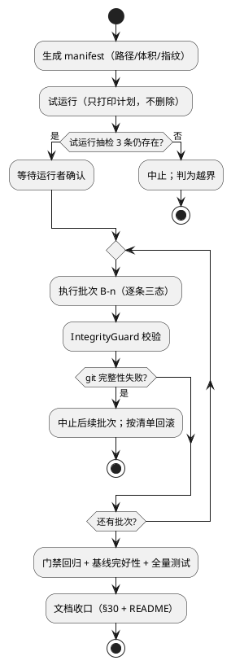
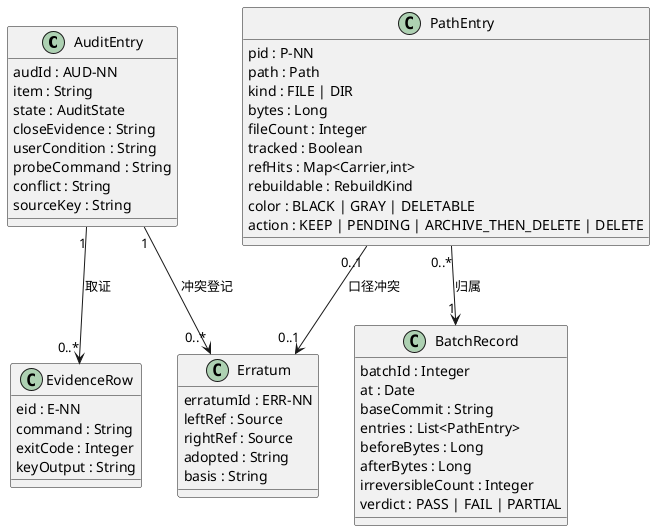

# 一、需求与存量功能关系分析

> 事实基线：仓库根 `TSC/`，分支 `main`，HEAD `87eea33`，工作区干净，`main...origin/main` 0/0，已跟踪文件 **281**。
> 本设计全部结论基于 2026-11-23 只读快照；执行阶段必须按 §2.4.1（台账取数）与 §2.5.3（路径重新取证）刷新，体积与存在性以执行时为准。

## 1.1 需求功能与存量功能对比

### 1.1.1 已实现功能

需求所需的"判定事实源"与"门禁能力"在存量代码中已完整存在，本任务不需要新建任何判定基础设施，只做**编排与登记**。

| 需求功能 | 存量功能 | 代码位置 | 匹配度 |
|---|---|---|---|
| 判定路径是否受版本控制跟踪 | `git ls-files` / `git check-ignore` 能力（仓库元数据） | `TSC/.git`；`.gitignore:1-24` | 100% |
| 忽略面事实（哪些目录本就不入库） | 既有 `.gitignore` 含 `target/`、`.tmp/`、`models/`、`.codeartsdoer/`、`node_modules/`、`dist/`、`*.cdx.json` | `.gitignore:1-24` | 100% |
| 门禁静态规则（B4 七规则） | `check-b4-gates.sh`，规则 `source/budget/record/outbound/zero-transcript/targets/doc-plan`，退出码 0/1/2 语义完备 | `scripts/check-b4-gates.sh:28`（`STATUS_FILE`）、`:271`（zero-transcript）、`:333`（targets）、`:348`（doc-plan）、`:37`（usage） | 100% |
| 门禁静态规则（P-UI 六规则） | `check-ui-integration.sh`，规则 `credential-redline/settings-ux/card-render/body-hidden/frontend-offline/zero-transcript` | `scripts/check-ui-integration.sh:26`（usage）、`:237`（PASS 汇总） | 100% |
| 用例名零回归校验 | `test-name-inventory.sh --diff docs/progress/test-names-before.txt`，缺省基线即该文件 | `scripts/test-name-inventory.sh:351`、`:378-379` | 100% |
| 基线文件存在性与行数门禁 | CI `baseline-presence (C3)` 用 `test -s` 并打印行数 | `.github/workflows/ci.yml:167-168` | 100% |
| 文档层泄漏扫描（md 载体） | `scan-secrets-docs.sh --all-md`，扫描面来自 `git ls-files '*.md'` | `scripts/scan-secrets-docs.sh:57`、`:60-70` | 100% |
| 联调记录泄漏扫描（artifacts 载体） | `scan-secrets-docs.sh --artifacts [DIR]`，默认 `ARTIFACT_DIR=".tmp/llm-live"`，显式缺失退 2、隐式缺失退 0 | `scripts/scan-secrets-docs.sh:13`、`:105-113` | 100% |
| 宣称禁令扫描（G2/macOS） | `check-g2-claims.sh` 扫 `docs/progress`、capture 源码与测试、`README.md`、近 20 条提交标题 | `scripts/check-g2-claims.sh:11`（`PATTERN`）、`:47-50` | 100% |
| macOS 口径与 CI 形状校验 | `check-mac-scope.sh` 校验 `docs/progress` 不得含"G2 仍需真实三平台"、CI job 数必须 6 | `scripts/check-mac-scope.sh:105`、`:113-114`、`:99` | 100% |
| 未完成项事实源 | `b4-status.md` §25.3（未完成项表）、§25.4（不宣称清单）、§29.5（未关闭项）、§29.6（用户裁决表） | `docs/progress/b4-status.md:1036`、`:1049`、`:1307`、`:1315` | 100% |
| 出口判据事实源 | `ui_integration/tasks.md` §19 共 12 条 DoD，含"U-05 整体仍 `open`"、"AC 汇总 130"、"`NEW_TARGETS`=25" | `.codeartsdoer/specs/ui_integration/tasks.md:1272-1285` | 100% |
| 再生者身份可查（可重建性证据） | 各候选目录的生成者均为仓库内既有入口：门禁脚本、`cargo test`、`npm`、`run-llm-live.sh` | `scripts/check-capture-offline.sh:126-129`、`scripts/check-g2-claims.sh:36-39`、`scripts/run-llm-live.sh:20` | 100% |
| 备份与受控文件同源比对 | `.tmp/deny.toml.bak` 与 `deny.toml` 字节一致（本轮 `cmp` 实测 `IDENTICAL`） | `TSC/.tmp/deny.toml.bak`、`TSC/deny.toml` | 100% |

### 1.1.2 需要扩展的功能

| 需求功能 | 存量功能 | 差异说明 | 扩展方向 |
|---|---|---|---|
| 审计台账（`AUD-` 编号体系） | §25.3 为 8 行"项/状态/所需条件"表，无编号、无关闭条件、无取证命令、无冲突列 | 输入输出差异：存量是自然语言表，需求要 8 字段结构化行；业务逻辑差异：需按"用户裁决 > 批次状态 > 交接 > README"优先级归并；边界差异：需覆盖平台占位与纪律项（存量未列） | 在 `b4-status.md` 追加独立小节 §30，内含 17 条台账行；不改动 §25/§28/§29 原文（遵守"只登记不改写"） |
| 清理三色清单 | 仓库无任何清理清单；`.gitignore` 只表达"不入库"，不表达"可删" | 业务逻辑差异：`不入库 ≠ 可删`，需叠加引用扫描、重建性、唯一取证、外部依赖四条判定 | 新增 `P-` 编号路径清单（本设计 §2.3.3），执行期落 `.tmp/audit/manifest.tsv`，摘要入 §30 |
| 引用扫描（四类载体） | 无现成扫描器；既有门禁只扫自身关注面（如 `check-g2-claims` 只扫 4 个目标） | 输入差异：需求需扫代码 + 脚本/CI + 文档 + 规格；关键约束：`.codeartsdoer/` 与 `.tmp/` 未跟踪，`git grep` 会漏 | 落为可复现的 `grep -rIn` 命令族（§2.5.2），逐条清单行附命中结果；不使用 `git grep` |
| 文档口径收口 | README「当前进度」与 §25.3 基本一致，但三份文档对 `C-UI-02` 表述冲突 | 差异：`b4-status §29.5-2` 写"未裁决"，`§29.6` 写"保留（已裁决）"，`handoff-2026-11-22-pui §4-2` 写"未裁决" | 只追加勘误条目 + 校准 README 表述；按优先级取 §29.6 为最终口径，冲突双方原文保留 |
| 批次执行记录 | 仓库有回滚备份习惯（`.tmp/rollback/*.bak`），但无批次化清理流程 | 差异：需求要求逐条三态核销 + 前后体积对比 + 不可回滚条目计数 | 新增 `B-0..B-5` 批次定义与清单模板（§2.6，台账见 §2.4） |

### 1.1.3 需要新增的功能或接口

**（1）审计编排（只读）**

- 输入：`b4-status.md` 四节 + 两份 `handoff-*.md` + `ui_integration/tasks.md §19` + `docs/sdd/*.md` + `README.md` + git 元数据。
- 输出：17 行台账（`AUD-01..AUD-17`），每行含状态、关闭条件、所需用户条件、取证命令、冲突列。
- 核心逻辑：来源归并 → 优先级裁决 → 状态封闭集合校验 → 差集校验（防漏项/重复）。
- 依赖：无（纯读取）。

**（2）判定与清单（只读）**

- 输入：候选路径集合（`.tmp/`、`app/src-tauri/.tmp/`、`crates/infrastructure/.tmp/`、`target/`、外层 `.screenshots/`、外层 `.codeartsdoer/temp/accept/`）。
- 输出：黑/灰/可删三色归类 + 每行五条准则判定结果 + 预估回收体积。
- 核心逻辑：五条准则全满足才可删；灰名单默认"保留"；黑名单执行后逐条复验存在。
- 依赖：（2）依赖（1）产出的"取证结论"判定（准则 d）。

**（3）执行与取证（写，受授权）**

- 输入：已裁决的三色清单 + 用户授权范围。
- 输出：批次记录（已删/失败/跳过三态）+ 逐条指纹 + 前后体积 + 门禁回归结果 + 回滚说明。
- 核心逻辑：试运行 → 逐批删除 → 每批 git 完整性校验 → 全量门禁回归。
- 依赖：（3）依赖（2）；批次 3 额外依赖用户对灰名单的显式裁决。

**（4）文档收口（写，仅文档）**

- 输入：台账、执行记录、勘误登记、不宣称清单。
- 输出：`b4-status.md` §30（新增小节）+ `README.md`「当前进度」校准（仅替换表述，不删段落）。
- 核心逻辑：只追加、不改写历史章节；写入前做禁用词自检（zero-transcript / g2-claims 双约束）。
- 依赖：（3）。

**（5）仓库外残留处置（写，受授权）**

- 输入：外层 `.screenshots/`（实测仅含空 `.tmp`）、外层 `.codeartsdoer/temp/accept/`（127 K）。
- 输出：处置记录（删/保留）。
- 约束：外层目录不属 git 仓库，无回滚能力 → 仅允许删除空目录与 IDE 可再生临时文件；外层 `.codeartsdoer/` 其余内容（`.codebase`、`skills`、`mcp`、`rule`）严禁触碰。

## 1.2 存量功能详细分析

### 1.2.1 `check-b4-gates.sh`（7 规则，本地专属门禁）

- **接口契约**：`--rule=<name>` 或 `--self-test`；退出码 `0` 通过 / `1` 命中违规 / `2` 扫描面缺失。**不接受 `--all`**，必须逐规则调用。
- **业务规则**：
  - `zero-transcript` 把 `docs/progress/b4-status.md` 纳入扫描面（`scripts/check-b4-gates.sh:271,322-323`），禁用面包含 `https?://`、`sk-[A-Za-z0-9]{8,}`、`Authorization: Bearer`、`Bearer <token>`、模型名模式（`(deepseek|gpt-4|gpt-3|claude)-<id>`）、`request_id:`。**这是对 §30 写作的硬约束**：新增小节不得出现任何 URL、凭据样式串、模型名字面量、`request_id` 赋值形态。
  - `doc-plan` 读取 `.codeartsdoer/specs/b4_gate/spec.md` 第 8 章表格，逐行校验"动作非新增的行，其路径必须存在"（`:348-370`）。**推论**：删除 `docs/progress/` 下任何被该表登记的受控文件会直接触发 `doc-plan` 失败；同时该规则本身依赖未入库的 `.codeartsdoer/`，一旦删除该目录，`doc-plan` 退 2。
  - `targets` 依据 `scripts/test-name-inventory.sh` 的 `NEW_TARGETS`（实测 25 项，见 `:18`）校验 7 个 gate target 存在，与清理无关，但清理后必须复跑以证明未破坏。
- **扩展点**：无钩子函数；唯一扩展方式是新增规则文件，本任务禁止。
- **约束**：不依赖 `cargo`（可快速回归）；但 `doc-plan` 隐含"`.codeartsdoer/specs/b4_gate/spec.md` 必须存在"这一**未入库依赖**。

### 1.2.2 `check-ui-integration.sh`（6 规则）

- **接口契约**：`--rule=<name>`，规则集 `credential-redline/settings-ux/card-render/body-hidden/frontend-offline/zero-transcript`；无 `--all`（`scripts/check-ui-integration.sh:24-27`）。
- **业务规则**：扫描面固定在 `app/src/**`、`app/src-tauri/src/ipc/**`（`:14-19`），判定为"命中即违规"的正则计数。
- **约束**：与清理无耦合；但 `ui_integration/tasks.md` §19 第 7 条写"六规则 `--all` 退 0"，与脚本实际能力不符 → 属于**口径勘误候选**（登记而不改写 tasks.md 原文）。

### 1.2.3 `test-name-inventory.sh` + `docs/progress/test-names-before.txt`

- **接口契约**：`--diff [BASE]`，缺省 `BASE=docs/progress/test-names-before.txt`（`:378-379`）；输出含 `removed=`/`added=`。
- **基线事实**：`test-names-before.txt` 实测 **365 行**；CI 在 `baseline-presence (C3)` 用 `test -s` 并打印行数（`.github/workflows/ci.yml:167-168`），并在下一步执行 `--diff`（`:175`）。
- **约束**：该文件是**不可删、不可改**的基线；删除会使 C3 步骤失败，改动会使 `removed` 非零。清理批次必须把它列入黑名单并做"行数 + 指纹"双校验。

### 1.2.4 `scan-secrets-docs.sh`

- **接口契约**：`--all-md` / `--artifacts [DIR]` / `--self-test`；退出码 `0/1/2`，**显式缺失扫描面退 2，隐式缺失退 0**（`:105-113`）。
- **业务规则**：`--all-md` 的扫描面是 `git ls-files '*.md'`（`:57`）→ **只扫已跟踪 md**；`.codeartsdoer/specs/**/*.md` 不入库，天然不在扫描面内。
- **对清理的影响**：
  - 删除 `docs/progress/*.md` 会改变扫描面（不是"缺失"，因为仍有其它 md），**但**会导致 `check-g2-claims` 的 `docs/progress` 目标缺失（若整目录被删）→ 必须至少保留一份状态文档。
  - 删除 `crates/infrastructure/.tmp/llm-live/**` **不触发** `--artifacts` 缺失告警，因为缺省扫描面是仓库根 `.tmp/llm-live`（实测不存在，隐式缺失 → 退 0）。
  - `run-llm-live.sh` 的 `record_roots()`（`:19-21`）把 `crates/infrastructure/.tmp/llm-live` 列为记录根候选，仅供 `--print-record-roots` 打印，不做存在性断言 → 删除该目录不影响脚本退出码。

### 1.2.5 `check-g2-claims.sh`

- **业务规则**：禁用宣称集合固定在 `:11`（含"G2 门禁通过"、"B2 已完成"、"macOS 已验证"等 9 个短语）；同时扫描近 20 条提交标题（`:53-60`）→ **§30 追加的提交不得使用这些短语作为 commit message**。
- **约束**：扫描 `docs/progress` 为递归 + `-I`，新增小节只要不命中短语即安全。

### 1.2.6 `check-mac-scope.sh`

- **业务规则**：`docs/progress/` 中出现字面量"G2 仍需真实三平台"即判失败（`:113-114`）；提交 `ci.yml` job 数必须为 6（`:99`）。
- **约束**：§30 的不宣称清单必须换用其它措辞（如"三平台真机矩阵未取证"），**不得**照抄被禁字面量。

### 1.2.7 CI 覆盖缺口（治理事实）

- `.github/workflows/ci.yml` 实测包含：前端 5 步 + rust 7 步 + C2 覆盖 + C3 基线/用例名 + C1 五脚本 + `cargo deny` + `sbom` + sqlcipher（`:28-265`）。
- **未进入 CI** 的门禁：`check-b4-gates.sh`（7 规则）、`check-ui-integration.sh`（6 规则）、`check-mac-scope.sh`、`check-b3-gates.sh`。这四者只在本地/会话内执行，且部分依赖未入库的 `.codeartsdoer/`。
- **推论**：清理后"门禁全绿"的证据只能来自本地执行，不得据此推断"远端 CI 绿"（对应 `AC-B4-109` 仍"远端未取证"）。

### 1.2.8 忽略面与"不可删"边界

| 判据 | 事实 | 出处 |
|---|---|---|
| `.codeartsdoer/` 不入库 | 忽略规则命中，`git ls-files .codeartsdoer` = 0 | `.gitignore:11`；`git check-ignore -v` 实测 |
| `.tmp/` 不入库 | 同上；`.tmp` 实测 68 个顶层条目、99 个文件、926 K | `.gitignore:21` |
| `target/` 不入库且体积 5.6 G | `du -sh target` 实测 | `.gitignore:3` |
| `models/` 被忽略但属运行必需资产 | 忽略规则 + spec §1.4-7 | `.gitignore:23` |
| 外层 `.screenshots/` 仅有空 `.tmp` | `find` 实测 1 个条目（目录） | 仓库外 |
| 外层 `.codeartsdoer/temp/accept/` 127 K | 4 份 IDE 会话临时文件 | 仓库外 |
| `app/dist/`、`app/node_modules/`、`*.cdx.json`、`*.tsbuildinfo` 亦被忽略 | `git status --ignored` 实测 | 本轮**不纳入**清理范围（需另行裁决，见 §2.8 Q-06） |
# 二、增量设计方案

> 命名约定：审计项 `AUD-NN`、路径项 `P-NN`、决策 `D-AUD-NN`、验收判据 `E-NN`、风险 `R-AUD-NN`、裁决项 `Q-NN`、批次 `B-0..B-5`。
> 环境变量沿用全大写下划线风格：`AUDIT_ROOT`、`AUDIT_OUT`、`AUDIT_SNAPSHOT_AT`、`GATE_PATH`。

## 2.1 实现模型

### 2.1.1 上下文视图



通信协议与频率：全部为本地进程内命令调用（bash），无网络调用；`CI` 仅在 `AC-B4-109` 取证时按需只读访问，本阶段**不发起**。

### 2.1.2 服务/组件总体架构



| 组件 | 职责 | 落地形态 | 约束 |
|---|---|---|---|
| `AuditLedgerBuilder` | 归并来源、按优先级裁决口径、检测漏项/重复 | 命令族 + 人工填写 md 表格 | 只读；不写 docs |
| `ReferenceScanner` | 四类载体引用检索 | `grep -rIn` 命令族（§2.5.2） | 禁用 `git grep`（漏未跟踪） |
| `TriageClassifier` | 五条准则判定并归三色 | 判定表（§2.3.2） | 全满足才可删 |
| `VolumeProbe` | 体积/条目数测量 | `du -sk` / `find -type f \| wc -l` | >1 GB 用计数+抽样 |
| `ManifestWriter` | 生成 `manifest.tsv` 与批次清单 | `.tmp/audit/manifest.tsv` | 无清单不得删除 |
| `BatchExecutor` | 逐批删除 + 三态核销 | 逐条删除命令 | 单批 ≤5 目录 |
| `IntegrityGuard` | git 完整性 + 基线完好性校验 | 断言命令（§2.6.3） | 失败即中止后续批次 |
| `DocCloser` | §30 追加 + README 校准 + 勘误 | 编辑文档 | 只追加，不改写历史 |

**关键决策：不新增 `scripts/` 下的任何脚本。** 依据 §1.4-1（禁改 `scripts/**`）。所有"可执行检查"以命令清单形式登记在本文档与 §30 中；若需要编排辅助，只允许落在 `.tmp/audit/`（未跟踪、随批次 1 一并清理），且不得成为任何判定的事实源。

### 2.1.3 实现设计

**（1）三色判定状态机**



**（2）批次执行活动流**



**（3）扩展点设计**

本任务不引入任何源码扩展点。文档侧唯一"扩展点"是 `b4-status.md` 的追加位：`§30`（当前最大编号为 `§29`，标题清单实测末位即 `§29`）。追加前必须执行 `grep -cE '^## §29' docs/progress/b4-status.md` = 1 与 `grep -cE '^## §30' docs/progress/b4-status.md` = 0 双校验；冲突则顺延编号并记录实际落地编号。

**（4）事务边界**

删除不具原子性，因此以"批次 = 事务单元"：每批次的清单文件即该批次的前映像。回滚粒度 = 批次；批次内单条失败不回滚整批，但必须记入三态。

## 2.2 接口设计

### 2.2.1 总体设计

本组件不新增程序化 API，接口形态为**命令契约 + 文档契约**。命令契约分两类：只读（可任意重复）与写入（需批次清单前置）。稳定性：命令契约"稳定"（依赖既有脚本参数面），文档契约"稳定"（追加式）。

| 接口 | 类型 | 稳定性 | 依赖 |
|---|---|---|---|
| `I-01 审计取数` | 只读命令族 | 稳定 | git + 6 份文档 |
| `I-02 引用扫描` | 只读命令族 | 稳定 | grep（含未跟踪） |
| `I-03 跟踪/忽略判定` | 只读命令族 | 稳定 | `git ls-files` / `git check-ignore` |
| `I-04 体积与指纹` | 只读命令族 | 稳定 | `du` / `find` / `cmp` / `sha256sum` |
| `I-05 清单生成` | 写入 `.tmp/audit/**` | 实验（可再约定） | I-01..I-04 |
| `I-06 批次执行` | 写入文件系统 | 实验 | I-05 + 授权 |
| `I-07 门禁回归` | 只读执行 | 稳定（脚本参数面不变） | `scripts/*.sh` |
| `I-08 文档收口` | 写入 `docs/**`、`README.md` | 稳定（仅追加/替换表述） | I-03、I-06 |

### 2.2.2 接口清单

#### I-01 审计取数（只读）

- 签名（bash）：
  - `git -C "$AUDIT_ROOT" rev-parse --abbrev-ref HEAD`
  - `git -C "$AUDIT_ROOT" status --porcelain`
  - `git -C "$AUDIT_ROOT" ls-files | wc -l`
  - `git -C "$AUDIT_ROOT" log --oneline -1`
  - `git -C "$AUDIT_ROOT" rev-list --left-right --count origin/main...HEAD`
- 业务说明：为台账提供 HEAD、洁净度、跟踪数、同步计数四项事实基线。
- 前置条件：仓库可读；`origin/main` 已 fetch（不 fetch 也不影响，计数仅作登记）。
- 后置条件：无状态变化。
- 异常映射：非仓库 → 退出非零 → 台账状态全部降级为"未判定（来源缺失）"。
- 调用示例：

```bash
export AUDIT_ROOT="$PWD"; export AUDIT_OUT=".tmp/audit"
mkdir -p "$AUDIT_OUT"
git status --porcelain | tee "$AUDIT_OUT/status.txt"; wc -l < "$AUDIT_OUT/status.txt"
git ls-files | wc -l
```

#### I-02 引用扫描（只读）

见 §2.5.2 的完整命令族。要点：**必须包含未跟踪目录**，因此用 `grep -rIn` 而非 `git grep`；必须排除 `.git`、`target`、`node_modules`。输出仅记录"命中文件:行号"，与 `scan-secrets-docs.sh` 的"绝不回显内容"纪律一致。

#### I-03 跟踪/忽略判定（只读）

- 签名：
  - `git ls-files --error-unmatch "<rel_path>" >/dev/null 2>&1; echo $?` → `0`=已跟踪，非 0=未跟踪
  - `git check-ignore -v "<rel_path>"` → 命中行给出 `.gitignore:行号:规则`
- 后置条件：无。
- 异常映射：路径不存在 → `check-ignore` 退 1 且无输出 → 记为"路径不存在"。
- 调用示例（判 `.tmp` 与 `target`）：

```bash
for p in .tmp target models .codeartsdoer docs/progress/test-names-before.txt; do
  printf '%-40s ' "$p"
  if git ls-files --error-unmatch "$p" >/dev/null 2>&1; then echo TRACKED; else
    git check-ignore -q "$p" && echo "UNTRACKED+IGNORED" || echo "UNTRACKED+NOT-IGNORED"; fi
done
```

#### I-04 体积与指纹（只读）

- 签名：
  - `du -sk "<dir>"`（KB）
  - `find "<dir>" -type f | wc -l`
  - `sha256sum "<file>"`
  - `cmp -s "<a>" "<b>" && echo IDENTICAL`
- 前置条件：`>1 GB` 的目录（`target/`）**先**用 `find | wc -l` + 抽样，若 `du -sk` 超过 30 秒则改用"条目数 + 单文件均值×条目数"估算并标"估算"。
- 调用示例：

```bash
du -sk .tmp app/src-tauri/.tmp crates/infrastructure/.tmp 2>/dev/null
find .tmp -type f | wc -l
sha256sum .tmp/deny.toml.bak deny.toml
cmp -s .tmp/deny.toml.bak deny.toml && echo IDENTICAL || echo DIFFER
```

#### I-05 清单生成（写 `.tmp/audit/**`）

- 产物：`manifest.tsv`，字段见 §2.3.3；`triage.md`（三色表，供评审）。
- 前置条件：I-01..I-04 全部成功；每条路径的"存在性"已记录。
- 后置条件：`manifest.tsv` 行数 == 三色清单行数（不含黑名单中"执行后复验"行）。
- 异常映射：缺任一条路径存在性 → 拒绝进入 I-06。

#### I-06 批次执行（受授权写）

- 前置条件：用户已授权批次范围；`manifest.tsv` 存在；试运行已通过（抽检 3 条仍存在）。
- 后置条件：逐条三态、前后体积、不可回滚条目数、批次时点齐全。
- 异常映射（按发生概率排序）：文件占用 → 跳过 + 记录原因；权限只读 → 跳过 + 建议；`git status` 非空 → 整批中止并告警。

#### I-07 门禁回归（只读执行）

见 §2.9.3 命令表。**不新增规则、不改脚本参数面**。

#### I-08 文档收口（写文档）

- 前置条件：I-06 完成（或明确"未执行清理"仅做审计）；§30 编号唯一。
- 后置条件：`b4-status.md` 仅追加；README 仅替换「当前进度」内的语句；无历史章节被改写。
- 异常映射：编号冲突 → 顺延并记录实际编号；写入后自检失败 → 回退本节新增内容（git 可回滚，因该文件受控）。

## 2.3 数据模型

### 2.3.1 设计目标

1. 支撑 17 条台账行的**增量更新**：重复执行不产生重复编号、不丢已登记条目（以"来源键 = 文档路径 + 章节标题 + 事项名"做幂等键）。
2. 支撑 30+ 条路径行的**逐条可复核**：每行判定依据可被独立重放。
3. 体积口径分层：`<1 GB` 精确、`>1 GB` 估算并标注。
4. 与存量文档兼容：§30 为纯追加，不影响 `doc-plan`/`zero-transcript`/`g2-claims` 既有判定。

### 2.3.2 模型实现



**枚举封闭集**

- `AuditState` = `open` | `未完成` | `未判定` | `未判定（来源缺失）` | `已裁决保留` | `closed` | `passed` | `not-applicable`
- `RebuildKind` = `可重建（生成命令）` | `与受控文件内容一致` | `不可重建`
- `Carrier` = `代码` | `脚本与CI` | `文档` | `规格`
- `Action` = `保留` | `待裁决` | `归档后删除` | `直接删除`

**约束校验（写入前自检）**

- `audId` 连续且不复用；与 `AC-B4-` 前缀互不覆盖。
- 含 `open`/`未完成` 的行必须有 `userCondition`（可为"无"）。
- `color == GRAY` 时 `action != 直接删除`。
- `tracked == true` 时 `color` 必须为 `BLACK`。

### 2.3.3 字段规范（落地表格形态）

**（A）审计台账（§30 表 A，17 行）**

| 列 | 必填 | 取值来源 | 示例 |
|---|---|---|---|
| `编号` | 是 | `AUD-NN` | `AUD-01` |
| `事项` | 是 | 文档既有名称，禁止改写 | `U-05 整体` |
| `状态` | 是 | 封闭集合之一 | `open` |
| `关闭条件` | 是 | 证据类型（用例名/命令/远端结论/真机验收） | "真实联网 E2E 记录 + 真机 WebView2 截图" |
| `所需用户条件` | 是 | 凭据/设备/样本/授权，无则"无" | "端点凭据、真机、投屏样本" |
| `取证命令` | 是 | 本地只读命令或"文档名 + 章节标题" | `bash scripts/run-llm-live.sh --print-record-roots` |
| `冲突` | 否 | 被覆盖出处，无则"无" | `handoff-2026-11-22-pui.md §4-2` |
| `来源` | 是 | 文件路径 + 章节标题 | `docs/progress/b4-status.md §25.3` |

**（B）三色清单（manifest.tsv，TSV 列序固定）**

`pid / path / kind / bytes / file_count / tracked / ref_code / ref_script_ci / ref_doc / ref_spec / rebuildable / color / action / basis / batch`

**（C）批次记录（§30 表 C）**

`batch / 时点 / 基线提交 / 条目数 / 前体积 / 后体积 / 已删 / 失败 / 跳过 / 不可回滚条目数 / 结论`

**（D）验收证据表（§30 表 D）**

`eid / 判据 / 命令 / 退出码 / 关键输出`

**（E）勘误登记（§30 表 E）**

`erratum / 冲突双方（文件+章节）/ 采用口径 / 依据（裁决来源）`

### 2.3.4 持久化策略

- 逐条 manifest（`manifest.tsv`）、试运行报告、原始命令输出：落 `.tmp/audit/`；**不入库**，随批次 1 清理或按需保留到批次 5。
- 台账、批次汇总、勘误、不宣称清单：落 `docs/progress/b4-status.md §30`（受控，git 可回滚）。
- 不新增任何受控文件（避免扩大 `doc-plan` 与提交面）；若评审人要求独立台账文件，另立裁决项（§2.8 Q-05）。
## 2.4 审计台账的生成方式与结构

### 2.4.1 生成步骤（幂等）

1. **取数**：执行 I-01，落 `.tmp/audit/status.txt`、`head.txt`、`counts.txt`（跟踪数 = 281）。
2. **抽取来源**：按固定行区间读取六处来源（`sed -n` 精确定位，避免全文人工比对）：
   - `docs/progress/b4-status.md:1036-1057`（§25.3 + §25.4）
   - `docs/progress/b4-status.md:1307-1322`（§29.5 + §29.6）
   - `docs/progress/handoff-2026-11-22-pui.md:33-40`（§4 未关闭项）
   - `docs/progress/handoff-2026-11-22.md:40-48`（§5 剩余条件项）
   - `.codeartsdoer/specs/ui_integration/tasks.md:1272-1285`（§19 出口判据）
   - `README.md:7-29`（「当前进度」）
3. **归并同项**：以 `事项名` 为幂等键；同一事项多来源时按优先级 `用户裁决记录 > 批次状态文档 > 交接说明 > README` 取状态。
4. **封闭集合校验**：状态词不在 §2.3.2 枚举内 → 退回重填（禁止"基本完成""大致可用"）。
5. **差集校验**：台账事项集合 vs 六处来源事项集合，输出 `missing`/`duplicate`；任一非空 → 不得进入 §2.5 判定阶段。
6. **落地**：17 行填入 §30 表 A；原始抽取结果保留在 `.tmp/audit/sources/`。

### 2.4.2 静态台账（AUD-01 ~ AUD-17，随执行复核后可微调状态）

| 编号 | 事项 | 状态 | 关闭条件 | 所需用户条件 | 取证命令/定位 | 冲突 | 来源 |
|---|---|---|---|---|---|---|---|
| AUD-01 | U-05 整体 | `open` | 真实联网 E2E 记录 + 真机 WebView2 验收记录 + 窗口/焦点/投屏结论 | 端点凭据、真机、投屏/会议样本 | `docs/progress/b4-status.md §29.5-1`；`ui_integration/tasks.md §19-10` | 无 | §29.5、§19 |
| AUD-02 | U-07 整体 | `open` | AUD-03~06 四项全部关闭 | 见 AUD-03~06 合并条件 | `docs/progress/b4-status.md §25.3` | 无 | §25.3 |
| AUD-03 | U-07-41.5 负反馈加权 | `未完成`（规格层明确不做） | 补齐 b4 级增量需求规格（字段/枚举/AC/零转录） | 需求规格立项授权 | `grep -n "U-07-41.5" docs/progress/b4-status.md` | 无 | §25.3 |
| AUD-04 | U-07-42 缓存/outbox | `未完成` | 持久化介质确定 + "重启不丢"口径定义 + 用例通过 | 确认介质与口径 | `grep -n "U-07-42" docs/progress/b4-status.md` | 无 | §25.3 |
| AUD-05 | U-07-43 按需补全实体 | `未完成` | 真实检索源接入 + 8s p95 样本达标 | 真实检索源 + 性能样本 | `grep -n "U-07-43" docs/progress/b4-status.md` | 无 | §25.3 |
| AUD-06 | U-07-52 审计哈希链存储 | `未完成` | 落库介质确定 + 180 天保留策略确认 + 哈希链用例通过 | 介质与保留策略裁决 | `grep -n "U-07-52" docs/progress/b4-status.md` | 无 | §25.3 |
| AUD-07 | U-08 真实端点/真机 | `未判定`（9 个 `#[ignore]` 保持） | 端点凭据可用 + 真机验证 + 误触发率与性能记录 | 凭据、真机、样本；`#[ignore]` 不解锁 | `bash scripts/run-llm-live.sh --print-record-roots`（只打印根，不联网） | 无 | §25.3、§29.5-4 |
| AUD-08 | AC-B4-109 远端 CI | `passed`（仅本地）/ 远端未取证 | 远端 run 结论文本或截图 + 步骤全绿 | push 授权后的远端只读查看权限 | 文档定位 `b4-status.md §25.3`；远端结论需用户提供 | 无 | §25.3 |
| AUD-09 | C-UI-02 macOS CI 编译观察项 | `已裁决保留` | 无（已裁决，保持 `ci.yml`/`deny.toml`/`platform-mac` 零 diff） | 无 | `git diff --quiet HEAD -- .github/workflows/ci.yml deny.toml` | **见 AUD-16** | §29.6 |
| AUD-10 | C-UI-03 生产探针 | `已裁决保留`（默认关闭） | 无（仅 `--features llm-https` 显式开启） | 无 | `grep -n "C-UI-03" docs/progress/b4-status.md §29.6` | 无 | §29.6 |
| AUD-11 | 9 个 `#[ignore]` 纪律项 | `未判定`（不解锁） | 不改数量、不改名称；解锁需另行立项 | 明确解锁授权 | `grep -rIn "#\[ignore\]" crates app --include=*.rs \| wc -l` 期望 **9** | 无 | §29.5-4、§19-11 |
| AUD-12 | `tests/replay/` 不存在 | `未判定`（纪律项） | 保持不存在；创建需另行立项 | 明确创建授权 | `find . -type d -name replay -not -path './target/*' \| wc -l` 期望 **0** | 无 | §29.5-4 |
| AUD-13 | platform-win WASAPI/UIA/OCR 占位 | `未完成` | 三个能力各有真实实现 + 用例 | 真机音频/UI 自动化/OCR 样本 | 文档定位 `b4-status.md §29.5`；`ls crates/platform-win/src` | 无 | §1.3-2（需求侧） |
| AUD-14 | platform-mac 整体占位 | `未完成` | macOS 目标实现 + 交叉编译验证 | macOS 环境（本轮不提供） | `git ls-files crates/platform-mac \| wc -l`；`bash scripts/check-mac-scope.sh --rule=...` | 无 | §29.6 |
| AUD-15 | `.codeartsdoer/` 未入库（治理缺口） | `open` | 解除忽略并入库，或明确"永久不入库"并登记理由 | 忽略面变更裁决（Q-01） | `git check-ignore -v .codeartsdoer`；`git ls-files .codeartsdoer \| wc -l` 期望 **0** | 无 | `.gitignore:11` |
| AUD-16 | 文档口径漂移：C-UI-02 | `未完成` | 三处表述统一到"已裁决保留"或明确时点差异 | 无（按 §29.6 裁决口径收口） | 见 §2.10.1 冲突举证命令 | `§29.5-2`"未裁决" / `§29.6`"保留" / `handoff-pui §4-2`"未裁决" | §29.5、§29.6、handoff |
| AUD-17 | 本地专属门禁未纳入 CI | `open` | 四个本地门禁进 CI 或明确"仅本地执行"并登记理由 | CI 变更裁决（本轮不做） | `grep -cE "check-b4-gates\|check-ui-integration\|check-mac-scope\|check-b3-gates" .github/workflows/ci.yml` 期望 **0** | 无 | `ci.yml:28-265` |

**台账不变量**：`AC-B4` 汇总仍为 **130**；`NEW_TARGETS` 仍为 **25**（实测 `scripts/test-name-inventory.sh:18`）；本任务不新增、不改写任何 `AC-B4` 编号。

## 2.5 三色判定的可执行落地与引用扫描

### 2.5.1 五条准则的命令化

| 准则 | 判定命令 | 通过条件 |
|---|---|---|
| C1 未受跟踪 | `git ls-files --error-unmatch "<p>" >/dev/null 2>&1; echo $?` | 退出码 **1**（非 0） |
| C2 未被引用 | §2.5.2 四类载体扫描（+ 根配置 `.gitignore`/`deny.toml`/`Cargo.toml`） | 命中数 **0**（自命中需剔除并说明） |
| C3 可重建 | 登记生成者 + 执行生成者自检：`bash scripts/<gen>.sh --self-test` 或 `cargo test -p <crate> <test>`；或 `cmp -s` 与受控文件一致 | 生成命令存在且可执行（不要求本轮真跑全量） |
| C4 无唯一取证结论 | `grep -rInE "AC-B4-1[12][0-9]\|U-0[578]" "<p>"` + 人工确认 | 命中 **0**，或命中但不构成唯一结论（需说明） |
| C5 无外部交付依赖 | `grep -rIn "<p>" .github scripts docs README.md .codeartsdoer/specs` | 命中 **0**，或命中者已登记为基线依赖 → 转黑名单 |

**判定矩阵（必须全满足才可删）**

```bash
# 示例：判定一个候选路径（P 为相对路径，如 .tmp/deny.toml.bak）
P=".tmp/deny.toml.bak"
git ls-files --error-unmatch "$P" >/dev/null 2>&1 && { echo "C1 FAIL: tracked"; } || echo "C1 PASS"
grep -rIn --fixed-strings -- "$P" \
  --exclude-dir=.git --exclude-dir=target --exclude-dir=node_modules \
  . 2>/dev/null | grep -v "^./$P" ; echo "C2 命中行见上（应为空）"
cmp -s ".tmp/deny.toml.bak" "deny.toml" && echo "C3 PASS: IDENTICAL"
grep -rInE "AC-B4-1[12][0-9]|U-0[578]" ".tmp/deny.toml.bak" 2>/dev/null | wc -l
grep -rIn --fixed-strings -- "$P" .github scripts docs README.md .codeartsdoer/specs 2>/dev/null | wc -l
```

### 2.5.2 引用扫描命令族（四类载体，含未跟踪目录）

**硬约束**：不得使用 `git grep`。实测 `.codeartsdoer/`（`git ls-files` = 0）与 `.tmp/` 均为未跟踪，`git grep` 会漏掉规格文档与临时引用，导致误判为"可删"。

```bash
# 0) 全量兜底（一次覆盖四类载体 + 根配置文件）
scan_all() {
  local p="$1"
  grep -rIn --fixed-strings -- "$p" \
    --exclude-dir=.git --exclude-dir=target --exclude-dir=node_modules \
    . 2>/dev/null | grep -v "^\./${p#./}"
}
# 1) 代码载体
grep -rIn --fixed-strings -- "<p>" crates app/src app/src-tauri/src --include=*.rs --include=*.ts --include=*.tsx
# 2) 脚本与 CI 载体
grep -rIn --fixed-strings -- "<p>" scripts .github Cargo.toml Cargo.lock deny.toml .gitignore
# 3) 文档载体（含 README 与状态文档命令块）
grep -rIn --fixed-strings -- "<p>" docs README.md
# 4) 规格与任务载体（未跟踪，必须显式扫描）
grep -rIn --fixed-strings -- "<p>" .codeartsdoer/specs
# 5) 文件名反向扫描（引用可能只写文件名，不写路径）
grep -rIn --fixed-strings -- "$(basename "<p>")" docs scripts .github .codeartsdoer/specs README.md | grep -v "^\./${p#./}"
```

**输出纪律**：只记录 `文件:行号`（与 `scan-secrets-docs.sh` 一致）；命中内容可能含凭据样式串，禁止回显正文。

**实测结论（本轮已抽样验证）**

| 候选 | 命中 | 结论 |
|---|---|---|
| `docs/progress/test-names-before.txt` | `scripts/test-name-inventory.sh:351,378-379`；`.github/workflows/ci.yml:167-175`；多份规格 | **黑名单**（基线依赖） |
| `.tmp/ui-integration/ac-board.md` | `.codeartsdoer/specs/ui_integration/tasks.md:193,198,1230-1231,1244,1279` | **灰名单**（取证看板） |
| `crates/infrastructure/.tmp/llm-live/**` | `crates/infrastructure/src/llm/live/record.rs:122,277`；`scripts/run-llm-live.sh:20`；`scripts/scan-secrets-docs.sh:13`（缺省指向根 `.tmp/llm-live`，非本目录） | **灰名单**（真实联调记录） |
| `deny.toml.bak` | 无外部引用；与 `deny.toml` 实测 `IDENTICAL` | **可删** |
| `.tmp/ui-integration/lib.sh` | 外部无引用（仅 `.tmp` 内部使用） | **可删**（随批次 1） |

### 2.5.3 三色清单静态版（执行时重新取证后核销）

**黑名单（禁删，执行后逐条复验存在）**

| 编号 | 路径 | 理由 |
|---|---|---|
| P-01 | `docs/progress/test-names-before.txt` | 365 行用例名基线；C1/C2 命中 |
| P-02 | `docs/progress/` 其余 10 份 md（`b0~b4-status`、`b2-24-merge`、`b2-offline-closure`、`ci-readiness`、`handoff-*2`） | 进度与裁决事实源（manifest 内逐份展开） |
| P-03 | `docs/sdd/` 4 份（`spec/design/tasks/tasks-b2-offline-closure`） | 已跟踪正式规格；`check-mac-scope.sh:105` 引用 |
| P-04 | `scripts/**`（20 项） | 门禁与工具链基线 |
| P-05 | `.github/workflows/ci.yml` | CI 门禁与基线引用 |
| P-06 | `deny.toml` | 依赖合规基线 |
| P-07 | `Cargo.toml`、`Cargo.lock` | 依赖基线（`Cargo.lock` 指纹参与重建回归） |
| P-08 | `crates/**`（源码与测试） | 源码（禁改禁删） |
| P-09 | `app/src/**`、`app/src-tauri/src/**` | 源码 |
| P-10 | `models/**` | 运行必需外部资产（被忽略但非多余） |
| P-11 | `.tmp/test-temp/`（目录本身） | `TEMP/TMP` 约定根（`b3_understanding/design.md:1486-1501`） |
| P-12 | `.codeartsdoer/**` | 规格事实源 + `check-b4-gates.sh:348` 的 `doc-plan` 依赖 |
| P-13 | `README.md` | 文档索引与口径事实源 |

**灰名单（需裁决，默认保留）→ 详见 §2.8**

| 编号 | 路径 | 快照体积 | 默认动作 |
|---|---|---|---|
| P-20 | `.tmp/ui-integration/ac-board.md` | 25 K | 保留（Q-02） |
| P-21 | `crates/infrastructure/.tmp/llm-live/**` | 128 K / 6 个 run 目录 | 保留（Q-03） |
| P-22 | `.tmp/rollback/{ci,design,tni}.bak` | 100 K | 待裁决（Q-04） |
| P-23 | `.tmp/url-2.5.9-meta/` | 269 K / 19 文件 | 待裁决（Q-05） |
| P-24 | `target/` | 约 5.6 G（估算口径） | 保留（Q-01） |
| P-25 | 外层 `.screenshots/`（含空 `.tmp`） | 0 | 待裁决（Q-06） |
| P-26 | 外层 `.codeartsdoer/temp/accept/**` | 127 K / 4 文件 | 待裁决（Q-06） |

**可删清单（五条准则全满足）**

| 编号 | 路径 | 快照体积 | 生成者 |
|---|---|---|---|
| P-30 | `.tmp/*.log`（`build*.log`、`clippy*.log`、`contract.log`、`deny.log`、`names-diff*.log`、`test*.log`、`wlv-*.log`、`status-push.log`、`web-build.log`） | 顶层 64 个直接文件合计 **770.8 K**（逐条在 manifest 展开） | 门禁脚本 / cargo / npm 输出 |
| P-31 | `.tmp/*.txt`（`b4-*`、`gate_*`、`clippy/deny/final/r/t/ws/inv/p0-real*`） | 计入上行 | 门禁脚本输出 |
| P-32 | `.tmp/deny.toml.bak` | 1 K | 与 `deny.toml` 字节一致（实测 `IDENTICAL`） |
| P-33 | `.tmp/rb-mod.bak`、`.tmp/rb-tni.bak` | <1 K | 脚本自检产物 |
| P-34 | `.tmp/g2-claims-selftest.md`、`.tmp/capture-offline-selftest.rs` | <1 K | `check-g2-claims.sh:36-39`、`check-capture-offline.sh:126-129` 运行时重建 |
| P-35 | `.tmp/test-temp/**` 内容 | 75 K / 9 文件 | `cargo test` 临时目录（目录保留） |
| P-36 | `.tmp/verify*.sh`（4）、`.tmp/verify*.ps1`（4） | <5 K | 一次性验证脚本，无引用 |
| P-37 | `.tmp/ui-integration/{baseline.txt,deny.txt,lib.sh}` | <2 K | 会话脚手架，无外部引用 |
| P-38 | `app/src-tauri/.tmp/ui-store-tests/**` | 9 K / 6 文件 | 设置存储单测夹具（测试重建） |

**体积合计**：可删项约 **0.88 M**（770.8 K 顶层文件 + 45.7 K `ui-integration` 非看板 + 75 K `test-temp` 内容 + 9 K `ui-store-tests`；不含 P-24）；灰名单可回收上限约 **6.02 G**（含 `target/` 5.6 G，需 Q-01 授权）。

## 2.6 清理批次与执行顺序

### 2.6.1 批次定义

| 批次 | 范围 | 条目 | 预估回收 | 前置条件 | 不可回滚条目 |
|---|---|---|---|---|---|
| B-0 | 清单生成 + 试运行（不删任何文件） | P-30..P-38、P-20..P-26 | 0 | 无 | 0 |
| B-1 | 仓库内脚本产物（`.tmp` 顶层日志/备份/自检/verify/ui-integration 非看板/test-temp 内容） | P-30..P-37 | ≈ 0.87 M | B-0 抽检通过 | 0（全部可重建） |
| B-2 | 测试夹具 | P-38 | 9 K | B-1 通过 + git 完整性通过 | 0（测试重建） |
| B-3 | 灰名单已授权项 | P-20..P-23、P-21 | ≤ 0.52 M | 用户对 Q-02~Q-05 逐项裁决 + 结论已归档 | = 已授权且未备份条数（必须显式计数） |
| B-4 | 构建缓存 | P-24 `target/` | ≈ 5.6 G（估算） | 用户授权 Q-01 + 工具链版本与 `Cargo.lock` 指纹已记录 | 0（可重建，但重建耗时） |
| B-5 | 仓库外残留 | P-25、P-26 | 127 K | 用户授权 Q-06；确认外层无其它交付文件 | = 未备份条数（外层无 git） |

### 2.6.2 顺序与中断语义

1. 严格按 B-0 → B-5 执行；**禁止跳过或合并批次**（spec §5.3.1-2）。
2. 单批次删除目录数 ≤ 5（spec §4.1-2）；B-1 为单目录（`.tmp`）内逐条删除，B-4 为单目录。
3. 每批次结束立即写入 `BatchRecord` 并执行 §2.6.3 校验；**校验失败 → 停止后续批次**。
4. 中断语义：已执行批次计入报告；未执行批次必须标记"未执行"，不得视为默认完成。
5. 并发抑制：执行前关闭 `cargo`、`npm`、IDE 索引；执行后以"条目数稳定 60 秒"为完成判据（避免 `.tmp` 被后台重建造成假失败）。

### 2.6.3 `IntegrityGuard` 守护断言

```bash
# 基线（B-0 时记录）
BASE_TRACKED=$(git ls-files | wc -l | tr -d ' ')     # 期望 281
BASE_HEAD=$(git rev-parse HEAD)
BASE_TNI_LINES=$(wc -l < docs/progress/test-names-before.txt | tr -d ' ')   # 期望 365
BASE_TNI_SHA=$(sha256sum docs/progress/test-names-before.txt | cut -d' ' -f1)

# 每批次后（任一失败即中止）
test -z "$(git status --porcelain)" || { echo "FAIL: 工作区不干净"; exit 1; }
test "$(git ls-files | wc -l | tr -d ' ')" = "$BASE_TRACKED" || { echo "FAIL: 跟踪数变化"; exit 1; }
test "$(git rev-parse HEAD)" = "$BASE_HEAD" || { echo "FAIL: HEAD 变化"; exit 1; }
test "$(wc -l < docs/progress/test-names-before.txt | tr -d ' ')" = "$BASE_TNI_LINES" || { echo "FAIL: 基线路数"; exit 1; }
test "$(sha256sum docs/progress/test-names-before.txt | cut -d' ' -f1)" = "$BASE_TNI_SHA" || { echo "FAIL: 基线指纹"; exit 1; }
# 黑名单逐条复验
for p in docs/progress/test-names-before.txt docs/sdd/spec.md docs/sdd/design.md docs/sdd/tasks.md \
         deny.toml Cargo.toml Cargo.lock README.md .github/workflows/ci.yml; do
  test -e "$p" || { echo "FAIL: 黑名单缺失 $p"; exit 1; }
done
```

> 注：B-1/B-2 不删除任何受控文件，因此 `git status` 必然为空；若 B-1 后出现非空状态，说明误删了受控路径（例如 `.tmp` 内含有被 `git add -f` 过的文件），必须立即按清单回滚。

## 2.7 取证与回滚路径

### 2.7.1 取证矩阵

| 对象 | 取证方式 | 证据落点 |
|---|---|---|
| 审计台账 17 行 | 每行"取证命令"可独立重放 + 来源文档定位 | §30 表 A + `.tmp/audit/sources/` |
| 清理前快照 | `du -sk`、`find -type f \| wc -l`、逐文件 `sha256sum`（可删项） | `.tmp/audit/manifest.tsv` |
| 试运行 | 计划输出 + 抽检 3 条仍存在 | `.tmp/audit/dryrun.txt` |
| 每批次 | 三态逐条 + 前后体积 + 不可回滚计数 + 时点/基线提交 | §30 表 C |
| 门禁回归 | 退出码 + 关键输出行 | §30 表 D |
| 文档收口 | 新增小节行数、README 差异字节、自检命令结果 | §30 表 E + `git diff --stat` |
| 远端 CI（AUD-08） | 只读结论文本/截图（本阶段不发起） | 台账"未取证"标记保留 |

### 2.7.2 回滚路径

| 情形 | 可回滚性 | 回滚动作 | 验证 |
|---|---|---|---|
| 误删受控文件（P-01~P-13） | 可回滚（git） | `git checkout -- "<path>"` 或 `git restore "<path>"` | 跟踪数 = 281 + 指纹一致 + 重跑门禁 |
| 误删可删项（P-30~P-38） | 不可回滚，可重建 | 重跑生成者：`bash scripts/check-b4-gates.sh --rule=doc-plan`、`cargo test -p meeting-copilot-infrastructure`、`npm ci && npm run build` | 目录重新出现且条目数稳定 |
| 误删灰名单（P-20~P-23） | 不可回滚（无跟踪） | 仅能凭"结论已归档"弥补；原件无备份则不可恢复 | 归档记录存在 + 用户确认 |
| 误删构建缓存（P-24） | 可重建 | `cargo build --workspace`（必要时 `cargo fetch`） | `cargo test --workspace` 结果回到 825/0/9 |
| 误删仓库外残留（P-25/P-26） | 不可回滚 | 空目录重建：`mkdir -p`；IDE 临时文件由工具再生 | 目录存在性校验 |
| 文档收口出错（§30/README） | 可回滚（git） | `git restore -- docs/progress/b4-status.md README.md` | `git diff` 为空 + 门禁复跑 |
| `.gitignore` 变更（Q-01 若授权） | 可回滚（git） | 单独 revert 该变更提交 | `git check-ignore -v` 与原状一致 |

**回滚边界声明（每批次必须写入报告）**：可回滚 = 受控文件 + 已归档结论；不可回滚 = 未跟踪且未备份的路径。B-3/B-5 报告必须显式写明"不可回滚条目数"。B-4 的"不可回滚"为 0，但**不可逆副作用**是重建耗时与依赖拉取需求。

### 2.7.3 归档前置动作（灰名单删除的唯一合法通道）

1. 从取证产物中提取结论（AC 勾选状态、run 摘要、样本统计），**不复制原始内容**。
2. 将结论写入 `docs/progress/b4-status.md §30` 表 C 的"结论归档"列（不得含 URL/凭据/模型名）。
3. 复跑 `bash scripts/scan-secrets-docs.sh --all-md` 与 `bash scripts/check-g2-claims.sh` 均退 0。
4. 归档记录存在后，方可执行删除；归档失败 → 强制转"保留"（spec §5.3.3-6）。
## 2.8 灰名单默认处置与用户裁决项

### 2.8.1 默认处置原则

**默认一律保留。** 未获得用户显式裁决的灰名单条目，在第 B-3 批次中标记为"未执行（待裁决）"，不计入回收体积，也不影响本任务收口（本任务可在"仅执行 B-0/B-1/B-2"的形态下通过）。

### 2.8.2 裁决项清单

| 编号 | 对象 | 快照证据 | 默认 | 若批准删除的前置动作 | 风险等级 |
|---|---|---|---|---|---|
| **Q-01** | `target/`（约 5.6 G，估算口径） | `du -sh target` = 5.6G；`find target -type f \| wc -l` 计数 | **保留** | 记录工具链版本 + `Cargo.lock` sha256；删除后立即 `cargo build --workspace` 并跑 `cargo test --workspace` 回到 825/0/9；预留重建时间窗（远超 10 分钟全流程上限，需单独授权） | 中（重建失败需拉依赖） |
| **Q-02** | `.tmp/ui-integration/ac-board.md`（25 K，20/20 AC 看板） | `grep -cE '^\| AC-B4-1[12][0-9]' .tmp/ui-integration/ac-board.md` = 20 | **保留** | 先把 20 条 AC 状态与证据路径归档进 §30 表 C；归档后复跑 `check-g2-claims`/`scan-secrets-docs` | 高（不可回滚） |
| **Q-03** | `crates/infrastructure/.tmp/llm-live/**`（128 K，6 个 run 目录） | `find crates/infrastructure/.tmp/llm-live -maxdepth 1 -type d \| wc -l` = 7（含根） | **保留** | 先归档 run 摘要（不复制 `samples.jsonl` 内容）；执行 `bash scripts/scan-secrets-docs.sh --artifacts crates/infrastructure/.tmp/llm-live` 并记录命中数；归档后清理 | 中（U-08 取证线索） |
| **Q-04** | `.tmp/rollback/{ci,design,tni}.bak`（100 K） | 回滚能力已由 git 提交承载；`git log` 可回溯对应变更 | **保留**（可删，但需确认） | 确认三者对应变更均已在 `main` 历史中（`git log --oneline -- .github/workflows/ci.yml` 等） | 低 |
| **Q-05** | `.tmp/url-2.5.9-meta/`（269 K，19 文件，crate 源码包） | 许可证复核用，可重新获取 | **保留**（网络不可用时的唯一副本） | 确认网络可用且可重取；或确认许可证复核已结束 | 低 |
| **Q-06** | 外层 `.screenshots/`（空）+ 外层 `.codeartsdoer/temp/accept/**`（127 K/4 文件） | `find .screenshots -mindepth 1` = 1（仅空 `.tmp`） | **保留**（需明确授权） | 外层非 git 仓库，删除前 `ls -R` 确认无交付文件；**严禁**触碰外层 `.codeartsdoer` 的 `.codebase/skills/mcp/rule/agents` | 中（不可回滚） |
| **Q-07** | 是否解除 `.codeartsdoer/` 忽略（治理缺口 AUD-15） | `git check-ignore -v .codeartsdoer` → `.gitignore:11`；`git ls-files .codeartsdoer` = 0 | **保留忽略**（本轮不做） | 必须独立裁决 + 独立变更单；不得与清理批次合并（spec §5.2.1-7）；解除后 `scan-secrets-docs --all-md` 扫描面会扩大，需先验证无泄漏 | 高（影响 CI 与提交面） |
| **Q-08** | 是否把 `app/dist/`、`app/node_modules/`、`*.cdx.json`、`*.tsbuildinfo` 纳入清理 | `git status --ignored` 命中 4 类；均为可再生产物 | **保留**（不在本任务范围） | 另立清理批次；`node_modules` 删除后需 `npm ci`，`*.cdx.json` 由 `sbom.sh` 再生 | 中 |

**裁决记录格式**（写入 §30 表 E 前的临时记录）：

```
Q-NN | 裁决=PASS/REJECT/保留 | 裁决人 | 时点 | 前置动作完成证据（命令+退出码） | 不可回滚条目数
```

### 2.8.3 无需裁决即可执行的项（本轮可交付范围）

- B-0（清单 + 试运行）、B-1（可删项 P-30~P-37）、B-2（P-38）：全部为"可再生产物 + 未跟踪 + 无引用"，五条准则全满足，**不需要**用户逐条裁决，只需 §2.6 的一次执行授权。
- 文档收口 §2.10：仅追加/替换表述，属受控文件，可回滚。
- B-3/B-4/B-5：**必须**逐项裁决（Q-01~Q-06）。

## 2.9 验收判据与不宣称清单

### 2.9.1 验收判据表（E-01 ~ E-16）

| 编号 | 判据 | 命令 | 期望 |
|---|---|---|---|
| E-01 | 审计台账完整（17 行，8 列齐全） | `grep -cE '^\| AUD-[0-9]{2} \|' docs/progress/b4-status.md` | **17** |
| E-02 | 台账编号连续不复用 | `grep -oE 'AUD-[0-9]{2}' docs/progress/b4-status.md \| sort -u \| wc -l` | **17** |
| E-03 | 状态词合法 | `grep -E '^\| AUD-' docs/progress/b4-status.md \| grep -cE '基本完成\|大致可用'` | **0** |
| E-04 | 未完成项无一被伪关闭 | `grep -E '^\| AUD-0[1-8] ' docs/progress/b4-status.md \| awk -F'\|' '{print $4}' \| grep -cE 'closed\|passed'` | **1**（仅 AUD-08 允许"本地 passed/远端未取证"；AUD-01~07 必须为 0） |
| E-05 | `AC-B4` 汇总未变 | `grep -c "AC 汇总" docs/progress/b4-status.md`；`grep -n "AC 汇总.*130" docs/progress/b4-status.md` | 命中且含 **130** |
| E-06 | `NEW_TARGETS` 未变 | `grep -c "^NEW_TARGETS='" scripts/test-name-inventory.sh` | **1**（值仍 25 项） |
| E-07 | 基线文件完好 | `wc -l < docs/progress/test-names-before.txt`；`sha256sum` 与 B-0 记录一致 | **365** 且指纹一致 |
| E-08 | 工作区洁净 | `git status --porcelain` | 空（除 §30/README 的预期改动，提交后为空） |
| E-09 | 跟踪文件数不变 | `git ls-files \| wc -l` | **281**（若新增 §30 仅改既有文件则为 281；若新增文件需另核） |
| E-10 | HEAD 未变（清理批次） | `git rev-parse HEAD` 与 B-0 基线一致 | 一致（文档提交前） |
| E-11 | 黑名单全在 | `for p in ...; do test -e "$p"; done` | 全部存在 |
| E-12 | 可删项已删/已核销 | `find .tmp -maxdepth 1 -type f \| wc -l` | 从 **64** 降至 **0**（B-1 后；顶层目录保留，灰名单目录按裁决） |
| E-13 | 用例名零回归 | `bash scripts/test-name-inventory.sh --diff docs/progress/test-names-before.txt` | 退 **0** 且 `removed=0` |
| E-14 | 门禁全绿 | §2.9.3 全表退 0 | 全部 0 |
| E-15 | 全量回归与基线一致 | `cargo test --workspace` | **825 passed / 0 failed / 9 ignored** |
| E-16 | 不宣称校验 | `bash scripts/check-g2-claims.sh`；`grep -rInE "https?://" docs/progress/b4-status.md` | 退 0；URL 命中 **0** |

> E-09 说明：若评审要求把台账独立成文件（Q-05 之外的新裁决），跟踪数会变为 282，必须同步更新 E-09/E-10 基线与 §30 记录，不得静默改判。
> E-15 的 825/0/9 是 `§25.2` 时点值，若本任务期间基线已变化，以 B-0 实测值为准并登记偏差（禁止改写基线计数）。

### 2.9.2 不宣称清单（必须原样写入 §30）

1. 不宣称 U-05 / U-07 / U-08 已完成或已交付。
2. 不宣称真实端点联调、真机 WebView2、投屏/会议采集已验收。
3. 不宣称三平台真机矩阵已取证（**不得**使用 `check-mac-scope.sh:114` 禁止的字面量）。
4. 不宣称远端 CI 已绿（AUD-08 仍为"远端未取证"）。
5. 不宣称 `#[ignore]` 已解锁、`tests/replay/` 已建立。
6. 不宣称清理动作提升了任何产品能力；"文件已清理""门禁全绿"不得等价为"功能完成"。
7. 不宣称 `.codeartsdoer/` 治理缺口已关闭（Q-07 默认保留）。
8. 不宣称本地门禁全绿等于远端 CI 绿（AUD-17 未解决）。

**自检命令**（写入后执行）：

```bash
grep -nE "U-05.*(已完成|已交付)|U-07.*(已完成|已交付)|U-08.*(已完成|已交付)" docs/progress/b4-status.md README.md
grep -nE "真机.*(已通过|已验证)|真实联网.*(已通过|已验证)" docs/progress/b4-status.md README.md
bash scripts/check-g2-claims.sh
```

### 2.9.3 门禁回归命令表（可复现，Git Bash 与 PowerShell 均可）

```bash
# 环境前置（Windows：rustup shim 损坏时的既有绕法 + 测试临时目录）
export PATH="$HOME/.rustup/toolchains/stable-x86_64-pc-windows-msvc/bin:$PATH"
export TEMP="$PWD/.tmp/test-temp"; export TMP="$TEMP"; mkdir -p "$TEMP"

# 1) 事实源与判定（只读，秒级）
git status --porcelain
git ls-files | wc -l
git check-ignore -v .tmp target models .codeartsdoer
git ls-files --error-unmatch docs/progress/test-names-before.txt >/dev/null; echo "tracked=$?"

# 2) B4 七规则（本地专属，逐规则调用，无 --all）
for r in source budget record outbound zero-transcript targets doc-plan; do
  bash scripts/check-b4-gates.sh --rule="$r" || echo "FAIL: $r"
done

# 3) P-UI 六规则（逐规则调用）
for r in credential-redline settings-ux card-render body-hidden frontend-offline zero-transcript; do
  bash scripts/check-ui-integration.sh --rule="$r" || echo "FAIL: $r"
done

# 4) CI 同源门禁（与 ci.yml 一致的入口）
bash scripts/check-layering.sh
bash scripts/scan-secrets.sh
bash scripts/check-capture-offline.sh --all
bash scripts/check-g2-claims.sh
bash scripts/scan-secrets-docs.sh --all-md
bash scripts/check-mac-scope.sh --rule=claims

# 5) 用例名零回归
bash scripts/test-name-inventory.sh --diff docs/progress/test-names-before.txt

# 6) 格式 / clippy / 全量
cargo fmt --all --check
cargo clippy --workspace --all-targets -- -D warnings
cargo test --workspace
```

**PowerShell 等价形式（仅列差异项）**：

```powershell
$env:PATH = "$HOME\.rustup\toolchains\stable-x86_64-pc-windows-msvc\bin;$env:PATH"
$env:TEMP = "$PWD\.tmp\test-temp"; $env:TMP = $env:TEMP; New-Item -ItemType Directory -Force $env:TEMP | Out-Null
(git ls-files | Measure-Object -Line).Lines
bash scripts/check-b4-gates.sh --rule=doc-plan; $LASTEXITCODE
```

> 约定：`.tmp/test-temp` 为仓库内固定测试临时根（`b3_understanding/design.md:1486-1501`），**只清内容不删目录**；路径分隔符在脚本内统一使用 POSIX `/`（Git Bash 兼容 Windows 路径）。

## 2.10 文档口径收口（只改文档，不改源码语义）

### 2.10.1 冲突举证（AUD-16）

```bash
# 三处表述并列取证（只读）
grep -n "C-UI-02" docs/progress/b4-status.md          # 期望：§29.5-2 "未裁决" + §29.6 "保留"
grep -n "C-UI-02" docs/progress/handoff-2026-11-22-pui.md   # 期望：§4-2 "未裁决"
grep -n "C-UI-02" .codeartsdoer/specs/ui_integration/tasks.md
```

采用口径：**以 `b4-status.md §29.6`（用户裁决记录，优先级最高）为准 → "C-UI-02 已裁决：保留 macOS CI 编译观察项，`ci.yml`/`deny.toml`/`platform-mac` 零改动"。**

### 2.10.2 改法（三处动作，全部"只追加/只校准"）

| 落点 | 动作 | 边界 |
|---|---|---|
| `docs/progress/b4-status.md` | **追加** `## §30` 独立小节（表 A~E） | 不改 §25/§28/§29 任何字符；§30 编号唯一性先校验 |
| `docs/progress/b4-status.md §30 表 E` | 登记勘误 `ERR-01`（AUD-16）：列出 §29.5-2 / §29.6 / `handoff-pui §4-2` 三处原文与采用口径 | 保留冲突原文引用，不删除被覆盖表述 |
| `README.md`「当前进度」 | **仅替换**未完成项的状态表述使其与台账一致；保留未完成段落与平台占位表述 | 不删章节、不新增能力宣称、不改「文档索引」链接 |

**禁止动作**（触发即回滚）：
- 改写 `§25.3/§29.5` 历史结论；
- 在 README 或 §30 出现"已完成/已交付/已通过"与 U-05/U-07/U-08 或真机/真实联网的组合；
- 在 §30 出现 `http(s)://`、`sk-`、`Bearer <token>`、模型名字面量、`request_id:` —— 这五类会直接触发 `check-b4-gates --rule=zero-transcript`（该规则把 `b4-status.md` 纳入扫描面）。

### 2.10.3 §30 小节骨架（追加内容模板）

```
## §30 仓库审计与清理快照（YYYY-MM-DD）
### §30.1 事实基线（HEAD / 跟踪数 / 分支同步计数）
### §30.2 审计台账（表 A：AUD-01~AUD-17，8 列）
### §30.3 三色清单摘要（表 B：黑/灰/可删计数 + 灰名单裁决结果）
### §30.4 批次执行记录（表 C：B-1~B-5，三态/前后体积/不可回滚计数/结论归档）
### §30.5 验收证据（表 D：E-01~E-16，命令/退出码/关键输出）
### §30.6 勘误登记（表 E：ERR-01 C-UI-02 口径）
### §30.7 不宣称清单（§2.9.2 八条原样）
### §30.8 交接待续（当前 HEAD、跟踪数、保留目录约定、未完成项入口路径、`AUD-15/17` 状态）
```

**交接可续四要素**（spec §5.4.1-4）：当前 HEAD 短哈希、跟踪文件数、保留目录约定（`.tmp/test-temp/` 保留、`target/` 默认保留、`.codeartsdoer/` 保留）、未完成项入口（`b4-status.md §30.2` 表 A + `§25.3`）。

## 2.11 风险登记

| 编号 | 风险 | 触发条件 | 影响 | 缓解 | 回滚 |
|---|---|---|---|---|---|
| R-AUD-01 | 误删受控文件 | 清理命令路径写错 / `.tmp` 内存在 `git add -f` 过的文件 | 工作区脏、门禁失败 | B-0 清单逐条 `git ls-files --error-unmatch`；每批 `IntegrityGuard` | `git restore` + 复跑门禁 |
| R-AUD-02 | 删除不可回滚取证产物 | 无裁决即删 P-20/P-21 | U-08 取证线索永久丢失 | 灰名单默认保留；删除前强制归档（§2.7.3） | 无（不可恢复），只能靠归档结论弥补 |
| R-AUD-03 | `.gitignore` 覆盖面误判 | 认为"被忽略=可删" | 误删 `models/`、`target/` 中的必需资产 | 三色判定强制走五条准则；`git check-ignore` 只作 C1 的辅助 | 恢复/重建 |
| R-AUD-04 | `.codeartsdoer/` 未入库导致判定漏引用 | 用 `git grep` 扫描 | 误删被规格引用的路径 | §2.5.2 明确禁用 `git grep`；四类载体显式包含 `.codeartsdoer/specs` | 恢复文件 + 更正清单 |
| R-AUD-05 | CI 基线依赖被破坏 | 删除 `test-names-before.txt` / `docs/progress` 整目录 | C1/C3 步骤失败、`check-g2-claims` 扫描面缺失 | 黑名单 + E-07/E-11 + `ci.yml:167-175` 引用登记 | git 恢复 |
| R-AUD-06 | 本地门禁误当远端绿 | 以本地 0 命中推断 `AC-B4-109` 通过 | 虚假闭环 | 台账 AUD-08 保持"远端未取证"；不宣称清单第 4/8 条 | 更正文档 |
| R-AUD-07 | §30 触发 zero-transcript | 写入 URL/凭据样式/模型名 | `check-b4-gates --rule=zero-transcript` 失败 | §2.10.2 五类禁词；写入后立即跑门禁 | 删除该段并重写 |
| R-AUD-08 | §30 触发 g2-claims / mac-scope | 复制被禁字面量 | 门禁失败 | §2.9.2 措辞替换；`check-g2-claims.sh` 自检 | 改写措辞 |
| R-AUD-09 | 构建缓存删除后重建失败 | 依赖源不可用 / 工具链不匹配 | 无法回归 825/0/9 | Q-01 默认保留；若授权则先记录工具链版本与锁文件指纹 | `cargo fetch` + 重建；不可恢复则重新安装依赖 |
| R-AUD-10 | 并发写入造成"删了又出现" | IDE 索引 / 后台构建 | 报告失真 | 执行前关闭构建与索引；条目数稳定 60 秒判据 | 重跑该批次条目 |
| R-AUD-11 | 外层目录越界删除 | 误把外层 `.codeartsdoer/` 整体当临时目录 | IDE 配置与 skills 丢失（不可回滚） | Q-06 仅允许 `temp/accept`；删除前 `ls -R` 存档 | 不可恢复 |

## 2.12 本阶段不含范围（显式边界）

1. **不含**真实端点联调、真实 LLM 冷却验证、真机 WebView2 验收、真机性能与误触发率测量（U-05/U-08 保持 `open`）。
2. **不含**解锁任何 `#[ignore]`、**不含**创建 `tests/replay/`、**不含**改写 9/9 ignored 口径。
3. **不含** `git push`、新建远端分支、触发远端 CI、修改远端状态；`AC-B4-109` 只登记"未取证"。
4. **不含**任何源码、`Cargo.toml`/`Cargo.lock`、`deny.toml`、`.github/workflows/ci.yml`、`scripts/**`、`app/src/**` 的改动（含新增脚本）。
5. **不含**门禁语义改动：不新增规则、不放宽规则、不改 `NEW_TARGETS`、不改 `AC-B4` 汇总。
6. **不含** `.gitignore` 变更（Q-07 默认保留忽略，若授权则走独立变更单）。
7. **不含** `app/dist/`、`app/node_modules/`、`*.cdx.json`、`*.tsbuildinfo` 的清理（Q-08 默认保留）。
8. **不含**平台占位实现（`platform-win` WASAPI/UIA/OCR、`platform-mac`）。
9. **不含**任何 commit（提交动作需用户另行指令）。

## 2.13 关键决策汇编

| 编号 | 决策 | 理由 | 约束来源 |
|---|---|---|---|
| **D-AUD-01** | 不新增 `scripts/**` 脚本，可执行检查以"命令清单 + 文档模板"落地；编排辅助只允许在 `.tmp/audit/` | 遵守"禁改 scripts/**"，同时保证每条判据可复现 | §1.4-1 |
| **D-AUD-02** | 引用扫描一律用 `grep -rIn`（排除 `.git/target/node_modules`），**禁用 `git grep`** | `.codeartsdoer/` 与 `.tmp/` 未跟踪，`git grep` 漏引用 | 实测 `git ls-files .codeartsdoer` = 0 |
| **D-AUD-03** | 台账落点 = `b4-status.md §30`（追加），不新建受控文件 | 避免扩大 `doc-plan` 与提交面；追加可回滚 | §5.4.1-1、`doc-plan` 规则 |
| **D-AUD-04** | 台账编号 `AUD-NN` 与 `AC-B4-` 平行、互不覆盖；状态用封闭集合 | 防止与验收编号混编、防止模糊表述 | §5.1.1-2/6 |
| **D-AUD-05** | 灰名单**默认全部保留**；B-3 在无裁决时整批"未执行" | 未跟踪路径不可回滚；裁决权归用户 | §5.2.1-4、§5.3.1-8 |
| **D-AUD-06** | `target/` 归灰名单，默认保留；授权后必须绑定"重建回归"（825/0/9） | 5.6 G 可重建但耗时远超 10 分钟上限，副作用需显式授权 | §4.1-1/3、Q-01 |
| **D-AUD-07** | 批次固定 `B-0..B-5`，B-0 为纯试运行，单批 ≤5 目录 | 逐批可中断、可回滚 | §4.2-2、§5.3.1-2 |
| **D-AUD-08** | 每批次强制 `IntegrityGuard`（status 空 + 跟踪数 281 + HEAD 不变 + 基线 365/指纹） | git 完整性是"未误删受控文件"的唯一硬证据 | §5.3.1-4/5 |
| **D-AUD-09** | 灰名单删除必须先"归档结论"再删原件；归档失败即转保留 | 结论才是价值载体 | §5.2.1-8、§5.3.3-6 |
| **D-AUD-10** | 文档收口只做"追加 + 替换表述"，不改写历史章节 | 保留口径演进痕迹，便于复核 | §5.4.1-1/2 |
| **D-AUD-11** | §30 写作强制禁五类串（URL / `sk-` / `Bearer <token>` / 模型名 / `request_id:`） | `check-b4-gates --rule=zero-transcript` 把 `b4-status.md` 纳入扫描面 | `scripts/check-b4-gates.sh:271,322` |
| **D-AUD-12** | 门禁调用一律**逐规则**（`--rule=`），不写 `--all` | 两个门禁脚本均无 `--all`；`tasks.md §19-7` 的"--all"表述属口径勘误 | `check-ui-integration.sh:26`、`check-b4-gates.sh:37` |
| **D-AUD-13** | `.codeartsdoer/` 保留（不删、不解忽略） | `doc-plan` 规则依赖其 `b4_gate/spec.md`；且属事实源 | `check-b4-gates.sh:348`、Q-07 |
| **D-AUD-14** | 远端 CI 只登记"未取证"，不得因本地全绿标注通过 | 本地 4 个门禁未进 CI（AUD-17） | §5.1.1-3、AUD-08/17 |
| **D-AUD-15** | 体积口径分层：≤1 GB 精确 `du -sk`；`target/` 用条目数 + 抽样标注"估算" | 避免 >30 s 的全目录遍历 | §4.1-1、§6.2-3 |
| **D-AUD-16** | 报告纪律：只记录 `文件:行号`，禁止回显命中正文 | 命中内容可能含凭据样式串 | §4.3-1、`scan-secrets-docs.sh` 既有纪律 |
| **D-AUD-17** | 保留 `.tmp/test-temp/` 目录本身，仅清内容 | 是设计文档约定的 `TEMP/TMP` 根，删除目录会使后续测试需额外 `mkdir` | `b3_understanding/design.md:1486-1501` |
| **D-AUD-18** | 外层残留仅处置 `.screenshots/` 与 `.codeartsdoer/temp/accept/`，外层其余一律不动 | 外层非仓库、无 git 回滚；`skills/mcp/rule` 属工作区配置 | Q-06、R-AUD-11 |

## 2.14 实测勘误登记（X-AUD-01/03/04，2026-11-23 回填）

> 依据：`docs/progress/b4-status.md §30.3` 偏差登记、`.tmp/audit/b1-before-files.tsv`、`.tmp/audit/b2-before.sha256`。
> 纪律：原文数字一律保留不改写，仅在本节登记实测值与取证方式。

| 编号 | 原设计表述 | 实测值 | 取证命令 | 处置 |
|---|---|---|---|---|
| X-AUD-01 | P-30~P-37 未列 `.tmp/asr.json` | 该文件存在，按五准则判为可删（模型元数据可重取） | `grep -n asr.json .tmp/audit/b1-before-files.tsv` | 已随 B-1 删除；本节补登，无需回滚（可重取） |
| X-AUD-03a | P-21 / Q-03「6 个 run 目录」 | 13 个 run 目录（`-maxdepth 1 -type d` = 14，含根）；131,072 B | `find crates/infrastructure/.tmp/llm-live -maxdepth 1 -type d \| wc -l` | 以 13 为准；灰名单默认保留，Q-03 待裁决 |
| X-AUD-03b | P-38 / B-2「6 文件」 | 5 文件；336 B（B-2 已删，`cargo test` 可重建） | `find app/src-tauri/.tmp/ui-store-tests -type f \| wc -l` | 以 5 为准 |
| X-AUD-04 | B-1「≈ 0.87 M」 | 1,003,207 B（76 条） | `wc -l < .tmp/audit/b1-before-files.tsv`；§30.3 表 C | 以 1,003,207 B 为准；0.87 M 为估算口径 |

> X-AUD-02（全量基线 859/0/9）与 X-AUD-05（否定语境命中）不涉及设计数字更正，故不增行：前者已在 `README`/§30.3 校准为对照值，后者按纪律不改写。