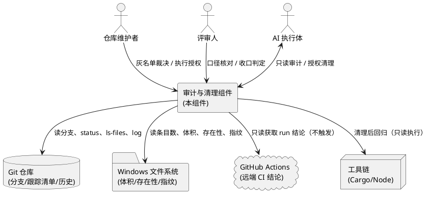
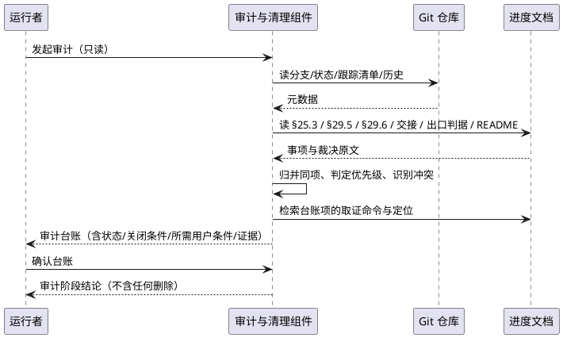
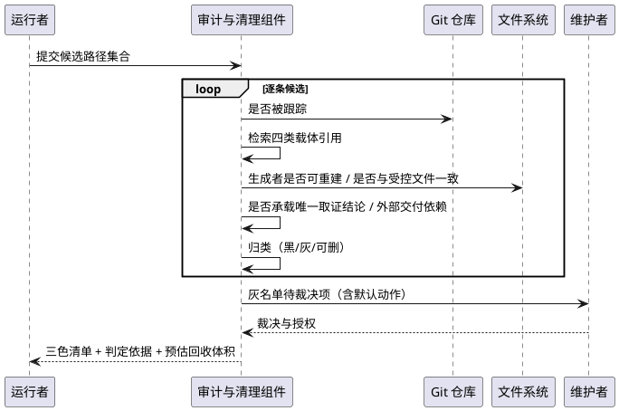
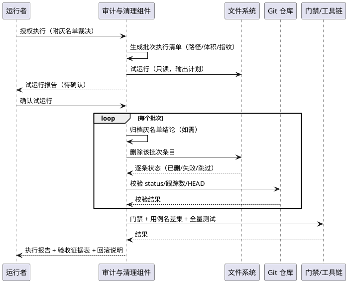
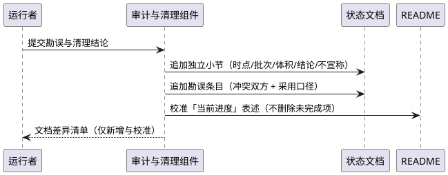

# **1. 组件定位**

## **1.1 核心职责**

本组件负责审计仓库未完成事项并安全清理可再生的多余文件，实现"进度口径可核验、工作区无残留"。

## **1.2 核心输入**

1. 进度状态文档：`docs/progress/b4-status.md`（§25.3 未完成项、§29.5 未关闭项、§29.6 用户裁决）、`docs/progress/handoff-2026-11-22-pui.md`（未关闭项原样保留清单）、`docs/progress/ci-readiness.md`。
2. 规格与任务文档：`.codeartsdoer/specs/ui_integration/{spec.md,design.md,tasks.md}`（其中 tasks.md §19 为本阶段出口判据）、`docs/sdd/{spec.md,design.md,tasks.md}`。
3. 工程口径文档：`README.md`「当前进度」与「文档索引」两节。
4. Git 元数据（只读）：当前分支、工作区洁净度、已跟踪文件清单、提交历史、与 `origin/main` 的领先/落后计数。
5. 文件树与体积统计（只读）：候选清理目录的条目数、单目录体积、是否存在同名受控文件（如 `deny.toml`）。
6. 仓库内引用检索结果（只读）：脚本、CI 工作流、README、门禁对候选路径/文件名的引用命中。
7. 用户裁决：灰名单条目的删留决定、是否解除 `.codeartsdoer/` 忽略、是否执行清理批次。

## **1.3 核心输出**

1. 审计台账：逐条未完成事项的编号、来源、当前状态、关闭条件、所需用户条件、可复现取证命令。
2. 清理三色清单：黑名单（禁删）、灰名单（需裁决）、可删清单，逐条附录用判定结果与处置动作。
3. 清理执行报告：按批次组织的 manifest，含每条被删路径、删除前体积、内容指纹、所属批次与回滚方式。
4. 验收证据表：每条验收判据对应的命令、退出码与关键输出行（含清理前后的数量/体积对比）。
5. 文档口径勘误登记：发现的文档冲突（如"未裁决"与"已裁决"并存）及其补正落点。
6. 不宣称清单：明确"清理不等于功能完成"，列出不得宣称的状态。

## **1.4 职责边界**

1. 本组件**不修改**任何源码、`Cargo.toml`/`Cargo.lock`、`deny.toml`、`.github/workflows/ci.yml`、`scripts/**`、`app/src/**`。
2. 本组件**不删除**受版本控制跟踪的文件；受控文件的移除只能由独立变更单承担。
3. 本组件**不删除**取证产物与基线文件（定义见 §2 与 §5.2.3）。
4. 本组件**不解锁**任何 `#[ignore]` 用例、**不创建** `tests/replay/`、**不改写** 9/9 ignored 口径。
5. 本组件**不执行** `git push`、不新建远端分支、不修改远端状态；远端 CI 结论只允许只读读取。
6. 本组件**不评估**未完成项的产品价值与排期优先级，只登记状态与关闭条件。
7. 本组件**不清理** `models/`（运行必需的外部资产）、`.git/`、Cargo 注册表缓存，以及仓库外的用户个人目录。
8. 本组件**不做**与本任务无关的重构、重排编号、批量格式化。

# **2. 领域术语**

**未完成事项**
: 在产品或工程口径中尚未达到关闭条件、且当前不处于 `closed` / `passed` / `not-applicable` 状态的工作项。

**取证产物**
: 由验证过程生成、原本用于支撑验收结论的证据文件，其价值不在于文件本身而在于其所承载的结论记录。
: 备注：本仓库内典型代表为 `.tmp/ui-integration/ac-board.md` 与 `crates/infrastructure/.tmp/llm-live/**`。

**基线文件**
: 被仓库内脚本、CI 工作流或门禁读取，删除后会导致门禁或取证失败的受控文件。
: 备注：`docs/progress/test-names-before.txt` 与 `docs/sdd/*.md` 属于此类。

**可再生产物**
: 具备明确生成者（脚本、测试、构建工具），删除后可由同一生成者按既有命令重新产生，且不含唯一信息的文件或目录。

**灰名单**
: 同时具备"可再生产物"特征与"取证/回滚价值"特征，必须经用户裁决后才能处置的条目。

**禁删清单**
: 满足任一禁删情形（受版本控制跟踪、被仓库内引用、承载唯一取证结论、属运行必需资产）的路径集合。

**口径漂移**
: 同一事实在多份文档中表述不一致，且未标注时点或裁决来源的现象。

**审计台账**
: 未完成事项的结构化记录表，是本组件唯一的进度事实输出。

**执行清单**
: 清理动作执行前生成、执行中逐条核销、执行后作为回滚依据的路径级记录。

# **3. 角色与边界**

## **3.1 核心角色**

仓库维护者：对灰名单作出删留裁决，授权执行清理批次，决定是否解除 `.codeartsdoer/` 忽略。
评审人：核对审计台账与文档口径的一致性，确认验收证据可复现，判定本任务是否收口。
运行者：在本地按批次执行清理并记录证据，负责中断与回滚。
AI 执行体：在授权范围内执行只读审计与已授权的清理动作，不得自行扩大范围。

## **3.2 外部系统**

Git 仓库：提供分支、跟踪文件清单、提交历史与工作区状态，是"受控/未受控"判定的唯一事实源。
Windows 文件系统：提供目录体积、条目数、文件存在性与内容指纹，是"可删/已删"判定的唯一事实源。
GitHub Actions：远端 CI 结论的只读来源，用于 AC-B4-109 类远端取证。
构建与运行时工具链：Cargo、Node/npm 与 Rust 工具链，仅用于清理后的可重建性回归，不参与判定。

## **3.3 交互上下文**

# **4. DFX约束**

## **4.1 性能**

1. 只读审计阶段对单个候选目录的统计必须在 30 秒内完成；对超过 1 GB 的目录必须改用"条目计数 + 抽样体积"的估算口径，禁止对全目录逐文件遍历求和。
2. 清理阶段必须按目录粒度执行，单批次删除的目录数不得超过 5 个，避免长时间不可中断操作。
3. 审计与清理的只读/删除命令必须可重复执行，单次全流程（不含清理后重建）不得超过 10 分钟。

## **4.2 可靠性**

1. 任何删除动作执行前必须已生成该批次的执行清单，且清单中每条路径的存在性已记录；无清单不得删除。
2. 清理流程必须支持逐批中断：中断后已删除批次不得重复计入，未执行批次不得被隐式跳过。
3. 清理后 `git status --porcelain` 必须为空，且已跟踪文件数、HEAD 提交不得发生变化。
4. 审计台账必须可增量更新：重复执行审计不得产生重复编号，也不得丢失已登记条目。

## **4.3 安全性**

1. 审计与清理全过程禁止读取、打印、复制任何凭据内容；遇到疑似密钥的文件内容，只允许记录路径与字节数，禁止记录内容片段。
2. 清理前必须对候选目录执行一次敏感内容扫描并记录命中数；对承载真实联调记录的目录，命中结果必须写入执行记录。
3. 禁止删除包含用户凭据、真实调用记录、真实会议内容转录的目录，除非该目录已被判定为"取证结论已另行归档"且用户明确授权。
4. 所有删除动作只允许作用于会话工作区内的路径，越界路径（仓库外、系统目录、用户主目录）必须拒绝并在报告中标注。

## **4.4 可维护性**

1. 审计台账与三色清单必须以"每行一条路径/一条事项"的表格形式落到文档，且每行的判定依据可被独立复核。
2. 每条验收判据必须附一条可直接执行的只读校验命令，禁止使用需要人工目视的模糊判据。
3. 清理结论必须登记到 `docs/progress` 的既有状态文档中，并注明时点、批次范围与不宣称清单。

## **4.5 兼容性**

1. 所有命令必须同时满足 Git Bash 与 PowerShell 可执行；路径分隔符与引号处理必须显式说明。
2. 清理不得破坏任何被 CI 或脚本引用的相对路径约定。
3. 清理不得改变 `.gitignore` 语义；若需调整忽略项（如解除 `.codeartsdoer/`），必须作为独立裁决项登记，不与清理批次合并。

# **5. 核心能力**

## **5.1 未完成事项审计**

### **5.1.1 业务规则**

1. **单一事实源规则**：每条未完成事项必须标注唯一来源文档与章节，来源优先级为"用户裁决记录 > 批次状态文档 > 交接说明 > README"。
   a. 验收条件：同一事项在多份文档冲突时 → 台账取最高优先级来源，并在"冲突"列标注被覆盖的表述。
2. **状态三态规则**：每条事项状态必须取自 `open` / `未完成` / `未判定` / `已裁决保留` / `closed` / `passed` / `not-applicable` 的封闭集合，禁止使用"基本完成""大致可用"等模糊表述。
   a. 验收条件：台账出现集合外状态词 → 审计判为不合格并退回。
3. **禁止伪造关闭规则**：无取证证据时，禁止将任何事项标为 `closed` / `passed`。
   a. 验收条件：`U-05`、`U-07`、`U-08` 三项在无新证据时被标为 `closed` → 该条审计结论作废并回滚该行。
4. **关闭条件必填规则**：每条事项必须写明"关闭所需证据"与"所需用户条件"两类信息，缺一即视为未登记完整。
   a. 验收条件：台账某行缺少"所需用户条件" → 审计未通过。
5. **取证命令可复现规则**：每条 `passed` / `未完成` 事项必须附一条本地可执行的取证命令或文档定位（文档名 + 章节标题）。
   a. 验收条件：任一行缺取证命令与文档定位 → 审计未通过。
6. **编号连续规则**：审计台账使用独立编号前缀（`AUD-`），与产品验收编号（`AC-B4-`）平行存在、互不覆盖。
   a. 验收条件：审计台账编号与 `AC-B4-` 混编、或改动 `AC-B4` 既有编号 → 审计未通过。
7. **AC 汇总不变规则**：本任务不得改变 `AC-B4` 汇总计数（130）与新增测试目标计数（`NEW_TARGETS`=25）。
   a. 验收条件：清理后 `AC-B4` 汇总 ≠ 130 或 `NEW_TARGETS` ≠ 25 → 本任务判为未通过。
8. **纪律项原样保留规则**：`#[ignore]` 用例数量与名称、`tests/replay/` 不存在状态必须原样保留并在台账中单独登记为"纪律项"。
   a. 验收条件：清理或审计过程删除/改写任何 `#[ignore]` 标注，或创建 `tests/replay/` → 立即判定为越界，回滚对应批次。
9. **平台占位如实登记规则**：`platform-win` 的 WASAPI/UIA/OCR 与 `platform-mac` 的整体占位状态必须登记为未完成事项，不得因"接口已存在"而记为可用。
   a. 验收条件：台账未包含平台占位项，或将其记为 `passed` → 审计未通过。
10. **口径漂移登记规则**：发现的文档冲突必须作为独立条目登记，不得在审计过程中直接改写被引用文档的既有结论。
    a. 验收条件：审计报告只登记不修改 → 通过；直接改写历史状态章节 → 未通过。

### **5.1.2 交互流程**

### **5.1.3 异常场景**

1. **来源文档互相冲突**
   a. 触发条件：同一事项在两个章节分别记为"未裁决"与"已裁决"。
   b. 系统行为：按优先级取裁决记录为准，冲突双方原文均写入台账"冲突"列，不删除任一原文。
   c. 用户感知：台账"状态"列显示最终口径，并附冲突出处，退出码为成功（审计本身成功）。
2. **来源文档缺失或不可读**
   a. 触发条件：台账某条引用的文档路径不存在或章节标题不匹配。
   b. 系统行为：该条状态降级为"未判定（来源缺失）"，并记录访问错误原因类别。
   c. 用户感知：审计结论标注"部分未取证"，并要求补齐文档，禁止静默跳过。
3. **远端 CI 结论不可得**
   a. 触发条件：无网络、无读取权限或流水线结论已过期。
   b. 系统行为：`AC-B4-109` 类事项保持"本地 passed / 远端未取证"，不推断为绿。
   c. 用户感知：台账给出"未取证"标记与所需条件（远端读取权限或用户提供结论截图）。
4. **事项集合与历史编号不一致**
   a. 触发条件：台账条目数与既有文档登记数不匹配（漏项或重复）。
   b. 系统行为：输出差集（缺失项、重复项），阻止进入清理阶段。
   c. 用户感知：审计判为未通过，列出需补齐的事项编号。
5. **审计过程中发现疑似凭据**
   a. 触发条件：候选目录内存在疑似凭据或真实调用记录。
   b. 系统行为：只记录路径、字节数与文件类型，不读取内容、不复制，转入灰名单。
   c. 用户感知：台账与清单标注"需裁决（含敏感内容风险）"。

## **5.2 多余文件判定与三色清单**

### **5.2.1 业务规则**

1. **五条判定准则（全满足才可删）**：一条路径必须同时满足以下五条才可进入可删清单。
   a. 未受版本控制跟踪；
   b. 未被仓库内任何文件引用（脚本、CI、README、门禁、文档命令块）；
   c. 具备明确生成者且可由既有命令重建（或与受控文件内容完全一致）；
   d. 不含唯一取证结论；
   e. 不被外部交付链依赖（文档链接、CI 输入、门禁输入）。
   b. 验收条件：任一条不满足的路径出现在可删清单 → 判定清单不合格。
2. **引用检索必须覆盖四类载体**：代码、脚本与 CI、文档（含 README 与状态文档中的命令块）、规格与任务文档。
   a. 验收条件：清单中某路径在四类载体任一命中且未说明处置 → 该条不得标记为可删。
3. **黑名单规则**：以下路径必须在清单中标记为禁删，且清理后逐条校验存在。
   a. 验收条件：任一条禁删路径在执行报告中被标记为已删除 → 立即判为越界并回滚。
4. **灰名单规则**：同时具备"可再生产物"与"取证/回滚价值"的路径必须进入灰名单，默认动作为"保留"，删除需用户显式裁决并附前置归档动作。
   a. 验收条件：灰名单条目在无裁决记录的情况下被删除 → 判为越界。
5. **目录级处置规则**：处置粒度以目录为单位（如 `.tmp/`、`target/`）；禁止在未逐条核销的情况下对多目录一次性批量删除。
   a. 验收条件：单个删除动作的清单中缺少逐条路径记录 → 判为流程不合规。
6. **不可删的业务资产规则**：`models/` 下运行必需资产、`.git/`、构建缓存之外的依赖缓存（Cargo 注册表 / npm 缓存）禁止删除。
   a. 验收条件：报告中出现上述路径被删 → 判为越界。
7. **忽略项变更隔离规则**：调整 `.gitignore`（如解除 `.codeartsdoer/` 忽略）必须作为独立裁决项，禁止与清理批次混同执行。
   a. 验收条件：清理批次的执行清单中出现 `.gitignore` 修改 → 判为流程不合规。
8. **取证产物归档优先规则**：灰名单中的取证产物若需删除，必须先把结论（而非文件本身）登记到 `docs/progress`，再删除原件。
   a. 验收条件：取证产物被删除但结论未登记 → 判为不可逆损失，任务不得收口。

### **5.2.2 判定流程**

### **5.2.3 本任务的事实基线与名单**

> 下列名单基于 2026-11-23 只读快照；执行前必须重新取证，路径存在性与体积以执行时为准。

**禁删清单（黑名单）**

| 路径 | 禁删理由 |
|---|---|
| `docs/progress/test-names-before.txt` | 365 行用例名基线；被 `scripts/test-name-inventory.sh`（默认参数与 `--diff`）与 `.github/workflows/ci.yml`（`test -s` 与 `--diff`）引用 |
| `docs/progress/b*-status.md`、`handoff-*.md`、`ci-readiness.md` | 进度与裁决事实源，审计台账的唯一来源 |
| `docs/sdd/spec.md`、`design.md`、`tasks.md`、`tasks-b2-offline-closure.md` | 已跟踪的正式规格；被 README 文档索引与 `scripts/check-mac-scope.sh` 引用 |
| `scripts/**`、`.github/workflows/ci.yml`、`deny.toml`、`Cargo.toml`、`Cargo.lock` | 门禁与依赖基线，均受版本控制 |
| `crates/**`、`app/src/**`、`app/src-tauri/src/**` | 源码，禁止以清理名义改动 |
| `models/**` | 运行必需外部资产（被忽略但非多余） |
| `.tmp/test-temp/`（目录本身） | 被 `b2`/`b3`/`b4` 设计与任务文档约定为 `TEMP/TMP` 根，需保留目录或保证可重建 |

**灰名单（需裁决，默认保留）**

| 路径 | 体积（快照） | 性质 | 默认动作 |
|---|---|---|---|
| `.tmp/ui-integration/ac-board.md` | 25 K | AC-B4-111~130 的 20/20 取证看板，被 `ui_integration/tasks.md` §19 出口判据引用 | 保留；若删必须先归档结论 |
| `crates/infrastructure/.tmp/llm-live/**` | 128 K | 真实 LLM 联调记录（`run.json` + `samples.jsonl`），被 `scripts/scan-secrets-docs.sh` 作为泄漏扫描面 | 保留；删除需用户裁决并记录扫描命中 |
| `.tmp/rollback/*.bak`（`ci.bak`/`design.bak`/`tni.bak`） | 100 K | 历史回滚备份；回滚能力已由 git 提交承载 | 确认 git 可回滚后可删 |
| `.tmp/url-2.5.9-meta/` | 269 K | 从 crates.io 下载的 crate 源码包（许可证复核用），可重新获取 | 可删（网络可用时） |
| `TSC/target/` | 约 5.6 G | 构建缓存，可完全重建；删除后首次全量测试需重新编译 | 可删；需在清理后立即执行重建回归 |
| 外层 `TSC/.screenshots/`（含空 `.tmp`） | 0 | 会话工作区残留空目录，不在仓库内 | 可删（空目录） |
| 外层 `TSC/.codeartsdoer/temp/accept/**` | 127 K | IDE 会话临时文件，非仓库内容 | 可删（工具自动再生） |
| `.tmp/verify*.sh`、`.tmp/verify*.ps1` | 小 | 一次性验证脚本，未被引用 | 可删 |

**可删清单（第一优先，满足五条准则）**

| 路径 | 体积（快照） | 生成者 |
|---|---|---|
| `TSC/.tmp/` 下日志与门禁输出（`*.log`、`b4-*.txt`、`gate_*.txt`、`test*.txt/log`、`deny*.txt`、`names-diff*.log`、`final.txt`、`r.txt`、`t.txt`、`ws.txt`、`inv.txt`、`p0-real*.txt`、`status-push.log`、`web-build.log`、`wlv-*.log`） | 约 480 K | 门禁脚本与 cargo/npm 执行输出，重跑即再生 |
| `.tmp/deny.toml.bak` | 1 K | 与受控 `deny.toml` 字节一致（已比对相同） |
| `.tmp/rb-mod.bak`、`.tmp/rb-tni.bak`、`.tmp/g2-claims-selftest.md`、`.tmp/capture-offline-selftest.rs` | 小 | 脚本自检产物，脚本运行时重建 |
| `.tmp/test-temp/**` 内容 | 75 K | 测试临时目录内容（目录保留） |
| `app/src-tauri/.tmp/ui-store-tests/**` | 9 K | 设置存储单测夹具，测试运行时重建 |
| `crates/infrastructure/.tmp/llm-live/**` | 128 K | 仅在与灰名单裁决一并授权时删除 |

### **5.2.4 异常场景**

1. **候选路径实际受控**
   a. 触发条件：五条准则第 1 条判定后，路径仍出现在 `git ls-files` 中。
   b. 系统行为：立即移入黑名单，取消该路径所有删除计划。
   c. 用户感知：清单以"受控文件，禁止删除"标注，退出码为失败（清单不合格）。
2. **引用检索命中但生成者不可重建**
   a. 触发条件：路径被文档或脚本引用，且无重建命令。
   b. 系统行为：移入黑名单并登记为"基线依赖"。
   c. 用户感知：报告中说明引用位置，禁止删除。
3. **体积与预期严重不符**
   a. 触发条件：实测体积超过名单标注值的 3 倍或低于 10%。
   b. 系统行为：暂停该条处置，输出体积明细，要求人工确认后再进入执行阶段。
   c. 用户感知：清单标注"体积异常，待复核"。
4. **同名受控文件并存**
   a. 触发条件：候选备份文件名与仓库内受控文件同名（如 `deny.toml.bak` 与 `deny.toml`）。
   b. 系统行为：必须完成内容指纹比对后才允许处置，比对一致方可并入可删清单。
   c. 用户感知：清单"依据"列显示"内容一致"或"内容不一致（转灰名单）"。
5. **删除时文件被占用**
   a. 触发条件：目标文件被 IDE、编译器或测试进程持有。
   b. 系统行为：跳过该条并记录失败原因，其余条目继续；批次标记为"部分完成"。
   c. 用户感知：报告列出未删除路径与解除占用建议（关闭构建/IDE 后重跑该条）。

## **5.3 清理执行与验收取证**

### **5.3.1 业务规则**

1. **先清单后执行规则**：执行阶段必须先进入试运行（只输出计划、不做删除），试运行通过后才允许实删。
   a. 验收条件：试运行后随机抽检 3 条可删路径仍存在 → 通过；试运行期间任何路径消失 → 立即判为越界。
2. **批次化规则**：清理必须按"批次 1：仓库内脚本产物 → 批次 2：测试夹具 → 批次 3：灰名单已授权项 → 批次 4：构建缓存 → 批次 5：仓库外残留"顺序执行，每批次独立取证。
   a. 验收条件：批次顺序被跳过或合并 → 执行报告不合格。
3. **清单核销规则**：每批次执行后必须逐条核销"已删/失败/跳过"三态，禁止只记录数量。
   a. 验收条件：报告中某批次只有汇总数量而无逐条状态 → 判为不合格。
4. **git 完整性守护规则**：每批次执行后必须校验工作区仍干净、跟踪文件数不变、HEAD 不变。
   a. 验收条件：`git status --porcelain` 非空，或跟踪文件数偏离基线（281），或 HEAD 变化 → 回滚该批次。
5. **基线文件完好规则**：清理后 `docs/progress/test-names-before.txt` 的行数（365）与内容指纹必须与清理前一致。
   a. 验收条件：行数或指纹不一致 → 判为不可逆损失，任务不得收口。
6. **门禁回归规则**：清理后必须执行既有门禁与用例名差集校验，任一失败即判为未通过。
   a. 验收条件：`check-b4-gates.sh`、`check-ui-integration.sh`、`test-name-inventory.sh --diff` 任一非零，或差集 `removed` 非零 → 未通过。
7. **重建回归规则**：删除构建缓存后必须执行一次全量测试，结果必须与基线一致（825 passed / 0 failed / 9 ignored）。
   a. 验收条件：用例数或失败数偏离基线 → 未通过，先排查是否误删构建输入。
8. **不可逆说明规则**：未受版本控制的路径一旦删除无法由 git 恢复，因此灰名单与取证产物必须先归档结论或复制备份后再删。
   a. 验收条件：任一无跟踪路径被删除且无归档/备份记录 → 判为流程不合规。
9. **不宣称规则**：清理报告与 README 不得因"文件已清理""门禁全绿"而宣称任何产品能力已完成。
   a. 验收条件：交付文档出现"U-05/U-07/U-08 已完成/已交付"或"真机/真实联网已通过" → 判为不合格。
10. **文档登记规则**：清理完成后必须在 `docs/progress/b4-status.md` 追加独立小节，登记时点、批次、回收体积、验收结论、未完成项状态与不宣称清单。
    a. 验收条件：状态文档缺少该小节，或未列批次与体积 → 未通过。

### **5.3.2 执行流程**

### **5.3.3 异常场景**

1. **批次删除后 git 状态异常**
   a. 触发条件：删除后 `git status --porcelain` 非空，或跟踪文件数变化。
   b. 系统行为：停止后续批次，保留当前批次清单，按清单定位误删的受控路径并用 git 恢复。
   c. 用户感知：报告标注"批次 N 中断（git 完整性失败）"，并要求人工复核后重跑。
2. **门禁回归失败**
   a. 触发条件：门禁脚本非零退出或差集 `removed` 非零。
   b. 系统行为：冻结清理流程，输出失败规则与命中行；若由误删基线文件引起，先恢复文件再复跑。
   c. 用户感知：任务判为未通过，给出具体失败命令与恢复动作。
3. **重建回归与基线不一致**
   a. 触发条件：`cargo test --workspace` 结果偏离 825/0/9。
   b. 系统行为：区分"构建输入缺失"与"真实用例失败"，前者恢复对应缓存目录，后者按既有偏差流程登记。
   c. 用户感知：报告给出失败用例清单与初步归因，禁止直接改写基线计数。
4. **体积回收与预估偏差过大**
   a. 触发条件：实际回收体积低于预估的 50%。
   b. 系统行为：复核是否有条目被文件锁跳过，或存在隐藏子目录。
   c. 用户感知：报告列出未回收条目与原因。
5. **用户中途撤回授权**
   a. 触发条件：执行期间维护者撤回后续批次授权。
   b. 系统行为：立即停止后续批次，已完成批次保持并记录。
   c. 用户感知：报告标记"部分完成（用户中止）"，回滚说明仅覆盖已完成批次。
6. **归档结论写入失败**
   a. 触发条件：取证产物结论无法写入 `docs/progress`（权限/磁盘）。
   b. 系统行为：禁止删除该取证产物，转为"保留"。
   c. 用户感知：清单标注"归档失败，原件保留"。

### **5.3.4 风险与回滚**

1. **误删基线文件（高风险）**：由 git 恢复，验证手段为跟踪文件数与内容指纹双重校验；恢复后必须重跑门禁与差集。
2. **误删取证产物（不可逆）**：取证产物不受版本控制，删除后不可恢复；因此必须先归档结论，且灰名单默认保留。
3. **构建缓存删除导致重建失败（中风险）**：若依赖缓存不可用，需重新拉取依赖；回滚方式为重新构建，不涉及文件恢复；执行前需记录工具链版本与 `Cargo.lock` 指纹。
4. **真实联调记录被删除（中风险）**：可能丢失 U-08 类事项的取证线索；处置前必须完成敏感内容扫描并记录命中，结论另存后方可删。
5. **清理期间并发写入（中风险）**：IDE 索引、后台构建可能重建 `.tmp` 子目录造成"删了又出现"；要求执行前关闭构建与索引，执行后以"条目数稳定"作为判定。
6. **Windows 路径与权限差异（低风险）**：长路径、只读属性、文件锁可能导致删除失败；回滚方式为逐条重试，不扩大删除范围。
7. **口径被误读为"能力完成"（低风险）**：以"不宣称清单"与台账状态列双重约束，交付前逐条核对关键词。
8. **回滚边界说明**：可回滚对象为受控文件（git）与已归档结论；不可回滚对象为未跟踪且未备份的路径。任何批次执行前必须声明该批次中"不可回滚条目"数量。

## **5.4 文档口径同步与勘误**

### **5.4.1 业务规则**

1. **只登记不改写规则**：审计发现的文档冲突只允许新增勘误条目，禁止直接改写历史章节结论。
   a. 验收条件：历史章节被静默改写 → 判为超出范围并回滚。
2. **勘误必须指名规则**：每条勘误必须给出冲突双方的文件名与章节标题，以及最终采用口径与依据。
   a. 验收条件：勘误条目缺少双方出处 → 不合格。
3. **README 口径规则**：清理完成后 README「当前进度」必须与台账状态一致，且保留"未完成"段落与平台占位表述。
   a. 验收条件：README 删除了未完成项表述，或新增能力完成宣称 → 不合格。
4. **交接可续规则**：清理完成后必须留下可被新会话直接使用的交接信息（当前 HEAD、跟踪文件数、保留目录约定、未完成项入口路径）。
   a. 验收条件：交接段落缺失上述任一要素 → 不合格。

### **5.4.2 交互流程**

### **5.4.3 异常场景**

1. **勘误与用户裁决冲突**
   a. 触发条件：拟采用口径与用户最近一次裁决相反。
   b. 系统行为：以用户裁决为准，勘误条目改为"记录历史冲突，保留裁决口径"。
   c. 用户感知：文档中同时可见冲突原文与最终口径标记。
2. **README 校准导致链接失效**
   a. 触发条件：校准过程中删改了章节或路径，导致相对链接不可达。
   b. 系统行为：禁止删除章节，只允许追加或替换表述；失效链接必须回退修改。
   c. 用户感知：校验结果列出失效链接，要求修复后重跑。
3. **新增小节编号冲突**
   a. 触发条件：状态文档已有同名章节编号（如重复 `§30`）。
   b. 系统行为：追加时校验编号唯一性，冲突则顺延编号并记录。
   c. 用户感知：报告标注实际落地编号。

# **6. 数据约束**

## **6.1 审计条目（审计台账行）**

1. **编号**：必须形如 `AUD-NN`，两位序号、连续、不复用。
2. **事项名**：必须使用文档中既有名称（如 `U-05`、`U-07-42`、`AC-B4-109`），不得改写既有编号。
3. **来源**：必须是"文件路径 + 章节标题"的组合，至少一个来源。
4. **状态**：必须取自 §5.1.1 第 2 条定义的封闭集合。
5. **关闭条件**：必须写明所需证据类型（用例名/命令/远端结论/真机验收），禁止留空。
6. **所需用户条件**：必须明确列出用户需提供的输入（凭据、设备、样本、授权），无则填"无"。
7. **取证命令**：必须是本地可执行命令或文档定位；命令不得修改仓库状态。
8. **冲突列**：当同一事项存在多份文档口径时必填，需列出被覆盖出处；无冲突填"无"。

## **6.2 清理条目（三色清单行）**

1. **路径**：必须以仓库根为基准的相对路径或明确标注"仓库外"的绝对路径。
2. **类型**：必须取值为"文件"或"目录"，目录需注明"含 N 个文件"。
3. **体积**：必须给出字节或 KB/MB 量级；超过 1 GB 允许使用目录级估算值并标注"估算"。
4. **跟踪状态**：必须是"已跟踪"或"未跟踪"，取值只能来自 git 事实源。
5. **引用命中**：必须列出命中的载体类别（代码/脚本与CI/文档/规格），无命中填"无"。
6. **可重建性**：必须是"可重建（附生成命令或生成者）"或"不可重建"或"与受控文件内容一致"。
7. **归类**：必须取值为"黑名单""灰名单""可删"，并附对应理由编号（§5.2.1 准则序号）。
8. **处置动作**：必须取值为"保留""待裁决""归档后删除""直接删除"，灰名单不允许填"直接删除"。

## **6.3 批次执行记录**

1. **批次号**：必须为 1~5 的整数，且与 §5.3.1 第 2 条顺序一致。
2. **条目状态**：每条只能是"已删""失败""跳过"三态之一，且失败与跳过必须附原因。
3. **内容指纹**：删除前必须记录每条被删路径的指纹（目录可用条目数 + 总字节数替代）。
4. **不可回滚条目数**：必须是整数，且与该批次中未跟踪且未备份的条目数相等。
5. **前后对比**：每批次必须给出"删除前条目数/体积"与"删除后条目数/体积"。
6. **验收结论**：必须为"通过""未通过""部分完成"，并附未通过项编号。
7. **时点**：必须记录执行日期（YYYY-MM-DD）与基线提交短哈希。