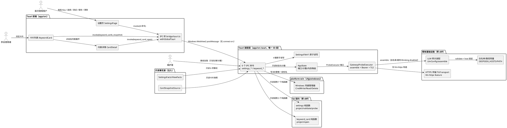
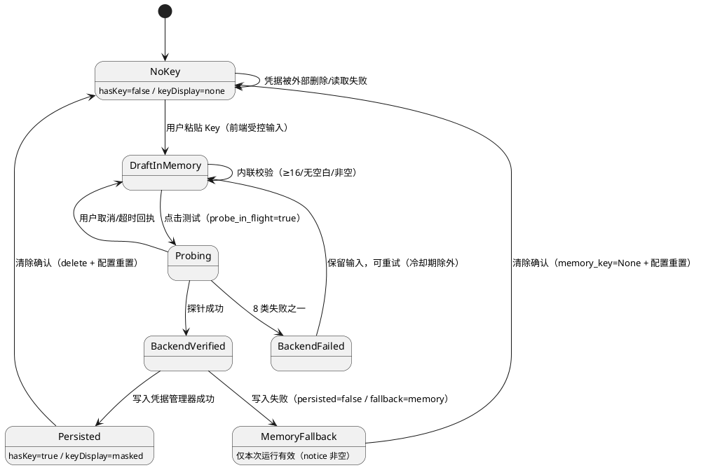
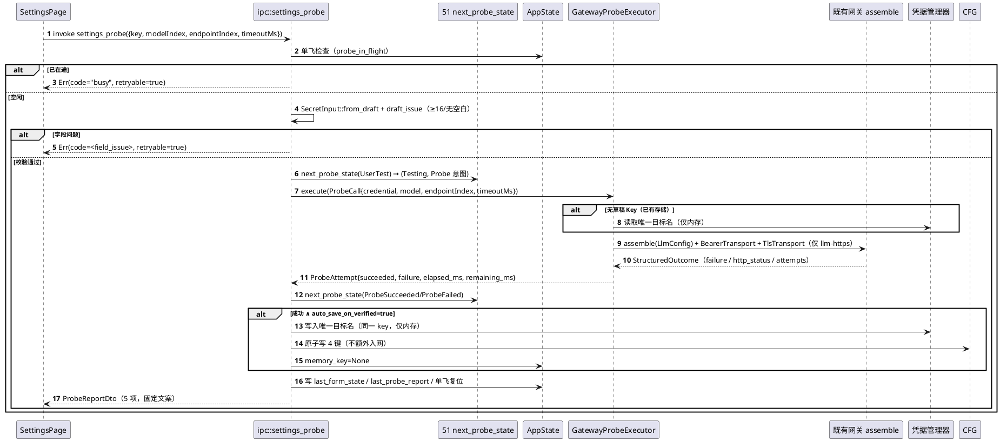
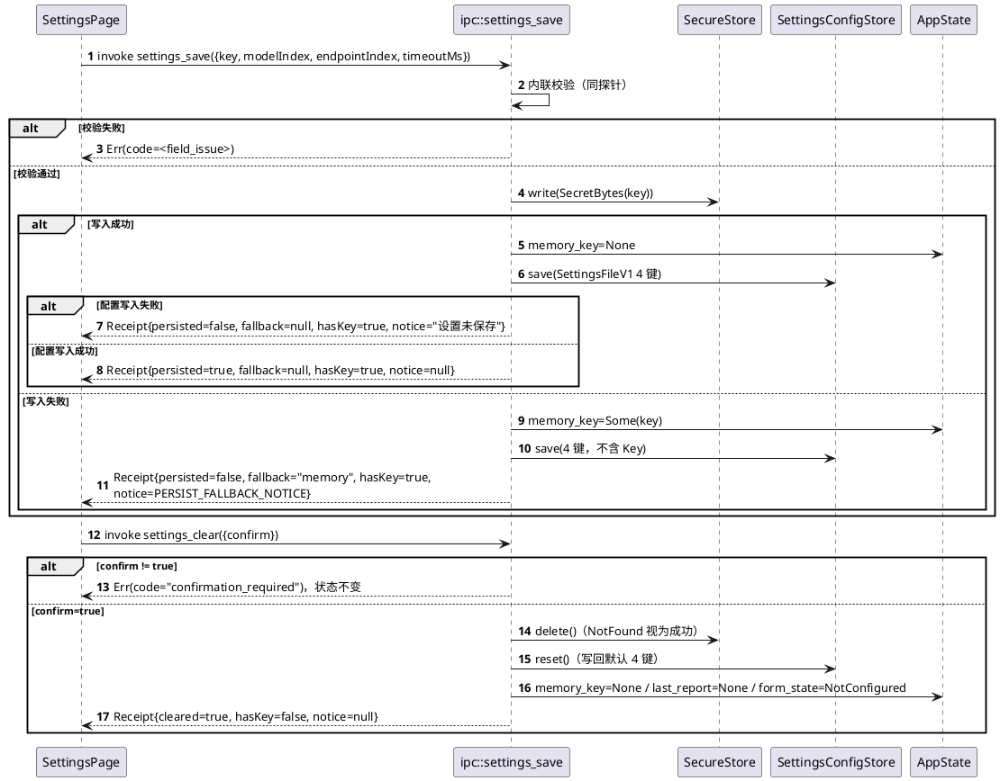
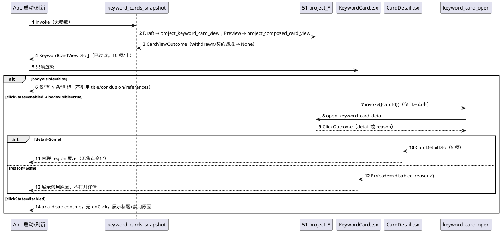
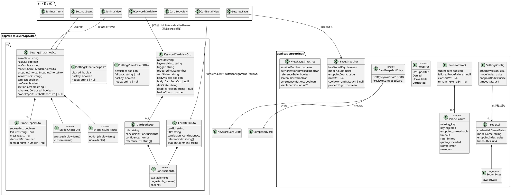

# 一、需求与存量功能关系分析

> **文档性质**：本文件是 `ui_integration/spec.md`（AC-B4-111~130）的实现方案设计（HOW），只定义架构、接口、类型、字段、文件落位、验收命令与决策，不写代码、不生成 tasks。
> **基线实况**（HEAD：`crates/ui-bridge/src/settings/**`、`crates/ui-bridge/src/keyword_card/**` 已实现；`crates/platform-win/src/lib.rs` 仅 7 行空壳；`app/src-tauri/src/main.rs` 仅 `ipc_version`；`app/src` 仍为静态演示页）：
> - 51 设置向导 18 项类型 / 7 个纯函数 / 3 常量已落盘（`crates/ui-bridge/src/settings/**`），`llm_settings_view` 18 例全绿；
> - 51 点击视图 8 项类型 / 3 个纯函数已落盘（`crates/ui-bridge/src/keyword_card/**`），`keyword_card_view` 19 例全绿；
> - `NEW_TARGETS`=25（含 `keyword_card_view`、`llm_settings_view`、`gate_replay_driver`）；
> - `app/src-tauri` 无 `ipc/` 目录、无状态管理、无 6 命令；`app/src` 无设置页、无卡片组件、无 IPC 调用；
> - `crates/application` 无 `settings/` 端口；`crates/platform-win` 无 `secure_store`。
> **本轮校准（2026-11-23）**：以 `spec.md` 新增 §6.7（`ClickState` 载荷拆分）、§6.8（端口纯数据与只读事实源）、§7.7（需求类型 / AC-B4-119 的 E1~E5 分项 / C1~C7 前置）为最高依据复审本设计。三处口径回调：
> 1. `windows-sys` 版本由旧稿 `0.59` 回调为 **实况 `0.45.0`**（`Cargo.lock` 已锁、jni 闭包；不升级 0.59/0.61、不引入第二版本），登记 **X-UI-11**，不改 D-B4 编号；
> 2. `ProbeAttempt` 回执字段对齐 spec §6.8-4（`remainingMs`，取代旧稿 `cooldownUntilMs`），登记 **X-UI-13**；
> 3. `tasks.md` 任务编号（W-UI-01~18）与既有 AC 编号（AC-B4-01~130）一律不重排，本文件只做设计侧落地。
> **本设计的三条硬边界**：① 不改 51 任何既有类型/函数/字段（`ui-bridge/src/{settings,keyword_card}/**` 零 diff）；② 不改 `gate`/`cards`/`domain`/`infrastructure/src/llm/**`；③ 不改既有 110 条 AC 与 13 项封闭面。

## 1.1 需求功能与存量功能对比

### 1.1.1 已实现功能

> 匹配度判定口径：100% = 语义与字段完全一致、可直接复用；75% = 语义一致但需要投影/包装；50% = 具备部分字段或能力；25% = 仅有骨架或范式可借鉴。

| 需求功能 | 存量功能 | 代码位置 | 匹配度 |
|---|---|---|---|
| 设置视图 8 项投影（`formState`/`hasKey`/`keyDisplay`/`modelChoice`/`endpointChoice`/`inlineErrors`/`canTest`/`canSave`） | `SettingsView` + `project_settings_view` | `crates/ui-bridge/src/settings/view.rs:82-105`、`:186-235` | 100% |
| 一步式默认（模型 0 / 端点 0 / 超时 6 000 ms / 自动保存） | `SettingsDefaults::single_step` + `apply_defaults` | `crates/ui-bridge/src/settings/view.rs:20-42`、`:132-152` | 100% |
| Key 内联校验（非空 / ≥16 / 无内部空白；`submitted=false` 不展示） | `SecretInput::draft_issue` + `validate_settings_input` | `crates/ui-bridge/src/settings/input.rs:46-60`、`crates/ui-bridge/src/settings/view.rs:154-184` | 100% |
| 固定无载荷掩码 | `mask_api_key` + `MaskedKey`（2 态） | `crates/ui-bridge/src/settings/view.rs:44-48`、`:107-113` | 100% |
| 模型预设/自定义 2 态与注入清单解析 | `ModelDraft` + `resolve_model_name` + `ModelSelectionView` | `crates/ui-bridge/src/settings/input.rs:69-74`、`crates/ui-bridge/src/settings/view.rs:50-54`、`:115-130` | 100% |
| 端点仅白名单下标（2 态、无地址原串） | `EndpointDraft` + `EndpointSelectionView` | `crates/ui-bridge/src/settings/input.rs:76-80`、`crates/ui-bridge/src/settings/view.rs:56-60`、`:195-203` | 100% |
| 测试状态机 6 态 / 5 事件 / 单飞 / 冷却只读 | `SettingsFormState` + `ProbeEvent` + `next_probe_state` | `crates/ui-bridge/src/settings/probe.rs:6-100`、`crates/ui-bridge/src/settings/view.rs:72-80` | 100% |
| 8 类失败与 8 条固定中文文案 | `ProbeFailureKind` + `humanize_probe_failure` | `crates/ui-bridge/src/settings/probe.rs:6-16`、`:42-53` | 100% |
| 保存/清除意图（3 变体、不跨 IPC） | `SettingsIntent` + `SettingsInput::{persist_intent,clear_intent}` | `crates/ui-bridge/src/settings/input.rs:88-160` | 100% |
| 设置四段顺序常量 | `SECTION_ORDER`（4 项固定） | `crates/ui-bridge/src/settings/mod.rs:7` | 100% |
| 降级提示常量 | `PERSIST_FALLBACK_NOTICE` | `crates/ui-bridge/src/settings/mod.rs:9` | 100% |
| 卡片视图 10 项投影（只降不升、屏蔽态、撤回不生成） | `project_keyword_card_view` + `KeywordCardView` | `crates/ui-bridge/src/keyword_card/view.rs:11-136`、`:235-284` | 100% |
| 11 项预览卡恒不可点 | `project_composed_card_view` | `crates/ui-bridge/src/keyword_card/view.rs:286-321` | 100% |
| 点击本地详情 5 项（0 外发/0 LLM/0 审计/0 存储） | `open_keyword_card_detail` + `ClickOutcome` | `crates/ui-bridge/src/keyword_card/view.rs:323-348` | 100% |
| 正文隐藏 / 角标（`bodyVisible=false`） | `mask_state` + `badge_count` 投影 | `crates/ui-bridge/src/keyword_card/view.rs:188-196`、`:259-281` | 100% |
| 既有网关装配入口 | `assemble` / `assemble_with_clock` | `crates/infrastructure/src/llm/mod.rs:352-373` | 100% |
| Bearer 注入（发送时构造副本、Debug 掩码） | `BearerTransport` | `crates/infrastructure/src/llm/live/auth.rs:16-64` | 100% |
| 真实 HTTPS 传输（系统 TLS、TLS1.2、禁止无效证书） | `TlsTransport` + `TLS_POLICY` | `crates/infrastructure/src/llm/transport_tls.rs:22-194` | 100% |
| 服务地址白名单与路径常量（逐字节锁定） | `DEEPSEEK_HOSTS` / `PATH_CONSTANT` / `host_is_locked` | `crates/infrastructure/src/llm/live/policy.rs:6-14`、`:50-79` | 100% |
| 6 000 ms 超时口径 | `LlmConfig::default().request_timeout_ms` | `crates/infrastructure/src/llm/mod.rs:89` | 100% |
| 凭据包装不序列化、Debug/Display 恒 `***` | `SecretString` | `crates/infrastructure/src/llm/live/config.rs:22-47` | 100% |
| 桌面壳与 IPC 注册范式 | `ipc_version` + `generate_handler!` | `app/src-tauri/src/main.rs:3-22` | 75%（需扩 6 命令与状态） |
| 最小权限与无网络 CSP | `capabilities/default.json`、`tauri.conf.json` CSP | `app/src-tauri/capabilities/default.json:1-9`、`app/src-tauri/tauri.conf.json:24-28` | 100%（保持） |
| 前端 IPC 类型与绑定一致性范式 | `schema.json` + `types.ts` + `check-bindings.mjs` | `app/src/bridge/schema.json:1-13`、`app/src/bridge/types.ts:1-34`、`scripts/check-bindings.mjs:1-40` | 75%（需扩 7 DTO） |

### 1.1.2 需要扩展的功能

| 需求功能 | 存量功能 | 差异说明 | 扩展方向 |
|---|---|---|---|
| `SettingsSnapshotDto`（11 项，含分区顺序/高级折叠/探针报告） | 51 `SettingsView`（8 项，无 `sectionsOrder`/`advancedCollapsed`/`probeReport`） | 输入输出差异：DTO 需要 3 个装配层字段；51 视图恰好 8 项不得扩 | 在 `app/src-tauri/src/ipc/dto.rs` 新建 DTO，由命令层映射；51 零改 |
| `ProbeReportDto`（5 项，承载 8 类失败与冷却剩余） | `SettingsFormState::Failed` 无载荷（D-B4-P151） | 业务逻辑差异：失败类别不能塞进既有 6 态枚举 | 新增独立只读 DTO；`formState` 仍 6 值；51 零改 |
| 真实凭据存在性 / 真实配置读写 | `SettingsFacts` 6 项只接收注入；无 `SecureStore`/`SettingsConfigStore` | 边界差异：51 不读 OS、不读文件 | 在 `crates/application/src/settings/ports.rs` 定义端口；`platform-win` 与 `app/src-tauri` 实现 |
| 真实探针执行 | 51 只产 `SettingsIntent::Probe`；网关装配已存在但无探针适配器 | 输入输出差异：51 无网络符号；装配层需构造网关调用并映射回 8 类 | `ProbeExecutor` 端口 + `app/src-tauri/src/ipc/probe.rs` 生产适配器；`infrastructure/src/llm/**` 零改 |
| 6 个 IPC 命令 | 仅 `ipc_version`（1 个） | 命令面差异：需 6 个固定命令 + 状态 | `app/src-tauri/src/ipc/mod.rs` 定义 6 个 `fn`；`main.rs` 注册 + `manage(AppState)` |
| 前端 DTO 驱动设置页 | `App.tsx` 静态演示（`SEED_CARDS`、`CHANNELS`） | 渲染差异：需受控表单、分区顺序、后端布尔驱动 | 新建 `app/src/settings/SettingsPage.tsx`，`App.tsx` 接线 |
| 前端卡片渲染与内联详情 | 无卡片组件；静态 `<li>` | 渲染差异：需 `aria-disabled`、条件 `onClick`、隐藏态角标、非模态详情 | 新建 `app/src/cards/{KeywordCard,CardDetail}.tsx` |
| 语言桥接（零 npm 依赖） | `types.ts` 只有 4 个旧 DTO + `IpcInvoker` 接口 | 绑定差异：需 `withGlobalTauri` 全局类型与 6 命令白名单 | 新写 `window.__TAURI__` 类型 + `invokeCommand`；不改 `@tauri-apps/api`（C-UI-01） |
| 静态门禁覆盖新面 | `check-b4-gates.sh` 7 规则覆盖 gate/citation/cards/51 | 扫描面差异：`platform-win/secure_store`、`application/settings`、`app/src-tauri/src/ipc` 未覆盖 | 扩扫描面与模式分层，规则仍 7 条；新增 `check-ui-integration.sh` 六规则 |
| 平台实现落位 | `platform-win/src/lib.rs` 仅 `PLATFORM_NAME` | 能力差异：无凭据管理器调用 | 新增 `crates/platform-win/src/secure_store.rs`，`lib.rs` +1 行 |
| 文档口径 | `b4-status.md` §28 为"规格已定、待实现" | 时点差异：实现后需补 §28.8/§29 快照 | 实现阶段追加；不重排既有章节编号 |

### 1.1.3 需要新增的功能或接口

**A. application 端口与事实源（`crates/application/src/settings/**`）**

1. `SecureStore`：写入/读取/删除凭据条目；入参为纯字节包装类型，不含 `Serialize`。
2. `SettingsConfigStore`：读取/保存/重置恰 4 键配置；不含凭据与地址。
3. `ProbeExecutor`：执行一次探针调用；入参为内存凭据、模型名、端点下标、超时；出参为成功耗时或 8 类失败之一。
4. `SettingsFactsSource`：产出 6 项只读事实（含 `has_stored_key`/`now_ms`/冷却镜像/在途标记）。
5. `CardSnapshotSource`：产出只读卡片条目（13 字段草案或 11 项预览）。
6. `ViewFactsSource`：产出 6 项只读视图事实（会话一致/授权撤销/引用过期/投屏/遮蔽/可见条数）。
7. 纯数据类型：`SettingsFileV1`（恰 4 键）、`ProbeCall`、`ProbeAttempt`、`ProbeFailure`（8 态）、`SecretBytes`（无载荷展示）、`ViewFactsSnapshot`（6 项）、`CardSnapshotEntry`（2 态）。

**B. Windows 平台凭据实现（`crates/platform-win/src/secure_store.rs`）**

1. `WindowsCredentialStore`：`cfg(windows)` 下实现 `SecureStore`，调用凭据管理器写入/读取/删除。
2. 固定目标名常量（全仓唯一）：通用凭据、本机持久。
3. `cfg(not(windows))` 同名实现返回 `Unsupported`，保证 workspace 交叉编译，不宣称可用。
4. 无 `std::fs`、无 `keyring`、无 DPAPI、无自管密文文件。

**C. Tauri 装配层与 IPC（`app/src-tauri/src/**`）**

1. `AppState`：持有 6 个端口/事实源、目录清单、内存降级 Key、上一状态、上次探针报告、诊断计数、单飞标记。
2. 6 个固定命令（`settings_snapshot`/`settings_probe`/`settings_save`/`settings_clear`/`keyword_cards_snapshot`/`keyword_card_open`）与薄注册。
3. 只读 DTO 6 组：`SettingsSnapshotDto`（11）、`ProbeReportDto`（5）、`SettingsSaveReceiptDto`（4）、`SettingsClearReceiptDto`（3）、`KeywordCardViewDto`（10）+ `CardBodyDto`（4）、`CardDetailDto`（5）。
4. `SettingsFileV1` 的原子读写与损坏回默认（临时文件 + 同目录替换）。
5. `GatewayProbeExecutor`：仅 `llm-https` feature 下构造；复用 `assemble` + `BearerTransport` + `TlsTransport`；no-op 观察者。
6. 目录清单（模型预设/端点显示名）：不新增环境变量名、不内联模型名与 URL。
7. 诊断计数 6 项（成功/拒绝，只整数）与白名单日志 6 字段。

**D. 前端（`app/src/**`）**

1. `app/src/bridge/types.ts` 扩 7 个 DTO 接口 + `IPC_COMMANDS`（恰 6）+ `IpcErrorDto` 复用。
2. `app/src/bridge/schema.json` 扩 7 个 DTO 字段集，保持 `check-bindings.mjs` 通过。
3. `app/src/bridge/tauri.ts`：`window.__TAURI__` 手写类型 + `invokeCommand`；不引入 npm 依赖、不发网络请求。
4. `app/src/settings/SettingsPage.tsx`：四段固定顺序、高级区首屏折叠、按钮只取后端 `canTest`/`canSave`、内联错误只消费后端枚举。
5. `app/src/cards/KeywordCard.tsx` / `CardDetail.tsx`：只读 DTO；禁用卡 `aria-disabled` 不绑 `onClick`；隐藏态只留角标；内联非模态详情、不抢焦点。
6. `app/src/App.tsx`：以快照驱动替换静态 `SEED_CARDS`，接入设置页入口与卡片列表。
7. `app/src/styles.css`：卡片角标/禁用原因/设置分区样式（新增类，不改既有类语义）。

**E. 门禁与文档**

1. `scripts/check-ui-integration.sh`（新增，六规则，退出码 0/1/2）。
2. `scripts/check-b4-gates.sh` 扩扫描面（规则仍 7 条，`--rule=targets` 不追加 target）。
3. `docs/progress/b4-status.md` §28.8/§29 实现快照；`README.md` 关键词卡片/隐私与凭据/当前阶段改写（不宣称可用）。
4. `deny.toml` 许可证检查面同步（结论为零 diff，见 §2.5）。

**F. 依赖面**

1. `windows-sys` = **`0.45.0`（实况已锁，见 X-UI-11）**，只放在 `[target.'cfg(windows)'.dependencies]`，feature 仅 `Win32_Security_Credentials` + `Win32_Foundation`；**不升级 0.59/0.61、不引入第二版本**（否则会与 `Cargo.lock` 既有闭包并行，违反 `bans` 口径）。
2. `app/src-tauri` 新增 path 依赖 `application`/`platform-win`/`infrastructure`（`llm-https` 为可选 feature，默认关闭）。
3. 前端零新增 npm 依赖（C-UI-01）。`Cargo.lock` 新增包仅上述依赖闭包；`ui-bridge` 段零 diff。

## 1.2 存量功能详细分析

### 1.2.1 51 设置向导契约（`crates/ui-bridge/src/settings/**`）

**接口契约**

1. `project_settings_view(facts, input, state, presets, endpoints) -> SettingsView`：纯投影；事实归一优先级固定为 `has_key=false → NotConfigured` > `probe_in_flight → Testing` > `cooldown_until_ms>now_ms → Cooling` > 传入 `state`（`crates/ui-bridge/src/settings/view.rs:186-235`）。
2. `validate_settings_input(facts, input, presets, endpoints) -> Vec<FieldIssue>`：`submitted=false` 恒空；错误按 `FieldIssue` 声明序稳定排序去重（`view.rs:154-184`）。
3. `apply_defaults(facts, defaults) -> SettingsInput`：清单非空时给 `PresetIndex(0)`/`Index(0)`；清单为空给 `None`（`view.rs:132-152`）。
4. `next_probe_state(facts, input, state, event, presets, endpoints, defaults) -> (SettingsFormState, Option<SettingsIntent>)`：`UserTest` 且 Key 未提供 → `NotConfigured`；`UserCancel` → `ConfiguredUnverified`；`ProbeFailed` → `Failed`（无载荷）；`ClockTick` 只在冷却未过期时给 `Cooling{remaining_ms}`（`probe.rs:55-100`）。
5. `SettingsInput::{persist_intent, clear_intent}`：`clear_intent` 需 `clear_confirmed=true` 且 Key 已提供（`input.rs:145-160`）。
6. `humanize_probe_failure`：8 条固定中文文案，一对一（`probe.rs:42-53`）。

**业务规则**

1. `SettingsFormState` 恰 6 态，`Failed` **无载荷**；失败类别由装配层 `ProbeReportDto` 承载（D-B4-P151）。
2. `MaskedKey` 恰 2 态且 `Masked` 无载荷；`mask_api_key` 只按 `is_provided()` 返回。
3. `SecretInput` 无 `Serialize`/`Deserialize`/`Display`，`Debug` 恒 `***`；无长度/前后缀/明文访问器（`input.rs:5-67`）。
4. `SettingsIntent`/`SettingsInput`/`ProbeRequest` 不实现 `Serialize`/`Deserialize`，不得跨 IPC（`input.rs:88-143`）。
5. `settings/**` 无 `std::fs`/`std::env`/网络/系统时间/日志符号（门禁既有断言）。

**扩展点与约束**

1. 唯一注入点：`SettingsFacts`（6 项）+ 模型清单 + 端点清单 + `SettingsDefaults`（4 项）。装配层只能提供纯数据，不能传入平台句柄。
2. 唯一执行点：`SettingsIntent` 只作意图；51 不执行。装配层执行时不得把状态写回 51 类型（51 类型只读投影）。
3. 约束：同输入 100 次投影逐字节一致；不新增第 19 类型/第 8 函数；`settings/**` 与 `keyword_card/**` 互不依赖。

### 1.2.2 51 卡片视图契约（`crates/ui-bridge/src/keyword_card/**`）

**接口契约**

1. `project_keyword_card_view(&KeywordCardDraft, &ViewFacts) -> CardViewOutcome`：先校验撤回/契约，再排序引用、计算结论态、屏蔽态与只降不升的 `click_state`（`view.rs:235-284`）。
2. `project_composed_card_view(&ComposedCard, &ViewFacts) -> CardViewOutcome`：预览恒 `Disabled(NotAllowed)`，不改写 11 项（`view.rs:286-321`）。
3. `open_keyword_card_detail(&KeywordCardView) -> ClickOutcome`：仅 `Enabled + body=Some` 返回详情；否则返回原禁用原因或 `NotAllowed`（`view.rs:323-348`）。

**业务规则**

1. `body_visible == body.is_some()`；`body=None ⇒ click_state != Enabled`。
2. `Enabled` 仅在 8 项前置事实全真时出现；输入 `Disabled` 只能保持或降级，不得升级。
3. 投屏 → `Disabled(ScreenShareProtection)`；紧急遮蔽 → `Disabled(EmergencyMasked)`；两者隐藏正文且 `badge_count ≥1`。
4. `Withdrawn` 不生成视图（`view=None` + `CardWithdrawn`），不因刷新/重放复活。
5. `ConclusionView::Available` 仅当 `Passed` 且 `summary=Some`。

**扩展点与约束**

1. 装配层只允许调用 3 个函数与 8 个类型，不得补字段、不得把预览卡改为可点。
2. `ViewFacts`（6 项）由装配层注入；不得在 51 内读取投屏/遮蔽真实 API。
3. 约束：`keyword_card/**` 不依赖 `gate`/`cards`/domain 写路径；无平台/网络/文件/系统时间符号。

### 1.2.3 既有 LLM 网关与白名单（`crates/infrastructure/src/llm/**`）

1. **装配入口**：`assemble(config: Arc<RwLock<LlmConfig>>, transport: Arc<dyn HttpTransport>, observer: Arc<dyn LlmObserver>)` 与 `assemble_with_clock`；构造前调用 `LlmConfig::validate()`（`mod.rs:352-373`）。不读取环境变量。
2. **Bearer 注入**：`BearerTransport::new(inner, SecretString)` 在 `send`/`open_stream` 时构造带 `Authorization` 的请求副本；`Debug` 恒掩码（`live/auth.rs:16-64`）。
3. **HTTPS 传输**：`TlsTransport` 仅在 `llm-https` feature 下编译；`TLS_POLICY` 固定 TLS1.2、禁止无效证书、SNI 为 host；`host_allowed` 逐字节匹配白名单（`transport_tls.rs:22-80`）。
4. **白名单与路径**：`DEEPSEEK_HOSTS`（1 项）、`PATH_CONSTANT`（唯一路径段）；`host_is_locked` 仅允许 443、禁止 IP 字面量/尾点/`xn--`/userinfo（`live/policy.rs:6-79`）。
5. **超时与冷却参数**：`LlmConfig.request_timeout_ms` 默认 6 000；`cooling_threshold`/`cooling_ms` 为网关内部参数（`mod.rs:62-107`）。
6. **返回形态**：`StructuredLlmGateway::complete_structured` 返回 `StructuredOutcome`（含 `failure: Option<FailureClass>`、`http_status`、`attempts`），非网络错误通常不返回 `Err`。`FailureClass` 6 态：`Timeout`/`RateLimited`/`InvalidSchema`/`Unavailable`/`ContentFiltered`/`Offline`。
7. **观察者**：`LocalObserver` 会把 `LlmAuditRecord` 写入审计与日志；其摘要含模型名与端点 host，探针**不得**复用（见 §2.1.3.2）。
8. **约束**：本增量对 `infrastructure/src/llm/**` 零 diff；只消费公开常量/类型。

### 1.2.4 platform-win 空壳与能力矩阵

1. `crates/platform-win/src/lib.rs` 仅 `PLATFORM_NAME = "windows"`（7 行），无任何平台 API。
2. `crates/platform-win/Cargo.toml` 无依赖；新增 `windows-sys` 只允许放在 `[target.'cfg(windows)'.dependencies]`，版本取 **实况 `0.45.0`**（X-UI-11）；非 Windows 目标不编译该依赖。
3. `crates/platform-win/resources/capability_matrix.toml` 恰 6 条能力，与 `platform-mac` 键集合必须相等（`check-mac-scope.sh:matrix`）。**本增量不得在该文件新增第 7 条**，凭据管理器不作为 UI 能力位登记。
4. 约束：`platform-win/src` 不得出现 `target_os = "macos"`、`std::fs`、`keyring`；非 Windows 目标返回 `Unsupported`。

### 1.2.5 app 外壳、前端与权限

1. `app/src-tauri/src/main.rs` 仅 `ipc_version` + `generate_handler!` + 启动日志；无状态管理、无 `ipc/` 目录。
2. `app/src-tauri/tauri.conf.json`：CSP 为 `default-src 'self'; img-src 'self' data:; style-src 'self' 'unsafe-inline'; script-src 'self'`；**无 `connect-src`**（AC-126 要求保持 0）。未启用 `withGlobalTauri`。
3. `app/src-tauri/capabilities/default.json`：仅 `core:default`；不得新增 `fs:`/`http:`/`shell:`/`sql:`。
4. `app/src/App.tsx`：静态 `SEED_CARDS`（3 条）与 `CHANNELS`，无 IPC 调用、无设置页、无卡片组件。
5. `app/src/bridge/types.ts` 只有 4 个旧 DTO 与 `IpcInvoker`；`schema.json` 仅登记 4 个 DTO；`check-bindings.mjs` 会逐 DTO 比对字段集与 `IPC_PROTOCOL_VERSION=1`。
6. `app/package.json`：依赖仅 `react`/`react-dom`；无 `@tauri-apps/api`（C-UI-01 要求保持零新增）。
7. `app/src/main.tsx` 挂载 `App`；`app/index.html` 自带 CSP meta（与 tauri.conf 一致）。
8. 约束：`app/src` 不得出现本地存储、`console.log/debug/info`、网络 API、自动聚焦/滚动抢占；卡片正文不持久化。

### 1.2.6 脚本与门禁基线

1. `scripts/check-b4-gates.sh` 七规则（`source`/`budget`/`record`/`outbound`/`zero-transcript`/`targets`/`doc-plan`），退出码 0/1/2；`require_core_faces` 已含 `SETTINGS_APP_DIR` 与 `UI_KW_APP_DIR`；`core_files()` 已含 51 两目录；`rule_source` 的禁词含 `std::env`/`std::fs`/`Instant::now`/`SystemTime::now`/网络/全局态。
2. `scripts/test-name-inventory.sh` 的 `NEW_TARGETS`=25；inventory 只列 `lib` 与 `tests/*.rs`，**不列 bin**（app/src-tauri 为 bin，新增 `#[cfg(test)]` 不进 inventory）。
3. `scripts/check-mac-scope.sh`：`matrix` 要求 win/mac 能力矩阵键集合相等且各 6 条；`claims` 扫描宣称口径。
4. `scripts/scan-secrets.sh` 扫 `app/src`/`crates`/`scripts`，排除 `*.md`；`scan-secrets-docs.sh --all-md` 扫全部受版本控制的 `.md`。
5. `scripts/check-bindings.mjs`：schema 中的每个 DTO 必须在 `types.ts` 存在同名 interface 且字段集完全一致；`IPC_PROTOCOL_VERSION` 必须为 1。
6. `.github/workflows/ci.yml`：Windows + 两 mac target 的 `fmt`/`clippy --all-targets -- -D warnings`/`build`/`test`；`compliance` 运行 `cargo deny check licenses bans sources advisories`；`feature-coverage` 依赖 `llm-https` 编译。本增量**不改 ci.yml**（C-UI-02）。
7. `deny.toml`：licenses allow 恰 15 项；`targets` 含 Windows x64/ARM64 与两 mac；`bans.wildcards = "deny"`；`sources.unknown-* = "deny"`。

### 1.2.7 冻结面与不可破坏清单

| 面 | 取值 | 本设计动作 |
|---|---|---|
| `crates/application/src/gate/api.rs` | 4 个 `pub fn` | 零 diff |
| `GateRecord` / `GateAuditEvent` / `GateInputFixture` / `ReplayReport` | 14 / 7 / 23 / 5 | 零 diff |
| `GateCounter` / `GateRejectReason` | 32 / 23 | 零新增 |
| `ComposedCard` / `KeywordCardView` / `SettingsView` | 11 / 10 / 8 | 零新增字段 |
| `KeywordCardDraft` / `ReferenceView` / `CitationAlignment` | 13 / 5 / 3 | 零 diff |
| `SettingsFacts` / `SettingsInput` / `SettingsIntent` | 6 / 5 / 3 变体 | 零 diff |
| `crates/ui-bridge/src/{settings,keyword_card}/**` | 18/7/3 与 8/3 | 零 diff |
| `crates/ui-bridge/Cargo.toml`、`Cargo.lock` 的 ui-bridge 段 | — | 零 diff |
| `crates/application/src/{gate,cards}`、`crates/domain/src/model/**` | — | 零 diff |
| `crates/infrastructure/src/llm/**` | — | 零 diff |
| `crates/platform-mac/**`、`platform-win/resources/capability_matrix.toml` | — | 零 diff |
| `.github/workflows/ci.yml`、`deny.toml` | — | 零 diff（C-UI-02 + 许可证已覆盖） |
| 既有 AC-B4-01~110 | — | 不重排、不改语义 |
| `NEW_TARGETS` | 25 | 保持 25（不新增 cargo target） |
| 既有 7 条门禁规则与退出码 | 7 | 规则仍 7 条，仅扩扫描面/分层模式 |
# 二、增量设计方案

## 2.0 设计结论速览

> 本章只做"把需求翻译成可落地结构"，不含实现代码。所有新增决策编号承接 D-B4-P155，自 **D-B4-P156** 起。

| 编号 | 冲突 / 缺口 | 唯一裁决 | 落点 |
|---|---|---|---|
| **C-UI-D01** | spec §9.1 `D-B4-P148` 采用 `@tauri-apps/api`，与用户已接受的 **C-UI-01（零新增前端依赖、启用 `withGlobalTauri`）** 相抵 | **以 C-UI-01 为准**：`tauri.conf.json` 增 `app.withGlobalTauri=true`；前端手写 `window.__TAURI__` 类型与 `invokeCommand`；不新增 npm 依赖。登记 **D-B4-P156** 替代 D-B4-P148 的实现口径 | `app/src-tauri/tauri.conf.json`、`app/src/bridge/{types.ts,tauri.ts}`、`app/package.json` 零 diff |
| **C-UI-D02** | spec §9.1 `D-B4-P153` 正文写"五规则"，而 §4.4-4/§7.5/AC-B4-130 均为**六规则** | **以六规则为准**：`check-ui-integration.sh` 固定 6 条；D-B4-P153 的"五"为笔误，登记 **D-B4-P157** 纠正（不改 AC 文本） | `scripts/check-ui-integration.sh` |
| **C-UI-D03** | spec §5.4 要求 `SecureStore` 落在 `platform-win`，但 `platform-win` 当前无依赖、无 application 引用 | `platform-win` 增 `meeting-copilot-application`（path）与 `windows-sys`（仅 Windows target）；`lib.rs` +1 行 `pub mod secure_store;` | `crates/platform-win/{Cargo.toml,src/lib.rs,src/secure_store.rs}` |
| **C-UI-D04** | 51 的 `SecretInput` 无明文访问器，但装配层必须把 Key 交给凭据管理器/网关 | **不新增访问器**（51 零 diff）；命令层以 IPC 一次性 `key: String` 直接构造端口入参与 `SecretInput`；`SettingsIntent` 只作状态机语义，不作为取凭据的载体（**D-B4-P161**） | `app/src-tauri/src/ipc/{settings,probe}.rs` |
| **C-UI-D05** | `SettingsFormState::Failed` 无载荷（D-B4-P151），但冷却剩余与失败类别需回显 | 新增独立只读 `ProbeReportDto`（5 项）；`formState` 仍 6 值；冷却期表示固定为 `formState="cooling"` + `probeReport.failure="rate_limited"` + `remainingMs>0`（**D-B4-P162**） | `app/src-tauri/src/ipc/dto.rs` |
| **C-UI-D06** | `keyword_card_open` 需要"详情或拒绝原因"二选一，且 DTO 不得扩到 6 项 | 命令返回 `Result<CardDetailDto, IpcErrorDto>`；拒绝原因放 `IpcErrorDto.code`（6 类禁用原因 + `card_withdrawn`/`input_contract_violation`/`reference_contract_violation`/`card_not_found`），`message` 为固定中文短句，`retryable=false`（**D-B4-P163**） | `app/src-tauri/src/ipc/cards.rs` |
| **C-UI-D07** | 模型预设/端点清单从何而来（既不得内联模型名、不得新增清单来源） | 复用既有注入链：预设来自既有 `LLM_MODEL`（未设置则为空 → `canTest=false` 显示"暂不可用"）；端点 = 既有白名单第 1 项，显示名为固定标签"默认服务"（不含 host/URL）；不新增 `LLM_*` 变量名（**D-B4-P160**） | `app/src-tauri/src/ipc/catalog.rs`（或 `probe.rs` 内私有构造） |
| **C-UI-D08** | 探针若复用 `LocalObserver`，会把模型名与 host 写入审计/日志 | 探针使用 **no-op 观察者**（不写审计/指标/日志）；`ProbeAttempt` 只含布尔/耗时/8 类失败/冷却毫值（**D-B4-P159**） | `app/src-tauri/src/ipc/probe.rs` |
| **C-UI-D09** | `--rule=source` 的严格 IO 禁词（`std::fs`/`Instant::now`/`SystemTime::now`）与装配层必然使用 IO 相抵 | `--rule=source` 对 `app/src-tauri/src/ipc/**` 使用**装配层受限模式**（仍禁网络/全局态/占位 panic，允许 IO 与时钟）；对 `application/settings`、`platform-win/secure_store` 保持严格模式（**D-B4-P165**） | `scripts/check-b4-gates.sh` |
| **C-UI-D10** | 前端"用例"（AC-B4-116/122/123/125/126/127）无 TS 测试框架，`cargo test` 不能直接执行 | 这些用例名作为 `check-ui-integration.sh` 的**子断言标识**输出 PASS/FAIL；不新增 npm 测试框架、不新增 cargo target（**D-B4-P167**） | `scripts/check-ui-integration.sh` |
| **C-UI-D11** | 用户要求"同步 `deny.toml` 许可证检查面"，但 AC-B4-129 要求 `deny.toml` 零 diff | **零 diff 成立**：`windows-sys` 为 `MIT OR Apache-2.0`，命中既有 15 项 allow；`[graph].targets` 已含 Windows，许可证检查面天然覆盖。以 `cargo deny check licenses` 退 0 取证；若真实报出新许可证，另开独立变更单（**D-B4-P168**） | `deny.toml` 零 diff + 证据 |
| **C-UI-D12** | 卡片点击后的"详情"需要非模态且不抢焦点；现有前端无组件 | 新建 `KeywordCard`/`CardDetail`；详情为 `role="region"` 的内联 `section`，不使用 `dialog`/`showModal`/`autoFocus`/`focus()`/`scrollIntoView`（**D-B4-P169**） | `app/src/cards/**` |
| **C-UI-D13** | `settings.json` 的原子写与损坏回默认需可离线断言 | 路径 = Tauri `app_config_dir()/settings.json`；临时文件 `settings.json.tmp` + 同目录替换；损坏/版本不符 → 备份 `.bak`（仅 4 键）→ 回默认；越界下标回 0（**D-B4-P166**） | `app/src-tauri/src/ipc/settings_store.rs` |
| **C-UI-D14** | 旧稿写 `windows-sys = 0.59`，实况 `Cargo.lock` 已锁 **0.45.0**（jni 闭包）与 0.61.2（tauri 闭包），无 0.59 | **以实况 `0.45.0` 为准**：只复用已锁版本，不升级 0.59/0.61、不引入第二版本；feature 名不符时只调 feature、不改 API 语义；`deny.toml` 零 diff（**D-B4-P171**，登记 X-UI-11） | `crates/platform-win/Cargo.toml`、`Cargo.lock`（闭包不新增窗口版本） |
| **C-UI-D15** | 51 `KeywordCardView` 的 `click_state` 是**带载荷枚举**（`disabled{reason}`），直接 `serde` 透传会输出 `{"disabled":"..."}`，与 spec §6.7 的两扁平字段相抵 | **命令层手工拆平**：`clickState`（`enabled`/`disabled`）+ `disabledReason`（`null`/6 类）；`KeywordCardViewDto` **禁止持有 `ClickState`**、禁止 `serde` 默认标签；`citationAlignment` 只进 `CardDetailDto`，不进快照（**D-B4-P172**） | `app/src-tauri/src/ipc/{dto,cards}.rs`、`app/src/bridge/*` |
| **C-UI-D16** | spec §6.8 把"3 端口 + 3 事实源"落到业务数据约束，但旧稿只列 trait 未封闭字段 | 端口纯数据 6 类封闭（`SettingsConfig` 4 项默认 `1/0/0/6000`、`SecretBytes` 无载荷、`ProbeCall` 单次、`ProbeAttempt` 4 项、`ProbeFailure` 恰 8 态、`PortError` 恰 4 类）；事实源 6/2/6（`FactsSnapshot` 6、`CardSnapshotEntry` 2 态、`ViewFactsSnapshot` 6）；`application/settings` 0 IO/网络/时钟（**D-B4-P173**） | `crates/application/src/settings/{ports,sources}.rs` |
| **C-UI-D17** | 脚本改动若先于代码落盘，`require_core_faces()` 与六规则扫描面缺失会退 2，被误判为通过 | 实施按 **C1→C7 串行**：C1 端口+凭据、C2 DTO/状态、C3 命令实现（含载荷拆分）、C4 注册+`withGlobalTauri`、C5 前端、**C6 脚本（必须晚于 C1~C5）**、C7 文档；退 2 即放行失败（**D-B4-P174**，登记 X-UI-12） | §2.5.6 批次表 |

**设计骨架（一句话）**：51 与 domain 契约**一行不改**；`application` 只新增 6 个端口 trait（3 端口 + 3 事实源）与 6 类纯数据；`platform-win` 只新增凭据管理器三操作；`app/src-tauri` 是唯一 IO/时钟/网络装配层，暴露 6 个固定命令并在命令层**手工拆平**载荷枚举；前端只消费只读 DTO（零 npm 新增、`withGlobalTauri`、CSP/能力零 diff）。

## 2.1 实现模型

### 2.1.1 上下文视图



> 图只表达分层与调用方向：前端不直连网关、不直连凭据管理器；`app/src-tauri` 是唯一同时接触 IPC、凭据、文件与网关的层；51 与 infrastructure 均为零 diff 消费方。

### 2.1.2 服务/组件总体架构

```plantuml
@startuml
skinparam componentStyle rectangle

package "meeting-copilot-application（新增 settings/）" {
  [ports.rs\nSecureStore / SettingsConfigStore / ProbeExecutor] as PORTS
  [sources.rs\nSettingsFactsSource / CardSnapshotSource /\nViewFactsSource] as SOURCES
  [纯数据\nSettingsFileV1 / ProbeCall / ProbeAttempt /\nProbeFailure / SecretBytes / ViewFactsSnapshot /\nCardSnapshotEntry] as DATA
  PORTS --> DATA
  SOURCES --> DATA
}

package "meeting-copilot-platform-win（新增 secure_store.rs）" {
  [WindowsCredentialStore] as WCS
  [非 Windows Unsupported 空壳] as WSHELL
}

package "meeting-copilot-desktop（app/src-tauri）" {
  [main.rs\nmanage(AppState) + generate_handler![6]] as MAIN
  [ipc/mod.rs\n6 个 #[tauri::command]] as IPCMOD
  [ipc/dto.rs\n6 组只读 DTO + 输入 DTO] as DTO
  [ipc/settings.rs\n快照/保存/清除实现] as SET
  [ipc/settings_store.rs\nSettingsFileV1] as STORE
  [ipc/probe.rs\nProbeExecutor 生产适配器 + 8 类映射] as PROBE
  [ipc/cards.rs\n快照/详情实现] as CARDS
  [ipc/catalog.rs\n模型/端点只读清单] as CAT
  [ipc/state.rs\nAppState + 计数 + 单飞] as STATE
  MAIN --> IPCMOD
  IPCMOD --> SET
  IPCMOD --> PROBE
  IPCMOD --> CARDS
  MAIN --> STATE
  SET --> DTO
  PROBE --> DTO
  CARDS --> DTO
  SET --> STORE
  PROBE --> CAT
}

package "meeting-copilot-ui-bridge（零 diff）" {
  [settings/**\n18 类型 / 7 函数] as S51
  [keyword_card/**\n8 类型 / 3 函数] as K51
}

package "meeting-copilot-infrastructure（零 diff）" {
  [llm::assemble] as ASSEMBLE
  [live::BearerTransport] as BEARER
  [transport_tls::TlsTransport] as TLS
  [live::policy 白名单] as POLICY
}

package "Tauri 前端（app/src）" {
  [bridge/types.ts + bridge/tauri.ts] as TYPES
  [settings/SettingsPage.tsx] as PAGE
  [cards/KeywordCard.tsx + CardDetail.tsx] as CARD
  [App.tsx] as APP
  APP --> PAGE
  APP --> CARD
  PAGE --> TYPES
  CARD --> TYPES
}

PORTS <|.. WCS
PORTS <|.. STORE
PORTS <|.. PROBE
SOURCES <|.. STATE
CAT --> STATE : 注入 presets/endpoints
SET --> S51
CARDS --> K51
PROBE --> ASSEMBLE
PROBE --> BEARER
PROBE --> TLS
ASSEMBLE --> POLICY
@enduml
```

**crate 边界与依赖方向（单向）**

| 层 | crate | 依赖方向 | 允许 | 禁止 |
|---|---|---|---|---|
| 契约层 | `ui-bridge` | → application/domain | 纯函数、只读投影、`Serialize` 视图 | 平台/网络/文件/环境/系统时间；本轮零 diff |
| 端口层 | `application` | → domain | 纯数据、trait、只读事实源 | 平台实现、网络、文件、时钟实现 |
| 平台层 | `platform-win` | → application | Windows 凭据管理器（仅 `cfg(windows)`） | 依赖 ui-bridge/tauri/infrastructure；`std::fs`；非 Windows 宣称可用 |
| 装配层 | `meeting-copilot-desktop` | → ui-bridge/application/platform-win/infrastructure | IPC、文件、时钟、网关装配、凭据读写 | 业务判定（必须调用 51）、卡片合成、门控/审计/存储 |
| 前端 | `app/src` | → 仅 Tauri 全局对象 | DOM 渲染、只读 DTO、invoke 6 命令 | 网络 API、持久化、`@tauri-apps/api`、自动聚焦、卡片正文落盘 |

### 2.1.3 实现设计

#### 2.1.3.1 凭据生命周期与降级状态机



**规则**

1. Key 明文只存在于：前端受控输入框 → IPC 一次性参数 → 命令栈内存 → 凭据管理器（或降级内存）。**不反向回传**：任何 DTO/日志/诊断/审计/前端存储均不含 Key。
2. 保存顺序固定：**先写安全存储，再写 4 键配置**。安全存储失败 → 不写明文、不写文件；配置仍可写（不含 Key），回执 `persisted=false` + `fallback="memory"` + `notice=PERSIST_FALLBACK_NOTICE`。
3. 读取只用于两处：① 快照判断 `hasKey`（只判存在，不取内容）；② 探针在无草稿 Key 时读取已存凭据。读取失败一律按 `hasKey=false` 处理，不报错、不回显。
4. 清除：`confirm=true` 才执行；删除凭据（不存在视为成功）+ 重置配置文件 + `memory_key=None` + 清空上次探针报告；幂等。
5. 降级 Key 仅存于 `AppState.memory_key`（进程内存）；进程退出即失效，不写任何介质；`Drop` 后不可再读。

**凭据与数据库/审计的边界**

| 介质 | 是否允许出现 Key | 说明 |
|---|---|---|
| Windows 凭据管理器 | 是（系统托管） | 唯一持久介质；通用凭据、本机持久、唯一目标名 |
| 进程内存（`AppState.memory_key`） | 是（降级/单次调用） | 退出即失效；不写日志/审计/回放/诊断 |
| `settings.json` | 否 | 恰 4 键 |
| 前端（React state） | 是（受控输入框） | 提交成功后清空；失败保留；不写 localStorage/sessionStorage/indexedDB |
| 日志/审计/回放/错误文案/诊断 | 否 | 仅枚举/布尔/计数/毫值/固定文案/掩码态 |

#### 2.1.3.2 探针两段式（唯一执行路径）



**两段式的唯一分工**

1. **段 1（51，纯函数）**：只做状态转移与 8 条文案映射；不构造网络请求、不读凭据、不计时。
2. **段 2（装配层，端口）**：`ProbeExecutor::execute` 是唯一出网入口；复用 `assemble` + `BearerTransport` + `TlsTransport`，沿用白名单、6 000 ms 超时、thinking disabled；并发恒为 1（单飞）。
3. **观察者**：探针网关使用 **no-op `LlmObserver`**（`record_metric`/`append_audit` 返回 `Ok(())`、`log` 空实现），确保模型名/端点 host 不进入审计与日志；探针不产生审计事件。

**8 类失败映射（`ProbeFailure` → `ProbeFailureKind`）**

| 来源 | 条件 | 端口失败 | 51 枚举 | 固定文案（既有第 42-53 行） |
|---|---|---|---|---|
| `http_status` | 401 / 403 | `KeyRejected` | `KeyRejected` | 密钥无效，请检查后重试。 |
| `http_status` | 402 | `QuotaExceeded` | `QuotaExceeded` | 额度不足，请检查账户。 |
| `http_status` | 429 | `RateLimited` | `RateLimited` | 请求过于频繁，请稍后再试。 |
| `http_status` | 500..=599 | `ServerError` | `ServerError` | 服务暂时异常，请稍后重试。 |
| `FailureClass::Timeout` | — | `Timeout` | `Timeout` | 连接超时，请稍后重试。 |
| `FailureClass::Offline` | — | `EndpointUnreachable` | `EndpointUnreachable` | 服务地址不可达，请检查网络。 |
| `FailureClass::RateLimited` | — | `RateLimited` | `RateLimited` | 请求过于频繁，请稍后再试。 |
| `FailureClass::Unavailable` | — | `ServerError` | `ServerError` | 服务暂时异常，请稍后重试。 |
| `FailureClass::InvalidSchema` | — | `ServerError` | `ServerError` | 服务暂时异常，请稍后重试。 |
| `FailureClass::ContentFiltered` | — | `Unknown` | `Unknown` | 未知错误，请重试。 |
| `Err(CopilotError)` / 其他状态码 | — | `Unknown` | `Unknown` | 未知错误，请重试。 |
| 无 Key（`SecretInput` 为空且无存储） | — | `MissingKey` | `MissingKey` | 请先填写访问密钥。 |
| 能力未启用（`llm-https` 未编译） | — | `Unknown` | `Unknown` | 未知错误，请重试。 |

> 映射表覆盖 8 类且**不新增第 9 类**；`InvalidSchema` 归入 `ServerError`（服务可达但响应不符合约定），`ContentFiltered` 与配置错误归入 `Unknown`。能力未启用（C-UI-03）只返回 `Unknown` 固定文案，不泄露"feature 未启用"细节。

#### 2.1.3.3 保存 / 清除流程



**幂等与一致性**

1. 重复保存：同一目标名覆盖，凭据条目数恒为 1；配置 4 键覆盖写。
2. 重复清除：目标不存在也返回 `cleared=true`。
3. 配置写入使用临时文件 + 同目录替换，避免半写；损坏或 `schemaVersion != 1` → 备份后回默认，不 panic、不清除凭据。
4. 探针成功且 `auto_save_on_verified=true` 时，命令层在**同一调用内**内部执行一次保存（写凭据 + 原子写 4 键，使用同一一次性 key；不额外入网、不新增 IPC 调用）；前端据 `ProbeReportDto.succeeded` 提示"已可用，已保存"。`settings_save` 仍可手动调用且幂等。
5. 执行前先检查冷却（内部镜像 `cooldown_until_ms`，由 `ProbeAttempt.remaining_ms` 与 `now_ms` 推导）：`cooldown_until_ms > now_ms` 时直接返回 `ProbeReportDto{succeeded=false, failure="rate_limited", remainingMs>0}`，**不调用** `ProbeExecutor`、不改状态。

#### 2.1.3.4 卡片快照与渲染分支



**渲染分支的唯一判据**

1. 前端**不得**自行补 `clickState`/`disabledReason`/`body`；只读 DTO。
2. 可点条件恒为 `clickState === "enabled" && bodyVisible === true`；其余一律 `aria-disabled="true"` 且不绑定 `onClick`。
3. 隐藏态只渲染角标，DOM 不出现 `title`/`conclusion`/`referenceIds`；禁用原因必为 `screen_share_protection` 或 `emergency_masked`（后端保证）。
4. 详情为当前窗口内联面板（`section`，非 `dialog`），不自动聚焦、不 `scrollIntoView`、不改变既有键盘焦点；关闭后焦点留在原卡片。
5. 点击命令 0 检索/0 LLM/0 外发/0 审计/0 存储；不后台重试、不缓存正文。
6. 快照为空 → 空态"暂无提示卡"；撤回卡不出现、不复活；页面刷新由快照重新注入。
7. `App.tsx` 删除静态 `SEED_CARDS`，卡片列表改由 `keyword_cards_snapshot` 驱动；"采集状态/时间轴"保持静态只读（不属于本需求），不新增数据源、不新增 IPC。
8. 禁用原因（6 类）与内联错误（6 类）的中文展示常量**内联在组件/页面文件**（不新增文件）；键集合与后端枚举一致由 `check-ui-integration.sh` 断言。

#### 2.1.3.5 并发、单飞、原子写与确定性

| 关注点 | 设计 |
|---|---|
| 探针并发 | `AppState.probe_in_flight: AtomicBool`（`compare_exchange`）；在途第二次请求返回 `busy`，不产生第二次网关调用；`RAII Guard` 保证异常路径复位 |
| 命令并发 | `settings_save`/`settings_clear` 通过 `Mutex<SettingsRuntime>` 串行化；快照/卡片读命令不持写锁 |
| 单飞与状态一致 | `probe_in_flight=true ⇔ form_state=Testing`；快照投影时以事实优先级归一（51 既有规则） |
| 原子写 | `settings.json.tmp` → 同目录 `rename`；失败保留旧文件并回执失败；不先删旧文件 |
| 损坏恢复 | JSON 非法/`schemaVersion != 1` → 写 `.bak`（仅 4 键）→ 返回默认值；不 panic、不清凭据 |
| 确定性 | 同输入 100 次投影逐字节一致（51 既有）；DTO 映射不引入随机/时间/序依赖；卡片按快照顺序稳定输出 |
| 性能 | 快照 = 1 次凭据存在性查询 + 纯投影（目标 p95 ≤50 ms）；探针沿用 6 000 ms 超时 + 装配开销 ≤500 ms；卡片投影 ≤1 ms/卡（离线只做结构断言，不宣称实测） |
| 内存降级 | `memory_key` 与 `last_probe_report` 只在 `AppState`；进程退出即失效；不写日志/审计 |
| 诊断计数 | 6 项成功计数 + 6 项拒绝计数（`u64`）；只暴露给离线诊断，不跨 IPC、不含文本 |

#### 2.1.3.6 失败降级矩阵（扩展 spec §5.5）

| 失败点 | 降级行为 | 用户可见 | 禁止 |
|---|---|---|---|
| 凭据管理器写入失败 | 内存态保存（`memory_key`） | `fallback="memory"` + "仅本次运行有效" | 写明文/静默成功/写配置文件 |
| 凭据管理器读取失败 | `hasKey=false`、`formState=NotConfigured` | 重新输入 | 报错泄露、半配置 |
| 配置文件写入失败 | 保留旧配置，回执失败 | "设置未保存" | 半写入/删除旧文件 |
| 配置文件损坏/版本不符 | 备份 + 回默认 | "已恢复默认" | panic、清凭据 |
| 探针网络失败 | 保留输入，回 8 类文案 | 人话 + 重试 | 显示端点串/内部码/Key |
| 探针在途 | `busy` | 按钮禁用 | 并发调用 |
| 冷却期 | 只读 `remainingMs` | 剩余秒数 + 禁用 | 本地自建计时器/重试 |
| 能力未启用（`llm-https` 关闭） | `Unknown` 固定文案 | "未知错误，请重试" | 明文 HTTP 回退 |
| 卡片详情拒绝 | 不打开详情 | 禁用原因 | 自动重试/外发 |
| 卡片快照为空 | 空态文案 | "暂无提示卡" | 轮询/缓存 |
| 快照源读取失败 | 返回空列表（不回退旧卡） | 空态 | 复活已撤回卡 |

#### 2.1.3.7 模型/端点清单注入（不新增来源）

| 项 | 来源 | 约束 |
|---|---|---|
| 模型预设清单 | 既有 `LLM_MODEL`，**读取点固定在 `main.rs`**（进程启动一次），以 `Option<String>` 注入 `SettingsCatalog` | 不新增 `LLM_*` 变量名；仓库内 0 模型名字面量；`ipc/**` 不出现 `std::env`/`LLM_` 字面量；值仅进入 `SettingsFacts.model_count` 与 `modelChoice.displayName`，不进日志/审计/配置 |
| 端点清单 | 既有 `DEEPSEEK_HOSTS` 第 1 项 + `PATH_CONSTANT`（`ipc/catalog.rs` 拼接） | 显示名固定为"默认服务"（不含 host/URL）；完整 URL 只存在于装配层内存；不写入 `settings.json` |
| 端点下标 | `0..endpoint_count` | 前端只传下标；51 fail-closed 越界 → `Unavailable` |
| 空清单 | `model_count=0` / `endpoint_count=0` | `canTest=false`/`canSave=false`，显示"暂不可用"，不出现死路 |

> 生产默认（C-UI-03）：`llm-https` 未启用或 `LLM_MODEL` 未设置时，清单为空或探针返回 `Unknown`；真实公网连通性留用户显式开启与真机阶段。离线验收只使用替身。
#### 2.1.3.8 扩展点与替换策略

| 扩展点 | 接口 / 载体 | 默认实现 | 替换与约束 |
|---|---|---|---|
| 凭据存储 | `SecureStore` | `WindowsCredentialStore`（`cfg(windows)`） | 测试替身实现 trait；不得新增第二套凭据介质；非 Windows 返回 `Unsupported` |
| 配置存储 | `SettingsConfigStore` | `settings_store.rs`（原子文件） | 测试替身用临时目录；仍须恰 4 键 |
| 探针执行 | `ProbeExecutor` | `GatewayProbeExecutor`（`llm-https` 下构造） | 测试替身返回固定 `ProbeAttempt`；UI/51 0 网络符号 |
| 设置事实 | `SettingsFactsSource` | `AppState`（凭据存在性 + 时钟 + 冷却镜像） | 测试替身注入 6 项固定值 |
| 卡片快照 | `CardSnapshotSource` | 进程内只读注册表（默认空） | 测试替身注入 13 字段草案/11 项预览 |
| 视图事实 | `ViewFactsSource` | 默认全 false + 0 条 | 测试替身注入 6 项；不调用真实投屏 API |
| 模型/端点清单 | `SettingsCatalog` | `main.rs` 读取既有 `LLM_MODEL` + 白名单第 1 项 | 只读注入；不新增变量名/不内联模型名 |
| 前端文案 | 组件内常量表 | 6 条字段问题 + 6 条禁用原因 + 8 条探针文案 | 键集合必须与后端枚举一致（脚本断言）；改文案不改语义 |
| 业务判定 | 51 + 38/39/B4 | 51 纯函数 | **禁止**在装配层重写判定；不得新增第 7 类关键词/第 7 道门 |

> 扩展点只允许"替换实现/注入数据"，不允许改变 6 命令、DTO 字段集、8 类失败与 6 态状态机。

## 2.2 接口设计

### 2.2.1 总体设计

**接口分类**

| 分类 | 接口 | 稳定性 | 变更策略 |
|---|---|---|---|
| 前端 IPC（固定 6 命令） | `settings_snapshot`/`settings_probe`/`settings_save`/`settings_clear`/`keyword_cards_snapshot`/`keyword_card_open` | 稳定（闭集） | 只增不改；新增命令须新 AC + 协议版本升级；本期 `IPC_PROTOCOL_VERSION=1` 不变 |
| 既有保留 | `ipc_version` | 稳定 | 不计入 6 命令白名单 |
| 装配端口（application） | `SecureStore`/`SettingsConfigStore`/`ProbeExecutor` | 稳定 | 只增方法须同步所有实现；本期 3 trait |
| 只读事实源（application） | `SettingsFactsSource`/`CardSnapshotSource`/`ViewFactsSource` | 稳定 | 本期 3 trait |
| 前端桥接 | `invokeCommand` + `IPC_COMMANDS` + 7 个 DTO interface | 稳定 | 与 `schema.json` 同批改；`check-bindings.mjs` 退 0 |
| 51 契约 | 7 个设置函数 + 3 个卡片函数 | **冻结** | 零 diff，不得新增/改名 |

**命名与类型纪律**

1. 命令名、DTO 字段、枚举值统一 `camelCase`（JSON）；枚举值使用 `snake_case` 字面量（与 spec §6 一致）。
2. 命令入参使用单结构体 `input`，禁止散参数（避免 `too_many_arguments`，也便于 `deny_unknown_fields`）。
3. 响应 DTO 全部 `#[serde(rename_all = "camelCase", deny_unknown_fields)]`；`Option` 字段序列化为 `null`，不得省略字段。
4. 一次调用只产生一个顶层响应 DTO；拒绝路径统一用 `IpcErrorDto`（4 字段），不新增错误码 DTO。
5. 不允许 `serde_json::Value`、`HashMap`、`any` 作为业务载荷；前端不用 `any`（tsconfig 已 `strict`）。

### 2.2.2 接口清单

#### A. `settings_snapshot`

- **签名**：`fn settings_snapshot(state: tauri::State<'_, AppState>) -> Result<SettingsSnapshotDto, IpcErrorDto>`
- **业务说明**：读取凭据存在性（不取内容）、4 键配置、注入事实与目录清单，调用 51 `apply_defaults`/`project_settings_view` 投影为 11 项只读快照。
- **前置条件**：`AppState` 已装配 6 个端口/事实源；无参数。
- **后置条件**：不写任何存储；不改变 `form_state`；读取失败按默认值降级。
- **异常映射**：仅在快照不可构造（端口 panic 级异常以外的内部错误）时返回 `IpcErrorDto{code:"snapshot_unavailable", retryable:true}`；凭据/配置读取失败**不**走异常，按 `hasKey=false`/默认值处理。
- **调用示例**：`const snapshot = await invokeCommand<SettingsSnapshotDto>("settings_snapshot");`

> **命名约束（为满足 AC-111/120 的 grep 计数）**：`app/src-tauri/src/ipc/mod.rs` **只**定义 6 个 `fn`（不定义其他以 `settings_*`/`keyword_*` 开头的函数）；`settings.rs` 内只出现 **1 个** 以 `fn settings_snapshot` 开头的函数（`fn settings_snapshot_impl`），其余辅助函数以 `snapshot_*` 命名，避免 `grep -c` 计数漂移。

#### B. `settings_probe`

- **签名**：`fn settings_probe(state: tauri::State<'_, AppState>, input: ProbeInputDto) -> Result<ProbeReportDto, IpcErrorDto>`
- **业务说明**：单飞校验 → Key 内联校验 → 51 `next_probe_state(UserTest)` → `ProbeExecutor::execute` → 8 类映射 → 51 状态转移 → 返回 5 项报告。
- **前置条件**：`input.key` 可为空字符串（此时尝试读取已存凭据）；`modelIndex`/`endpointIndex` 必须在目录清单范围内；`timeoutMs` 落在 `100..=8_000`（越界归一为 6 000）。
- **后置条件**：不写凭据、不写配置；只更新内存中的 `last_form_state`/`last_probe_report`/`cooldown_until_ms`；单飞标记必复位。
- **异常映射**：`busy`（在途）、`api_key_missing`/`api_key_too_short`/`api_key_has_whitespace`/`model_missing`/`endpoint_unavailable`（字段问题）、`probe_unavailable`（端口不可用，`retryable=true`）。探针业务失败**不**走异常，返回 `ProbeReportDto`。
- **调用示例**：`const report = await invokeCommand<ProbeReportDto>("settings_probe", { input: { key, modelIndex, endpointIndex, timeoutMs } });`

#### C. `settings_save`

- **签名**：`fn settings_save(state: tauri::State<'_, AppState>, input: SaveInputDto) -> Result<SettingsSaveReceiptDto, IpcErrorDto>`
- **业务说明**：先写 Windows 凭据管理器（唯一目标名），成功后清内存降级 Key；再原子写 4 键配置；失败按 §2.1.3.3 返回降级回执。
- **前置条件**：Key 通过内联校验；模型/端点下标有效。
- **后置条件**：成功后 `hasKey=true`；配置恰 4 键；同一目标名条目数恒 1；不写明文。
- **异常映射**：字段问题同探针；`save_unavailable`（配置存储不可用且安全存储也失败，`retryable=true`）。安全存储失败**不**走异常（降级回执）。
- **调用示例**：`const receipt = await invokeCommand<SettingsSaveReceiptDto>("settings_save", { input: { key, modelIndex, endpointIndex, timeoutMs } });`

#### D. `settings_clear`

- **签名**：`fn settings_clear(state: tauri::State<'_, AppState>, input: ClearInputDto) -> Result<SettingsClearReceiptDto, IpcErrorDto>`
- **业务说明**：二次确认后删除凭据目标名（不存在视为成功）、重置 4 键配置、清空内存降级 Key 与上次探针报告。
- **前置条件**：`input.confirm === true`。
- **后置条件**：`hasKey=false`、`formState=NotConfigured`、`keyDisplay="none"`；状态与凭据一致；幂等。
- **异常映射**：`confirmation_required`（未确认，状态不变，`retryable=false`）；`clear_failed`（删除/重置均失败，`retryable=true`）。
- **调用示例**：`const receipt = await invokeCommand<SettingsClearReceiptDto>("settings_clear", { input: { confirm: true } });`

#### E. `keyword_cards_snapshot`

- **签名**：`fn keyword_cards_snapshot(state: tauri::State<'_, AppState>) -> Result<Vec<KeywordCardViewDto>, IpcErrorDto>`
- **业务说明**：从 `CardSnapshotSource` 取只读条目；草案卡调 `project_keyword_card_view`，预览卡调 `project_composed_card_view`；`view=None`（撤回/契约违规）直接过滤；映射为 10 项 DTO。
- **前置条件**：无参数；`ViewFactsSource` 可用。
- **后置条件**：不生成卡、不检索、不写存储、不改快照源；返回顺序与快照源一致。
- **异常映射**：`card_snapshot_unavailable`（事实源故障，`retryable=true`）；空列表是正常结果（`[]`）。
- **调用示例**：`const cards = await invokeCommand<KeywordCardViewDto[]>("keyword_cards_snapshot");`

#### F. `keyword_card_open`

- **签名**：`fn keyword_card_open(state: tauri::State<'_, AppState>, input: OpenInputDto) -> Result<CardDetailDto, IpcErrorDto>`
- **业务说明**：按 `cardId` 在只读快照中定位草案卡；重新投影后调用 `open_keyword_card_detail`；仅 `Enabled + body=Some` 返回 5 项详情。
- **前置条件**：`input.cardId` 非空；卡片来自当前快照。
- **后置条件**：0 检索/0 LLM/0 外发/0 审计/0 存储；不改变快照与状态；不聚焦、不滚动。
- **异常映射**：`card_not_found`；`card_withdrawn`；`input_contract_violation`；`reference_contract_violation`；6 类禁用原因（`stale_reference`/`authorization_revoked`/`not_allowed`/`emergency_masked`/`screen_share_protection`/`reference_unverified`）。均 `retryable=false`，`message` 为固定中文短句。
- **调用示例**：`const detail = await invokeCommand<CardDetailDto>("keyword_card_open", { input: { cardId } });`

### 2.2.3 端口清单（application）

#### A. `SecureStore`

- **签名**：`fn write(&self, secret: &SecretBytes) -> Result<(), PortError>; fn read(&self) -> Result<Option<SecretBytes>, PortError>; fn delete(&self) -> Result<(), PortError>;`
- **业务说明**：唯一凭据持久化端口；实现方负责把字节写入系统安全存储；删除幂等。
- **前置条件**：`SecretBytes` 只在进程内；不得格式化/序列化。
- **后置条件**：同一实现目标名恒定；写入覆盖不新增条目。
- **异常映射**：`PortError::Unsupported`（非 Windows/能力未启用）、`Denied`（系统拒绝）、`Unavailable`（系统不可用）、`Corrupted`（读取内容非法）。
- **调用示例**：仅装配层调用；测试使用内存实现。

#### B. `SettingsConfigStore`

- **签名**：`fn load(&self) -> Result<SettingsConfig, PortError>; fn save(&self, config: &SettingsConfig) -> Result<(), PortError>; fn reset(&self) -> Result<(), PortError>;`
- **业务说明**：恰 4 键非敏感配置的原子读写；`reset` = 写回默认 4 键。
- **前置条件**：`SettingsConfig` 只含 `schema_version`/`model_index`/`endpoint_index`/`timeout_ms`。
- **后置条件**：文件键集合固定 4；损坏/版本不符返回默认值（不返回错误），备份不含敏感字段。
- **异常映射**：`Unavailable`（写入失败）、`Denied`、`Corrupted`（实现内部降级为默认，不向上抛）。
- **调用示例**：仅装配层调用；测试使用临时目录实现。

#### C. `ProbeExecutor`

- **签名**：`fn execute(&self, call: &ProbeCall) -> Result<ProbeAttempt, PortError>;`
- **业务说明**：唯一出网端口；生产实现复用既有网关；替身实现返回固定回执。
- **前置条件**：`call.model_name` 非空；`call.endpoint_index` 在清单内；`call.timeout_ms` 已归一。
- **后置条件**：并发恒为 1（由 AppState 单飞保证）；不写审计/日志；不重试超过既有网关口径。
- **异常映射**：`Unsupported`（`llm-https` 未启用）、`Unavailable`（装配失败）；网络失败走 `ProbeAttempt.failure`，不抛错。
- **调用示例**：仅命令层调用。

#### D. `SettingsFactsSource`

- **签名**：`fn facts(&self) -> FactsSnapshot;`
- **业务说明**：产出 6 项只读事实；`has_stored_key` 只判存在。
- **前置条件**：可在端口内部读取时钟与凭据存在性，但返回值不得含凭据内容。
- **后置条件**：6 项字段封闭；`now_ms` 单调（同一命令内取一次）。
- **调用示例**：仅命令层调用。

#### E. `CardSnapshotSource`

- **签名**：`fn cards(&self) -> Vec<CardSnapshotEntry>;`
- **业务说明**：产出只读卡片条目（13 字段草案或 11 项预览）；空列表合法。
- **前置条件**：条目来自注入/进程内注册表，不得在读取时合成卡片。
- **后置条件**：不写存储、不触发检索/LLM/审计；顺序稳定。
- **调用示例**：仅命令层调用。

#### F. `ViewFactsSource`

- **签名**：`fn view_facts(&self) -> ViewFactsSnapshot;`
- **业务说明**：产出 6 项只读视图事实（会话/授权/引用/投屏/遮蔽/可见条数）。
- **前置条件**：只消费注入事实；不调用真实投屏/遮蔽 API。
- **后置条件**：6 项封闭；`visible_card_count` 由装配层给出。
- **调用示例**：仅命令层调用。

#### G. 端口纯数据封闭（spec §6.8-1~6，落点 `ports.rs`）

| 类型 | 字段/变体 | 约束（必须同时满足） | 禁止 |
|---|---|---|---|
| `SettingsConfig` | `schemaVersion`/`modelIndex`/`endpointIndex`/`timeoutMs`（**恰 4 项**） | `default() = 1/0/0/6000`；`normalized()` 下标越界归 0、`timeout_ms` 越界归 6 000（`100..=8_000`）；不带任何凭据/地址/显示名 | 第 5 键；`Serialize` 到前端；字符串/Map 承载 |
| `SecretBytes` | 仅内部字节缓冲（**无载荷对外形态**） | 只承载一次性凭据字节；`Debug` 恒固定掩码；构造/写入/读取仅在端口实现内部 | `Serialize`/`Deserialize`/`Display`；长度、前缀、后缀、明文取值访问器；`Clone` 到全局状态 |
| `ProbeCall` | `credential: SecretBytes`、`modelName`、`endpointIndex`、`timeoutMs` | 只在单次命令栈内存在；`modelName` 已在目录清单内、`timeoutMs` 已归一 | 进入 `AppState`/配置/日志/审计；`Serialize` |
| `ProbeAttempt` | `succeeded`、`failure: Option<ProbeFailure>`、`elapsedMs`、`remainingMs: Option<u64>`（**4 项**） | `succeeded=true ⇒ failure=None`；`remainingMs>0` 才表示冷却；不含 Key 片段、请求体、端点原串（X-UI-13 取代旧稿 `cooldownUntilMs`） | 第 5 字段；内部错误码文本；冷却截止绝对时间 |
| `ProbeFailure` | `missing_key`/`key_rejected`/`endpoint_unreachable`/`timeout`/`rate_limited`/`quota_exceeded`/`server_error`/`unknown`（**恰 8 态**） | 与 spec §6.2 `ProbeReportDto.failure` 一一对应；与 51 `ProbeFailureKind` 8 态同名 | 第 9 态；合并/改名；携带文本载荷 |
| `PortError` | `Unsupported`/`Denied`/`Unavailable`/`Corrupted`（**恰 4 类**） | 逐类映射 §5.5 降级行为：`Unsupported`→内存降级/探针 `Unknown`、`Denied`→`hasKey=false`/回执失败、`Unavailable`→回执失败不清凭据、`Corrupted`→备份回默认 | 第 5 类；携带 Key/端点/内部码；`Display` 输出敏感信息 |

#### H. 只读事实源封闭与纪律（spec §6.8 事实源 1~4，落点 `sources.rs`）

| 事实源 trait | 返回类型 | 字段/态（封闭） | 纪律 |
|---|---|---|---|
| `SettingsFactsSource` | `FactsSnapshot` | `hasStoredKey`/`modelCount`/`endpointCount`/`nowMs`/`cooldownUntilMs: Option<u64>`/`probeInFlight`（**6 项**） | `has_stored_key` 只判存在（`secure.read().is_some() ∨ memory_key.is_some()`），不取内容；`cooldownUntilMs` 为**绝对毫值镜像**（与端口回执的相对值 `remainingMs` 区分）；不得新增第 7 项；不得改为可写 |
| `CardSnapshotSource` | `Vec<CardSnapshotEntry>` | `Draft(13 字段卡片草案)` / `Preview(11 项预览，恒不可点)`（**2 态**） | 只读注册表/注入；**禁止在读取时合成卡片**、禁止触发检索/LLM/审计 |
| `ViewFactsSource` | `ViewFactsSnapshot` | `sessionMatches`/`authorizationRevoked`/`referenceStale`/`screenShare`/`emergencyMasked`/`visibleCardCount`（**6 项**） | 只来自注入；本轮不读取真实投屏/紧急遮蔽 API；不得新增第 7 项 |

**端口层统一约束**

1. 6 个 trait 均 `Send + Sync`，方法签名只出现纯数据类型与 `PortError`；不得出现平台句柄、`PathBuf` 以外的 IO 类型、`serde_json::Value`、`HashMap` 业务载荷。
2. `crates/application/src/settings/**` 0 命中 `std::fs`/`std::env`/`reqwest`/`TcpStream`/`Instant::now`/`SystemTime::now`（AC-B4-119 E4 的 `no_hits` 断言）；时钟由事实源注入、IO 由实现方承担。
3. 端口/事实源的数量固定为 **3 + 3**：新增第 4 个端口、第 4 个事实源或第 7 项事实均视为结构违规（`application_declares_three_ports`/`sources_declare_three_ports` 双重断言）。
4. **命名口径**：Rust 密封枚举变体用 `PascalCase`（`KeyRejected`、`Unsupported`），其 JSON 字面量/断言用 `snake_case`（`key_rejected`）；`ProbeFailure` 8 变体与 51 `ProbeFailureKind` 同名同序，映射为恒等转换，不新增中间枚举。

### 2.2.4 前端桥接接口

| 接口 | 签名（TypeScript） | 约束 |
|---|---|---|
| 全局对象 | `window.__TAURI__?.core.invoke<T>(command: string, args?: Record<string, unknown>): Promise<T>` | 手写声明，不使用 `any`；不引入 `@tauri-apps/api` |
| 命令白名单 | `IPC_COMMANDS`（`as const` 元组，恰 6 项） | 与 6 命令逐字一致；`ipc_version` 不计入 |
| 通用调用 | `invokeCommand<T>(command: IpcCommand, args?: Record<string, unknown>): Promise<T>` | 只在 `tauri.ts` 内访问全局对象；失败抛出 `IpcErrorDto` |
| 设置页加载 | `loadSettingsSnapshot(): Promise<SettingsSnapshotDto>` | 只读；失败显示固定中文错误 |
| 探针 | `probeSettings(input: ProbeInputDto): Promise<ProbeReportDto>` | 按钮禁用只取 `snapshot.canTest` |
| 保存 | `saveSettings(input: SaveInputDto): Promise<SettingsSaveReceiptDto>` | 成功后清空输入框；失败保留 |
| 清除 | `clearSettings(input: ClearInputDto): Promise<SettingsClearReceiptDto>` | 二次确认由 UI 提供 |
| 卡片快照 | `loadKeywordCards(): Promise<KeywordCardViewDto[]>` | 空数组 → 空态 |
| 卡片详情 | `openKeywordCard(cardId: string): Promise<CardDetailDto>` | 仅 `enabled && bodyVisible` 时调用 |

### 2.2.5 版本与兼容策略

1. `IPC_PROTOCOL_VERSION` 保持 **1**（`check-bindings.mjs` 要求）。
2. 6 命令为闭集；新增命令必须新 AC + 升版本，本期不做。
3. DTO 字段只增不改；删除/改名视为破坏性变更，必须新 AC。
4. `tauri.conf.json` 仅新增 `app.withGlobalTauri=true`；CSP 与 capabilities 零 diff（AC-126/129）。
5. 前端命令名与 Rust 命令名逐字一致；`schema.json` 与 `types.ts` 字段集同批变更，先改 DTO 再改前端。

## 2.3 数据模型

### 2.3.1 设计目标

1. **只读投影**：所有 IPC 响应都是 51/domain 事实的纯投影，不含凭据、地址原串、主机名、模型原值、请求标识。
2. **闭集对齐**：字段数与 spec §6 一一对应（11/5/4/3/10/4/5），越界即结构违规。
3. **单向生命周期**：Key 单向（输入框 → IPC → 内存 → 凭据管理器）；卡片正文单向（快照 → DTO → DOM），不落盘。
4. **离线可判定**：所有字段集、枚举值、不变量都能用 `cargo test` + 静态 grep + 脚本断言。
5. **参与方一致**：51 类型、domain 类型、DTO 三层用固定映射表，不做隐式 `serde` 透传（避免 51 字段名/大小写漂移）。

### 2.3.2 模型实现



#### A. `SettingsSnapshotDto`（11 项，响应）

| # | 字段 | 类型 | 允许值 / 约束 | 来源 | 禁止 |
|---|---|---|---|---|---|
| 1 | `formState` | `string` | `not_configured`/`configured_unverified`/`testing`/`verified`/`failed`/`cooling` | `SettingsFormState` 映射 | 不得加入 `failure` 载荷 |
| 2 | `hasKey` | `bool` | `false ⇒ keyDisplay="none" ∧ canTest=false ∧ canSave=false` | `SettingsView.has_key` | — |
| 3 | `keyDisplay` | `string` | `masked`/`none`（无载荷） | `MaskedKey` 映射 | 不得出现长度/前后缀 |
| 4 | `modelChoice` | `ModelChoiceDto` | `{kind:"preset",displayName}` 或 `{kind:"custom",name}` | `ModelSelectionView` | 不得出现 `modelRaw` |
| 5 | `endpointChoice` | `EndpointChoiceDto` | `{kind:"option",displayName}` 或 `{kind:"unavailable"}` | `EndpointSelectionView` | 不得出现 `url`/`host`/`endpointRaw` |
| 6 | `inlineErrors` | `string[]` | 6 枚举 `snake_case`，稳定排序去重；`submitted=false` 为空 | `Vec<FieldIssue>` | 不得含自由文本/Key |
| 7 | `canTest` | `bool` | `hasKey ∧ formState∉{testing,cooling} ∧ 模型有效 ∧ 端点可用` | `SettingsView.can_test` | 前端不得自行推导 |
| 8 | `canSave` | `bool` | `hasKey ∧ 模型有效 ∧ 端点可用` | `SettingsView.can_save` | 不要求测试通过 |
| 9 | `sectionsOrder` | `string[]` | 恰 4 项，顺序固定（粘贴 Key/选择模型/服务地址/测试并保存） | `SECTION_ORDER` | 不得增删/重排 |
| 10 | `advancedCollapsed` | `bool` | 快照恒 `true`（首屏折叠） | 装配层常量 | 前端本地展开不回写 |
| 11 | `probeReport` | `ProbeReportDto \| null` | `failed`/`cooling` 时非空；`verified`/`not_configured` 为 `null` | `AppState.last_probe_report` | 不得含 Key/端点串 |

**禁止字段**（结构体内不得出现）：`apiKey`/`keyLen`/`keyPrefix`/`keySuffix`/`endpointRaw`/`url`/`host`/`modelRaw`/`requestBody`/`requestId`/`normalizedTerm`/`gateDecisionRef`/`traceId`。

#### B. `ProbeReportDto`（5 项，响应）

| # | 字段 | 类型 | 约束 |
|---|---|---|---|
| 1 | `succeeded` | `bool` | 与 `failure` 互斥；成功时 `failure=null` |
| 2 | `failure` | `string \| null` | 8 值之一：`missing_key`/`key_rejected`/`endpoint_unreachable`/`timeout`/`rate_limited`/`quota_exceeded`/`server_error`/`unknown` |
| 3 | `message` | `string` | 必须逐字等于 51 的 8 条固定文案之一；不含 Key/端点/内部码 |
| 4 | `elapsedMs` | `number` | `0..`；失败/未执行可为 0 |
| 5 | `remainingMs` | `number \| null` | 仅冷却期非空且 >0；非冷却恒 `null` |

#### C. 回执 DTO

**`SettingsSaveReceiptDto`（4 项）**

| # | 字段 | 类型 | 约束 |
|---|---|---|---|
| 1 | `persisted` | `bool` | 仅当凭据与配置均成功为 `true` |
| 2 | `fallback` | `string \| null` | `null` 或 `"memory"` |
| 3 | `hasKey` | `bool` | 成功保存（含降级）恒 `true` |
| 4 | `notice` | `string \| null` | 降级时 `PERSIST_FALLBACK_NOTICE`；配置失败时为固定"设置未保存"；不含 Key |

**`SettingsClearReceiptDto`（3 项）**

| # | 字段 | 类型 | 约束 |
|---|---|---|---|
| 1 | `cleared` | `bool` | 删除+重置均成功/幂等成功时为 `true` |
| 2 | `hasKey` | `bool` | 成功后恒 `false` |
| 3 | `notice` | `string \| null` | 失败提示（固定文案）；成功为 `null` |

#### D. `KeywordCardViewDto`（10 项，响应）

| # | 字段 | 类型 | 来源 / 约束 |
|---|---|---|---|
| 1 | `cardId` | `string` | `CardRef`；与快照恒等 |
| 2 | `keywordKind` | `string` | 5 值 `snake_case` |
| 3 | `trigger` | `string` | `auto`/`on_demand` |
| 4 | `triggeredAtMs` | `number` | 毫值；不取系统时间（沿用输入） |
| 5 | `cardStatus` | `string` | `displayed`/`collapsed`；`withdrawn` 被过滤 |
| 6 | `bodyVisible` | `bool` | 与 `body != null` 等价 |
| 7 | `body` | `CardBodyDto \| null` | `bodyVisible=false` 恒 `null` |
| 8 | `clickState` | `string` | `enabled`/`disabled` |
| 9 | `disabledReason` | `string \| null` | 6 值 `snake_case`；`enabled` 恒 `null` |
| 10 | `badgeCount` | `number` | ≥1；隐藏态展示"有 N 条" |

**禁止字段**：`normalizedTerm`/`gateDecisionRef`/`traceId`/`url`/`model`/`requestId`/`apiKey`。

#### E. `CardBodyDto`（4 项）/ `CardDetailDto`（5 项）

| 类型 | 字段 | 类型 | 约束 |
|---|---|---|---|
| `CardBodyDto` | `title` | `string` | ≤40 字（`TitleText` 已保证）；不重读原文 |
| | `conclusion` | `ConclusionDto` | 3 态；`available` 仅 `Passed` 且 `summary=Some` |
| | `confidence` | `number` | `0..=1`；不重算 |
| | `referenceIds` | `string[]` | 升序去重；不带引用正文/URL |
| `CardDetailDto` | `cardId` | `string` | 与视图恒等 |
| | `title` | `string` | 来自 `CardBodyView.title` |
| | `conclusion` | `ConclusionDto` | 原样保留 |
| | `referenceIds` | `string[]` | 升序；不带正文 |
| | `citationAlignment` | `string` | `passed`/`failed`/`unknown` |

#### F. `SettingsFileV1`（恰 4 键，磁盘）

| # | 键 | 类型 | 默认 | 约束 |
|---|---|---|---|---|
| 1 | `schemaVersion` | `u16` | 1 | 非 1 → 回默认并备份 |
| 2 | `modelIndex` | `usize` | 0 | 越界 → 0 |
| 3 | `endpointIndex` | `usize` | 0 | 越界 → 0 |
| 4 | `timeoutMs` | `u64` | 6000 | 落在 `100..=8000`；越界 → 6000 |

**禁止键**：凭据、地址、主机名、模型名、显示名、请求标识、时间戳、会话标识。

#### G. 内存状态（`AppState`，不跨 IPC）

| 字段 | 类型 | 约束 |
|---|---|---|
| `secure` | `Arc<dyn SecureStore>` | 平台实现或测试替身 |
| `config` | `Arc<dyn SettingsConfigStore>` | 原子写实现或临时目录替身 |
| `probe` | `Arc<dyn ProbeExecutor>` | 生产/替身 |
| `facts` | `Arc<dyn SettingsFactsSource>` | 不缓存 Key |
| `cards` | `Arc<dyn CardSnapshotSource>` | 进程内只读注册表 |
| `view_facts` | `Arc<dyn ViewFactsSource>` | 只读注入 |
| `catalog` | `SettingsCatalog` | `presets: Vec<String>` + `endpoints: Vec<EndpointTarget>`；`EndpointTarget` 含内部完整 URL（仅装配层内存）与显示名 |
| `memory_key` | `Mutex<Option<String>>` | 仅降级保存/重试；清除/成功保存即 `None` |
| `form_state` | `Mutex<SettingsFormState>` | 51 类型；初始按 `hasKey` |
| `probe_in_flight` | `AtomicBool` | 单飞 |
| `cooldown_until_ms` | `Mutex<Option<u64>>` | 只读网关镜像；由 `ProbeAttempt.remaining_ms + now_ms` 推导，不跨端口 |
| `last_probe_report` | `Mutex<Option<ProbeReportDto>>` | 最近一次报告 |
| `counters` | `Mutex<CommandCounters>` | 6 项成功 + 6 项拒绝（`u64`） |

### 2.3.3 映射表（51/domain → DTO）

| 51 / domain 类型 | DTO 类型 | 规则 |
|---|---|---|
| `SettingsFormState` | `formState: string` | 6 态一一映射；`Cooling{remaining_ms}` → `"cooling"` + `probeReport.remainingMs` |
| `MaskedKey` | `keyDisplay: string` | `Masked`→`"masked"`；`None`→`"none"` |
| `ModelSelectionView` | `ModelChoiceDto` | `Preset{display_name}`→`{kind:"preset",displayName}`；`Custom{name}`→`{kind:"custom",name}` |
| `EndpointSelectionView` | `EndpointChoiceDto` | `Option{display_name}`→`{kind:"option",displayName}`；`Unavailable`→`{kind:"unavailable"}` |
| `FieldIssue` | `inlineErrors: string[]` | 6 枚举 `snake_case`，保持 51 排序去重结果 |
| `ProbeFailureKind` | `failure: string \| null` | 8 枚举 `snake_case`；`message` 取 `humanize_probe_failure` 逐字结果 |
| `KeywordCardView` | `KeywordCardViewDto` | **不是一对一投影**：10 项；`click_state` 强拆为 `clickState` + `disabledReason`（禁止 serde 透传）；`citation_alignment` **不进入**快照 DTO，只进 `CardDetailDto`；其余字段 `CardRef.as_str()`、枚举 `snake_case` |
| `CardBodyView` | `CardBodyDto` | `title.as_str()`；`ConclusionView`→`ConclusionDto`；`confidence.value()`；引用只取 `reference_id` |
| `CardDetailView` | `CardDetailDto` | 5 项一对一（唯一持有 `citationAlignment` 的 DTO）；引用 ID 升序原样 |
| `SettingsFileV1`（app） | `SettingsConfig`（application） | 4 字段一一转换；不做字符串/Map 透传 |
| `FactsSnapshot`（application） | `SettingsFacts`（51） | 6 项一一转换；`has_stored_key = secure.read().is_some() \|\| memory_key.is_some()` |
| `ViewFactsSnapshot`（application） | `ViewFacts`（51） | 6 项一一转换；只读注入 |
| `CardSnapshotEntry`（application） | `KeywordCardDraft` / `ComposedCard` | `Draft` 走 `project_keyword_card_view`；`Preview` 走 `project_composed_card_view` |

**枚举字面量（JSON）**

| 枚举 | 字面量 |
|---|---|
| `formState` | `not_configured` / `configured_unverified` / `testing` / `verified` / `failed` / `cooling` |
| `keyDisplay` | `masked` / `none` |
| `inlineErrors` / `FieldIssue` | `api_key_missing` / `api_key_too_short` / `api_key_has_whitespace` / `model_missing` / `model_too_long` / `endpoint_unavailable` |
| `failure` / `ProbeFailureKind` | `missing_key` / `key_rejected` / `endpoint_unreachable` / `timeout` / `rate_limited` / `quota_exceeded` / `server_error` / `unknown` |
| `keywordKind` | `proper_noun` / `acronym` / `institution_role` / `policy_standard` / `metric` |
| `trigger` | `auto` / `on_demand` |
| `cardStatus` | `displayed` / `collapsed` |
| `clickState` | `enabled` / `disabled` |
| `disabledReason` | `stale_reference` / `authorization_revoked` / `not_allowed` / `emergency_masked` / `screen_share_protection` / `reference_unverified` |
| `citationAlignment` | `passed` / `failed` / `unknown` |
| `conclusion.kind` | `available` / `no_reliable_source` / `absent` |
| `fallback` | `memory` |

### 2.3.3.1 载荷拆分映射（spec §6.7 落地）

> 51 `ClickState` 是**带载荷枚举**（`Enabled` 或 `Disabled{reason}`）。若 DTO 直接持有该类型并以 `serde` 默认外部标签输出，外部形态会退化为 `{"disabled":"stale_reference"}`，违反 spec §6.4/§6.7。因此**视图投影/命令层手工拆平**，`serde` 只负责扁平字段。

| 51 输入 | 判定 | DTO 输出（两个扁平字段） | 说明 |
|---|---|---|---|
| `ClickState::Enabled` | `body.is_some()` 且 8 项前置事实全真 | `clickState="enabled"` + `disabledReason=null` | 可点；前端仅在 `bodyVisible=true` 时绑定 `onClick` |
| `ClickState::Disabled(StaleReference)` | 引用过期 | `clickState="disabled"` + `disabledReason="stale_reference"` | — |
| `ClickState::Disabled(AuthorizationRevoked)` | 授权撤销（不可自恢复） | `clickState="disabled"` + `disabledReason="authorization_revoked"` | — |
| `ClickState::Disabled(NotAllowed)` | 预览卡/策略不允许（预览恒此态） | `clickState="disabled"` + `disabledReason="not_allowed"` | `ComposedCard` 预览**不得**升级为可点 |
| `ClickState::Disabled(EmergencyMasked)` | 紧急遮蔽 | `clickState="disabled"` + `disabledReason="emergency_masked"` | 同时 `bodyVisible=false`、只留角标 |
| `ClickState::Disabled(ScreenShareProtection)` | 投屏保护 | `clickState="disabled"` + `disabledReason="screen_share_protection"` | 同时 `bodyVisible=false`、只留角标 |
| `ClickState::Disabled(ReferenceUnverified)` | 引用未验证 | `clickState="disabled"` + `disabledReason="reference_unverified"` | — |

**映射纪律（硬约束）**

1. `KeywordCardViewDto` **禁止**出现 `ClickState` 类型字段、禁止 `#[serde(tag/flatten)]` 间接透传、禁止以 `serde_json::Value` 转存枚举；拆分在 `cards.rs` 的纯映射函数内完成（可按 `match` 逐变体展开，也可用具名方法），不得在 `dto.rs` 里 `derive` 出外部标签。
2. 字段数不变式：拆分前后 `KeywordCardViewDto` **恒 10 项**、`CardDetailDto` **恒 5 项**，内嵌 `CardBodyDto` **恒 4 项**；新增字段即结构违规（AC-B4-121）。
3. `citationAlignment` **只允许**出现在 `CardDetailDto`（`passed`/`failed`/`unknown`）；`KeywordCardViewDto` 10 项中不出现，避免与 `disabledReason` 语义重叠（spec §6.7-4）。
4. 一致性不变量（DTO 层断言）：`clickState="enabled" ⇒ disabledReason=null ∧ bodyVisible=true`；`clickState="disabled" ⇒ disabledReason≠null`；`disabledReason ∈ {screen_share_protection, emergency_masked} ⇒ bodyVisible=false`。
5. 单测锚点：`ipc_card_snapshot_is_closed_and_read_only`（10 项 + 禁词 0）、`ipc_card_detail_is_closed`（5 项）、`keyword_card_view_failed_alignment_stays_visible_but_disabled`（既有 51 用例，确保 `citationAlignment=failed` 时仍可见但禁用）。

### 2.3.4 不变量清单

1. `hasKey=false ⇒ keyDisplay="none" ∧ canTest=false ∧ canSave=false ∧ formState="not_configured"`。
2. `canTest=true ⇒ hasKey ∧ formState ∉ {testing, cooling} ∧ modelChoice 有效 ∧ endpointChoice.kind="option"`。
3. `canSave=true ⇒ hasKey ∧ 模型有效 ∧ 端点可用`（不要求测试通过）。
4. `sectionsOrder.length === 4` 且顺序逐字固定；`advancedCollapsed` 首屏恒 `true`。
5. `probeReport.failure !== null ⇒ message` 为 8 条之一；`probeReport.remainingMs !== null ⇒ formState="cooling" ∧ failure="rate_limited"`。
6. `bodyVisible === (body !== null)`；`clickState="enabled" ⇒ disabledReason === null ∧ bodyVisible === true`。
7. `cardStatus !== "withdrawn"`（快照层过滤）；撤回卡不得出现在响应中，刷新后不复活。
8. 任何响应/日志/诊断不含 Key、Key 片段、Key 长度、端点原串、主机名、模型原值、请求标识。
9. `SettingsFileV1` 键集合恒为 4；`settings.json` 不出现凭据/地址/模型名。
10. 同输入 100 次：快照投影、DTO 映射、卡片投影逐字节一致；卡片顺序与快照源一致。
11. `clickState="disabled" ⇒ disabledReason !== null ∧ disabledReason ∈ 6 类`；`citationAlignment` 只出现在 `CardDetailDto`（快照 DTO 不出现）。
12. 字段封闭双重不变式：6 组响应 DTO 恒 **11/5/4/3/10/4/5**；端口纯数据 `SettingsConfig`=4、`ProbeAttempt`=4、`ProbeFailure`=8 态、`PortError`=4 类；事实源 `FactsSnapshot`=6、`CardSnapshotEntry`=2 态、`ViewFactsSnapshot`=6。
13. `ProbeAttempt.remainingMs !== null ⇒ remainingMs > 0`；`AppState.cooldown_until_ms` 仅作内部镜像，由 `now_ms + remaining_ms` 推导，**不跨端口**、不进 DTO。
## 2.4 AC-B4-111~130 用例名与验收命令

> **判定面**：`crates/application/src/settings/**`、`crates/platform-win/src/secure_store.rs`、`app/src-tauri/src/{main.rs,ipc/**}`、`app/src/{bridge,settings,cards}/**`、`scripts/check-ui-integration.sh`。
> **用例落点纪律**：Rust 单测全部写在模块内 `#[cfg(test)]`（`app/src-tauri` 为 bin，不新增 cargo target；`NEW_TARGETS` 保持 25）；前端结构断言以 `check-ui-integration.sh` 子断言标识输出，不引入 npm 测试框架（D-B4-P167）。
> **样本纪律**：测试假凭据统一 `test-key-` 前缀；测试与设计不写真实凭据形态、URL、模型名字面量；模型/端点一律走注入夹具。

| AC | 实现落点 | 用例名（逐字） | 验收命令（节选，完整组见 §2.4.2） |
|---|---|---|---|
| AC-B4-111 | `app/src-tauri/src/ipc/settings.rs`、`dto.rs` | `ipc_settings_snapshot_is_closed_and_keyless`、`ipc_settings_snapshot_without_key_is_not_configured` | `cargo test -p meeting-copilot-desktop ipc_settings_snapshot_is_closed_and_keyless`；`sed -n '/struct SettingsSnapshotDto/,/^}/p' app/src-tauri/src/ipc/dto.rs \| grep -cE 'apiKey\|keyLen\|keyPrefix\|keySuffix\|endpointRaw\|url\|host\|modelRaw\|requestId'`=0；`grep -c 'fn settings_snapshot' app/src-tauri/src/ipc/settings.rs`=1 |
| AC-B4-112 | `crates/platform-win/src/secure_store.rs` | `secure_store_roundtrip_uses_fixed_target`（`cfg(windows)`）、`secure_store_write_is_idempotent`、`secure_store_delete_is_idempotent` | `cargo test -p meeting-copilot-platform-win secure_store_roundtrip_uses_fixed_target`；`grep -c 'CredWriteW' .../secure_store.rs`≥1；`CredReadW`≥1；`CredDeleteW`≥1；`CRED_TYPE_GENERIC`≥1；`grep -c 'std::fs' ...`=0；`grep -rc 'keyring' crates/platform-win/src`=0 |
| AC-B4-113 | `app/src-tauri/src/ipc/settings_store.rs` | `ipc_settings_file_has_only_four_keys`、`ipc_settings_corruption_falls_back_to_defaults` | `cargo test -p meeting-copilot-desktop ipc_settings_file_has_only_four_keys`；`sed -n '/struct SettingsFileV1/,/^}/p' .../settings_store.rs \| grep -cE 'apiKey\|secret\|endpointRaw\|url\|hostName\|modelName\|displayName\|requestId'`=0；临时目录 JSON 键数=4 |
| AC-B4-114 | `app/src-tauri/src/ipc/probe.rs`、`application/settings/ports.rs` | `probe_executor_is_port_only`、`probe_adapter_reuses_existing_gateway`、`ipc_probe_never_opens_socket` | `cargo test -p meeting-copilot-desktop probe_executor_is_port_only`；`grep -rnE 'reqwest\|hyper::\|TcpStream\|std::net' app/src-tauri/src/ipc crates/ui-bridge/src/settings app/src`=0；`grep -c 'assemble' app/src-tauri/src/ipc/probe.rs`≥1；`cargo tree -p meeting-copilot-ui-bridge --edges normal --prefix none \| grep -cE '^(tauri\|windows\|objc2\|reqwest\|hyper\|sqlx)'`=0 |
| AC-B4-115 | `app/src-tauri/src/ipc/settings.rs` | `save_receipt_reports_memory_fallback_without_plaintext`、`clear_requires_confirmation_and_deletes_target`、`clear_is_idempotent` | `cargo test -p meeting-copilot-desktop save_receipt_reports_memory_fallback_without_plaintext`；`grep -c 'PERSIST_FALLBACK_NOTICE' .../settings.rs`≥1；`bash scripts/check-ui-integration.sh --rule=credential-redline` 退 0 |
| AC-B4-116 | `app/src/settings/SettingsPage.tsx`、`scripts/check-ui-integration.sh` | `settings_page_renders_four_fixed_sections`、`settings_page_buttons_follow_server_flags`（脚本子断言） | `bash scripts/check-ui-integration.sh --rule=settings-ux` 退 0；`grep -c 'canTest' app/src/settings/SettingsPage.tsx`≥1；`grep -cE '(modelIndex\|endpointIndex)[[:space:]]*(===|!==)' app/src/settings/*.tsx`=0；`npm --prefix app run typecheck` 退 0 |
| AC-B4-117 | `app/src-tauri/src/ipc/probe.rs`、既有 `llm_settings_view` | `ipc_probe_failure_maps_eight_kinds`、`ipc_probe_failure_keeps_inputs`、`ipc_probe_cooling_reports_remaining_ms`；文案复用 `llm_settings_view_probe_events_and_messages`（见 X-UI-01） | `cargo test -p meeting-copilot-desktop ipc_probe_failure_maps_eight_kinds`；`cargo test -p meeting-copilot-desktop ipc_probe_cooling_reports_remaining_ms`；`cargo test -p meeting-copilot-ui-bridge --test llm_settings_view llm_settings_view_probe_events_and_messages`；`grep -c 'humanize_probe_failure' .../probe.rs`≥1 |
| AC-B4-118 | `app/src-tauri/src/ipc/settings.rs`、门禁 | `ipc_key_is_absent_from_responses_and_logs`、`settings_api_key_is_masked_without_payload` | `cargo test -p meeting-copilot-desktop ipc_key_is_absent_from_responses_and_logs`；`bash scripts/check-ui-integration.sh --rule=credential-redline`；`bash scripts/scan-secrets.sh`；`bash scripts/scan-secrets-docs.sh --all-md` |
| AC-B4-119 | `application/settings/{ports,sources}.rs`、`platform-win` | `application_declares_three_ports`、`sources_declare_three_ports`、`settings_config_rejects_extra_keys`、`secure_store_is_windows_only` | `cargo test -p meeting-copilot-application application_declares_three_ports`；`cargo test -p meeting-copilot-application sources_declare_three_ports`；`cargo test -p meeting-copilot-application settings_config_rejects_extra_keys`；`grep -cE '^pub trait (SecureStore\|SettingsConfigStore\|ProbeExecutor)' .../ports.rs`=3；`grep -cE '^pub trait (SettingsFactsSource\|CardSnapshotSource\|ViewFactsSource)' .../sources.rs`=3；`grep -c 'pub enum PortError' .../ports.rs`=1 且 4 变体；`grep -c 'pub enum ProbeFailure' .../ports.rs`=1 且 8 变体；`grep -c 'Unsupported' .../secure_store.rs`≥1；`grep -c 'target_os = "macos"' .../secure_store.rs`=0；`no_hits 'std::fs\|std::env\|reqwest\|TcpStream\|Instant::now\|SystemTime::now'` 覆盖 `application/settings/**`；`bash scripts/check-mac-scope.sh --rule=claims` |
| AC-B4-120 | `app/src-tauri/src/ipc/mod.rs`、脚本、文档 | ——（计数与零 diff 断言） | `grep -cE 'fn (settings_snapshot\|settings_probe\|settings_save\|settings_clear\|keyword_cards_snapshot\|keyword_card_open)' app/src-tauri/src/ipc/mod.rs`=6；`git diff --quiet HEAD -- crates/ui-bridge/Cargo.toml crates/application/src/gate crates/application/src/cards crates/domain/src/model`；`NEW_TARGETS`=25；AC 汇总=130；`b4-status.md` 含 D-B4-P144；`README.md` 无"设置向导已可用" |
| AC-B4-121 | `app/src-tauri/src/ipc/cards.rs`、`dto.rs` | `ipc_card_snapshot_is_closed_and_read_only`、`ipc_card_detail_is_closed` | `cargo test -p meeting-copilot-desktop ipc_card_snapshot_is_closed_and_read_only`；`sed -n '/struct KeywordCardViewDto/,/^}/p' .../dto.rs \| grep -cE 'normalizedTerm\|gateDecisionRef\|traceId\|url\|model\|requestId\|apiKey'`=0；同块 `grep -cE '^    pub '`=10；`CardDetailDto` 块=5 |
| AC-B4-122 | `app/src/cards/KeywordCard.tsx`、门禁 | `card_component_binds_click_only_when_enabled`、`card_component_marks_disabled_semantics`（脚本子断言） | `bash scripts/check-ui-integration.sh --rule=card-render`；`grep -c 'aria-disabled' app/src/cards/KeywordCard.tsx`≥1；`grep -c 'onClick={enabled' ...`≥1；`cargo test -p meeting-copilot-ui-bridge --test keyword_card_view keyword_card_view_failed_alignment_stays_visible_but_disabled` |
| AC-B4-123 | `app/src/cards/KeywordCard.tsx`、`cards.rs` | `card_component_hides_body_when_not_visible`（脚本子断言）、`ipc_card_snapshot_hides_body_under_screen_share` | `bash scripts/check-ui-integration.sh --rule=body-hidden`；`cargo test -p meeting-copilot-ui-bridge --test keyword_card_view keyword_card_view_hides_body_under_screen_share`；`... keyword_card_view_hides_body_under_emergency_mask` |
| AC-B4-124 | `app/src-tauri/src/ipc/cards.rs` | `ipc_card_open_has_zero_side_effects`；复用 `keyword_card_view_detail_has_no_outbound_side_effect` | `cargo test -p meeting-copilot-desktop ipc_card_open_has_zero_side_effects`；`grep -rnE 'issue_query\|AuditLog\|reqwest\|TcpStream\|card_store\|compose_keyword_card\|keyword_card_admission' .../cards.rs`=0 |
| AC-B4-125 | `app/src/cards/CardDetail.tsx`、门禁 | `card_detail_does_not_steal_focus`（脚本子断言） | `bash scripts/check-ui-integration.sh --rule=no-focus-steal`；`grep -c 'role="dialog"' app/src/cards/CardDetail.tsx`=0 |
| AC-B4-126 | `app/src/**`、`app/src-tauri/{tauri.conf.json,capabilities}`、门禁 | `frontend_is_offline_and_minimal_privilege`（脚本子断言） | `bash scripts/check-ui-integration.sh --rule=frontend-offline`；`grep -c 'connect-src' app/src-tauri/tauri.conf.json`=0；`grep -cE 'fs:\|http:\|shell:\|sql:' app/src-tauri/capabilities/default.json`=0；`grep -c 'IPC_COMMANDS' app/src/bridge/types.ts`≥1 |
| AC-B4-127 | `app/src/**`、门禁、既有 `keyword_card_view` | `frontend_persists_neither_key_nor_card_text`（脚本子断言）、`card_snapshot_does_not_revive_withdrawn`（`cards.rs` 新增） | `grep -rnE 'localStorage\|sessionStorage\|indexedDB' app/src`=0；`grep -rnE 'console\.(log\|debug\|info)' app/src`=0；`cargo test -p meeting-copilot-ui-bridge --test keyword_card_view keyword_card_view_withdrawn_is_not_revived` |
| AC-B4-128 | 既有契约面、门禁 | `existing_closed_faces_are_unchanged` | `cargo test -p meeting-copilot-desktop existing_closed_faces_are_unchanged`；`grep -c '^pub fn ' crates/application/src/gate/api.rs`=4；`git diff --quiet HEAD -- crates/application/src/gate crates/application/src/cards crates/domain/src/model`；`cargo test -p meeting-copilot-ui-bridge --test keyword_card_view`；`--test llm_settings_view` |
| AC-B4-129 | 平台口径、门禁 | `platform_scope_is_windows_only` | `cargo test -p meeting-copilot-desktop platform_scope_is_windows_only`；`bash scripts/check-mac-scope.sh --rule=claims`；`bash scripts/check-g2-claims.sh`；`git diff --quiet HEAD -- .github/workflows/ci.yml deny.toml crates/platform-mac`；`grep -rc 'target_os = "macos"' app/src-tauri crates/platform-win/src`=0 |
| AC-B4-130 | 六规则脚本、文档 | ——（聚合断言） | `bash scripts/check-ui-integration.sh --all` 退 0；AC 汇总=130；`NEW_TARGETS`=25；`grep -c 'U-05.*产品化' docs/progress/b4-status.md`≥1；`grep -c '^## §28' docs/progress/b4-status.md`=1；`cargo test --workspace` 退 0 |

### 2.4.1 用例清单（按文件归集，共 29 个 Rust 新用例）

| 文件 | 用例 |
|---|---|
| `crates/application/src/settings/ports.rs`（`#[cfg(test)]`） | `application_declares_three_ports`、`settings_config_rejects_extra_keys` |
| `crates/application/src/settings/sources.rs`（`#[cfg(test)]`） | `sources_declare_three_ports` |
| `crates/platform-win/src/secure_store.rs`（`#[cfg(test)]`，Windows 下运行） | `secure_store_roundtrip_uses_fixed_target`、`secure_store_write_is_idempotent`、`secure_store_is_windows_only`、`secure_store_delete_is_idempotent` |
| `app/src-tauri/src/ipc/settings.rs`（`#[cfg(test)]`） | `ipc_settings_snapshot_is_closed_and_keyless`、`ipc_settings_snapshot_without_key_is_not_configured`、`save_receipt_reports_memory_fallback_without_plaintext`、`clear_requires_confirmation_and_deletes_target`、`clear_is_idempotent`、`ipc_key_is_absent_from_responses_and_logs`、`settings_api_key_is_masked_without_payload`、`existing_closed_faces_are_unchanged`、`platform_scope_is_windows_only` |
| `app/src-tauri/src/ipc/settings_store.rs`（`#[cfg(test)]`） | `ipc_settings_file_has_only_four_keys`、`ipc_settings_corruption_falls_back_to_defaults` |
| `app/src-tauri/src/ipc/probe.rs`（`#[cfg(test)]`） | `probe_executor_is_port_only`、`probe_adapter_reuses_existing_gateway`、`ipc_probe_never_opens_socket`、`ipc_probe_failure_maps_eight_kinds`、`ipc_probe_failure_keeps_inputs`、`ipc_probe_cooling_reports_remaining_ms` |
| `app/src-tauri/src/ipc/cards.rs`（`#[cfg(test)]`） | `ipc_card_snapshot_is_closed_and_read_only`、`ipc_card_detail_is_closed`、`ipc_card_open_has_zero_side_effects`、`ipc_card_snapshot_hides_body_under_screen_share`、`card_snapshot_does_not_revive_withdrawn` |

> 统计口径：上述 `#[cfg(test)]` 不进 `scripts/test-name-inventory.sh`（inventory 只列 lib 与 `tests/*.rs`，app/src-tauri 为 bin）；`NEW_TARGETS` 保持 25。既有 51 两个 target 的用例名不改，不新增测试文件。

### 2.4.2 验收命令组（离线，单退出码）

```bash
# 0) 编译与静态
cargo fmt --all --check
cargo clippy --workspace --all-targets -- -D warnings
cargo test --workspace

# 1) 新增 Rust 用例（按 crate 分组）
cargo test -p meeting-copilot-application application_declares_three_ports
cargo test -p meeting-copilot-platform-win secure_store_roundtrip_uses_fixed_target
cargo test -p meeting-copilot-desktop ipc_
cargo test -p meeting-copilot-ui-bridge --test llm_settings_view
cargo test -p meeting-copilot-ui-bridge --test keyword_card_view

# 2) DTO 封闭与禁止字段
sed -n '/struct SettingsSnapshotDto/,/^}/p' app/src-tauri/src/ipc/dto.rs | grep -cE 'apiKey|keyLen|keyPrefix|keySuffix|endpointRaw|url|host|modelRaw|requestId'
sed -n '/struct KeywordCardViewDto/,/^}/p' app/src-tauri/src/ipc/dto.rs | grep -cE 'normalizedTerm|gateDecisionRef|traceId|url|model|requestId|apiKey'
sed -n '/struct KeywordCardViewDto/,/^}/p' app/src-tauri/src/ipc/dto.rs | grep -cE '^    pub '
sed -n '/struct CardDetailDto/,/^}/p' app/src-tauri/src/ipc/dto.rs | grep -cE '^    pub '

# 3) 六个命令与端口
grep -cE 'fn (settings_snapshot|settings_probe|settings_save|settings_clear|keyword_cards_snapshot|keyword_card_open)' app/src-tauri/src/ipc/mod.rs
grep -cE '^pub trait (SecureStore|SettingsConfigStore|ProbeExecutor)' crates/application/src/settings/ports.rs
grep -cE '^pub trait (SettingsFactsSource|CardSnapshotSource|ViewFactsSource)' crates/application/src/settings/sources.rs
grep -c 'pub enum PortError' crates/application/src/settings/ports.rs          # 1（恰 4 变体）
grep -c 'pub enum ProbeFailure' crates/application/src/settings/ports.rs        # 1（恰 8 变体）
sed -n '/pub struct SettingsConfig/,/^}/p' crates/application/src/settings/ports.rs | grep -cE '^    pub '   # 4
sed -n '/pub struct FactsSnapshot/,/^}/p' crates/application/src/settings/sources.rs | grep -cE '^    pub '  # 6
sed -n '/pub struct ViewFactsSnapshot/,/^}/p' crates/application/src/settings/sources.rs | grep -cE '^    pub ' # 6

# 4) 网络/凭据/平台边界
grep -rnE 'reqwest|hyper::|TcpStream|std::net' app/src-tauri/src/ipc crates/ui-bridge/src/settings app/src
grep -rnE 'localStorage|sessionStorage|indexedDB' app/src
grep -rnE 'console\.(log|debug|info)' app/src
grep -c 'connect-src' app/src-tauri/tauri.conf.json
grep -cE 'fs:|http:|shell:|sql:' app/src-tauri/capabilities/default.json

# 5) 门禁与零 diff
bash scripts/check-ui-integration.sh --all
bash scripts/check-b4-gates.sh --rule=source
bash scripts/check-b4-gates.sh --rule=zero-transcript
bash scripts/check-b4-gates.sh --rule=record
bash scripts/check-b4-gates.sh --rule=targets
bash scripts/scan-secrets.sh
bash scripts/scan-secrets-docs.sh --all-md
bash scripts/check-mac-scope.sh --rule=claims
bash scripts/check-g2-claims.sh
npm --prefix app run typecheck
node scripts/check-bindings.mjs

# 6) 零 diff
git diff --quiet HEAD -- crates/ui-bridge/Cargo.toml crates/ui-bridge/src/settings crates/ui-bridge/src/keyword_card crates/application/src/gate crates/application/src/cards crates/domain/src/model crates/infrastructure/src/llm .github/workflows/ci.yml deny.toml crates/platform-mac
grep -m1 '^NEW_TARGETS=' scripts/test-name-inventory.sh
```

> 命令组中的 `--rule` 组合与 AC 一一对应；任何一条非 0 即本阶段不放行。`scripts/check-ui-integration.sh --all` 的六规则与退出码见 §2.5.1。
## 2.5 脚本、依赖与 deny 面改动

### 2.5.1 新增 `scripts/check-ui-integration.sh`（六规则）

**脚本契约**：`--rule=<name>` 单规则；`--all` 聚合六规则；退出码 `0`=通过、`1`=命中违规、`2`=扫描面缺失或参数非法（与 `check-b4-gates.sh` 同口径）；不依赖 cargo、不访问网络。

| 规则 | 子断言标识（用例名） | 判定内容 |
|---|---|---|
| `credential-redline` | `frontend_persists_neither_key_nor_card_text`、`settings_api_key_is_masked_without_payload` | ① `app/src/**` 与 `app/src-tauri/src/**` 0 命中 `localStorage`/`sessionStorage`/`indexedDB`/`console.log`/`console.debug`/`console.info`/`println!`/`eprintln!`/`dbg!`；② 6 个**响应** DTO 定义块（`SettingsSnapshotDto`/`ProbeReportDto`/`SettingsSaveReceiptDto`/`SettingsClearReceiptDto`/`KeywordCardViewDto`/`CardDetailDto`）0 命中精确禁词 `apiKey`/`keyLen`/`keyPrefix`/`keySuffix`/`endpointRaw`/`url`/`host`/`modelRaw`/`requestBody`/`requestId`/`normalizedTerm`/`gateDecisionRef`/`traceId`（**不得**用裸 `model`，避免误伤 `modelChoice`）；③ 调用 `scan-secrets.sh` 与 `scan-secrets-docs.sh --all-md`，均退 0 |
| `frontend-offline` | `frontend_is_offline_and_minimal_privilege` | ① `app/src/**` 0 命中 `fetch(`/`axios`/`XMLHttpRequest`/`WebSocket`/`EventSource`/`sendBeacon`/`@tauri-apps/api`；② `tauri.conf.json` 无 `connect-src`；③ `capabilities/default.json` 仅 `core:default`（0 命中 `fs:`/`http:`/`shell:`/`sql:`）；④ `types.ts` 的 `IPC_COMMANDS` 恰 6 项且与 6 命令逐字一致 |
| `no-focus-steal` | `card_detail_does_not_steal_focus` | ① `app/src/**` 0 命中 `autoFocus`/`.focus(`/`scrollIntoView`/`showModal`；② `app/src/cards/CardDetail.tsx` 0 命中 `role="dialog"` |
| `card-render` | `card_component_binds_click_only_when_enabled`、`card_component_marks_disabled_semantics` | ① `KeywordCard.tsx` 含 `aria-disabled`、`onClick={enabled`、`bodyVisible`、`badgeCount`；② 禁用分支不绑定 `onClick`；③ 预览/禁用卡仍渲染标题与禁用原因 |
| `body-hidden` | `card_component_hides_body_when_not_visible` | 提取 `KeywordCard.tsx` 的 `BODY-HIDDEN-BEGIN`/`BODY-HIDDEN-END` 标记块（隐藏分支），断言块内只引用 `badgeCount`，0 命中 `title`/`conclusion`/`referenceIds` |
| `settings-ux` | `settings_page_renders_four_fixed_sections`、`settings_page_buttons_follow_server_flags` | ① `SettingsPage.tsx` 含 `sectionsOrder`、`advancedCollapsed`、`canTest`、`canSave`；② 0 命中 `(modelIndex|endpointIndex)===`/`!==`（前端不自行判定）；③ 四段渲染顺序与 `SECTION_ORDER` 一致；④ 高级区由 `advancedCollapsed` 控制 |

**约束**

1. 六规则固定，不增删；`--all` 任一退 1/2 即总退非 0。
2. 扫描面缺失退 2（不得当作 0）：`app/src/bridge/types.ts`、`app/src/settings/SettingsPage.tsx`、`app/src/cards/{KeywordCard,CardDetail}.tsx`、`app/src-tauri/tauri.conf.json`、`capabilities/default.json`、`app/src-tauri/src/ipc/dto.rs`。
3. 前端"用例名"由脚本输出 `PASS: <用例名>` / `FAIL: <用例名>`，供 AC 取证；不新增 npm 测试框架（D-B4-P167）。
4. 脚本不接入 `ci.yml`（C-UI-02/AC-129 零 diff），只作本地与阶段验收门禁。

### 2.5.2 `scripts/check-b4-gates.sh` 扩扫描面（规则仍 7 条）

| 变更点 | 设计 | 约束 |
|---|---|---|
| 新变量 | `APP_SETTINGS_DIR="crates/application/src/settings"`、`PLATFORM_SECURE_STORE="crates/platform-win/src/secure_store.rs"`、`IPC_DIR="app/src-tauri/src/ipc"` | 路径用字符串常量；不拼接完整 target 名 |
| `require_core_faces()` | 追加 `need_dir "${APP_SETTINGS_DIR}"`、`need_file "${PLATFORM_SECURE_STORE}"`、`need_dir "${IPC_DIR}"` | 目录/文件缺失退 2（X-03 口径：脚本改动与落盘同批） |
| `core_files()` | 追加 `application/settings/*.rs` 与 `platform-win/src/secure_store.rs` | 用于**严格** IO 禁词扫描 |
| 新增 `ipc_files()` | 枚举 `app/src-tauri/src/ipc/*.rs` | 用于装配层受限模式 + 零转录 |
| `rule_source` | 对 `core_files()` 保持原严格禁词（含 `std::fs`/`std::env`/`Instant::now`/`SystemTime::now`/网络/全局态/占位 panic）；对 `ipc_files()` 使用**装配层受限模式**：`reqwest::|hyper::|TcpStream|std::net|std::env|LLM_|todo!\(|unimplemented!\(|panic!\(|static mut|OnceLock|lazy_static|thread_local` | 装配层允许 IO 与时钟；禁网络/环境变量/全局态/占位 panic；仍为同一规则、仍为 7 条 |
| `rule_zero_transcript` | 追加 `APP_SETTINGS_DIR`、`PLATFORM_SECURE_STORE`、`ipc_files()` | 装配层源码 0 命中 URL/Key 形态/鉴权头/模型名/`request_id` 字面量 |
| `rule_targets` | **不变**：循环仍 7 项，不追加 `keyword_card_view`/`llm_settings_view`/`gate_replay_driver`（X-05） | `NEW_TARGETS` 保持 25 |
| 其余规则 | `budget`/`record`/`outbound`/`doc-plan` 不变 | 既有 110 条 AC 的取证路径不变 |

> **偏差说明（X-UI-02）**：spec §7.5-1 字面要求 `--rule=source` 追加 `app/src-tauri/src/ipc/**`，但该规则的严格模式禁 `std::fs`/`Instant::now`/`SystemTime::now`，与"装配层是唯一 IO 层"直接冲突。本设计采用同规则内**双模式**：端口层严格、装配层受限（D-B4-P165），既保留 spec 的扫描面，又不让合格实现必然失败。
> **环境变量读取点**：既有 `LLM_MODEL` 只在 `main.rs` 读取一次（`main.rs` 不在 `ipc_files()` 扫描面内），`ipc/**` 不得出现 `std::env` 或 `LLM_` 字面量；受限模式据此可判定。

### 2.5.3 依赖面

| 文件 | 变更 | 约束 / 取证 |
|---|---|---|
| `crates/application/Cargo.toml` | 零 diff（只新增模块，不新增依赖） | `git diff --quiet HEAD -- crates/application/Cargo.toml` |
| `crates/platform-win/Cargo.toml` | 新增 normal 依赖 `meeting-copilot-application`（path）；新增 `[target.'cfg(windows)'.dependencies] windows-sys = { version = "0.45.0", features = ["Win32_Security_Credentials","Win32_Foundation"] }`（**版本必须是已锁的 0.45.0**，X-UI-11） | 非 Windows 不编译 `windows-sys`；版本号非 wildcard（`bans.wildcards=deny` 通过）；**不得**同时引入 0.59/0.61；feature 名与 0.45.0 feature 表不符时只调 feature 名，不改 API 语义；`Cargo.lock` 若新增第二版本窗口即视为失败 |
| `crates/platform-win/src/lib.rs` | +1 行 `pub mod secure_store;`；`PLATFORM_NAME` 不变 | `grep -c '^pub mod secure_store;'`=1 |
| `app/src-tauri/Cargo.toml` | 新增 `meeting-copilot-application`、`meeting-copilot-platform-win`、`meeting-copilot-infrastructure`（`default-features = false, features = ["bundled-sqlite"]`，避免链接系统 sqlite）、`serde`、`serde_json`；新增 feature `llm-https = ["meeting-copilot-infrastructure/llm-https"]`（**默认不启用**） | 默认构建不构造 TLS；真实公网留显式开启（C-UI-03）；`bundled-sqlite` 与 workspace 既有编译路径一致 |
| `Cargo.lock` | 新增 `windows-sys`/`windows-targets` 等闭包与 app 依赖边 | `cargo tree -p meeting-copilot-ui-bridge` 依赖集合零变化 |
| `app/package.json` / `package-lock.json` | **零 diff** | 不新增 `@tauri-apps/api`（C-UI-01） |
| `.github/workflows/ci.yml` | **零 diff** | C-UI-02 / AC-129 |

### 2.5.4 `deny.toml` 许可证检查面（结论：零 diff）

1. `windows-sys` 的许可证为 `MIT OR Apache-2.0`，命中既有 15 项 `allow` 列表；`[graph].targets` 已包含 `x86_64-pc-windows-msvc` 与 `aarch64-pc-windows-msvc`，许可证检查面天然覆盖新依赖。
2. 因此 `deny.toml` **零 diff**（AC-B4-129 字面成立），无需新增 `exceptions`、无需放宽 `allow`。
3. 取证命令：`cargo deny check licenses bans sources advisories` 退 0；`cargo deny check licenses` 退 0 且 allow 条目数仍为 15。
4. 若实跑出现未在白名单的传递依赖许可证，**不得**静默放宽；改走独立变更单并登记新决策（本期不做）。

### 2.5.5 文档变更面（实现阶段）

| 文件 | 动作 | 内容 |
|---|---|---|
| `docs/progress/b4-status.md` | 追加 §28.8 / §29 | 实现快照、命令结果表、AC-111~130 三态、依赖/零 diff/不宣称；不重排 §1~§28 |
| `README.md` | 改写"当前进度/LLM 配置入口/关键词卡片/隐私与凭据" | 口径改为"接入规格已定、实现待验收"，不出现"设置向导已可用" |
| `.codeartsdoer/specs/ui_integration/design.md` | 本文件 | 实现方案 |
| `.codeartsdoer/specs/ui_integration/tasks.md` | 后续阶段生成 | 不属于本文件职责 |

### 2.5.6 实施批次 C1~C7 与门禁时序（spec §7.7.3）

> 任务编号沿用 `tasks.md` 的 `W-UI-01~W-UI-18`，本设计**不重排、不新增**任务编号；批次划分与 spec §7.7.3 一致。

| 批次 | 任务（tasks.md） | 交付物（设计面） | 进入下一批的最小判据 |
|---|---|---|---|
| **C1** | W-UI-01、W-UI-02、W-UI-03 | `application/settings/{mod,ports,sources}.rs`（3+3 trait、6 类纯数据）、`platform-win/{Cargo.toml,lib.rs,secure_store.rs}`（`windows-sys=0.45.0`） | `cargo test -p meeting-copilot-application`、`-p meeting-copilot-platform-win` 退 0；`cargo deny check licenses` 退 0；`NEW_TARGETS`=25；E4 `no_hits` 退 0 |
| **C2** | W-UI-04 | `ipc/{dto,state,catalog}.rs`（6 组 DTO + 输入 DTO + `AppState`） | `cargo check -p meeting-copilot-desktop` 退 0；DTO 字段数 **11/5/4/3/10/4/5**（含 `CardBodyDto` 4） |
| **C3** | W-UI-05~W-UI-08 | `ipc/{settings_store,settings,probe,cards}.rs`（命令纯实现，含 §2.3.3.1 载荷拆分） | `cargo test -p meeting-copilot-desktop ipc_` 退 0；`grep` 断言 `KeywordCardViewDto` 块 `^    pub `=10、禁词=0；`citationAlignment` 仅出现在 `CardDetailDto` 块 |
| **C4** | W-UI-09 | `tauri.conf.json` +1 行 `withGlobalTauri=true`；`main.rs` 注册 6 handler + `manage(AppState)` | `cargo build -p meeting-copilot-desktop` 退 0；`withGlobalTauri` 命中=1；`app/package.json` 零 diff；CSP 无 `connect-src` |
| **C5** | W-UI-10~W-UI-13 | `app/src/bridge/{types,schema,tauri}`、`settings/**`、`cards/**`、`App.tsx` | `node scripts/check-bindings.mjs`、`npm --prefix app run typecheck` 退 0；`IPC_COMMANDS` 恰 6；0 网络/0 持久化/0 焦点抢占 |
| **C6** | W-UI-14、W-UI-15 | `scripts/check-ui-integration.sh`（六规则）、`check-b4-gates.sh` 扩扫描面（规则仍 7） | **必须晚于 C1~C5**；六规则 ×0、7 规则 ×0；任何退 2 即放行失败（X-UI-12） |
| **C7** | W-UI-16、W-UI-17 | `b4-status.md` §28.8/§29、`README.md`、零 diff/计数取证 | 文档 grep 断言退 0；`U-05` 仍登记为 **`open`**（只写"离线判据本地 passed"） |

> `W-UI-18`（tasks.md 批次 B8 的第二项）在 C7 之后执行全量回归与收口提交，不改变 C1~C7 的批次归属，也不新增任务编号。

**串行红线与回滚**

1. **C6 不得提前**：`check-ui-integration.sh` 的扫描面清单（`ipc/dto.rs`、`SettingsPage.tsx`、`KeywordCard.tsx`、`CardDetail.tsx`、`tauri.conf.json`、`capabilities/default.json`）在 C1~C5 未落盘前必然缺失 → 退 2；`require_core_faces()` 同理。先改脚本再落代码属放行失败。
2. 每批一次提交、不 push（`AC-B4-109` 远端取证不在本轮）；单批门禁失败即 `git revert` 该批，不修历史。
3. `windows-sys` 编译失败 → 回退到 C1 前状态并登记 X-UI-11；**不得**改用 `keyring`/DPAPI/自管密文文件、不得放开 `deny.toml`。
4. 六规则误报 → 只调脚本扫描面/标记块，不改被扫代码语义、不放宽禁词清单。
5. C1~C7 全部完成后：`cargo test --workspace` 退 0、AC 汇总=130、`NEW_TARGETS`=25、U-05 整体仍 `open`（真机/真实联网不宣称）。

## 2.6 零 diff 矩阵

| 面 | 判据 | 说明 |
|---|---|---|
| 51 设置契约 | `git diff --quiet HEAD -- crates/ui-bridge/src/settings` | 18 类型 / 7 函数 / 3 常量零改 |
| 51 卡片契约 | `git diff --quiet HEAD -- crates/ui-bridge/src/keyword_card` | 8 类型 / 3 函数零改 |
| ui-bridge 整 crate | `git diff --quiet HEAD -- crates/ui-bridge` | 含 `src/**`、`tests/**`、`Cargo.toml` 全域零 diff（比逐目录更严格，防夹带） |
| ui-bridge 依赖 | `git diff --quiet HEAD -- crates/ui-bridge/Cargo.toml` | 零新增依赖；`Cargo.lock` 的 ui-bridge 段零变化 |
| 门控 | `git diff --quiet HEAD -- crates/application/src/gate` | `api.rs` 4 个 `pub fn`、`GateRecord` 14 等不变 |
| 卡片合成 | `git diff --quiet HEAD -- crates/application/src/cards` | `ComposedCard` 11 不变 |
| domain | `git diff --quiet HEAD -- crates/domain/src/model` | 13 项封闭面不变 |
| 网关与白名单 | `git diff --quiet HEAD -- crates/infrastructure/src/llm` | 复用 `assemble`/`BearerTransport`/`TlsTransport`/常量，不改实现 |
| macOS | `git diff --quiet HEAD -- crates/platform-mac` | 不新增 mac 分支 |
| CI / deny | `git diff --quiet HEAD -- .github/workflows/ci.yml deny.toml` | C-UI-02；deny 已覆盖新依赖 |
| 前端依赖 | `git diff --quiet HEAD -- app/package.json app/package-lock.json` | C-UI-01：零新增 npm 依赖（不引入 `@tauri-apps/api`） |
| 能力与 CSP | `git diff --quiet HEAD -- app/src-tauri/capabilities/default.json`；`grep -c 'connect-src' app/src-tauri/tauri.conf.json`=0 | 仅允许 `tauri.conf.json` 增 `withGlobalTauri` 一行 |
| 能力矩阵 | `git diff --quiet HEAD -- crates/platform-win/resources/capability_matrix.toml` | 仍 6 条，与 mac 键集合相等 |
| 旧 DTO / 绑定 | `git diff --quiet HEAD -- crates/ui-bridge/src/dto.rs crates/ui-bridge/tests/schema.rs` | 旧 4 DTO 与 schema 测试零改 |
| 既有脚本 | `git diff --quiet HEAD -- scripts/check-capture-offline.sh scripts/check-b3-gates.sh scripts/check-mac-scope.sh scripts/scan-secrets.sh scripts/scan-secrets-docs.sh scripts/test-name-inventory.sh scripts/check-bindings.mjs` | 除 `check-b4-gates.sh` 与新增 `check-ui-integration.sh` 外，脚本零改 |
| 既有 AC | `.codeartsdoer/specs/b4_gate/spec.md`、`ci_deny_repair/spec.md` 零改 | AC-B4-01~110 不重排、不改语义 |
| 测试 target | `NEW_TARGETS`=25 | 不新增 cargo target；app 单测在 bin 内 |

**允许变更面（仅下列文件）**

| 文件/目录 | 变更类型 |
|---|---|
| `crates/application/src/lib.rs` | +1 行 `pub mod settings;` |
| `crates/application/src/settings/{mod,ports,sources}.rs` | 新增 |
| `crates/platform-win/{Cargo.toml,src/lib.rs}` | 依赖 +1 行模块声明 |
| `crates/platform-win/src/secure_store.rs` | 新增 |
| `app/src-tauri/Cargo.toml` | 依赖/feature |
| `app/src-tauri/tauri.conf.json` | +1 行 `withGlobalTauri` |
| `app/src-tauri/src/main.rs` | 模块声明 + `manage` + 7 个 handler |
| `app/src-tauri/src/ipc/{mod,dto,state,settings,settings_store,probe,cards,catalog}.rs` | 新增 |
| `app/src/bridge/{types.ts,schema.json,tauri.ts}` | 扩 7 DTO + 6 命令白名单 |
| `app/src/settings/{SettingsPage.tsx}` | 新增 |
| `app/src/cards/{KeywordCard.tsx,CardDetail.tsx}` | 新增 |
| `app/src/{App.tsx,styles.css,vite-env.d.ts}` | 接线/样式/全局类型 |
| `scripts/check-b4-gates.sh` | 扩扫描面（规则仍 7） |
| `scripts/check-ui-integration.sh` | 新增（六规则） |
| `docs/progress/b4-status.md`、`README.md` | 实现快照/口径 |
| `Cargo.lock` | 依赖闭包变化 |
## 2.7 新增决策登记（D-B4-P156 ~ D-B4-P174）

> 承接 `ci_deny_repair` 的 D-B4-P143 与 `ui_integration/spec.md` 的 D-B4-P144~P155；本节只登记**设计期新增/替代**决策，不改写既有决策文本。

| 编号 | 决策 | 理由 | 影响面 |
|---|---|---|---|
| **D-B4-P156** | 前端 IPC 绑定采用 **`withGlobalTauri`** + 手写 `window.__TAURI__` 类型；**不新增 `@tauri-apps/api`**，`app/package.json` 零 diff。本决策**替代 D-B4-P148 的实现口径**（D-B4-P148 文本保留，仅标记"实现由 P156 覆盖"） | 用户已接受 C-UI-01（零新增前端依赖）；手写类型可在 `strict` 下保持类型安全；全局面仅 1 个 `invoke`，不引入第二套协议 | `tauri.conf.json` +1 行；`app/src/bridge/tauri.ts`；`package.json` 零 diff |
| **D-B4-P157** | `check-ui-integration.sh` 固定 **6 条规则**；D-B4-P153 正文"五规则"为笔误，以 §4.4-4/§7.5/AC-B4-130 的六规则为准 | 规格三处与 AC 均为六规则；固定 6 条才能覆盖凭据/离线/焦点/卡片/隐藏/设置 UX | 新脚本；不新增 cargo target |
| **D-B4-P158** | Windows 凭据条目：**通用凭据**（`CRED_TYPE_GENERIC`）、**本机持久**（`CRED_PERSIST_LOCAL_MACHINE`）、UTF-8 字节、全仓唯一目标名；写入同名覆盖、删除 NotFound 视为成功 | 系统托管、按用户隔离、无自管密文文件；幂等保存/清除；不写 `std::fs`/`keyring`/DPAPI | `platform-win/src/secure_store.rs` |
| **D-B4-P159** | 探针适配器使用 **no-op `LlmObserver`**（不写审计/指标/日志）；失败映射固定为 §2.1.3.2 的 13 行表（覆盖 8 类）；冷却只读 `capability().cooling` 镜像，默认 `None` | 避免模型名/端点 host 进入审计与日志；不新增第二套重试/熔断/计时；AC-117 可离线判定 | `app/src-tauri/src/ipc/probe.rs` |
| **D-B4-P160** | 目录清单：模型预设来自既有 `LLM_MODEL`（**只由 `main.rs` 读取一次**，未设置则空）；端点 = 既有白名单第 1 项，显示名固定"默认服务"；**不新增 `LLM_*` 变量、仓库零模型名/URL 字面量** | 不新增清单来源、不扩白名单；空清单走"暂不可用"而非死路；离线 0 字面量；`ipc/**` 不含 `std::env`/`LLM_` | `main.rs`（读取）+ `ipc/catalog.rs`（映射）；`SettingsFacts.model_count`/`endpoint_count` |
| **D-B4-P161** | **不新增 `SecretInput` 明文访问器**；命令层以 IPC 一次性 `key: String` 直接构造端口入参与 51 `SecretInput`；`SettingsIntent` 只作状态机语义，不作为取凭据载体 | 51 零 diff；Key 不进入全局状态；`SettingsIntent` 不跨 IPC（D-B4-P147） | `ipc/settings.rs`、`ipc/probe.rs` |
| **D-B4-P162** | 失败类别与冷却剩余由独立 `ProbeReportDto`（5 项）承载；`formState` 仍 6 值；冷却期固定 `formState="cooling"` + `failure="rate_limited"` + `remainingMs>0` | 不改既有 `SettingsFormState`（D-B4-P151）；8 类文案唯一来源；DTO 字段封闭 | `ipc/dto.rs`、快照映射 |
| **D-B4-P163** | `keyword_card_open` 采用 `Result<CardDetailDto, IpcErrorDto>`；拒绝原因放 `IpcErrorDto.code`（6 类禁用原因 + 3 类视图拒绝 + `card_not_found`），`message` 固定短句、`retryable=false` | 不新增第 6 字段 DTO；拒绝语义可枚举；前端不打开详情 | `ipc/cards.rs` |
| **D-B4-P164** | 卡片快照与视图事实默认 **空快照 + 全 false**；只消费注入事实，不实现真实投屏/遮蔽检测；不建卡片存储/审计/回放 | 平台 API 不可离线判定；保持 51 边界；快照为空显示空态 | `ipc::{cards,state}` |
| **D-B4-P165** | `--rule=source` 同规则内**双模式**：`application/settings` 与 `platform-win/secure_store` 用严格禁词；`app/src-tauri/src/ipc/**` 用装配层受限禁词（允许 IO/时钟，禁网络/环境/全局态/占位 panic） | 装配层是唯一 IO 层；直接套严格禁词会让合格实现必然失败；规则仍 7 条 | `scripts/check-b4-gates.sh` |
| **D-B4-P166** | `settings.json` 落 Tauri `app_config_dir()`；`settings.json.tmp` + 同目录替换；损坏/版本不符备份 `.bak`（仅 4 键）并回默认；下标越界回 0；清除 = 写回默认 4 键 | 原子写避免半配置；备份不含敏感字段；不 panic；清除幂等 | `ipc/settings_store.rs` |
| **D-B4-P167** | 前端结构类"用例"以 `check-ui-integration.sh` 子断言实现（输出 `PASS/FAIL: <用例名>`）；**不新增 npm 测试框架、不新增 cargo target** | 无 TS 测试依赖；离线可判定；`NEW_TARGETS` 保持 25 | 新脚本；`app/src/**` 结构 |
| **D-B4-P168** | `deny.toml` **零 diff**：`windows-sys` 由既有 `MIT OR Apache-2.0` 覆盖，`[graph].targets` 已含 Windows；以 `cargo deny check licenses` 退 0 取证 | 满足 AC-B4-129 的零 diff；不放宽白名单；不静默忽略新许可证 | 零 diff + 证据 |
| **D-B4-P169** | 卡片无障碍：列表 `role="list"`；可点卡为 `<button type="button">`；禁用卡 `aria-disabled="true"` 且无 `onClick`、`aria-describedby` 指向原因；详情为 `section role="region"`（非 `dialog`）；隐藏态只渲染角标 | 语义可静态判定；不抢焦点；禁用语义明确 | `app/src/cards/**` |
| **D-B4-P170** | `AppState`：单飞 `AtomicBool` + RAII 复位；`Mutex` 串行化保存/清除；内存降级 Key；6 项诊断计数（成功/拒绝）；日志仅 6 字段（`event`/`command`/`outcome`/`elapsed_ms`/`failure_kind`/`count`） | 并发恒 1；Key 不进日志；诊断只整数；失败必回显 | `ipc/state.rs`、`ipc/settings.rs` |
| **D-B4-P171** | `windows-sys` 版本口径回调为 **`0.45.0`**（`Cargo.lock` 实况：0.45.0 由 jni 闭包锁定，0.61.2 为 tauri 闭包，无 0.59）；只复用已锁版本、不升级、不引入第二版本；feature 仅 `Win32_Security_Credentials`+`Win32_Foundation`，名称不符只调 feature | 离线可解析；避免双版本窗口与 `bans` 冲突；`deny.toml` 仍零 diff（D-B4-P168 不变） | `platform-win/Cargo.toml`；`Cargo.lock` 不新增 windows-sys 版本 |
| **D-B4-P172** | `ClickState` 载荷拆分：命令层手工映射为 `clickState`+`disabledReason`；`KeywordCardViewDto` **禁止持有带载荷枚举**、禁止 `serde` 默认标签输出；`citationAlignment` 只进 `CardDetailDto` | 保证外部形态为 spec §6.7 的扁平两字段；避免 51 字段名/标签漂移；字段数不变 | `ipc/dto.rs`、`ipc/cards.rs`、`bridge/types.ts` |
| **D-B4-P173** | 端口纯数据与事实源封闭按 spec §6.8 收口：`SettingsConfig` 4 项（默认 `1/0/0/6000`，越界归一）、`SecretBytes` 无载荷展示、`ProbeCall` 单次、`ProbeAttempt` 4 项（`remainingMs`）、`ProbeFailure` 8 态、`PortError` 4 类；事实源 6/2 态/6；`application/settings` 0 IO/网络/时钟 | 让 AC-B4-119 的 E1/E2/E5 可静态判定；端口层离线可测；不把平台/时钟耦合进 application | `application/settings/{ports,sources}.rs` |
| **D-B4-P174** | 实施顺序固定 C1→C7，**C6（脚本）必须晚于 C1~C5**；批次判据见 §2.5.6；任意门禁退 2 视为放行失败 | 扫描面依赖被扫文件先落盘；避免假绿/假通过；提交可独立回滚 | 全部变更面；`scripts/**` 后置 |

## 2.8 风险、偏差与不宣称

### 2.8.1 偏差登记

| 编号 | 偏差 | 处置 |
|---|---|---|
| **X-UI-01** | AC-B4-117 的第二个命令写 `llm_settings_view settings_failure_messages_are_humanized`，但既有用例名为 `llm_settings_view_probe_events_and_messages`（覆盖 8 条文案非空） | 以既有用例名执行；不改 AC 文本；在 `b4-status.md` §29 登记命令名替代，避免假绿 |
| **X-UI-02** | spec §7.5-1 要求 `--rule=source` 追加 `app/src-tauri/src/ipc/**`，与严格 IO 禁词冲突 | 采用 D-B4-P165 双模式；规则仍 7 条；扫描面仍含 ipc |
| **X-UI-03** | spec `D-B4-P148` 与用户已接受的 C-UI-01 相抵 | 由 D-B4-P156 覆盖实现口径；D-B4-P148 文本保留；`b4-status.md` §29 登记替代关系 |
| **X-UI-04** | `D-B4-P153` 正文"五规则"与 §4.4/§7.5/AC-130 的六规则不一致 | 以六规则为准（D-B4-P157）；不改 AC |
| **X-UI-05** | 用户要求"同步 deny.toml 检查面"，AC-B4-129 要求 deny.toml 零 diff | 以零 diff + `cargo deny` 证据落实（D-B4-P168）；若真实新许可证则独立变更单 |
| **X-UI-06** | AC-B4-116/122/123/125/126/127 列出的前端"用例"无 TS 测试载体 | 以脚本子断言标识实现（D-B4-P167）；不新增 npm 依赖 |
| **X-UI-07** | AC-B4-112/119 的 Windows 用例在非 Windows 上不可执行 | 用例 `#[cfg(windows)]`；非 Windows 下 `Unsupported` 分支单独断言；不宣称 mac 可用 |
| **X-UI-08** | `advancedCollapsed` 在快照中恒 `true`，与用户手动展开不一致 | 首次进入折叠；展开状态只在前端本地 state，刷新回折叠；不持久化（符合"0 前端持久化"） |
| **X-UI-09** | `SettingsSnapshotDto` 的 `modelChoice` 可能包含模型名（注入值），属展示层字段 | 允许进入 DTO，但禁止进入日志/审计/配置/诊断；`Debug` 白名单不输出取值 |
| **X-UI-10** | 探针必然产生一次外发（固定短文本） | 探针是本需求的核心交付；payload 为固定短文本、不含会议内容；不写审计/日志；真实公网留真机阶段 |
| **X-UI-11** | **版本偏差**：旧稿 `windows-sys = 0.59`，`tasks.md` R-UI-01 曾建议"优先 0.61"；实况 `Cargo.lock` 为 0.45.0（jni 闭包）与 0.61.2（tauri 闭包），无 0.59 | 以 **0.45.0** 为准（D-B4-P171）：只改 `platform-win/Cargo.toml` 版本号与 feature，不改 D-B4 编号、不改 API 语义；`Cargo.lock` 不新增 windows-sys 版本；`W-UI-16.1` 在 §29 登记；`deny.toml` 零 diff |
| **X-UI-12** | **时序偏差**：`check-ui-integration.sh` 与 `check-b4-gates.sh` 扩面若先于代码落盘，扫描面缺失会退 2 | C6 **必须晚于 C1~C5**（D-B4-P174）；退 2 即本阶段放行失败；脚本改动与文件落盘同批 |
| **X-UI-13** | **字段名偏差**：旧稿端口回执 `ProbeAttempt{cooldownUntilMs}`，spec §6.8-4 规定 `remainingMs` | 以 spec 为准：`ProbeAttempt` = `succeeded`/`failure`/`elapsedMs`/`remainingMs`（4 项）；`AppState.cooldown_until_ms` 降为内部镜像（`now_ms + remaining_ms`）；不改 51 与任务编号 |

### 2.8.2 风险登记

| 风险 | 影响 | 缓解 |
|---|---|---|
| `withGlobalTauri` 在 WebView2 + 页面 CSP 下注入失败 | 前端无法调用 6 命令 | 真机阶段验证；若失败，回退方案需**新裁决**（`@tauri-apps/api` 或调整 CSP），不擅自改 CSP/加依赖 |
| `windows-sys` 0.45.0 的 feature 名/API 与预期不符 | 凭据模块编译失败或行为偏移 | C1 内 `cargo check -p meeting-copilot-platform-win` 实测；**只允许**调整 feature 名或版本号（0.45.0 内），不改 API 语义、不改用 `keyring`/DPAPI；失败回退 C1 前并登记 X-UI-11 |
| 误引入 0.59/0.61 造成双版本窗口 | `cargo deny bans` 失败或体积膨胀 | 只写 `0.45.0`；取证 `grep -c 'windows-sys' Cargo.lock` 版本条目数与基线一致（0.45.0/0.61.2 各 1 条，不新增 0.59） |
| Tauri 2 命令参数 camelCase 映射 | 参数反序列化失败 | 入参结构体 `serde(rename_all="camelCase")` + `deny_unknown_fields`；单测覆盖 |
| app crate 在 mac target 编译 | CI mac 观察项变红 | `platform-win` 非 Windows 空壳；`llm-https` 默认关闭；app 不写 `target_os = "macos"`；CI 零改由既有矩阵观察 |
| 凭据管理器读取触发系统 UI/权限 | 快照延迟或失败 | 读取只判存在、失败按 `hasKey=false`；不重试；真机阶段记录 |
| `cargo deny` 对 windows-sys 传递依赖许可证判定 | compliance 失败 | 实施前实跑 `cargo deny check licenses bans sources advisories`；不静默放宽 |
| 前端 `strict` + `exactOptionalPropertyTypes` | DTO 可空字段类型报错 | DTO 统一 `T \| null`（不用可选属性）；`IPC_COMMANDS` 用 `as const` |
| 设置页错误文案硬编码 | 与后端枚举漂移 | 前端固定 6+8 条中文映射，并在 `check-ui-integration.sh` 断言键集合与后端枚举一致 |
| 卡片 DTO 字段被误加 | AC-121 字段数失败 | DTO 结构体行数由单测与 `grep -c '^    pub '` 双重断言 |

### 2.8.3 回滚与兼容矩阵

| 场景 | 回滚 / 降级 | 判定口径 |
|---|---|---|
| `withGlobalTauri` 在目标 WebView 不可用 | 前端显示固定"桌面壳不可用"提示，保留静态只读视图；6 命令不回退为网络调用；切换 `@tauri-apps/api` 需**新裁决** | 真机阶段复核；离线不宣称 |
| `windows-sys` 编译/API 不兼容 | `SecureStore` 返回 `Unsupported` → 保存降级为内存态并显式提示；不写明文/文件 | `cargo check -p meeting-copilot-platform-win`；AC-115 替身覆盖降级回执 |
| `llm-https` 未启用 | 探针返回 `Unknown` 固定文案；**禁止**回落明文 HTTP | C-UI-03；AC-117 映射表 |
| `settings.json` 损坏/版本不符 | 备份 + 回默认 4 键；凭据不动；不 panic | AC-113 用例 |
| 凭据条目被外部删除 | 快照 `hasKey=false`、`formState=NotConfigured`；模型/端点选择保留 | AC-111 用例 |
| 卡片快照源故障/为空 | 返回空列表 + 空态；不复活旧卡、不缓存正文 | AC-121/127 |
| 前端 DTO 与 `schema.json` 不一致 | `check-bindings.mjs` 退非 0，阶段不放行 | §2.4.2 命令组 |
| 新依赖触发未白名单许可证 | 停止实施，走独立变更单；**不得**放宽 `deny.toml` | D-B4-P168 |

### 2.8.4 不宣称清单

1. 不宣称真实联网 E2E 或真实模型响应已通过；探针只用替身判定契约与映射（沿用 N-UI-01）。
2. 不宣称真机体验（真实窗口渲染、焦点轨迹、投屏/遮蔽 API、系统凭据库日志）已验收（D-UI-01~03）。
3. 不宣称"设置向导已可用""产品级卡片已交付"（N-UI-03）。
4. 不宣称 macOS 支持；口径仍为"不适用（无设备）"（N-UI-04）。
5. 不宣称 9 个 `#[ignore]` 真实端点用例已解锁。
6. 不宣称 6 000 ms / 50 ms / 1 ms 性能指标已实测；本设计只保留结构性断言与既有口径。
7. 不宣称远端 CI 已绿；`cargo deny` 与 clippy 以本地命令取证为准。

### 2.8.5 本轮校准对照（spec §6.7 / §6.8 / §7.7 → 设计落点，2026-11-23）

| # | 校准项（spec 依据） | 设计要求（摘要） | 设计落点 | 结论 |
|---|---|---|---|---|
| 1 | 依赖版本（§9.2 C-UI-04、§9.4.4-1） | `windows-sys` 固定 **0.45.0**、单版本、仅 `cfg(windows)` | §2.5.3、§2.8.2、§2.7 D-B4-P171 | 已回调（X-UI-11） |
| 2 | 载荷拆分（§6.7） | `clickState`+`disabledReason` 两扁平字段；禁止 DTO 持有 `ClickState`；`citationAlignment` 只进详情 | §2.3.3、§2.3.3.1、D-B4-P172 | 已收口 |
| 3 | 预览卡（§6.7-5） | `ComposedCard` 恒 `disabled`+`not_allowed`，不得升级为可点 | §2.1.3.4、§2.3.3.1 | 沿用既有 51 语义 |
| 4 | 端口纯数据（§6.8-1~6） | `SettingsConfig` 4 项/`SecretBytes` 无载荷/`ProbeCall` 单次/`ProbeAttempt` 4 项/`ProbeFailure` 8 态/`PortError` 4 类 | §2.2.3 G、§2.3.2 类图、D-B4-P173 | 已收口（X-UI-13） |
| 5 | 事实源（§6.8 事实源 1~4） | `FactsSnapshot` 6 / `CardSnapshotEntry` 2 态 / `ViewFactsSnapshot` 6；只读、不合成卡、不读真实投屏 API | §2.2.3 H、§2.1.3.8 | 已收口 |
| 6 | DTO 组与字段（§6.6-2） | 6 组 **11/5/4/3/10/4/5**；`CardBodyDto` 4 | §2.3.2 A~E、§2.3.4-12 | 不变 |
| 7 | IPC 闭集（§5.3） | 恰 6 命令 + `ipc_version` 保留；`SettingsIntent` 不跨 IPC | §2.2.1、§2.2.2 | 不变 |
| 8 | 前端绑定（§9.2 C-UI-01） | `withGlobalTauri` + 手写 `window.__TAURI__`；零新增 npm；CSP/能力零 diff | §2.2.4、§2.5.3、§2.6 | 不变 |
| 9 | AC-B4-119 E1~E5（§7.7.2） | E1 三端口在 application；E2 事实源 3 个；E3 非 Windows `Unsupported`；E4 0 IO/网络/时钟；E5 纯数据封闭 | §2.2.3 A~H、§1.2.4、§2.4 | 可逐条取证 |
| 10 | 批次与门禁（§7.7.3） | C1~C7 串行；C6 晚于 C1~C5；退 2 即失败 | §2.5.6、D-B4-P174 | 已固化（X-UI-12） |
| 11 | 零 diff 硬边界（§1.5、AC-120/128/129） | ui-bridge 整 crate、`gate/api.rs`、`domain`、`infrastructure/llm`、`platform-mac`、`capability_matrix`、`ci.yml`、`deny.toml`、`package.json/lock`、`NEW_TARGETS=25` | §2.6 | 已全覆盖 |
| 12 | 状态口径（§7.6-6） | **U-05 整体保持 `open`**；只登记离线判据本地通过 | §2.5.6、§2.8.4 | 已显式 |

## 2.9 交付自检（设计阶段出口）

| # | 检查项 | 期望 | 证据 |
|---|---|---|---|
| 1 | 设计文档存在 | `.codeartsdoer/specs/ui_integration/design.md` | 本文件 |
| 2 | 需求映射完整 | AC-B4-111~130 每条均有落点 + 用例名 + 命令 | §2.4 |
| 3 | IPC 闭集 | 6 命令 + `ipc_version` 保留；无第 7 命令 | §2.2.1、§2.2.2 |
| 4 | DTO 闭集 | 11/5/4/3/10/4/5 字段；禁止字段清单明确 | §2.3.2 |
| 5 | 端口闭集 | 3 + 3 trait；纯数据 4/无载荷/4/8/4；事实源 6/2 态/6；`application` 不依赖平台/网络/时钟 | §2.2.3 A~H |
| 6 | 凭据边界 | 仅凭据管理器 + 内存；0 文件/日志/审计/回放 | §2.1.3.1、§2.1.3.6 |
| 7 | 探针两段式 | 51 纯状态机 + 装配层端口；no-op 观察者；`ProbeAttempt.remainingMs` | §2.1.3.2、§2.2.3 G |
| 8 | 卡片渲染 | 只读 DTO、`clickState`/`disabledReason` 拆平、禁用不绑回调、隐藏只留角标、非模态详情 | §2.1.3.4、§2.3.3.1 |
| 9 | 脚本面 | 新脚本六规则；`check-b4-gates.sh` 规则仍 7；`NEW_TARGETS`=25 | §2.5.1、§2.5.2、§2.6 |
| 10 | 依赖面 | `windows-sys` **0.45.0**（仅 `cfg(windows)`、单版本）；前端零新增；`deny.toml` 零 diff | §2.5.3、§2.5.4 |
| 11 | 零 diff 矩阵 | ui-bridge 整 crate/门控/卡片/domain/infrastructure/mac/ci/deny/package 全覆盖 | §2.6 |
| 12 | 决策编号 | D-B4-P156~P174 连续、无重号、与正文引用一致 | §2.7 |
| 13 | 平台口径 | 仅 Windows；mac 不适用；无 mac 分支 | §1.2.4、§2.8.2 |
| 14 | 不宣称 | 真实联网/真机/可用性/远端 CI 均不宣称；U-05 仍 `open` | §2.8.4、§2.5.6 |
| 15 | 无实现代码 | 仅签名、字段、伪流程与 PlantUML | 全文 |
| 16 | 版本回调已登记 | 0.59 → 0.45.0；X-UI-11；不改 D-B4 编号 | §2.7 D-B4-P171、§2.8.1 |
| 17 | 载荷拆分已收口 | 禁止 serde 透传与 DTO 持有 `ClickState`；`citationAlignment` 只在详情 | §2.3.3.1 |
| 18 | 批次时序已固化 | C1→C7；C6 晚于 C1~C5；退 2 即失败 | §2.5.6、§2.8.5 |
| 19 | 与 spec 一致 | §6.7/§6.8/§7.7 逐项有落点，偏差均登记 | §2.8.5 |

> **设计结论**：本方案可在不触碰 51 契约、门控/卡片/domain、网关实现、CI/deny/package 的前提下，把设置向导与关键词卡片接到 Windows 凭据管理器、4 键配置和既有网关端口；`ClickState` 与端口纯数据均按 spec §6.7/§6.8 手工收口，全部验收离线可判定；实施按 C1→C7 串行且 C6 后置；真实联网、真机体验与 U-05 收口留用户显式开启与后续阶段。