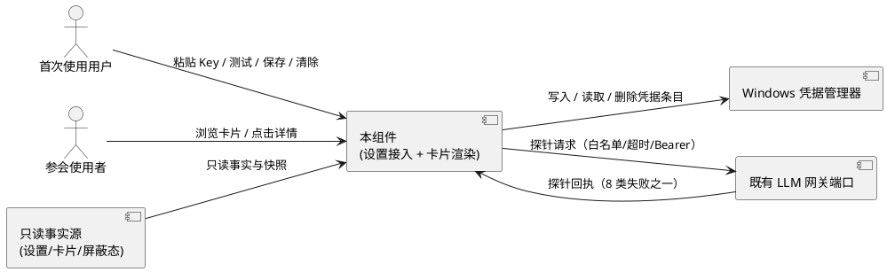
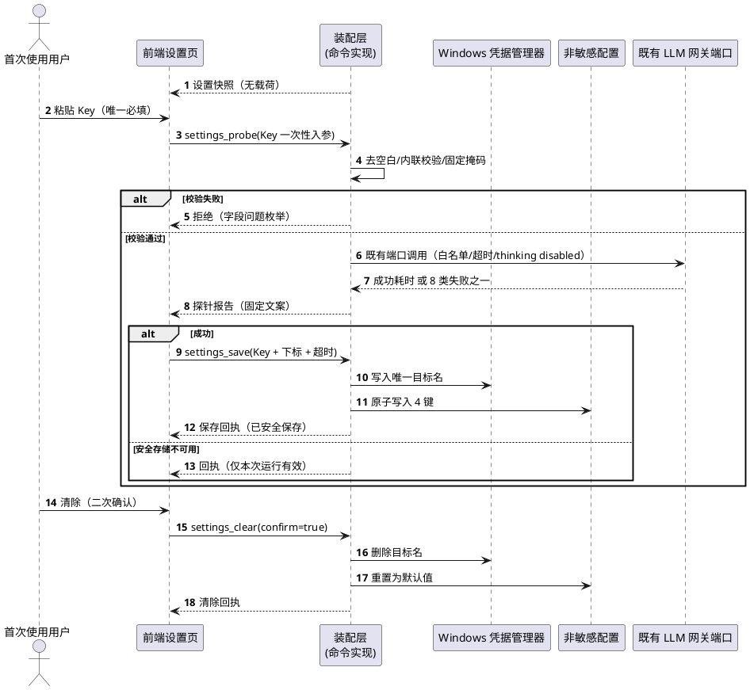
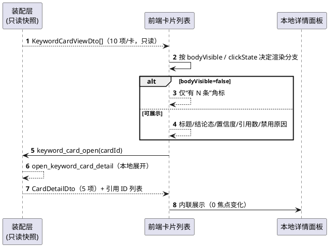

# ui_integration · 增量需求规格（U-05 产品化接入）

> 阶段：需求规格设计（本文件只产出需求，**不写代码、不改配置、不提交**）。
> 基线：`b4_gate` AC-B4-01~104（103 passed + 1 not-applicable）＋ `ci_deny_repair` AC-B4-105~110（本地 passed）；`docs/progress/b4-status.md` §28 已登记 U-05 产品化增量；`NEW_TARGETS`=25、AC 汇总=130（AC-B4-111~130 当前 `pending`）。
> 编号纪律：AC-B4-01~110 **不重排、不改语义**；本增量只追加 **AC-B4-111~130**（20 条）。决策编号承接 `ci_deny_repair` 的 D-B4-P143 与设计期 D-B4-P156~P170；本轮不新增 AC 编号、不改任务编号。
> 落点：`.codeartsdoer/specs/ui_integration/spec.md`（已存在；2026-11-23 只做校准与必要增补，不改 `design.md`/`tasks.md`）。
> 实况口径（2026-11-23 校准，优先级高于 `design.md` 旧稿）：`windows-sys` 实况 **0.45.0**（设计写 0.59）；前端 **`withGlobalTauri`** 且不新增 `@tauri-apps/api`；`ClickState` 带载荷，IPC DTO 必须拆 `clickState` + `disabledReason`；`check-ui-integration.sh` 属 C6，必须晚于 C1~C5；`NEW_TARGETS`=25；U-05 整体保持 `open`。

# **1. 组件定位**

## **1.1 核心职责**

本组件负责把 51 的**离线契约**接到 Windows 真实能力与 Tauri 前端，交付"只填一个 Key 就能用"的设置页与可点击的关键词卡片渲染，且不改变任何既有封闭面。

## **1.2 核心输入**

1. 用户操作：粘贴/更换 API Key、选择模型、选择服务地址（仅白名单下标）、点击"测试连接"、保存、清除、点击卡片。
2. 注入的只读事实：`SettingsFacts`（6 项）、模型预设清单、端点清单（来自既有白名单的显示名）、网关冷却镜像；`ViewFacts`（6 项）与 `KeywordCardDraft`（13 字段）快照。
3. 平台能力回执：Windows 安全存储写入/读取/删除结果；非敏感配置文件读写结果。
4. 既有 LLM 网关端口回执：探针结果（成功耗时或 8 类失败之一）。
5. 既有 51 离线契约：`SettingsView`（8 项）、`KeywordCardView`（10 项）、`CardBodyView`（4 项）、`CardDetailView`（5 项）、`ProbeFailureKind`（8 项）等。

## **1.3 核心输出**

1. 只读设置快照：`SettingsSnapshotDto`（8 项视图 + 分区顺序 + 探针报告），**不含任何 Key 载荷**。
2. 保存/清除回执：`SettingsSaveReceiptDto`、`SettingsClearReceiptDto`（成功/降级/失败，仅枚举与布尔）。
3. 探针报告：`ProbeReportDto`（`failure`/`message`/`elapsedMs`/`remainingMs`），`message` 为 8 条固定文案之一。
4. 卡片快照与详情：`KeywordCardViewDto`（10 项）、`CardDetailDto`（5 项）与拒绝原因。
5. 本地诊断计数：6 个命令的成功/拒绝计数（整数），不含文本。

## **1.4 职责边界**

1. 本组件**不实现**卡片合成（38）、引用对齐判定（39）、门控判定与 `click_state` 权威（B4）、卡片存储与展示审计（52）、回放本体（13.3）。
2. 本组件**不实现**真实投屏/紧急遮蔽检测 API；只消费注入的 `screen_share`/`emergency_masked` 事实。
3. 本组件**不发起**检索、不生成结论、不把"继续检索"放进点击路径（需要时重新走 G1~G5）。
4. 本组件**不新增**模型清单来源、**不扩展**端点白名单、**不新增** `LLM_*` 环境变量名。
5. 本组件**不修改** `docs/sdd/**`；测试与进度只登记事实，不宣称真机体验。

## **1.5 与既有封闭面的关系（硬约束）**

| 封闭面 | 取值 | 本轮动作 |
|---|---|---|
| `crates/application/src/gate/api.rs` | 4 个 `pub fn` | 零 diff |
| `GateRecord` / 审计 / 夹具 / `ReplayReport` | 14 / 7 / 23 / 5 | 零 diff、零新增字段 |
| `GateCounter` / `GateRejectReason` | 32 / 23 | 零新增 |
| `ComposedCard` / `KeywordCardView` / `SettingsView` | 11 / 10 / 8 | 零新增字段 |
| `KeywordCardDraft` / `ReferenceView` / `CitationAlignment` | 13 / 5 / 3 | 零 diff |
| `SettingsFacts` / `SettingsInput` / `SettingsIntent` | 6 / 5 / 3 变体 | 零 diff |
| `crates/domain/src/model/**`、`crates/application/src/{gate,cards}` | — | `git diff --quiet` 退 0 |
| `crates/ui-bridge/Cargo.toml`、`Cargo.lock` 的 ui-bridge 段 | — | 零 diff |
| B4 既有 AC | 01~110 | 不重排、不改语义 |
| Rust 依赖版本 | `windows-sys` 实况 **0.45.0**；前端 npm 依赖 | 不升级、不引入第二版本；升级需授权（X-UI-11） |
| 前端 IPC 绑定 | `withGlobalTauri` + 手写 `window.__TAURI__` 类型 | 不新增 `@tauri-apps/api`，`app/package.json` 零 diff（D-B4-P156） |

## **1.6 两项能力的归属矩阵**

| 能力 | 唯一所有者 | 本轮交付 | 本轮不交付 | 越界判定 |
|---|---|---|---|---|
| 设置视图/校验/掩码/状态机 | 51（`ui-bridge/src/settings`） | 只读快照与状态转移复用 | 平台读写、网络、文件 | 51 侧仍 0 命中 `std::fs`/`std::env`/网络符号 |
| 凭据安全存储 | **platform-win**（`secure_store`） | Windows 凭据管理器读写删三操作 | 跨平台密钥链、DPAPI 文件方案 | 仅 `cfg(windows)` 实现；无自管密文文件 |
| 非敏感配置持久化 | **app 装配层** | `settings.json`（4 键）原子读写 | 存储 Key、存 URL/host | 文件键集合固定 |
| 连通性测试 | **app 装配层 + 既有网关端口** | `ProbeExecutor` 端口 + 生产适配器 | UI 直连、独立重试/熔断/计时 | 前端与 51 侧 0 网络符号 |
| 保存/清除执行 | **app 装配层** | 意图落地 + 降级回执 | 明文落盘、静默失败 | 失败必回显降级 |
| 卡片视图投影 | 51（`ui-bridge/src/keyword_card`） | 复用既有 3 函数 | 合成/校验/门控/存储 | 既有边界断言继续有效 |
| 卡片渲染与详情 | **前端（`app/src`）** | 只读 DTO → DOM | 检索、LLM、外发、审计、焦点抢占 | 前端 0 网络/0 持久化 |
| `ViewFacts`/卡片快照 | **装配层（注入）** | 只读注入端口 | 真实投屏 API、卡片生成链路 | 只消费快照 |

## **1.7 本轮"不做"清单（显式）**

| 编号 | 不做的事项 | 判定方式 |
|---|---|---|
| N-UI-01 | 不做真实联网 E2E（不跑真实公网连通性、不取真实模型响应） | 探针适配器只允许被测试替身调用；`scan-secrets-docs`/脚本命中 0；CI 不新增网络步骤 |
| N-UI-02 | 不把 Key 写入任何文件（含加密文件、备份、缓存、前端存储） | `secure_store` 无 `std::fs`；`app/src` 无 `localStorage`/`sessionStorage`/`indexedDB` |
| N-UI-03 | 不宣称真机体验已验收（窗口、焦点、投屏、代际授权） | README/b4-status 不出现"设置向导已可用""真机通过"类表述 |
| N-UI-04 | 不改 macOS 支持口径（仍为"不适用（无设备）"） | `check-mac-scope.sh --rule=claims` 退 0；不新增 mac 分支 |
| N-UI-05 | 不做卡片存储、展示审计、回放目录 | 无 `card_store`/`Sqlite`；`tests/replay/` 仍不存在 |
| N-UI-06 | 不做真实投屏/紧急遮蔽检测 | `ViewFacts` 只来自注入；无平台投屏 API 调用 |
| N-UI-07 | 不把点击变成检索入口 | 点击命令源码 0 命中 `issue_query`/`reqwest`/`audit` |
| N-UI-08 | 不新增门控计数/拒绝码/domain 契约 | 32/23/字段数不变 |
| N-UI-09 | 不新增 cargo test target | `NEW_TARGETS` 保持 25 |
| N-UI-10 | 不做模型清单仓库内联、不做端点自由输入 | 源码/测试/进度 0 模型名字面量、0 URL |

# **2. 领域术语**

**设置快照（SettingsSnapshot）**
: 装配层从注入事实与内存草稿投影出的只读设置状态，只含枚举、布尔、固定文案与无载荷掩码。

**安全存储目标名（Secure Target）**
: Windows 凭据管理器中唯一标识本产品凭据条目的固定字符串常量；全仓只允许出现 1 个业务目标名。

**非敏感配置（Non-Sensitive Config）**
: 只含模型下标、端点下标、超时毫值与 schema 版本的本地配置文件；不含凭据、地址原串、主机名与显示名。

**探针（Probe）**
: 一次经既有 LLM 网关端口的连通性测试；由装配层执行，51 只做状态转移与文案映射。

**探针报告（Probe Report）**
: 探针结果的人话回执，含 8 类失败之一、固定文案、耗时与冷却剩余；不含 Key 片段与端点串。

**降级保存（Fallback Persist）**
: 安全存储不可用时的保存结果：仅本次运行有效，必须显式回显，禁止静默或明文回退。

**卡片快照（Card Snapshot）**
: 装配层注入的只读卡片列表（13 字段卡片或 11 项预览）与 `ViewFacts`；渲染层只读。

**正文隐藏（Body Hidden）**
: 投屏保护或紧急遮蔽期间，卡片只展示"有 N 条"角标，DOM 不出现标题、结论与引用。

**禁用卡（Disabled Card）**
: `click_state=Disabled{reason}` 的卡片；仍可展示标题与禁用原因，但不绑定点击、不可键盘激活。

**不抢焦点（No Focus Steal）**
: 打开/关闭详情不改变当前键盘焦点，不使用模态对话框、不自动聚焦、不滚动抢占。

**可信装配层（Trusted Wiring Layer）**
: `app/src-tauri` 内的命令实现与端口适配，唯一允许读安全存储、写非敏感配置、调用网关的层。

# **3. 角色与边界**

## **3.1 核心角色**

1. 首次使用用户：只愿意粘贴一个 Key，期望"测试即保存"，失败时看到人话原因并能一键重试。
2. 参会使用者：在会议中浏览卡片，点击已启用的卡片查看本地详情；投屏或紧急遮蔽时只看角标。
3. 维护者：需要在不联网、不读 Key 的前提下复跑全部机器判定。

## **3.2 外部系统**

1. Windows 凭据管理器：系统级凭据库，按当前用户隔离；提供写入、读取、删除三条操作。
2. 既有 LLM 网关端口：沿用既有白名单、超时、thinking disabled、Bearer 注入与失败分类；本轮不新增调用形态。
3. Tauri 运行时：提供 6 个固定命令的 IPC 边界与窗口上下文；不启用文件系统/网络插件。
4. 只读事实源：`SettingsFacts`、模型/端点清单、网关冷却、`ViewFacts`、卡片快照（由装配层注入）。

## **3.3 交互上下文**

> 图只表达业务边界：不出现文件路径、URL、命令参数与密钥串；本组件内部不展示分层。

# **4. DFX 约束**

## **4.1 性能**

1. `settings_snapshot` 纯投影 + 1 次凭据存在性查询，p95 ≤50 ms（离线基准）。
2. 探针沿用网关既有 6 000 ms 超时口径；装配层额外开销 ≤500 ms；并发恒为 1。
3. 卡片快照投影 ≤1 ms/卡（纯函数）；首屏可交互 ≤1.5 s（不新增网络字体与远程资源）。

## **4.2 可靠性**

1. 保存幂等：同一目标名重复写入覆盖，不新增第 2 条凭据。
2. 清除幂等：目标不存在也返回成功；清除后 `hasKey=false`。
3. 配置文件原子写（临时文件 + 替换）；损坏或 schema 不匹配时回默认值，备份文件不含敏感字段。
4. 探针单飞：在途时第二次请求返回 `BUSY` 且不产生第 2 次网关调用。
5. 同输入 100 次投影与状态转移逐字节一致。

## **4.3 安全性**

1. Key 明文只存在于：前端受控输入框（提交后立即清空）→ IPC 参数 → 单次命令内的内存输入 → 凭据管理器。**不反向回传**。
2. 安全存储条目类型为通用凭据、持久化为本机（不随漫游）；目标名全仓唯一；读取仅用于探针与保存，不回传前端。
3. 前端不得持久化 Key 与卡片正文；Rust 侧不得把 Key 写入日志/审计/回放/诊断/错误文案。
4. 错误信息只允许 8 条固定文案与枚举码，不含 Key 任何子串、请求体、端点原串。
5. Tauri 能力集保持最小（仅核心默认权限）；CSP 不新增 `connect-src`。

## **4.4 可维护性**

1. IPC 命令面固定 6 个（不含既有 `ipc_version`）；每个命令 1 个纯函数 + 1 个薄注册。
2. 日志字段白名单：`event`/`command`/`outcome`/`elapsed_ms`/`failure_kind`/`count`。
3. 诊断计数固定 6 项（快照/保存/探针/清除/卡片快照/卡片打开），只整数。
4. 新增静态门禁 `scripts/check-ui-integration.sh`，规则固定 6 条、退出码 0/1/2（扫描面缺失退 2）。

## **4.5 兼容性**

1. 仅 Windows；`cfg(not(windows))` 保留 `Unsupported` 空壳以满足 workspace 交叉检查，但**不宣称**支持。
2. macOS 口径不变（不适用、无设备）；CI mac 编译观察项的存废见 C-UI-02，未裁决前不改 `ci.yml`/`deny.toml`/`platform-mac`。
3. 既有 110 条 AC 与全部封闭面零 diff；`gate/cards/domain` 零 diff。
4. 依赖变更**逐项列明**：`windows-sys`（仅 Windows，实况 0.45.0，见 X-UI-11）、`application`/`platform-win`/`infrastructure` 的 path 依赖（见 D-B4-P144/D-B4-P146/C-UI-04）；前端采用 `withGlobalTauri`、**零新增 npm 依赖**（D-B4-P156 覆盖 D-B4-P148）。除此之外零新增。

# **5. 核心能力**

## **5.1 设置向导接入真实能力**

> 目标：把 `ui-bridge/src/settings` 的纯契约接到"安全存储 + 非敏感配置 + 既有网关 + 装配层执行"，前端只做展示与最少输入。

### **5.1.1 业务规则**

1. **一步式默认（沿用 51 契约）**：进入设置页必须已选中预设模型首项、端点首项、超时 6 000 ms；用户只需粘贴 Key 即使 `canTest=true`（清单非空）。清单为空时显示"暂不可用"并禁用测试/保存，不得留空屏或死路。
   a. 验收条件：只填 Key → `canTest=true`；清单为空 → `canTest=false` 且 `inlineErrors` 含 `ModelMissing`/`EndpointUnavailable`。
2. **四段固定顺序、高级默认折叠**：分区顺序恒为"粘贴 Key → 选择模型 → 服务地址（高级，默认折叠）→ 测试并保存"；首屏不得要求填写地址；从"未配置"到"已验证"的用户动作数 ≤3。
   a. 验收条件：前端只按 `sectionsOrder` 渲染；高级区 `collapsed=true`（首次进入）；默认路径动作计数 ≤3。
3. **内联校验只在提交后展示**：Key 去首尾空白后非空、长度 ≥16、内部无空白/换行；不校验前缀、不判真伪、不联网预检；`submitted=false` 时不显示红字。
   a. 验收条件：`validate_settings_input` 行为不变；前端错误列表只来自后端 `inlineErrors`，前端不自行推导。
4. **固定掩码、零回显**：任何位置只显示固定无载荷掩码；不显示首尾字符、长度、字符类别或"已保存 N 位"；更换 Key 只提供"重新输入"，不提供"查看"。
   a. 验收条件：1/16/64/256 长度输入掩码输出逐字节相同；响应 JSON 与日志不含 Key 子串或长度。
5. **Key 只进 Windows 安全存储**：保存时先写凭据管理器，成功后 `hasKey=true` 且 `keyDisplay` 为固定掩码；**禁止**写入配置文件、禁止写注册表自定义键、禁止自管密文文件。
   a. 验收条件：配置文件键集合 = 4 键且不含凭据；`secure_store` 无文件 API；重复保存后凭据条目数仍为 1。
6. **非敏感配置持久化**：只持久化 `schemaVersion`/`modelIndex`/`endpointIndex`/`timeoutMs`；不持久化地址原串、主机名、显示名、模型名；损坏回默认。
   a. 验收条件：`settings.json` 键集合逐字节固定；注入损坏内容后快照回默认且不 panic。
7. **连通性测试经既有网关端口**：探针由装配层执行，沿用既有白名单、6 000 ms 超时、thinking disabled、Bearer 注入；前端与 51 侧 0 网络符号；测试用替身，生产适配器仅在启用 HTTPS feature 时构造。
   a. 验收条件：`probe` 命令调用 `ProbeExecutor` 端口；生产适配器调用既有网关装配函数；`ui-bridge`/前端网络符号命中 0。
8. **失败人话化与可恢复**：8 类失败各 1 条固定文案；失败后保留已填 Key（内存）与模型/端点选择；非冷却期恢复可测；冷却期显示剩余秒并禁用；文案不含 Key 片段与端点串。
   a. 验收条件：8 类逐一遍历，文案恰 8 条且互不相同；失败后 `hasKey`/`modelChoice`/`endpointChoice` 不变；冷却时 `canTest=false`。
9. **保存/清除由装配层执行**：保存 = 安全存储写入 + 配置文件写入；清除 = 删除凭据 + 重置配置文件；清除必须二次确认；安全存储失败时降级为"仅本次运行有效"并显式提示，**禁止**静默失败或明文回退。
   a. 验收条件：安全存储失败 → `persisted=false`、`fallback="memory"`、`notice` 非空；清除未确认 → 拒绝且状态不变。
10. **凭据与零转录边界**：视图、诊断、日志、测试与进度只允许枚举/布尔/计数/毫值/固定文案/掩码态；Key 明文、片段、长度、地址原串、模型名取值、请求标识一律禁止进入记录层。
    a. 验收条件：`--rule=credential-redline` 退 0；`scan-secrets-docs.sh --all-md` 退 0；`Debug` 输出不含 Key 片段。

### **5.1.2 交互流程**

> 图不出现文件路径、URL、注册表与密钥串；"既有 LLM 网关端口"是端口，前端不直连。

### **5.1.3 异常场景**

1. **安全存储不可用**
   a. 触发条件：写入被系统拒绝或平台返回错误。
   b. 系统行为：保存降级为内存态并返回显式回执；不写明文、不写配置文件、不重试超过 1 次。
   c. 用户感知："已保存，但仅本次运行有效"。
2. **凭据管理器条目被外部删除**
   a. 触发条件：快照时读取不到目标名。
   b. 系统行为：`hasKey=false`、`formState=NotConfigured`、`canTest=false`；不报错、不留半配置。
   c. 用户感知：回到"请粘贴 Key"，模型与端点默认仍保留。
3. **配置文件损坏或版本不匹配**
   a. 触发条件：JSON 非法或 `schemaVersion` 非 1。
   b. 系统行为：回默认值，保留不含敏感字段的备份；不 panic、不清除凭据。
   c. 用户感知：设置回默认，Key 仍可用（如已保存）。
4. **探针失败**
   a. 触发条件：网关返回 8 类失败之一。
   b. 系统行为：写探针报告；保留输入；非冷却期恢复可测。
   c. 用户感知：对应固定中文文案 + "重试"。
5. **探针在途重复点击**
   a. 触发条件：`probe_in_flight=true` 再次请求。
   b. 系统行为：返回 `BUSY`，不产生第二次网关调用、不改状态。
   c. 用户感知：按钮短暂禁用。
6. **冷却期**
   a. 触发条件：网关冷却镜像未过期。
   b. 系统行为：`canTest=false`，返回 `remainingMs`。
   c. 用户感知："请等待 N 秒后再试"。
7. **清除未确认**
   a. 触发条件：`confirm` 非真。
   b. 系统行为：拒绝，状态与凭据不变。
   c. 用户感知："请先确认清除"。
8. **清单为空**
   a. 触发条件：模型或端点清单为空。
   b. 系统行为：禁用测试/保存，保留自定义模型入口。
   c. 用户感知："暂不可用，请联系管理员"。

## **5.2 关键词卡片前端渲染**

> 目标：用既有 `KeywordCardView`/`CardDetailView` 在 Tauri 前端渲染可点击卡片与本地详情；隐藏正文、禁用卡不可点、点击 0 副作用、不抢焦点。

### **5.2.1 业务规则**

1. **只读快照驱动**：前端只消费 `keyword_cards_snapshot` 返回的 `KeywordCardViewDto`（10 项）；不得自行补字段、不得把 `ComposedCard` 预览当作可点击。
   a. 验收条件：前端无 "补 clickState" 代码路径；预览卡 `clickState=disabled` 且原因 `not_allowed`。
2. **可点击条件完全由后端决定**：仅当 `clickState="enabled"` 且 `bodyVisible=true` 才绑定点击；其余一律 `aria-disabled=true` 且不绑定 `onClick`。
   a. 验收条件：组件源码存在 `aria-disabled` 与条件性 `onClick`；禁用例矩阵逐项断言不可点。
3. **失败/未验证卡片可展示不可点**：`citationAlignment∈{failed,unknown}` 仍渲染标题与"未验证"角标，点击被拒并显示禁用原因。
   a. 验收条件：`failed`/`unknown` 卡 `disabledReason=reference_unverified`；DOM 含标题、不含详情按钮回调。
4. **正文隐藏**：`bodyVisible=false` 时只渲染"有 N 条"角标，DOM 不含标题/结论/引用；禁用原因必须是 `screen_share_protection` 或 `emergency_masked`。
   a. 验收条件：隐藏分支不引用 `title`/`conclusion`/`references`；序列化 DTO 中 `body=null`。
5. **点击只展开本地详情**：点击调用 `keyword_card_open`，只映射 `open_keyword_card_detail`；0 检索、0 LLM、0 外发、0 审计、0 存储。
   a. 验收条件：命令实现 0 命中外发/审计/存储/合成符号；替身计 `outbound=0`/`llm=0`/`audit=0`。
6. **不抢焦点**：详情为内联面板（非模态），不自动聚焦、不调用 `focus()`、不 `scrollIntoView`；打开/关闭不改变既有键盘焦点。
   a. 验收条件：前端源码 0 命中 `autoFocus`/`.focus(`/`scrollIntoView`/`showModal`；详情 `role` 非 `dialog`。
7. **离线与最小权限**：前端 0 网络 API；CSP 不含 `connect-src`；能力集只有 `core:default`；invoke 命令白名单恰 6 项。
   a. 验收条件：`--rule=frontend-offline` 退 0；`grep -c 'connect-src'` = 0；白名单长度 6。
8. **卡片隐私**：前端不持久化卡片正文（无本地存储、无文件、无 console 打印）；日志只允许 ID/枚举/计数。
   a. 验收条件：`app/src` 0 命中本地存储 API 与 `console.log/debug/info`；DTO 无 `normalizedTerm`/`gateDecisionRef`/请求标识。

### **5.2.2 交互流程**

> 图不出现检索源、模型、数据库与窗口句柄；详情只在当前窗口内联展示。

### **5.2.3 异常场景**

1. **快照为空**
   a. 触发条件：无卡片。
   b. 系统行为：渲染空态文案；不报错、不轮询。
   c. 用户感知："暂无提示卡"。
2. **卡片已撤回**
   a. 触发条件：快照中不出现该卡（51 不生成视图）。
   b. 系统行为：前端不缓存旧卡、不复活；刷新后仍不存在。
   c. 用户感知：卡片消失。
3. **禁用卡被点击/键盘激活**
   a. 触发条件：`clickState="disabled"`。
   b. 系统行为：不调用命令；保持焦点；显示禁用原因文案。
   c. 用户感知：无详情打开。
4. **详情请求返回拒绝**
   a. 触发条件：打开时卡片已禁用或已过期。
   b. 系统行为：返回拒绝原因，前端不打开详情。
   c. 用户感知：显示对应原因。
5. **投屏/遮蔽事实晚到**
   a. 触发条件：快照更新后 `bodyVisible` 变 false。
   b. 系统行为：重新渲染为仅角标，立即丢弃已渲染正文节点。
   c. 用户感知：正文消失，仅见"有 N 条"。
6. **前端越界尝试**
   a. 触发条件：出现网络 API/本地存储/焦点抢占代码。
   b. 系统行为：静态门禁命中。
   c. 用户感知：阶段不放行。

## **5.3 IPC 命令面（固定 6 个，闭集）**

| 命令 | 入参（只读/一次性） | 出参 | 禁止 |
|---|---|---|---|
| `settings_snapshot` | 无 | `SettingsSnapshotDto` | 不含 Key、地址原串、模型名 |
| `settings_probe` | `key`（一次性）、`modelIndex`、`endpointIndex`、`timeoutMs` | `ProbeReportDto` | 不写存储、不写文件、不回显 Key |
| `settings_save` | `key`、`modelIndex`、`endpointIndex`、`timeoutMs` | `SettingsSaveReceiptDto` | 失败不得明文回退 |
| `settings_clear` | `confirm` | `SettingsClearReceiptDto` | 未确认必须拒绝 |
| `keyword_cards_snapshot` | 无 | `KeywordCardViewDto[]` | 不生成卡、不检索 |
| `keyword_card_open` | `cardId` | `CardDetailDto` 或拒绝原因 | 0 检索/0 LLM/0 审计/0 存储 |

1. 命令名固定；前端只允许调用这 6 个（`ipc_version` 为既有保留，不计入）。
2. `key` 参数只在命令调用期内存在；命令实现不得写入全局状态、不得进任何缓存。
3. `SettingsIntent` 不跨 IPC；装配层按 §6.26 重新构造只读 DTO，DTO 不含 Key。

## **5.4 平台适配接口（端口与实现分层）**

| 端口 | 定义位置 | 生产实现 | 测试替身 | 禁止 |
|---|---|---|---|---|
| `SecureStore`（写入/读取/删除） | `crates/application/src/settings/ports.rs` | `crates/platform-win/src/secure_store.rs` | 内存实现 | 自管密文文件、跨平台密钥链 |
| `SettingsConfigStore`（读/写 4 键） | `crates/application/src/settings/ports.rs` | `app/src-tauri/src/ipc/settings_store.rs` | 临时目录实现 | 写 Key、写地址 |
| `ProbeExecutor`（探针执行） | `crates/application/src/settings/ports.rs` | 既有网关 + `BearerTransport` + HTTPS 传输 | 固定回执替身 | UI 直连、独立重试/熔断 |
| `SettingsFactsSource`/`CardSnapshotSource`/`ViewFactsSource` | `crates/application/src/settings/sources.rs` | 装配层注入 | 固定夹具 | 真实投屏 API、卡片生成 |

1. 端口只含纯数据类型；`application` 不依赖平台实现、不依赖网络。
2. 非 Windows 目标的 `SecureStore` 返回 `Unsupported`，保证交叉编译，不宣称可用。
3. 生产探针适配器只在启用 HTTPS feature 时构造；未启用时返回 `Unsupported`，不得退化为明文 HTTP。

## **5.5 失败降级矩阵**

| 失败点 | 降级行为 | 用户可见 | 禁止 |
|---|---|---|---|
| 凭据管理器写入失败 | 内存态保存 | "仅本次运行有效" | 写明文/静默 |
| 凭据管理器读取失败 | `hasKey=false` | 重新输入 | 报错泄露 |
| 配置文件写入失败 | 保留旧配置并回执失败 | "设置未保存" | 半写入 |
| 配置文件损坏 | 回默认 + 备份 | "已恢复默认" | panic |
| 探针网络失败 | 保留输入，显示 8 类文案 | 人话 + 重试 | 显示端点串 |
| 探针在途 | `BUSY` | 按钮禁用 | 并发调用 |
| 冷却期 | 只读倒计时 | 剩余秒数 | 本地自建计时器 |
| 卡片详情拒绝 | 不打开详情 | 禁用原因 | 自动重试/外发 |

# **6. 数据约束**

## **6.1 SettingsSnapshotDto（只读，封闭 11 项）**

1. **formState**：必填，`not_configured`/`configured_unverified`/`testing`/`verified`/`failed`/`cooling` 六值之一。
2. **hasKey**：必填布尔；`false` ⇒ `keyDisplay="none"` 且 `canTest=false`。
3. **keyDisplay**：必填，`masked`/`none` 两值；**无载荷**。
4. **modelChoice**：必填，`{kind:"preset", displayName}`/`{kind:"custom", name}` 两态；名称来自注入清单或用户输入。
5. **endpointChoice**：必填，`{kind:"option", displayName}`/`{kind:"unavailable"}`；只允许注入清单下标对应项。
6. **inlineErrors**：0..*，元素闭集 6 项；按枚举声明序稳定排序并去重。
7. **canTest**：必填布尔；不变量 = `hasKey ∧ 模型有效 ∧ 端点可用 ∧ formState ∉ {testing, cooling}`。
8. **canSave**：必填布尔；不变量 = `hasKey ∧ 模型有效 ∧ 端点可用`。
9. **sectionsOrder**：必填，恰 4 项且顺序固定（"粘贴 Key"/"选择模型"/"服务地址"/"测试并保存"）。
10. **advancedCollapsed**：必填布尔；首次进入为 `true`。
11. **probeReport**：`null` 或 `ProbeReportDto`；`failed` 时非空，成功时为 `null`。

12. **禁止字段**：`apiKey`/`keyLen`/`keyPrefix`/`keySuffix`/`endpointRaw`/`url`/`host`/`modelRaw`/`requestBody`/`requestId`。

## **6.2 ProbeReportDto / SaveReceiptDto / ClearReceiptDto**

**ProbeReportDto（5 项）**

1. **succeeded**：必填布尔。
2. **failure**：`null` 或 8 类失败之一（`missing_key`/`key_rejected`/`endpoint_unreachable`/`timeout`/`rate_limited`/`quota_exceeded`/`server_error`/`unknown`）。
3. **message**：必填固定中文文案；不得含 Key、请求体、端点串、内部错误码。
4. **elapsedMs**：0..*，毫值。
5. **remainingMs**：`null` 或冷却剩余毫值；仅冷却期非空。

**SettingsSaveReceiptDto（4 项）**

1. **persisted**：必填布尔。
2. **fallback**：`null` 或 `"memory"`。
3. **hasKey**：必填布尔，保存后恒 `true`（失败除外）。
4. **notice**：`null` 或固定提示（降级/失败），不含 Key。

**SettingsClearReceiptDto（3 项）**

1. **cleared**：必填布尔。
2. **hasKey**：必填布尔，成功清除后 `false`。
3. **notice**：`null` 或固定提示。

## **6.3 非敏感配置 SettingsFileV1（恰 4 键）**

1. **schemaVersion**：必填，整数，恒为 1。
2. **modelIndex**：必填，0..*；越界时回默认 0。
3. **endpointIndex**：必填，0..*；越界时回默认 0。
4. **timeoutMs**：必填，整数，落在 100..=8 000；默认 6 000。

5. **禁止键**：凭据、地址、主机名、模型名、显示名、请求标识、时间戳、会话标识。

## **6.4 KeywordCardViewDto（10 项映射）**

1. **cardId**：字符串；来自 `CardRef`。
2. **keywordKind**：五值之一（`proper_noun`/`acronym`/`institution_role`/`policy_standard`/`metric`）。
3. **trigger**：`auto`/`on_demand`。
4. **triggeredAtMs**：毫值整数。
5. **cardStatus**：`displayed`/`collapsed`（`withdrawn` 不出现：51 不生成视图）。
6. **bodyVisible**：布尔；`false` ⇒ `body=null`。
7. **body**：`null` 或 `CardBodyDto`（4 项：`title`/`conclusion`/`confidence`/`referenceIds`）。
8. **clickState**：`enabled`/`disabled` 两值。
9. **disabledReason**：`null` 或 6 类原因之一（`stale_reference`/`authorization_revoked`/`not_allowed`/`emergency_masked`/`screen_share_protection`/`reference_unverified`）。
10. **badgeCount**：整数 ≥1；仅隐藏态展示"有 N 条"。

11. **禁止字段**：`normalizedTerm`/`gateDecisionRef`/`traceId`/`url`/`model`/`requestId`/`apiKey`。

## **6.5 CardDetailDto（5 项）**

1. **cardId**：与视图恒等。
2. **title**：来自 `CardBodyView.title`；不得重读原文。
3. **conclusion**：三态（`available`+文本 / `no_reliable_source` / `absent`）。
4. **referenceIds**：升序引用 ID 列表；不携带引用正文。
5. **citationAlignment**：`passed`/`failed`/`unknown`。

## **6.6 信任边界与不变量**

1. **数据流单向**：事实/快照 → 只读 DTO → 前端 DOM；Key 单向：输入框 → IPC → 内存 → 凭据管理器。
2. **DTO 封闭（6 组，共 11/5/4/3/10/4/5）**：`SettingsSnapshotDto` 11、`ProbeReportDto` 5、`SaveReceipt` 4、`ClearReceipt` 3、`KeywordCardViewDto` 10（内嵌 `CardBodyDto` 4）、`CardDetailDto` 5；新增字段即结构违规。
3. **正文不落盘**：卡片 DTO 不写入任何持久化介质；页面刷新后由快照重新注入。
4. **既有不变量沿用**：`bodyVisible ⟺ body≠null`；`clickState=enabled ⇒ disabledReason=null ∧ bodyVisible=true`；`withdrawn` 不出现。

## **6.7 载荷拆分与映射纪律（ClickState / citationAlignment）**

> 本节只定义"对外 DTO 的字段形态"，不规定实现方式。`crates/ui-bridge/src/keyword_card` 的 `ClickState` 是**带载荷枚举**（`enabled` 或 `disabled{reason}`）；IPC DTO 必须拆平，不得直接序列化透传。

1. **clickState**：必填，`enabled`/`disabled` 两值；`disabled` 时 `disabledReason` 非空，`enabled` 时 `disabledReason=null`。
2. **disabledReason**：`null` 或 6 类之一（`stale_reference`/`authorization_revoked`/`not_allowed`/`emergency_masked`/`screen_share_protection`/`reference_unverified`）；不得携带载荷以外的文本或嵌套对象。
3. **禁止透传**：`KeywordCardViewDto` 禁止直接持有带载荷枚举（否则外部形态会变成 `{"disabled":"..."}`），必须在视图投影/命令层手工映射为两个扁平字段；禁止以 `serde` 默认标签直接输出。
4. **citationAlignment 不分流到快照**：该字段只允许进入 `CardDetailDto`（5 项）；`KeywordCardViewDto` 10 项中不出现，避免与 `disabledReason` 语义重叠。
5. **预览卡**：`ComposedCard` 预览恒映射为 `clickState="disabled"` + `disabledReason="not_allowed"`；不得把预览升级为可点击。
6. **字段数不变式**：拆分前后 `KeywordCardViewDto` 恒 10 项、`CardDetailDto` 恒 5 项；新增字段即结构违规（AC-B4-121）。

## **6.8 端口纯数据与只读事实源（W-UI-02 起的规格依据）**

> 本节把 AC-B4-119 的"3 端口 + 3 事实源"落到**业务数据约束**，不规定语言签名与实现位置以外的细节。

**端口纯数据**

1. **SettingsConfig**：恰 4 项（`schemaVersion`/`modelIndex`/`endpointIndex`/`timeoutMs`）；默认 `1/0/0/6000`；下标越界归 0，`timeoutMs` 越界归 6 000；禁止额外键。
2. **SecretBytes**：只承载一次性凭据字节；**禁止** `Serialize`/`Deserialize`/`Display`，禁止提供长度、前缀、后缀、明文取值访问器；`Debug` 恒为固定掩码。
3. **ProbeCall**：一次探针调用的入参（内存凭据 + 模型显示名 + 端点下标 + 超时）；只在单次命令内存在，不得进入全局状态或任何持久化介质。
4. **ProbeAttempt**：一次探针的回执（`succeeded`、8 类失败之一或空、`elapsedMs`、`remainingMs`）；不含 Key 片段、请求体、端点原串。
5. **ProbeFailure**：恰 8 态（`missing_key`/`key_rejected`/`endpoint_unreachable`/`timeout`/`rate_limited`/`quota_exceeded`/`server_error`/`unknown`），与 §6.2 `ProbeReportDto.failure` 一一对应；不得多于 8 态。
6. **PortError**：恰 4 类（`Unsupported`/`Denied`/`Unavailable`/`Corrupted`）；映射到 §5.5 的降级行为，不得新增第 5 类。

**只读事实源**

1. **FactsSnapshot（6 项）**：`hasStoredKey`/`modelCount`/`endpointCount`/`nowMs`/`cooldownUntilMs`（可空）/`probeInFlight`；不得新增第 7 项，不得改为可写。
2. **ViewFactsSnapshot（6 项）**：`sessionMatches`/`authorizationRevoked`/`referenceStale`/`screenShare`/`emergencyMasked`/`visibleCardCount`；只来自注入，不得读取真实投屏/紧急遮蔽 API。
3. **CardSnapshotEntry（2 态）**：`draft`（13 字段卡片草案，交 51 投影）或 `preview`（11 项预览，恒不可点）；不得在读取时合成卡片。
4. **只读纪律**：3 个事实源只产出快照，不写回 51 类型、不持久化、不触发检索/LLM/审计。

# **7. 验收判定**

## **7.1 离线可判定与不可判定分界**

| 类别 | 判定方式 | 本轮覆盖 |
|---|---|---|
| 离线可判定（主体） | `cargo test` 退出码、脚本退出码、静态 grep、DTO 字段集、依赖树、临时目录文件键集合 | AC-B4-111~130 全部 |
| 需真机 | 真实窗口渲染、真实焦点轨迹、真实投屏/遮蔽 API、系统凭据库日志 | **不判定、不宣称**（D-UI-01~04） |
| 需真实端点 | 真实公网连通性、真实模型响应、真实限流/额度 | **不判定**（沿用 9 个 `#[ignore]`） |

## **7.2 AC-B4-111~120：设置向导接入（增量 10 条）**

> 判定面：`app/src-tauri/src/ipc/**`、`crates/platform-win/src/secure_store.rs`、`crates/application/src/settings/**`、`app/src/**`、`scripts/check-ui-integration.sh`。AC-B4-111~120 当前均为 `pending`（规格已定，待实现）。
> 样本纪律：测试假凭据统一 `test-key-` 前缀；测试与规格不写真实凭据形态、URL、模型名字面量。

| 编号 | EARS 陈述 | 可机器判定（命令 / 用例名） |
|---|---|---|
| AC-B4-111 | When 前端调用 `settings_snapshot`，the 响应 shall 恰为 `SettingsSnapshotDto`（11 项，见 §6.1），不含 Key 载荷、地址原串、主机名与模型名；`hasKey=false` 时 `keyDisplay="none"` 且 `canTest=false`。 | 用例 `ipc_settings_snapshot_is_closed_and_keyless`、`ipc_settings_snapshot_without_key_is_not_configured`；`cargo test -p meeting-copilot-desktop ipc_settings_snapshot_is_closed_and_keyless` 退 0；`sed -n '/struct SettingsSnapshotDto/,/^}/p' app/src-tauri/src/ipc/dto.rs \| grep -cE 'apiKey\|keyLen\|keyPrefix\|keySuffix\|endpointRaw\|url\|host\|modelRaw\|requestId'`=0；`grep -c 'fn settings_snapshot' app/src-tauri/src/ipc/settings.rs`=1 |
| AC-B4-112 | When 保存成功，the Key shall 只写入 Windows 凭据管理器的**唯一天然目标名**（通用凭据、本机持久），`settings_snapshot` 只回 `hasKey=true` + 固定掩码；同一目标名重复保存后条目数 shall 仍为 1；读取仅用于探针，不回传前端。 | 用例 `secure_store_roundtrip_uses_fixed_target`（`cfg(windows)`，独立测试目标名、结束即删）、`secure_store_write_is_idempotent`、`secure_store_delete_is_idempotent`；`cargo test -p meeting-copilot-platform-win secure_store_roundtrip_uses_fixed_target` 退 0；`grep -c 'CredWriteW' crates/platform-win/src/secure_store.rs`≥1；`grep -c 'CredReadW' crates/platform-win/src/secure_store.rs`≥1；`grep -c 'CredDeleteW' crates/platform-win/src/secure_store.rs`≥1；`grep -c 'CRED_TYPE_GENERIC' crates/platform-win/src/secure_store.rs`≥1；`grep -c 'std::fs' crates/platform-win/src/secure_store.rs`=0；`grep -rc 'keyring' crates/platform-win/src`=0 |
| AC-B4-113 | When 保存，the 非敏感配置 shall 只含 `schemaVersion`/`modelIndex`/`endpointIndex`/`timeoutMs` 四键，原子写入；When 文件损坏或版本不匹配，the 读取 shall 回默认值且不 panic、不清除凭据。 | 用例 `ipc_settings_file_has_only_four_keys`、`ipc_settings_corruption_falls_back_to_defaults`；`cargo test -p meeting-copilot-desktop ipc_settings_file_has_only_four_keys` 退 0；`sed -n '/struct SettingsFileV1/,/^}/p' app/src-tauri/src/ipc/settings_store.rs \| grep -cE 'apiKey\|secret\|endpointRaw\|url\|hostName\|modelName\|displayName\|requestId'`=0；临时目录断言 JSON 键数 = 4 |
| AC-B4-114 | The 连通性测试 shall 只经 `ProbeExecutor` 端口执行；生产适配器 shall 调用既有网关装配与 Bearer 注入（白名单、6 000 ms 超时、thinking disabled 口径不变）；前端与 51 侧 shall 0 命中网络符号。 | 用例 `probe_executor_is_port_only`、`probe_adapter_reuses_existing_gateway`、`ipc_probe_never_opens_socket`；`cargo test -p meeting-copilot-desktop probe_executor_is_port_only` 退 0；`grep -rnE 'reqwest\|hyper::\|TcpStream\|std::net' app/src-tauri/src/ipc crates/ui-bridge/src/settings app/src`=0；`grep -c 'assemble' app/src-tauri/src/ipc/probe.rs`≥1；`cargo tree -p meeting-copilot-ui-bridge --edges normal --prefix none \| grep -cE '^(tauri\|windows\|objc2\|reqwest\|hyper\|sqlx)'`=0 |
| AC-B4-115 | When 保存，the 装配层 shall 先写安全存储再写非敏感配置；When 安全存储失败，the 回执 shall 为 `persisted=false`、`fallback="memory"`、`notice` 非空，且**禁止**写明文或静默成功；When 清除，the 装配层 shall 删除目标名并重置配置，未确认时 shall 拒绝且状态不变。 | 用例 `save_receipt_reports_memory_fallback_without_plaintext`、`clear_requires_confirmation_and_deletes_target`、`clear_is_idempotent`；`cargo test -p meeting-copilot-desktop save_receipt_reports_memory_fallback_without_plaintext` 退 0；`grep -c 'PERSIST_FALLBACK_NOTICE' app/src-tauri/src/ipc/settings.rs`≥1；`scripts/check-ui-integration.sh --rule=credential-redline` 退 0 |
| AC-B4-116 | The 设置页 shall 按 `sectionsOrder` 四段固定渲染、高级区首屏折叠；按钮可用性 shall 只取后端 `canTest`/`canSave`，前端不得自行推导模型/端点有效性；默认路径用户动作数 shall ≤3。 | 用例 `settings_page_renders_four_fixed_sections`、`settings_page_buttons_follow_server_flags`；`scripts/check-ui-integration.sh --rule=settings-ux` 退 0；`grep -c 'canTest' app/src/settings/SettingsPage.tsx`≥1；`grep -cE '(modelIndex|endpointIndex)[[:space:]]*(===|!==)' app/src/settings/*.tsx`=0；`npm --prefix app run typecheck` 退 0 |
| AC-B4-117 | When 探针失败，the `ProbeReportDto.failure` shall 覆盖 8 类且 `message` 逐项映射唯一固定文案；失败后 shall 保留 Key（内存）与模型/端点选择；冷却期 shall 返回 `remainingMs` 且 `canTest=false`。 | 用例 `ipc_probe_failure_maps_eight_kinds`、`ipc_probe_failure_keeps_inputs`、`ipc_probe_cooling_reports_remaining_ms`；`cargo test -p meeting-copilot-desktop ipc_probe_failure_maps_eight_kinds` 退 0；`cargo test -p meeting-copilot-ui-bridge --test llm_settings_view llm_settings_view_probe_events_and_messages` 退 0（实况用例名，见 X-UI-01；不改 AC 陈述）；`grep -c 'humanize_probe_failure' app/src-tauri/src/ipc/probe.rs`≥1 |
| AC-B4-118 | While 执行任一设置命令，the Key shall 不进前端持久化、不进日志/审计/回放/诊断、不出现在错误文案与响应载荷；任何长度输入的掩码 shall 恒为唯一固定值。 | 用例 `ipc_key_is_absent_from_responses_and_logs`、`settings_api_key_is_masked_without_payload`；`cargo test -p meeting-copilot-desktop ipc_key_is_absent_from_responses_and_logs` 退 0；`scripts/check-ui-integration.sh --rule=credential-redline` 退 0；`bash scripts/scan-secrets.sh` 退 0；`bash scripts/scan-secrets-docs.sh --all-md` 退 0 |
| AC-B4-119 | The 三个平台端口（`SecureStore`/`SettingsConfigStore`/`ProbeExecutor`）shall 定义在 application、实现落平台/装配层；非 Windows 的 `SecureStore` shall 返回 `Unsupported` 且不新增 mac 分支；`PLATFORM_NAME` 不变。 | 用例 `application_declares_three_ports`、`sources_declare_three_ports`、`settings_config_rejects_extra_keys`、`secure_store_is_windows_only`；`cargo test -p meeting-copilot-application application_declares_three_ports` 退 0；`grep -cE '^pub trait (SecureStore\|SettingsConfigStore\|ProbeExecutor)' crates/application/src/settings/ports.rs`=3；`grep -cE '^pub trait (SettingsFactsSource\|CardSnapshotSource\|ViewFactsSource)' crates/application/src/settings/sources.rs`=3；`grep -c 'Unsupported' crates/platform-win/src/secure_store.rs`≥1；`grep -c 'target_os = "macos"' crates/platform-win/src/secure_store.rs`=0；`bash scripts/check-mac-scope.sh --rule=claims` 退 0 |
| AC-B4-120 | When 执行设置接入验收，the IPC 命令面 shall 恰为 §5.3 的 6 个；`ui-bridge`/`gate`/`cards`/`domain` shall 零 diff；`NEW_TARGETS` shall 保持 25；AC 汇总 shall 为 130；`b4-status.md` shall 登记 U-05 产品化缺口与 D-B4-P144~P155；README shall 不宣称"设置向导已可用"。 | `grep -cE 'fn (settings_snapshot\|settings_probe\|settings_save\|settings_clear\|keyword_cards_snapshot\|keyword_card_open)' app/src-tauri/src/ipc/mod.rs`=6；`git diff --quiet HEAD -- crates/ui-bridge/Cargo.toml crates/application/src/gate crates/application/src/cards crates/domain/src/model` 退 0；`grep -m1 '^NEW_TARGETS=' scripts/test-name-inventory.sh \| sed -E "s/^NEW_TARGETS='//; s/'$//" \| wc -w`=25；`grep -ohE 'AC-B4-[0-9]{2,3}' .codeartsdoer/specs/b4_gate/spec.md .codeartsdoer/specs/ci_deny_repair/spec.md .codeartsdoer/specs/ui_integration/spec.md \| sort -u \| wc -l`=130；`grep -c 'D-B4-P144' docs/progress/b4-status.md`≥1；`grep -c '设置向导已可用' README.md`=0 |

## **7.3 AC-B4-121~130：关键词卡片前端渲染（增量 10 条）**

| 编号 | EARS 陈述 | 可机器判定（命令 / 用例名） |
|---|---|---|
| AC-B4-121 | When 前端调用 `keyword_cards_snapshot`/`keyword_card_open`，the 响应 shall 恰为 `KeywordCardViewDto`（10 项）/`CardDetailDto`（5 项）；`withdrawn` 卡 shall 不出现；DTO 不得含 `normalizedTerm`/`gateDecisionRef`/`traceId`/地址/模型/请求标识/凭据。 | 用例 `ipc_card_snapshot_is_closed_and_read_only`、`ipc_card_detail_is_closed`；`cargo test -p meeting-copilot-desktop ipc_card_snapshot_is_closed_and_read_only` 退 0；`sed -n '/struct KeywordCardViewDto/,/^}/p' app/src-tauri/src/ipc/dto.rs \| grep -cE 'normalizedTerm\|gateDecisionRef\|traceId\|url\|model\|requestId\|apiKey'`=0；`sed -n '/struct KeywordCardViewDto/,/^}/p' app/src-tauri/src/ipc/dto.rs \| grep -cE '^    pub '`=10；`sed -n '/struct CardDetailDto/,/^}/p' app/src-tauri/src/ipc/dto.rs \| grep -cE '^    pub '`=5 |
| AC-B4-122 | When `clickState="enabled"` 且 `bodyVisible=true`，the 卡片 shall 渲染标题/结论态/置信度/引用数并绑定点击；When `disabled`，shall `aria-disabled=true` 且不绑定 `onClick`，仍展示标题与禁用原因；`failed`/`unknown` shall 展示但禁用。 | 用例 `card_component_binds_click_only_when_enabled`、`card_component_marks_disabled_semantics`；`scripts/check-ui-integration.sh --rule=card-render` 退 0；`grep -c 'aria-disabled' app/src/cards/KeywordCard.tsx`≥1；`grep -c 'onClick={enabled' app/src/cards/KeywordCard.tsx`≥1；`cargo test -p meeting-copilot-ui-bridge --test keyword_card_view keyword_card_view_failed_alignment_stays_visible_but_disabled` 退 0 |
| AC-B4-123 | When `bodyVisible=false`（投屏保护或紧急遮蔽），the 卡片 shall 只渲染"有 N 条"角标，DOM 与 DTO 均不含标题/结论/引用；`disabledReason` shall 为 `screen_share_protection` 或 `emergency_masked`。 | 用例 `card_component_hides_body_when_not_visible`、`ipc_card_snapshot_hides_body_under_screen_share`；`scripts/check-ui-integration.sh --rule=body-hidden` 退 0；`cargo test -p meeting-copilot-ui-bridge --test keyword_card_view keyword_card_view_hides_body_under_screen_share` 退 0；`cargo test -p meeting-copilot-ui-bridge --test keyword_card_view keyword_card_view_hides_body_under_emergency_mask` 退 0 |
| AC-B4-124 | When 点击已启用卡片，the `keyword_card_open` shall 只映射 `open_keyword_card_detail`，返回 `CardDetailDto`；`outboundAttempts`/`llmCalls`/`auditEvents`/`storeWrites` shall 均为 0；不得发起检索/LLM/外发/审计/存储。 | 用例 `ipc_card_open_has_zero_side_effects`、`keyword_card_view_detail_has_no_outbound_side_effect`；`cargo test -p meeting-copilot-desktop ipc_card_open_has_zero_side_effects` 退 0；`grep -rnE 'issue_query\|AuditLog\|reqwest\|TcpStream\|card_store\|compose_keyword_card\|keyword_card_admission' app/src-tauri/src/ipc/cards.rs`=0 |
| AC-B4-125 | The 卡片详情 shall 为内联面板（非模态），打开/关闭 shall 不自动聚焦、不调用 `focus()`、不 `scrollIntoView`、不改变当前键盘焦点。 | 用例 `card_detail_does_not_steal_focus`；`scripts/check-ui-integration.sh --rule=no-focus-steal` 退 0（`app/src` 0 命中 `autoFocus`/`.focus(`/`scrollIntoView`/`showModal`）；`grep -c 'role="dialog"' app/src/cards/CardDetail.tsx`=0 |
| AC-B4-126 | While 前端运行，shall 0 命中 `fetch`/`axios`/`XMLHttpRequest`/`WebSocket`/`EventSource`/`sendBeacon`；CSP shall 不含 `connect-src`；能力集 shall 仅 `core:default`；invoke 白名单 shall 恰 6 项。 | 用例 `frontend_is_offline_and_minimal_privilege`；`scripts/check-ui-integration.sh --rule=frontend-offline` 退 0；`grep -c 'connect-src' app/src-tauri/tauri.conf.json`=0；`grep -cE 'fs:\|http:\|shell:\|sql:' app/src-tauri/capabilities/default.json`=0；`grep -c 'IPC_COMMANDS' app/src/bridge/types.ts`≥1 |
| AC-B4-127 | The 前端 shall 不持久化 Key 与卡片正文（无本地存储、无文件、无 `console.log/debug/info`）；卡片刷新后 shall 由快照重新注入，不复活已撤回卡片。 | 用例 `frontend_persists_neither_key_nor_card_text`、`card_snapshot_does_not_revive_withdrawn`；`grep -rnE 'localStorage\|sessionStorage\|indexedDB' app/src`=0；`grep -rnE 'console\.(log\|debug\|info)' app/src`=0；`cargo test -p meeting-copilot-ui-bridge --test keyword_card_view keyword_card_view_withdrawn_is_not_revived` 退 0 |
| AC-B4-128 | While 执行本增量，the 既有封闭面 shall 全部不变：`api.rs` 4 个 `pub fn`；`GateRecord` 14、审计 7、夹具 23、`ReplayReport` 5、`GateCounter` 32、`GateRejectReason` 23、`ComposedCard` 11、`KeywordCardView` 10、`SettingsView` 8；`gate`/`cards`/`domain` 零 diff。 | 用例 `existing_closed_faces_are_unchanged`；`grep -c '^pub fn ' crates/application/src/gate/api.rs`=4；`git diff --quiet HEAD -- crates/application/src/gate crates/application/src/cards crates/domain/src/model` 退 0；`cargo test -p meeting-copilot-ui-bridge --test keyword_card_view` 退 0；`cargo test -p meeting-copilot-ui-bridge --test llm_settings_view` 退 0 |
| AC-B4-129 | While 交付，the 平台口径 shall 为 Windows 单平台；macOS shall 仍为"不适用（无设备）"；shall 不新增 mac 分支、不宣称真机体验；CI mac 编译观察项在 C-UI-02 裁决前 shall 保持不变。 | 用例 `platform_scope_is_windows_only`；`bash scripts/check-mac-scope.sh --rule=claims` 退 0；`bash scripts/check-g2-claims.sh` 退 0；`git diff --quiet HEAD -- .github/workflows/ci.yml deny.toml crates/platform-mac` 退 0；`grep -rc 'target_os = "macos"' app/src-tauri crates/platform-win/src`=0 |
| AC-B4-130 | When 执行本增量验收，the 新门禁 `scripts/check-ui-integration.sh` 六规则 shall 全 0；AC 汇总 shall 为 130；`NEW_TARGETS` shall 保持 25；`b4-status.md` §28 shall 含 U-05 产品化缺口与 D-B4-P144~P155；shall 不宣称真实联网 E2E、真机体验与"设置向导已可用"。 | `bash scripts/check-ui-integration.sh --all` 退 0；`grep -ohE 'AC-B4-[0-9]{2,3}' .codeartsdoer/specs/b4_gate/spec.md .codeartsdoer/specs/ci_deny_repair/spec.md .codeartsdoer/specs/ui_integration/spec.md \| sort -u \| wc -l`=130；`grep -m1 '^NEW_TARGETS=' scripts/test-name-inventory.sh \| sed -E "s/^NEW_TARGETS='//; s/'$//" \| wc -w`=25；`grep -c 'U-05.*产品化' docs/progress/b4-status.md`≥1；`grep -c '^## §28' docs/progress/b4-status.md`=1；`cargo test --workspace` 退 0 |

## **7.4 AC 汇总与门控映射**

| 范围 | AC 编号 | 条数 | 主要证据 |
|---|---|---|---|
| 设置向导接入（增量） | AC-B4-111~120 | 10 | `app/src-tauri/src/ipc/**`、`platform-win/src/secure_store.rs`、`application/src/settings/{ports,sources}.rs`、`app/src/settings/**` |
| 关键词卡片前端渲染（增量） | AC-B4-121~130 | 10 | `app/src-tauri/src/ipc/cards.rs`、`app/src/cards/**`、`app/src/bridge/**`、既有 51 测试 |
| 既有 | AC-B4-01~110 | 110 | 不重排、不改语义（105~110 为 ci_deny_repair） |
| **合计** | AC-B4-01~130 | **130** | — |

> 时点口径（沿用 D-B4-P117）：AC-B4-84/94/104 的"汇总=84/94/104"保持为各自阶段结束时点断言；本阶段起以 AC-B4-130 的"汇总=130、`NEW_TARGETS`=25"为准。

## **7.5 新增门禁脚本与扫描面**

新增 `scripts/check-ui-integration.sh`，退出码 0/1/2（0=通过、1=命中、2=扫描面缺失），规则固定 6 条：

| 规则 | 断言内容 |
|---|---|
| `--rule=credential-redline` | `app/src/**` 与 `app/src-tauri/src/**` 0 命中本地存储 API、`console.log/debug/info`、`println!`/`eprintln!`/`dbg!`；DTO 定义块无凭据/地址/模型原串字段；`scan-secrets.sh` 与 `scan-secrets-docs.sh --all-md` 退 0 |
| `--rule=frontend-offline` | `app/src/**` 0 命中网络 API；`tauri.conf.json` 无 `connect-src`；`capabilities/default.json` 仅 `core:default`；`IPC_COMMANDS` 恰 6 项 |
| `--rule=no-focus-steal` | `app/src/**` 0 命中 `autoFocus`/`.focus(`/`scrollIntoView`/`showModal`；详情组件无 `role="dialog"` |
| `--rule=card-render` | `KeywordCard.tsx` 含 `aria-disabled`、条件性 `onClick`、`bodyVisible` 分支；禁用卡分支不绑定回调 |
| `--rule=body-hidden` | `bodyVisible=false` 分支只引用 `badgeCount`，不引用 `title`/`conclusion`/`references` |
| `--rule=settings-ux` | 设置页四段顺序固定、高级区首屏折叠、按钮只取 `canTest`/`canSave`、前端不自行比较模型/端点下标判定有效性 |

1. `check-b4-gates.sh` 的 `--rule=source`/`--rule=zero-transcript` 扫描面追加 `crates/platform-win/src/secure_store.rs`、`crates/application/src/settings/**`、`app/src-tauri/src/ipc/**`；**规则仍 7 条**，`--rule=targets` 循环不追加新 target。
2. 上述脚本改动必须与文件落盘**同批**（X-03 口径）；且属**提交批次 C6**，必须晚于 C1~C5（W-UI-01~W-UI-13 全部落盘）后才可执行；禁止先改脚本导致六规则与 7 条规则退 2，出现退 2 即视为本阶段放行失败（X-UI-12）。
3. `--all` 聚合六规则；任一退 1/2 即总退非 0。

## **7.6 不宣称清单**

1. 不宣称真实联网 E2E 已通过（探针只用替身判定契约与映射）。
2. 不宣称真机体验（窗口渲染、焦点轨迹、投屏/遮蔽 API）已验收。
3. 不宣称"设置向导已可用"或"产品级卡片已交付"。
4. 不宣称 macOS 支持；口径仍为"不适用（无设备）"。
5. 不宣称 9 个 `#[ignore]` 真实端点用例已解锁；`ignored` 仍为 9。
6. **U-05 整体保持 `open`**：AC-B4-111~130 全绿只代表"产品化接入的离线判据本地通过"，不代表真机体验、真实联网与产品可用性已验收。

## **7.7 W-UI-02 起的需求执行映射（不新增 AC 编号、不重排任务）**

### 7.7.1 需求类型分类与验收要点

| 类型 | AC | 验收要点（业务口径） | 直接映射的用例名 |
|---|---|---|---|
| 事件驱动（When） | AC-B4-111、AC-B4-112、AC-B4-113、AC-B4-114、AC-B4-115、AC-B4-117、AC-B4-121、AC-B4-122、AC-B4-123、AC-B4-124、AC-B4-130 | 事件发生后对外表现必须唯一且可复现；失败分支必须显式回执 | `ipc_settings_snapshot_is_closed_and_keyless`、`secure_store_roundtrip_uses_fixed_target`、`ipc_settings_file_has_only_four_keys`、`probe_executor_is_port_only`、`save_receipt_reports_memory_fallback_without_plaintext`、`ipc_probe_failure_maps_eight_kinds`、`ipc_card_snapshot_is_closed_and_read_only`、`card_component_binds_click_only_when_enabled`、`card_component_hides_body_when_not_visible`、`ipc_card_open_has_zero_side_effects` |
| 状态驱动（While） | AC-B4-118、AC-B4-126、AC-B4-128、AC-B4-129 | 持续态期间禁止项恒不出现；封闭面恒不变 | `ipc_key_is_absent_from_responses_and_logs`、`frontend_is_offline_and_minimal_privilege`、`existing_closed_faces_are_unchanged`、`platform_scope_is_windows_only` |
| 普适（The/Shall） | AC-B4-116、AC-B4-119、AC-B4-120、AC-B4-125、AC-B4-127 | 结构、顺序、端口与字段集恒满足；不依赖运行时数据 | `settings_page_renders_four_fixed_sections`、`application_declares_three_ports`、`sources_declare_three_ports`、`card_detail_does_not_steal_focus`、`frontend_persists_neither_key_nor_card_text` |
| 非期望分支（If/失败） | AC-B4-115、AC-B4-117、AC-B4-123、AC-B4-127、AC-B4-130 | 失败必降级且显式；不得静默、不得明文回退、不得复活撤回卡 | `ipc_probe_failure_keeps_inputs`、`ipc_probe_cooling_reports_remaining_ms`、`ipc_card_snapshot_hides_body_under_screen_share`、`card_snapshot_does_not_revive_withdrawn`、`--all` 六规则聚合 |

> 前端结构类用例（`settings_page_*`/`card_component_*`/`card_detail_does_not_steal_focus`/`frontend_*`）由 `check-ui-integration.sh` 输出 `PASS/FAIL: <用例名>` 取证；不新增 npm 测试框架、不新增 cargo target（D-B4-P167）。

### 7.7.2 AC-B4-119 的 EARS 分项（W-UI-02 直接依据）

> 以下 E1~E5 是 **AC-B4-119 同一编号下的分项**，用于 W-UI-02 逐条落地；**不是新增 AC**，不参与 AC 汇总计数（汇总仍为 130）。

1. **E1（普适）**：The 三端口（`SecureStore`/`SettingsConfigStore`/`ProbeExecutor`）shall 定义在 application 层，只使用纯数据入出参，不依赖平台实现与网络。→ W-UI-02.2；`application_declares_three_ports`。
2. **E2（普适）**：The 事实源 shall 恰 3 个（设置/卡片/视图事实），分别产出 6/2/6 项只读快照，不得新增第 4 个事实源或第 7 项事实。→ W-UI-02.3；`sources_declare_three_ports`。
3. **E3（非期望）**：If 目标平台非 Windows，then `SecureStore` shall 返回 `Unsupported`，且不得新增 macOS 分支或宣称可用。→ W-UI-03.3；`secure_store_is_windows_only`。
4. **E4（普适）**：The application 端口层 shall 0 命中文件、环境变量、网络与系统时钟 API，保持可离线判定。→ W-UI-02.2；`no_hits 'std::fs|std::env|reqwest|TcpStream|Instant::now|SystemTime::now'`。
5. **E5（数据约束）**：The 端口纯数据 shall 满足 §6.8：`SettingsConfig` 恰 4 项、`SecretBytes` 无载荷、`ProbeFailure` 恰 8 态、`PortError` 恰 4 类。→ W-UI-02.2；`settings_config_rejects_extra_keys`。

### 7.7.3 C1~C7 批次与门禁前置（需求约束）

| 批次 | 任务 | 进入下一批的最小判据 |
|---|---|---|
| C1 | W-UI-01、W-UI-02、W-UI-03 | `cargo test -p meeting-copilot-application`、`-p meeting-copilot-platform-win` 退 0；`cargo deny check licenses` 退 0；`NEW_TARGETS`=25 |
| C2 | W-UI-04 | `cargo check -p meeting-copilot-desktop` 退 0；6 组 DTO 字段数 11/5/4/3/10/4/5 |
| C3 | W-UI-05~W-UI-08 | `cargo test -p meeting-copilot-desktop ipc_` 退 0；卡片 DTO 载荷已拆分（§6.7） |
| C4 | W-UI-09 | `cargo build -p meeting-copilot-desktop` 退 0；`tauri.conf.json` 已启用 `withGlobalTauri`；`app/package.json` 零 diff |
| C5 | W-UI-10~W-UI-13 | `node scripts/check-bindings.mjs`、`npm --prefix app run typecheck` 退 0 |
| C6 | W-UI-14、W-UI-15 | **必须晚于 C1~C5**；六规则 ×0、7 规则 ×0；任何退 2 即放行失败（X-UI-12） |
| C7 | W-UI-16、W-UI-17 | 文档 grep 断言退 0；U-05 仍登记为 `open` |

# **8. 文档变更清单（由后续阶段落地，本轮只读）**

| 文件 | 章节 | 动作 | 说明 |
|---|---|---|---|
| `.codeartsdoer/specs/ui_integration/spec.md` | 全文 | 已存在（2026-11-23 校准） | 本增量需求规格（AC-B4-111~130）；本轮只校准与增补，不重排编号 |
| `.codeartsdoer/specs/ui_integration/requirements.md` | 全文 | 新增（后续） | 需求展开与追溯 |
| `.codeartsdoer/specs/ui_integration/design.md` | 全文 | 新增（后续） | 载体设计、端口签名、命令编排 |
| `.codeartsdoer/specs/ui_integration/tasks.md` | 全文 | 新增（后续） | 任务分解与判据 |
| `docs/progress/b4-status.md` | §10.1 / §10.2 / §10.3 / §28 | 改写+新增 | U-05 产品化缺口、口径约束、执行顺序、决策与 AC 三态 |
| `README.md` | 关键词卡片 / 隐私与凭据 / 当前阶段 | 改写（后续） | 对齐"接入规格已定、待实现"，不宣称可用 |
| `scripts/check-ui-integration.sh` | — | 新增（后续） | 六规则静态门禁 |
| `scripts/check-b4-gates.sh` | 扫描面常量 | 改写（后续） | 追加 3 个扫描面，规则仍 7 条 |
| `crates/application/src/settings/{ports,sources}.rs` | — | 新增（后续） | 三端口 + 三个事实源 |
| `crates/platform-win/src/secure_store.rs` | — | 新增（后续） | 凭据管理器三操作（`cfg(windows)`） |
| `app/src-tauri/src/ipc/{mod,dto,settings,settings_store,probe,cards}.rs` | — | 新增（后续） | 6 命令纯逻辑 + DTO + 适配 |
| `app/src/settings/**`、`app/src/cards/**` | — | 新增（后续） | 设置页与卡片/详情组件 |

# **9. 裁决登记**

## **9.1 已裁决项（本规格内有约束力）**

| 编号 | 冲突/歧义 | 本规格裁决 |
|---|---|---|
| **D-B4-P144** | 安全存储二选一 | 采用 **Windows 凭据管理器**（通用凭据、本机持久、唯一天然目标名）；**不采用 DPAPI**。理由：凭据管理器由系统托管、按用户隔离、可显式删除、无自管密文文件；DPAPI 需自管密文文件与文件权限/备份/漫游策略，触碰"Key 不落盘"红线。实现仅落 `crates/platform-win/src/secure_store.rs`（`cfg(windows)`），非 Windows 返回 `Unsupported` |
| **D-B4-P145** | 非敏感配置的介质与内容 | 落 Tauri 配置目录的 `settings.json`，**恰 4 键**（`schemaVersion`/`modelIndex`/`endpointIndex`/`timeoutMs`）；原子写；损坏回默认 + 不含敏感字段的备份；不存凭据/地址/主机名/模型名 |
| **D-B4-P146** | 探针如何"经既有网关端口" | 两段式：application 定义 `ProbeExecutor` 端口；生产适配器调用既有 `assemble` + `BearerTransport` + HTTPS 传输（启用既有 `llm-https` feature，不新增 registry 包）；失败分类映射表见 §5.5 与 AC-B4-117；UI 与 51 侧 0 网络符号 |
| **D-B4-P147** | IPC 面形态 | 6 个固定命令（§5.3）；`SettingsIntent` 不跨 IPC；`key` 仅作一次性入参，不进全局状态；命令内纯函数可单测 |
| **D-B4-P148** | 前端 IPC 依赖（**实现口径已被 D-B4-P156 覆盖**） | 原方案为 `@tauri-apps/api`（唯一新增 npm 依赖）；2026-11-23 校准后以 **C-UI-01 已裁决** 为准：启用 `withGlobalTauri` + 手写 `window.__TAURI__` 类型，**不新增** `@tauri-apps/api`，`app/package.json` 零 diff；CSP 保持 `default-src 'self'`，不新增 `connect-src`（X-UI-03） |
| **D-B4-P149** | 卡片渲染边界 | 新建 `KeywordCard`/`CardDetail` 组件，只读 DTO；禁用卡不绑定回调；隐藏态只渲染角标；详情为内联面板（非模态、无自动聚焦） |
| **D-B4-P150** | 屏蔽事实来源 | `screen_share`/`emergency_masked` 只来自注入事实；本轮不实现真实投屏检测 API，不宣称真机；`session_matches`/`reference_stale`/`authorization_revoked` 由装配层注入 |
| **D-B4-P151** | `SettingsFormState::Failed` 的载荷偏差 | **不改既有枚举**（保持无载荷 6 态）；失败类别与文案改由独立只读 `ProbeReportDto`（5 项）承载，`SettingsView` 仍 8 项，不新增第 9 字段 |
| **D-B4-P152** | 平台口径与 CI mac 观察 | 仅 Windows；macOS"不适用（无设备）"不变；不新增 mac 分支；CI mac 编译观察项的存废见 C-UI-02，**未裁决前零改动** |
| **D-B4-P153** | 测试与门禁载体 | 不新增 cargo test target（`NEW_TARGETS` 保持 25）；单测落 `app/src-tauri/src/ipc/**` 的 `#[cfg(test)]`（`cargo test -p meeting-copilot-desktop`）与 `platform-win` 单测；新增 `scripts/check-ui-integration.sh` **六规则**（原文"五规则"为笔误，见 D-B4-P157/X-UI-04）；`check-b4-gates.sh` 仅扩扫描面、规则仍 7 条 |
| **D-B4-P154** | AC 编号与汇总 | 追加 AC-B4-111~130（20 条），汇总=130；既有 01~110 不重排；`b4-status.md` §28 登记；U-05 口径改为"离线契约 closed；产品化接入规格已定、待实现（§28）" |
| **D-B4-P155** | 本轮显式不做 | 不真实联网 E2E、不把 Key 写文件、不宣称真机体验、不改 macOS 支持口径、不做卡片存储/审计/回放、不实现投屏 API、点击不触发检索/LLM（见 N-UI-01~10） |

## **9.2 确认项状态（4 项，2026-11-23 校准）**

1. **C-UI-01（依赖）→ 已裁决**：前端 IPC 采用 `withGlobalTauri` + 手写 `window.__TAURI__` 类型，**不新增 `@tauri-apps/api`**；`app/package.json` 零 diff（D-B4-P156，覆盖 D-B4-P148 实现口径，见 X-UI-03）。
2. **C-UI-02（macOS CI）→ 保留待裁决**：既有 AC-MS-04/05/09 要求保留 mac target 编译观察；本期**零改动**，删除需独立变更单并同步改写既有范围裁剪 AC。未裁决前不改 `ci.yml`/`deny.toml`/`platform-mac`。
3. **C-UI-03（真实探针开关）→ 保留待确认**：生产探针适配器默认**不启用**（未启用 HTTPS feature 时返回 `Unsupported`），真实公网连通性留给用户显式开启与真机阶段；AC 只用替身。
4. **C-UI-04（Rust 依赖）→ 已裁决（口径校准）**：允许新增 `windows-sys`（仅 `cfg(windows)`，安全凭据与基础类型 feature）；**版本以实况 `0.45.0` 为准**，不升级到 0.59/0.61、不引入第二版本；feature 名不符时只调整 feature，不改 API 语义；`deny.toml` 保持零 diff（D-B4-P168，见 X-UI-11）。

## **9.3 已知偏差与不可判定项**

| 编号 | 内容 | 处置 |
|---|---|---|
| D-UI-01 | 真实窗口渲染、像素与交互质量不可离线判定 | 登记；AC-B4-122/125 只判定组件结构与语义属性，不宣称真机 |
| D-UI-02 | 真实焦点轨迹不可离线判定；AC 只做静态断言 | 登记；真机阶段复核 |
| D-UI-03 | 真实投屏/紧急遮蔽 API、真实安全存储日志与权限行为不可离线判定 | 登记；AC-B4-112 只判定固定目标名与三操作，不宣称系统日志 |
| D-UI-04 | 真实网关连通性、错误码映射准确性、限流/额度真实表现不可离线判定 | 登记；AC-B4-117 只判定映射表与文案，不宣称真实端点 |
| D-UI-05 | `SettingsFormState::Failed` 无载荷与旧设计稿 `Failed{failure}` 不一致 | 以 D-B4-P151 收口：不改枚举，用独立 `ProbeReportDto` 承载失败类别 |
| D-UI-06 | macOS CI 观察项与"用户无设备、倾向删除"冲突 | 以 C-UI-02 待裁决；未裁决前零改动，不宣称支持 |
## **9.4 本轮一致性校准与偏差/风险登记（2026-11-23）**

### 9.4.1 本轮需求范围与边界

**做什么（仅规格层）**

1. 校准 AC-B4-111~130 的实况口径与判定入口，使 **W-UI-02 起**可直接执行。
2. 增补 §6.7（`ClickState` 载荷拆分）、§6.8（端口纯数据与事实源）、§7.7（需求类型、AC-B4-119 EARS 分项、C1~C7 前置）。
3. 更新 C-UI-01/C-UI-04 裁决状态、`windows-sys` 版本口径、C6 时序、U-05 `open` 口径。

**不做什么**

1. 不新增或重排 AC 编号（仍 **111~130**，汇总 **130**）；不改 D-B4-P144~P155 与 D-B4-P156~P170 编号。
2. 不改 `design.md`/`tasks.md`；不写业务代码；不改 `Cargo.toml`/`Cargo.lock`/`deny.toml`/`ci.yml`；不提交 git。
3. 不放宽任何封闭面、零 diff 与 `NEW_TARGETS`=25；不解锁 9 个 `#[ignore]`。
4. 不宣称真机体验、真实联网 E2E、"设置向导已可用"或"产品级卡片已交付"。

### 9.4.2 一致性核对结论

| # | 核对项 | 既有文档口径 | 实况/校准结论 | 处置 |
|---|---|---|---|---|
| 1 | AC 编号与汇总 | 111~130、130 | 一致 | 不变 |
| 2 | `windows-sys` 版本 | `design.md` 写 0.59；`tasks.md` R-UI-01 建议优先 0.61 | `Cargo.lock` 实为 **0.45.0**（jni 闭包）与 0.61.2（tauri 闭包），无 0.59 | 规格固化 **0.45.0**；X-UI-11 更新；不改任务编号 |
| 3 | 前端 IPC 绑定 | `design.md` D-B4-P148 写 `@tauri-apps/api`；D-B4-P156 已改为 `withGlobalTauri` | 实况无 `@tauri-apps/api`、无 `window.__TAURI__` | 以 **D-B4-P156** 为准；§1.5/§4.5/§9.1/§9.2 已校准（X-UI-03） |
| 4 | `ClickState` 载荷 | spec §6.4 已列 `clickState`+`disabledReason`，但缺"禁止 serde 透传" | 51 `ClickState::Disabled(reason)` 为带载荷枚举 | §6.7 增补拆分纪律（R-UI-09/R-UI-10） |
| 5 | DTO 组数与字段 | spec §6.6 未列 `CardBodyDto` | design/tasks 为 11/5/4/3/10/4/5 | §6.6-2 已补 `CardBodyDto` 4 |
| 6 | W-UI-02 端口数据 | spec §5.4 只有端口清单，缺字段约束 | tasks W-UI-02.2/2.3 已定义纯数据与事实源 | §6.8 增补 6 类端口数据 + 3 个事实源 |
| 7 | AC-B4-117 文案用例名 | spec 写 `settings_failure_messages_are_humanized` | 实况为 `llm_settings_view_probe_events_and_messages`；tasks 已用实况名 | AC 判定列改实况名，不改 AC 陈述（X-UI-01） |
| 8 | 缺失用例名 | AC-B4-112/117/119 判定列不全 | tasks/design 另有 `secure_store_delete_is_idempotent`、`ipc_probe_cooling_reports_remaining_ms`、`sources_declare_three_ports`、`settings_config_rejects_extra_keys` | 已补入判定列 |
| 9 | 门禁规则数 | §4.4/§7.5/AC-B4-130 为六规则；D-B4-P153 写"五规则" | 笔误 | 已更正为六规则（X-UI-04） |
| 10 | 脚本时序 | tasks C6 后置；spec §7.5-2 只写"同批" | `check-ui-integration.sh` 尚不存在，符合 C6 后置 | §7.5-2/§7.7.3 明确 C6 晚于 C1~C5（X-UI-12） |
| 11 | `NEW_TARGETS` | 25 | `test-name-inventory.sh` 实测 25 | 一致，不动 |
| 12 | U-05 状态 | tasks 0.4 要求整体 `open` | spec 原文未显式 | §7.6 增补第 6 条 |
| 13 | 仓库根目录 | 交接文档说明在 `TSC\TSC` | 外层 `TSC` 无 `.git`，子目录 `TSC\TSC` 才是仓库根 | 执行者以子目录为根，不在外层建文件 |
| 14 | 既有用例契约 | 51 两 target 19 + 18 例 | 未改 51 任何类型/函数 | 零 diff 继续成立 |

### 9.4.3 已满足项（本轮不再改动）

1. AC-B4-111~130 的 EARS 陈述与"可机器判定"结构。
2. 字段封闭与零 diff 矩阵：`api.rs` 4、`GateRecord` 14、审计 7、夹具 23、`ReplayReport` 5、`GateCounter` 32、`GateRejectReason` 23、`ComposedCard` 11、`KeywordCardView` 10、`SettingsView` 8。
3. 8 类失败、6 类禁用原因、6 态表单、5 项探针报告、4 键配置。
4. Windows 单平台、macOS"不适用（无设备）"、CI/deny 零改动。
5. 六规则门禁设计、7 条既有规则只扩扫描面、不新增 cargo target。
6. 不宣称清单 N-UI-01~10 与 D-UI-01~06。

### 9.4.4 需由后续阶段补记（本轮不改其它文档）

1. `design.md` §2.5.3/§2.8.2 的 `windows-sys = 0.59` 需复审为 **0.45.0** 口径（不改设计编号）。
2. `tasks.md` R-UI-01/X-UI-11 的"优先 0.61"需回调为 **0.45.0**；不改任务编号，由任务阶段更新。
3. `docs/progress/b4-status.md` §29 登记实现快照、本校准结论与 U-05 `open`。

### 9.4.5 风险与偏差登记（沿用 R-UI-xx / X-UI-xx，不新造编号）

| 编号 | 类型 | 本轮处置 | 影响面 |
|---|---|---|---|
| **R-UI-01** | 风险（依赖版本） | 实况 **0.45.0**；优先复用已锁版本，不升级 0.59/0.61、不引入第二版本；feature 名不符只调 feature；升级需用户授权 | W-UI-03.1 / C1 |
| **R-UI-02** | 风险（feature 不符） | 只允许调整 feature 名/版本号；不得改用 `keyring`/DPAPI/自管密文文件 | W-UI-03.2 / C1 |
| **R-UI-04** | 风险（注入失败） | `withGlobalTauri` 在 WebView2 失败时显示固定"桌面壳不可用"；不改 CSP、不加 npm 依赖，回退需新裁决 | C4 / C5 |
| **R-UI-06** | 风险（零转录） | 常量拼接 `SCHEME` + `"://"`，禁止连续 `https://` 字面量 | W-UI-04.4 / W-UI-07.2 |
| **R-UI-09** | 风险（字段错配） | `click_state` 拆为 `clickState` + `disabledReason`；`citationAlignment` 只进 `CardDetailDto` | W-UI-08.1 / C3 |
| **R-UI-10** | 风险（载荷枚举） | 禁止 DTO 直接持有 `ClickState`；命令层手工映射（§6.7） | W-UI-08.1 / C3 |
| **X-UI-01** | 偏差（用例名） | AC-B4-117 判定列改用实况名，防假绿；不改 AC 陈述 | C3 / C7 |
| **X-UI-03** | 偏差（前端依赖） | 由 D-B4-P156 覆盖 D-B4-P148；`app/package.json` 零 diff | C4 / C5 |
| **X-UI-04** | 偏差（规则数笔误） | 以六规则为准（D-B4-P157） | C6 |
| **X-UI-11** | 偏差（版本） | 0.59 → **0.45.0**（不是 0.61）；`deny.toml` 仍零 diff | C1 / C7 |
| **X-UI-12** | 偏差（时序） | C6 必须晚于 C1~C5；先改脚本退 2 即放行失败 | C6 |

### 9.4.6 本轮结论

1. **可执行性**：W-UI-02 起 20/20 AC 均有 EARS 陈述、主任务、逐字用例名、取证入口与批次前置。
2. **状态**：AC-B4-111~130 全部 `pending`；U-05 整体 `open`；真机与真实联网不判定、不宣称。
3. **变更面**：仅本文件；未改代码/配置/其它规格文档；未提交 git。