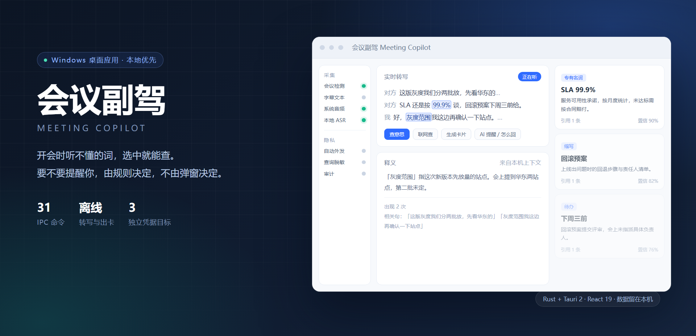
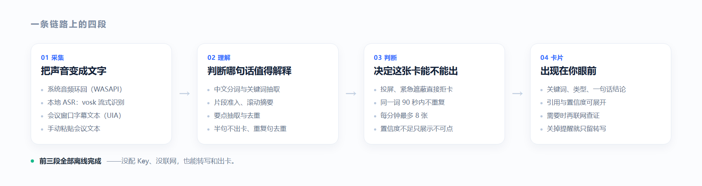
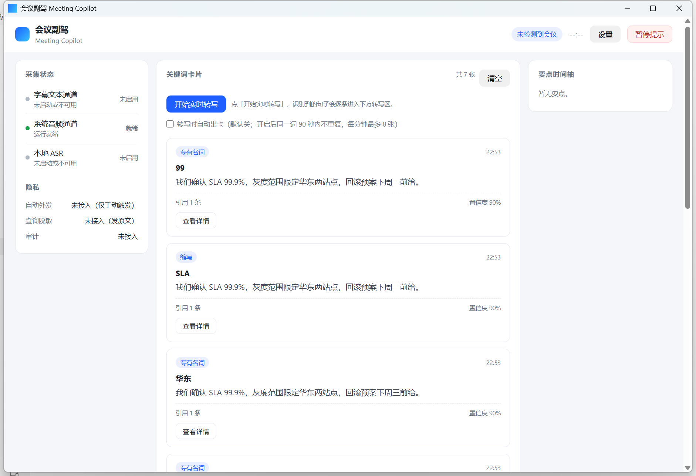

<div align="center">
  
</div>

<br>

<p align="center">
  <a href="https://github.com/AiLunSin/TSC/actions/workflows/ci.yml"></a>
  
  
  
  
  
</p>

# 会议副驾（Meeting Copilot）

一个常驻在屏幕边上的 Windows 桌面工具。开会时它跟着听，把值得解释的词记在一边；你要是听懂了，它一句都不打扰；你要是卡住了，选中那句话就能问。

仓库名 `TSC` 是项目代号。第一次用请直接看 [下载与使用指南](DOWNLOAD.md)。

## 为什么做这个

开会最难受的不是听不懂，是听不懂还得装作听懂了。轮到自己说话只能含糊带过，散会再去搜，搜出来的东西又跟会上那句话对不上。

现有的会议 AI 大多做会后总结，或者要你把内容贴进一个聊天框。这个工具换个位置：它就在你屏幕边上，一边听一边记，需要的时候再解释，不需要的时候保持安静。

## 它是怎么工作的



采集有三条路：系统音频环回接本地 vosk 识别、会议窗口里的字幕元素、手动粘贴一段文本。三种都接了，但主流会议客户端的窗口里读不到字幕文本，实际跑起来靠的是第一条和第三条。

转写默认只进转写区，不出卡。一场会能冒出几百个术语，全弹出来等于没有。想让它自己出卡得在设置里显式打开，打开后还有两道限流：同一个词 90 秒内不重复，每分钟最多 8 张。投屏和紧急遮蔽状态下直接拒卡，不给开关留余地。

解释先问本机。这段话在会上出现过几次、相关的是哪几句，这些不需要联网。配了模型 Key 才会把选中的内容连同前后各一句发出去，20 秒超时，失败就退回本机解释，并且如实标明这次结论是从哪来的，不冒充模型答的。

## 功能

| 功能 | 说明 |
|---|---|
| 实时转写 | 系统音频环回 → 16 kHz 单声道 → vosk 流式识别；半句先显示，稳定后才进全文 |
| 选中查义 | 选中不超过 200 字，点「查意思」；选的是整段话就自动切成概括模式 |
| 联网查证 | 博查、Tavily 两家预设，只发选中的 80 字以内，默认每小时 20 次 |
| 关键词卡片 | 关键词、类型、一句话结论、引用条数与置信度；点开只在本地展开 |
| AI 提醒 / 怎么回 | 看最近 12 句，给两条要留意的提醒和一两句能直接说出口的话 |
| 手动出卡 | 粘贴一段会议文本，走同一条链路 |
| 隐私控制 | 投屏拒卡、紧急遮蔽、凭据进系统凭据管理器、业务载荷字段级加密 |

## 界面



工作页只放开会时要按的东西：开始转写、选中之后的几个按钮、卡片区、粘贴入口。状态灯平时只有颜色，鼠标移上去才显示名字和细节，省得屏幕上到处是字。

模型、检索、限额、显示方式这些配置全在设置页。开会的时候不该有人在设置里翻菜单。

## 安装

系统要求 Windows 10/11，WebView2 一般已随系统安装。目前没有预编译的安装包，完整的准备工作和打包步骤见 [DOWNLOAD.md](DOWNLOAD.md)，从零开始大约要装四个基础工具，装一次就够。

从源码构建：

```bash
cargo build --workspace

cd app
npm ci
npm run build

cd ..
cargo build -p meeting-copilot-desktop --features llm-https
```

`llm-https` 不是默认特性。不带它也能转写和出卡，但「查意思」只会给本机上下文，联网查和 AI 提醒会直接报「未启用传输」，不静默失败。

实时转写另外需要 Python 3.8+ 和 `pip install vosk`，识别模型约 52 MB，不入库，发布前手动放进 `app/src-tauri/asr/`。

## 隐私

这东西一直在听会议，所以边界写死一点：

- 凭据只写入 Windows 凭据管理器，模型、博查、Tavily 三个目标分开存，配置文件里只有服务名和限额
- 日志只允许白名单字段，原文、完整地址、查询内容都不落盘；识别文本只写计数，不写内容
- 数据库打开需要密钥引用和实际派生密钥，业务表按字段做 AES-256-GCM；需要连 FTS 索引一起加密时切到 `sqlcipher`
- 出网只有三处，全部由点击触发：查意思（≤200 字 + 前后各一句）、联网查（≤80 字）、AI 提醒（最近 12 句，≤900 字）
- 审计只追加，在线保留 180 天，归档保留 5 年

## 已知限制

- 只支持 Windows。macOS 没有做，也没有设备验证。
- 字幕通道基本用不上：腾讯会议、飞书的窗口里读不到字幕文本，实际靠系统音频识别；OCR 兜底默认关闭，也没在真实字幕上验证过。
- 投屏检测和紧急遮蔽目前只能通过开发期环境变量注入触发，Windows 上没有自动侦测。
- 大规模的会中表现还没统计过：真机性能、误触发率、二十场以上的稳定性都还缺数据；联网查的召回质量取决于你配的那家检索服务。
- 只做会中，不做会后纪要导出。转写全文留在内存里，退出即清空。

## 技术栈

Rust + Tauri 2 桌面壳，React 19 + TypeScript + Vite 前端，SQLite 存储，31 个 IPC 命令。

分层是单向的：`domain` 放模型和端口，`application` 做采集、理解、门控编排，`infrastructure` 管存储、加密、审计和传输，`platform-win` 接 WASAPI、UIA、OCR，`ui-bridge` 出 IPC 的 DTO。依赖方向由 `scripts/check-layering.sh` 守着，越界会失败。

## 开发

```bash
cargo test --workspace
cargo clippy --workspace --all-targets -- -D warnings
cargo fmt --all -- --check

(cd app && npm run lint && npm run typecheck && npm run build)

bash scripts/check-layering.sh
bash scripts/scan-secrets.sh
```

CI 分六组：web、rust（Windows 加两个 Darwin 交叉编译）、用例名差集、特性覆盖、合规（许可证 / SBOM / 密钥扫描 / 分层）、sqlcipher。

改动前请确认能力状态与 `docs/progress/` 里的记录一致。没做完的写没做完，别在文档里提前宣布。

## 文档

| 文档 | 内容 |
|---|---|
| [DOWNLOAD.md](DOWNLOAD.md) | 下载、编译、首次配置 |
| [docs/ABOUT.md](docs/ABOUT.md) | 项目简介与能力边界 |
| [docs/sdd/](docs/sdd/) | 需求规格、技术方案、任务清单 |
| [docs/progress/](docs/progress/) | 各批次进度与验收记录（内部台账，随时可能过期） |
| [docs/compliance/](docs/compliance/) | 许可证复核与归档保留期意见 |

## 许可证

MIT 或 Apache-2.0，任选其一：[LICENSE-MIT](LICENSE-MIT) / [LICENSE-APACHE](LICENSE-APACHE)。

除非另有说明，提交进本项目的贡献按上述双许可授权。
