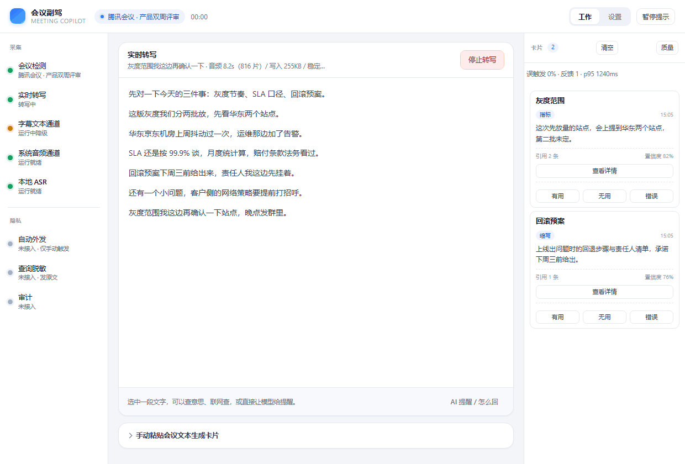

# 会议副驾（Meeting Copilot）

**开会时听不懂的术语，选中就能查。不选它，它一句都不打扰。**

Windows 10/11 · 实时转写在你自己的电脑上跑 · 只有你点的那一下才联网

<p>
  <a href="https://github.com/AiLunSin/meeting-glossary/actions/workflows/ci.yml"></a>
  
  
  
  
  
</p>



> Real-time meeting glossary for Windows. Select a phrase in the live transcript and get an explanation; local-first, nothing leaves the machine unless you click. Rust + Tauri 2.
>
> 仓库名 `TSC` 是项目代号，产品名叫会议副驾（Meeting Copilot）。

## 为什么做这个

开会最难受的不是听不懂，是听不懂还得装作听懂了。轮到自己说话只能含糊带过，散会再去搜，搜出来的东西又跟会上那句话对不上。

现有的会议 AI 大多做会后总结，或者要你把内容贴进一个聊天框。这个工具换个位置：它就在屏幕边上，一边听一边记，需要的时候再解释，不需要的时候保持安静。

## 和现成方案有什么不同

| | 会议副驾 | 会后总结类工具 | 通用对话模型 |
|---|---|---|---|
| 用的时候 | 会中，你卡住的那几十秒 | 会后 | 会后 |
| 触发方式 | 你选中哪句就解释哪句 | 全量自动总结 | 手动粘贴 |
| 默认外发 | 只在本机转写，点一下才发最小片段 | 音频与文本上传云端 | 内容上传 |
| 交付形态 | 装完即用的 Windows 程序 | 网页或客户端，通常要账号 | 网页 |

它不替代这些工具：会后要纪要、待办、分享，那些产品更合适。这里只解决会中那几十秒。

## 它是怎么工作的


采集有三条路：系统音频环回接本地 vosk 识别、会议窗口里的字幕元素、手动粘贴一段文本。三种都接了，但主流会议客户端的窗口里读不到字幕文本，实际跑起来靠的是第一条和第三条。

转写默认只进转写区，不出卡。一场会能冒出几百个术语，全弹出来等于没有。想让它自己出卡得在设置里显式打开，打开后还有两道限流：同一个词 90 秒内不重复，每分钟最多 8 张。投屏和紧急遮蔽状态下直接拒卡，不给开关留余地。

解释先问本机。这段话在会上出现过几次、相关的是哪几句，这些不需要联网。配了模型 Key 才会把选中的内容连同前后各一句发出去，20 秒超时，失败就退回本机解释，并且如实标明这次结论是从哪来的，不冒充模型答的。

## 功能

| 功能 | 说明 |
|---|---|
| 实时转写 | 系统音频环回 → 16 kHz 单声道 → vosk 流式识别；半句先显示，稳定后才进全文 |
| 选中查义 | 选中不超过 200 字，点「查意思」；选的是整段话就自动切成概括模式 |
| 联网查证 | 博查、Tavily 两家预设，只发选中的 80 字以内，默认每小时 20 次 |
| 关键词卡片 | 关键词、类型、一句话结论、引用条数与置信度；点开只在本地展开 |
| AI 提醒 / 怎么回 | 看最近 12 句，给两条要留意的提醒和一两句能直接说出口的话 |
| 手动出卡 | 粘贴一段会议文本，走同一条链路 |
| 隐私控制 | 投屏拒卡、紧急遮蔽、凭据进系统凭据管理器、业务载荷字段级加密 |

## 界面


工作页只放开会时要按的东西：开始转写、选中之后的几个按钮、卡片区、粘贴入口。状态灯默认只亮颜色，鼠标移上去才出名字和细节，省得满屏都是字；嫌看着不直观，可以在设置里改成常显（截图里是常显）。

模型、检索、限额、显示方式这些配置全在设置页。开会的时候不该有人在设置里翻菜单。

## 安装

Windows 10/11，WebView2 一般系统自带。安装包在 [Releases](https://github.com/AiLunSin/meeting-glossary/releases)，按要不要实时转写挑：

| 安装包 | 体积 | 装完能直接转写 | 还要自己装 |
|---|---|---|---|
| `MeetingCopilot-vX.Y.Z-full-x64-setup.exe` | 约 60 MB（模型压缩后约 42 MB） | 能 | 无 |
| `MeetingCopilot-vX.Y.Z-lite-x64-setup.exe` | 约 4.9 MB | 不能 | Python 3、`pip install vosk`、识别模型 |

两个版本界面和功能完全一样，差别只在转写的依赖：完整版把 vosk 模型和一份内嵌 Python 打进包，装完就能听；精简版只带程序本体，模型和解释器自己准备。只想开会时选词查意思、或者用粘贴生成卡片，精简版就够。

安装包没有代码签名，首次运行 Windows 会拦一下，点「更多信息 → 仍要运行」。完整性可以用 Release 里的 `SHA256SUMS.txt` 核对。

从源码构建（改代码时用）：

```bash
cargo build --workspace

cd app
npm ci
npm run build

cd ..
cargo build -p meeting-copilot-desktop --features llm-https
```

`llm-https` 不是默认特性。不带它也能转写和出卡，但「查意思」只会给本机上下文，联网查和 AI 提醒会直接报「未启用传输」，不静默失败。

识别模型不入库，放在 `app/src-tauri/asr/`；完整的准备工作（五样基础工具、模型下载地址、首次配置）见 [DOWNLOAD.md](DOWNLOAD.md)。

## 隐私

这东西一直在听会议，所以边界写死一点：

- 凭据只写入 Windows 凭据管理器，模型、博查、Tavily 三个目标分开存，配置文件里只有服务名和限额
- 日志只允许白名单字段，原文、完整地址、查询内容都不落盘；识别文本只写计数，不写内容
- 数据库打开需要密钥引用和实际派生密钥，业务表按字段做 AES-256-GCM；需要连 FTS 索引一起加密时切到 `sqlcipher`
- 出网只有三处，全部由点击触发：查意思（≤200 字 + 前后各一句）、联网查（≤80 字）、AI 提醒（最近 12 句，≤900 字）
- 审计只追加，在线保留 180 天，归档保留 5 年

## 已知限制

- 只支持 Windows。macOS 没有做，也没有设备验证。
- 字幕通道基本用不上：腾讯会议、飞书的窗口里读不到字幕文本，实际靠系统音频识别；OCR 兜底默认关闭，也没在真实字幕上验证过。
- 投屏检测和紧急遮蔽目前只能通过开发期环境变量注入触发，Windows 上没有自动侦测。
- 大规模的会中表现还没统计过：真机性能、误触发率、二十场以上的稳定性都还缺数据；联网查的召回质量取决于你配的那家检索服务。
- 只做会中，不做会后纪要导出。转写全文留在内存里，退出即清空。
- 安装包没有代码签名，首次运行会被 SmartScreen 拦；自签证书解决不了，要 OV/EV 证书或 Azure Trusted Signing。

## 技术栈

Rust + Tauri 2 桌面壳，React 19 + TypeScript + Vite 前端，SQLite 存储，31 个 IPC 命令。

分层是单向的：`domain` 放模型和端口，`application` 做采集、理解、门控编排，`infrastructure` 管存储、加密、审计和传输，`platform-win` 接 WASAPI、UIA、OCR，`ui-bridge` 出 IPC 的 DTO。依赖方向由 `scripts/check-layering.sh` 守着，越界会失败。

## 开发

```bash
cargo test --workspace
cargo clippy --workspace --all-targets -- -D warnings
cargo fmt --all -- --check

(cd app && npm run lint && npm run typecheck && npm run build)

bash scripts/check-layering.sh
bash scripts/scan-secrets.sh
```

CI 分六组：web、rust（Windows 加两个 Darwin 交叉编译）、用例名差集、特性覆盖、合规（许可证 / SBOM / 密钥扫描 / 分层）、sqlcipher。

发版：`git tag v0.1.0 && git push origin v0.1.0`。`release` 工作流在 Windows 机器上编译精简版与完整版两个安装包、生成 SHA256 清单，并建一个**草稿** Release，看过安装包再手动发布。模型在构建时从 vosk 官方直链下载；仓库如果配了 secret `ASR_MODEL_URL`，会优先用它（换镜像或内网源时用）。

README 里的动图和截图不是手工截的：`bash scripts/readme-capture/render-demo-gif.sh` 会用真实前端加一份假 IPC 重新渲染，改界面之后重跑即可。

改动前请确认能力状态与 `docs/progress/` 里的记录一致。没做完的写没做完，别在文档里提前宣布。

## 文档

| 文档 | 内容 |
|---|---|
| [DOWNLOAD.md](DOWNLOAD.md) | 下载、编译、首次配置 |
| [docs/ABOUT.md](docs/ABOUT.md) | 项目简介与能力边界 |
| [docs/sdd/](docs/sdd/) | 需求规格、技术方案、任务清单 |
| [docs/progress/](docs/progress/) | 各批次进度与验收记录（内部台账，随时可能过期） |
| [docs/compliance/](docs/compliance/) | 许可证复核与归档保留期意见 |

## 许可证

MIT 或 Apache-2.0，任选其一：[LICENSE-MIT](LICENSE-MIT) / [LICENSE-APACHE](LICENSE-APACHE)。

除非另有说明，提交进本项目的贡献按上述双许可授权。
