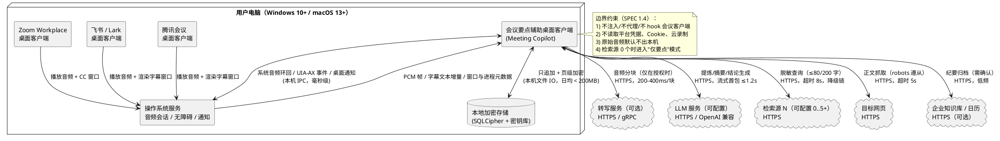
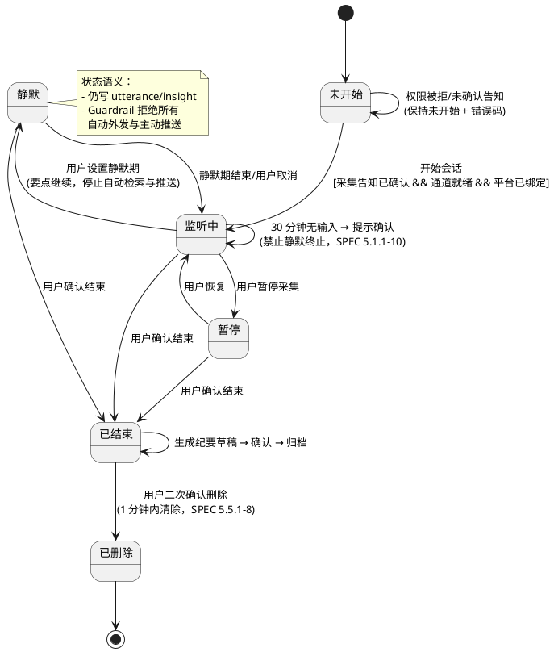
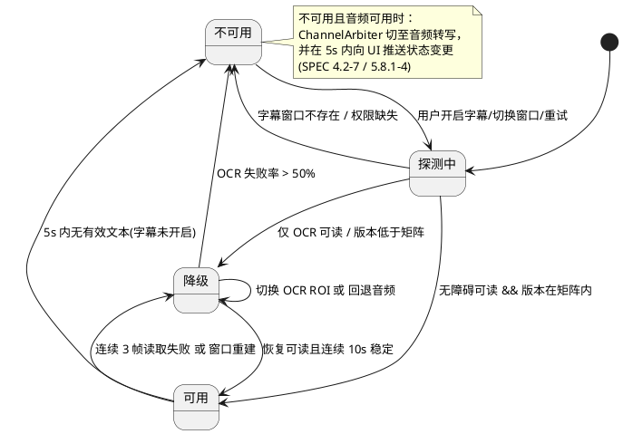
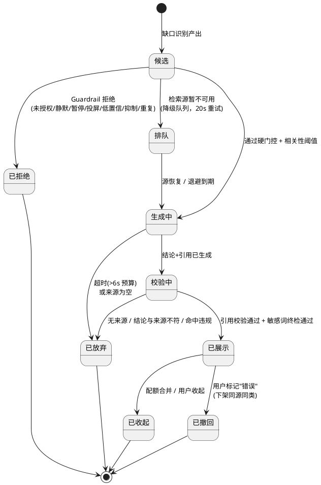
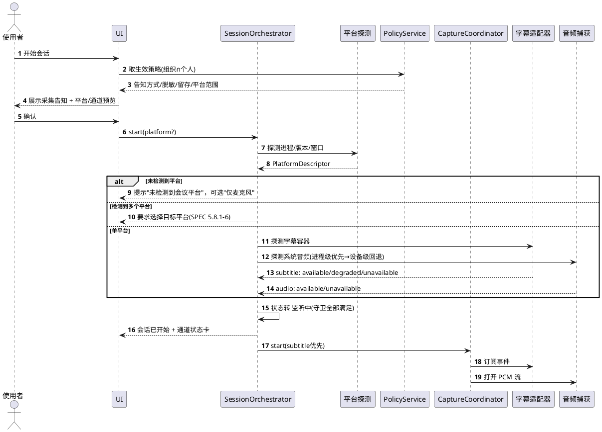
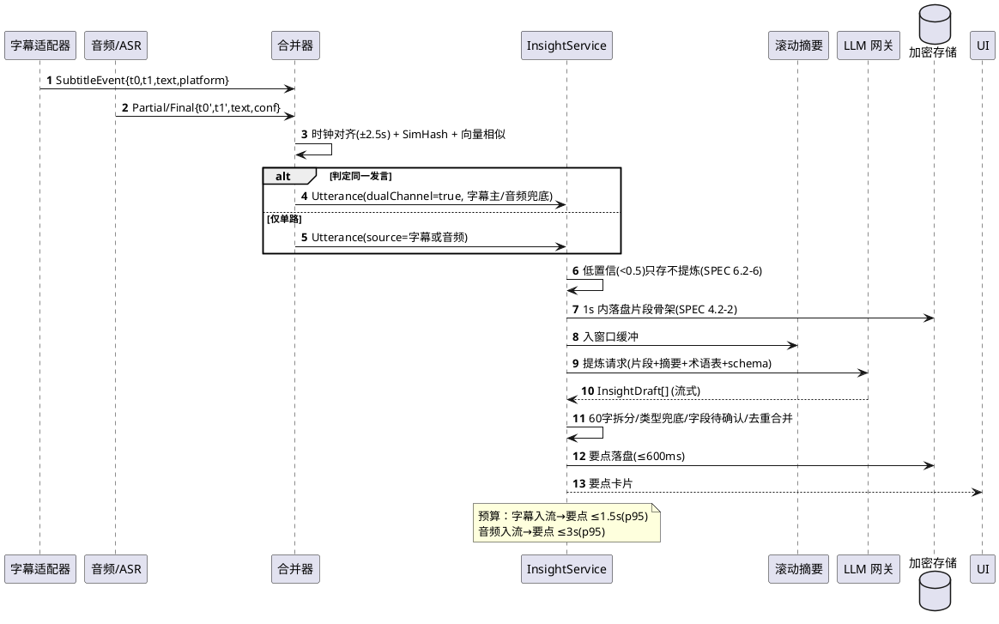
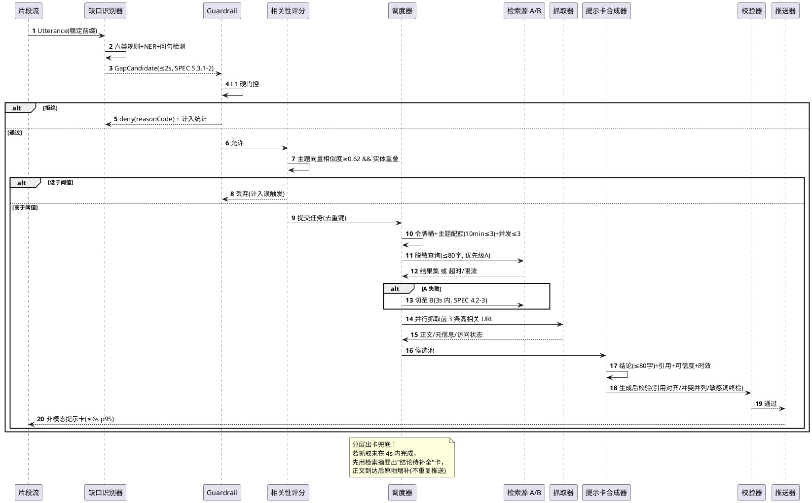
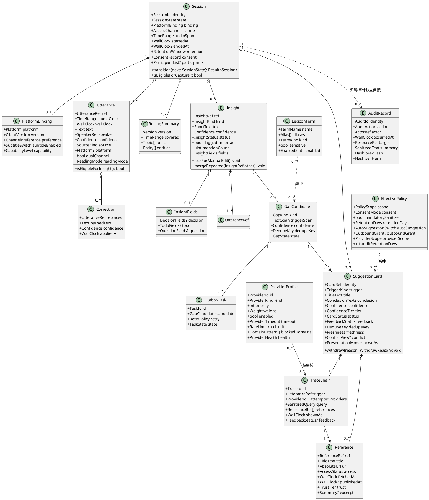
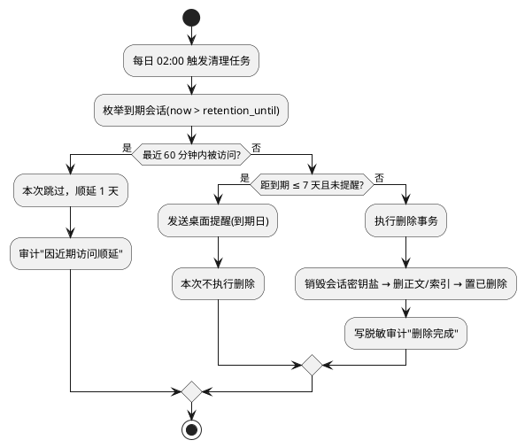

# 一、需求与存量功能关系分析

> **前置说明（与模板的差异声明）**
> 本仓库当前为**空项目**（除 `.codeartsdoer/specs/meeting_copilot/spec.md` 外无任何源码、无 `package.json` / `Cargo.toml` / `CMakeLists.txt`），因此不存在可引用的存量业务代码。为保证"每项功能对比必须有具体位置引用"的要求不打折扣，本章将**存量参照对象**定义为两类可核实基线：
> 1. **平台系统能力**：Windows / macOS 操作系统提供的音频捕获与无障碍文本读取接口；
> 2. **开源基线**：社区成熟、许可证可查的开源项目与其模块级能力。
>
> 表格中的"来源位置"列因此填写为 `项目名#模块` 或 `OS-API#接口`，而非本地行号。所有许可证均为**待复核状态**（标记 ⚠ 的必须在选型评审中由法务/合规复核），不得视为已验证结论。
> 文中 `SPEC x.y.z-n` 指 `spec.md` 中的章节号+条目号（如 `SPEC 5.3.1-2` 表示 5.3.1 业务规则第 2 条），用于需求可追溯。

## 1.1 需求功能与存量功能对比

### 1.1.1 已实现功能（能力级可直接复用）

判定依据：该能力在开源基线或系统 API 中已具备**生产级成熟度**，我们只需做集成、配置与少量封装，不需要重新实现核心算法。匹配度 100% 表示"能力即插即用"；75% 表示"能力存在但需封装/适配/裁剪"；50% 表示"仅有算法或参考实现，需工程化"；25% 表示"仅存在方向性参考"。

| 需求功能（SPEC 追溯） | 存量能力 | 来源位置 | 许可证 / 属性 | 匹配度 | 判定依据与约束 |
|---|---|---|---|---|---|
| 桌面客户端承载（SPEC 1.4-1、4.5-1） | Tauri 2 桌面壳（Rust 后端 + 系统 WebView） | `tauri-apps/tauri#core` | MIT / Apache-2.0 | 75% | 跨平台 Win/mac、x64/ARM64 均支持；系统 WebView 相比 Electron 显著降低常驻内存，满足空闲 ≤400MB（SPEC 4.1-8）；但悬浮窗、托盘、无焦点弹窗需插件补充 |
| Windows 系统音频捕获（SPEC 5.8.1-2a） | WASAPI Loopback（设备级）+ Process Loopback（进程级，Win10 2004+） | `OS-API#WASAPI / AUDIOCLIENT_ACTIVATION_TYPE_PROCESS_LOOPBACK` | 系统能力 | 100% | 可捕获渲染设备输出；进程级环回可按会议客户端 PID 隔离，避免混入其它系统声音；**Win10 低于 2004 只能设备级回退**（见 1.2.1） |
| macOS 系统音频捕获（SPEC 5.8.1-2a、4.5-1） | ScreenCaptureKit `SCStream` 音频输出（macOS 13+） | `OS-API#ScreenCaptureKit` | 系统能力 | 75% | macOS 13 起提供系统/单应用音频流；需"屏幕录制"权限；`SCContentFilter` 可按应用过滤；需处理 13.0–14.3 的已知稳定性差异 |
| 流式语音转写（SPEC 4.1-1、5.1.1-4） | sherpa-onnx 流式 Zipformer / Paraformer 中英双语 | `k2-fsa/sherpa-onnx#streaming-asr` | Apache-2.0 | 75% | 端侧流式、CPU 友好、支持中英混识；需自建分段、VAD、时间戳对齐封装；说话人分离为可选附加 |
| 离线高质量转写回填（SPEC 4.2-5、5.2.3-5） | faster-whisper / whisper.cpp 批量转写 | `SYSTRAN/faster-whisper`、`ggml-org/whisper.cpp` | MIT | 75% | 用于会话结束补齐"未提炼"片段、以及流式结果低置信时的二次校正；CPU 推理需控制线程数以免冲破 CPU 预算 |
| 语音活动检测与静音过滤（SPEC 5.1.1-7） | Silero VAD（ONNX） | `snakers4/silero-vad#onnx` | MIT | 100% | 提供 5 秒静音判定、切句边界、重叠发言起点检测 |
| Windows 正文文本/字幕读取（SPEC 5.8.1-2b） | UI Automation（TextPattern / 结构变更事件） | `OS-API#UIAutomation`；封装参考 `pywinauto/pywinauto` | 系统能力 / BSD-3 | 75% | 对标准控件可稳定读取；对 Electron 自绘文本（飞书）不可靠，需 OCR 兜底 |
| macOS 无障碍文本读取（SPEC 5.8.1-2b） | Accessibility API（AXObserver + AXStaticText/AXGroup） | `OS-API#AXUIElement`；封装参考 `tdezwaan/AXSwift` | 系统能力 / MIT | 75% | 需"辅助功能"授权；Chromium/Electron 需启用无障碍树才可读，存在失效风险 |
| 字幕区域 OCR 兜底（SPEC 5.8.3-4） | Windows.Media.Ocr / Apple Vision / Tesseract | `OS-API#Windows.Media.Ocr`、`OS-API#Vision`、`tesseract-ocr/tesseract` | 系统能力 / Apache-2.0 | 75% | 作为字幕通道第三层兜底；需固定 ROI 裁剪 + 增量帧差 + 文本去抖，否则 CPU 与误识别不可控 |
| 网页正文抽取（SPEC 5.3.1-12） | trafilatura 正文/元信息抽取；readability 备用 | `adbar/trafilatura`、`mozilla/readability` | Apache-2.0 | 75% | 输出标题、正文、发布时间、语言；需内置 robots.txt 判定与登录墙识别，禁止绕过 |
| 本地加密存储（SPEC 4.3-3） | SQLite + SQLCipher（页级加密）+ FTS5 全文索引 | `sqlcipher/sqlcipher`、`sqlite/sqlite` | BSD-style / Public Domain | 75% | 需自行实现密钥派生（OS 密钥库托管）与密钥轮换；FTS5 索引随库加密 |
| 本地向量检索（SPEC 5.2.1-7、5.3.1-10） | sqlite-vec 向量扩展 / 余弦近邻 | `asg017/sqlite-vec` | MIT / Apache-2.0 | 75% | 与加密库共存放，避免引入独立向量服务（内存约束 SPEC 4.1-7）；规模为单会话万级片段，够用 |
| 进程与窗口识别（SPEC 5.8.1-4、5.8.3-1） | sysinfo 进程/版本探测 + 窗口标题枚举 | `GuillaumeGomez/sysinfo`、`OS-API#EnumWindows` | MIT | 75% | 识别腾讯会议/飞书/Lark/Zoom 进程与客户端版本；窗口标题用于平台判定与字幕容器定位 |
| 托盘、通知、悬浮窗（SPEC 5.4.1-9、4.3-1） | Tauri 托盘/通知/多窗口插件 | `tauri-apps/plugins-workspace` | MIT / Apache-2.0 | 75% | 非模态、不抢焦点（SPEC 5.4.1-10）需平台层 `WS_EX_NOACTIVATE` / `NSWindow.styleMask` 定制 |
| 结构化输出约束（SPEC 6.3、6.4） | JSON Schema 校验 + 受限解码 | `dottxt-ai/outlines`（参考）、JSON Schema 校验器 | Apache-2.0 | 50% | 云端 LLM 通过 function calling/JSON mode 约束；本地小模型需语法约束解码，工程化成本在 50% 档 |

### 1.1.2 需要扩展的功能（部分匹配，需在基线上改造）

| 需求功能（SPEC 追溯） | 存量能力 | 差异说明（输入/逻辑/边界） | 扩展方向 |
|---|---|---|---|
| 三平台字幕文本通道（SPEC 5.8.1-1、5.8.1-2b） | 通用 UIA / AX 文本读取 | **输入差异**：三平台字幕容器结构、窗口生命周期、是否独立窗口均不同；**逻辑差异**：需从混合 UI 树中筛出"字幕流"而非聊天/参会人列表；**边界差异**：平台升级后控件类型漂移、字幕未开启、共享屏幕遮挡 | 平台适配插件化（每平台一个 `SubtitleAdapter`），能力探测→选择器配置→启发式打分→OCR 兜底四级；插件带 `versionRange` 与失效降级策略（SPEC 4.5-2） |
| 双通道去重合并（SPEC 5.1.1-5、5.8.1-5、6.2-9） | 两路独立时间戳 + 文本 | **输入差异**：字幕与 ASR 时间基准不同（字幕常滞后 0.5–2s，ASR 为音频时间）；**逻辑差异**：需语义等价判定而非字符串相等；**边界差异**：同一人连说、双讲重叠、字幕断句与 ASR 断句不一致 | 统一"音频时钟"为基准；时间窗 ±2.5s + 归一化文本 SimHash + 向量相似双阈值；命中则合并为一条并打 `dualChannel` 标记，仅计一次（SPEC 6.2-9） |
| 要点提炼（SPEC 5.2.1-1~8） | 通用 LLM 抽取能力 | **输入差异**：需带滚动摘要上下文与术语表；**逻辑差异**：四类分类 + 60 字上限 + 决策/待办必需字段 + 疑问闭环；**边界差异**：低置信片段不得提炼、静默期片段排除、人工编辑锁定 | 两阶段：规则/轻量分类器预筛 → LLM 结构化抽取 → Schema 校验 → 后处理（拆分超长、补"待确认"、去重合并、类型兜底为关键信息） |
| 全自动主动提示主路径（SPEC 5.3.1-1~2、5.4.1-1） | 通用检索 + 抓取 + LLM 摘要 | **输入差异**：触发源是流式片段而非用户查询；**逻辑差异**：需触发识别→硬门控→相关性打分→生成→生成后校验五级漏斗；**边界差异**：静默期/暂停/投屏/未授权/低置信/抑制列表全部要拦截 | 新增 `ProactivePipeline` 门控管线（见 2.6），把"检索能力"包成受策略约束的受控能力，而非直连 |
| 检索源开放可配置与多源调度（SPEC 4.5-6、5.3.1-7、6.9） | 通用 HTTP 客户端 | **输入差异**：源配置含类型/优先级/权重/超时/限额/屏蔽域名；**逻辑差异**：优先级降级、权重排序、熔断、8s 超时、健康状态；**边界差异**：0 源时进入"仅要点"模式、配置错误标记不可用、运行中热生效 | 定义 `SearchProvider` 端口 + 适配器注册表；调度器实现优先级链 + 熔断器 + 令牌桶 + 结果融合排序（见 2.2、2.5） |
| 脱敏与敏感词一致性（SPEC 4.3-4、5.3.1-6、5.6.1-3） | NER + 词典替换 | **输入差异**：需覆盖查询/提示卡/纪要/导出/日志五类出口；**逻辑差异**：人名需识别而非仅词典命中；**边界差异**：脱敏失败必须阻断外发（fail-closed） | 独立 `Sanitizer` 组件 + 出口统一拦截（Outbound Gateway），所有外发/导出必须经同一入口；失败即阻断并审计 |
| 本地审计（SPEC 4.3-7、6.8） | append-only 表 + 哈希链 | **差异**：需 180 天固定保留、不可删改、仅存脱敏摘要、到期整体归档 | 哈希链（前一条哈希入下一条）+ 定期锚定 + 只追加表；归档包整体加密封存 |
| 会议纪要导出（SPEC 5.5.1-6、4.5-5） | Markdown/JSON 序列化 | **差异**：导出前强制脱敏检查、三格式一致性、PDF 可选、禁止含原文音频 | 统一 `MinutesDocument` 中间模型 → 三个 Renderer；导出前过 `Sanitizer` 与敏感词复核 |
| 断网降级与补齐（SPEC 4.2-5、5.3.3-1） | 本地队列 + 重试 | **差异**：断网期间要点必须继续、恢复后 30s 内补齐、全部源不可用需明确降级态 | 本地 outbox 持久队列 + 网络状态机 + 恢复后并发受控回放（≤3 并发，SPEC 4.1-4） |

### 1.1.3 需要新增的功能或接口（存量完全缺失）

按模块分组，每项给出输入、输出、核心逻辑与依赖。

**A. 采集与平台接入层**
1. **平台能力探测与门禁**：输入=运行中进程列表+窗口标题+版本资源；输出=`PlatformDescriptor{platform, version, subtitleAvailable, audioAvailable, capabilityLevel}`；逻辑=进程名匹配→版本比对支持矩阵→窗口/无障碍探测→生成通道建议；依赖=sysinfo、UIA/AX。对应 SPEC 5.8.1-4、4.5-2。
2. **字幕通道插件框架**：输入=平台标识+版本；输出=增量字幕事件流 `SubtitleEvent`；逻辑=选择器集加载→事件订阅/轮询→文本去抖→断句→时间戳归一；依赖=UIA/AX/OCR。对应 SPEC 5.8.1-2b。
3. **通道仲裁与合并器**：输入=字幕事件流+ASR 片段流；输出=统一 `Utterance`（含 `dualChannel` 标记）；逻辑=时钟对齐+等价判定+优先级仲裁（字幕优先/音频优先）；依赖=VAD、SimHash、向量相似。对应 SPEC 5.1.1-5。
4. **音频前处理链**：输入=WASAPI/SCStream PCM；输出=16kHz mono 分块 + VAD 标记；逻辑=重采样、降噪、回声抑制、静音段剔除、设备切换检测；依赖=重采样库、Silero VAD。对应 SPEC 5.1.3-2、5.1.1-7。

**B. 理解层**
5. **滚动摘要器**：输入=最近窗口片段+上一版摘要；输出=`RollingSummary`；逻辑=30s/20 片段触发、增量压缩、保留上一版对比、15s 超时丢弃；依赖=LLM（云/本地）。对应 SPEC 5.2.1-9、5.2.3-4。
6. **要点提炼器**：输入=片段+摘要上下文+术语表；输出=0..n 条 `InsightDraft`；逻辑=类型分类、60 字限制与拆分、决策/待办/疑问字段补全、置信度继承与衰减；依赖=LLM+Schema 校验。对应 SPEC 5.2.1-1~8。
7. **要点去重与锁定器**：输入=新要点草稿+既有要点；输出=合并结果（提及次数+1）或新要点；逻辑=语义相似度≥0.88 合并、10 分钟窗口同主题合并、人工编辑锁定不被覆盖；依赖=向量索引。对应 SPEC 5.2.1-7、5.2.1-10、5.2.3-2。
8. **信息缺口识别器**：输入=片段流+术语表+已解释集合；输出=`GapCandidate{type, span, confidence, triggerPhrase}`；逻辑=首次专有名词/缩写/机构/法规编号/数据指标/未答提问六类规则+NER+问句检测+2s 内产出；依赖=NER、术语差集、句法规则。对应 SPEC 5.3.1-2。

**C. 检索与生成层**
9. **检索源适配器注册表**：输入=`ProviderProfile`；输出=`SearchProvider` 实例；逻辑=类型→适配器映射、热加载、连接测试、健康状态；依赖=各源 HTTP 客户端。对应 SPEC 5.7.1-2、6.9。
10. **多源调度与融合器**：输入=脱敏查询；输出=候选结果集（含来源标签/相关度）；逻辑=优先级降级、3s 切换、8s 超时、权重加权融合、屏蔽域名过滤、并发≤3；依赖=熔断器、令牌桶。对应 SPEC 4.1-4、4.2-3、5.3.3-1。
11. **抓取器**：输入=URL 列表；输出=`FetchedPage{title, body, publishedAt, accessStatus}`；逻辑=robots/登录墙/付费墙判定→抓取→正文抽取→合规过滤；依赖=trafilatura、HTTP 客户端。对应 SPEC 5.3.1-12、5.3.3-6。
12. **提示卡生成与校验器**：输入=抓取正文+触发上下文；输出=`SuggestionCardDraft`；逻辑=一句话结论（≤80 字）、引用必备、可信度分级、时效标注、冲突并列、无来源则不出结论；依赖=LLM+引用对齐校验。对应 SPEC 5.3.1-8~11、5.4.1-6。

**D. 呈现层**
13. **低打扰推送器**：输入=通过门控的提示卡；输出=卡片流/悬浮窗/角标三形态；逻辑=非模态、不抢焦点、配额（10min≤3）、合并展示、静默期抑制；依赖=平台窗口 API。对应 SPEC 5.4.1-1~10。
14. **投屏保护与紧急遮蔽**：输入=用户操作/显示拓扑变化；输出=界面清空/角标化；逻辑=1s 内隐藏正文、暂停采集与检索、强制关闭面板兜底；依赖=窗口管理、显示检测。对应 SPEC 5.4.1-5、5.4.1-7、5.6.1-8。

**E. 治理层**
15. **策略引擎**：输入=组织策略包+个人配置；输出=生效策略；逻辑=组织优先、冲突取严、不可绕过项锁定、来源展示；依赖=签名校验（Ed25519）。对应 SPEC 5.6.1-6、5.7.1-10、6.7。
16. **审计链**：输入=事件；输出=不可篡改记录；逻辑=只追加、哈希链、1s 内落库、失败降级并禁用敏感操作；依赖=加密库。对应 SPEC 4.3-7、6.8、5.6.3-4。
17. **质量度量与反馈闭环**：输入=采纳/无用/错误反馈+链路埋点；输出=采纳率/误触发率/误报率报表；逻辑=按会话/平台/主题维度聚合、阈值告警、周度抽检 20 条；依赖=本地统计库。对应 SPEC 4.4-1~4、5.7.1-7。
18. **留存与删除执行器**：输入=策略+访问记录；输出=到期提醒/删除结果；逻辑=到期前 7 天提醒、1 小时内被访问则顺延、1 分钟内不可恢复删除；依赖=文件系统、密钥擦除。对应 SPEC 5.5.1-7~8、5.5.3-4。

## 1.2 存量功能详细分析（基线能力约束与可行边界）

### 1.2.1 系统音频通道的约束

1. **接口契约（Windows/WASAPI）**
   - 入参：目标渲染设备 ID；进程级环回另需目标进程 PID。
   - 出参：PCM 流（通常 48kHz/16bit/立体声）+ 时间戳。
   - 副作用：设备级 loopback 会捕获**全部**系统播放声音（含音乐、通知音），因此必须做"只保留会议客户端音频"的处理：优先进程级环回；不可用时在设备级基础上叠加"仅会议期间激活 + 声源活跃度判定"，并明确告知用户可能混入其它声音。
   - 约束：**进程级 `ProcessLoopback` 要求 Windows 10 2004 及以上**；SPEC 4.5-1 仅要求 Win10+ 泛版本，故必须实现"设备级回退"，并在能力探测中把该差异暴露给用户（对应 SPEC 5.8.1-4 通道状态可见）。
   - 约束：会议客户端使用**独占模式**或第三方虚拟声卡时可能捕获失败 → 需回退麦克风并标记"仅麦克风"（SPEC 5.8.3-5）。

2. **接口契约（macOS/ScreenCaptureKit）**
   - 入参：`SCContentFilter`（按应用/显示器）+ 音频配置；出参：`CMSampleBuffer` 音频帧。
   - 前置条件：用户授予"屏幕录制"权限（系统设置 > 隐私与安全性）；未授权时**不能**采集系统音频。
   - 约束：macOS 13.0–14.3 存在已知的音频流中断/静音问题，需实现"静音看门狗 + 自动重建 stream"，并把重建次数计入诊断（SPEC 4.4-5）。
   - 约束：不得捆绑 GPL 的虚拟声卡（如 BlackHole，GPL-3.0）作为默认方案；仅可作为用户自行安装后的可选兼容项，且不得随安装包分发。

3. **不可突破的边界**：不注入、不 hook、不代理会议客户端进程（SPEC 1.4-3）；因此不得用 API Hook 抓取会议客户端的音频缓冲，只能走系统级采集。

### 1.2.2 字幕文本通道的约束（三平台差异）

| 平台 | 字幕形态（需实测确认） | 首选读取方式 | 主要风险 | 回退顺序 |
|---|---|---|---|---|
| 腾讯会议 | 实时字幕/转写面板，通常为独立浮窗 | Windows UIA TextPattern 事件；macOS AX 通知 | 浮窗类名与控件层级随版本变化；未开启字幕时无内容 | UIA/AX → OCR（ROI）→ 音频转写 |
| 飞书（含 Lark） | 字幕/转写面板，Electron 自绘可能性高 | Windows UIA + Chromium 无障碍树；macOS AX | Electron 无障碍树默认可能关闭，读取不稳定；国内版/国际版 UI 不同 | OCR（ROI）优先 → 音频转写 |
| Zoom | Closed Caption（CC）独立窗口 | Windows UIA TextPattern；macOS AX | CC 窗口仅在开启后出现；5.17+ 版本矩阵 | UIA/AX → OCR → 音频转写 |

**分析结论（影响设计的关键判断）**
1. 字幕通道**不能依赖固定控件类名/固定坐标**，必须采用"候选窗口发现 → 文本容器打分 → 事件订阅 → 增量 diff"的启发式方案，并把选择器做成**可下发配置**（平台升级后无需发版即可修）。
2. 由于飞书字幕自绘概率高，**OCR 兜底不是可选项而是必选项**；OCR 必须限制 ROI、帧率（≤2fps）并仅做变化区域，否则 CPU 均值会突破 SPEC 4.1-7 的 35%。
3. 字幕通道时延天然优于音频（无需 ASR），因此 SPEC 4.1-1/4.1-2 的 1.5s 指标应以字幕通道为主路径达成；音频通道 3s 指标依赖流式 ASR 的中间结果（见 2.1.3 时延预算）。

### 1.2.3 ASR 基线约束

- 流式识别（sherpa-onnx）提供**部分结果（partial）**与**最终结果（final）**两类输出：要点提炼可消费 partial 以压低时延，但 partial 易抖动，需"稳定前缀"策略（连续两次一致才提交），否则会放大要点误报率（SPEC 4.4-4 阈值 15%）。
- 中英混合识别需显式指定双语模型并保留语言标签，供 SPEC 4.5-4 的混合识别要求与 5.7.1-5 的语言标注使用。
- 说话人标识：sherpa-onnx 的 diarization 在流式场景稳定性不足；**默认不启用**，统一标记"未知说话人"，符合 SPEC 5.1.1-6"禁止推断或编造姓名"。
- 外部转写服务为**可配置项**而非必需项（SPEC 4.2-6 的降级要求）：默认本地推理，云端为可选增强；两者共用同一 `Transcriber` 端口。

### 1.2.4 LLM 基线与内存约束

- SPEC 4.1-7 要求内存 ≤2GB、CPU 均值 ≤35%。7B 级本地模型（量化后常驻 4GB+）**不可行**，因此：
  - **默认路径**：要点提炼、摘要、提示卡结论使用**可配置的云端 LLM**（OpenAI 兼容协议 / 国产模型 API），首 token 时延需 ≤1.2s 才能满足 6s 主动提示指标；
  - **降级路径**：断网时使用本地轻量模型（0.5B–1.5B 量化，常驻 ≤600MB）或纯规则提炼，保证"可用性降级但不断供"（SPEC 4.2-5）；
  - **硬约束**：本地模型必须是**可关闭的**，关闭后采集与要点规则链仍能工作（SPEC 4.2-8 的失败隔离要求）。
- 幻觉控制不能仅靠提示词：必须做"引用→结论"对齐校验（SPEC 5.3.1-8）与"来源冲突并列"（SPEC 5.3.3-5）；无来源时结论字段强制为空（SPEC 6.4-5）。

### 1.2.5 检索与抓取基线约束

- **许可证红线**：SearXNG 为 **AGPL-3.0**。若客户端**内置并分发**其代码或修改版，将触发 AGPL 的分发义务；因此本设计**只允许**以"用户配置的 HTTP 服务地址"方式接入（外部服务边界），默认不内置、不分发、不修改其代码。任何内置打包方案必须在法务复核后另行决策。
- **抓取合规**：trafilatura 只负责正文抽取，**不负责合规判定**；robots.txt 判定、登录墙/付费墙识别、限速、User-Agent 声明必须由抓取器自研实现（SPEC 5.3.1-12）。
- 检索结果质量差异极大，**不能**把"搜索摘要"直接当结论：必须以抓取正文为准，摘要仅作兜底并标注"正文未获取"（SPEC 5.3.3-6）。

### 1.2.6 许可证与合规基线清单（待复核）

| 组件 | 许可证 | 使用方式 | 风险 | 复核要点 |
|---|---|---|---|---|
| Tauri 2 | MIT / Apache-2.0 | 桌面壳，静态/动态链接 | 低 | 保留版权声明；WebView2 运行时分发条款（Windows） |
| sherpa-onnx | Apache-2.0 | 随包分发的推理库 + 模型 | 中 | **模型权重许可证独立于代码**，需逐个核实（尤其中文模型） |
| faster-whisper / whisper.cpp | MIT | 可选组件 | 低 | 模型权重（Whisper）为 MIT，需确认衍生转换模型许可 |
| Silero VAD | MIT | 随包 | 低 | ONNX 模型许可需随包附带 |
| trafilatura | Apache-2.0 | 随包 | 低 | 依赖树（lxml 等）许可合并核查 |
| sqlite-vec | MIT / Apache-2.0 | 随包扩展 | 低 | 与 SQLCipher 组合的构建许可 |
| SQLCipher | BSD-style | 随包 | 低 | OpenSSL 链接与出口合规声明 |
| SearXNG | **AGPL-3.0** | **仅外部 HTTP 接入** | **高** | 禁止内置分发；仅作为用户可选配置示例 |
| Tesseract | Apache-2.0 | OCR 兜底（可选） | 低 | 语言数据包许可（ tessdata ）需单独核查 |
| Qwen / 其它本地小模型 | Apache-2.0（多数） | 可选本地降级 | 中 | 各版本许可不同，需逐模型确认商用条款 |
| Llama 系列 | Llama Community License（非 OSI） | **不建议**进 V1 | 高 | 商用/分发限制条款，需法务明确 |
| BlackHole（虚拟声卡） | GPL-3.0 | **不随包分发** | 高 | 仅在文档中提及用户自装，避免衍生作品争议 |

> 说明：以上"风险"仅指**分发合规风险**，不代表技术不可用。所有 ⚠ 项在进入开发前必须输出 SBOM（CycloneDX）并完成一次法务签署。
# 二、增量设计方案

## 2.1 实现模型

### 2.1.1 上下文视图

本模块是**单机桌面进程**，不引入服务端。所有跨边界交互分为四类：本机系统接口（同机 IPC）、用户配置的外部 HTTP 服务、可选的云端 AI 服务、以及可选的归档目标。核心设计原则：**任何外部依赖失效都不得阻断"采集→要点"本地主链**（SPEC 4.2-8）。



**通信协议与频率约定**
| 边界 | 协议 | 频率/规模 | 失败影响 |
|---|---|---|---|
| 系统音频 → 客户端 | WASAPI / ScreenCaptureKit | 连续流，16kHz mono 分块 200–400ms | 回退麦克风或仅字幕（SPEC 4.2-7） |
| 无障碍 → 客户端 | UIA 事件 / AX 通知 | 每句 1–3 次，突发可达 20 次/秒（需去抖） | 回退 OCR 或音频转写 |
| 客户端 → 检索源 | HTTPS | ≤3 并发/会话，令牌桶限流 | 降级至下一优先级（SPEC 4.2-3） |
| 客户端 → LLM | HTTPS 流式 | 每片段 1 次精炼 + 每 30s 1 次摘要 | 回退规则提炼（SPEC 4.2-8） |
| 客户端 → 本地库 | SQLite over encrypted file | 每要点 1 次写入，1s 内落盘 | 暂停采集并告警（SPEC 5.1.3-5） |

### 2.1.2 服务/组件总体架构

架构分为五层，依赖方向**自上而下单向**；领域层不依赖任何平台 API 与网络实现，以便单测与替换（这也是"检索源开放可配置"和"平台插件化"的结构保证）。

```plantuml
@startuml
skinparam componentStyle rectangle
package "表现层 Presentation" {
  [卡片流视图] as UI1
  [侧边悬浮窗] as UI2
  [角标模式] as UI3
  [托盘/快捷键] as UI4
  [配置与策略页] as UI5
  [纪要与检索页] as UI6
}
package "应用层 Application" {
  [会话编排 SessionOrchestrator] as APP1
  [采集协调 CaptureCoordinator] as APP2
  [要点服务 InsightService] as APP3
  [主动提示管线 ProactivePipeline] as APP4
  [推送协调 PresenterService] as APP5
  [纪要服务 MinutesService] as APP6
  [策略服务 PolicyService] as APP7
  [导出与归档 ExportService] as APP8
}
package "领域层 Domain" {
  [片段归一化器] as D1
  [双通道合并器] as D2
  [滚动摘要器] as D3
  [要点提炼器] as D4
  [信息缺口识别器] as D5
  [要点去重器] as D6
  [门控与限流器 Guardrail] as D7
  [相关性评分器] as D8
  [脱敏器 Sanitizer] as D9
  [可信度分级器] as D10
  [提示卡合成器] as D11
  [纪要合成器] as D12
}
package "基础设施层 Infrastructure" {
  [Win 音频捕获] as I1
  [macOS 音频捕获] as I2
  [字幕适配器 腾讯会议] as I3
  [字幕适配器 飞书/Lark] as I4
  [字幕适配器 Zoom] as I5
  [OCR 兜底] as I6
  [本地流式 ASR] as I7
  [云端转写适配] as I8
  [LLM 网关（云/本地）] as I9
  [检索适配器注册表] as I10
  [多源调度器] as I11
  [网页抓取器] as I12
  [加密存储] as I13
  [审计哈希链] as I14
  [度量与诊断] as I15
  [通知与窗口] as I16
}

UI1 --> APP5
UI2 --> APP5
UI3 --> APP5
UI4 --> APP1
UI5 --> APP7
UI6 --> APP6
UI6 --> APP8

APP1 --> APP2
APP1 --> APP3
APP1 --> APP4
APP1 --> APP7
APP3 --> D1
APP4 --> D1
APP2 --> D2
APP3 --> D3
APP3 --> D4
APP3 --> D6
APP4 --> D5
APP4 --> D7
APP4 --> D8
APP4 --> D11
APP4 --> D9
APP4 --> D10
APP5 --> D7
APP6 --> D12
APP8 --> D9

APP2 --> I1
APP2 --> I2
APP2 --> I3
APP2 --> I4
APP2 --> I5
APP2 --> I6
APP2 --> I7
APP2 --> I8
APP3 --> I9
APP4 --> I9
APP4 --> I10
APP4 --> I11
APP4 --> I12
APP3 --> I13
APP6 --> I13
APP7 --> I13
APP8 --> I13
APP1 --> I14
APP4 --> I14
APP2 --> I14
APP8 --> I14
APP1 --> I15
APP4 --> I15
APP5 --> I16
@enduml
```



**模块职责与关键决策**

| 模块 | 职责 | 关键设计决策（理由） |
|---|---|---|
| SessionOrchestrator | 会话生命周期、平台绑定、通道仲裁、暂停/静默/紧急停止 | 单一状态持有者，所有状态变更集中收口，避免"多个模块各自记状态"导致 SPEC 6.1-4 状态不一致 |
| CaptureCoordinator | 音频/字幕两路采集、权限、设备切换、通道健康 | 双通道独立看门狗；字幕失效 5s 内回退（SPEC 4.2-7）在协调器内实现，不依赖 UI |
| InsightService | 片段→摘要→要点→持久化 | 要点落盘与提炼解耦：**先生成可回溯的最小要点骨架并 1s 内落盘**（SPEC 4.2-2），再异步补全字段 |
| ProactivePipeline | 缺口识别→门控→检索→抓取→合成→推送 | 以"漏斗 + 预算"而非"事件直通"建模；每级可单独关闭与统计（支撑 SPEC 4.4-1 的误触发率） |
| PolicyService | 组织/个人策略合成、不可绕过项锁定 | 策略求值在**所有出口统一调用**，禁止各模块自行读配置（否则 SPEC 5.6.1-6 无法保证） |
| Guardrail | 静默期/暂停/投屏/授权/限流/去重/抑制的**唯一判定点** | 纯函数式判定（输入快照，输出 allow/deny+原因码），便于回放测试与审计归因 |
| Sanitizer | 五类出口统一脱敏（查询/卡片/纪要/导出/日志） | fail-closed：脱敏异常即阻断外发（SPEC 5.3.1-6、5.6.3-2） |
| ProviderRegistry | 适配器注册、热加载、健康状态、连接测试 | 新增源不改代码不改包（SPEC 5.3.1-7c），配置保存即生效 |
| EncryptedStore | 加密读写、事务、迁移、留存清理 | 密钥在 OS 密钥库（DPAPI/Keychain），**库内不存明文密钥**（SPEC 4.3-3） |
| AuditChain | 只追加 + 前序哈希 + 周期锚定 | 满足 SPEC 6.8-7 不可篡改；写入失败即禁用敏感操作（SPEC 5.6.3-4） |

### 2.1.3 实现设计文档

#### （1）会话状态机

SPEC 6.1-4 只允许六个取值，因此把"静默期"建模为**监听中的受限子模式**：对 UI 与数据层呈现为"静默"，对内部仍属监听中（要点继续记录，SPEC 5.1.1-9）。



**状态转移守卫（必须全部满足，否则拒绝进入监听中）**
1. `consentConfirmed`（SPEC 5.1.1-1/3）；
2. `channelReady`（字幕或音频至少一条可用，SPEC 5.1.1-2）；
3. `platformBound`（三平台之一或"仅麦克风"，SPEC 6.1-5）；
4. `singlePlatformActive`（检测到第二个平台时必须新建会话，SPEC 5.1.1-11b）。

#### （2）采集通道状态机（按平台、按通道独立实例）



#### （3）提示卡生命周期



卡片状态与 SPEC 6.4-7（已展示/已收起/已撤回）对齐；`候选/排队/生成中/校验中/已放弃/已拒绝` 是**内部状态**，不写入业务数据表，只写入链路追踪（支撑 SPEC 4.4-3 全链路可追溯）。

#### （4）关键时序 A：会话启动与通道就绪



#### （5）关键时序 B：双通道合并与要点产出（时延预算标注）



#### （6）关键时序 C：全自动主动提示端到端（含五级门控）

这是 V1 的**主路径**（SPEC 5.3.1-1），必须做到"用户零操作"。



#### （7）时延预算分配（用于验收拆解）

| 指标（SPEC） | 总预算 p95 | 拆分 | 达成手段 |
|---|---|---|---|
| 文本/字幕入流 → 要点（4.1-2，1.5s） | 1500ms | 采集/去抖 200 + 归一化 50 + 提炼 900 + 落盘/渲染 250 | 字幕直达；提炼走"规则预筛 + LLM 小 schema 流式"；缓存同主题结论 |
| 音频入流 → 要点（4.1-1，3s） | 3000ms | 分块 300 + VAD 100 + partial 800 + 稳定前缀 300 + 提炼 1100 + 落盘 400 | 消费 ASR partial；二次校正异步回填不阻塞卡片 |
| 触发短语 → 提示卡（4.1-3，6s） | 6000ms | 识别 2000 + 门控 100 + 检索 2000 + 抓取 1200 + 合成 500 + 校验 200 | 缺口识别与 ASR partial 并行；检索/抓取流水线；摘要兜底出卡 |
| 按需补全 → 首卡（4.1-3，8s） | 8000ms | 交互 300 + 查询构造 200 + 检索 3500 + 抓取 2000 + 合成 1500 + 渲染 500 | 语义更充分，可放宽检索超时；仍受 8s 上限 |
| 滚动摘要刷新（4.1-9，≤30s 间隔） | 30000ms 周期 | 生成 ≤15s，超时丢弃 | 增量摘要（只压缩新增片段+上一版） |
| 纪要生成（1h 会话，4.1-9，≤30s） | 30000ms | 批次并行 + 模板化渲染 | 会话结束时优先补完提炼队列 |

#### （8）并发与资源模型

- **线程/任务划分**：采集线程（实时优先级，绝不阻塞）→ 归一化队列（有界，容量 2000，满则丢弃最旧并计数）→ 提炼任务池（并发 4）→ 检索任务池（**并发 ≤3**，SPEC 4.1-4）→ 抓取池（并发 3）→ 渲染（主线程/UI 线程）。
- **背压策略**：提炼队列积压超过 200 条时暂停从采集侧拉取，改为"只落盘不提炼"并置 UI 提示"提炼落后 N 条"；会话结束时以"补提炼"模式在 30s 内消化（SPEC 5.2.3-5）。
- **配额令牌桶**：主动提示按"每 10 分钟 3 条"（默认）与频率档位（低 1/中 3/高 5）双约束；超额候选**合并**为一条摘要卡而非丢弃（SPEC 5.4.3-1）。
- **内存预算（目标 ≤2GB 峰值，SPEC 4.1-7）**

| 分区 | 预算 | 说明 |
|---|---|---|
| UI/WebView | 220MB | Tauri 系统 WebView |
| 采集与音频缓冲 | 120MB | 环形缓冲 ≤60s |
| 流式 ASR（本地） | 520MB | int8 双语模型；云端转写时为 0 |
| 归一化/向量/去重 | 180MB | 万级片段索引 |
| LLM 本地降级模型 | 0MB（默认关闭） | 开启时 +550MB，需提示用户 |
| 加密库/缓存/审计 | 260MB | 页缓存 + FTS |
| 余量 | ≈700MB | 应对 GC 与峰值 |

- **CPU 预算（均值 ≤35%，10s 峰值 ≤60%）**：ASR 限 2 线程、OCR ≤2fps、向量检索仅在新要点时触发、摘要每 30s 一次；峰值保护器在连续 10s >55% 时自动降频（降低 OCR 帧率 → 提高 ASR 分块 → 暂停摘要），并记录诊断。

#### （9）失败隔离矩阵（设计即约束）

| 故障 | 隔离边界 | 系统行为 | 需求依据 |
|---|---|---|---|
| 检索/抓取/合成失败 | ProactivePipeline 内部 | 不影响 Capture/Insight/Minutes；候选进降级队列，UI 显示降级态 | SPEC 4.2-3、4.2-8 |
| 云端转写连续 3 次失败 | Transcriber 端口 | 切"仅文本输入"并通知 | SPEC 4.2-6、5.1.3-3 |
| 字幕通道失效 | ChannelArbiter | 5s 内切音频并提示 | SPEC 4.2-7 |
| 本地库不可写 | EncryptedStore | 暂停采集 + 保留内存缓冲 + 提示 E-STORE-003 | SPEC 5.1.3-5 |
| 审计不可写 | AuditChain | 禁导出/上传/删除，缓冲待恢复 | SPEC 5.6.3-4 |
| 脱敏不可用 | Sanitizer | 阻断全部外发与导出 | SPEC 5.6.3-2 |
| LLM 不可用 | 提炼器 | 规则提炼兜底（仍产四类要点） | SPEC 4.2-8 |
| 断网 | 网络状态机 | 采集/要点继续；检索任务入 outbox；恢复 30s 内补齐 | SPEC 4.2-5、4.2-3 |
## 2.2 接口设计

### 2.2.1 总体设计

接口按**稳定性**分为三类，稳定性直接决定兼容策略：

| 类别 | 定义 | 稳定性等级 | 变更策略 |
|---|---|---|---|
| **领域端口 Port** | 应用层与领域层之间的抽象（采集、转写、提炼、检索、抓取、合成、存储、审计、推送） | 稳定 | 破坏性变更必须走主版本；新增能力用**新增方法 + 默认实现**，不使用万能方法 |
| **适配器 SPI** | 平台字幕适配器、检索源适配器、转写/LLM 适配器的实现契约 | 稳定（对第三方可见） | 版本号随包发布；遵守 `spiVersion` 语义化版本；不满足则拒绝加载并提示"适配器版本不兼容" |
| **外部配置契约** | `ProviderProfile`、策略包、术语表 CSV、导出 JSON | 实验→稳定 | 显式 `schemaVersion`；旧版本必须可读（SPEC 4.5-8）；未知字段保留透传 |

**类型安全原则（强制）**
1. 所有跨模块数据使用**强类型结构体/枚举**，禁止 `Map<String, String>`、`serde_json::Value` 作为业务参数；JSON 仅在**外部边界**出现，进入领域前必须完成一次 `TryFrom` 校验。
2. 语言采用 Rust（Tauri 后端）；Rust 侧禁止 `unwrap()` 处理可恢复错误，统一 `Result<T, CopilotError>`；跨 IPC 到前端的 DTO 由 `serde` 派生并带 `#[serde(deny_unknown_fields)]`（配置类除外，需向前兼容）。
3. 枚举使用"封闭枚举 + 未知值得体降级"策略：业务写入只允许枚举值（SPEC 6.x 强约束），读取旧数据遇未知值映射到 `Unknown(reason)` 并告警，不得 panic。
4. 时间统一 `Timestamp(UnixMillis)`，音频时钟与墙钟分开建模，避免字幕/ASR 对齐时混用。

**错误模型**（与 SPEC 中 `E-XXX-NNN` 一一对应）

```rust
pub enum CopilotError {
    AudioPermissionDenied { platform: Platform },        // E-AUDIO-001
    AudioCaptureUnavailable { reason: CaptureFailure },  // E-AUDIO-002
    AsrUnavailable { consecutiveFailures: u8 },          // E-ASR-002
    StorageUnavailable { path: StoragePath },            // E-STORE-003
    PrivacySanitizeFailed { stage: SanitizeStage },      // E-PRIV-004
    SearchUnavailable { provider: ProviderId, cause: ProviderFailure }, // E-SEARCH-005
    MinutesIncomplete { missingRanges: Vec<TimeRange> }, // E-MIN-006
    ConsentMissing,                                      // E-CONSENT-007
    AuthorizationDenied { resource: ResourceRef },       // E-AUTH-008
    ProviderConfigInvalid { field: ConfigField, detail: String },
    AdapterVersionIncompatible { expected: SpiVersion, actual: SpiVersion },
    NetworkOffline,
}
```

**接口分组总览**

| 分组 | 接口 | 角色 | 稳定性 | 需求追溯 |
|---|---|---|---|---|
| 采集 | `SubtitleSource`、`AudioSource`、`ChannelArbiter` | 平台→应用 | 稳定 | SPEC 5.8.1-2 |
| 转写 | `Transcriber` | 应用→ASR | 稳定 | SPEC 4.2-6、5.1.1-4 |
| 理解 | `InsightExtractor`、`RollingSummarizer`、`GapDetector`、`Deduplicator` | 应用→领域 | 稳定 | SPEC 5.2、5.3.1-2 |
| 检索 | `SearchProvider`（SPI）、`SearchBroker`、`PageFetcher` | 应用→外网 | 稳定 | SPEC 5.3.1-7、4.5-6 |
| 生成 | `CardComposer`、`LlmGateway` | 应用→LLM | 稳定 | SPEC 5.3.1-8~11 |
| 治理 | `PolicyResolver`、`Guardrail`、`Sanitizer`、`AuditLog` | 全局 | 稳定 | SPEC 5.6、4.3 |
| 呈现 | `Presenter` | 应用→UI | 稳定 | SPEC 5.4.1-9 |
| 存储 | `SessionRepository`、`InsightRepository`、`UtteranceRepository`、`CardRepository` | 应用→库 | 稳定 | SPEC 6.x |

### 2.2.2 接口清单

#### A. 采集通道：字幕与音频

```rust
/// 字幕适配器 SPI：每个会议平台实现一份
pub trait SubtitleSource: Send {
    fn descriptor(&self) -> PlatformDescriptor;
    fn probe(&mut self) -> Result<SubtitleCapability, CopilotError>;
    fn subscribe(&mut self, sink: SubtitleSink) -> Result<Subscription, CopilotError>;
    fn health(&self) -> ChannelHealth;
    fn release(&mut self);
}

pub struct SubtitleEvent {
    pub platform: Platform,
    pub audio_clock: TimeRange,   // 归一化到音频时钟
    pub text: String,             // 非空、已去抖
    pub sequence: u64,            // 单调递增，用于增量 diff
    pub reading_mode: ReadingMode, // Accessibility | Ocr | Hybrid
}

pub struct SubtitleCapability {
    pub subtitle_window_found: bool,
    pub text_binding_score: f32,   // 0..1，容器可信度
    pub version_supported: bool,
    pub supports_speaker_label: bool,
    pub estimated_lag_ms: u32,
}

pub trait AudioSource: Send {
    fn descriptor(&self) -> AudioDescriptor;
    fn open(&mut self, target: AudioTarget) -> Result<AudioHandle, CopilotError>;
    fn next_chunk(&mut self) -> Result<AudioChunk, CopilotError>; // 200–400ms PCM
    fn devices(&self) -> Vec<AudioDevice>;
    fn health(&self) -> ChannelHealth;
}
```

- **业务说明**：`SubtitleSource` 是"三平台必备能力"的实现点，插件化后新增平台不改内核；`AudioSource` 在 Windows 上优先 `ProcessLoopback`、回退 `DeviceLoopback`，在 macOS 上使用 `ScreenCaptureKit`。
- **前置条件**：字幕—平台进程在运行且版本在矩阵内；音频—已获得系统权限（macOS 屏幕录制/麦克风，Windows 麦克风隐私设置）。
- **后置条件**：`subscribe` 成功后进入 `ChannelHealth::Available`；`release` 后不得再回调（回调带 `Subscription` 令牌做生命周期校验）。
- **异常映射**：权限 → `AudioPermissionDenied`；独占/虚拟声卡冲突 → `AudioCaptureUnavailable`；无字幕窗口 → `SubtitleCapability.subtitle_window_found=false`（非错误，走仲裁）。
- **契约示例（调用方式）**：

```rust
let mut source = adapter_registry.subtitle_for(Platform::Zoom, spi_version)?;
let cap = source.probe()?;
if cap.subtitle_window_found && cap.version_supported {
    let sub = source.subscribe(sink)?;
    arbiter.bind_subtitle(Platform::Zoom, sub);
}
```

#### B. 转写端口

```rust
pub trait Transcriber: Send + Sync {
    fn mode(&self) -> TranscriberMode;              // LocalStreaming | CloudBatch | LocalBatch
    fn open(&self, cfg: TranscriptionConfig) -> Result<TranscriptionSession, CopilotError>;
}

pub struct TranscriptionSession { /* 仅暴露方法，不暴露缓冲 */ }

impl TranscriptionSession {
    pub fn push(&mut self, chunk: AudioChunk) -> Result<(), CopilotError>;
    pub fn drain(&mut self, max: usize) -> Vec<TranscriptEvent>; // Partial | Final
    pub fn flush(&mut self) -> Result<Vec<TranscriptEvent>, CopilotError>;
    pub fn stats(&self) -> TranscriptionStats; // 失败次数、时延、语言
}

pub enum TranscriptEvent {
    Partial { audio_clock: TimeRange, text: String, confidence: Confidence, language: LanguageTag },
    Final   { audio_clock: TimeRange, text: String, confidence: Confidence, language: LanguageTag, speaker: SpeakerRef },
    Correction { replaces: UtteranceRef, audio_clock: TimeRange, text: String, confidence: Confidence },
}
```

- **业务说明**：`Correction` 用于离线回填对 partial 的二次校正，但**不得**覆盖已人工编辑的要点（SPEC 5.2.1-10）。
- **前置条件**：连续失败计数器 <3；否则调用方应已切"仅文本"（SPEC 4.2-6）。
- **后置条件**：`flush` 后不得再返回 Partial；会话结束必须 `flush` 以补齐未提炼片段（SPEC 5.2.3-5）。
- **异常映射**：超时/错误 → `AsrUnavailable{consecutiveFailures}`。

#### C. 理解层端口

```rust
pub trait RollingSummarizer {
    fn refresh(&mut self, window: &[UtteranceRef], previous: Option<&RollingSummary>)
        -> Result<RollingSummary, SummarizeError>;
}

pub struct RollingSummary {
    pub covered: TimeRange,
    pub version: u32,
    pub topics: Vec<Topic>,        // 供相关性评分使用
    pub entities: Vec<Entity>,
}

pub trait InsightExtractor {
    fn extract(&self, input: ExtractionInput<'_>) -> Result<Vec<InsightDraft>, ExtractError>;
}

pub struct ExtractionInput<'a> {
    pub utterance: &'a Utterance,
    pub rolling_summary: Option<&'a RollingSummary>,
    pub lexicon: &'a LexiconSnapshot,
    pub language: LanguageTag,
    pub confidence_band: ConfidenceBand,
}

pub struct InsightDraft {
    pub kind: InsightKind,            // KeyInfo | Decision | Todo | Question
    pub text: ShortText,              // newtype，构造即校验 ≤60 字
    pub sources: NonEmpty<UtteranceRef>,
    pub confidence: Confidence,
    pub fields: InsightFields,        // Decision{owner?,scope?} | Todo{action,owner?,due?} | Question{answered:bool}
}

pub trait GapDetector {
    fn detect(&self, utterance: &Utterance, ctx: &GapContext<'_>) -> Vec<GapCandidate>;
}

pub struct GapCandidate {
    pub kind: GapKind, // FirstSeenTerm | Abbreviation | Organization | Regulation | Metric | UnansweredQuestion
    pub trigger_span: TextSpan,
    pub normalized_query_seed: ShortText, // ≤80 字，未脱敏
    pub confidence: Confidence,
    pub dedupe_key: DedupeKey,
}

pub trait Deduplicator {
    fn resolve(&self, draft: &InsightDraft, session: SessionRef) -> DedupeOutcome; // New | Merged{count} | Locked
}
```

- **业务说明**：`InsightDraft` 用 `ShortText` 在**构造期**强制 60 字约束（SPEC 6.3-4），超长必须在提炼器内拆分，不能依赖 UI 截断。
- **后置条件**：`InsightDraft.sources` 非空（SPEC 5.2.1-1）；`Question` 必须带 `answered` 初始 `false`。
- **异常映射**：Schema 不符 → `ExtractError::SchemaViolation`（不产生要点，计入"未提炼"）；超时 → `ExtractError::Timeout`。

#### D. 检索 SPI（开放可配置的核心）

```rust
/// 检索源适配器 SPI：任何第三方服务/自建服务/开源引擎按此实现
pub trait SearchProvider: Send + Sync {
    fn profile_id(&self) -> ProviderId;
    fn kind(&self) -> ProviderKind; // ThirdPartyApi | SelfHosted | OpenSourceEngine | Other
    fn test_connection(&self) -> Result<ProviderHealth, ProviderFailure>;
    fn search(&self, req: &ProviderRequest) -> Result<ProviderResponse, ProviderFailure>;
}

pub struct ProviderRequest {
    pub query: SanitizedQuery,        // newtype：只能由 Sanitizer 产出
    pub limit: ProviderLimit,         // 1..=10
    pub locale: LanguageTag,
    pub timeout: ProviderTimeout,     // ≤8s，profile 可配
    pub blocked_domains: Vec<DomainPattern>,
}

pub struct ProviderResponse {
    pub results: Vec<SearchHit>,      // 含 title/url/snippet/rank/published_hint
    pub latency: Latency,
    pub fetched_at: Timestamp,
}

pub trait SearchBroker {
    fn submit(&self, task: ProactiveTask) -> Result<TaskHandle, CopilotError>;
    fn cancel(&self, handle: TaskHandle);
    fn capacity(&self) -> BrokerCapacity; // 排队数、并发数、熔断中的源
}

pub trait PageFetcher {
    fn fetch(&self, url: &AbsoluteUrl, policy: &FetchPolicy) -> FetchOutcome;
}

pub enum FetchOutcome {
    Ok(FetchedPage),
    Skipped { reason: SkipReason },    // RobotsDisallowed | LoginWall | Paywall | BlockedDomain
    Failed { cause: FetchFailure },
}
```

- **业务说明**：`SanitizedQuery` 是**不可伪造的类型**（私有构造函数，只能由 `Sanitizer` 返回），从类型层面保证"未脱敏不得外发"（SPEC 5.3.1-6）。这是本设计最重要的类型安全约束之一。
- **前置条件**：`profile.enabled == true` 且 `health != Disabled`；`timeout ≤ 8s`（SPEC 6.9-8）。
- **后置条件**：调度器按优先级串行降级、按权重融合；失败源在熔断窗口内不再被调度（SPEC 5.3.3-3）。
- **异常映射**：`ProviderFailure::{Timeout, RateLimited, AuthFailed, MalformedResponse, Unreachable}` → 统一 `CopilotError::SearchUnavailable`，并按源分别统计（SPEC 4.4-1）。
- **契约示例（新增源不改内核）**：

```rust
// 配置保存后热加载：不重编译、不重启（SPEC 5.3.1-7c）
let profile = ProviderProfile::try_from(config_dto)?;   // 外部 JSON → 强类型
registry.upsert(profile, adapter_factory::from_kind(profile.kind)?)?;
let health = registry.get(profile.id)?.test_connection()?;
```

#### E. LLM 网关与提示卡合成

```rust
pub trait LlmGateway: Send + Sync {
    fn complete_structured<T: StructuredOutput>(&self, req: LlmRequest<'_>) -> Result<T, LlmError>;
    fn stream_structured<T: StructuredOutput>(&self, req: LlmRequest<'_>) -> Result<StructuredStream<T>, LlmError>;
}

pub trait StructuredOutput: DeserializeOwned + JsonSchema {
    const TASK: LlmTask; // InsightExtract | Summary | CardConclusion | MinutesDraft
}

pub struct LlmRequest<'a> {
    pub prompt: PromptPayload<'a>,   // 已包含脱敏后的片段与摘要
    pub max_output_tokens: NonZeroU16,
    pub temperature_milli: u16,      // 千分比，避免浮点不稳定
    pub deadline: Duration,
}

pub trait CardComposer {
    fn compose(&self, input: CardInput<'_>) -> Result<CardDraft, ComposeError>;
}

pub struct CardDraft {
    pub trigger: TriggerKind,          // Auto | OnDemand
    pub title: TitleText,              // ≤40 字
    pub conclusion: Option<ConclusionText>, // ≤80 字；无来源必须 None
    pub references: Vec<Reference>,
    pub confidence: Confidence,
    pub freshness: Freshness,
    pub conflict: Option<ConflictView>, // 来源冲突并列
    pub dedupe_key: DedupeKey,
}
```

- **业务说明**：`StructuredOutput` 把 LLM 输出约束为强类型，避免 JSON 解析后二次手工校验遗漏字段；`conclusion: Option<...>` 在类型层表达"无来源即无结论"（SPEC 6.4-5）。
- **前置条件**：`deadline` 必须小于剩余端到端预算（6s 内）。
- **后置条件**：`CardDraft` 必须通过 `CardValidator`（引用存在、结论与来源有支撑句、敏感词终检）。
- **异常映射**：`LlmError::{Timeout, RateLimited, InvalidSchema, ContentFiltered}`；Timeout/Unavailable 时降级为"摘要兜底卡"或不出卡。

#### F. 治理接口

```rust
pub trait PolicyResolver {
    fn effective(&self, org: Option<&SignedPolicyBundle>, personal: &PersonalSettings)
        -> Result<EffectivePolicy, PolicyConflict>;
}

pub trait Guardrail {
    fn evaluate(&self, ctx: &GuardContext<'_>) -> Decision; // Allow | Deny { code: DenyCode }
}

pub enum DenyCode {
    AutoDisabled, NotAuthorized, QuietPeriod, Paused, ScreenShareMode,
    LowConfidence, Duplicate, Suppressed, QuotaExhausted, NoProviderEnabled,
    SensitiveTerm, ConsentMissing,
}

pub trait Sanitizer {
    fn sanitize_query(&self, text: &str, limit: QueryLimit) -> Result<SanitizedQuery, SanitizeError>;
    fn sanitize_output(&self, text: &str, surface: OutputSurface) -> SanitizedText; // 永不失败，打码
    fn scan(&self, text: &str) -> Vec<SensitiveHit>;
}

pub trait AuditLog {
    fn append(&self, event: AuditEvent) -> Result<AuditReceipt, AuditError>;
    fn query(&self, filter: AuditFilter) -> Vec<AuditRecord>;
}
```

- **业务说明**：`Guardrail::evaluate` 为**纯函数式**判定，输入是上下文快照，输出是带原因码的决策；同一个 `DenyCode` 同时用于审计归因、误触发统计与诊断面板（SPEC 4.4-4、5.4.3-5）。
- **关键约束**：`EffectivePolicy` 中 `mandatory` 字段（强制脱敏、告知方式、留存上限、审计保留 180 天）不可被个人配置覆盖，解析时直接取严（SPEC 5.6.1-6、5.6.3-3、6.7-1）。
- **异常映射**：`AuditError::Unwritable` → 全局进入"敏感操作禁用"状态（SPEC 5.6.3-4）。

#### G. 存储与呈现端口

```rust
pub trait SessionRepository {
    fn create(&self, draft: SessionDraft) -> Result<Session, StorageError>;
    fn transition(&self, id: SessionId, next: SessionState, at: Timestamp) -> Result<Session, StorageError>;
    fn get(&self, id: SessionId) -> Result<Option<Session>, StorageError>;
    fn delete_irrecoverable(&self, id: SessionId, confirm: DeleteConfirmation) -> Result<(), StorageError>;
}

pub trait Presenter {
    fn push_card(&self, card: SuggestionCard, mode: PresentationMode) -> PresenterAck;
    fn set_mode(&self, mode: PresentationMode);      // CardStream | Floating | Badge
    fn emergency_blackout(&self) -> BlackoutAck;     // 1s 内清空（SPEC 5.4.1-7）
    fn set_screen_share_protection(&self, on: bool);
    fn notify(&self, n: DesktopNotification);        // 不抢焦点
}

pub enum PresenterAck { Shown { at: Timestamp }, Deferred, Rejected { reason: AckReason } }
```

- **后置条件**：`push_card` 返回 `Shown` 前不得获取键盘焦点（SPEC 5.4.1-10）；`emergency_blackout` 必须在 1s 内返回且同时触发 `CaptureCoordinator.stop()` 与 `ProactivePipeline.suspend()`。

#### H. 外部配置契约（`ProviderProfile` 示例）

```json
{
  "schemaVersion": "1.0",
  "id": "provider-a",
  "displayName": "示例检索源",
  "kind": "ThirdPartyApi",
  "endpoint": "https://search.example.com/v1/query",
  "authRef": "keychain://provider-a",
  "priority": 10,
  "weight": 80,
  "enabled": true,
  "timeoutMs": 6000,
  "rateLimit": { "maxRequests": 20, "windowSeconds": 60 },
  "blockedDomains": ["*.example-blocked.com"]
}
```

- **说明**：`authRef` 只存**引用**，密钥在 OS 密钥库；配置文件导出时不含明文（SPEC 6.9-4）。`schemaVersion` 缺失时按 1.0 处理，未知字段保留并透传（SPEC 4.5-8）。

## 2.3 数据模型

### 2.3.1 设计目标

1. **领域一致**：类名与 `spec.md` 第 2 章术语严格一致（Session / Utterance / Insight / SuggestionCard / Reference / Lexicon / Policy / AuditRecord / ProviderProfile），不引入"消息表、话题表"等实现词汇作为领域概念。
2. **可回溯**：任一提示卡可沿 `GapCandidate → 触发片段 → 检索请求 → 引用来源 → 展示 → 反馈` 完整回溯（SPEC 4.4-3）；任一要点可回到片段与时间戳（SPEC 5.2.1-1）。
3. **容量**：单会话 ≥10,000 片段、≥600 要点、≥200 提示卡（SPEC 4.1-6）；历史会话按 30–365 天留存，需支持关键词检索 2s 内返回（SPEC 5.5.1-5），因此全文索引与向量索引必须**同库共存**且随库加密。
4. **加密与密钥**：库页级加密；密钥由 OS 密钥库派生（Windows DPAPI / macOS Keychain + HKDF），密钥不落盘明文（SPEC 4.3-3）；删除会话需同时擦除其密钥派生盐与索引（SPEC 5.5.1-8）。
5. **兼容**：领域对象与持久化分离（Repository 负责映射），旧版本数据迁移只做**只读升级 + 版本标记**，不破坏原字段（兼容期 ≥6 个月，SPEC 4.5-8）。
6. **生命周期**：会话结束不删除，进入"待确认→已归档/到期"；到期前 7 天提醒，最近 1 小时内访问过则顺延（SPEC 5.5.1-7、5.5.3-4）。

**关键建模决策**
- **时间双重表示**：`audio_clock`（音频帧时间）用于通道对齐与去重；`wall_clock` 用于 UI 与审计。二者只在 `Utterance` 上同时保留，其它对象仅用 `wall_clock`，避免对齐逻辑扩散。
- **技术字段隔离**：主键、创建/更新时间、版本号、加密元数据属于**持久化适配层**，不出现在领域模型中；领域侧用值对象 `SessionId`/`UtteranceRef` 等强类型标识。
- **不可变事件流 + 可变投影**：Utterance 写入后不可变（仅允许 `Correction` 追加修订记录）；Insight 可有 `已编辑` 状态但保留修订；AuditRecord 完全不可变。

### 2.3.2 模型实现



**关系与生命周期说明**

| 关系 | 多重性 | 生命周期规则 |
|---|---|---|
| Session → Utterance | 1 : 0..* | 片段随会话删除级联擦除；片段不可跨会话迁移（SPEC 6.2-2） |
| Session → Insight | 1 : 0..* | 要点必须引用**同会话**片段（SPEC 6.3-5） |
| Insight → UtteranceRef | 1 : 1..* | 至少 1 条；删除片段前必须处理引用（默认禁止删除被引用片段） |
| GapCandidate → SuggestionCard | 1 : 0..1 | 一个缺口最多产出一张卡；被拒/放弃的候选只留追踪，不进入卡片表 |
| SuggestionCard → Reference | 1 : 0..* | 无来源时 `conclusion` 必须为空（SPEC 6.4-5） |
| Session → AuditRecord | 1 : 0..* | 审计独立保留 180 天，**不随会话删除**，仅去原文（SPEC 6.8-6） |
| LexiconTerm → GapCandidate | 0..* : 0..* | 术语表用于"首次出现"判定；敏感术语禁止外发（SPEC 6.6-4） |

**枚举与约束落点（与 SPEC 6.x 对照）**

| 枚举/约束 | 取值 | 落点 | 需求 |
|---|---|---|---|
| `SessionState` | 未开始/监听中/暂停/静默/已结束/已删除 | `Session.state` 唯一写入点 `transition()` | SPEC 6.1-4 |
| `SourceKind` | 麦克风/平台系统音频/平台字幕/外部转写 | `Utterance.source` | SPEC 6.2-7 |
| `InsightKind` | 关键信息/决策/待办/疑问 | `Insight.kind`，无法判定 → KeyInfo 且降置信 | SPEC 6.3-3、5.2.1-2 |
| `InsightStatus` | 自动/已编辑/已删除 | `status`，已编辑后 `mergeRepeated` 只加计数 | SPEC 6.3-7、5.2.1-10 |
| `TriggerKind` | 自动主动/按需补全 | `SuggestionCard.trigger`，**默认 Auto** | SPEC 6.4-2 |
| `CardStatus` | 已展示/已收起/已撤回 | `status` + `withdraw()` | SPEC 6.4-7 |
| `TrustTier` | 官方/权威媒体/一般网页/用户生成内容 | `Reference.trust` | SPEC 6.5-6 |
| `DedupeKey` | `hash(topicCluster, providerDomain)` | 卡片与候选共用同一键，10 分钟窗口 | SPEC 6.4-9、5.3.1-10 |

**去重键与窗口的工程定义**
- `DedupeKey = SHA-256(topic_cluster_id ‖ normalized_entity_set ‖ primary_domain)` 取前 16 字节；`topic_cluster_id` 由向量近邻（余弦 ≥0.88）聚类得到，而非关键词哈希——否则"大模型上下文长度"与"LLM 上下文窗口"会被误判为不同主题。
- 10 分钟窗口内同键：**优先复用缓存结果**（24h 缓存，SPEC 5.3.1-13），仅刷新展示时间并标注"结果来自 X 小时前"，不发起新检索。

**存储映射策略（不含表结构）**
- 每个聚合根一个 Repository；`Utterance` 与 `Insight` 采用"主表 + 全文索引 + 向量索引"三写同事务（SQLite 单库事务保证一致）。
- 审计用独立只追加表 + 哈希链列；每 1000 条计算一次锚定哈希写入独立锚点表，用于离线校验（SPEC 6.8-7）。
- 向量索引仅索引 `Insight.text` 与 `RollingSummary.topics`，**不索引原始音频**；片段文本进入 FTS5 供纪要检索。
- 删除：先删密钥派生材料 → 置删除标记 → 事务内清除正文与索引 → 1 分钟内完成 → 仅保留脱敏审计摘要（SPEC 5.5.1-8）。
## 2.4 技术选型与开源项目参考

### 2.4.1 选型总表

| 层次 | 选定方案 | 备选 | 决策理由 | 许可证 | 核实提示 |
|---|---|---|---|---|---|
| 桌面壳 | **Tauri 2**（Rust + 系统 WebView） | Electron 3x、Qt 6 | 空闲内存与安装包体积显著优于 Electron，直接满足 SPEC 4.1-8（≤400MB）；Rust 侧便于直接调用 WASAPI/SCK | MIT / Apache-2.0 | 需附 WebView2 运行时分发条款；Linux 不在范围内 |
| 核心语言 | **Rust 2021** | C++/Qt、C#/Avalonia | 内存安全 + FFI 能力强 + 单二进制；便于强类型建模（见 2.2.1） | MIT / Apache-2.0 | — |
| 前端 | **React + TypeScript + Vite** | Svelte、Vue | 生态成熟，卡片流/时间轴组件丰富；严格 TS（禁用 `any`） | MIT | 依赖树需 SBOM |
| 系统音频（Win） | **WASAPI**（`windows` crate 直调）+ Process Loopback | `cpal`、`rodio` | 进程级环回可隔离会议音频；`windows` crate 官方维护 | MIT / Apache-2.0 | Win10 <2004 必须回退设备级（见 2.5.3） |
| 系统音频（mac） | **ScreenCaptureKit**（`objc2` 绑定） | BlackHole（虚拟声卡）、CoreAudio Tap | 系统原生、可按应用过滤、macOS 13+ 可用 | 系统框架 / objc2 MIT | **不得**捆绑 BlackHole（GPL-3.0） |
| 重采样/降噪 | `rubato` + 自研 AEC 旁路 | `samplerate` | 高质量、纯 Rust、无 C 依赖 | MIT | — |
| VAD | **Silero VAD（ONNX）** + `ort` | WebRTC VAD | 静音/切句/重叠检测准确率明显优于能量阈值法 | MIT | 模型文件许可需随包附带 |
| 流式 ASR | **sherpa-onnx**（中英双语流式模型） | Vosk、FunASR | 端侧流式、CPU 占用可控、单库覆盖流式与离线 | Apache-2.0 | **模型权重许可独立**，需逐模型核实；Vosk Apache-2.0 可备选 |
| 离线回填 ASR | sherpa-onnx 离线模型 或 whisper.cpp | faster-whisper | 避免引入 Python 运行时；whisper.cpp 纯 C/C++ 易嵌入 | MIT（whisper.cpp） | Whisper 权重 MIT；转换后模型需附许可 |
| LLM（默认） | **可配置云端 LLM（OpenAI 兼容协议）** | Azure OpenAI、国产模型 API | 满足 6s 主动提示与 2GB 内存约束；模型可替换 | 商业服务 | 需数据不训练条款；禁止发送未脱敏内容 |
| LLM（降级） | llama.cpp 运行 0.5B–1.5B 量化模型，**默认关闭** | mistral.rs、ONNX Runtime GenAI | 断网时可继续提炼；用户显式开启以承担内存 | MIT / Apache-2.0 | 模型许可逐项核实（Qwen 多为 Apache-2.0） |
| 结构化输出 | JSON Schema（`schemars` 生成）+ function calling | Outlines 约束解码 | 云侧零成本；本地侧可选约束解码 | MIT / Apache-2.0 | — |
| 检索 | **SearXNG（仅外部 HTTP）** + 商业/自建适配器 | Tavily、Brave、Bing、Exa | 满足"开放可配置"（SPEC 4.5-6）；默认不内置任何源 | **AGPL-3.0（SearXNG）** | **禁止内置分发/修改**；商业 API 需各自条款复核 |
| 正文抽取 | 自研 DOM 抽取（`html5ever` + `scraper`），trafilatura 作对照/可选 sidecar | readability | 避免 Python 运行时与额外内存；抽取质量用 trafilatura 基线做回归 | Apache-2.0（trafilatura） | sidecar 方案会增加 80–150MB 与启动成本，非默认 |
| HTTP | `reqwest`（rustls） | `hyper` | 连接池、超时、重定向策略可控；便于统一出口管控 | MIT / Apache-2.0 | 关闭自动跟随跨域重定向需自研策略 |
| 抓取合规 | 自研 robots/登录墙/限速 | `protego`（Python） | 必须在同一进程内做判定，避免跨语言 | — | robots 规则解析可参考 RFC 9309 |
| 无障碍（Win） | **UI Automation**（`windows` crate） | pywinauto（Python） | 无跨语言、支持 TextPattern 与结构事件 | MIT / Apache-2.0 | UIA 在自绘窗口上不可靠，必须 OCR 兜底 |
| 无障碍（mac） | **AXUIElement / AXObserver** | AXSwift（Swift） | 原生、低延迟 | 系统框架 | Electron 需无障碍树开启，存在失效风险 |
| OCR | Windows.Media.Ocr / Apple Vision 为主，Tesseract 可选 | PaddleOCR | 系统内置零分发成本、低内存；仅 ROI 小图 | 系统 / Apache-2.0 | Tesseract 语言包许可单独核查；PaddleOCR 模型许可需核实 |
| 本地存储 | **SQLite + SQLCipher + FTS5** | LMDB + 自研索引 | 单文件、事务、全文索引与向量同库；页级加密 | BSD-style | OpenSSL 链接与出口合规声明 |
| 向量索引 | **sqlite-vec**（≤10 万向量） | hnswlib（需内存图） | 常驻内存低，随库加密 | MIT / Apache-2.0 | 距离函数需固定 cosine 并做归一化 |
| 密钥管理 | **OS 密钥库 + HKDF** | 自研密钥文件 | 不落盘明文（SPEC 4.3-3） | 系统 / MIT（`keyring`） | DPAPI 与 Keychain 的迁移/重装行为需实测 |
| 策略签名 | **Ed25519**（`ed25519-dalek`） | RSA | 签名小、验签快、实现成熟 | BSD-3 | 公钥需内置并支持轮换 |
| 可观测 | `tracing` + 环形日志 + 脱敏诊断包 | OpenTelemetry | 本地优先，默认不外传；诊断包可人工导出 | MIT / Apache-2.0 | 日志严禁原文（SPEC 4.4-2） |
| 打包/签名 | Tauri Bundler（MSI/NSIS、DMG） | — | 与壳一致；支持 ARM64 与 Universal | MIT / Apache-2.0 | Windows 代码签名、macOS 公证为商业服务成本 |

### 2.4.2 优先参考的开源项目（参考思路，不复制代码）

| 项目 | 参考点 | 许可证 | 复用方式 | 风险提示 |
|---|---|---|---|---|
| `tauri-apps/tauri` | 桌面壳、权限模型、插件体系、无焦点窗口 | MIT/Apache-2.0 | 直接依赖 | 插件能力需逐项评估 |
| `k2-fsa/sherpa-onnx` | 流式/离线 ASR、VAD 组合、双语模型 | Apache-2.0 | 直接依赖（库）+ 模型 | 模型许可独立核实 |
| `ggml-org/whisper.cpp` | 离线高质量回填、量化策略 | MIT | 可选依赖 | 权重许可 |
| `snakers4/silero-vad` | 静音/切句/重叠检测 | MIT | 直接依赖（ONNX） | 模型许可 |
| `adbar/trafilatura` | 正文/元信息抽取质量基线 | Apache-2.0 | **仅作回归对照**，非默认运行 | 引入 Python 运行时的成本 |
| `searxng/searxng` | 多引擎聚合与结果归一化思路 | **AGPL-3.0** | **仅作为用户可选的外部服务地址** | 绝不内置分发；配置示例中不得暗示官方背书 |
| `sqlcipher/sqlcipher` | 页级加密与密钥派生 | BSD-style | 直接链接 | OpenSSL 合规 |
| `asg017/sqlite-vec` | 向量近邻与索引持久化 | MIT/Apache-2.0 | 直接依赖 | 规模上限与精度需压测 |
| `obsproject/obs-studio` | WASAPI 环回与音频重采样的工程经验 | **GPL-2.0** | **只读参考，不复制代码** | GPL 传染；仅借鉴架构与参数 |
| `pywinauto/pywinauto` | UIA 控件树遍历与文本容器打分思路 | BSD-3 | 只读参考（我们用 Rust 实现） | 跨语言不可直接用 |
| `tdezwaan/AXSwift` | macOS AX 观察者封装模式 | MIT | 只读参考 | Swift 与 Rust 互操作成本 |
| `tesseract-ocr/tesseract` | OCR 兜底能力 | Apache-2.0 | 可选依赖 | 体积与语言包 |
| `dottxt-ai/outlines` | 结构化输出约束解码 | Apache-2.0 | 只读参考（云侧用 JSON mode） | 本地推理集成复杂度 |
| `GuillaumeGomez/sysinfo` | 进程/版本/资源采集 | MIT | 直接依赖 | macOS 隐私权限限制 |

> **许可证纪律**：GPL/AGPL 项目一律"只读参考或外部服务接入"，不得复制源码、不得静态链接、不得随安装包分发；所有直接依赖进入 `cargo-deny` 白名单并生成 CycloneDX SBOM，发布前由法务复核。

### 2.4.3 不选方案及理由（避免"只罗列不决策"）

| 被否方案 | 否决原因 |
|---|---|
| Electron + Node 全栈 | 空闲内存常驻 250–400MB，叠加 ASR 后很难守住 2GB 峰值与 ≤400MB 空闲（SPEC 4.1-7/8）；且音频/无障碍原生能力仍需 N-API 扩展，复杂度不降 |
| Qt 6（C++） | LGPL 动态链接合规成本 + 团队 Rust/TS 效率更高；QML 卡片流开发效率低于 Web 栈 |
| 纯浏览器扩展 / Web 应用 | 违反 SPEC 1.4-1（桌面客户端唯一形态），且无法捕获系统音频与跨应用无障碍文本 |
| 平台开放 API（Zoom CC API、腾讯/飞书开放平台） | SPEC 5.8.1-3 明确"不得依赖平台开放接口授予"；且三平台授权模型不一致，无法满足"零授权可用" |
| 内置 SearXNG 作为默认检索 | AGPL-3.0 分发义务 + 运维成本；违反"不内置唯一检索服务商"（SPEC 4.5-6） |
| 本地 7B LLM 作为默认 | 内存必然突破 2GB（SPEC 4.1-7），且低端 CPU 无法满足 6s 提示时延 |
| 音频全量上传云端转写 | 违反 SPEC 4.3-2"原始音频默认本地处理"；隐私风险与带宽成本不可接受 |
| 平台进程注入 / API Hook 抓字幕 | 违反 SPEC 1.4-3 与 5.8.1-3，且易触发平台反作弊与安全软件告警 |

## 2.5 会议平台接入路径

### 2.5.1 统一接入模型

三平台共用**同一套接入骨架**，差异被收敛到"平台适配插件"内：

```
进程/窗口发现 ──▶ 版本与支持矩阵判定 ──▶ 能力探测(字幕容器 + 音频可达)
        │                                        │
        ├─▶ 字幕通道: Selector Profile → UIA/AX 事件 → 增量 diff → 断句
        │        └─(失败/低可信)─▶ OCR ROI 兜底 ──▶ 文本
        └─▶ 音频通道: 进程级环回 → (失败) 设备级环回 → (失败) 麦克风
                                 ↓
                        统一音频时钟 + VAD + 流式 ASR
                                 ↓
                     ChannelArbiter 去重合并 → Utterance
```

**核心抽象**：`PlatformAdapter` 由四部分组成——`descriptor`（进程名/版本读取）、`SubtitleSource`、`AudioTargetResolver`（如何定位该平台的音频源）、`CapabilityMatrix`（字幕延迟、说话人支持、自绘概率）。

### 2.5.2 平台探测与版本矩阵

| 平台 | 进程/应用标识（需实测确认） | 版本读取 | 支持范围（SPEC 4.5-2） | 字幕通道实现 | 音频目标 |
|---|---|---|---|---|---|
| 腾讯会议 | Windows `wemeetapp.exe`；macOS `TencentMeeting.app` | Win 文件版本资源 / macOS `CFBundleShortVersionString` | 当前主版本及前 2 个主版本 | UIA `TextPattern` 优先；浮窗为自绘时 OCR ROI | 进程级环回（PID）→ 设备级 |
| 飞书 / Lark | Windows `Feishu.exe` / `Lark.exe`；macOS `Feishu.app` / `Lark.app` | 同上 | 当前主版本及前 2 个主版本（国内版与国际版**分别**维护矩阵） | Electron 无障碍树优先，**默认按 OCR 主路径设计**；AX 需辅助功能授权 | 进程级环回 → 设备级 |
| Zoom Workplace | Windows `Zoom.exe`；macOS `zoom.us.app` | 同上 | **5.17 及以上** | CC 独立窗口 UIA/AX 读取；CC 未开启则无字幕 | 进程级环回 → 设备级 |

**版本失配处理**：低于矩阵时字幕通道置 `unavailable`（SPEC 5.8.3-2），仅尝试音频；平台主版本升级后 15 个工作日内完成适配或走回退通道（SPEC 4.5-2）。

### 2.5.3 字幕文本通道（首选通道）实现路径

分四层，逐层降级，避免"平台一升级就整体失效"：

| 层 | 机制 | 触发 | 输出 | 关键参数 |
|---|---|---|---|---|
| L1 选择器定位 | 可下发 `SelectorProfile`（窗口标题正则、控件角色、文本属性、容器层级） | 会话开始/窗口出现 | 候选文本容器列表 + 可信度分 | 选择器带 `versionRange`，远程可更新 |
| L2 事件读取 | Windows `UIA_TextPattern` + `StructureChanged` 事件；macOS `AXObserver` + `AXValueChanged` | 容器已锁定 | 增量文本片段 | 去抖 250–400ms；合并同一容器连续变更 |
| L3 轮询兜底 | 定时读取容器当前全量文本并做后缀 diff | 事件不触发/平台不支持事件 | 增量文本 | 轮询 ≤4 次/秒，仅字幕容器 |
| L4 OCR 兜底 | 固定 ROI 截图 → 系统 OCR → 文本行重组 | L1–L3 连续 3 帧失败，或已知自绘平台 | 文本行 + 置信度 | ROI 由窗口几何计算；≤2fps；帧差阈值 0.02；忽略与上一帧相似度 >0.95 的行 |

**文本归一化（所有层共用）**
1. 去除平台水印/时间戳/参会人列表等噪声行（正则 + 行长度/位置启发式）；
2. 合并被平台断行的同一句（以句末标点与停顿时间为界）；
3. 处理"增量覆盖型"字幕（平台只显示当前一句）与"追加型"字幕（滚动保留多句）两种模式——前者靠"文本变化即新句"，后者靠"后缀 diff"；
4. 语言检测（中/英/混合），输出 `LanguageTag` 供 SPEC 4.5-4/5.7.1-5 使用；
5. 时间戳：字幕无可靠起始时间时，以"首次观测到该句"的墙钟时间映射到音频时钟，并标注 `estimated=true`（用于去重容差放宽到 ±3.5s）。

**为什么这样设计**：SPEC 5.8.1-3 禁止注入/授权依赖，因此字幕只能"读可见文本"；而三平台 UI 实现差异大且随版本漂移，只有"配置化选择器 + OCR 兜底 + 版本矩阵"能在不重新发版的前提下维持可用性。

### 2.5.4 系统音频通道（兜底/互补通道）实现路径

| 平台 | Windows | macOS |
|---|---|---|
| 首选 | `ProcessLoopback`（按会议客户端 PID，Win10 2004+） | `SCContentFilter(desktopIndependentWindow 或 app)` + `SCStreamConfiguration.capturesAudio=true` |
| 次选 | 设备级 WASAPI Loopback（默认渲染设备） | 同（按显示器/应用过滤失败时退全系统音频） |
| 末选 | 麦克风（标记"仅麦克风"） | 麦克风（AVCaptureDevice） |
| 权限 | 麦克风隐私设置（仅末选需要）；无系统音频专用权限 | **屏幕录制**（必需）+ 麦克风（末选）+ 辅助功能（字幕通道） |
| 关键参数 | 48kHz/16bit/2ch → 16kHz/mono；块 200–400ms | 48kHz/2ch → 16kHz/mono；块 200–400ms |
| 健康检查 | 连续 3 块静音且 VAD 无活动 → 判定"疑似无声"（可能是独占模式/路由问题） | 静音看门狗 + 每 30s 校验 stream 状态，异常则重建 |

**音频前处理链**：重采样 → 直流/低频去除 → 轻降噪 → VAD → 分块送 ASR；同时保留 8s 环形缓冲用于"字幕缺失时回补"。

**通道仲裁规则（`ChannelArbiter`）**
1. 默认**字幕优先**（SPEC 5.8.1-5）：字幕可用时，音频仍采集但只用于"字幕缺口回补"与"双通道校验"，避免白跑 ASR 推高 CPU；
2. 字幕 5s 无有效文本 → 判定不可用 → 切音频转写并 UI 提示（SPEC 4.2-7）；
3. 字幕恢复可用且连续 10s 稳定 → 切回字幕，音频转为校验模式；
4. 两通道同时产出 → 合并为一条 `dualChannel` 片段（SPEC 5.1.1-5 / 6.2-9）；
5. 两通道都不可用 → 会话保留、已产生要点不丢、UI 明确"采集不可用"（SPEC 4.2-7）。

### 2.5.5 双通道去重算法（工程可落地版）

1. **候选配对**：对同一时间窗内（音频时钟 ±2.5s，若字幕为估算时间则 ±3.5s）的字幕片段与 ASR 片段两两配对。
2. **文本归一化**：去标点/空格、繁简统一、数字与英文小写化。
3. **三级判定**：
   - 完全相同 → 直接合并；
   - SimHash 汉明距离 ≤3 且长度比 ∈[0.6, 1.6] → 合并；
   - 否则计算向量余弦 ≥0.86 → 合并（仅对长度 >8 字的片段启用，控制算力）。
4. **合并策略**：以字幕文本为主（断句更自然），音频片段提供精确起止时间与置信度；`dualChannel=true`，`source=平台字幕`，`confidence=max(两者)` 但不超过 0.95（避免虚高）。
5. **禁止重复计入**：合并后的 `Utterance` 只产生一次要点与一次缺口识别（SPEC 5.1.1-5）。
6. **重叠发言**：同窗口内存在两条不可合并且说话人/音色不同的片段 → 双方标 `overlap=true`，不进入高置信要点（SPEC 5.1.3-4）。

### 2.5.6 平台能力差异声明（UI 必须呈现，SPEC 5.8.1-7）

| 能力 | 腾讯会议 | 飞书 / Lark | Zoom |
|---|---|---|---|
| 字幕可读性 | 中（浮窗，视版本） | 低–中（Electron 自绘，OCR 依赖） | 中–高（CC 独立窗口） |
| 字幕典型延迟 | 1–2s | 1–2s | 1–1.5s |
| 说话人标识 | 部分版本提供 | 部分版本提供 | CC 通常不提供 |
| 需用户开启字幕 | 是 | 是 | 是 |
| 推荐通道 | 字幕优先 | 字幕(OCR) + 音频并行 | 字幕优先 |
| 已知限制 | 共享屏幕时浮窗可能被遮挡 | 国内/国际版 UI 差异 | CC 关闭即无字幕 |

> 上述数值为**设计目标与实测待校准项**，M0 阶段必须逐平台实测并写入 `CapabilityMatrix`；未实测前不得对外宣称具体延迟。

### 2.5.7 平台策略遵从与红线

1. 平台提示"禁止录制/禁止第三方采集"时：仅保留系统音频通道或停止采集，并明确告知（SPEC 5.8.1-8）。
2. **不做**：进程注入、DLL 注入、API Hook、读取 Cookie/令牌/私有数据目录、解析云录制文件、模拟平台客户端网络请求。
3. **不做**：网页版接入（SPEC 5.8.1-9）；仅当网页版音频进入系统音频时可被动采集，且不保证字幕。
4. 同一会话只绑定一个平台；检测到第二个平台在会中时要求新建会话（SPEC 5.8.1-6）。
## 2.6 全自动提示的质量门控与去噪策略

全自动主动提示是 V1 的主路径（SPEC 5.3.1-1），其最大工程风险不是"能不能检到"，而是**误报与提示风暴**（SPEC 4.4-4 阈值：误触发率 >30% 告警、采纳率 <20% 告警）。因此把"提示"建模为**五级漏斗 + 预算约束**，每一级都可独立观测与关闭。

### 2.6.1 五级门控漏斗

| 级别 | 名称 | 判定内容 | 通过条件 | 不通过处理 | 观测指标 |
|---|---|---|---|---|---|
| **L0** | 缺口识别 | 片段是否含六类信息缺口信号；是否首次出现；是否为未答提问（10s 无人回应） | 命中≥1 类且 `confidence ≥ 0.5` | 不产生候选；低置信计入"识别质量跳过" | 候选数/千片段、六类分布 |
| **L1** | 硬门控 | 自动模式开关、一次性授权、静默期、暂停、投屏保护、低置信、去重键、抑制列表、配额、检索源可用 | 全部 allow | `Deny{code}`，写链路追踪（不写卡片） | 各 `DenyCode` 计数（=误触发归因） |
| **L2** | 相关性 | 与当前话题的语义相似度、实体重叠、信息增益、来源可信度加权 | 综合分 ≥ 档位阈值 | 丢弃并计"低相关" | 相关性分布 p50/p90 |
| **L3** | 生成与校验 | 是否有 ≥1 条可访问来源；结论是否被来源支撑；是否冲突；是否命中敏感/违规；长度与时效 | 全部通过 | 不出结论卡（可出"未找到可靠来源"提示） | 无来源率、引用对齐失败率 |
| **L4** | 反馈闭环 | 用户有用/无用/错误；周度抽检 | — | 负反馈 → 抑制/降权/撤回 | 采纳率、误触发率、误报率 |

**漏斗容量预算（防提示风暴）**：L0 每 10 分钟最多产出 20 个候选 → L1 后 ≤10 → L2 后 ≤6 → 令牌桶放行 ≤3（默认档）→ 展示 ≤3。超出候选按 `score` 排序保留前 3，其余丢弃并计数（SPEC 5.3.3-9）。

### 2.6.2 L0 触发识别规则（六类，对应 SPEC 5.3.1-2）

| 类型 | 识别信号 | 典型示例 | 基础分 | 抑制/降权条件 |
|---|---|---|---|---|
| 首次专有名词 | 术语表差集 + NER(PER/ORG/PROD) + 首现标记 | 某新平台名、内部项目代号 | 0.70 | 已在本次会话解释过；与话题无关 |
| 缩写 | 全大写 2–6 字母 + 括号展开模式 | "SLA""RAG""OKR" | 0.65 | 通用缩写白名单（如 "OK""API"） |
| 机构/职务 | NER(ORG) + 职务词典 | "某某委""首席架构师" | 0.60 | 无信息增益（仅称谓） |
| 政策法规/标准 | 编号模式（GB/T、ISO、RFC、法条） | "GB/T 35273""ISO 27001" | 0.80 | 已在会话中被完整解释 |
| 数据指标 | 数字 + 单位/百分比 + 对比词（同比/环比/高于） | "留存提升 12%""成本下降 300 万" | 0.75 | 数字为时间/编号；无对比基准且不可外部核验 |
| 未答提问 | 问句检测 + 10s 内无回应片段 + 需外部事实 | "这个标准最新版是哪年？" | 0.85 | 属于对在场者的提问且已有人回应 |

**硬性时延**：候选必须在片段稳定后 2s 内产出（SPEC 5.3.1-2a）；实现上 L0 与 ASR partial 并行，不等 final。

### 2.6.3 L2 相关性评分（可解释、可调参）

```
score = 0.40 × semantic
      + 0.25 × entity
      + 0.20 × gain
      + 0.15 × sourceTrust
score = score × exp(-Δt / 180s)        // 话题时间衰减
```
- `semantic`：候选查询与"滚动摘要主题 + 最近 5 条片段"的最大余弦相似度（bge-small-zh / multilingual-e5-small，端侧 ≤80MB）。
- `entity`：候选实体与当前话题实体集合的命中比例（含别名/缩写展开）。
- `gain`：首次出现=1.0，10 分钟内二次提及=0.5，已解释=0。
- `sourceTrust`：检索源 `weight/100` × 域名可信度（官方 1.0 / 权威媒体 0.8 / 一般网页 0.5 / UGC 0.25）。
- **阈值档位**（用户可整体调整，SPEC 5.7.1-9）：严格 0.72、平衡 0.62（默认）、宽松 0.52；调整时 UI 必须提示"误报减少/漏报增加"。
- **自适应**：滑动 7 天统计，若采纳率 <20% → 阈值 +0.04、频率降一档；若误触发率 >30% → 阈值 +0.06 并缩短主题冷却。自适应变更必须写审计（策略变更），且**不得**修改用户显式设置。

### 2.6.4 去噪策略组合（十项，按执行顺序）

| # | 策略 | 参数（默认） | 作用 | 需求 |
|---|---|---|---|---|
| 1 | 语义聚类 | 余弦 ≥0.88 归为同主题 | 避免同一概念反复触发 | SPEC 5.3.1-10 |
| 2 | 去重键 | `SHA-256(topic ‖ entities ‖ domain)[:16]`，窗口 10min | 完全重复直接复用缓存 | SPEC 6.4-9 |
| 3 | 主题配额 | 单主题 10min ≤2；全局 ≤3 | 防止单话题刷屏 | SPEC 5.3.1-10、5.4.1-1 |
| 4 | 令牌桶 | 容量 3，补充速率 3/10min；频率档位可改 | 平滑突发 | SPEC 5.4.1-1、5.7.1-6 |
| 5 | 实体冷却 | 同实体 5min 内不再触发 | 防止反复解释同一名词 | SPEC 5.3.1-10 |
| 6 | 候选排序收敛 | 候选 >10 时按 score 取前 3 | 防风暴 | SPEC 5.3.3-9 |
| 7 | 合并展示 | 低优先级候选折叠为"另有 N 条" | 不打扰但可回溯 | SPEC 5.4.3-1 |
| 8 | 抑制列表 | 主题/来源/实体三类，自动推送受限，按需可用 | 尊重用户意图 | SPEC 5.3.1-14 |
| 9 | 负反馈 | "错误"→撤回并下架同源同类；"无用"×2→该主题降权 0.5 | 闭环纠偏 | SPEC 5.4.1-8、5.4.3-3 |
| 10 | 硬抑制 | 静默期/暂停/投屏/未授权/低置信一律不触发 | 合规与体验底线 | SPEC 5.3.1-15/16、5.4.1-3/5 |

### 2.6.5 L3 生成质量与幻觉控制

| 控制点 | 规则 | 失败处理 |
|---|---|---|
| 引用必备 | 每张卡 ≥1 条 `Reference`；`access=Ok` 或明确标注不可访问 | 无来源 → 结论置空，出"未找到可靠来源"提示（SPEC 5.3.1-8） |
| 结论-来源对齐 | 从正文抽取支撑句，与结论余弦 ≥0.60 且实体一致 | 不通过 → 重写一次，仍不通过 → 不出结论 |
| 长度约束 | 标题 ≤40 字、结论 ≤80 字（类型层 `TitleText`/`ConclusionText`） | 超长 → 截断重生成，不得静默截断 |
| 冲突并列 | 两个 ≥权威媒体级来源结论矛盾 | 并列展示双方，不给单边结论（SPEC 5.3.3-5） |
| 时效标注 | 发布时间 >12 个月 → "信息较早，请核实"（SPEC 5.3.1-11） | — |
| 合规过滤 | 正文命中敏感词/违规 → 丢弃该来源并审计（SPEC 5.3.3-7） | 剩余来源不足 → 不出卡 |
| 置信度分级 | 按来源等级与对齐度计算，低置信显示"待确认" | 不得进正式纪要结论（SPEC 5.5.1-9） |
| 撤回 | 用户反馈"错误" → 卡片灰化 + 同源同类下架 | 写质量清单（SPEC 5.4.3-3） |

**要点（Insight）侧的质量控制**（与卡片并行）：四类分类兜底为关键信息并降置信（SPEC 5.2.1-2）、≤60 字强制拆分、引用 ≥1、决策/待办缺失字段填"待确认"、疑问随回应自动置"已答复"、10 分钟内相似要点合并计数、人工编辑锁定。

### 2.6.6 质量指标、告警与自动收敛

| 指标 | 目标（V1 验收） | 告警阈值 | 自动动作 | 需求 |
|---|---|---|---|---|
| 端到端要点时延 p95 | 音频 ≤3s / 文本 ≤1.5s | 连续 10min 超阈 | 降 OCR 帧率、提高分块、暂停摘要 | SPEC 4.1-1/2 |
| 主动提示时延 p95/p99 | ≤6s / ≤10s | 连续 20 次超 6s | 切"摘要兜底出卡"、缩短抓取条数 | SPEC 4.1-3 |
| 自动提示触发率 | 基线化（按会话时长） | 偏离基线 ±50% | 收敛候选上限 | SPEC 4.4-1 |
| 自动提示误触发率 | ≤30% | >30% | 阈值 +0.06、频率降档 | SPEC 4.4-4 |
| 提示采纳率 | ≥20% | <20% | 阈值 +0.04、负反馈加权 | SPEC 4.4-4 |
| 要点误报率 | ≤15% | >15% | 提高提炼置信门槛、减少合并 | SPEC 4.4-4 |
| 转写失败率 | <3% | 连续 3 次失败 | 切"仅文本输入" | SPEC 4.2-6 |
| 检索源失败率 | 分源统计 | 单源 >20% | 熔断该源、切下一优先级 | SPEC 4.4-1、4.2-3 |
| 字幕通道失效率 | 分平台统计 | 单平台 >10% | 强制音频优先、上报适配 | SPEC 4.4-1/5 |
| 周度抽检 | 20 条/周 | 准确率 <85% | 输出错误类型分布与改进项 | SPEC 5.7.1-7 |

> 指标口径统一在"本地度量库"计算，**不上传原文**；仅当用户显式导出诊断包时才包含脱敏统计（SPEC 4.4-2）。

## 2.7 隐私与合规落地

### 2.7.1 五类出口的统一管控

所有数据离开"可信内核"必须经过同一出入口，禁止模块自行拼接外发内容。

| 出口 | 载体 | 必过管控 | 失败行为 | 需求 |
|---|---|---|---|---|
| 检索查询 | HTTPS | `Sanitizer.sanitize_query` → `SanitizedQuery`（类型不可伪造）→ 长度上限（自动 80/按需 200）→ 敏感词/人名/联系方式拦截 | 阻断外发 + 审计 `E-PRIV-004` | SPEC 4.3-4/5、5.3.1-5/6 |
| 提示卡 | UI/通知 | 脱敏后渲染；投屏模式下隐藏正文；紧急遮蔽清空 | 降级为角标 | SPEC 4.3-4、5.4.1-5/7 |
| 纪要/导出 | 文件 | 导出前 `scan` 全量复核 → 命中则打码并确认 | 阻断导出 | SPEC 5.5.1-6、5.6.1-3 |
| 日志/诊断 | 本地文件 | 结构化字段白名单；禁止原文/URL 全文/查询全文/凭据 | 丢弃该字段并计数 | SPEC 4.4-2 |
| 归档 | HTTPS（知识库/日历） | 仅"已确认正式"纪要；文本脱敏；不含音频 | 拒绝归档 | SPEC 5.5.1-2、1.4-1 |

**脱敏实现**：词典（敏感词表 + 参会人姓名 + 术语表敏感标记）+ NER（人名/机构/电话/邮箱/证件号）+ 规则（手机号、邮箱、身份证、IP）+ 一致性替换（同一实体在同一会话内使用同一掩码，保证可读性）。人名脱敏采用"角色化"策略（如"张总"→"某负责人"），保证检索可用性（否则查询无意义）。

### 2.7.2 自动外发授权模型（SPEC 4.3-5、5.3.1-3、6.7-7）

```rust
pub struct OutboundGrant {
    pub granted_at: Timestamp,
    pub content_types: GrantScope,     // TextQueryOnly（音频永远不在授权范围）
    pub max_query_chars: GrantLimit,   // Auto=80, OnDemand=200
    pub enabled_provider_ids: Vec<ProviderId>,
    pub expires_at: Option<Timestamp>,
    pub revoked_at: Option<Timestamp>,
}
```

| 规则 | 设计落点 |
|---|---|
| 首次启用全自动时**一次性**授权，展示授权范围（内容类型/长度/源清单） | 授权向导页，逐项勾选，生成 `OutboundGrant` 并写审计 |
| 未授权 → 禁止任何自动检索 | `Guardrail::Deny{NotAuthorized}`；仅本地要点 |
| 随时可关闭，关闭后**不得自行恢复** | `revoked_at` 持久化；启动/升级/会话开始均校验；恢复需重新走授权向导（SPEC 4.3-6、5.4.1-11） |
| 音频上传逐次确认，独立于文本授权 | `AudioUploadConsent` 每次会话级确认；未确认只做本地（SPEC 4.3-2） |
| 授权变更（新增源/提高上限）需重新确认 | 变更即失效旧授权，回落到 `TextQueryOnly + 最小上限` |

### 2.7.3 加密与密钥分层（SPEC 4.3-3）

| 层 | 内容 | 保护方式 |
|---|---|---|
| L0 设备密钥 | 主密钥（32B 随机） | Windows DPAPI（当前用户）、macOS Keychain（`kSecAttrAccessibleAfterFirstUnlockThisDeviceOnly`） |
| L1 数据库密钥 | SQLCipher key | 由 L0 + 应用标识 + 随机盐经 HKDF-SHA256 派生，仅内存持有 |
| L2 字段级 | 参会人、敏感术语、审计摘要 | AES-256-GCM（信封加密），AAD 绑定 `session_id` 防搬运 |
| L3 导出文件 | 用户导出的纪要 | 可选口令加密（Argon2id + AES-GCM），默认不加密但提示 |
| L4 诊断包 | 统计与状态 | 仅脱敏字段；用户确认后才生成 |

- **密钥轮换**：每次主版本升级重建 L1 并 `PRAGMA rekey`；轮换失败则拒绝启动（避免"以为加密其实明文"）。
- **删除即擦除**：删除会话先销毁该会话的 L2 盐与关联密钥条目，再删正文；SSD 场景声明"逻辑删除 + 密钥不可恢复"，不做不可靠的物理擦除承诺。
- **禁止**：密钥写入配置文件、日志、崩溃转储、剪贴板。

### 2.7.4 审计与不可篡改（SPEC 4.3-7、6.8）

- 表结构：`(audit_id, action, actor, occurred_at, target, sanitized_summary, prev_hash, self_hash)`；`self_hash = H(prev_hash ‖ canonical(fields))`。
- 每 1000 条写一个锚点（`anchor = H(last_self_hash ‖ count)`）到独立锚点表，支持离线校验。
- 写入失败 → 立即进入"敏感操作禁用"（导出/上传/删除/配置变更），缓冲恢复后补写并标记。
- 保留 180 天固定；到期整体加密封存后归档，**不删除审计**。
- 审计摘要禁止原文：查询只记录"长度 + 主题标签 + 源 ID"，不记录查询文本。

### 2.7.5 留存、提醒与删除


- 删除必须在 1 分钟内完成（SPEC 5.5.1-8）；大库采用分批删除 + 进度可见，但**用户确认后不可取消**。
- 删除后仅保留不含原文的审计摘要（SPEC 6.8-6）。

### 2.7.6 组织策略防绕过（SPEC 5.6.1-6、5.7.1-10、6.7-1）

- 组织策略以**签名包**（Ed25519）下发/导入：`{scope:"org", rules, mandatory:[...], issued_at, nonce}`；客户端内置公钥验签，验签失败拒绝加载并提示。
- 求值顺序：`org.mandatory` 直接锁定 → `org.rules` 与 `personal` 逐项比较取严 → 生成 `EffectivePolicy`。
- 每次启动、策略文件变更、会话开始、导出前**重新求值**；任何模块不得缓存过期策略超过 60s。
- 冲突时 UI 明示"该项由组织策略限定"（SPEC 5.6.3-3）。

### 2.7.7 合规映射（需法务确认，非法律意见）

| 要求 | 设计响应 | 残留风险 |
|---|---|---|
| 告知同意（个人信息保护法） | 会话前展示采集告知；首次/每次可配；在场人员提示文案 | 多人会议中"在场人员"告知的取证能力有限 |
| 会议录音同意（部分地区要求全员同意） | **默认不录音**、不落原始音频；仅保留文本与要点；音频仅内存缓冲 ≤8s | 若用户开启音频上传，需自行承担同意责任 |
| 最小必要 | 外发查询 ≤80 字、只含触发短语与专名；默认不上传音频 | 语义仍可能推断业务信息 |
| 存储限制 | 默认 30 天、可配 1–365 天；到期提醒与自动清理 | 备份/Time Machine 可能留存副本 |
| 数据主体权利（删除/导出） | 1 分钟内不可恢复删除；三格式导出 | 已归档到外部知识库的数据需用户自行处理 |
| 员工监控限制（部分司法辖区） | 不提供员工行为审计/舆情监控（SPEC 1.4-11）；管理员默认不看原文 | 企业自行导出后的用途不可控 |
| 跨境传输 | 云端 LLM/检索源可配置为境内服务；默认不发送原文 | 用户选择境外服务时的合规责任转移 |

### 2.7.8 隐私工程检查清单（发布门禁）

1. 默认配置下抓包验证：无原文外发、无音频外发、无未脱敏查询；
2. 日志抽样：1000 条日志中不得出现姓名/电话/邮箱/URL 全文/查询全文；
3. 密钥检查：安装目录、配置、日志、崩溃转储中无密钥材料；
4. 删除验证：删除后 1 分钟内 DB 文件与索引中不可检出该会话文本；
5. 授权验证：撤销授权后重启、升级、新建会话均不得自动恢复外发；
6. 策略验证：篡改签名策略包必须被拒绝加载。
## 2.8 风险与分期交付建议

### 2.8.1 风险登记表

| # | 风险 | 概率 | 影响 | 预警信号 | 缓解措施 | 关联需求 |
|---|---|---|---|---|---|---|
| R1 | 平台版本升级导致字幕控件/窗口结构漂移 | 高 | 高 | 字幕通道失效率突升、OCR 占比 >60% | 选择器配置远程可更新；OCR 兜底；5s 回退音频；15 工作日适配 SLA；诊断包按平台归类 | SPEC 4.2-7、4.5-2、4.4-5 |
| R2 | 飞书 Electron 自绘导致 UIA/AX 读不到字幕 | 高 | 中 | 飞书字幕 `text_binding_score` <0.4 | **默认按 OCR 主路径设计**；ROI 自适应；OCR 质量回归集 | SPEC 5.8.1-2b |
| R3 | macOS ScreenCaptureKit 音频在 13.x 不稳定、权限拒绝率高 | 中高 | 高 | stream 重建次数 >3/小时；首启权限拒绝 >30% | 静音看门狗 + 自动重建；权限引导页；麦克风回退；不支持版本明确标注 | SPEC 4.2-7、5.8.3-5 |
| R4 | Win10 2004 以下无法进程级环回，混入其它系统声音 | 中 | 中 | 非会议声源占比高；用户投诉"录到音乐" | 设备级回退 + 声源活跃度判定 + 明确告知；能力探测暴露差异 | SPEC 5.8.1-4 |
| R5 | 低端设备无法同时满足 2GB 内存与 35% CPU | 中 | 高 | 峰值内存 >1.8GB；10s CPU 峰值 >60% | 默认云端转写（本地 ASR 可选）；峰值保护器自动降频；硬件最低配置声明；性能门禁进 CI | SPEC 4.1-7/8 |
| R6 | 自动提示误报过多导致用户关闭自动模式 | 高 | 高 | 采纳率 <20%、误触发率 >30%、关闭率上升 | 五级门控 + 抑制 + 负反馈 + 频率档位；灰度期只开"高置信类"（法规/指标） | SPEC 4.4-4、5.4.1-8 |
| R7 | 检索源慢导致 6s 提示不可达 | 中 | 高 | p95 检索 >3s、抓取 >2s | 分层出卡（摘要先出、正文增补）；多源竞速/降级；抓取前 3 条并行；超时预算硬截断 | SPEC 4.1-3、4.2-3 |
| R8 | 错误结论/幻觉引发信任崩塌 | 中 | 高 | 用户标记"错误"率上升、抽检准确率 <85% | 引用必备 + 对齐校验 + 冲突并列 + 撤回下架 + 无来源不出结论 | SPEC 5.3.1-8、5.4.3-3 |
| R9 | AGPL/GPL 组件许可污染 | 低 | 高 | SBOM 出现 AGPL/GPL 直接链接 | GPL/AGPL 仅只读参考或外部服务；`cargo-deny` 卡口；法务签署 | — |
| R10 | 平台 ToS 限制第三方采集 | 中 | 高 | 平台提示/封禁；用户投诉 | 只读可见文本 + 系统音频；不注入不代理；平台限制时仅保留音频或停止并告知 | SPEC 5.8.1-8 |
| R11 | 说话人缺失/重叠发言导致要点归属错误 | 高 | 中 | "决策人/负责人"待确认比例 >50% | 默认"未知说话人"不推断；重叠标 `overlap` 且不进高置信；决策/待办缺字段标"待确认" | SPEC 5.1.1-6、5.1.3-4、5.2.1-4/5 |
| R12 | 开放配置的检索源带来 SSRF/内网探测风险 | 中 | 高 | 配置指向私网/元数据地址；异常出站 | 仅允许 http(s)；默认拒绝环回/链路本地/云元数据地址（用户显式"允许内网"才放行）；DNS 重绑定防护；响应大小与重定向限制 | SPEC 5.7.1-2 |
| R13 | 密钥丢失/轮换失败导致历史数据不可读 | 低 | 高 | 解密失败率 >0 | 版本升级前备份密钥包装；`rekey` 失败即拒绝启动；不提供"修复明文"后门 | SPEC 4.3-3 |
| R14 | 多平台同时开会导致误绑定/混写 | 中 | 中 | 会话内出现第二平台来源 | 开始前强制选择平台；会话内检测第二平台即提示新建（硬拦截写入） | SPEC 5.1.1-11、5.8.1-6 |
| R15 | 提示风暴与性能劣化 | 中 | 中 | 单位时间候选 >10；UI 卡顿 >200ms | 候选收敛、令牌桶、合并折叠、渲染虚拟化 | SPEC 4.1-5、5.3.3-9 |

### 2.8.2 分期交付（建议 18 周，含三平台并行）

> **硬约束响应**：腾讯会议、飞书、Zoom 三者从 M1 起**并行进入**，不得以"先做一款"作为 V1 路径；某平台字幕通道不可行时，以"音频通道可用 + UI 明确标注字幕不可用"判定为**对接通过**（满足 SPEC 5.8.1-1），但不得宣称字幕能力一致（SPEC 5.8.1-7）。

| 阶段 | 周期 | 交付内容 | 出口门禁（未过不进下一阶段） |
|---|---|---|---|
| **M0 技术验证** | 3 周 | ①三平台字幕读取原型（选择器 + OCR ROI）；②Win/mac 系统音频捕获原型；③流式 ASR 时延/内存/CPU 基线；④LLM 要点 schema 与门控离线回放框架 | 三平台各取得 ≥1 条可用字幕路径并给出实测延迟；两平台音频跑通；基线报告证明关键指标可达（允许含"需云端转写"的结论） |
| **M1 Alpha** | 6 周 | 会话状态机、双通道采集、归一化与去重合并、要点提炼、滚动摘要、加密存储、审计链、要点 UI、三平台适配器 | 三平台均可建会话并稳定产出要点 30 分钟；字幕通道要点 p95 ≤1.5s；空闲内存 ≤400MB、峰值 ≤2GB |
| **M2 Beta** | 5 周 | 全自动提示全链路（L0–L4）、多源调度与熔断、抓取与正文抽取、卡片三形态、投屏保护与紧急遮蔽、授权与策略引擎、抑制与反馈 | 自动提示 p95 ≤6s；误触发率 ≤30%（内测 ≥20 场）；隐私检查清单 1–6 全部通过 |
| **M3 RC/V1** | 4 周 | 纪要与三格式导出、历史检索、留存清理、断网 outbox 与补齐、质量报表、打包签名/公证、兼容矩阵回归、性能调优 | 全量 SPEC 验收通过；SBOM + 法务签署；三平台版本矩阵全部验证；灰度 2 周无 P0 |

**工作量与团队（建议）**：Rust 桌面/音频 2 人、Windows 平台适配 1 人、前端 1 人、AI/算法（ASR/LLM/门控）1 人、QA/自动化 1 人、安全与合规 0.5 人、产品/设计 0.5 人。
<!-- removed-by: mac_scope_and_b2_24；原因：无 macOS 交付项 -->

**关键排期判断**：M0 的"三平台字幕可行性实测"是整个计划的最大不确定性，必须**用真实会议**验证（不能只看代码结构），否则 M1 的范围与指标承诺会失真。

### 2.8.3 V1 范围裁剪建议（保底方案）

若进度承压，按下述顺序裁剪（**不得裁剪**项除外）：

| 优先级 | 能力 | 是否可裁 | 说明 |
|---|---|---|---|
| P0 | 三平台对接（至少音频通道）+ 自动要点 + 全自动提示 + 本地加密 + 审计 + 采集告知 | **不可裁** | 直接对应 V1 硬约束与合规底线 |
| P1 | 字幕通道全平台可用、双通道合并、投屏保护、紧急遮蔽、授权与策略引擎 | 不可裁（可降级） | 字幕不可用时允许音频兜底，但 UI 必须标注 |
| P2 | 多源优先级调度（≥2 源） | 可简化 | 保底单源 + 缓存，但接口与配置必须已具备（开放性不可裁） |
| P3 | 纪要导出 PDF、知识库/日历归档 | 可裁 | Markdown/文本/JSON 必须保留 |
| P4 | 周度质量报表可视化 | 可简化 | 指标采集与告警必须保留 |
| P5 | 本地 LLM 降级 | 可裁 | 断网时退化为"仅要点"仍满足 SPEC 4.2-5 |

## 2.9 需求追溯矩阵

| SPEC 需求 | 设计落点 | 关键机制 | 验证方式 |
|---|---|---|---|
| 1.4 职责边界（桌面形态、不注入、不指定服务商） | 2.4.3、2.5.7、2.2.2-D | Tauri 桌面壳；只读 UIA/AX/系统音频；`SearchProvider` SPI 无内置默认源 | 架构评审 + 抓包/进程行为检查 |
| 4.1-1/2 要点时延（3s/1.5s） | 2.1.3(5)(7) | 字幕优先；ASR partial + 稳定前缀；规则预筛 + 流式 schema | 基准脚本 + 真会议采样 p95 |
| 4.1-3 提示时延（6s/10s/8s） | 2.1.3(6)(7)、2.6.5 | 识别与 ASR 并行；检索/抓取流水线；摘要兜底分层出卡 | 端到端埋点 p95/p99 |
| 4.1-4 并发与排队（≤3，≤15s） | 2.1.3(8)、2.6.1 | 检索池并发 3；候选收敛；队列超时降级 | 压测（并发注入） |
| 4.1-5 交互响应 ≤200ms | 2.1.3(8) | UI 虚拟化；渲染线程与采集/提炼解耦 | 前端性能测试 |
| 4.1-6 2 小时/10,000 片段 | 2.3.1、2.1.3(8) | 有界队列；分批落盘；索引增量 | 长稳测试（2h 真会议回放） |
| 4.1-7/8 内存与 CPU | 2.1.3(8)、2.4.3 | 内存分区预算；峰值保护器；云端转写默认 | 资源监控 CI + 低端机实测 |
| 4.1-9 摘要/纪要耗时 | 2.1.3(7)、2.1.2 | 增量摘要；结束补提炼；模板化渲染 | 计时基准 |
| 4.2-1 可用性 99.5% | 2.1.3(9) | 失败隔离；本地主链不依赖外网 | 故障注入 + 月度统计 |
| 4.2-2 1s 落盘/60s 恢复 | 2.1.3(5)、2.3.2 | 片段骨架先落盘；WAL；恢复回放最近 60s | 断电/杀进程测试 |
| 4.2-3 源故障 3s 切换/30s 补齐 | 2.2.2-D、2.1.3(9) | 优先级降级链；熔断；outbox 回放（并发≤3） | 断源注入 + 断网测试 |
| 4.2-4 零源"仅要点"模式 | 2.2.2-D、2.6.1 | 0 源 → `NoProviderEnabled`，UI 常驻提示 | 配置用例 |
| 4.2-5 断网本地降级 | 2.1.3(9)、2.8.2-M3 | 本地采集/要点继续；检索入 outbox；恢复补齐 | 断网 30 分钟演练 |
| 4.2-6 转写连续失败降级 | 2.2.2-B、2.1.3(9) | 失败计数 3 → "仅文本输入" | 故障注入 |
| 4.2-7 字幕失效 5s 回退 | 2.1.3(2)、2.5.4 | 通道状态机 + 仲裁器 + 静音看门狗 | 关闭字幕/遮挡窗口测试 |
| 4.2-8 提示失败不影响要点 | 2.1.3(9) | 管线隔离；异常只影响候选 | 注入检索/抓取/LLM 失败 |
| 4.3-1 告知与首次确认 | 2.1.3(1)、2.7.1 | 告知页 + `consentConfirmed` 守卫 | 流程用例 |
| 4.3-2 音频默认本地 | 2.7.2、2.5.4 | 音频仅内存缓冲；上传逐次确认 | 抓包 + 默认配置检查 |
| 4.3-3 加密存储与密钥分离 | 2.7.3 | DPAPI/Keychain + HKDF + 页级加密 | 密钥扫描 + 文件检查 |
| 4.3-4/5 脱敏与一次性授权 | 2.2.2-F、2.7.1/2 | `SanitizedQuery` 类型；80/200 字；授权范围展示 | 单元测试 + 授权撤销测试 |
| 4.3-6 不可静默恢复 | 2.7.2 | `revoked_at` 持久化；启动/升级/会话三重校验 | 重启/升级/新建会话用例 |
| 4.3-7 审计 180 天 | 2.7.4 | 只追加 + 哈希链 + 锚点 | 篡改检测 + 到期归档 |
| 4.3-8 1 分钟删除 | 2.7.5 | 解密密钥销毁 + 分批删除 + 不可取消 | 删除计时 + 文本残留扫描 |
| 4.3-9 权限最小化 | 2.1.2、2.7.6 | 本地会话归属；管理员默认不可读原文 | 权限矩阵测试 |
| 4.3-10 不采集凭据 | 2.5.7 | 只读可见文本 + 系统音频 | 代码审计 + 行为检查 |
| 4.4-1 可观测指标 | 2.6.6 | 本地度量库；分源/分平台维度 | 报表核对 |
| 4.4-2 日志禁原文 | 2.7.1 | 字段白名单 + 脱敏 | 日志抽样扫描 |
| 4.4-3 全链路可追溯 | 2.3.2 `TraceChain` | 卡片链路编号串联触发→检索→引用→展示→反馈 | 抽样回溯演练 |
| 4.4-4 质量告警 | 2.6.6 | 阈值触发 + 自动收敛 + 原因分类 | 指标注入测试 |
| 4.4-5 平台可按平台定位 | 2.5.2、2.8.1-R1 | 诊断包含平台/版本/通道/失败分类 | 诊断包评审 |
| 4.5-1 平台与架构 | 2.4.1、2.5.4 | Win x64/ARM64 + mac Intel/Apple Silicon | 构建矩阵 + 真机冒烟 |
| 4.5-2 版本矩阵与 15 日适配 | 2.5.2、2.8.1-R1 | 版本矩阵 + 选择器热更新 + 回退通道 | 版本回归 |
| 4.5-3 网页版不保证 | 2.5.7 | 仅系统音频被动采集 | 场景说明 + 用例 |
| 4.5-4 中英混合 | 2.2.2-B、2.5.3 | 双语模型 + 语言标签 | 混合语料测试 |
| 4.5-5 三格式导出 | 1.1.2、2.1.2 | `MinutesDocument` → 三 Renderer | 导出对比测试 |
| 4.5-6 检索开放可配置（≥5 源） | 2.2.2-D、2.4.1 | 适配器 + 优先级 + 权重 + 热加载 | 5 源配置用例 |
| 4.5-7 无源可用 | 4.2-4 同上 | "仅要点"模式 | 配置用例 |
| 4.5-8 向后兼容 6 个月 | 2.2.1、2.3.1 | `schemaVersion` + 只读升级 + 未知字段透传 | 旧数据回放 |
| 5.1.1-1~11 采集规则 | 2.1.3(1)(4)、2.5.5 | 状态机守卫；来源标注；双通道合并；静音/暂停/静默；30 分钟保护 | 规则用例 + 状态机单测 |
| 5.1.2 交互流程 | 2.1.3(4)(5) | 时序 A/B | 端到端演示 |
| 5.1.3 采集异常 | 2.1.3(9)、2.5.4 | 权限/设备/转写/重叠/存储五类处置 | 故障注入 |
| 5.2.1-1~11 要点规则 | 2.2.2-C、2.3.2、2.6.5 | 引用必备；四类；60 字；决策/待办字段；疑问闭环；去重；人工锁定 | 标注集评测 + 规则断言 |
| 5.2.2/5.2.3 | 2.1.3(5)、2.1.3(8) | 补提炼队列；折叠；超时丢弃 | 压测 + 用例 |
| 5.3.1-1~16 联网补全 | 2.6 全章、2.2.2-D/E | 五级门控；授权；最小上下文；来源必备；可信度；限流；缓存；抑制；低置信拦截 | 门控回放 + 隐私抓包 |
| 5.3.2/5.3.3 | 2.1.3(6)、2.6.6 | 优先级降级；降级队列；空结果；冲突；正文失败；误报；风暴 | 故障矩阵测试 |
| 5.4.1-1~11 提示规则 | 2.1.3(3)(6)、2.6.4 | 默认开启；相关性；静默；一键暂停；投屏；卡片结构；紧急遮蔽；反馈；三形态；不抢焦点 | 交互用例 + 焦点检测 |
| 5.4.2/5.4.3 | 2.1.3(3)、2.6.4 | 合并折叠；投屏保护；撤回；遮蔽失败强停；中断诊断 | 场景演练 |
| 5.5.1-1~9 纪要 | 2.1.2、2.7.5、1.1.2 | 30s 草稿；确认后归档；完整时间轴；待跟进；检索；导出；留存；不可恢复删除 | 1h 会话演练 + 导出审计 |
| 5.5.2/5.5.3 | 2.7.5、2.1.3(9) | 部分纪要；导出失败重试；打码确认；顺延；空结果建议 | 用例 |
| 5.6.1-1~8 隐私 | 2.7 全章 | 告知；本地优先；脱敏一致；最小权限；审计；策略不可绕过；用途限制；紧急停止 | 合规检查清单 |
| 5.6.2/5.6.3 | 2.7.6、2.7.8 | 策略签名；脱敏失败阻断；冲突取严；审计失败禁用；越权拒绝 | 安全测试 |
| 5.7.1-1~10 配置 | 2.2.2-D/F、2.4.1 | 术语表 CSV；源配置与测试；平台配置；偏好；语言；提示档位；反馈闭环；配置审计；置信度档位；禁止绕过 | 配置用例 + 冲突用例 |
| 5.7.2/5.7.3 | 2.6.6、2.7.6 | 质量报表；导入错误明细；冲突提示；指标告警；连接测试 | 报表核对 |
| 5.8.1-1~9 平台对接 | 2.5 全章 | 三平台并行；双通道；无授权依赖；状态可见；优先级与去重；多平台互斥；差异声明；平台策略；禁止项 | 三平台真机矩阵 |
| 5.8.2/5.8.3 | 2.1.3(4)、2.5.2 | 通道探测与回退；版本过低；字幕未开；升级失效；音频失败；多平台；共享屏幕 | 故障演练 |
| 6.1 会话数据 | 2.3.2 `Session` | 六状态；单平台绑定；通道记录；留存上限 | 数据约束校验 |
| 6.2 片段数据 | 2.3.2 `Utterance` | ≤2000 字切分；置信度 <0.5 不提炼；来源/平台一致；双通道只计一次 | 约束单测 |
| 6.3 要点数据 | 2.3.2 `Insight` | ≤60 字；引用≥1；已编辑不被覆盖；提及计数；待办/疑问字段 | Schema 校验 |
| 6.4 提示卡数据 | 2.3.2 `SuggestionCard` | 触发方式；标题≤40/结论≤80；无来源无结论；去重键 | Schema 校验 |
| 6.5 引用数据 | 2.3.2 `Reference` | 标题≤200；绝对地址；抓取时间；可信度四档；摘要≤500 | Schema 校验 |
| 6.6 术语表 | 2.3.2 `LexiconTerm` | 名称唯一；类型；敏感标记；启停 | 导入用例 |
| 6.7 策略数据 | 2.3.2 `EffectivePolicy`、2.7.6 | 组织优先；强制脱敏；留存 1–365；授权字段；审计 180 固定 | 冲突用例 |
| 6.8 审计数据 | 2.7.4 | 八类操作；不可篡改；脱敏摘要；到期归档 | 篡改检测 |
| 6.9 检索源配置 | 2.2.2-H、2.3.2 `ProviderProfile` | 类型；authRef；优先级唯一；权重；超时≤8s；限额；屏蔽域名；健康 | 配置校验 + 连接测试 |
| 6.10 平台接入配置 | 2.3.2 `PlatformBinding` | 版本范围；通道优先级；字幕开关；识别方式；可用状态；适配记录 | 版本矩阵回归 |

**验收执行口径（把指标变成可执行门禁）**
1. **时延**：以真实会议回放 + 打点埋点计算 p95/p99，样本量单场景 ≥200 次；不得用合成文本替代字幕通道实测。
2. **资源**：低端基准机（4 核 / 8GB / 集显）与主流机双档跑 2 小时，记录均值与 10s 峰值。
3. **可靠性**：故障注入矩阵（断网、源超时、ASR 失败、字幕关闭、库只读、审计不可写）逐项验证隔离效果。
4. **隐私**：抓包 + 日志扫描 + 密钥扫描 + 删除残留扫描四件套，作为发布硬门禁。
5. **平台兼容**：三平台 × 版本矩阵 ×（字幕开启/关闭/共享屏幕）×（Win/mac）最小回归集，每平台不少于 12 个组合。

---

**交付边界**：本文件为技术设计文档（`design.md`），仅覆盖架构、接口、数据模型、选型、接入路径、门控与合规设计；具体任务拆解与排期细化由 `spec-task-agent` 生成 `tasks.md`，本文件不包含实现代码与任务清单。