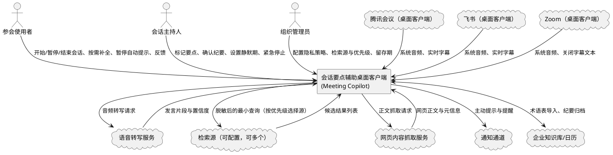
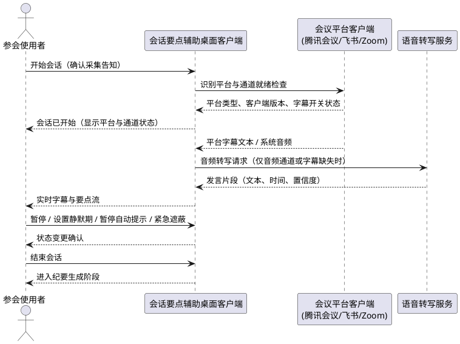
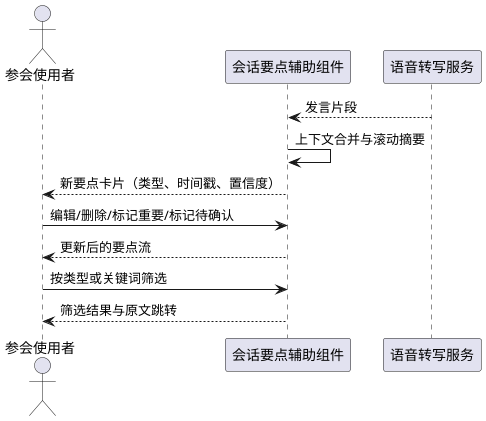
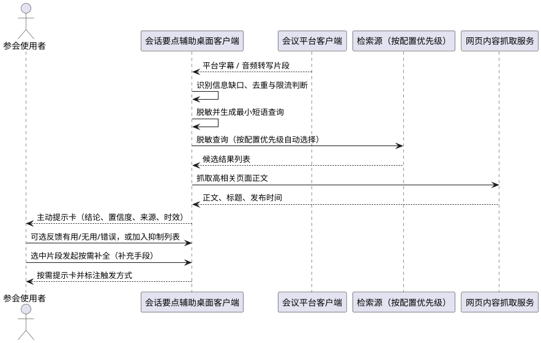
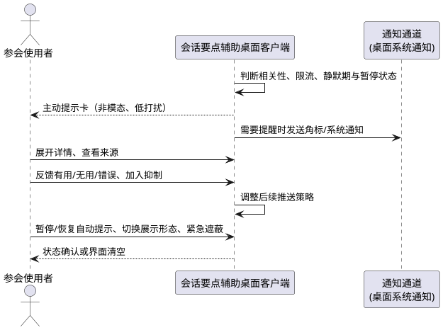
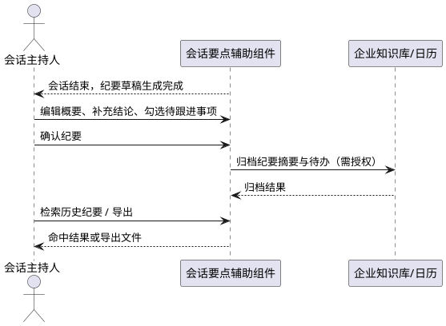
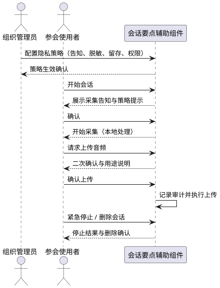
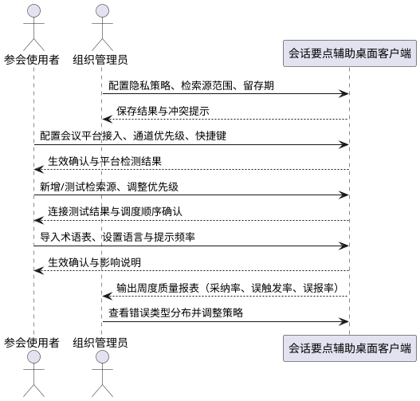
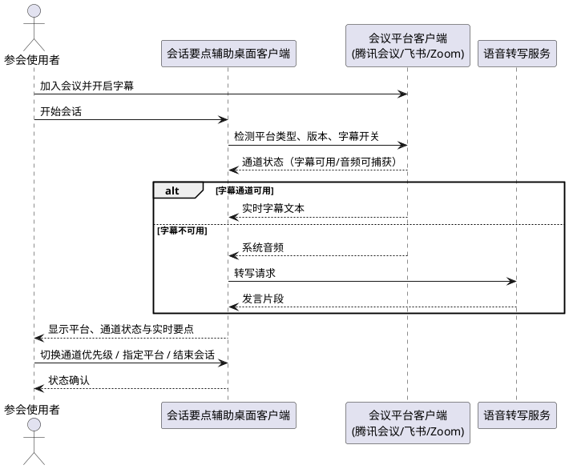

# **1. 组件定位**

## **1.1 核心职责**

本桌面客户端负责接入指定会议平台实时监听会话、全自动捕捉要点并主动联网补全，实现会中即时辅助与会后回溯。

## **1.2 核心输入**

1. 用户操作指令：来自参会使用者的开始/暂停/结束会话、按需补全检索、暂停或恢复自动提示、标记要点、反馈有用性、紧急遮蔽等操作。
2. 会话音频流：来自本机麦克风，以及腾讯会议、飞书、Zoom 桌面客户端播放的系统输出声音，包含时间顺序但不包含说话人标识。
3. 会话文本流：来自腾讯会议、飞书、Zoom 桌面客户端提供的实时字幕/隐藏字幕文本，或由外部转写服务返回的带时间戳文本片段。
4. 转写文本结果：外部转写服务返回的发言片段文本、时间范围、识别置信度与可选说话人标识。
5. 会议平台会话信息：当前会议平台类型与客户端版本、会议是否已开启字幕、平台会议标识与主题（如可获取）、采集通道就绪状态。
6. 配置与术语数据：会议平台接入配置、检索源配置（源清单、优先级、启停状态、限额）、自动外发授权状态、敏感词表、领域术语表、语言偏好、提示频率与显示模式。
7. 检索返回内容：任一已启用检索源返回的候选结果列表，以及网页内容抓取服务返回的正文与元信息。
8. 定时与周期触发信号：滚动摘要刷新周期、主动提示限流窗口、留存期到期清理、缓存过期清理等。

## **1.3 核心输出**

1. 要点卡片：面向使用者的关键信息、决策、待办、疑问四类要点，含时间戳与来源片段。
2. 提示卡：面向使用者的背景补充、术语解释、数据核对、待确认问题，含触发方式（自动主动/按需补全）、一句话结论、置信度与引用来源。
3. 会话纪要：面向使用者的会话概要、要点分类清单、时间轴、未决问题与引用来源清单。
4. 检索请求：发送给已配置检索源的脱敏查询内容，区分自动触发与按需触发。
5. 正文抓取请求：发送给网页内容抓取服务的页面地址清单。
6. 通知：通过桌面系统通知通道发送的会中提示、留存到期提醒、采集与通道异常告警。
7. 审计与用量记录：会话生命周期、自动与按需检索请求、数据导出与删除等操作的可追溯记录。
8. 归档数据：经使用者确认后写入外部知识库/日历的纪要摘要与后续动作。

## **1.4 职责边界**

1. 本组件的产品形态固定为桌面客户端，不提供 Web 端与移动端形态，也不提供多人协作的云端编辑界面（纪要归档至外部系统的情况除外）。
2. 本组件只对接腾讯会议、飞书、Zoom 三款会议平台的桌面客户端，不负责平台客户端的下载分发、版本升级、账号登录、会议组织、邀请与云录制管理。
3. 本组件不修改、不注入、不代理任意会议平台客户端进程，不读取平台账号凭据、SSO 令牌与企业租户配置。
4. 本组件不提供逐字稿的人工校对与字幕编辑平台，仅呈现已获得的转写结果与平台字幕。
5. 本组件不代替使用者做出业务决策，不自动向外发出回复、邮件或会议邀请。
6. 本组件不生成对外发布的正式文稿（如合同、公告、公关稿），仅生成内部辅助材料。
7. 本组件不做法律合规判定，仅提供可配置的告知、脱敏与留存策略执行能力。
8. 本组件不指定、也不内置唯一的检索服务商；检索源由配置决定，组件不承担检索源自身的可用性、内容质量与内容合规责任，仅承担脱敏、来源标注与降级提示责任。
9. 本组件不保证联网信息绝对正确，只提供来源标注与可信度分级，不做权威结论。
10. 本组件不将用户会话内容用于模型训练，也不向第三方出售或交换会话数据。
11. 本组件不提供跨组织的企业级内容审查平台能力（如全网舆情监控、员工行为审计）。

# **2. 领域术语**

**会话（Session）**
: 由使用者显式开始、到显式结束（或超时自动结束）为止的一段连续对话过程，是全部要点与提示的归属边界。

**发言片段（Utterance）**
: 由单一说话人在一段连续时间内完成表达、并带有起止时间与识别置信度的文本单元。

**要点（Insight）**
: 从发言片段中提炼出的、对业务有留存价值的陈述，分为关键信息、决策、待办、疑问四种类型。

**提示卡（Suggestion Card）**
: 系统在会中主动或按需呈现的信息补充单元，包含触发方式、标题、一句话结论、置信度与引用来源。

**引用来源（Reference）**
: 支撑提示卡结论的外部信息出处，包含页面标题、页面地址、抓取时间与可信度等级。

**滚动摘要（Rolling Summary）**
: 对最近一段滑动窗口内发言片段所做的压缩性概括，用于维持系统对当前话题的上下文理解。

**术语表（Lexicon）**
: 使用者维护的领域词汇、产品名、人名与缩写集合，用于提高转写纠正与解释的准确度。

**敏感词（Sensitive Term）**
: 被使用者或组织标记为不得出现在检索请求、提示卡、纪要与日志中的词汇或标识。

**静默期（Quiet Period）**
: 使用者主动要求暂停主动提示的一段时间，期间不产生新提示卡，但要点记录继续进行。

**全自动主动提示（Proactive Auto Suggestion）**
: 系统在会话监听过程中无需使用者发起任何操作，自动识别信息缺口、自动完成脱敏检索与抓取、并主动推送提示卡的运行方式，是首版默认且必备的主路径能力。

**按需补全（On-demand Enrichment）**
: 使用者在全自动主动提示之外，针对指定发言片段、要点或术语主动发起的联网检索与信息补充，是补充手段而非主路径。

**桌面客户端（Desktop Client）**
: 安装并运行在使用者个人电脑上的独立应用程序，是本组件唯一的产品形态，承载采集、提示、纪要、配置与本地数据存储。
: 备注：不包含网页版与移动端形态。

**会议平台（Meeting Platform）**
: 承载音视频会议并提供实时字幕能力的第三方桌面软件，首版必须支持腾讯会议、飞书与 Zoom 三款。

**平台接入通道（Capture Channel）**
: 桌面客户端获取会议内容的路径，分为系统音频通道与字幕文本通道两类。

**检索源（Search Provider）**
: 提供联网检索能力的服务或搜索引擎，具体接入哪一个由配置决定，组件不内置指定的唯一服务商。

**检索源配置（Provider Profile）**
: 描述单个检索源接入参数、启停状态、优先级、权重与限额的配置单元，支持同时配置多个并按优先级与备用顺序调度。

**会话纪要（Minutes）**
: 会话结束时生成的回顾文档，包含概要、要点清单、时间轴、未决问题与引用来源清单。

**采纳（Adoption）**
: 使用者对提示卡执行"有用"反馈、复制其内容或将其转为要点的行为。

# **3. 角色与边界**

## **3.1 核心角色**

1. 参会使用者：在桌面客户端中使用实时要点与自动推送的提示卡，必要时发起按需补全，反馈提示质量。
2. 会话主持人：控制会话的开始与结束，确认并归档会话纪要，管理本次会话的静默期与紧急停止。
3. 组织管理员：在桌面客户端的管理视图中配置组织级隐私策略、检索源清单与优先级、留存期与共享范围，查看审计与质量报表。

## **3.2 外部系统**

1. 腾讯会议（桌面客户端）：通过系统音频通道与字幕文本通道提供会话内容，并提供会议是否开启字幕、客户端版本等可读状态。
2. 飞书（桌面客户端）：通过系统音频通道与字幕文本通道提供会话内容，国内版飞书与国际版 Lark 均须支持。
3. Zoom（桌面客户端）：通过系统音频通道与关闭字幕（Closed Caption）文本通道提供会话内容。
4. 语音转写服务：将音频转为带时间范围与置信度的发言片段，可选提供说话人标识。
5. 检索源（可配置，不限定服务商）：接收脱敏后的查询，返回候选网页结果列表；可同时配置多个并指定优先级。
6. 网页内容抓取服务：接收页面地址，返回正文、标题、发布时间等元信息。
7. 通知通道：承接会中提示与运维告警的桌面系统通知。
8. 企业知识库/日历：提供术语表导入与会后纪要归档，可选提供待办同步。

## **3.3 交互上下文**

# **4. DFX约束**

## **4.1 性能**

1. 从音频入流到产出对应要点卡片，95 分位端到端时延不得超过 3 秒；经平台字幕通道入流时不得超过 1.5 秒。
2. 从文本入流到产出对应要点卡片，95 分位端到端时延不得超过 1.5 秒。
3. 全自动主动提示从触发短语被识别到提示卡展示，95 分位不得超过 6 秒、99 分位不得超过 10 秒；按需补全从发起到展示首条提示卡，95 分位不得超过 8 秒。
4. 单个会话并行的自动检索任务不得超过 3 个，超出部分必须排队，且排队不得导致提示展示延迟超过 15 秒。
5. 界面交互（滚动、展开、标记）响应时间不得超过 200 毫秒。
6. 单个会话连续运行时长下限为 2 小时；单会话可承载的发言片段不少于 10000 条；上述指标在腾讯会议、飞书、Zoom 任一平台接入下均须满足。
7. 在默认配置（监听、要点捕捉、全自动主动提示均开启）下，客户端内存占用不得超过 2 GB，CPU 平均占用不得超过 35%，连续 10 秒峰值不得超过 60%。
8. 未开始会话的空闲待机状态下，客户端内存占用不得超过 400 MB。
9. 滚动摘要刷新间隔不得超过 30 秒；会话纪要生成（1 小时会话）耗时不超 30 秒。

## **4.2 可靠性**

1. 组件月度可用性不低于 99.5%（不含外部检索源、转写服务与会议平台自身故障）。
2. 已确认的要点在产生后 1 秒内完成本地持久化，进程异常退出后重启可恢复最近 60 秒的上下文。
3. 任一已启用检索源不可用时，必须在 3 秒内切换到配置中的备用源；全部检索源不可用时，自动提示进入降级队列并在界面明确提示降级状态，恢复后 30 秒内补齐。
4. 配置中未启用任何检索源时，系统必须以"仅要点"模式正常运行，并在界面明确提示"未配置检索源"。
5. 网络中断期间，监听与要点捕捉必须继续在本地运行，中断恢复后 30 秒内补齐待补全的检索任务。
6. 外部转写服务连续失败 3 次后，必须切换为"仅文本输入"模式并通知使用者。
7. 平台字幕通道失效时，必须在 5 秒内自动回退到系统音频通道并提示使用者；两条通道均失效时，会话必须保留且已产生的要点不得丢失。
8. 全自动提示环节（检索、抓取、生成）失败不得影响要点捕捉、滚动摘要与会后纪要的产出。

## **4.3 安全性**

1. 会话开始前必须向在场人员展示采集告知；首次使用时必须由使用者确认后方可开始采集。
2. 原始音频默认仅在本地处理，禁止默认上传；音频上传必须逐次获得使用者确认，文本类检索查询按第 5 条的一次性授权执行。
3. 本地存储的会话文本、要点与纪要必须加密存储，密钥不得与会话数据同处明文保存。
4. 发送至检索源的查询必须完成敏感词与人名脱敏：全自动主动提示的外发查询默认不超过 80 字且只包含触发短语、专有名词与必要限定词；按需补全不超过 200 字；任何情况下禁止外发完整会话、参会人名单与音频。
5. 全自动外发必须一次性获得使用者的明确授权，授权范围（外发的内容类型、长度上限、启用哪些检索源）必须在授权时展示；未获授权时禁止任何自动外发。
6. 使用者必须可随时关闭全自动外发与自动提示，关闭后系统不得自行恢复，恢复必须再次经使用者确认。
7. 审计记录必须覆盖：会话开始/结束、自动与按需检索请求（脱敏后）、提示推送、纪要导出、会话删除、检索源与策略变更，保留期 180 天。
8. 删除会话必须在 1 分钟内完成，删除后不可恢复；仅保留不含原文的审计摘要。
9. 普通使用者只能访问自己参与的会话；管理员默认只能配置策略与查看统计，不得查看会话原文（如组织另行授权，必须二次确认并留痕）。
10. 禁止采集、存储或索取腾讯会议、飞书、Zoom 的账号、密码、SSO 令牌与企业租户凭据。

## **4.4 可维护性**

1. 必须可观测的核心指标：端到端要点时延、主动提示时延、自动提示触发率、自动提示误触发率、转写失败率、检索源失败率（按源分别统计）、平台字幕通道失效率（按平台分别统计）、提示采纳率、要点误报率、活跃会话数。
2. 日志中禁止出现会话原文、原始音频地址、完整检索查询与任何会议平台凭据，只允许出现脱敏标识与统计值。
3. 每次提示卡生成必须携带可追溯编号，用于串联"触发片段—检索请求—引用来源—展示—反馈"全链路，并记录触发方式为自动或按需。
4. 质量指标低于阈值（提示采纳率 < 20%、要点误报率 > 15%、自动提示误触发率 > 30%）时必须触发告警并输出原因分类统计。
5. 会议平台故障必须可按平台定位：诊断信息须区分平台类型、客户端版本、通道状态与失败原因分类，以支撑平台升级后的快速适配。

## **4.5 兼容性**

1. 产品形态为桌面客户端：必须支持 Windows 10 及以上（x64 与 ARM64）与 macOS 13 及以上（Apple Silicon 与 Intel）；不提供 Web 端与移动端。
2. 会议平台版本支持矩阵：腾讯会议桌面客户端当前主版本及前 2 个主版本；飞书桌面客户端（含国际版 Lark）当前主版本及前 2 个主版本；Zoom Workplace 桌面客户端 5.17 及以上版本。平台发布新主版本后，必须在 15 个工作日内完成适配或按 4.2 第 7 条进入回退通道。
3. 仅支持上述平台的桌面客户端；平台网页版不属于受支持形态，仅在系统音频通道可用时可降级采集且字幕通道不做保证。
4. 必须支持中文与英文会话内容的混合识别与要点提炼。
5. 会话纪要必须支持导出为 Markdown、纯文本与结构化 JSON 三种格式；PDF 导出为可选项。
6. 检索源必须保持开放可配置：组件不指定、不内置唯一检索服务商，凡提供可调用检索接口的第三方服务、自建检索服务或开源搜索引擎，均可通过配置接入；至少支持同时配置 5 个检索源并设置优先级与权重。
7. 未启用任何检索源或检索能力不可用时，系统必须以"仅要点"模式正常运行，不得因缺失检索源导致会话不可用。
8. 对外配置与数据格式升级必须保持向后兼容，旧版本会话数据在新版本中必须可读，兼容期不少于 6 个月。

# **5. 核心能力**

## **5.1 会话监听与采集**

### **5.1.1 业务规则**

1. **显式开始**：会话必须由使用者显式操作开始，系统禁止在后台自动开始采集。
   a. 验收条件：When 使用者执行"开始会话"并完成采集告知确认，系统 shall 创建会话并开始接收音频或字幕输入。
2. **平台接入前置**：会话必须绑定一个已识别的会议平台（腾讯会议、飞书、Zoom）或明确的"仅麦克风"模式；开始前必须完成通道就绪检查。
   a. 验收条件：When 使用者执行"开始会话"，系统 shall 检测当前运行的会议平台与可用通道，并在界面显示平台名称、客户端版本与通道状态。
   b. 验收条件：If 三款指定平台均未运行，系统 shall 提示"未检测到会议平台"并允许使用者选择"仅麦克风模式"继续。
3. **采集告知**：首次使用或组织策略要求时，系统必须展示面向在场人员的采集告知，并在确认后才允许采集。
   a. 验收条件：If 使用者未确认采集告知，系统 shall 拒绝启动采集并提示"需先获得在场人员知情同意"。
4. **来源标注**：每条发言片段必须标注其来源类型（麦克风、平台系统音频、平台字幕、外部转写）与时间范围，平台字幕还须标注所属平台。
   a. 验收条件：When 同一时间窗内存在多个来源的内容，系统 shall 分别标注来源，不得静默覆盖。
5. **双通道去重**：同一发言同时来自平台字幕与音频转写时，必须合并为一条片段，以字幕文本为主、音频转写为兜底，禁止重复计入要点与检索触发。
   a. 验收条件：When 平台字幕与音频转写在同一时间窗内输出语义相同的内容，系统 shall 合并为一条片段并标注"双通道"。
6. **说话人标识**：无法区分说话人时，系统必须标记为"未知说话人"，禁止推断或编造姓名。
   a. 验收条件：If 转写结果与平台字幕均不含说话人标识，系统 shall 将说话人字段置为"未知说话人"。
7. **静音过滤**：连续静音超过 5 秒的时间段不得生成空发言片段，也不得计入要点统计。
   a. 验收条件：When 输入为持续静音，系统 shall 不产生发言片段，界面显示"静音中"。
8. **暂停与恢复**：会话进行中必须支持暂停采集与恢复，暂停期间的内容不得进入要点与检索。
   a. 验收条件：While 会话处于暂停状态，系统 shall 丢弃新入流内容且不生成任何要点与提示，也不发起自动检索。
9. **静默期**：使用者可设置静默期时长，静默期内要点继续记录，但不得产生主动提示卡，也不得发起自动外发检索。
   a. 验收条件：While 处于静默期，系统 shall 抑制主动提示与自动检索，仅在静默期结束后汇总展示。
10. **自动结束保护**：无任何输入连续 30 分钟时必须提示使用者，由使用者确认结束，系统禁止静默终止会话。
    a. 验收条件：When 连续 30 分钟无有效输入，系统 shall 提示"是否结束会话"，并保留当前会话数据。
11. **禁止项**：禁止在未创建会话的情况下采集或暂存音频，禁止将采集内容用于会话之外的用途，禁止在会话未绑定平台时混用多个平台的输入。
    a. 验收条件：If 收到未归属会话的音频，系统 shall 立即丢弃并记录一条审计事件。
    b. 验收条件：If 同一会话内检测到第二个平台的输入，系统 shall 提示使用者新建会话，不得混合写入同一会话。

### **5.1.2 交互流程**

### **5.1.3 异常场景**

> 平台处置：macOS 不适用（无设备）；Linux 不适用；Windows 分支保留。

1. **采集权限被拒**
   a. 触发条件：使用者拒绝麦克风或系统音频权限，或操作系统回收权限。
   b. 系统行为：不启动采集，给出权限开启指引，保留会话为"未开始"状态。
   c. 用户感知：提示"E-AUDIO-001 未获得音频权限，无法监听"，并提供重试入口。
2. **音频设备切换或拔出**
   a. 触发条件：会话进行中输入设备变更或断开。
   b. 系统行为：自动切换到默认设备，记录切换时间点，缺口时间段标记为"音频缺失"。
   c. 用户感知：界面提示"设备已切换/音频中断 12 秒"。
3. **外部转写服务超时或失败**
   a. 触发条件：转写请求连续 3 次超时（单次超过 10 秒）或返回错误。
   b. 系统行为：降级为"仅文本输入"模式，缓存未转写音频不超过留存策略允许范围。
   c. 用户感知：提示"E-ASR-002 转写服务不可用，已降级为文本模式"。
4. **多人重叠发言**
   a. 触发条件：同一时间窗内检测到两个及以上说话人的重叠内容。
   b. 系统行为：保留各自片段并标记"重叠"，重叠部分不进入高置信度要点。
   c. 用户感知：该片段显示"重叠发言，参考价值有限"标签。
5. **会话数据写入失败**
   a. 触发条件：本地存储不可写（磁盘满、权限异常）。
   b. 系统行为：暂停采集并保留内存缓冲，尝试提示使用者释放空间。
   c. 用户感知：提示"E-STORE-003 存储不可用，采集已暂停"。

## **5.2 要点捕捉与滚动摘要**

### **5.2.1 业务规则**

1. **可回溯**：每条要点必须关联至少一个发言片段的标识与时间戳，禁止产生无来源的要点。
   a. 验收条件：When 生成一条要点，系统 shall 附带可跳转回原文的时间戳与片段引用。
2. **四类划分**：要点必须归入关键信息、决策、待办、疑问四类之一，禁止出现未分类要点。
   a. 验收条件：When 要点生成后，系统 shall 标注其唯一类型；If 无法判定类型，系统 shall 归为关键信息并降低置信度。
3. **篇幅约束**：单个要点正文不得超过 60 字，超出时必须拆分为多条，禁止整段复制原文。
   a. 验收条件：When 提炼结果超过 60 字，系统 shall 拆分为多条要点并保留原文引用。
4. **决策完整性**：决策类要点必须包含决策内容，并标注决策人与生效范围；缺失时必须标记"待确认"。
   a. 验收条件：If 决策要点缺少决策人，系统 shall 展示"决策人：待确认"。
5. **待办完整性**：待办类要点必须包含动作与负责人字段；缺失负责人或期限时必须标记"待确认"。
   a. 验收条件：When 识别到"我来跟进/下周给出"等表述，系统 shall 生成待办要点并填入可识别字段。
6. **疑问闭环标记**：疑问类要点必须标记"已答复/未答复"状态。
   a. 验收条件：When 后续发言片段中出现对某疑问的回应，系统 shall 将该疑问标记为"已答复"并关联回应片段。
7. **去重合并**：语义相同或高度相近的要点必须合并为一条并累计出现次数，禁止同一内容重复铺满界面。
   a. 验收条件：When 同一要点在 10 分钟内被重复提及，系统 shall 合并展示并标注"提及 3 次"。
8. **事实与推测分界**：系统禁止将推测性表述呈现为确定事实；置信度低于阈值的内容必须标注"待确认"。
   a. 验收条件：If 内容来源置信度低于阈值，系统 shall 以"待确认"样式展示并禁止计入正式纪要结论。
9. **滚动摘要**：系统必须在每 30 秒或累计 20 条新片段时刷新滚动摘要，摘要仅用于上下文维持，不得作为对外结论。
   a. 验收条件：When 满足刷新条件，系统 shall 更新滚动摘要并保留上一版摘要用于对比。
10. **人工编辑**：使用者必须可以编辑、删除、标记"重要"要点，人工修改结果优先于自动结果且不得被后续自动生成覆盖。
    a. 验收条件：When 使用者编辑某要点，系统 shall 锁定该要点，后续相同内容的自动结果只做"提及"计数。
11. **禁止项**：禁止从静默期、暂停期间或已删除片段中生成要点。
    a. 验收条件：If 输入片段归属于静默期，系统 shall 不参与要点提炼。

### **5.2.2 交互流程**

### **5.2.3 异常场景**

1. **识别置信度过低**
   a. 触发条件：发言片段整体置信度低于阈值，或文本明显不连贯。
   b. 系统行为：不生成要点，仅保留原文并标记"识别不确定"。
   c. 用户感知：片段旁显示"识别质量低，未提炼要点"。
2. **用户修改与自动结果冲突**
   a. 触发条件：使用者编辑要点后，系统又生成内容冲突的新要点。
   b. 系统行为：保留人工版本，新内容作为"补充信息"并列展示，不覆盖人工结果。
   c. 用户感知：显示"存在新的相关表述，查看补充"。
3. **要点数量过载**
   a. 触发条件：10 分钟内生成要点超过 30 条。
   b. 系统行为：按重要度与类型配额收敛展示，其余折叠为"更多要点"。
   c. 用户感知：提示"要点较多，已折叠次要内容"。
4. **摘要刷新超时**
   a. 触发条件：滚动摘要生成超过 15 秒未完成。
   b. 系统行为：沿用上一版摘要，本次刷新丢弃并记录一次失败。
   c. 用户感知：无阻塞提示，仅在诊断面板显示摘要状态异常。
5. **会话结束时会要生成不完整**
   a. 触发条件：会话结束时存在未完成提炼的片段队列。
   b. 系统行为：在 30 秒内补完队列，超时部分标记"未提炼"并计入待办复核清单。
   c. 用户感知：纪要页提示"有 3 条片段未完成提炼，可手动补全"。

## **5.3 联网信息补全（全自动主动提示为主路径）**

### **5.3.1 业务规则**

1. **全自动主路径**：联网补全必须以全自动主动提示作为首版默认且必备的主路径，会话进行中无需使用者任何操作即自动完成"识别信息缺口→脱敏→检索→抓取→推送"。
   a. 验收条件：When 全自动模式处于开启状态且会话正在监听，系统 shall 在未收到任何用户补全指令的情况下，对识别出的信息缺口自动生成并推送提示卡。
   b. 验收条件：If 全自动模式被关闭，系统 shall 仅保留要点捕捉与按需补全，不得以"手动补全优先"替代自动提示。
2. **触发识别范围**：出现下列表述时系统必须判定为信息缺口并生成候选补全任务：首次出现的专有名词、缩写、产品名、机构名与职务、政策法规与标准编号、数据指标及其对比基准、外部事件与新闻、会话中提出但无人回答且需外部事实支撑的问题。
   a. 验收条件：When 发言片段中出现首次出现的专有名词或缩写，系统 shall 在 2 秒内生成候选补全任务。
   b. 验收条件：When 会话中出现需外部事实支撑且 10 秒内无人回应的提问，系统 shall 生成候选补全任务。
3. **自动外发授权**：自动外发必须在使用者首次启用全自动模式时一次性授权，授权后不再逐条确认，但使用者必须可随时关闭。
   a. 验收条件：If 使用者未完成自动外发授权，系统 shall 仅执行本地要点捕捉且不发起任何自动检索。
4. **双触发并存**：系统必须同时支持自动主动提示与按需补全，两类提示卡必须可区分并分别统计。
   a. 验收条件：When 使用者对某片段或要点发起按需补全，系统 shall 生成提示卡并标注"按需补全"。
5. **最小必要上下文**：自动触发的外发查询只允许包含被触发的短语、专有名词与必要限定词，默认不超过 80 字；按需补全不超过 200 字；任何情况下禁止附带完整会话、参会人名单与音频。
   a. 验收条件：If 查询内容超过对应长度上限，系统 shall 截断并提示"已按最小上下文外发"。
6. **脱敏前置**：查询必须在使用者配置的敏感词表与人名规则下完成脱敏，脱敏未完成时禁止外发。
   a. 验收条件：If 脱敏流程失败，系统 shall 终止外发并提示"E-PRIV-004 脱敏失败，检索已取消"。
7. **检索源开放可配置**：组件禁止指定或内置唯一的检索服务商；检索源必须通过配置接入、启停与排序，至少支持同时配置多个源并设置优先级与备用顺序。
   a. 验收条件：When 配置中启用 2 个及以上检索源，系统 shall 按配置优先级调用，并在当前源失败时自动切换至下一优先级。
   b. 验收条件：If 配置中未启用任何检索源，系统 shall 进入"仅要点"模式并在界面明示"未配置检索源"。
   c. 验收条件：When 使用者新增一个符合接口约定的检索源并保存，系统 shall 在下一次检索请求时按新配置生效，无需重启客户端。
8. **来源必备**：每条提示卡必须至少附带 1 条引用来源；无来源时禁止给出结论性表述。
   a. 验收条件：When 检索无可用结果，系统 shall 展示"未找到可靠来源"而不得生成推测结论。
9. **可信度分级**：每条来源必须标注可信度等级（官方/权威媒体/一般网页/用户生成内容）与抓取时间。
   a. 验收条件：When 展示提示卡，系统 shall 同时展示来源等级与抓取时间。
10. **去重与限流**：10 分钟内同一主题的提示卡不得超过 3 条，语义重复的提示卡不得重复推送；自动触发与按需补全共用同一去重键。
    a. 验收条件：When 相同查询在 10 分钟内再次触发，系统 shall 复用缓存结果而不再发起新检索。
11. **时效标注**：涉及数字、价格、政策、版本等信息时，必须标注信息的发布时间与时效性提示。
    a. 验收条件：When 引用内容发布时间早于 12 个月，系统 shall 标注"信息较早，请核实"。
12. **抓取合规**：禁止抓取需登录、付费墙内或站点明确禁止抓取的内容，禁止绕过访问限制。
    a. 验收条件：If 页面需要登录或声明禁止抓取，系统 shall 跳过该页面并在来源清单中注明"不可访问"。
13. **缓存复用**：相同脱敏查询在 24 小时内必须优先复用缓存结果，并标注缓存时间。
    a. 验收条件：When 命中缓存，系统 shall 展示缓存结果与"结果来自 X 小时前"。
14. **抑制列表**：使用者可将某类主题或某来源加入抑制列表，之后不得再自动推送同类内容，但按需补全不受该列表限制（须提示已抑制）。
    a. 验收条件：When 使用者选择"不再提示此类内容"，系统 shall 记录抑制规则并停止同类自动推送。
15. **低置信触发抑制**：触发短语所在片段的识别置信度低于阈值时，禁止发起自动外发检索。
    a. 验收条件：If 片段置信度低于阈值，系统 shall 跳过自动补全并计入"因识别质量跳过"统计。
16. **禁止项**：禁止在静默期、暂停采集、投屏保护模式、全自动模式关闭状态下发起自动外发；禁止将敏感词、参会人真实姓名与联系方式写入外发查询与提示卡。
    a. 验收条件：If 查询中包含未脱敏的人名或联系方式，系统 shall 拦截并记录审计事件。

### **5.3.2 交互流程**

### **5.3.3 异常场景**

1. **检索源超时或限流**
   a. 触发条件：单次检索超过 8 秒未返回，或当前检索源返回限流错误。
   b. 系统行为：按配置优先级切换至下一检索源；全部不可用时进入降级队列，20 秒内自动重试一次。
   c. 用户感知：提示"E-SEARCH-005 检索较慢/暂不可用，已按配置切换或加入重试队列"。
2. **未配置检索源**
   a. 触发条件：配置中无任何启用的检索源。
   b. 系统行为：保持要点捕捉与纪要能力，停止全部自动与按需检索，界面常驻提示配置入口。
   c. 用户感知：显示"未配置检索源，当前为仅要点模式"。
3. **检索源配置错误**
   a. 触发条件：接入地址无效、鉴权失败或返回格式不符合约定。
   b. 系统行为：将该源标记为"不可用"，停止对其重试并切换下一源，输出配置诊断信息。
   c. 用户感知：配置页显示"该检索源不可用：鉴权失败"，并提供测试连接入口。
4. **检索结果为空或全部低相关**
   a. 触发条件：返回结果相关度均低于阈值。
   b. 系统行为：不生成提示卡结论，仅展示"未找到可靠来源"与可选的检索关键词建议。
   c. 用户感知：显示"未找到可靠来源，可修改关键词重试"。
5. **来源之间结论冲突**
   a. 触发条件：同一问题的高可信来源给出相互矛盾的结论。
   b. 系统行为：并列展示双方结论与来源，不做单边结论。
   c. 用户感知：提示"来源结论不一致，请自行判断"。
6. **正文抓取失败**
   a. 触发条件：页面返回 4xx/5xx、超时或内容为空。
   b. 系统行为：仅保留搜索结果摘要作为参考，并标注"正文未获取"。
   c. 用户感知：来源条目标注"仅摘要，正文不可用"。
7. **抓取内容命中敏感或不合规内容**
   a. 触发条件：抓取正文包含敏感词或明显违规内容。
   b. 系统行为：丢弃该正文、不生成提示卡，记录审计。
   c. 用户感知：提示卡显示"该来源内容被过滤"。
8. **自动触发误报**
   a. 触发条件：自动提示针对普通词汇或无需解释的内容发起补全。
   b. 系统行为：使用者反馈"无关"后，将该形态的词加入本地抑制规则，并计入自动提示误触发率。
   c. 用户感知：提示"已减少此类提示"。
9. **自动触发放量导致提示风暴**
   a. 触发条件：单位时间内候选补全任务超过 10 个。
   b. 系统行为：按相关度、信息缺口类型与置信度排序，仅保留前 3 个执行，其余丢弃并记录。
   c. 用户感知：无阻塞提示，界面显示"已收敛自动提示数量"。
10. **未完成自动外发授权**
    a. 触发条件：使用者启用全自动模式但拒绝或未完成外发授权。
    b. 系统行为：仅开启要点捕捉，不发起自动检索，保留授权入口。
    c. 用户感知：显示"未授权自动外发，自动提示暂不可用"。

## **5.4 会中提示与低打扰推送**

### **5.4.1 业务规则**

1. **自动提示默认开启**：使用者完成自动外发授权后，全自动主动提示默认开启并持续运行，是首版默认体验；默认配额为每 10 分钟不超过 3 条主动提示卡。
   a. 验收条件：When 使用者首次完成自动外发授权并开始会话，系统 shall 默认以自动提示开启状态运行，无需额外设置。
2. **相关性门槛**：提示卡必须与当前话题相关度高于阈值，禁止推送与当前对话无关的泛化内容。
   a. 验收条件：If 提示卡相关性低于阈值，系统 shall 不予展示并计入误触发统计。
3. **静默期尊重**：静默期内禁止主动推送与自动检索；静默期结束后必须合并展示，不得逐条弹出。
   a. 验收条件：While 处于静默期，系统 shall 不展示任何主动提示卡。
4. **会话内一键暂停**：会话进行中必须提供一键暂停/恢复自动提示的入口，暂停期间要点继续记录。
   a. 验收条件：When 使用者暂停自动提示，系统 shall 立即停止自动外发检索与推送，并在界面常驻显示"自动提示已暂停"。
5. **投屏安全**：开启"共享屏幕模式"时，必须隐藏提示卡正文与字幕内容，仅保留"有 N 条提示"的角标。
   a. 验收条件：While 共享屏幕模式开启，系统 shall 不在主屏可见区域展示会话内容。
6. **卡片结构**：每条提示卡必须包含触发方式、标题、一句话结论（不超过 80 字）、置信度、来源入口与可展开详情。
   a. 验收条件：When 展示提示卡，系统 shall 至少呈现触发方式、标题、结论与来源入口四要素。
7. **紧急遮蔽**：使用者触发紧急遮蔽时，必须立即停止采集与自动检索，并在 1 秒内清空界面中的会话内容。
   a. 验收条件：When 触发紧急遮蔽，系统 shall 在 1 秒内隐藏全部会话文本与提示并暂停采集与自动检索。
8. **反馈生效**：使用者的有用/无用/错误反馈必须记录并作用于该主题后续推送策略。
   a. 验收条件：When 使用者标记"错误"，系统 shall 不再推送同主题同来源内容。
9. **展示形态**：必须支持卡片流、侧边悬浮窗、收起为角标三种形态，使用者可随时切换。
   a. 验收条件：When 使用者切换展示形态，系统 shall 保留当前提示列表与滚动位置。
10. **不抢占焦点**：自动提示必须以非模态方式展示，禁止抢走会议平台窗口焦点或打断输入。
    a. 验收条件：When 自动提示卡到达，系统 shall 在不获取键盘焦点的前提下完成展示。
11. **禁止项**：禁止在使用者关闭自动模式后发起自动外发；禁止通过配置项、版本升级或重启静默重新开启自动外发。
    a. 验收条件：If 自动模式处于关闭状态，系统 shall 不发起任何自动检索与主动推送。

### **5.4.2 交互流程**

### **5.4.3 异常场景**

1. **提示过载**
   a. 触发条件：单位时间内候选提示超过展示配额。
   b. 系统行为：按相关度与置信度排序保留前 N 条，其余合并为摘要。
   c. 用户感知：显示"另有 5 条低优先级提示已收起"。
2. **投屏泄露风险**
   a. 触发条件：检测到共享屏幕模式开启但界面内容仍在可见区域。
   b. 系统行为：立即切换为角标模式并隐藏正文。
   c. 用户感知：提示"已进入投屏保护模式"。
3. **提示卡内容错误**
   a. 触发条件：使用者反馈提示卡结论与事实不符。
   b. 系统行为：撤回该卡片并下架同来源同类内容，写入质量清单。
   c. 用户感知：卡片变灰并显示"已撤回，原因：用户反馈有误"。
4. **紧急遮蔽执行失败**
   a. 触发条件：遮蔽指令未能在 1 秒内生效（界面阻塞）。
   b. 系统行为：强制关闭提示面板与字幕窗口，并停止采集与自动检索进程。
   c. 用户感知：提示"已强制停止采集，请检查界面残留"。
5. **自动提示被意外中断**
   a. 触发条件：会话运行中自动提示长时间（超过 10 分钟）无任何产出。
   b. 系统行为：检查授权状态、检索源状态与限流状态，输出中断原因分类，不自动恢复已关闭的开关。
   c. 用户感知：界面显示"自动提示已停止：检索源均不可用 / 已关闭自动模式"。

## **5.5 会话纪要与回顾**

### **5.5.1 业务规则**

1. **自动草稿**：会话结束后必须自动生成纪要草稿，包含概要、四类要点清单、时间轴、未决问题与来源清单。
   a. 验收条件：When 会话结束，系统 shall 在 30 秒内（1 小时会话）生成纪要草稿并标注"草稿"状态。
2. **确认归档**：纪要必须经主持人或使用者确认后才能标记为"正式"并允许归档到外部知识库。
   a. 验收条件：If 纪要未确认，系统 shall 禁止将其写入外部知识库/日历。
3. **时间轴完整性**：时间轴必须覆盖整段会话，允许存在"无要点区间"，禁止跳过或压缩时间刻度。
   a. 验收条件：When 查看时间轴，系统 shall 显示完整会话时长与要点分布。
4. **未决问题清单**：纪要必须单独列出未答复疑问与"待确认"字段，便于会后跟进。
   a. 验收条件：When 存在未答复疑问，系统 shall 在纪要顶部生成"待跟进事项"区。
5. **检索与筛选**：必须支持按关键词、时间范围、要点类型、参会人（如已知）与会话标签检索历史纪要。
   a. 验收条件：When 使用者输入关键词，系统 shall 在 2 秒内返回命中列表并高亮上下文。
6. **导出**：必须支持导出 Markdown、纯文本与结构化 JSON；导出内容不得包含原始音频与未脱敏敏感信息。
   a. 验收条件：When 执行导出，系统 shall 先完成脱敏检查，命中敏感词时提示确认或自动打码。
7. **留存与清理**：会话默认留存 30 天，组织可配置 1 至 365 天；到期前 7 天必须提醒，到期后自动清除。
   a. 验收条件：When 会话达到留存期上限，系统 shall 自动删除并在审计中记录删除动作。
8. **删除不可恢复**：使用者删除会话时，必须二次确认，删除后数据不可恢复，仅保留不含原文的审计摘要。
   a. 验收条件：When 使用者确认删除，系统 shall 在 1 分钟内完成清除并提示"已删除，不可恢复"。
9. **禁止项**：禁止把自动生成的推测性结论写入正式纪要的"结论"部分；禁止未经确认自动外发纪要。
   a. 验收条件：If 纪要中某条目置信度为"待确认"，系统 shall 只允许其出现在"待跟进事项"区。

### **5.5.2 交互流程**

### **5.5.3 异常场景**

1. **纪要生成失败**
   a. 触发条件：会话结束时提炼队列未完成或处理超时。
   b. 系统行为：生成"部分纪要"，标注缺失区间，并提供重新生成入口。
   c. 用户感知：提示"E-MIN-006 纪要未完整生成，可重试"。
2. **导出失败**
   a. 触发条件：目标路径不可写、文件被占用或体积超限。
   b. 系统行为：保留导出任务，允许更换路径重试；不修改原会话数据。
   c. 用户感知：提示"导出失败，请更换路径后重试"。
3. **敏感词命中导出内容**
   a. 触发条件：导出前脱敏检查发现敏感词。
   b. 系统行为：默认自动打码并生成脱敏说明，需使用者确认后才输出。
   c. 用户感知：提示"已发现 4 处敏感信息，已打码，确认后导出"。
4. **留存清理误删风险**
   a. 触发条件：清理任务与使用者正在查看的会话冲突。
   b. 系统行为：跳过最近 1 小时内被访问的会话，本次不清理并顺延一天。
   c. 用户感知：无打扰提示，审计中记录"因近期访问顺延"。
5. **检索无结果**
   a. 触发条件：关键词、时间范围组合无匹配。
   b. 系统行为：返回空结果并给出放宽条件的建议。
   c. 用户感知：显示"未找到结果，试试缩短关键词或扩大时间范围"。

## **5.6 隐私与合规控制**

### **5.6.1 业务规则**

1. **告知与确认**：采集前必须展示告知；组织策略可要求每次会话均确认，个人模式可配置为首次确认。
   a. 验收条件：When 组织策略设为"每次确认"，系统 shall 在每次开始会话时重新要求确认。
2. **本地优先**：原始音频必须默认本地处理，音频上传必须逐次显式确认并记录审计；文本类检索查询的外发按 4.3 第 5 条的一次性授权执行，不受逐次确认约束。
   a. 验收条件：If 未获得上传确认，系统 shall 仅在本地处理音频并禁止外发音频。
   b. 验收条件：When 全自动外发授权有效且音频上传未获确认，系统 shall 只外发脱敏后的文本查询，不传输音频。
3. **脱敏一致性**：敏感词与姓名脱敏必须同时作用于检索查询、提示卡、纪要、导出文件与日志。
   a. 验收条件：When 敏感词出现在任意输出中，系统 shall 以打码形式呈现并保留脱敏记录。
4. **最小权限**：普通使用者只能访问自己参与的会话；管理员默认不得查看会话原文。
   a. 验收条件：If 管理员尝试查看原文，系统 shall 拒绝并提示"需组织二次授权"。
5. **审计完整性**：所有敏感操作（含自动外发检索、导出、删除、平台与检索源配置变更）必须写入审计，审计记录不得包含会话原文。
   a. 验收条件：When 执行自动外发检索、导出或删除，系统 shall 在 1 秒内生成一条不含正文的审计记录。
6. **策略不可绕过**：组织级策略（强制脱敏、强制告知、留存上限）禁止被使用者配置覆盖。
   a. 验收条件：If 使用者尝试关闭强制脱敏，系统 shall 拒绝并展示策略来源。
7. **数据用途限制**：会话数据禁止用于模型训练、广告画像与跨会话的商业分析。
   a. 验收条件：If 收到将会话内容用于训练的请求，系统 shall 拒绝并记录审计。
8. **紧急停止**：使用者必须可随时一键停止采集并清空可见内容。
   a. 验收条件：When 触发紧急停止，系统 shall 立即暂停采集并清空可见会话内容。

### **5.6.2 交互流程**

### **5.6.3 异常场景**

1. **未确认告知即尝试采集**
   a. 触发条件：使用者跳过确认流程或确认状态丢失。
   b. 系统行为：阻止采集并回到告知页面。
   c. 用户感知：提示"E-CONSENT-007 需确认采集告知后才能开始"。
2. **脱敏组件不可用**
   a. 触发条件：脱敏规则加载失败或脱敏服务异常。
   b. 系统行为：阻断所有外发与导出，仅允许本地查看并标记"未脱敏"。
   c. 用户感知：提示"脱敏不可用，已暂停检索与导出"。
3. **策略冲突**
   a. 触发条件：使用者个人设置与组织策略冲突（如个人希望留存 90 天，组织上限 30 天）。
   b. 系统行为：以更严格策略为准，界面说明生效来源。
   c. 用户感知：显示"当前留存期由组织策略限定为 30 天"。
4. **审计写入失败**
   a. 触发条件：审计存储不可写。
   b. 系统行为：降级为本地临时缓冲，同时禁止敏感操作（导出、上传、删除）直到恢复。
   c. 用户感知：提示"审计不可用，敏感操作已临时禁用"。
5. **越权访问**
   a. 触发条件：非参与者或管理员尝试访问他人会话。
   b. 系统行为：拒绝访问并记录越权审计事件。
   c. 用户感知：提示"E-AUTH-008 无权访问该会话"。

## **5.7 配置、个性化与质量反馈**

### **5.7.1 业务规则**

1. **术语表维护**：使用者必须可以导入、增删领域术语、产品名、人名与缩写，导入格式支持 CSV。
   a. 验收条件：When 导入术语表，系统 shall 校验重复与空值并报告成功/失败条数。
2. **检索源开放配置**：组件不得指定或内置唯一检索服务商；使用者必须可新增、编辑、启停任意符合接口约定的检索源，并配置名称、类型、优先级、权重、限额与域名屏蔽清单。
   a. 验收条件：When 使用者新增一个检索源并保存，系统 shall 支持对该源执行连接测试，并返回可用性或失败原因。
   b. 验收条件：When 存在多个启用的检索源，系统 shall 按优先级顺序调度，并允许使用者调整顺序。
   c. 验收条件：If 组织策略限定了可用检索源范围，系统 shall 拒绝超出范围的源配置并说明策略来源。
3. **会议平台接入配置**：使用者必须可配置接入的会议平台（腾讯会议、飞书、Zoom，可多选）、采集通道优先级（字幕优先/音频优先）与平台识别方式（自动识别/手动指定）。
   a. 验收条件：When 使用者选择"仅接入 Zoom"，系统 shall 在开始会话时只识别并提示 Zoom 通道状态。
4. **桌面客户端偏好**：使用者必须可配置开机自启动、托盘常驻、悬浮窗位置与透明度、全局快捷键与系统通知方式。
   a. 验收条件：When 使用者关闭悬浮窗，系统 shall 保留托盘入口与快捷键唤起能力。
5. **语言与识别偏好**：使用者可选择会话语言（中文/英文/自动识别），自动模式下必须标注实际识别语言。
   a. 验收条件：When 自动识别语言，系统 shall 在会话信息中显示识别结果与置信度。
6. **提示偏好**：使用者可配置提示频率（低/中/高）、主动提示开关、展示形态与快捷键；主动提示开关默认开启。
   a. 验收条件：When 使用者将频率设为"低"，系统 shall 每 10 分钟最多推送 1 条主动提示。
   b. 验收条件：When 使用者关闭主动提示，系统 shall 保留按需补全能力且不发起自动检索。
7. **反馈闭环**：系统必须统计提示采纳率、自动提示误触发率、要点误报率与检索源失败率，并按会话、平台与主题维度输出；每周抽检不少于 20 条提示卡进行准确性评估。
   a. 验收条件：When 周度抽检完成，系统 shall 输出准确率、主要错误类型与改进建议。
8. **配置审计**：所有策略、检索源与平台接入配置变更必须记录变更人、时间与前后值。
   a. 验收条件：When 修改组织策略或检索源配置，系统 shall 生成含前后值的审计记录。
9. **置信度可调**：使用者可整体调整要点与提示的置信度门槛（严格/平衡/宽松），调整后必须提示对误报与漏报的影响。
   a. 验收条件：When 调整置信度门槛，系统 shall 展示"误报减少、漏报增加"的影响说明。
10. **禁止项**：禁止配置项绕过组织隐私策略、自动外发授权与检索源范围限制；禁止通过配置关闭审计记录或静默开启自动外发。
    a. 验收条件：If 配置变更与组织策略冲突，系统 shall 拒绝保存并提示冲突项。

### **5.7.2 交互流程**

### **5.7.3 异常场景**

1. **术语表格式错误**
   a. 触发条件：导入文件列缺失、编码异常或内容重复。
   b. 系统行为：整体拒绝导入或仅导入合法行，输出错误明细。
   c. 用户感知：提示"导入失败 12 行，可下载错误清单"。
2. **配置与策略冲突**
   a. 触发条件：使用者配置项超出组织允许范围。
   b. 系统行为：拒绝保存冲突项，其余合法项按原计划保存。
   c. 用户感知：提示"3 项因组织策略未生效"。
3. **质量指标异常**
   a. 触发条件：提示采纳率低于 20%、要点误报率高于 15% 或自动提示误触发率高于 30%。
   b. 系统行为：触发告警，自动收敛主动提示频率并输出错误分类。
   c. 用户感知：管理员收到告警；使用者感知为提示数量下降。
4. **反馈数据缺失**
   a. 触发条件：使用者长期不反馈，样本不足以评估。
   b. 系统行为：以抽检方式补充评估样本，报表标注"样本不足"。
   c. 用户感知：报表页显示"样本不足，结论仅供参考"。
5. **检索源测试连接失败**
   a. 触发条件：新增检索源时地址不可达、鉴权失败或返回格式不符合约定。
   b. 系统行为：不保存为启用状态，保留配置草稿并输出失败原因。
   c. 用户感知：显示"连接测试失败：鉴权失败（401）"，允许修改后重试。
6. **接入平台不可用**
   a. 触发条件：配置中启用某平台，但该平台客户端未安装或版本低于支持矩阵。
   b. 系统行为：保留配置但标记"不可用"，开始会话时跳过该平台。
   c. 用户感知：配置页显示"腾讯会议客户端未检测到或版本低于受支持范围"。

## **5.8 指定会议平台对接**

### **5.8.1 业务规则**

> 平台处置：macOS 不适用（无设备）；Linux 不适用；Windows 分支保留。

1. **对接范围**：首版必须对接腾讯会议、飞书（含国际版 Lark）与 Zoom 三款会议平台的桌面客户端，三者均为必备能力，禁止以"后续支持其他平台"替代。
   a. 验收条件：When 使用者安装并运行上述任一平台，系统 shall 能在开始会话时识别该平台并提供可用的采集通道。
2. **对接方式**：本组件必须采用本地接入方式获取会话内容，包含两条通道：
   a. 系统音频通道：捕获平台客户端在本机播放的会议声音并送外部转写服务，作为兜底与互补通道。
   b. 字幕文本通道：读取平台客户端提供的实时字幕/关闭字幕文本（腾讯会议字幕、飞书字幕、Zoom Closed Caption），作为首选通道。
   c. 验收条件：When 平台已开启字幕，系统 shall 优先使用字幕文本通道，无需等待音频转写。
3. **依赖边界**：对接不得依赖平台开放接口的授予，也不得修改、注入、代理平台客户端；不得读取平台账号凭据、私有数据目录、云录制文件与后台会议记录。
   a. 验收条件：When 使用者未在平台完成任何第三方授权，系统 shall 仍可通过本地通道完成采集。
   b. 验收条件：If 检测到需要平台管理员授权才能获取的数据，系统 shall 放弃该数据来源并在界面标注"平台未提供"。
4. **通道状态可见**：会话界面必须展示当前平台名称、客户端版本、各通道状态（可用/降级/不可用）与字幕是否开启。
   a. 验收条件：When 会话开始，系统 shall 展示平台与通道状态卡片；通道状态变化时须在 5 秒内更新。
5. **通道优先级与去重**：默认字幕优先、音频兜底；两条通道同时输出时按 5.1.1 第 5 条合并，禁止重复计入要点与检索触发。
   a. 验收条件：When 两通道同时可用，系统 shall 只保留一条合并片段并标注"双通道"。
6. **多平台并行**：同一时刻运行多个平台时，系统必须要求使用者选择一个平台建立会话，或分别建立独立会话，禁止混写。
   a. 验收条件：If 检测到两个及以上平台正在会议中，系统 shall 弹出选择提示并列出各平台的会议主题与通道状态。
7. **平台能力差异标注**：平台间字幕可用性、字幕延迟、说话人标识能力差异必须在界面注明，禁止以同一话术宣称能力一致。
   a. 验收条件：When 接入不支持说话人标识的平台，系统 shall 在会话信息中标注"该平台不提供说话人标识"。
8. **平台策略遵从**：平台明确限制第三方采集或未开启字幕时，系统必须提示限制并仅使用可用通道，禁止绕过平台限制。
   a. 验收条件：If 平台提示禁止录制或第三方采集，系统 shall 提示使用者并仅保留系统音频通道或停止采集。
9. **禁止项**：禁止使用平台网页版作为受支持接入方式；禁止将平台账号登录态、Cookie 或令牌用于采集；禁止在未识别平台的情况下把音频写入已绑定其他平台的会话。

### **5.8.2 交互流程**

### **5.8.3 异常场景**

> 平台处置：macOS 不适用（无设备）；Linux 不适用；Windows 分支保留。

1. **平台客户端未安装或未运行**
   a. 触发条件：开始会话时未检测到任何受支持平台进程。
   b. 系统行为：提示安装或启动指引，允许改用"仅麦克风模式"，不建立平台绑定。
   c. 用户感知：显示"未检测到腾讯会议/飞书/Zoom，可切换仅麦克风模式"。
2. **平台版本低于支持矩阵**
   a. 触发条件：检测到的客户端版本低于 4.5 第 2 条规定的范围。
   b. 系统行为：拒绝使用字幕通道，仅尝试音频通道，并提示升级。
   c. 用户感知：显示"客户端版本过低，字幕通道不可用，请升级到受支持版本"。
3. **字幕未开启**
   a. 触发条件：平台会议进行中但字幕功能关闭。
   b. 系统行为：自动回退音频通道并转写，同时在界面提示开启字幕可降低延迟。
   c. 用户感知：显示"未开启字幕，已使用音频转写（延迟较高）"。
4. **平台升级导致字幕通道失效**
   a. 触发条件：平台主版本升级后字幕文本无法读取或格式不兼容。
   b. 系统行为：5 秒内回退系统音频通道，记录平台版本与失败分类，上报适配需求。
   c. 用户感知：显示"字幕通道暂时不可用，已切换音频转写"。
5. **系统音频捕获失败**
   a. 触发条件：平台使用独占音频、虚拟声卡冲突或系统权限不足。
   b. 系统行为：回退麦克风通道，标记"仅麦克风"，并在会话中标注音频缺口起点。
   c. 用户感知：显示"E-AUDIO-002 无法捕获会议音频，已切换麦克风"。
6. **多平台同时开会**
   a. 触发条件：同一时刻两个及以上受支持平台处于会议中。
   b. 系统行为：暂停自动绑定，要求使用者选择目标平台后建立独立会话。
   c. 用户感知：显示"检测到 2 个会议平台，请选择本次要接入的会议"。
7. **平台内共享屏幕导致字幕不可见**
   a. 触发条件：平台会议中开启共享屏幕且字幕窗口被遮挡或关闭。
   b. 系统行为：保持音频通道采集，提示字幕通道可能中断。
   c. 用户感知：显示"字幕窗口不可见，已切换音频转写"。

# **6. 数据约束**

## **6.1 会话（Session）**

1. **会话标识**：必须全局唯一，创建后不可变更。
2. **开始时间**：必填，精度到秒，不得晚于结束时间。
3. **结束时间**：会话进行中可为空；结束后必填且不得早于开始时间。
4. **会话状态**：取值必须为"未开始/监听中/暂停/静默/已结束/已删除"之一。
5. **会议平台**：必填，取值必须为"腾讯会议/飞书/Zoom/仅麦克风"之一；单个会话只能绑定一个平台，绑定后不可变更。
6. **平台客户端版本**：绑定平台时必填，须在开始会话时记录的版本号范围内。
7. **接入通道**：必须为"字幕优先/音频优先/仅字幕/仅音频"之一，并记录会话期间实际生效的通道及切换时间点。
8. **内容来源**：必须至少包含一种来源类型（麦克风、平台系统音频、平台字幕、外部转写）。
9. **参会人清单**：可为空；如填写，姓名不得超过 50 字，且必须在检索查询中被视为敏感信息。
10. **组织归属**：企业模式下必填；个人模式下可为空。
11. **留存截止时间**：必填，且不得晚于组织策略规定的上限日期。

## **6.2 发言片段（Utterance）**

1. **片段标识**：必须全局唯一，不可复用。
2. **所属会话**：必填，且必须指向未删除的会话。
3. **起止时间**：必填，结束时间必须晚于开始时间，且均须落在会话时间范围内。
4. **正文**：必填，长度大于 0 且不超过 2000 字；超出时必须切分。
5. **说话人**：可为"未知说话人"，不得为空字符串；不得填写未经确认的真实姓名。
6. **识别置信度**：取值 0 至 1，必填；低于 0.5 时不得参与要点提炼，也不得触发自动外发检索。
7. **来源类型**：必须为"麦克风/平台系统音频/平台字幕/外部转写"之一。
8. **所属平台**：来源类型为平台通道时必填，且必须与会话绑定的平台一致。
9. **通道合并标记**：同一时间窗内由字幕与音频合并而来的片段必须标记"双通道"，且只计一次。

## **6.3 要点（Insight）**

1. **要点标识**：必须全局唯一。
2. **所属会话**：必填。
3. **类型**：必须为"关键信息/决策/待办/疑问"之一。
4. **正文**：必填，不超过 60 字。
5. **来源片段引用**：至少 1 条，且引用的片段必须属于同一会话。
6. **置信度**：取值 0 至 1，必填；低于门槛时必须展示"待确认"标记。
7. **状态**：必须为"自动/已编辑/已删除"之一；"已编辑"状态不得被自动结果覆盖。
8. **重要标记**：布尔值，默认为否。
9. **提及次数**：整数，最小为 1，合并时递增。
10. **待办附加字段**：动作必填，负责人与期限可为"待确认"。
11. **疑问附加字段**：答复状态必须为"已答复/未答复"之一。

## **6.4 提示卡（Suggestion Card）**

1. **提示卡标识**：必须全局唯一，用于全链路追溯。
2. **触发方式**：必须为"自动主动/按需补全"之一，自动主动为默认主路径。
3. **标题**：必填，不超过 40 字。
4. **一句话结论**：必填，不超过 80 字；无可靠来源时不得填写结论。
5. **引用来源**：无来源时可为空，但此时结论必须为空且展示"未找到可靠来源"。
6. **置信度**：取值 0 至 1，必填。
7. **推送状态**：必须为"已展示/已收起/已撤回"之一。
8. **反馈状态**：可为"未反馈/有用/无用/错误"之一。
9. **去重键**：必填，由主题与来源共同决定，10 分钟内不得出现相同去重键的重复展示。

## **6.5 引用来源（Reference）**

1. **来源标识**：必须全局唯一。
2. **页面标题**：必填，不超过 200 字。
3. **页面地址**：必填，必须为可访问的绝对地址；失效地址须标记"不可访问"。
4. **抓取时间**：必填，不得晚于当前时间。
5. **发布时间**：可为空；为空时必须标注"发布时间未知"。
6. **可信度等级**：必须为"官方/权威媒体/一般网页/用户生成内容"之一。
7. **正文摘要**：可为空，长度不超过 500 字。

## **6.6 术语表（Lexicon）**

1. **术语名称**：必填，同一术语表内不得重复，长度不超过 100 字。
2. **术语别名**：可为空，多个别名以分隔符区分。
3. **术语类型**：必须为"产品/人名/缩写/行业词汇/其他"之一。
4. **敏感标记**：布尔值；标记为敏感的术语不得出现在外发查询与导出文件中。
5. **启停状态**：必须为"启用/停用"之一，停用术语不参与识别纠正。

## **6.7 隐私与配置策略（Policy）**

1. **策略作用域**：必须为"组织/个人"之一，组织策略优先级高于个人策略。
2. **告知方式**：必须为"每次确认/首次确认"之一。
3. **脱敏开关**：组织策略下强制开启且不可关闭。
4. **留存天数**：取值 1 至 365 的整数，个人设置不得超过组织上限。
5. **检索源范围**：可为空表示不限定，此时使用者可自行配置任意检索源；非空时只允许使用范围内的检索源，且不得指定唯一服务商。
6. **自动提示开关**：布尔值，默认开启；关闭后禁止一切自动外发检索。
7. **自动外发授权**：必须记录授权状态、授权时间、授权的内容类型与长度上限、授权时启用的检索源；未授权时禁止自动外发。
8. **审计保留天数**：固定 180 天，不可修改。

## **6.8 审计记录（Audit Record）**

1. **记录标识**：必须全局唯一且不可修改。
2. **操作类型**：必须为"会话开始/会话结束/检索/提示推送/导出/删除/策略变更/越权尝试"之一。
3. **操作主体**：必填，记录角色与账户标识。
4. **发生时间**：必填，精度到秒，写入后不可变更。
5. **关联对象标识**：必填，指向对应会话、提示卡或配置项。
6. **内容摘要**：必须为脱敏后的摘要，禁止包含会话原文与完整查询内容。
7. **不可篡改**：审计记录一经写入不得删除或修改，到期后整体归档。

## **6.9 检索源配置（Provider Profile）**

1. **配置标识**：必须全局唯一，同一客户端内不得重复。
2. **检索源名称**：必填，不超过 50 字，仅用于配置与统计展示，不得作为"内置默认源"使用。
3. **接入类型**：必须为"第三方检索接口/自建检索服务/开源搜索引擎/其他"之一。
4. **接入参数**：必填，包含调用地址与鉴权引用；鉴权密钥不得以明文形式导出。
5. **启停状态**：必须为"启用/停用"之一；启用数量为 0 时系统进入"仅要点"模式。
6. **优先级**：整数，同一配置内不得重复；数值越小优先级越高，失败时按优先级降级。
7. **权重**：取值 0 至 100，用于多源同时可用时的结果排序参考。
8. **限额**：必须配置单次超时（不超过 8 秒）与单位时间最大请求数，超限时按降级处理。
9. **屏蔽域名清单**：可为空；命中清单的来源必须丢弃并计入过滤统计。
10. **健康状态**：必须记录最近一次连接测试结果与失败原因分类，停用状态不得参与调度。

## **6.10 会议平台接入配置（Platform Binding）**

1. **平台类型**：必须为"腾讯会议/飞书/Zoom"之一（可多选维护，单会话只能择一绑定）。
2. **客户端版本**：必填，记录已适配的版本范围；低于范围时字幕通道必须置为不可用。
3. **采集通道优先级**：必须为"字幕优先/音频优先"之一，默认字幕优先。
4. **字幕通道开关**：布尔值，默认开启；关闭时必须提示"延迟将上升"。
5. **平台识别方式**：必须为"自动识别/手动指定"之一。
6. **可用状态**：必须为"可用/降级/不可用"之一；不可用时不得出现在开始会话的平台选择列表中。
7. **适配记录**：必须记录平台主版本与最近一次适配验证时间，用于版本升级后的失效判断。

# **7. U-07 增量规格（P3 立项，2026-11-23）**

> 适用范围：本节为 b4 级增量规格，只覆盖 U-07-41.5（负反馈加权）、U-07-42（缓存/断网 outbox）、U-07-43（按需补全实体）、U-07-52（审计哈希链存储）四项。本节不改变第 1–6 章既有条款；与既有条款冲突时取更严格者。本节是规格，不代表任何能力已实现。

## **7.0 立项裁决与统一约束**

### **7.0.1 本轮裁决**

| 编号 | 待裁决点 | 本轮取值 | 评审可推翻 |
|---|---|---|---|
| U-07-41.5 | 负反馈枚举 | 沿用 `FeedbackStatus`：未反馈/有用/无用/错误（`None/Adopted/Dismissed/Reported`），不新增枚举 | 是 |
| U-07-41.5 | 是否影响排序 | 影响同轮候选排序与配额取舍；不改变相关度阈值判定，不改变任何 `Deny` 结论 | 是 |
| U-07-41.5 | 去重键 | 复用 `DedupeKey`（`topic_cluster_id + normalized_entities + primary_domain`）；反馈按 `topic_cluster_id` 与 `(topic_cluster_id, source_ref_id)` 两级聚合，不存 URL 与原文 | 是 |
| U-07-42 | 持久化介质 | 复用现有 SQLCipher/SQLite 单库（`meeting.db`），新增 `query_cache`、`proactive_outbox` 两表；不新建独立缓存文件或明文副本 | 是 |
| U-07-42 | 保留与上限 | 查询缓存 TTL 24 小时、≤2,000 条、≤20 MiB（LRU）；outbox 待处理 ≤500 条、单任务最长 7 天 | 是 |
| U-07-43 | 真实检索源 | 维持开放 SPI，无内置默认源；验收须由使用者配置至少 1 个真实源并走真实网络；测试替身不计入性能样本 | 是 |
| U-07-43 | 8s p95 口径 | 从用户触发到首卡可见，真实检索且未命中缓存的样本 ≥200 次，p95 ≤8 秒、p99 ≤12 秒、超时率 ≤2% | 是 |
| U-07-52 | 落库介质 | 同一 SQLCipher/SQLite 库，新增只追加表 `audit_record`、`audit_anchor`，并以 SQLite 触发器拒绝 UPDATE/DELETE | 是 |
| U-07-52 | 180 天起算点 | 自 `occurred_at` 起 180×24 小时，固定不可配；到期按自然月封存归档，不物理销毁 | 是 |
| U-07-52 | 归档保留期 | 归档包保留 5 年（暂定，需法务确认；未确认前不得对外宣称该期限） | 是 |

### **7.0.2 四项共同约束**

1. **零转录**：四项新增的任何表、索引、缓存、队列、归档、日志、指标与诊断包，都不得包含发言原文、提示卡标题/结论、查询原文、参会人姓名与联系方式、页面正文。
   a. 验收条件：When 以 1,000 条含唯一标记文本的会话数据执行四项新增路径，系统 shall 在库文件、WAL、日志与导出物中命中该标记 0 次。
2. **仅存标识与结构**：允许持久化的只有 ID、枚举、时间戳、长度、计数、置信度、哈希、主题簇 ID、引用 ID 与状态机字段。
3. **安全门先行**：负反馈、缓存命中与 outbox 补齐都必须在 `Guardrail` 给出 `Allow` 之后执行；任何新增逻辑不得改写 `Deny`、不得放宽 80/200 字上限、不得绕过授权、静默期、投屏保护与暂停开关。
4. **删除联动**：会话删除时，其缓存、outbox 与反馈关联行必须级联删除；审计记录按 7.4 归档规则处理，不受会话删除影响。
5. **可重建**：权重、缓存与 outbox 都是可重建或可清理的派生数据；重建或清理失败不得影响采集、要点与纪要主链。

## **7.1 负反馈加权（U-07-41.5）**

### **7.1.1 业务规则**

1. **反馈入口与取值**：每张已展示卡片可被标记"有用/无用/错误"三者之一，对应 `FeedbackStatus::Adopted/Dismissed/Reported`；未标记保持 `None`。同一卡片以最后一次反馈为准，并允许撤销回未反馈。
   a. 验收条件：When 同一卡片先后标记"有用"再标记"错误"，系统 shall 只保留"错误"并触发一次撤回。
2. **作用维度**：反馈作用于主题簇与来源两个维度，不作用于单条卡片以外的正文；同一主题在不同会话与不同平台共享权重。
   a. 验收条件：When 会话 A 对主题 T 标记两次"无用"，系统 shall 在会话 B 对同一主题 T 的自动候选应用降权后的排序。
3. **权重更新边界**：权重以千分整数 `weight_milli` 表示，初值 1000，取值域 100–1000。
   a. 每次"无用"：`weight_milli := max(100, weight_milli - 250)`；连续两次"无用"即由 1000 降至 500。
   b. 每次"有用"：`weight_milli := min(1000, weight_milli + 100)`。
   c. 连续 72 小时无新增负反馈后，每日 02:00 回补 100，直至 1000。
   d. 验收条件：When 对同一主题连续标记两次"无用"，系统 shall 使该主题权重为 500，且第三次"无用"不得低于 100。
4. **"错误"不是权重**："错误"不改权重，而是立即撤回该卡（`CardStatus::Withdrawn`），并对"同主题簇 + 同来源引用"写入 7 天硬抑制；硬抑制不因权重回补解除，只能由使用者手动移除。
   a. 验收条件：When 标记"错误"，系统 shall 在 7 天内不再自动推送同主题同来源内容，且按需补全仍可执行并提示"该主题已加入抑制列表"。
5. **排序语义**：权重只参与同轮候选的排序与超额取舍，`rank_score = base_relevance_milli × weight_milli / 1000`；相关度阈值判定仍使用 `base_relevance_milli`。
   a. 验收条件：When 候选基础相关度相同，系统 shall 优先展示权重更高者；When 基础相关度低于阈值，系统 shall 不因权重为 1000 而展示。
6. **与安全门的关系**：加权、降权与硬抑制都在 `Guardrail` 返回 `Allow` 之后生效，不得改变 `Deny`、不得绕过授权/静默期/投屏保护/暂停开关。
   a. 验收条件：If 对任意 `Deny` 用例注入最有利反馈，系统 shall 仍返回同一 `Deny` 码。
7. **统计口径**：采纳率 = 有用 ÷（有用 + 无用 + 错误）；自动提示误触发率 =（自动卡的"无用" + "错误"）÷ 自动展示数；按会话、平台、主题三维输出；分母为 0 时显示"样本不足"。
   a. 验收条件：When 某维度样本为 0，系统 shall 输出"样本不足"而不输出 0% 或 100%。
8. **持久化字段**：反馈事件只允许记录 `feedback_id`、`card_id`、`dedupe_key`、`topic_cluster_id`、`source_ref_id`、`trigger_kind`、`platform`、`value`、`occurred_at`、`weight_after_milli`。
   a. 验收条件：When 导出反馈表结构，系统 shall 不包含卡片标题、结论、查询文本、片段文本、URL 与页面标题。
9. **禁止项**：禁止把反馈内容用于训练或外发；禁止只降权而不撤回"错误"卡；禁止以"未反馈"推断为负反馈；禁止把反馈事件写入日志或诊断包。

### **7.1.2 数据约束**

1. `feedback_id` 全局唯一，不可复用。
2. `dedupe_key` 必填，必须为 16 位十六进制字符串。
3. `value` 必须为 `adopted/dismissed/reported` 之一。
4. `weight_after_milli` 必须落在 100–1000。
5. `blocked_until` 仅在 `reported` 时存在，且固定为 `occurred_at + 7 天`。
6. 反馈事件只追加，不原地改写；权重表是派生缓存，可由事件流重建。

### **7.1.3 异常场景**

1. **反馈风暴**：同一卡片在 1 秒内多次反馈。系统行为：合并为最后一次并只写 1 条事件；用户无感。
2. **卡片已撤回后再反馈**：系统行为：只计入统计，不再改变权重、不再触发二次撤回；用户看到"该卡已撤回"。
3. **权重表缺失或损坏**：系统行为：从反馈事件重建；重建失败时回退 1000 并写脱敏审计；用户无感。
4. **跨设备/跨会话时间漂移**：系统行为：以本机单调时钟计算 72 小时窗口，`occurred_at` 仅作展示；用户无感。

## **7.2 缓存与断网 outbox（U-07-42）**

### **7.2.1 业务规则**

1. **单一介质**：`query_cache` 与 `proactive_outbox` 必须落在受密钥保护的本地单库；启动时缺少密钥必须拒绝打开，禁止静默降级为明文文件或仅内存副本。
   a. 验收条件：If 启动时密钥引用缺失，系统 shall 拒绝打开缓存与 outbox，并提示"缺少数据库密钥"。
2. **缓存键**：缓存键为 `SHA-256(provider_profile_id ‖ normalized_sanitized_query)`；同一键 24 小时内优先复用，命中时不得发起任何检索请求。
   a. 验收条件：When 相同脱敏查询在 24 小时内再次触发，系统 shall 展示缓存结果与"结果来自 X 小时前"，且检索源调用数为 0。
3. **缓存内容**：只允许保存引用元数据（引用 ID、标题、地址、可信度、发布时间、抓取时间、摘要 ≤500 字）与命中统计；禁止保存查询原文、会话文本与参会人信息。
4. **容量与淘汰**：缓存 ≤2,000 条且 ≤20 MiB，先到先淘汰；每小时清理一次过期项；会话删除时级联删除该会话产生的缓存。
   a. 验收条件：When 写入第 2,001 条缓存，系统 shall 淘汰最久未使用项且总字节数不超过 20 MiB。
5. **outbox 写入顺序**：任何外发检索任务必须先落库为 `pending`，再尝试网络；落库失败时禁止外发，降级为本地要点模式并提示。
6. **outbox 状态机**：`pending → failed → dead`；成功即删除或标记 `done`（保留 24 小时统计）。`dead` 不自动重试；按需补全允许使用者手动重试，自动任务只统计。
7. **重试上限**：单任务最多 3 次，指数退避 500 ms 起、8 秒封顶；全部检索源不可用时进入降级队列并于 20 秒内自动重试一次。
8. **"重启不丢"判定**：断网期间产生的任务在进程被强制终止并重启后，`pending + failed` 的任务 ID 集合与重启前完全一致，且离线期间外发尝试数为 0。
   a. 验收条件：When 断网产生 N 个任务后执行强制终止与重启，系统 shall 恢复同一 N 个任务，网络恢复后 30 秒内补齐率 ≥98%，补齐并发 ≤3。
9. **容量与保留**：待处理 ≤500 条；单任务最长 7 天，超期转 `dead` 并记录"超期"；`dead` 保留 7 天后清除；超限时拒绝新任务并提示，不得静默丢弃。
10. **补齐去重**：恢复补齐产生的卡片必须复用原 `dedupe_key`，30 分钟内不得重复出卡。
11. **零转录字段**：outbox 只允许保存 `task_id`、`trigger_kind`、`dedupe_key`、`topic_cluster_id`、候选的结构化字段（类型、片段范围、置信度）、状态、尝试次数与时间戳。
12. **禁止项**：禁止把缓存或 outbox 写入日志、诊断包与导出物；禁止在写入成功前外发；禁止网络恢复前提前消费任务。

### **7.2.2 数据约束**

1. `query_hash` 为 64 位小写十六进制字符串，全局唯一。
2. `expires_at` 必须等于 `fetched_at + 24 小时`，不得被配置延长。
3. `task_id` 全局唯一；`state` 必须为 `pending/failed/dead/done` 之一。
4. `attempts` 取值 0–3；达到 3 即 `dead`。
5. `candidate_json` 不得包含任何文本字段；序列化后必须通过零转录扫描。

### **7.2.3 异常场景**

1. **库只读或写失败**：系统行为：禁止外发，保持本地采集与要点，提示"缓存不可用，已切换仅要点"；恢复后不补发已放弃任务。
2. **缓存行损坏**：系统行为：删除该行并重新检索，计入"缓存损坏"统计；用户无感。
3. **时钟回拨**：系统行为：`now < fetched_at` 时视为已过期并重新检索；偏差超过 5 分钟时标记"时间异常"并绕过缓存。
4. **网络状态误判**：系统行为：以实际请求失败为准回退 outbox，不依赖单一网络标志；用户看到"已离线，恢复后补齐"。
5. **outbox 超限**：系统行为：同 `dedupe_key` 合并；仍超限则拒绝新任务并提示"待补任务已达上限"。

## **7.3 按需补全实体（U-07-43）**

### **7.3.1 业务规则**

1. **显式入口**：只能由使用者从片段、要点或术语显式发起；查询 ≤200 字，必须经统一脱敏出口构造 `SanitizedQuery`；卡片必须标注"按需补全"。
   a. 验收条件：When 使用者从片段发起补全，系统 shall 在 8 秒内给出首卡或明确的超时提示，且卡片标注触发方式。
2. **真实检索源**：维持开放 SPI，禁止内置默认源；验收必须由使用者配置至少 1 个启用源并走真实网络；测试替身与回放夹具不得计入 8s 样本。
3. **8s p95 口径**：从使用者触发到首卡可见计时，仅统计真实检索且未命中缓存的样本；样本 ≥200 次，覆盖 ≥3 个时段与 ≥10 个查询主题；p95 ≤8 秒、p99 ≤12 秒、超时率 ≤2%。缓存命中单独统计，不混入分位数。
4. **超时降级**：单源超时 8 秒即取消在途请求，展示"检索较慢，可重试"与重试入口；不得自动重复重试，不得在无来源时给出结论；全部源不可用时进入降级队列并按 7.2 规则重试一次。
5. **外发白名单**：只允许配置中启用的检索源 ID；地址必须为 HTTPS；目标主机必须与配置主机一致；禁止环回、私网、链路本地地址；跨主机重定向 0 次，同主机重定向 ≤2 次；外发只含脱敏文本，不含音频、姓名与联系方式。
   a. 验收条件：If 配置地址解析到私网或环回地址，系统 shall 拒绝外发并记录"目标地址被拒绝"。
6. **与抑制列表/自动关闭的关系**：被抑制主题的按需补全允许执行但必须提示"该主题已加入抑制列表"；自动提示关闭时按需补全仍可用，且不触发任何自动检索。
7. **统计与审计**：记录发起次数、成功/超时/失败分类、p50/p95/p99 与缓存命中率；审计只记录查询长度、主题标签与检索源 ID，不记录查询文本。
8. **重复发起**：同一 `dedupe_key` 在 10 分钟内重复发起时复用在途请求或缓存，不产生第二次外发。
9. **禁止项**：禁止由自动路径调用按需入口；禁止绕过脱敏器；禁止把超时样本从统计中剔除；禁止用合成文本替代真实网络样本。

### **7.3.2 数据约束**

1. 按需查询长度 1–200 字，超限必须拒绝而非截断后外发。
2. 首卡时延样本只允许保存毫秒数、结果分类、检索源 ID 与时间戳，不保存查询文本。
3. 性能样本量、时段数与主题数必须可核验；不足 200 次时状态只能标"样本不足"。

### **7.3.3 异常场景**

1. **无启用检索源**：系统行为：禁用按需入口并提示"未配置检索源"；不得回退到内置源。
2. **全部源超时**：系统行为：8 秒给出"检索较慢"、提供重试，不生成无来源结论；计入超时率。
3. **部分结果可用**：系统行为：先展示已有来源的卡片并标注"结果可能不完整"；后台不再自动补发第二次。
4. **使用者取消**：系统行为：立即取消在途请求，不计入成功样本，计入"取消"分类。
5. **地址被拒绝**：系统行为：不重试该源，提示"目标地址不被允许"，并写脱敏审计。

## **7.4 审计哈希链存储（U-07-52）**

### **7.4.1 业务规则**

1. **介质与表**：审计记录与锚点必须落在同一受密钥保护的本地库；`audit_record` 与 `audit_anchor` 只允许追加，禁止提供更新与删除接口。
2. **字段**：`audit_record` 至少包含 `seq`、`audit_id`、`action`、`actor`、`occurred_at`、`target`、`sanitized_summary`、`prev_hash`、`self_hash`；`audit_anchor` 至少包含 `up_to_seq`、`last_self_hash`、`anchor_hash`、`created_at`。
3. **哈希规范化**：`self_hash = SHA-256(prev_hash ‖ "|" ‖ action ‖ "|" ‖ actor ‖ "|" ‖ occurred_at_ms ‖ "|" ‖ target ‖ "|" ‖ sanitized_summary)`，输出 64 位小写十六进制；字段顺序固定，空值以空串参与。
4. **追加语义**：单写者事务内追加；`seq` 严格递增；首条 `prev_hash` 为 64 个 `0`；后续 `prev_hash` 必须等于上一条 `self_hash`；并发写入必须串行化。
   a. 验收条件：When 并发提交 100 条审计，系统 shall 得到连续 `seq` 且 `verify()` 返回链完整。
5. **锚点**：每 1,000 条写一个锚点，`anchor_hash = SHA-256(last_self_hash ‖ "|" ‖ "anchor" ‖ "|" ‖ up_to_seq)`；锚点独立存储，用于离线校验。
6. **180 天起算与归档**：保留期固定为 `occurred_at + 180×24 小时`，不可配置；到期记录按自然月封存为加密归档包，校验通过后才从在线表移出，不得物理销毁。
   a. 验收条件：When 记录到期，系统 shall 生成含首尾 `seq`、条数、末端 `self_hash` 与锚点的归档包，并在校验通过后才移除在线行。
7. **归档保留**：归档包保留 5 年（暂定，待法务确认）；到期后的处置方式未确认前只标记"待处置"，不得自动销毁。
8. **不可篡改校验**：启动时、归档前与按需校验时必须重算全链；返回首个不一致的 `audit_id`，链完整返回空。
   a. 验收条件：When 直接修改任意一条记录的摘要，系统 shall 定位到该 `audit_id` 并将敏感操作置为禁用。
9. **写失败处置**：审计写入失败时立即禁用导出、上传、删除与配置变更等敏感操作；缓冲恢复后补写并标记补写时间，补写不得改变 `occurred_at`。
10. **零转录摘要**：`sanitized_summary` 只允许固定模板与 ID/长度/分类；检索类审计只记录"长度 + 主题标签 + 检索源 ID"，禁止查询文本、URL、页面标题与正文。
11. **禁止项**：禁止提供 UPDATE/DELETE 语句入口；禁止把审计库导出为明文；禁止跳过校验直接归档；禁止修改 180 天保留期。

### **7.4.2 数据约束**

1. `audit_id` 全局唯一且不可修改；`seq` 为正整数且不可复用。
2. `occurred_at` 精度到毫秒，写入后不可变更；`sanitized_summary` 长度 ≤200 字。
3. `prev_hash` 与 `self_hash` 必须为 64 位小写十六进制。
4. 归档包的 `first_seq`、`last_seq`、`count` 必须与实际记录一致；任一不一致即归档失败并保留在线数据。

### **7.4.3 异常场景**

1. **写失败**：系统行为：回滚本条、禁用敏感操作、缓冲补写；用户看到"审计不可用，敏感操作已暂停"。
2. **链断裂**：系统行为：定位断点、禁用敏感操作、保留只读查询；用户看到"审计完整性校验失败"。
3. **归档失败**：系统行为：不删除在线记录，保留归档临时包并告警；下一轮重试。
4. **时钟回拨**：系统行为：`occurred_at` 如实记录，链顺序以 `seq` 为准；偏差超过 5 分钟写一条"时间异常"审计。
5. **库损坏或迁移失败**：系统行为：拒绝启动并提示恢复步骤；禁止以空库继续，避免"审计静默丢失"。